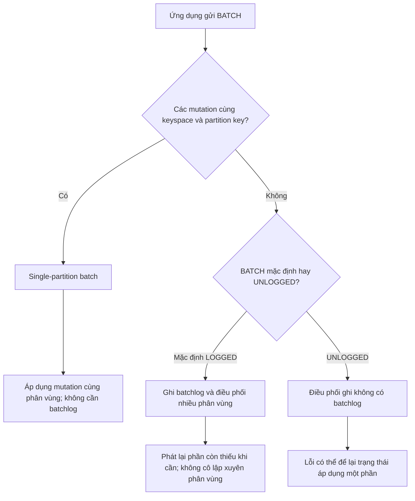

# BATCH nhiều bảng cùng khóa và điều kiện bảo đảm

Trong Apache Cassandra, một `BATCH` gom nhiều lệnh `INSERT`, `UPDATE`, `DELETE` vào một yêu cầu ghi. Trường hợp đáng chú ý là **ghi vào nhiều bảng trong cùng keyspace, với cùng giá trị khóa phân vùng**. Cassandra có thể xử lý trường hợp này như một *single-partition batch*, dù các câu lệnh cập nhật những bảng khác nhau. Điều đó ảnh hưởng trực tiếp đến tính nguyên tử, tính cô lập, độ trễ và nhu cầu sử dụng batchlog.

Bài học thuộc chương **BATCH và counter**, trong phạm vi tìm hiểu cơ sở dữ liệu wide-column Apache Cassandra: thiết kế bảng theo truy vấn, phân vùng dữ liệu, replication, consistency level và cách gọi CQL từ Java.

## 1. Tình huống: một thay đổi nghiệp vụ, hai bảng phục vụ hai truy vấn

Giả sử ứng dụng quản lý khách hàng có hai kiểu truy vấn:

- Lấy hồ sơ theo `customer_id`.
- Liệt kê thiết bị của khách hàng theo `customer_id`, sắp xếp bằng `device_id`.

Theo cách thiết kế **table per query** của Cassandra, ứng dụng lưu hai bảng cùng keyspace `demo`:

```sql
-- Giả định keyspace demo đã tồn tại và có cấu hình replication phù hợp.
CREATE TABLE demo.customer_profile_by_id (
    customer_id uuid PRIMARY KEY,
    display_name text,
    modified_at timestamp
);

CREATE TABLE demo.customer_devices_by_id (
    customer_id uuid,
    device_id text,
    active boolean,
    modified_at timestamp,
    PRIMARY KEY ((customer_id), device_id)
);
```

Với `customer_id = 11111111-1111-4111-8111-111111111111`, cả hai bảng dùng **cùng keyspace và cùng khóa phân vùng dạng `uuid`**. `device_id` là *clustering column*, không thuộc partition key. Do đó, cập nhật hồ sơ và một thiết bị của khách hàng trên có thể nằm trong một batch đơn phân vùng:

```sql
BEGIN BATCH
    UPDATE demo.customer_profile_by_id
    SET display_name = 'Mai',
        modified_at = '2026-11-21T03:00:00Z'
    WHERE customer_id = 11111111-1111-4111-8111-111111111111;

    INSERT INTO demo.customer_devices_by_id
        (customer_id, device_id, active, modified_at)
    VALUES
        (11111111-1111-4111-8111-111111111111,
         'android-01', true, '2026-11-21T03:00:00Z');
APPLY BATCH;
```

`BEGIN BATCH` mặc định là **logged batch** theo cú pháp CQL; không có nhu cầu viết `BEGIN LOGGED BATCH`. Với batch đơn phân vùng, Cassandra tối ưu bỏ thao tác ghi *batchlog*, kể cả khi người gọi dùng hình thức logged mặc định.

> **Điểm then chốt:** Hai bảng khác nhau **không tự động** đồng nghĩa hai phân vùng khác nhau trong ngữ cảnh tối ưu BATCH của Cassandra. Tài liệu Apache Cassandra mô tả rõ: hai bảng cùng keyspace và cùng partition key được xem là *single-partition batch*; mỗi bảng vẫn có mutation riêng. Không nên đánh đồng khái niệm này với việc hai bảng trở thành một bảng vật lý hoặc có thể `JOIN` dữ liệu.

## 2. Điều kiện nào thực sự tạo thành single-partition batch?

Xét **tất cả** các mutation trong batch, thay vì chỉ nhìn hai câu lệnh mẫu. Để nhận lợi ích của single-partition batch nhiều bảng, cần kiểm tra:

1. **Cùng keyspace:** Ví dụ cả hai bảng đều là `demo.*`. Hai keyspace có thể có cấu hình replication khác nhau, nên cùng tên khóa không đủ để suy ra cùng nhóm mutation.
2. **Cùng giá trị partition key sau mã hóa:** Không chỉ trông giống nhau khi in ra màn hình. Kiểu dữ liệu, số lượng thành phần và thứ tự trong khóa phân vùng ghép phải tương thích, và các giá trị phải biểu diễn cùng khóa. Ví dụ `uuid` với `uuid` giống nhau là trường hợp rõ ràng; `text '123'` không thể coi đương nhiên trùng với `int 123`.
3. **Không có câu lệnh chạm tới partition key khác:** Chỉ cần thêm một `customer_id` khác hoặc một bảng được phân vùng theo `email`/`device_id` thì batch có thể trở thành *multi-partition batch*.
4. **Các câu lệnh thuộc loại CQL BATCH hỗ trợ:** Chỉ nhóm các thao tác ghi `INSERT`, `UPDATE`, `DELETE`. Không dùng `SELECT` để đọc trạng thái trung gian trong batch; các ràng buộc `IF`/LWT có quy tắc riêng, trình bày ở phần sau.

Sự khác nhau giữa *partition key* và *primary key* rất quan trọng. Trong bảng `customer_devices_by_id`, khóa chính là `(customer_id, device_id)` nhưng partition key **chỉ** là `customer_id`. Ghi hai `device_id` khác nhau của cùng khách hàng vẫn thuộc cùng một phân vùng.

| Các lệnh trong cùng BATCH | Phân loại cần xét | Lý do |
| --- | --- | --- |
| `demo.profile_by_id` và `demo.devices_by_id` có cùng `customer_id uuid` | Single-partition | Cùng keyspace, cùng giá trị partition key |
| Hai dòng `devices_by_id` có `device_id` khác nhau nhưng cùng `customer_id` | Single-partition | `device_id` chỉ là clustering key |
| Hai dòng `devices_by_id` có `customer_id` khác nhau | Multi-partition | Hai partition key khác nhau |
| `customer_by_id` phân vùng theo `customer_id` và `customer_by_email` phân vùng theo `email` | Multi-partition | Hai định danh phân vùng khác nhau |
| Hai bảng thuộc hai keyspace khác nhau | Không coi là trường hợp đơn phân vùng nêu trên | Khác phạm vi keyspace/replication |

Khi thiết kế, hãy lấy **khóa phân vùng thực tế trong DDL** làm căn cứ. Việc hai bản ghi có cùng một cột thông thường tên `customer_id` không có ý nghĩa nếu cột đó không phải partition key ở cả hai bảng.

## 3. BATCH bảo đảm điều gì và không bảo đảm điều gì?

### 3.1. Atomicity và isolation trong phạm vi đơn phân vùng

Theo mô hình BATCH truyền thống của Cassandra:

- **Atomicity (nguyên tử) của cập nhật cùng phân vùng:** Các cập nhật thuộc một batch trên cùng partition key được xử lý như nhóm cập nhật nguyên tử ở phạm vi phân vùng; không phải một loạt SQL transaction độc lập.
- **Isolation (cô lập) trong phạm vi phân vùng:** Các cập nhật thuộc cùng partition key trong BATCH được cô lập với các cập nhật/đọc phân vùng theo cơ chế Cassandra hỗ trợ.
- **Tối ưu không dùng batchlog:** Với single-partition batch, Cassandra không cần chi phí batchlog vốn phục vụ các batch qua nhiều phân vùng.

Với **hai bảng cùng keyspace và cùng partition key**, tài liệu Cassandra phân loại đây là single-partition batch. Tuy nhiên, cách ứng dụng quan sát dữ liệu còn phụ thuộc consistency level, replica được chọn, thời điểm đọc và các ghi cạnh tranh. Hai câu `SELECT` riêng biệt từ hai bảng **không tạo ra một snapshot xuyên bảng tại cùng thời điểm**. Không diễn giải tính cô lập của mutation thành khả năng chạy một chuỗi nhiều truy vấn đọc như một transaction SQL.

### 3.2. Nếu batch trải qua nhiều partition key

`LOGGED BATCH` sử dụng **batchlog** để hỗ trợ hoàn tất các mutation của batch khi coordinator gặp lỗi. Tính chất này thường được diễn giải là *atomic eventual completion*: hệ thống cố gắng bảo đảm các phần của batch cuối cùng đều được áp dụng, hoặc không phần nào được áp dụng khi batch không bắt đầu thành công. **Không có isolation xuyên nhiều phân vùng**: trong khoảng chuyển tiếp, ứng dụng có thể quan sát một bảng hoặc phân vùng đã được cập nhật, trong khi nơi khác chưa cập nhật.

`UNLOGGED BATCH` không có cơ chế batchlog bảo vệ trường hợp ghi tới nhiều phân vùng. Nếu lỗi giữa chừng, một số mutation có thể thành công và số khác thất bại. Dùng `UNLOGGED` cho nhiều khóa khác nhau chỉ để giảm số round trip có thể gây áp lực coordinator và không giải quyết được vấn đề bảo đảm dữ liệu.

| Tiêu chí | Single-partition BATCH | Multi-partition `LOGGED BATCH` | Multi-partition `UNLOGGED BATCH` |
| --- | --- | --- | --- |
| Phạm vi | Một partition key trong cùng keyspace; có thể nhiều bảng | Nhiều partition key | Nhiều partition key |
| Batchlog | Được tối ưu bỏ | Có, để hỗ trợ hoàn tất batch sau lỗi | Không |
| Atomicity | Trong phạm vi đơn phân vùng | Bảo đảm hoàn tất về sau nhờ batchlog, không phải commit hiển thị đồng thời | Có thể áp dụng một phần sau lỗi |
| Isolation | Trong phạm vi cập nhật đơn phân vùng | Không bảo đảm xuyên phân vùng | Không bảo đảm xuyên phân vùng |
| Cách sử dụng | Nhóm nhỏ các ghi liên quan cùng khóa | Chỉ khi thực sự cần gắn các ghi khác phân vùng | Tránh dùng để kỳ vọng atomicity |

### 3.3. Consistency level không thay thế atomicity

`ONE`, `LOCAL_QUORUM`, `QUORUM`… quyết định số replica cần phản hồi cho thao tác đọc/ghi, tùy topology và replication factor. Chẳng hạn trong một datacenter có `RF=3`, `LOCAL_QUORUM` yêu cầu phản hồi từ đa số replica tại datacenter đó. Consistency level không làm hai partition key khác nhau trở thành một đơn vị cô lập, và cũng không tạo snapshot chung cho hai `SELECT`.

Với ghi và đọc ở quorum trong điều kiện phù hợp, khả năng đọc thấy cập nhật mới được cải thiện nhờ tập replica đọc/ghi giao nhau. Tuy nhiên, lỗi mạng, ghi đồng thời, timestamp xung đột, replica chưa hội tụ hoặc timeout vẫn cần được xử lý theo ngữ nghĩa Cassandra; không suy từ `QUORUM` ra giao dịch ACID đầy đủ.

## 4. Những giới hạn thường bị hiểu nhầm

**BATCH không phải transaction SQL.** BATCH không hỗ trợ `SELECT` rồi ra quyết định trong cùng một giao dịch; không thay thế khóa ngoại, ràng buộc liên bảng, rollback tùy ý hay đọc snapshot nhiều bảng. Đặc biệt, `BEGIN BATCH` không tạo ra một thứ tự thực thi được bảo đảm cho các thao tác xung đột trên cùng một ô dữ liệu.

**Các statement trong BATCH thường dùng cùng write timestamp** nếu không chỉ định khác. Cassandra phân giải xung đột theo timestamp; do vậy không viết hai `UPDATE` cùng một cột và kỳ vọng lệnh xuất hiện cuối cùng trong văn bản sẽ thắng. Hãy gộp thay đổi cho một cột thành một cập nhật rõ ràng, hoặc quản lý timestamp khi có yêu cầu cụ thể và hiểu rõ hệ quả của last-write-wins.

**Conditional batch (`IF`, LWT) bị giới hạn chặt hơn BATCH thông thường.** Với CQL/Paxos truyền thống, các câu lệnh có điều kiện trong cùng batch phải thuộc một partition **và một bảng**. Việc hai bảng có cùng `customer_id` không đồng nghĩa có thể thực hiện một phép `IF` nguyên tử xuyên hai bảng. Nếu cần kiểm tra điều kiện kinh doanh liên bảng, thiết kế lại aggregate/data model hoặc sử dụng cơ chế giao dịch phù hợp với phiên bản và hệ thống đang chạy.

**Counter là loại batch riêng.** `BEGIN COUNTER BATCH` dùng cho cập nhật counter; không trộn counter update với các cập nhật thường. Việc tăng counter không idempotent như gán một giá trị cố định, nên retry sau timeout cần thận trọng. Ví dụ của bài này là batch ghi thường, không phải counter batch.

**Không dùng BATCH như công cụ bulk loading.** BATCH quá lớn, ngay cả đơn phân vùng, có thể tăng độ trễ, bộ nhớ và kích thước partition; batch qua nhiều phân vùng còn làm coordinator phải điều phối nhiều replica. Với dữ liệu độc lập, ứng dụng thường nên dùng nhiều request bất đồng bộ có giới hạn concurrency thay vì một BATCH khổng lồ.

## 5. Đọc sơ đồ đường đi của một batch



Sơ đồ mô tả quyết định theo phạm vi mutation, không phải thứ tự chi tiết của commit log, memtable hay trao đổi giữa tất cả replica. Đường đi thực tế còn chịu ảnh hưởng của topology, phiên bản và loại lệnh.

## 6. Kết nối từ ứng dụng Java

Với **DataStax/Apache Cassandra Java Driver 4.x**, sử dụng prepared statement và `BatchStatement` để tái sử dụng câu lệnh, bind đúng kiểu và giới hạn nội dung batch. Ví dụ dưới đây giả định `CqlSession session` đã được cấu hình, hai bảng đã tồn tại và giá trị `customerId` giống nhau cho cả hai mutation:

```java
import com.datastax.oss.driver.api.core.CqlSession;
import com.datastax.oss.driver.api.core.cql.BatchStatement;
import com.datastax.oss.driver.api.core.cql.DefaultBatchType;
import com.datastax.oss.driver.api.core.cql.PreparedStatement;
import com.datastax.oss.driver.api.core.DefaultConsistencyLevel;
import java.time.Instant;
import java.util.UUID;

public void updateCustomerAndDevice(CqlSession session, UUID customerId) {
    PreparedStatement profileStmt = session.prepare(
        "UPDATE demo.customer_profile_by_id " +
        "SET display_name = ?, modified_at = ? WHERE customer_id = ?");

    PreparedStatement deviceStmt = session.prepare(
        "INSERT INTO demo.customer_devices_by_id " +
        "(customer_id, device_id, active, modified_at) " +
        "VALUES (?, ?, ?, ?)");

    // Trong thực tế, truyền thời điểm nghiệp vụ từ tầng gọi và giữ cố định khi retry.
    Instant modifiedAt = Instant.parse("2026-11-21T03:00:00Z");

    BatchStatement batch = BatchStatement.builder(DefaultBatchType.LOGGED)
        .addStatement(profileStmt.bind("Mai", modifiedAt, customerId))
        .addStatement(deviceStmt.bind(customerId, "android-01", true, modifiedAt))
        .setConsistencyLevel(DefaultConsistencyLevel.LOCAL_QUORUM)
        .build();

    session.execute(batch);
}
```

`DefaultBatchType.LOGGED` là hình thức mặc định tương đương `BEGIN BATCH`; với đúng một partition key Cassandra tự chọn tối ưu không cần batchlog. `LOCAL_QUORUM` chỉ là ví dụ: phải tương thích số replica và datacenter của môi trường thật. Trong ứng dụng lâu dài, hãy chuẩn bị `PreparedStatement` một lần, tái sử dụng giữa các lời gọi, thay vì `prepare` mỗi lần như ví dụ minh họa.

Khi nhận `WriteTimeoutException`/lỗi kết nối, **không được kết luận batch chắc chắn thất bại**. Server có thể đã thực hiện một phần hoặc toàn bộ thao tác nhưng phản hồi không về tới client. Với ví dụ gán giá trị cố định cho cột thường, retry thường có thể thiết kế theo hướng idempotent nếu giữ nguyên dữ liệu/timestamp và không có ghi cạnh tranh. Với counter, sinh UUID mới, thao tác trên list hoặc ghi phụ tạo hiệu ứng bên ngoài, cần một chiến lược xử lý khác. Khi nghiệp vụ đòi hỏi xác nhận chắc chắn, kiểm tra trạng thái theo khóa định danh và đối soát thay vì retry mù quáng.

## 7. Trường hợp phản ví dụ: hai bảng cùng khách hàng nhưng khác partition key

Giả sử ứng dụng còn có bảng tìm khách hàng theo email:

```sql
CREATE TABLE demo.customer_by_email (
    email text PRIMARY KEY,
    customer_id uuid,
    display_name text
);

BEGIN BATCH
    UPDATE demo.customer_profile_by_id
    SET display_name = 'Mai'
    WHERE customer_id = 11111111-1111-4111-8111-111111111111;

    INSERT INTO demo.customer_by_email (email, customer_id, display_name)
    VALUES ('mai@example.com',
            11111111-1111-4111-8111-111111111111, 'Mai');
APPLY BATCH;
```

Ở đây `customer_profile_by_id` phân vùng theo UUID; `customer_by_email` phân vùng theo chuỗi email. Dù dữ liệu cùng nói về một khách hàng và cùng chứa `customer_id`, đây là **multi-partition logged batch**. Coordinator cần cơ chế batchlog để hỗ trợ hoàn tất hai ghi; một truy vấn tới bảng theo email có thể thấy dữ liệu ở thời điểm khác truy vấn tới bảng theo ID. Nếu cần cập nhật nhiều bảng phục vụ nhiều mẫu truy vấn, hãy đánh giá chi phí và nhu cầu đồng bộ về sau, thay vì cho rằng BATCH sẽ biến chúng thành một SQL transaction.

## 8. Checklist thiết kế và xử lý sự cố

Trước khi đưa BATCH nhiều bảng vào production, có thể kiểm tra theo thứ tự:

1. **Xác định mục tiêu:** các ghi có thật sự là một thay đổi nghiệp vụ cần cùng nhóm hay chỉ là các thao tác tải dữ liệu không liên quan?
2. **Mở DDL và đối chiếu:** cùng keyspace; cùng partition-key columns, kiểu dữ liệu, thứ tự và giá trị; clustering key không được nhầm với partition key.
3. **Phân loại:** một partition key thì dùng single-partition batch; nhiều partition key thì chỉ dùng logged batch khi cần bảo đảm hoàn tất về sau, cân nhắc mô hình dữ liệu khác.
4. **Xem consistency và replication:** chọn mức ghi/đọc phù hợp với các datacenter; kiểm tra replica có hội tụ sau sự cố, không kỳ vọng SELECT xuyên bảng là snapshot.
5. **Giữ batch nhỏ:** tránh batch size lớn, partition nóng hoặc quá rộng, theo dõi latency, timeout, cảnh báo batch kích thước lớn và tài nguyên coordinator.
6. **Kiểm tra retry:** log mã thao tác/nghiệp vụ, giữ input ổn định cho các ghi idempotent, đọc đối soát sau kết quả không xác định; cân nhắc concurrent writers và timestamp.
7. **Thử lỗi thực tế:** mô phỏng timeout hoặc coordinator mất kết nối trong môi trường thử nghiệm, đọc lại từng bảng ở consistency level dự kiến và kiểm tra trường hợp cập nhật theo thời gian.

### Câu hỏi tự kiểm tra

**1.** `orders_by_customer` và `settings_by_customer` cùng keyspace, partition key `customer_id uuid`, cùng một giá trị UUID, clustering key khác nhau. Batch này có thể là single-partition không? **Có**, nếu toàn bộ mutation trong batch cùng partition key và không chứa ghi đến khóa khác.

**2.** Hai bảng có cùng cột `customer_id` nhưng bảng thứ hai phân vùng theo `email`. Có phải single-partition không? **Không**. Cột xuất hiện trong dữ liệu không quyết định phạm vi phân vùng; phải nhìn `PRIMARY KEY`.

**3.** BATCH mặc định ghi vào hai partition key có bảo đảm người đọc không bao giờ thấy trạng thái một bên cũ, một bên mới? **Không**. Batchlog giúp hoàn tất về sau; nó không cung cấp isolation xuyên phân vùng.

**4.** BATCH cùng partition key nhưng hai bảng khác nhau có thể dùng `IF` trên cả hai bảng để tạo transaction có điều kiện không? **Không** theo giới hạn conditional batch của CQL/Paxos truyền thống: các lệnh có điều kiện phải thuộc cùng phân vùng **và cùng bảng**.

**5.** Sau timeout, client có được coi tất cả mutation đã bị rollback không? **Không**. Kết quả có thể chưa xác định; cần retry có kiểm soát hoặc đối soát theo logic nghiệp vụ.

## Tài liệu tham khảo

- [Apache Cassandra — CQL Data Manipulation: BATCH, UNLOGGED, COUNTER](https://cassandra.apache.org/doc/stable/cassandra/developing/cql/dml.html).
- [Apache Cassandra 5.0 — Good use of BATCH statement](https://cassandra.staged.apache.org/doc/stable/cassandra/developing/cql/batch/batch-good-example.html), đặc biệt ghi chú về hai bảng cùng keyspace và partition key.

**Ghi nhớ:** Khi nói “BATCH nhiều bảng cùng khóa”, điều kiện quyết định là **cùng keyspace và cùng partition key thực tế của tất cả mutation**. Đó là tình huống thích hợp để khai thác single-partition BATCH của Cassandra; các trường hợp nhiều khóa khác nhau cần nhìn theo bảo đảm hoàn tất của logged batch và giới hạn cô lập khi đọc.
