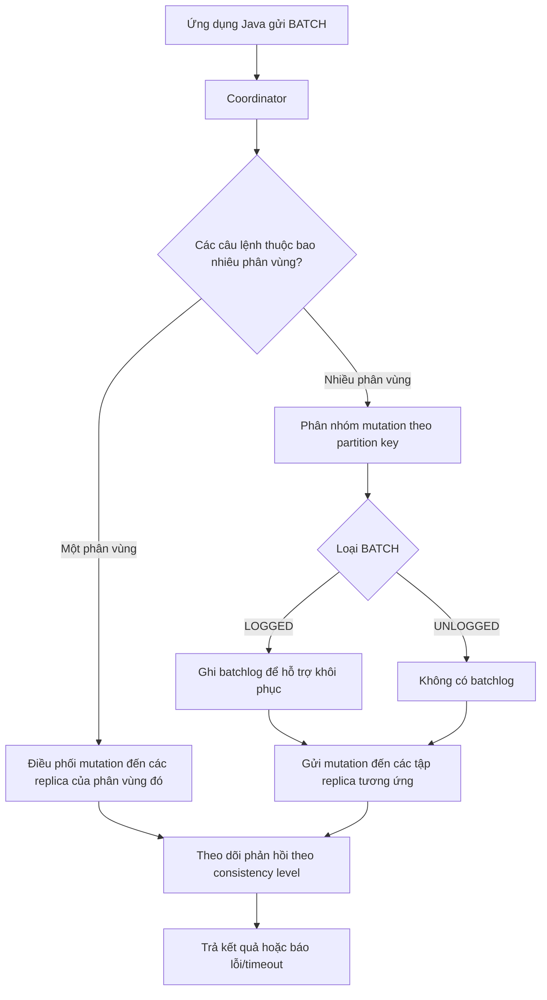
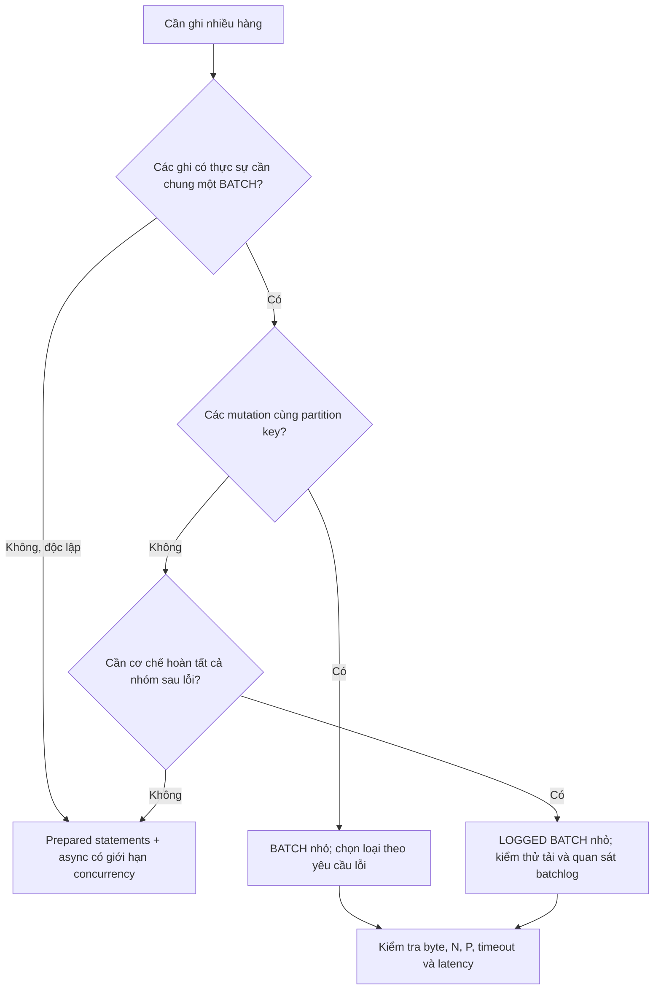

# Kích thước BATCH, số phân vùng và tải lên coordinator

Trong Apache Cassandra, `BATCH` là cách gửi một nhóm câu lệnh ghi CQL cùng nhau. Nó hữu ích khi một thao tác nghiệp vụ cần cập nhật nhiều hàng có liên quan, nhưng **không phải công cụ tăng tốc nạp dữ liệu hàng loạt**. Hiệu quả của BATCH phụ thuộc mạnh vào **dung lượng dữ liệu**, **số partition key khác nhau** và **công việc mà coordinator phải thực hiện**.

Đây là nội dung thuộc chương **BATCH và counter** trong mô-đun `DATABASE_ENGINE_WIDE_COLUMN_CASSANDRA`: hiểu kiến trúc phân tán, thiết kế bảng theo truy vấn, mức nhất quán đọc/ghi và cách kết nối Cassandra từ Java. Đặc biệt, phải tách bạch *một BATCH gồm nhiều câu lệnh* với *một BATCH chạm nhiều phân vùng*; hai trường hợp có chi phí khác nhau.

## 1. Ba đại lượng cần đo riêng

Giả sử ứng dụng gửi một BATCH chứa `N` câu lệnh `INSERT` hoặc `UPDATE`:

| Đại lượng | Ý nghĩa | Tác động điển hình |
| --- | --- | --- |
| **Số câu lệnh (`N`)** | Tổng số mutation/câu lệnh ghi trong BATCH | Tăng công phân tích, kiểm tra và xử lý ở coordinator; không đủ để kết luận BATCH có đắt hay không |
| **Kích thước BATCH (byte/KiB)** | Lượng dữ liệu mutation mà Cassandra phải mang theo và xử lý; phụ thuộc cả kích thước giá trị cột | Tăng lưu lượng mạng, bộ nhớ tạm, áp lực ghi và thời gian xử lý; có thể kích hoạt cảnh báo hoặc từ chối BATCH quá lớn |
| **Số phân vùng khác nhau (`P`)** | Số **giá trị partition key phân biệt** mà các câu lệnh ghi vào | Làm coordinator phải điều phối đến nhiều tập replica; logged BATCH qua nhiều phân vùng còn phát sinh công việc batchlog |

**Partition key không phải node.** Một phân vùng có thể có nhiều replica do replication factor; nhiều phân vùng có thể cùng nằm trên một node. Vì vậy `P = 20` không có nghĩa là 20 node, nhưng thường làm tăng số đích gửi và số kết quả phải tổng hợp.

Ví dụ, bảng có khóa chính `PRIMARY KEY ((tenant_id, event_date), event_id)` thì:

- Hai bản ghi có cùng `tenant_id` **và** `event_date`, dù khác `event_id`, thuộc **cùng một phân vùng**.
- Hai bản ghi có cùng `tenant_id` nhưng khác `event_date` thuộc **hai phân vùng**.
- Số câu lệnh lớn không nhất thiết đồng nghĩa với nhiều phân vùng; ngược lại, 10 câu lệnh có thể chạm đến 10 phân vùng.

Không có một giới hạn số câu lệnh duy nhất phù hợp mọi hệ thống. Cần đánh giá đồng thời `N`, dung lượng dữ liệu, `P`, replication factor, consistency level, tốc độ ghi và tải thực tế của cụm.

## 2. Vì sao số phân vùng quyết định chi phí điều phối?

Mỗi yêu cầu ghi có một **coordinator**: node tiếp nhận yêu cầu từ driver, xác định replica cho partition key, gửi mutation và theo dõi phản hồi theo consistency level. BATCH không loại bỏ các bước này.



Với một phân vùng, coordinator có thể gom các thay đổi theo cùng khóa phân vùng và đường đi replica. Với nhiều phân vùng, nó phải định tuyến và theo dõi nhiều nhóm ghi. Ngay cả khi tất cả mutation thuộc một request mạng từ client, phía server vẫn có nhiều công việc.

Ở **logged batch** trải nhiều phân vùng, Cassandra còn ghi thông tin BATCH vào **batchlog** (được sao chép để phục vụ khôi phục) trước khi phân phối các mutation, rồi dọn bản ghi batchlog sau khi hoàn tất. Nếu coordinator gặp sự cố giữa chừng, cơ chế replay có thể tiếp tục phát các mutation còn thiếu. Đây là chi phí bổ sung cho mục tiêu khôi phục, không phải tối ưu thông lượng ghi.

Ở **unlogged batch**, Cassandra bỏ bước batchlog, nhưng coordinator vẫn phải gửi mutation cho các phân vùng. Bởi vậy `BEGIN UNLOGGED BATCH` **không biến BATCH xuyên nhiều phân vùng thành thao tác ghi rẻ**.

Khi `P` và dung lượng cùng tăng, một request có thể làm tăng đồng thời:

1. Bộ nhớ tạm giữ và xử lý mutation trên coordinator.
2. Số thông điệp đến các replica và số phản hồi cần tổng hợp.
3. Thời gian chiếm dụng tài nguyên, độ trễ cuối đuôi (*tail latency*) và khả năng timeout khi cụm đang bận.
4. Áp lực ghi trên replica; về sau dữ liệu còn đi qua các hoạt động như flush/compaction. Compaction **không được loại bỏ** chỉ vì nhiều câu lệnh nằm trong một BATCH.

Đó là lý do một BATCH có ít câu lệnh nhưng mỗi giá trị rất lớn vẫn rủi ro, và một BATCH nhỏ về byte nhưng tản ra nhiều partition key vẫn có thể gây tải điều phối cao.

## 3. LOGGED, UNLOGGED và COUNTER BATCH: chọn theo ngữ nghĩa

| Loại | Mục đích phù hợp | Hệ quả khi ghi nhiều phân vùng |
| --- | --- | --- |
| `BEGIN BATCH` / `BEGIN LOGGED BATCH` | Cần tính **atomic eventual completion** của nhóm mutation thông thường: nếu được chấp nhận để xử lý, Cassandra có cơ chế batchlog để phát lại khi gặp lỗi | Thêm bước batchlog, tăng I/O, mạng và độ trễ; không cung cấp rollback kiểu cơ sở dữ liệu quan hệ |
| `BEGIN UNLOGGED BATCH` | Nhóm các ghi khi chấp nhận việc chúng có thể hoàn thành một phần nếu lỗi; thường hợp lý hơn cho các ghi **cùng phân vùng** | Không có batchlog; vẫn chịu chi phí fan-out đến nhiều replica và có nguy cơ chỉ một phần mutation thành công |
| `BEGIN COUNTER BATCH` | Nhóm các cập nhật cột `counter` theo quy tắc riêng của Cassandra | Counter có cơ chế và giới hạn riêng; không được trộn cập nhật counter với mutation thông thường trong cùng BATCH |

**Atomic không đồng nghĩa với isolated hay transactional rollback.** Logged BATCH hỗ trợ việc các mutation cuối cùng được áp dụng sau một số loại sự cố; nó không hứa mọi reader ở nhiều phân vùng sẽ luôn quan sát một ảnh chụp chung tại cùng thời điểm. Không dựa vào BATCH xuyên phân vùng để thực hiện giao dịch ACID nhiều bảng như trong RDBMS. Với các thay đổi trong cùng phân vùng, Cassandra có các đảm bảo cô lập ở phạm vi phân vùng; vẫn cần thiết kế đọc và consistency level phù hợp.

Một trường hợp thực tế đáng dùng logged BATCH xuyên phân vùng là khi ứng dụng cố ý ghi cùng một sự kiện vào hai bảng phục vụ hai truy vấn và **cần cơ chế phát lại** nếu đang ghi thì một node gặp lỗi. Khi mục tiêu chỉ là tăng tốc ingest 10.000 sự kiện độc lập, logged BATCH lớn thường là lựa chọn kém.

> Lưu ý về timeout: client nhận timeout không khẳng định toàn bộ mutation đã thất bại. Một số replica có thể đã ghi thành công. Phải thiết kế retry theo tính idempotent; thao tác tăng `counter` không nên retry mù vì có thể làm tăng số đếm ngoài ý muốn.

## 4. Minh họa: cùng 12 câu lệnh nhưng tải rất khác

Giả sử các `INSERT` đều có payload xấp xỉ 1 KiB; dưới đây là ví dụ *định tính*, không phải benchmark:

| Kịch bản | `N` | `P` | Dung lượng ước tính | Nhận định |
| --- | ---: | ---: | ---: | --- |
| A: 12 sự kiện của một tenant trong một ngày | 12 | 1 | ~12 KiB | Cùng đường định tuyến phân vùng; vẫn cần kiểm tra ngưỡng kích thước và độ lớn phân vùng |
| B: 12 ngày hoặc tenant khác nhau | 12 | 12 | ~12 KiB | Fan-out đến nhiều tập replica; logged batch thêm batchlog, unlogged batch không bảo đảm hoàn thành cả nhóm khi lỗi |
| C: 12 sự kiện cùng phân vùng, mỗi payload 100 KiB | 12 | 1 | ~1,2 MiB | Dù chỉ một phân vùng, kích thước quá lớn có thể bị server từ chối và làm nặng request |

**Kết luận thực hành:** Không dùng tiêu chí “dưới X câu lệnh thì an toàn” mà bỏ qua số partition key hoặc số byte. Ngưỡng tối ưu là đặc thù workload, nên xác nhận bằng kiểm thử tải với phân bố khóa và kích thước payload thật.

## 5. Ví dụ CQL: thiết kế bảng và nhận diện phân vùng

Giả sử ứng dụng lưu sự kiện để truy vấn theo khách hàng và ngày:

```sql
CREATE TABLE events_by_tenant_day (
    tenant_id uuid,
    event_date date,
    event_id timeuuid,
    event_type text,
    details text,
    PRIMARY KEY ((tenant_id, event_date), event_id)
) WITH CLUSTERING ORDER BY (event_id DESC);
```

**BATCH cùng phân vùng**: `tenant_id` và `event_date` của hai câu lệnh giống nhau. Ví dụ dưới dùng `UNLOGGED` vì hai ghi chỉ minh họa cách nhóm dữ liệu thuộc cùng một partition key; việc chọn logged/unlogged trong hệ thống thật còn tùy yêu cầu lỗi của nghiệp vụ.

```sql
BEGIN UNLOGGED BATCH
  INSERT INTO events_by_tenant_day
    (tenant_id, event_date, event_id, event_type, details)
  VALUES
    (11111111-1111-1111-1111-111111111111,
     '2026-11-21', now(), 'view', 'Trang chu');

  INSERT INTO events_by_tenant_day
    (tenant_id, event_date, event_id, event_type, details)
  VALUES
    (11111111-1111-1111-1111-111111111111,
     '2026-11-21', now(), 'click', 'Nut tim kiem');
APPLY BATCH;
```

**BATCH xuyên phân vùng**: chỉ cần đổi `event_date` ở câu lệnh thứ hai thành `'2026-11-22'`, `P` tăng từ 1 lên 2 dù `N` và kích thước payload gần như không đổi. Nếu hai bản ghi độc lập, tốt hơn là gửi hai lệnh ghi riêng và điều khiển concurrency ở client. Nếu chúng thật sự phải có cơ chế hoàn tất cả nhóm sau sự cố, cân nhắc logged BATCH nhỏ và chấp nhận chi phí batchlog.

```sql
-- Hai câu lệnh độc lập, không cần bọc trong BATCH xuyên phân vùng:
INSERT INTO events_by_tenant_day
  (tenant_id, event_date, event_id, event_type, details)
VALUES (11111111-1111-1111-1111-111111111111,
        '2026-11-21', now(), 'view', 'Ngay thu nhat');

INSERT INTO events_by_tenant_day
  (tenant_id, event_date, event_id, event_type, details)
VALUES (11111111-1111-1111-1111-111111111111,
        '2026-11-22', now(), 'view', 'Ngay thu hai');
```

Thêm `USING CONSISTENCY` trong mỗi mutation không phải cách để biến BATCH thành một transaction. Trong ứng dụng, chọn consistency level cho request phù hợp replication và yêu cầu đọc/ghi; ví dụ `LOCAL_QUORUM` khi cần số replica xác nhận trong datacenter cục bộ. Consistency level thay đổi điều kiện xác nhận, **không loại bỏ** chi phí của BATCH lớn.

## 6. Từ Java: gộp theo partition key, giữ BATCH nhỏ

Ví dụ sử dụng DataStax Java Driver 4.x và prepared statement. Hai mutation trong cùng BATCH có chung cặp `(tenant_id, event_date)`:

```java
import com.datastax.oss.driver.api.core.CqlSession;
import com.datastax.oss.driver.api.core.cql.BatchStatement;
import com.datastax.oss.driver.api.core.cql.DefaultBatchType;
import com.datastax.oss.driver.api.core.cql.PreparedStatement;
import com.datastax.oss.driver.api.core.DefaultConsistencyLevel;

import java.time.LocalDate;
import java.util.UUID;

void writeTwoEvents(CqlSession session, UUID tenantId,
                    LocalDate day, UUID firstId, UUID secondId) {
    PreparedStatement insert = session.prepare(
        "INSERT INTO events_by_tenant_day " +
        "(tenant_id, event_date, event_id, event_type, details) " +
        "VALUES (?, ?, ?, ?, ?)"
    );

    BatchStatement batch = BatchStatement.builder(DefaultBatchType.UNLOGGED)
        .addStatement(insert.bind(tenantId, day, firstId, "view", "Trang chu"))
        .addStatement(insert.bind(tenantId, day, secondId, "click", "Tim kiem"))
        .setConsistencyLevel(DefaultConsistencyLevel.LOCAL_QUORUM)
        .build();

    session.execute(batch);
}
```

Ở ví dụ này, `event_id` là `timeuuid`: giá trị `firstId` và `secondId` phải là UUID loại version 1 phù hợp với kiểu CQL (ví dụ tạo bằng tiện ích sinh time-based UUID); không dùng UUID ngẫu nhiên version 4 cho cột `timeuuid`. Trong chương trình thật, nên chuẩn bị `PreparedStatement` một lần và tái sử dụng, thay vì `prepare()` cho từng lời gọi như ví dụ tối giản.

Nếu đang ingest hàng triệu sự kiện độc lập, cách làm thông thường là **prepared statement + ghi bất đồng bộ với giới hạn số request đang bay** (*bounded in-flight requests*), để driver phân phối request đến coordinator thích hợp. Không dồn hàng nghìn partition key vào một BATCH để “giảm số lượt gọi mạng”. Khi thật sự cần BATCH, nhóm theo partition key và đặt giới hạn **cả số byte lẫn số câu lệnh**, thử nghiệm kích thước phù hợp; không chia batch tùy tiện nếu sẽ phá vỡ yêu cầu atomic của một thao tác nghiệp vụ.

## 7. Ngưỡng cảnh báo và cách quan sát trong vận hành

Cassandra có các cấu hình liên quan đến batch size, thường gặp trong `cassandra.yaml`:

| Cấu hình | Ý nghĩa vận hành |
| --- | --- |
| `batch_size_warn_threshold_in_kb` | Cảnh báo khi kích thước BATCH vượt ngưỡng cảnh báo |
| `batch_size_fail_threshold_in_kb` | Từ chối BATCH vượt ngưỡng lỗi |
| `unlogged_batch_across_partitions_warn_threshold` | Cảnh báo khi **unlogged BATCH** trải qua quá nhiều partition key |

Tên và giá trị mặc định có thể khác theo bản phát hành/cấu hình triển khai. Hãy kiểm tra bản Cassandra đang chạy, log và cấu hình thực tế; **không xem việc chưa thấy warning là bằng chứng BATCH hiệu quả**. Ngoài ra, kích thước ước lượng của mutation ở server có thể khác độ dài chuỗi CQL hoặc kích thước JSON ở client.

Khi xử lý độ trễ ghi tăng sau khi thêm BATCH, hãy kiểm tra theo trình tự:

1. **Tại client:** ghi nhận `N`, số partition key phân biệt `P`, tổng dung lượng dữ liệu ước lượng, tần suất BATCH, loại BATCH, consistency level, p95/p99 latency và tỷ lệ timeout.
2. **Tại coordinator:** xem log cảnh báo BATCH, CPU, heap/GC, hàng đợi hoặc tác vụ ghi, lượng request và độ trễ; đối chiếu thời điểm tăng tải với số BATCH xuyên phân vùng.
3. **Tại replica:** xem độ trễ và lỗi ghi, áp lực đĩa, memtable/flush/compaction, độ lệch tải giữa node. Các lệnh như `nodetool tpstats` và `nodetool tablestats` có thể bổ trợ, tùy phiên bản.
4. **Nếu dùng logged BATCH:** quan sát thêm hoạt động batchlog và replay khi có lỗi node; đừng nhầm replay với một giao dịch rollback ngay lập tức.
5. **Thử thay đổi có kiểm soát:** so sánh các ghi riêng có giới hạn concurrency, BATCH nhỏ cùng phân vùng và BATCH xuyên phân vùng trên workload đại diện. Đo throughput, p95/p99, timeout và tài nguyên coordinator/replica.

Ví dụ một batch 30 KiB có thể nhận warning trên cụm A nhưng không warning trên cụm B do cấu hình khác nhau. Không nên “chữa” BATCH quá lớn chỉ bằng cách nâng các ngưỡng cấu hình: điều đó chỉ nới cảnh báo/chặn và không giảm công việc của coordinator.

## 8. Những sai lầm thường gặp

| Suy luận sai | Cách hiểu đúng |
| --- | --- |
| “Gộp 1.000 `INSERT` vào một request chắc nhanh hơn 1.000 request.” | Cần xét partition key, kích thước và mức song song. BATCH xuyên nhiều phân vùng có thể làm throughput thấp hơn và tăng latency. |
| “`UNLOGGED` không ghi batchlog nên không có chi phí đáng kể.” | Coordinator vẫn định tuyến, gửi, theo dõi mutation đến nhiều replica. |
| “BATCH nhỏ tính theo số câu lệnh là đủ.” | Một hàng chứa blob hoặc chuỗi lớn có thể làm BATCH lớn theo byte. |
| “`LOGGED BATCH` là transaction ACID xuyên bảng/phân vùng.” | Batchlog phục vụ hoàn tất mutation khi gặp lỗi; không có rollback và snapshot isolation xuyên phân vùng như RDBMS. |
| “Cùng một tenant là cùng phân vùng.” | Phải so **toàn bộ partition key**; ví dụ `(tenant_id, event_date)` khác ngày là khác phân vùng. |
| “Timeout tức là chưa ghi gì, cứ retry là an toàn.” | Trạng thái có thể không xác định; phải xét idempotency và đặc biệt thận trọng với counter. |

## 9. Quy tắc ra quyết định



Checklist trước khi đưa vào production:

- Xác định **chính xác partition key** theo DDL; đếm số key phân biệt trong một BATCH.
- Ước lượng **kích thước mutation thực tế** và đặt giới hạn cho cả số câu lệnh lẫn byte.
- Chỉ dùng logged BATCH xuyên phân vùng khi có **yêu cầu nghiệp vụ rõ ràng** về hoàn tất nhóm sau sự cố.
- Đặt consistency level phù hợp replication và mô hình đọc/ghi; định nghĩa cách xử lý timeout/retry.
- Thử tải với dữ liệu đại diện, theo dõi latency, throughput, coordinator, replica và cảnh báo BATCH.

## 10. Bài tập tự kiểm tra

1. Với khóa chính `PRIMARY KEY ((shop_id, month), order_id)`, một BATCH ghi 80 đơn hàng thuộc cùng cửa hàng nhưng trải bốn tháng có bao nhiêu partition key phân biệt? **Đáp án:** bốn, nếu cả bốn tháng đều có đơn hàng; số lượng 80 không quyết định `P`.
2. Hai BATCH đều có 10 `INSERT`: batch thứ nhất ghi vào một phân vùng với payload 2 MiB, batch thứ hai ghi vào 10 phân vùng với tổng payload 20 KiB. BATCH nào “nhẹ hơn”? **Đáp án:** không thể kết luận bằng một tiêu chí; batch thứ nhất nặng về byte, batch thứ hai nặng về fan-out, và cần kiểm tra ngưỡng/cấu hình cũng như đo tải.
3. Một pipeline import 100.000 bản ghi độc lập bị chậm khi chuyển sang `BEGIN BATCH` lớn. Hãy đề xuất thay đổi. **Gợi ý:** prepared inserts riêng, điều chỉnh giới hạn request bất đồng bộ, đo p99 latency và throughput; chỉ dùng BATCH nhỏ khi có ràng buộc nghiệp vụ hoặc cùng partition key.
4. Ứng dụng gửi `COUNTER BATCH` tăng lượt xem, nhận timeout rồi gửi lại nguyên lệnh. Điều gì có thể sai? **Đáp án:** retry có thể làm tăng counter thêm một lần khi lần đầu đã được áp dụng; cần cơ chế chống đếm trùng theo nghiệp vụ.

**Ghi nhớ:** Trong Cassandra, câu hỏi đầu tiên khi thấy BATCH lớn không phải “bao nhiêu câu lệnh?”, mà là **“BATCH chứa bao nhiêu byte, trải qua bao nhiêu partition key, và coordinator phải điều phối bao nhiêu công việc?”**.
