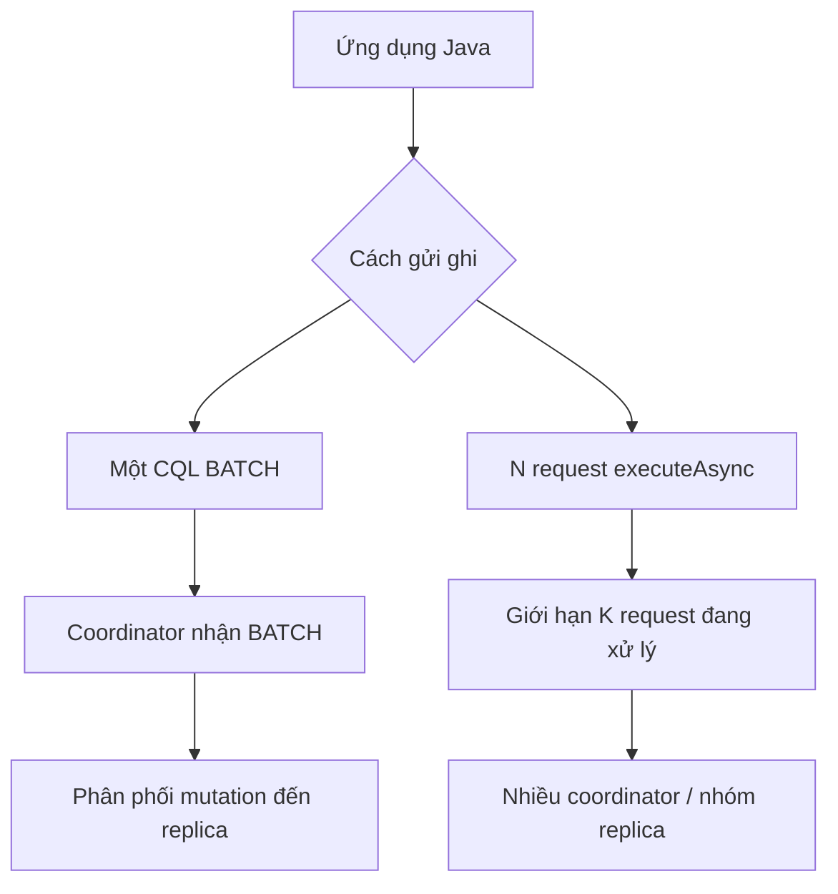

# So sánh BATCH với nhiều yêu cầu bất đồng bộ có giới hạn trong Cassandra

## 1. Vấn đề cần giải quyết

Trong Apache Cassandra, một ứng dụng Java thường cần ghi nhiều bản ghi trong thời gian ngắn: nhập dữ liệu, tiếp nhận sự kiện, cập nhật nhiều bảng phục vụ các truy vấn khác nhau hoặc đồng bộ dữ liệu từ hệ thống khác. Có hai cách triển khai dễ bị nhầm là tương đương:

1. Gom nhiều câu lệnh CQL vào một `BATCH` rồi gửi đến Cassandra.
2. Gửi từng câu lệnh ghi bằng API bất đồng bộ của Java driver, nhưng **giới hạn số yêu cầu đang xử lý đồng thời** (*bounded in-flight requests*).

Hai cách có mục tiêu khác nhau. **BATCH là công cụ xác định cách phối hợp nhiều mutation và, trong một số trường hợp, bảo đảm tính nguyên tử**. **Ghi bất đồng bộ có giới hạn là kỹ thuật điều tiết tải và tăng thông lượng cho các thao tác độc lập**. BATCH không phải phép tối ưu mặc định cho bulk insert; gửi bất đồng bộ không tự tạo ra tính nguyên tử giữa nhiều câu lệnh.

Phạm vi bài học thuộc kiến trúc phân tán và mô hình wide-column của **Apache Cassandra**: mỗi partition có thể nằm trên các replica khác nhau; khóa phân vùng, thiết kế bảng theo truy vấn, mức nhất quán đọc/ghi và chi phí ghi tại các node quyết định lựa chọn kỹ thuật.

## 2. Hiểu đường đi của yêu cầu ghi

Với mỗi câu lệnh `INSERT` hoặc `UPDATE`, client gửi request đến một **coordinator**. Coordinator xác định replica của partition dựa vào partition key, chuyển mutation đến các replica và hoàn tất request theo **write consistency level (CL)**. Các mutation độc lập có thể đi đến nhiều coordinator và nhiều nhóm replica.



Khi dùng một `BATCH` chứa nhiều partition, coordinator phải phân phối các mutation đến nhiều đích. Với nhiều request bất đồng bộ, driver có thể phân phối lưu lượng qua nhiều kết nối/coordinator; ứng dụng chủ động kiểm soát số request đang chờ kết quả. Cả hai vẫn chịu giới hạn tài nguyên của cluster và có thể gây quá tải nếu cấu hình sai.

**Ba khái niệm cần tách biệt:**

- **Atomicity (tính nguyên tử):** nhóm mutation có được bảo đảm cùng được áp dụng cuối cùng hay không, trong phạm vi được Cassandra hỗ trợ.
- **Isolation (tính cô lập):** truy vấn đồng thời có thể thấy trạng thái đã áp dụng một phần hay không.
- **Consistency level:** cần bao nhiêu replica phản hồi để một thao tác đọc/ghi được xác nhận. Ví dụ `LOCAL_QUORUM` là điều kiện xác nhận của từng thao tác, không biến một loạt request độc lập thành giao dịch đa partition.

## 3. BATCH trong Cassandra thực sự làm gì?

### 3.1. BATCH cùng partition

Xét bảng được thiết kế theo truy vấn lấy sự kiện theo tenant và ngày:

```sql
CREATE TABLE events_by_tenant (
    tenant_id   text,
    day         date,
    occurred_at timestamp,
    event_id    uuid,
    payload     text,
    PRIMARY KEY ((tenant_id, day), occurred_at, event_id)
) WITH CLUSTERING ORDER BY (occurred_at DESC, event_id ASC);
```

Partition key là **`(tenant_id, day)`**. Hai câu lệnh sau cùng ghi một partition vì có cùng cặp giá trị khóa phân vùng:

```sql
BEGIN UNLOGGED BATCH
    INSERT INTO events_by_tenant
        (tenant_id, day, occurred_at, event_id, payload)
    VALUES ('shop-a', '2026-11-21', '2026-11-21T09:00:00Z',
            550e8400-e29b-41d4-a716-446655440000, 'order-created');

    INSERT INTO events_by_tenant
        (tenant_id, day, occurred_at, event_id, payload)
    VALUES ('shop-a', '2026-11-21', '2026-11-21T09:00:01Z',
            550e8400-e29b-41d4-a716-446655440001, 'payment-requested');
APPLY BATCH;
```

Cassandra có thể xử lý các mutation cùng partition như một đơn vị cập nhật, với bảo đảm atomicity/isolation ở phạm vi partition. Đây là trường hợp BATCH có ý nghĩa khi **nhiều thay đổi trong một partition phải được nhìn nhận như một nhóm**; nhóm nên nhỏ, giới hạn theo nhu cầu nghiệp vụ. Với một partition, cơ chế tối ưu nội bộ không cần chi phí batchlog phân tán như trường hợp logged batch nhiều partition.

Không được kết luận rằng mọi BATCH đều nhanh hơn nhiều `INSERT` riêng lẻ. Một batch quá lớn vẫn làm tăng kích thước request, áp lực bộ nhớ và độ trễ tại coordinator/replica. Việc gom quá nhiều bản ghi vào cùng partition còn có thể tạo **hot partition**.

### 3.2. Logged BATCH nhiều partition

`BEGIN BATCH` mặc định là **logged batch** đối với các mutation thường. Khi batch trải qua nhiều partition, Cassandra dùng **batchlog** để hỗ trợ hoàn tất các mutation nếu coordinator gặp sự cố sau khi đã nhận batch. Ý nghĩa chính là **atomicity theo kiểu tất cả mutation cuối cùng được thực hiện, nếu hệ thống phục hồi và điều kiện ghi cho phép**, chứ không phải giao dịch có rollback.

```sql
BEGIN BATCH
    INSERT INTO orders_by_id (order_id, customer_id, state)
    VALUES (550e8400-e29b-41d4-a716-446655440010, 'c-1', 'CREATED');

    INSERT INTO orders_by_customer (customer_id, order_id, state)
    VALUES ('c-1', 550e8400-e29b-41d4-a716-446655440010, 'CREATED');
APPLY BATCH;
```

*Ví dụ giả định hai bảng `orders_by_id` và `orders_by_customer` đã được tạo với partition key tương ứng `order_id` và `customer_id`.* Đây là hai bảng phục vụ hai kiểu truy vấn khác nhau; một logged batch nhỏ có thể phù hợp nếu nghiệp vụ cần cơ chế hoàn tất cả hai ghi khi coordinator lỗi.

Tuy nhiên, **logged BATCH nhiều partition không cung cấp isolation tức thời giữa các partition**: trong lúc xử lý hoặc phục hồi, một client khác có thể đọc thấy một bảng đã cập nhật và bảng kia chưa cập nhật. Cassandra cũng không cung cấp rollback toàn batch theo nghĩa RDBMS. Batchlog làm phát sinh thêm I/O và phối hợp giữa các node; vì thế không nên dùng logged batch nhiều partition chỉ để giảm số lần gọi mạng hay tăng tốc nhập dữ liệu.

### 3.3. Unlogged BATCH nhiều partition và counter batch

`BEGIN UNLOGGED BATCH` không có bảo đảm khôi phục toàn nhóm của logged batch khi trải qua nhiều partition. Một số mutation có thể thành công trong khi mutation khác thất bại. Cassandra có thể cảnh báo khi một unlogged batch chạm nhiều partition; các ngưỡng cảnh báo/lỗi về kích thước batch có thể cấu hình và cần kiểm tra theo phiên bản, cấu hình cluster thực tế.

`BEGIN COUNTER BATCH` dành riêng cho counter update, không được trộn mutation counter với mutation thông thường trong cùng batch. **Counter increment không có tính idempotent**: nếu timeout khiến kết quả không rõ rồi tăng lại một cách mù quáng, giá trị có thể bị cộng hai lần. Một counter batch cũng không trở thành giải pháp bulk write an toàn cho các bản ghi bình thường.

## 4. Nhiều request bất đồng bộ có giới hạn

Với các bản ghi độc lập, ứng dụng có thể gửi `INSERT` riêng lẻ bằng `CqlSession.executeAsync(...)`. Vấn đề là phải giới hạn **số request đang chờ hoàn tất**. Nếu vòng lặp gửi hàng trăm nghìn request mà không chờ hoặc giới hạn, request, buffer và callback có thể chất đống ở client hoặc server; throughput có thể giảm và timeout tăng.

**Bounded concurrency** cho phép tối đa `K` request cùng lúc; request mới chỉ được gửi khi có chỗ trống. Nó đem lại backpressure ở tầng ứng dụng và tận dụng tốt hơn khả năng phân tán của Cassandra đối với nhiều partition độc lập.

```text
Danh sách ghi:  A B C D E F G H I J ...
Giới hạn K=3:
Tại t0:        [A] [B] [C]    D E F G H ... đang đợi
Khi B xong:    [A] [D] [C]    E F G H ... đang đợi
Khi A xong:    [E] [D] [C]    F G H ... đang đợi
```

Giới hạn này là **giới hạn đồng thời, không phải giới hạn tốc độ tuyệt đối**: nếu request rất nhanh, số request/giây vẫn có thể cao. Khi cần ràng buộc QPS, hãy bổ sung rate limiting và giám sát. Nên giới hạn theo toàn ứng dụng hoặc từng nhóm client phù hợp, tránh mỗi luồng tự mở một hàng nghìn request độc lập.

### 4.1. Ví dụ Java driver: thực hiện theo từng cửa sổ nhỏ

Ví dụ dùng **DataStax/Apache Cassandra Java Driver 4.x** (API `com.datastax.oss.driver.api.core.*`) và Java 17. Mỗi cửa sổ có tối đa 32 câu lệnh; đợi cửa sổ trước hoàn tất rồi mới gửi cửa sổ tiếp theo. Cách này dễ kiểm chứng giới hạn in-flight và xử lý lỗi. Trong hệ thống cần tận dụng tối đa từng slot, có thể thay bằng hàng đợi bất đồng bộ với sliding window, nhưng vẫn phải giữ cùng nguyên tắc backpressure.

```java
import com.datastax.oss.driver.api.core.CqlSession;
import com.datastax.oss.driver.api.core.cql.BoundStatement;
import com.datastax.oss.driver.api.core.cql.PreparedStatement;

import java.time.Instant;
import java.time.LocalDate;
import java.util.List;
import java.util.UUID;
import java.util.concurrent.CompletableFuture;
import java.util.concurrent.CompletionStage;

public final class BoundedCassandraWrites {
    public record Event(
            String tenantId,
            LocalDate day,
            Instant occurredAt,
            UUID eventId,
            String payload) {}

    public static CompletionStage<Void> insertEvents(
            CqlSession session, List<Event> events, int maxInFlight) {
        if (maxInFlight <= 0) {
            throw new IllegalArgumentException("maxInFlight must be positive");
        }

        PreparedStatement insert = session.prepare(
                "INSERT INTO events_by_tenant " +
                "(tenant_id, day, occurred_at, event_id, payload) " +
                "VALUES (?, ?, ?, ?, ?)");

        CompletableFuture<Void> chain = CompletableFuture.completedFuture(null);

        for (int start = 0; start < events.size(); start += maxInFlight) {
            final int from = start;
            final int to = Math.min(from + maxInFlight, events.size());

            chain = chain.thenCompose(unused -> {
                CompletableFuture<?>[] inFlight =
                        new CompletableFuture<?>[to - from];

                for (int i = from; i < to; i++) {
                    Event event = events.get(i);
                    BoundStatement statement = insert.bind(
                            event.tenantId(),
                            event.day(),
                            event.occurredAt(),
                            event.eventId(),
                            event.payload());

                    inFlight[i - from] = session.executeAsync(statement)
                            .toCompletableFuture();
                }

                return CompletableFuture.allOf(inFlight);
            });
        }

        return chain;
    }
}
```

Ví dụ gọi hàm khi đã có `CqlSession session` và `List<Event> events`:

```java
BoundedCassandraWrites.insertEvents(session, events, 32)
        .toCompletableFuture()
        .join();
```

Trong ví dụ:

- `PreparedStatement` được prepare **một lần**; mỗi phần tử tạo `BoundStatement` riêng.
- Tối đa **32 request** đang chờ trong một cửa sổ, không gửi toàn bộ danh sách cùng lúc. `32` chỉ là con số minh họa, không phải mức mặc định tối ưu cho mọi cluster.
- `CompletableFuture.allOf(...)` chỉ hoàn tất thành công khi toàn bộ request trong cửa sổ thành công. Nếu một request lỗi, cửa sổ vẫn có thể đã ghi thành công **một phần**; các cửa sổ tiếp theo không được gửi sau khi chain thất bại.
- Đây là cách xử lý **theo cửa sổ**: một request nhanh phải đợi các request chậm còn lại trong cùng cửa sổ. Sliding window có thể lấp slot sớm hơn. Với nguồn dữ liệu cực lớn, nên lấy từng lô từ nguồn thay vì nạp tất cả `events` vào RAM.

**Đặc biệt:** callback của driver chạy trên các luồng dùng cho xử lý bất đồng bộ. Không đặt thao tác chặn lâu, gọi `.join()` hoặc công việc CPU nặng trong callback đó. Ví dụ chỉ ghép future; thao tác `.join()` nằm ở phía gọi đồng bộ và chỉ phù hợp ở ranh giới chương trình/worker cho phép chờ, không nên dùng trong event loop.

### 4.2. Bảo vệ hệ thống khi timeout và retry

Lệnh ghi không trả kết quả vì timeout **không có nghĩa là dữ liệu chắc chắn chưa được ghi**. Với các request bất đồng bộ độc lập, có request thành công, có request thất bại, có request ở trạng thái chưa rõ. Ứng dụng cần theo dõi kết quả theo từng bản ghi hoặc có cơ chế đối soát khi cần phục hồi chính xác; `allOf` chỉ báo lỗi tổng hợp, không cung cấp danh sách từng kết quả.

Ưu tiên thiết kế ghi **idempotent**: ví dụ upsert cùng khóa chính và cùng giá trị nghiệp vụ, hoặc sử dụng mã sự kiện ổn định để chống tạo trùng. Chỉ bật retry/idempotence khi đã xác nhận ngữ nghĩa thao tác an toàn, đặc biệt lưu ý counter increment, thao tác có TTL/timestamp hay cập nhật cạnh tranh. Tránh retry dồn dập: dùng backoff, giới hạn retry và quan sát overload/timeout.

## 5. Bảng so sánh theo tiêu chí vận hành

| Tiêu chí | BATCH cùng partition | Logged BATCH nhiều partition | Nhiều `executeAsync` có giới hạn |
|---|---|---|---|
| Mục đích chính | Nhóm mutation cần atomicity trong một partition | Giữ khả năng hoàn tất cả nhóm mutation qua sự cố coordinator | Tăng thông lượng cho nhiều thao tác độc lập, kiểm soát tải |
| Phạm vi dữ liệu | Cùng partition key | Có thể khác partition/table | Bất kỳ partition; tốt nhất khi có khả năng phân tán tải |
| Tính nguyên tử | Trong phạm vi partition | Bảo đảm hoàn tất cuối cùng dưới điều kiện phục hồi; không có rollback | Không có atomicity giữa các request |
| Isolation giữa partition | Không áp dụng khi chỉ một partition | Không có isolation đa partition | Không có isolation đa request |
| Batchlog phân tán | Không cần trong đường ghi cùng partition thông thường | Có, thêm I/O và phối hợp | Không |
| Song song và phân tán tải | Một coordinator tiếp nhận nhóm | Một coordinator phối hợp nhiều đích | Nhiều request có thể dùng nhiều coordinator |
| Xử lý lỗi | Nhóm nhỏ, kết quả ghi vẫn cần xem xét khi timeout | Một phần có thể tạm thời nhìn thấy trong lúc hoàn tất/phục hồi | Mỗi request có thể thành công/thất bại riêng |
| Phù hợp | Những thay đổi liên quan chặt chẽ trong một partition | Nhóm rất nhỏ, thật sự cần bảo đảm hoàn tất đa partition | Bulk import, ingest và ghi độc lập lưu lượng cao |
| Rủi ro thường gặp | Batch quá lớn, hot partition | Batchlog, fan-out, latency, coordinator quá tải | Không giới hạn in-flight, retry storm, quá tải cluster |

> Một `UNLOGGED BATCH` **nhiều partition** không thuộc hai trường hợp atomicity ở trên: nó vừa không có bảo đảm phục hồi cả nhóm của logged batch, vừa có thể tạo chi phí fan-out tại coordinator. Thông thường nên chuyển sang nhiều request bất đồng bộ có giới hạn nếu các ghi độc lập.

## 6. Chọn giải pháp theo tình huống

**Tình huống A — Ghi 10.000 sự kiện vào nhiều partition.** Nếu mỗi sự kiện là một phép ghi độc lập, không tạo BATCH 10.000 statement. Dùng `executeAsync` với số in-flight hữu hạn, điều chỉnh concurrency dựa trên latency và khả năng tiếp nhận của cluster. Chia đầu vào thành các cửa sổ nhỏ hoặc dùng producer/consumer có hàng đợi giới hạn. Tránh một partition key nóng do cách chia bucket không hợp lý.

**Tình huống B — Cập nhật hai dòng trong cùng partition và cần áp dụng cùng nhau.** Dùng một `BATCH` nhỏ cùng partition. Kiểm tra kỹ **giá trị partition key thực tế**, không dựa vào việc hai dòng cùng bảng hay có khóa trông giống nhau. Nếu hai dòng ở hai partition khác nhau, bảo đảm sẽ thay đổi.

**Tình huống C — Ghi một đơn hàng vào hai bảng truy vấn, nằm ở hai partition.** Nếu nghiệp vụ thực sự cần cơ chế hoàn tất cả hai mutation sau sự cố coordinator, cân nhắc **logged BATCH nhỏ**, chấp nhận chi phí và việc người đọc có thể quan sát trạng thái tạm thời chưa đồng bộ. Nếu chỉ cần đồng bộ cuối cùng và có thể bù lỗi riêng, nhiều ghi bất đồng bộ kèm retry/đối soát thường linh hoạt hơn. Nếu cần giao dịch cô lập mạnh trên nhiều partition, phải xem lại yêu cầu kiến trúc; logged batch không đáp ứng điều đó.

**Tình huống D — Tăng lượt xem bằng counter.** Không đưa counter increment vào BATCH thường hoặc retry tùy tiện. Dùng thao tác counter đúng loại, đánh giá ngữ nghĩa trùng lặp khi timeout; nếu bắt buộc đếm chính xác từng sự kiện, cân nhắc lưu sự kiện có khóa duy nhất và tổng hợp theo cơ chế phù hợp.

**Tình huống E — Kiểm tra điều kiện trước khi cập nhật.** Nếu yêu cầu là “chỉ ghi khi chưa tồn tại” hoặc compare-and-set, cần tìm hiểu **lightweight transaction** với `IF NOT EXISTS`/`IF ...` và chi phí đồng thuận của nó. Chọn BATCH hay async không tự mang lại điều kiện CAS.

## 7. Đo hiệu năng và chọn giới hạn đồng thời

Không có số `maxInFlight` tối ưu chung. Một lộ trình đo thực tế:

1. **Cố định workload:** tỷ lệ đọc/ghi, kích thước hàng, số partition, phân bố partition key, replication factor, consistency level và cấu hình client/server. So sánh cùng dữ liệu, cùng số mutation thực tế.
2. **Chạy baseline** với từng lệnh ghi đơn lẻ ở mức đồng thời thấp; tăng dần số in-flight, ví dụ `1 → 8 → 16 → 32 → 64`, dừng khi latency hoặc lỗi tăng đáng kể. Đây chỉ là dãy thử nghiệm, không phải khuyến nghị cố định.
3. **Đo nhiều hơn throughput:** mutations/giây, độ trễ p50/p95/p99, tỷ lệ timeout, CPU coordinator/replica, pending requests, áp lực bộ nhớ, disk I/O và lưu lượng mạng. Với logged batch, quan sát thêm tác động batchlog.
4. **Giữ tải đủ lâu** để thấy compaction và các tác vụ nền. CQL `BATCH` không tránh được chi phí memtable, commit log, SSTable hay compaction; Cassandra còn cần repair theo chính sách vận hành của cluster.
5. **Kiểm tra lỗi có chủ đích:** timeout, mất kết nối client/coordinator, node tạm ngừng hoạt động. Quan sát dữ liệu có bị ghi một phần, trùng lặp hay chậm hoàn tất, và kiểm thử quy trình retry/đối soát.

Đối với bulk ingest, số statement trong một BATCH lớn không tương đương với tăng concurrency: **một request lớn** có thể kéo dài thời gian giữ tài nguyên, trong khi **nhiều request nhỏ được điều tiết** giúp phân phối tải và phản hồi dễ quan sát hơn. Vẫn cần kiểm soát tốc độ sản xuất dữ liệu để không đẩy nghẽn sang hàng đợi khác.

## 8. Những ngộ nhận thường gặp

| Ngộ nhận | Điều cần hiểu đúng |
|---|---|
| “BATCH trong Cassandra giống `BEGIN TRANSACTION` ở SQL.” | BATCH có bảo đảm atomicity theo phạm vi/loại batch, nhưng không đem lại giao dịch đa partition cô lập với rollback. |
| “Gom càng nhiều `INSERT` thì càng nhanh.” | BATCH lớn, đặc biệt nhiều partition, có thể gây fan-out và batchlog tốn kém. |
| “`UNLOGGED` luôn nhanh nên cứ dùng nhiều partition.” | Unlogged nhiều partition không bảo đảm hoàn tất cả nhóm khi lỗi, vẫn dùng coordinator để phân phối mutation. |
| “Async nghĩa là gửi không giới hạn.” | Phải giới hạn in-flight và, khi cần, giới hạn QPS/queue để tạo backpressure. |
| “`LOCAL_QUORUM` khiến mọi bảng cập nhật đồng thời.” | Write CL áp dụng cho từng thao tác/replica set, không bảo đảm isolation giữa các partition. |
| “Timeout chắc chắn là ghi thất bại.” | Ghi có thể đã được áp dụng; retry phải dựa vào idempotence và đối soát. |
| “BATCH giải quyết vấn đề counter bị tăng hai lần.” | Counter increment không idempotent; counter batch không tự xử lý duplicate khi retry. |

## 9. Bài thực hành tự kiểm chứng

**Bài 1 — Cùng partition:** tạo `events_by_tenant`, chạy hai lệnh `INSERT` trong một `UNLOGGED BATCH` với cùng `(tenant_id, day)`. Truy vấn theo partition key và xác minh cả hai hàng. Đổi `day` của hàng thứ hai và giải thích vì sao đây không còn là batch cùng partition.

**Bài 2 — Ghi độc lập:** tạo vài nghìn sự kiện trải trên nhiều tenant/ngày; dùng mã Java ở mục 4 với `maxInFlight = 1`, `8`, `32` và `64`. Ghi lại throughput, p95/p99 latency và timeout. Không chỉ đánh giá bằng thời gian chạy tổng khi cluster đã quá tải.

**Bài 3 — Thử lỗi:** khi đang chạy nhập dữ liệu, mô phỏng mất kết nối hoặc ép timeout trong môi trường thử nghiệm. Ghi nhận những event id đã tồn tại, những yêu cầu có kết quả không rõ; thiết kế cách retry idempotent và đối soát an toàn.

**Bài 4 — Phân tích thiết kế:** xét hai bảng theo `order_id` và `customer_id`. Trả lời: khi nào logged batch nhỏ có lý do nghiệp vụ, khi nào có thể thay bằng write bất đồng bộ + cơ chế eventual consistency, và tại sao logged batch không thay thế transaction đa partition kiểu RDBMS?

## 10. Ghi nhớ khi thiết kế hệ thống

Khi bài toán là **nhiều ghi độc lập trên nhiều partition**, ưu tiên **request bất đồng bộ có giới hạn**, dùng prepared statement và quan sát tải cluster. Khi bài toán là **nhóm mutation liên quan trong cùng partition**, cân nhắc **BATCH nhỏ cùng partition**. Chỉ cân nhắc **logged BATCH nhiều partition** khi thật sự cần cơ chế hoàn tất toàn nhóm sau sự cố, và chấp nhận không có isolation đa partition cũng như chi phí batchlog.

Quyết định cuối cùng phải bắt đầu từ **partition key và yêu cầu nhất quán của nghiệp vụ**; sau đó mới chọn hình thức gửi lệnh, concurrency, retry và chiến lược đo tải. Đây là cách tiếp cận phù hợp với Cassandra như một cơ sở dữ liệu phân tán wide-column được thiết kế bảng theo truy vấn.
