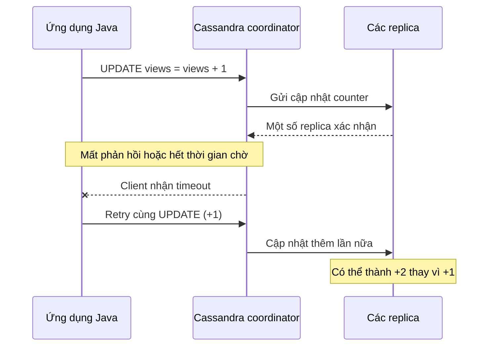

# Kiểu `counter` và các ràng buộc của bảng counter trong Apache Cassandra

## Mục tiêu bài học

Trong chương **BATCH và counter** của module **DATABASE_ENGINE_WIDE_COLUMN_CASSANDRA**, bài này giải thích cách Apache Cassandra lưu bộ đếm phân tán, thiết kế bảng wide-column theo truy vấn và xử lý các giới hạn của phép tăng/giảm. Sau bài học, bạn có thể:

- Phân biệt cột `counter` với cột số nguyên `bigint` thông thường.
- Tạo bảng counter hợp lệ, viết CQL tăng/giảm và đọc giá trị.
- Nhận ra các giới hạn về schema, `INSERT`, `TTL`, `TIMESTAMP`, điều kiện `IF` và `BATCH`.
- Giải thích vì sao retry một lần tăng sau timeout có thể đếm hai lần và vì sao consistency level không bảo đảm *exactly once*.
- Chọn partition key, clustering key, replication và cách kết nối từ Java phù hợp với truy vấn đếm.

## 1. `counter` là gì và khi nào cần dùng?

`counter` là kiểu cột đặc biệt trong CQL để biểu diễn **số nguyên có dấu 64 bit được cập nhật bằng phép cộng hoặc trừ**. Thay vì ghi đè một giá trị mới, ứng dụng gửi một lượng thay đổi (*delta*): `+1`, `+5`, `-1`… Cassandra phối hợp các bản sao để duy trì giá trị bộ đếm phân tán.

Ví dụ: mỗi lần một trang được xem, ứng dụng tăng `views` thêm một; khi cần hiển thị số lượt xem, ứng dụng đọc `views` theo khóa tương ứng. Đây là trường hợp sử dụng tự nhiên nếu hệ thống chấp nhận một số bất định khi có sự cố hoặc request bị gửi lặp.

| Thuộc tính | `bigint` thông thường | `counter` |
|---|---|---|
| Ý nghĩa thao tác | Gán giá trị số cụ thể | Cộng/trừ một delta |
| Câu lệnh tiêu biểu | `UPDATE ... SET total = 42` | `UPDATE ... SET total = total + 1` |
| Hỗ trợ `INSERT` thông thường | Có | Không: dùng `UPDATE` để tăng/giảm |
| Kết hợp với cột dữ liệu thông thường | Có | Không trong cùng bảng counter |
| Phù hợp khi | Cần ghi giá trị xác định, có thể kiểm soát việc cập nhật | Cần đếm tăng/giảm, chịu được giới hạn về retry và độ chính xác |

**Điểm cốt lõi:** `counter` không phải phép `UPDATE` gán số nguyên theo cách thông thường. `views = views + 1` là một sự kiện thay đổi số đếm; gửi sự kiện ấy hai lần có thể tăng hai đơn vị.

## 2. Thiết kế bảng counter theo truy vấn

Giả sử yêu cầu nghiệp vụ: “Lấy số lượt xem **mỗi ngày của một trang**; đôi lúc liệt kê các ngày trong cùng tháng”. Một bảng phù hợp là:

```sql
CREATE TABLE views_by_page_month (
    page_id uuid,
    month_bucket text,
    view_date date,
    views counter,
    PRIMARY KEY ((page_id, month_bucket), view_date)
);
```

Trong đó:

- **Partition key** là cặp `(page_id, month_bucket)`. Một trang trong một tháng tương ứng một partition; điều này hạn chế partition phình to khi lưu nhiều năm dữ liệu.
- **Clustering key** `view_date` phân biệt các hàng từng ngày bên trong partition, giúp đọc ngày cụ thể hoặc quét các ngày của tháng.
- `views` là **cột không thuộc khóa duy nhất** trong ví dụ và bắt buộc dùng kiểu `counter`.

Phân tích truy vấn trước khi chọn khóa rất quan trọng trong Cassandra. Bảng trên phục vụ truy vấn theo trang và tháng; nó **không** cung cấp cách hiệu quả để liệt kê mọi trang có nhiều lượt xem nhất toàn hệ thống. Muốn bảng xếp hạng hoặc tổng hợp theo chiều khác, cần thiết kế luồng tổng hợp và mô hình lưu trữ riêng.

### Ghi và đọc bằng CQL

```sql
-- Một lượt xem ngày 21/11/2026.
UPDATE views_by_page_month
SET views = views + 1
WHERE page_id = 11111111-1111-1111-1111-111111111111
  AND month_bucket = '2026-11'
  AND view_date = '2026-11-21';

-- Điều chỉnh giảm một đơn vị (khi nghiệp vụ cho phép).
UPDATE views_by_page_month
SET views = views - 1
WHERE page_id = 11111111-1111-1111-1111-111111111111
  AND month_bucket = '2026-11'
  AND view_date = '2026-11-21';

-- Đọc một ngày theo toàn bộ primary key.
SELECT views
FROM views_by_page_month
WHERE page_id = 11111111-1111-1111-1111-111111111111
  AND month_bucket = '2026-11'
  AND view_date = '2026-11-21';

-- Liệt kê các ngày thuộc cùng một partition tháng.
SELECT view_date, views
FROM views_by_page_month
WHERE page_id = 11111111-1111-1111-1111-111111111111
  AND month_bucket = '2026-11';
```

`UPDATE ... SET views = views + n` có thể tạo hàng counter khi khóa chưa có; ứng dụng không cần và không thể khởi tạo bằng `INSERT`. Giá trị counter có thể âm nếu số lần giảm vượt số lần tăng. Đọc một hàng chưa từng được ghi có thể không trả về hàng nào; phía ứng dụng cần quy định cách diễn giải trường hợp “chưa có số đếm” thay vì mặc định mọi truy vấn đều trả `0`.

## 3. Các ràng buộc quan trọng của bảng counter

Bảng counter có quy tắc schema và CQL riêng. Vi phạm thường bị Cassandra từ chối ngay khi `CREATE TABLE` hoặc thực thi câu lệnh.

| Nhóm ràng buộc | Quy tắc / hệ quả |
|---|---|
| Kiểu dữ liệu của khóa | Partition key và clustering key phải là kiểu khóa thông thường; **cột `counter` không được nằm trong primary key**. |
| Các cột ngoài khóa | Bảng có counter chỉ được chứa các cột counter ngoài những cột khóa; không trộn `counter` với `text`, `int`, `timestamp`… làm cột dữ liệu thường. |
| Khởi tạo và cập nhật | Sử dụng `UPDATE` với phép `counter = counter + n` hoặc `counter = counter - n`; không `INSERT` vào bảng counter và không gán trực tiếp `counter = n`. |
| Điều kiện khóa của `UPDATE` | Xác định đầy đủ partition key và các thành phần clustering key để tác động đúng hàng cần đếm. |
| TTL và timestamp ghi | Không dùng `USING TTL` hoặc `USING TIMESTAMP` cho cập nhật counter; counter không hỗ trợ cơ chế hết hạn như cột thông thường. |
| LWT / điều kiện | Không dùng `IF`, `IF EXISTS` để biến phép tăng counter thành một cập nhật so sánh-và-ghi có điều kiện. |
| Batch | Dùng `BEGIN COUNTER BATCH` cho các cập nhật counter; không trộn statement counter và statement thường trong cùng batch. |
| Retry | Phép cộng/trừ **không idempotent**: thực hiện hai lần có thể thay đổi giá trị hai lần. |

Các ví dụ **không hợp lệ** sau minh họa lỗi hay gặp:

```sql
-- Sai: trộn counter với một cột dữ liệu không phải counter.
CREATE TABLE invalid_views (
    page_id uuid PRIMARY KEY,
    views counter,
    page_title text
);

-- Sai: không INSERT dữ liệu vào counter table.
INSERT INTO views_by_page_month
    (page_id, month_bucket, view_date, views)
VALUES
    (11111111-1111-1111-1111-111111111111, '2026-11', '2026-11-21', 1);

-- Sai: gán giá trị tuyệt đối thay vì cộng/trừ delta.
UPDATE views_by_page_month
SET views = 100
WHERE page_id = 11111111-1111-1111-1111-111111111111
  AND month_bucket = '2026-11' AND view_date = '2026-11-21';

-- Sai: TTL không áp dụng cho counter.
UPDATE views_by_page_month USING TTL 3600
SET views = views + 1
WHERE page_id = 11111111-1111-1111-1111-111111111111
  AND month_bucket = '2026-11' AND view_date = '2026-11-21';

-- Sai: counter UPDATE không hỗ trợ điều kiện IF.
UPDATE views_by_page_month
SET views = views + 1
WHERE page_id = 11111111-1111-1111-1111-111111111111
  AND month_bucket = '2026-11' AND view_date = '2026-11-21'
IF EXISTS;
```

Nếu cần lưu `page_title`, `owner_id`, trạng thái bài viết hoặc các thuộc tính khác, hãy lưu vào **bảng thực thể riêng**. Ứng dụng có thể đọc dữ liệu mô tả từ bảng đó và số lượt xem từ bảng counter theo khóa phù hợp; đừng cố đưa tất cả thuộc tính vào một bảng counter.

### Không có thao tác “đặt lại về 0” bằng câu lệnh gán

Lệnh `SET views = 0` không hợp lệ. Cũng không nên giả định rằng xóa một hàng rồi tăng lại ngay là cách reset an toàn: các replica, tombstone, thời điểm ghi và tình huống phục hồi có thể khiến thao tác xóa counter phức tạp. Với bộ đếm theo kỳ, thiết kế **khóa kỳ mới** (`month_bucket`, `view_date`…) thường rõ ràng và dễ vận hành hơn. Nếu phải xóa dữ liệu counter, cần kiểm chứng hành vi theo phiên bản Cassandra đang triển khai và bảo đảm quy trình repair phù hợp.

## 4. Vì sao counter là bài toán phân tán khó?

Trong Cassandra, một partition được sao chép trên nhiều nút theo replication factor của keyspace. Một lần tăng có thể đi qua coordinator và các replica; tùy consistency level, client được trả thành công khi đủ số replica cần thiết đã xác nhận. Nhưng **thành công, thất bại và timeout ở phía client không đồng nhất với việc thay đổi đã hoặc chưa xảy ra**.

Hãy xét chuỗi sự kiện:



Đây là lý do quan trọng để không đánh dấu câu lệnh counter là *idempotent* và không tự động retry một cách mù quáng. Một timeout là **kết quả chưa xác định** đối với ứng dụng: lần cập nhật ban đầu có thể chưa được áp dụng, có thể đã được áp dụng một phần, hoặc có thể đã được ghi dù phản hồi bị mất.

### Consistency level giải quyết được gì?

- `ONE` / `LOCAL_ONE` thường ưu tiên độ trễ và khả năng sẵn sàng; số bản sao được yêu cầu xác nhận ít hơn.
- `QUORUM` / `LOCAL_QUORUM` yêu cầu nhiều replica xác nhận hơn trong phạm vi thích hợp, có thể đánh đổi độ trễ và tính sẵn sàng khi sự cố.
- Replication và consistency level ảnh hưởng đường đi đọc/ghi, nhưng **không biến một phép tăng counter thành exactly-once**. Ngay cả khi đọc ở quorum, ứng dụng cũng không thể dùng kết quả để chắc chắn liệu một request timeout cụ thể có nên gửi lại hay không.

Counter không cung cấp transaction có điều kiện kiểu `IF current = x THEN x + 1` để khử trùng lặp request. Nếu số đếm phải chính xác tuyệt đối theo từng sự kiện thanh toán, phân bổ hạn mức hoặc tồn kho, nên xây dựng cơ chế ghi nhận sự kiện có ID duy nhất, chống trùng và tổng hợp có kiểm soát bằng một hệ thống phù hợp thay vì chỉ dựa vào counter Cassandra.

## 5. `COUNTER BATCH` và những gì batch không bảo đảm

Khi cần gửi nhiều cập nhật counter trong một yêu cầu, CQL có cú pháp batch riêng:

```sql
BEGIN COUNTER BATCH
    UPDATE views_by_page_month
    SET views = views + 1
    WHERE page_id = 11111111-1111-1111-1111-111111111111
      AND month_bucket = '2026-11' AND view_date = '2026-11-21';

    UPDATE views_by_page_month
    SET views = views + 2
    WHERE page_id = 11111111-1111-1111-1111-111111111111
      AND month_bucket = '2026-11' AND view_date = '2026-11-22';
APPLY BATCH;
```

`BEGIN COUNTER BATCH` chỉ chứa cập nhật counter; không đưa `INSERT` hoặc `UPDATE` của bảng thường vào cùng batch. Batch không phải công cụ mặc định để tăng thông lượng: gom quá nhiều partition vào batch khiến coordinator phải làm thêm việc và có thể làm độ trễ tăng.

Đặc biệt, batch không làm cho toàn bộ quá trình tăng/giảm trở thành transaction ACID theo kiểu cơ sở dữ liệu quan hệ, và **không loại bỏ vấn đề timeout/retry**. Nếu client gửi lại cả counter batch sau timeout, từng phép cộng có nguy cơ được áp dụng thêm lần nữa. Dùng batch chỉ khi có nhu cầu thực sự và đã hiểu giới hạn của counter batch.

## 6. Kết nối từ Java và xử lý lỗi đúng cách

Ví dụ với DataStax/Apache Cassandra Java Driver 4.x, dùng `PreparedStatement` để tạo câu lệnh CQL ổn định. `CqlSession` nên được quản lý vòng đời ở mức ứng dụng; đoạn dưới giả sử `session` đã được mở và kết nối tới keyspace thích hợp:

```java
import java.time.LocalDate;
import java.util.UUID;

import com.datastax.oss.driver.api.core.CqlSession;
import com.datastax.oss.driver.api.core.cql.BoundStatement;
import com.datastax.oss.driver.api.core.cql.PreparedStatement;

public final class PageViewCounter {
    private final CqlSession session;
    private final PreparedStatement increment;

    public PageViewCounter(CqlSession session) {
        this.session = session;
        this.increment = session.prepare(
            "UPDATE views_by_page_month " +
            "SET views = views + ? " +
            "WHERE page_id = ? AND month_bucket = ? AND view_date = ?"
        );
    }

    public void addViews(UUID pageId, LocalDate day, long delta) {
        String bucket = String.format("%04d-%02d", day.getYear(), day.getMonthValue());
        BoundStatement statement = increment
            .bind(delta, pageId, bucket, day)
            .setIdempotent(false);
        session.execute(statement);
    }
}
```

Trong ví dụ này, `delta` là số nguyên có dấu: số dương tăng, số âm giảm (phép `+ ?` với giá trị âm). Hãy xác nhận chiến lược retry thực tế trong cấu hình Java Driver và hạ tầng ứng dụng: đánh dấu `.setIdempotent(false)` để driver không mặc định coi câu lệnh tăng counter là an toàn khi thực thi lại, nhưng các lớp proxy, queue, HTTP client hoặc logic nghiệp vụ vẫn có thể tự gửi lại yêu cầu.

Khi `session.execute(...)` ném timeout, ghi log thông tin nhận diện sự kiện và trạng thái **chưa rõ đã áp dụng hay chưa**. Không tự động biến mọi timeout thành lời gọi `addViews` lần thứ hai. Với nhu cầu đếm chính xác, lưu event ID và xây dựng luồng xử lý chống trùng ở tầng thích hợp; chỉ thêm `request_id` vào câu lệnh counter không tự tạo ra tính idempotent.

## 7. Hiệu năng, compaction, repair và vận hành

**Chọn khóa phân vùng theo tải ghi và kiểu truy vấn.** Một khóa `(page_id, month_bucket)` có thể rất “nóng” nếu một trang nổi tiếng nhận lượng tăng cực lớn. Nhiều cập nhật đồng thời vào cùng một counter tạo cạnh tranh và tăng tải trên các replica liên quan. Khi cần mở rộng, cân nhắc phân tán bộ đếm theo *shard* (`shard_id` trong khóa) rồi đọc và cộng kết quả ở ứng dụng; đổi lại sẽ có nhiều hàng cần truy vấn và phức tạp trong tổng hợp.

**Giữ kích thước partition hợp lý.** Bucket theo tháng trong ví dụ giới hạn số hàng ngày trong một partition; bucket quá dài khiến số hàng tăng, còn bucket quá nhỏ tạo thêm thao tác đọc nhiều partition. Đặt kích thước bucket theo số hàng thực tế, tần suất truy vấn và vòng đời dữ liệu.

**Theo dõi các dấu hiệu vận hành.** Quan sát write/read latency, timeout, unavailable, hotspot, kích thước partition, số lượng tombstone và sức khỏe các replica. Counter sử dụng cơ chế xử lý chuyên biệt; compaction giúp quản lý dữ liệu SSTable nhưng không thể sửa sai do ứng dụng tăng trùng. Repair giúp đồng bộ dữ liệu giữa replica theo quy trình vận hành Cassandra, song không thể suy ra và loại bỏ một lượt tăng hợp lệ về mặt lưu trữ nhưng do client retry nhầm.

**Lập kế hoạch lưu giữ dữ liệu.** Vì counter không hỗ trợ TTL cho từng cập nhật, hãy quyết định chính sách retention ở mức mô hình dữ liệu và tác vụ vận hành. Việc xóa counter/tái sử dụng khóa cần kiểm thử trong điều kiện replication, node downtime và repair; đặc biệt tránh dùng xóa rồi tăng ngay như một phép reset đơn giản.

## 8. Chọn `counter` hay kiến trúc khác?

| Nhu cầu | Hướng tiếp cận |
|---|---|
| Hiển thị lượt xem, lượt click ước lượng khi tải lớn và có chấp nhận sai lệch do lỗi/retry | Cân nhắc counter Cassandra; kiểm soát retry và hotspot. |
| Đếm sự kiện có ID duy nhất, cần đối soát và xây dựng lại số liệu | Lưu event/ledger bất biến, khử trùng theo ID và tổng hợp từ sự kiện. |
| Phải đặt một số cụ thể, cập nhật có điều kiện, áp dụng TTL trực tiếp | Dùng bảng dữ liệu thường hoặc hệ quản trị đáp ứng yêu cầu transaction; không dùng cột `counter`. |
| Một khóa nhận số lượt tăng quá cao | Thiết kế shard/bucket hoặc hệ thống gom sự kiện trước khi ghi, cân nhắc chi phí đọc tổng hợp. |

### Checklist thực hành

1. Xác định trước hai truy vấn: đọc số đếm một ngày và liệt kê các ngày một tháng của cùng trang; đối chiếu chúng với partition key và clustering key trong DDL.
2. Tạo `views_by_page_month`, tăng `+3`, giảm `-1`, rồi đọc lại giá trị. Thử làm câu lệnh `INSERT` và `USING TTL` để quan sát lỗi cụ thể từ phiên bản Cassandra đang dùng.
3. Mô phỏng client mất phản hồi sau một lần tăng. Viết rõ hai khả năng “đã tăng” và “chưa tăng” trước khi chọn chính sách retry cho ứng dụng Java.
4. Tự đánh giá yêu cầu: nếu một sự kiện được gửi hai lần mà số đếm tăng hai lần thì nghiệp vụ có chấp nhận không? Nếu không, thiết kế nơi lưu event ID và quy trình khử trùng trước khi quyết định sử dụng counter.

**Ghi nhớ:** Bảng counter là một cấu trúc đặc biệt để thực hiện phép cộng/trừ phân tán. Tính đúng đắn đến từ cả **schema theo truy vấn**, **kỷ luật retry**, **mức nhất quán và replication**, cùng **quy trình vận hành**, chứ không chỉ từ kiểu dữ liệu `counter`.
