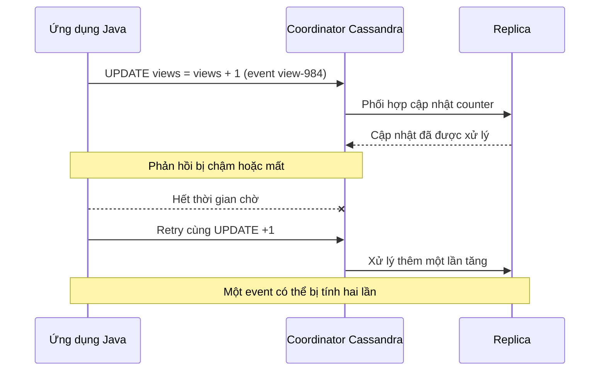

# Tăng/giảm counter, retry và khả năng áp dụng nhiều lần

> **Chương:** BATCH và counter  
> **Học phần:** `DATABASE_ENGINE_WIDE_COLUMN_CASSANDRA`

Apache Cassandra là cơ sở dữ liệu phân tán theo mô hình *wide-column*. Khi thiết kế bảng theo truy vấn, ta phải cân nhắc khóa phân vùng, phân bố tải giữa các node, replication và mức nhất quán đọc/ghi. CQL cung cấp kiểu `counter` để cộng hoặc trừ một đại lượng ngay trên cụm Cassandra. Tuy nhiên, trong hệ thống phân tán, **cùng một yêu cầu tăng counter được thực hiện hai lần có thể làm giá trị tăng hai lần**. Đây là điểm đặc biệt quan trọng khi ứng dụng Java gặp timeout, mất kết nối hoặc nhận lại thông điệp từ hàng đợi.

Sau bài này, bạn có thể:

- Viết CQL tăng, giảm và đọc counter; nhận ra các giới hạn của bảng counter.
- Phân biệt tính giao hoán của phép cộng với **idempotence** (khả năng áp dụng lặp mà không đổi kết quả).
- Giải thích vì sao timeout ghi không chứng minh rằng counter chưa tăng, và vì sao retry mù có thể đếm trùng.
- Chọn cách xử lý retry trong Java và mô hình dữ liệu phù hợp với yêu cầu chính xác của nghiệp vụ.
- Hiểu phạm vi của `COUNTER BATCH`, consistency level, repair và đối soát dữ liệu.

## 1. Counter trong Cassandra là gì?

Một cột `counter` lưu một số nguyên có dấu, có thể tăng hoặc giảm bằng các lệnh `UPDATE`. Ứng dụng không cần đọc giá trị hiện tại rồi tự tính `value + 1` trước khi ghi. Cassandra xử lý thay đổi counter bằng cơ chế riêng dành cho dữ liệu đếm phân tán.

Ví dụ, ta muốn xem **tổng số lượt xem của một trang theo từng ngày**:

```sql
-- Giả sử đã chọn keyspace có sẵn bằng USE <ten_keyspace>.
CREATE TABLE page_views_by_day (
    tenant_id text,
    page_id uuid,
    view_day date,
    views counter,
    PRIMARY KEY ((tenant_id, page_id, view_day))
);
```

Ở đây `(tenant_id, page_id, view_day)` là **toàn bộ khóa phân vùng**. Một cặp trang/ngày có một ô đếm. Lựa chọn này hợp với truy vấn lấy số lượt xem của đúng một trang trong đúng một ngày, nhưng các trang có lượng truy cập cực lớn có thể tạo ra phân vùng ghi nóng; phần sau sẽ nói đến sharding.

```sql
-- Lần cập nhật đầu tiên có thể tạo giá trị counter từ 0.
UPDATE page_views_by_day
SET views = views + 1
WHERE tenant_id = 'shop-01'
  AND page_id = 11111111-1111-1111-1111-111111111111
  AND view_day = '2026-11-21';

UPDATE page_views_by_day
SET views = views + 3
WHERE tenant_id = 'shop-01'
  AND page_id = 11111111-1111-1111-1111-111111111111
  AND view_day = '2026-11-21';

UPDATE page_views_by_day
SET views = views - 1
WHERE tenant_id = 'shop-01'
  AND page_id = 11111111-1111-1111-1111-111111111111
  AND view_day = '2026-11-21';

SELECT views FROM page_views_by_day
WHERE tenant_id = 'shop-01'
  AND page_id = 11111111-1111-1111-1111-111111111111
  AND view_day = '2026-11-21';
```

Nếu cả ba bản cập nhật đều thành công **đúng một lần**, phép tính là `0 + 1 + 3 - 1 = 3`. Giá trị có thể âm: Cassandra không tự chặn `views < 0`, nên nếu nghiệp vụ cần giới hạn dưới bằng 0 thì phải kiểm soát ở mô hình khác.

Các ràng buộc CQL cần nhớ:

| Thao tác hoặc cấu trúc | Với `counter` |
| --- | --- |
| `SET views = views + n` hoặc `views - n` | Hợp lệ; `n` là mức tăng/giảm. |
| `INSERT ... views = 10`, `UPDATE ... SET views = 10` | Không hợp lệ; counter không cho gán trực tiếp giá trị tuyệt đối. |
| Cột thường không thuộc khóa chính đặt cùng cột `counter` | Không được trộn trong cùng bảng counter. |
| `USING TTL`, `USING TIMESTAMP` trên cập nhật counter | Không được hỗ trợ. |
| `UPDATE ... IF ...` (lightweight transaction/CAS) trên counter | Không được hỗ trợ; không có lệnh “chỉ cộng nếu chưa xử lý event X” cho counter. |
| `WHERE` của cập nhật counter | Phải xác định đầy đủ khóa chính của hàng được cập nhật. |

Vì vậy, **counter không phải một số nguyên thông thường có thể đặt lại tùy ý**. Muốn làm mới một kỳ đếm, thường nên chuyển sang khóa của kỳ mới (ví dụ `view_day` mới), thay vì xóa hoặc đặt lại counter đang được ghi đồng thời.

## 2. Phép cộng có thể giao hoán nhưng không idempotent

Hai phép cộng `+2` và `+3` có thể đổi thứ tự mà vẫn cho cùng tổng: `(x + 2) + 3 = (x + 3) + 2`. Tính chất đó **không** giải quyết vấn đề gửi trùng cùng một yêu cầu.

Gọi `f(x) = x + 1` là một sự kiện lượt xem. Một thao tác idempotent phải thỏa `f(f(x)) = f(x)`. Counter tăng không thỏa điều này:

```text
Một lần:       f(10)    = 11
Hai lần:       f(f(10)) = 12
Kết luận:     12 != 11  → tăng counter KHÔNG idempotent
```

Tương tự, `views = views - 1` không idempotent: nếu yêu cầu hoàn trả/trừ một lượt bị phát lại, số đếm giảm thêm một lần nữa. Việc hai phép cập nhật có thể chạy theo thứ tự khác nhau không đảm bảo mỗi sự kiện chỉ được áp dụng một lần.

Phân biệt hai khái niệm thường bị nhầm:

- **Một cập nhật counter thành công một lần:** Cassandra xử lý một phép cộng/trừ và phản hồi theo mức nhất quán được yêu cầu.
- **Một sự kiện nghiệp vụ được tính đúng một lần:** ứng dụng đảm bảo mọi bản phát lại của cùng `event_id` chỉ đóng góp đúng một lần vào kết quả. Counter đơn lẻ không tự cung cấp bảo đảm này.

## 3. Timeout, retry và trường hợp kết quả không xác định

Xét ứng dụng nhận sự kiện `view-984`, muốn cộng `views` thêm 1. Dòng thời gian có thể xảy ra:



Sau timeout, ứng dụng **không biết chắc** lệnh đầu tiên đã được áp dụng hay chưa. Nếu tự động gửi lại cùng `UPDATE ... + 1`, tổng có thể bị cộng thêm một lần. Truy vấn `SELECT` để xem tổng hiện tại thường không giúp phân biệt lượt tăng đó đến từ `view-984` hay sự kiện khác đang xảy ra đồng thời.

| Tình huống | Có thể suy ra gì? | Cách ứng xử |
| --- | --- | --- |
| Kiểm tra dữ liệu đầu vào lỗi **trước khi** gửi yêu cầu | Chưa có cập nhật được gửi đi. | Sửa lỗi đầu vào; có thể gửi một yêu cầu mới. |
| Ghi được phản hồi thành công | Cập nhật được xác nhận theo consistency level đã chọn. | Ghi nhận thành công; không gửi lại cùng sự kiện. |
| Ghi timeout, connection reset hoặc client mất phản hồi **sau khi gửi** | Kết quả không xác định: cập nhật có thể đã được áp dụng. | Không retry mù; lưu trạng thái cần đối soát hoặc chấp nhận sai lệch nếu số đếm chỉ để tham khảo. |
| Worker/hàng đợi phát lại cùng `event_id` | Có thể là bản sao của sự kiện đã xử lý. | Cần cơ chế nhận diện sự kiện trùng ở tầng ứng dụng nếu yêu cầu mỗi event chỉ tính một lần. |
| Đọc counter timeout | Phép đọc không cộng/trừ counter. | Có thể đọc lại, nhưng vẫn cân nhắc tải và mức nhất quán. |

**Lưu ý:** driver có thể tự retry lỗi kết nối, timeout hoặc thử host khác tùy phiên bản, cấu hình retry policy và đánh dấu idempotence. Không nên mặc định rằng “không thấy retry trong code” nghĩa là chắc chắn chỉ có một lần gửi. Ngược lại, việc tắt retry tự động cũng **không loại bỏ** phát lại từ HTTP client, message broker, scheduler hay người dùng bấm lại.

### Consistency level có giúp tránh đếm trùng không?

`LOCAL_QUORUM`/`QUORUM` và replication ảnh hưởng đến số replica phải xác nhận và khả năng nhìn thấy dữ liệu sau ghi/đọc. Chúng **không biến** phép `+1` thành idempotent. Nếu ứng dụng gửi hai yêu cầu hợp lệ và cả hai được áp dụng, cụm có thể nhất quán trên chính giá trị đã bị đếm hai lần.

Compaction và repair góp phần duy trì trạng thái lưu trữ và đồng bộ replica, nhưng không biết `view-984` đại diện cho một sự kiện nghiệp vụ duy nhất. Chúng không thể tự suy ra để xóa một lần tăng do retry trùng.

## 4. Kết nối Java: đánh dấu counter statement là không idempotent

Với **DataStax/Apache Cassandra Java Driver 4.x**, hãy khai báo rõ đặc tính không idempotent của câu lệnh. Ví dụ dưới đây giả định `CqlSession` đã kết nối đúng keyspace và local data center, bảng `page_views_by_day` đã tồn tại.

```java
import java.time.LocalDate;
import java.util.UUID;

import com.datastax.oss.driver.api.core.CqlSession;
import com.datastax.oss.driver.api.core.DefaultConsistencyLevel;
import com.datastax.oss.driver.api.core.cql.BoundStatement;
import com.datastax.oss.driver.api.core.cql.PreparedStatement;

public final class PageViewCounter {
    private final CqlSession session;
    private final PreparedStatement increment;
    private final PreparedStatement decrement;

    public PageViewCounter(CqlSession session) {
        this.session = session;
        this.increment = session.prepare(
            "UPDATE page_views_by_day SET views = views + ? " +
            "WHERE tenant_id = ? AND page_id = ? AND view_day = ?");
        this.decrement = session.prepare(
            "UPDATE page_views_by_day SET views = views - ? " +
            "WHERE tenant_id = ? AND page_id = ? AND view_day = ?");
    }

    public void change(String tenantId, UUID pageId, LocalDate day,
                       long amount, boolean increase) {
        if (amount <= 0) {
            throw new IllegalArgumentException("amount must be positive");
        }

        BoundStatement statement = (increase ? increment : decrement)
            .bind(amount, tenantId, pageId, day)
            .setIdempotent(false)
            .setConsistencyLevel(DefaultConsistencyLevel.LOCAL_QUORUM);

        session.execute(statement);
    }
}
```

`setIdempotent(false)` cung cấp thông tin cho driver khi quyết định retry và speculative execution theo retry policy. Cần kiểm tra policy thực tế của phiên bản driver được dùng; cờ này **không** tạo cơ chế chống trùng trong Cassandra. `LOCAL_QUORUM` là lựa chọn minh họa khi cấu hình replication ở local data center đáp ứng được mức này, không phải bảo đảm “exactly once”.

Trong luồng xử lý lỗi, cần gắn mỗi yêu cầu với `event_id` có tính ổn định. Nếu `session.execute(...)` ném lỗi **sau khi đã gửi**, ghi trạng thái “kết quả chưa xác định” vào nơi theo dõi đáng tin cậy, đưa vào quy trình đối soát hoặc chọn rõ mức sai lệch có thể chấp nhận. **Không gọi lại ngay `session.execute(statement)` trong `catch`** chỉ vì gặp write timeout. Cũng phải kiểm tra retry ở API, queue consumer và job scheduler phía ngoài hàm này.

## 5. Khi nào dùng counter, khi nào cần dữ liệu sự kiện?

Chọn giải pháp theo **yêu cầu nghiệp vụ**, không chỉ theo sự tiện lợi của câu lệnh `+1`:

| Nhu cầu | Hướng thiết kế phù hợp | Đánh đổi |
| --- | --- | --- |
| Lượt xem, lượt tương tác, số lần bấm; chấp nhận lệch nhỏ khi có lỗi mạng | Cassandra `counter`, có thể theo ngày và shard | Ghi nhanh theo phép cộng/trừ; khó loại trùng và không đặt lại trực tiếp. |
| Báo cáo phải biết mỗi sự kiện đã được ghi nhận hay chưa | Lưu event bất biến, có `event_id` duy nhất; tính tổng từ tập event đã khử trùng | Tốn thêm lưu trữ và công sức tổng hợp/đối soát. |
| Tồn kho, số dư, hạn mức; tuyệt đối không được cộng/trừ trùng hoặc xuống dưới giới hạn | Mô hình ghi có giao dịch/CAS và ràng buộc nghiệp vụ phù hợp | Cần thiết kế đồng thời, phục hồi và kiểm chứng chặt chẽ hơn; không dùng counter thuần túy. |

### Ví dụ lưu event bất biến để loại trùng

Thay vì dùng `counter` làm nguồn sự thật, ứng dụng có thể lưu mỗi sự kiện với ID ổn định rồi tính số đếm từ các sự kiện duy nhất:

```sql
CREATE TABLE view_events_by_bucket (
    tenant_id text,
    event_day date,
    bucket smallint,
    event_id uuid,
    page_id uuid,
    delta int,
    PRIMARY KEY ((tenant_id, event_day, bucket), event_id)
);

-- event_id, event_day và bucket của cùng một sự kiện phải giữ nguyên khi retry.
INSERT INTO view_events_by_bucket
    (tenant_id, event_day, bucket, event_id, page_id, delta)
VALUES
    ('shop-01', '2026-11-21', 3,
     22222222-2222-2222-2222-222222222222,
     11111111-1111-1111-1111-111111111111, 1)
IF NOT EXISTS;
```

`INSERT ... IF NOT EXISTS` dùng lightweight transaction (LWT) trên **bảng thường**, giúp chỉ tạo một hàng cho `event_id` tại khóa đã xác định. `bucket` có thể được suy ra một cách ổn định từ hash của `event_id` để giới hạn độ lớn và phân tán các phân vùng; mỗi lần retry phải tạo ra **cùng khóa**. Không nên dùng UUID ngẫu nhiên mới ở mỗi lần retry, vì như vậy một sự kiện sẽ thành nhiều khóa khác nhau.

Sau khi lưu, một tiến trình có thể tổng hợp `delta` của **các event duy nhất** theo trang/ngày rồi ghi kết quả dẫn xuất theo cơ chế có thể tái tính và đối soát. Bảng sự kiện cho phép giải thích “vì sao tổng bằng N” và xây dựng lại số đếm khi cần.

**Bẫy thường gặp:** tạo bảng `processed_events`, đánh dấu event bằng LWT rồi cộng `counter` là **hai thao tác riêng**. Nếu ứng dụng chết sau bước đánh dấu nhưng trước bước cộng, có thể bị thiếu số đếm; làm ngược lại thì có thể cộng trùng. Cassandra không cho đưa cập nhật counter và non-counter vào một batch để tạo giao dịch đúng-một-lần giữa hai bảng. Nếu cần tính chính xác, hãy dựa vào event log và quy trình tổng hợp có thể phục hồi, hoặc chọn hệ thống giao dịch có bảo đảm thích hợp.

### Shard khi một khóa đếm quá nóng

Một trang quá nhiều lượt xem có thể làm cùng một partition key chịu tải lớn. Có thể thêm `shard` **vào khóa phân vùng**:

```sql
CREATE TABLE sharded_views_by_day (
    tenant_id text,
    page_id uuid,
    view_day date,
    shard smallint,
    views counter,
    PRIMARY KEY ((tenant_id, page_id, view_day, shard))
);
```

Khi ghi, chọn một trong các shard, chẳng hạn 0–15; khi đọc tổng, đọc tất cả shard liên quan rồi cộng ở ứng dụng. Nếu đưa `shard` chỉ vào **clustering key**, các shard vẫn ở cùng partition và không giải quyết điểm nóng phân vùng. Sharding phân tán tải ghi, **không** khiến counter idempotent; event bị phát lại vẫn có thể tăng nhiều lần, kể cả khi luôn rơi vào cùng shard.

## 6. `COUNTER BATCH` có giúp retry an toàn không?

Cassandra có cú pháp riêng cho batch chứa cập nhật counter:

```sql
BEGIN COUNTER BATCH
    UPDATE page_views_by_day SET views = views + 1
    WHERE tenant_id = 'shop-01'
      AND page_id = 11111111-1111-1111-1111-111111111111
      AND view_day = '2026-11-21';

    UPDATE page_views_by_day SET views = views + 1
    WHERE tenant_id = 'shop-01'
      AND page_id = 33333333-3333-3333-3333-333333333333
      AND view_day = '2026-11-21';
APPLY BATCH;
```

`COUNTER BATCH` phục vụ nhóm cập nhật counter; không được trộn câu lệnh counter với câu lệnh sửa dữ liệu thường trong cùng batch. Nó **không mang theo `event_id` để khử trùng**, không biến phép cộng thành idempotent và không cho phép an toàn gửi lại toàn bộ batch sau timeout. Hai lệnh tăng trong batch có thể bị áp dụng thêm nếu ứng dụng phát lại batch; vì vậy hãy chỉ batch khi có lý do rõ ràng về mặt truy cập dữ liệu và đã cân nhắc chi phí phân tán của nhiều phân vùng.

## 7. Quy trình xử lý trong ứng dụng thực tế

1. **Xác định ngữ nghĩa số đếm.** Nếu là số liệu vận hành có thể xấp xỉ, cho phép dùng counter và công khai biên độ sai lệch khi có sự cố. Nếu cần tính đúng mỗi event, lưu và khử trùng event trước khi xây số liệu dẫn xuất.
2. **Gắn `event_id` bền vững.** Cùng một sự kiện phải giữ nguyên ID qua HTTP retry, queue redelivery và restart; không tạo ID mới chỉ vì thử lại.
3. **Ghi rõ idempotence cho driver.** Với counter, đặt `false`, xem retry policy và speculative execution đang bật/tắt thế nào. Kiểm tra cả những tầng có thể phát lại ngoài Cassandra driver.
4. **Phân loại lỗi theo khả năng đã gửi.** Lỗi xảy ra chắc chắn trước khi gửi khác với write timeout sau khi gửi. Với kết quả chưa biết, đừng coi đó là “chưa cộng”.
5. **Chọn consistency level theo replication/topology.** Đánh giá độ trễ, độ sẵn sàng và độ mới khi đọc; không dùng consistency level như cách chống duplicate.
6. **Theo dõi và đối soát.** Ghi tỷ lệ timeout, retry, backlog, số event duy nhất và chênh lệch giữa counter với nguồn sự kiện. Thực hiện repair theo vận hành cụm, nhưng sửa sai lệch nghiệp vụ bằng cơ chế đối soát riêng.

## 8. Tự kiểm tra

**Bài 1.** Một counter đang bằng `7`. Yêu cầu `+2` được gửi, phía client timeout, client retry `+2` và lần retry thành công. Giá trị cuối có thể là bao nhiêu, và tại sao?

**Bài 2.** Một tác vụ trừ tồn kho 1 đơn vị dùng `SET remaining = remaining - 1`. Có nên đánh dấu idempotent và retry tự động khi timeout không? Bạn sẽ thay bằng cách nào nếu phải bảo đảm không bán quá số lượng?

**Bài 3.** Ứng dụng đã ghi `processed_events` bằng `IF NOT EXISTS` rồi tăng `views`. Nếu process chết giữa hai bước, chuyện gì xảy ra khi worker nhận lại event đó?

<details>
<summary>Gợi ý đáp án</summary>

1. Nếu lần đầu không được áp dụng, kết quả là `9`; nếu lần đầu đã được áp dụng, kết quả là `11`. Timeout không xác định kết quả của lần đầu. Nếu còn các ghi khác cùng lúc, không thể suy từ tổng hiện tại để biết trạng thái riêng của sự kiện.
2. Không: phép trừ cũng không idempotent và có thể đưa số tồn xuống âm. Cần mô hình có ràng buộc và giao dịch/CAS phù hợp, cùng định danh yêu cầu để tránh trừ trùng.
3. Event đã được đánh dấu nên lần phát lại có thể bị xem là trùng và bỏ qua, làm thiếu lượt tăng. Hai bước không tạo thành một giao dịch đúng-một-lần; nên giữ event bất biến làm nguồn sự thật và thiết kế tổng hợp có thể chạy lại/đối soát.

</details>

## Ghi nhớ

- `counter` phù hợp với phép cộng/trừ phân tán nhưng `+n` và `-n` **không idempotent**.
- Timeout ghi sau khi gửi có kết quả **không xác định**; retry có nguy cơ cộng/trừ trùng.
- `setIdempotent(false)`, consistency level và `COUNTER BATCH` không tự cung cấp bảo đảm đúng-một-lần từ sự kiện đến số đếm.
- Với dữ liệu cần chính xác, hãy thiết kế theo `event_id`, lưu nguồn sự kiện có thể kiểm chứng và tổng hợp/đối soát theo cơ chế có thể phục hồi.
