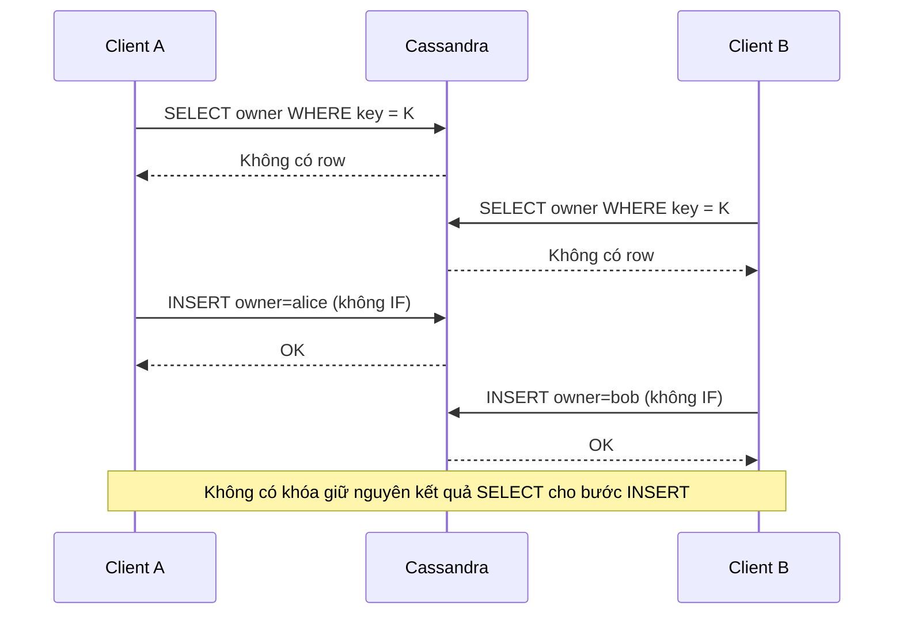

# Bài toán kiểm tra rồi mới ghi và nguy cơ cạnh tranh

## 1. Mục tiêu của bài học

Trong ứng dụng dùng Apache Cassandra, một đoạn mã rất dễ viết là: **đọc trạng thái hiện tại, kiểm tra điều kiện ở Java, rồi ghi thay đổi**. Đoạn mã này có vẻ đúng khi chỉ có một request, nhưng có thể sai khi nhiều thread, process hoặc máy chủ ứng dụng cùng truy cập **một partition**.

Bài học thuộc chương **LWT và đồng thời** của module `DATABASE_ENGINE_WIDE_COLUMN_CASSANDRA`. Nó kết nối thiết kế bảng theo truy vấn và khóa phân vùng với các chủ đề phân tán đã học: **replication**, **consistency đọc/ghi**, CQL, vận hành node và kết nối từ Java. Mục tiêu chính là hiểu *vì sao* xảy ra race condition, **điều kiện nào không thể được bảo vệ bằng SELECT rồi INSERT/UPDATE thông thường**, và khi nào cần **lightweight transaction (LWT)** của Cassandra.

Sau bài này, bạn có thể:

1. Giải thích **time-of-check to time-of-use (TOCTOU)**, lost update và tranh chấp quyền sở hữu một khóa.
2. Chỉ ra vì sao `LOCAL_QUORUM` hoặc `ALL` cho hai request tách rời **không biến chúng thành một phép kiểm-tra-và-ghi nguyên tử**.
3. Thiết kế **partition key** sao cho đối tượng cần bảo vệ được kiểm tra trong **cùng phạm vi CAS**.
4. Sử dụng `INSERT ... IF NOT EXISTS`, `UPDATE ... IF ...`, `DELETE ... IF ...` và hiểu kết quả `[applied]`.
5. Phân biệt **regular consistency** với **serial consistency** (`SERIAL`/`LOCAL_SERIAL`) trong giao dịch dùng Paxos.
6. Thử hai phiên `cqlsh` cùng thay đổi dữ liệu và xem ví dụ Java Driver xử lý cạnh tranh.
7. Phân loại ba kết quả khác nhau: **áp dụng thành công**, **điều kiện không thỏa**, và **timeout/lỗi chưa biết chắc kết quả**.
8. Đánh giá trade-off về độ trễ, throughput, contention và phạm vi bảo đảm của LWT.

> **Phạm vi:** ví dụ dùng Cassandra 5.0.9 trên một node Docker để thử cú pháp. Một node giúp thấy race giữa hai client, **không** phải bài kiểm thử khả năng chịu lỗi/quorum phân tán. Phần so sánh RF=3 chỉ áp dụng khi có **ba node thật đã tham gia ring**; không chạy lệnh phá hủy dữ liệu hoặc mô phỏng sự cố trên production.

## 2. Một tình huống có vẻ đơn giản: đăng ký tên duy nhất

Giả sử hệ thống có quy tắc:

> Trong mỗi tenant, một `handle` chuẩn hóa chỉ được thuộc về **một** `owner_id` tại một thời điểm.

Hai người dùng cùng thử đăng ký handle `bluebird` thuộc tenant `t1`. Cách thực hiện dễ nghĩ đến:

```text
1. SELECT owner_id WHERE tenant_id='t1' AND handle='bluebird';
2. Nếu chưa có row → cho phép.
3. INSERT row với owner_id của người đang đăng ký.
4. Trả lời "đăng ký thành công".
```

Khi chỉ một request chạy, kết quả thường đúng. Khi có hai request cạnh tranh, **khoảng thời gian giữa bước 1 và bước 3** cho phép cả hai cùng quan sát trạng thái cũ.

### 2.1. Timeline cạnh tranh

```text
Thời điểm         Client A                     Client B
----------------------------------------------------------------
t0                SELECT → chưa có row
t1                                             SELECT → chưa có row
t2                Kiểm tra ở Java: OK
t3                                             Kiểm tra ở Java: OK
t4                INSERT owner='alice'
t5                                             INSERT owner='bob'
t6                Trả "thành công"             Trả "thành công"
----------------------------------------------------------------
Kết quả: hai bên đều được báo thành công, nhưng một key CQL không
        thể đại diện cho hai quyền sở hữu riêng đúng theo nghiệp vụ.
```

**Đó là race condition**, không phải chỉ là lỗi do mạng chậm. Một node hoặc một JVM vẫn có thể gặp lỗi này nếu hai thread/client làm việc đồng thời. Ở cluster phân tán, latency và nhiều coordinator làm khoảng tranh chấp dễ xuất hiện hơn, nhưng bản chất là **đọc và ghi không được ràng buộc thành một thao tác duy nhất**.

**Kết quả cuối của ghi thường không được suy đơn giản là “client B ghi sau nên B thắng”.** Cassandra xử lý mutation theo timestamp ở cấp cell và quy tắc reconciliation; thứ tự thực thi phía client, đồng hồ và đường mạng không luôn quyết định timestamp lớn nhất. Nếu hai lệnh cập nhật nhiều cột, không nên giả định kết quả xung đột tương đương một transaction cập nhật toàn bộ đối tượng theo thứ tự gọi hàm.

### 2.2. Cùng một mẫu lỗi xuất hiện ở đâu?

| Nhu cầu nghiệp vụ | Phép kiểm rồi ghi dễ sai | Hậu quả khi hai request cùng chạy |
|---|---|---|
| Claim username/handle | `SELECT thiếu row → INSERT` | Hai client cùng nhận rằng đã chiếm tên |
| Đặt chỗ một tài nguyên | `SELECT status=FREE → UPDATE status=BOOKED` | Hai người đều được thông báo đặt chỗ thành công |
| Đổi trạng thái đơn hàng | `SELECT status=PENDING → UPDATE status=PAID` | Một transition có thể ghi đè trạng thái đã đổi |
| Phiên bản tài liệu | `SELECT revision=7 → UPDATE revision=8` | Hai lần sửa cùng “thành công”, một sửa đổi bị mất |
| Giới hạn quota | `SELECT used < limit → tăng used` | Hai request cùng thấy đủ chỗ, có thể vượt giới hạn |

Không phải mọi ví dụ đều nên được giải quyết bằng **cùng một câu CQL**. Muốn bảo vệ một quy tắc, phải chọn **đúng khóa và phạm vi đồng bộ**; ví dụ quota toàn tenant không thể được bảo đảm chỉ bằng CAS trên những partition thiết bị độc lập.

## 3. Vì sao Cassandra không tự khóa giữa SELECT và INSERT?

### 3.1. Mỗi statement thường là một request riêng



Trong Cassandra:

- `INSERT` không có `IF` là **upsert**: một row có cùng primary key sẽ được tạo hoặc cập nhật; client không được trả một bảo đảm “trước đó chưa tồn tại”.
- `UPDATE` không có `IF` cũng không tự kiểm tra row đã tồn tại hoặc một cột có giữ nguyên từ lúc Java đọc hay chưa.
- **Primary key** ngăn việc có hai row vật lý với cùng khóa, **không** ngăn hai requester cùng tin rằng mình đã đăng ký thành công.
- Mỗi mutation có timestamp được dùng để giải quyết xung đột theo cơ chế **last-write-wins** của Cassandra; timestamp không phải version lock của quy tắc nghiệp vụ.
- Bọc SELECT và INSERT trong cùng một method Java hoặc cùng một HTTP request **không** tạo transaction server-side.

### 3.2. QUORUM giúp điều gì và không giúp điều gì?

Với keyspace có RF=3 trong một datacenter, `LOCAL_QUORUM` cần **2/3 replica** phản hồi. Đọc và ghi ở quorum có tính chất giao nhau về **tập replica**, giúp bảo đảm nhất quán theo mô hình Cassandra khi điều kiện và timestamp phù hợp.

Nhưng xét tình huống:

```text
A: SELECT ở LOCAL_QUORUM -> FREE
B: SELECT ở LOCAL_QUORUM -> FREE
A: UPDATE ở LOCAL_QUORUM -> BOOKED_BY_A
B: UPDATE ở LOCAL_QUORUM -> BOOKED_BY_B
```

**Cả hai SELECT đều có thể hợp lệ tại thời điểm thực hiện, cả hai UPDATE thường đều được chấp nhận.** Quorum không giữ một “khóa” trên K giữa hai request. `ALL` cho SELECT và UPDATE cũng không tự thêm điều kiện *giá trị chưa thay đổi kể từ lần đọc trước*.

| Cơ chế | Có cần phối hợp replica? | Có bảo vệ điều kiện “vẫn bằng X ngay khi ghi” không? |
|---|---|---|
| `SELECT` → Java `if` → `INSERT` thường | Theo CL của từng request | **Không** |
| `UPDATE` thường ở `LOCAL_QUORUM` | Có, theo số replica phản hồi | **Không** |
| `INSERT ... IF NOT EXISTS` | Có, qua **Paxos/LWT** | **Có**, trong phạm vi điều kiện/partition được hỗ trợ |
| `UPDATE ... IF revision=7` | Có, qua **Paxos/LWT** | **Có**, nếu các đường ghi liên quan tuân theo giao thức phù hợp |

Điểm mấu chốt: **replication factor** quyết định nơi lưu bản sao; **consistency level thông thường** quyết định số phản hồi; **LWT** quyết định việc kiểm tra điều kiện và chọn mutation có được phối hợp thành một thao tác compare-and-set hay không.

## 4. LWT: kiểm tra điều kiện và ghi dưới Paxos

### 4.1. Tư duy Compare-and-Set (CAS)

CAS diễn đạt yêu cầu:

> Chỉ áp dụng mutation **nếu trạng thái hiện tại còn thỏa điều kiện** khi nhóm replica đưa ra quyết định.

Với `INSERT ... IF NOT EXISTS`, điều kiện là *row chưa tồn tại*. Với `UPDATE ... IF revision=7`, điều kiện là *giá trị revision hiện bằng 7*. Cassandra dùng **Paxos** cho lightweight transaction để phối hợp các replica và tránh việc hai mutation điều kiện đối nghịch đều được thông qua như hai thao tác độc lập.

**Linearizability** ở đây là bảo đảm về các thao tác CAS trong **phạm vi partition** và giao thức tương ứng: các thao tác cạnh tranh có thể được lý giải như được quyết định theo một thứ tự nhất quán. Nó **không** biến Cassandra thành RDBMS có transaction ACID toàn database, không tạo ràng buộc unique tự động xuyên mọi bảng, và không bảo vệ được một quy tắc nếu đường ghi khác vẫn có thể thay row **không dùng CAS**.

### 4.2. Hình dung tiến trình Paxos

```text
Ứng dụng gửi: INSERT ... IF NOT EXISTS cho partition K
                 |
                 v
        Coordinator làm việc với replicas
                 |
     Prepare / promise; xác định trạng thái được chấp nhận
                 |
     Kiểm tra điều kiện, chọn proposal để các replica thống nhất
                 |
       Accept / commit theo cơ chế Paxos
                 |
     [applied]=true hoặc [applied]=false
```

Đây là **mô hình khái niệm**, không phải danh sách gói tin hay số vòng mạng cố định cho mọi bản Cassandra. Các tối ưu triển khai Paxos có thể thay đổi theo phiên bản, tình trạng tranh chấp và topology. Điều cần nhớ là LWT có **chi phí phối hợp và độ trễ cao hơn** ghi thường; không dùng nó như mặc định cho hàng triệu sự kiện telemetry chỉ vì muốn “an toàn hơn”.

### 4.3. Ba câu CQL cốt lõi

```sql
-- Kiểm tra row chưa tồn tại rồi mới tạo.
INSERT INTO lwt001.claims (tenant_id, handle, owner_id, request_id, revision, state)
VALUES ('t1', 'bluebird', 'alice', 10000000-0000-4000-8000-000000000001, 1, 'ACTIVE')
IF NOT EXISTS;

-- Chỉ đổi trạng thái nếu version vẫn là 1.
UPDATE lwt001.claims
SET state = 'SUSPENDED', revision = 2
WHERE tenant_id = 't1' AND handle = 'bluebird'
IF revision = 1;

-- Chỉ xóa nếu owner/version vẫn là giá trị mong đợi.
DELETE FROM lwt001.claims
WHERE tenant_id = 't1' AND handle = 'bluebird'
IF owner_id = 'alice' AND revision = 2;
```

Các ví dụ này sẽ được chạy **có thứ tự** ở mục thực hành, trên dữ liệu lab. `[applied]=true` là kết quả condition đã được áp dụng; `[applied]=false` nghĩa điều kiện không thỏa, không phải lỗi timeout.

## 5. Thiết kế partition key đúng chỗ cần bảo đảm

### 5.1. Unique handle theo tenant

Vì quy tắc cần bảo vệ là **mỗi cặp (tenant, handle) có một chủ**, bảng chọn cặp này làm **composite partition key**:

```sql
CREATE TABLE lwt001.claims (
    tenant_id text,
    handle text,
    owner_id text,
    request_id uuid,
    revision int,
    state text,
    PRIMARY KEY ((tenant_id, handle))
);
```

Mỗi cặp `(tenant_id, handle)` là một partition riêng. Hai client cùng đăng ký `('t1','bluebird')` sẽ tranh trên **cùng đối tượng CAS**. Nhưng `('t2','bluebird')` là partition khác, hợp lệ nếu quy tắc chỉ unique **trong tenant**.

**Cực kỳ quan trọng:** nếu tạo bảng với primary key chỉ là `owner_id` và đặt `handle` thành cột thường, `INSERT IF NOT EXISTS` chỉ bảo vệ **owner_id**, không bảo vệ uniqueness của `handle`. Hai owner khác nhau có thể cùng giữ một handle trên hai partition khác nhau. **LWT không tự tạo global unique index.**

### 5.2. Chuẩn hóa tên trước khi đưa vào khóa

Ví dụ:

| Đầu vào người dùng | Khóa quy tắc nghiệp vụ muốn bảo vệ |
|---|---|
| `BlueBird` | `bluebird` |
| ` bluebird ` | `bluebird` |
| `BLUEBIRD` | `bluebird` |

Nếu nghiệp vụ coi ba chuỗi là cùng một handle, phía ứng dụng phải áp dụng **một quy tắc chuẩn hóa nhất quán** trước khi ghi CQL; xét cả Unicode normalization/case folding theo quy tắc sản phẩm. Nếu một client giữ nguyên chữ hoa còn client khác chuyển lowercase, chúng có thể CAS trên **hai partition khác nhau** và cả hai đều được áp dụng, trong khi nghiệp vụ cho rằng trùng tên.

Nên lưu quy tắc canonicalization trong một service/library dùng chung, kiểm thử với dữ liệu đa ngôn ngữ và ghi rõ uniqueness scope. Không thay partition key ngay trên bảng đang có dữ liệu rồi mong Cassandra tự chuyển mọi row.

## 6. Chuẩn bị môi trường lab Cassandra 5.0.9

### 6.1. Một node để học cú pháp và race

Cần Docker Engine/Desktop chạy Linux containers, CPU/SSD đủ trống và khoảng 8 GiB RAM tổng trở lên để lab một node dễ hoạt động. Ví dụ giới hạn 4 GiB RAM cho Cassandra JVM/container, không phải sizing production. Chọn cổng host `9317` còn trống.

Chạy **trên host có Docker CLI**:

```bash
docker version
docker pull cassandra:5.0.9
docker network create lwt001-net
docker volume create lwt001_node_data

docker run -d --name cassandra-lwt001 --network lwt001-net --memory=4g --memory-swap=4g -e MAX_HEAP_SIZE=2G -e CASSANDRA_CLUSTER_NAME=lwt001-lab -e CASSANDRA_ENDPOINT_SNITCH=GossipingPropertyFileSnitch -e CASSANDRA_DC=dc1 -e CASSANDRA_RACK=rack1 -p 127.0.0.1:9317:9042 -v lwt001_node_data:/var/lib/cassandra cassandra:5.0.9
```

Nếu container/network/volume cùng tên **đã tồn tại**, kiểm tra chủ sở hữu và dữ liệu trước khi chạy; ví dụ giả định tất cả đều mới. Không chia sẻ volume này với node Cassandra khác. Cổng `9317` chỉ publish trên **loopback host**, bởi lab không bật auth/TLS mặc định. Không đưa cổng đó ra LAN/internet.

Chờ readiness:

```bash
docker ps -a --filter name=cassandra-lwt001
docker logs --tail 100 cassandra-lwt001
docker exec cassandra-lwt001 nodetool status
docker exec cassandra-lwt001 nodetool statusbinary
docker exec cassandra-lwt001 cqlsh -e "SELECT cluster_name, data_center, release_version FROM system.local WHERE key='local';"
```

Đợi `nodetool status` cho **một node `UN`**, `statusbinary` là `running` và CQL trả `cluster_name=lwt001-lab`, `data_center=dc1`, server version `5.0.9`. Container `Up` chưa chứng minh CQL sẵn sàng.

### 6.2. Tạo keyspace và hai bảng

Mở cqlsh trong container:

```bash
docker exec -it cassandra-lwt001 cqlsh
```

Chạy:

```sql
CREATE KEYSPACE IF NOT EXISTS lwt001
WITH replication = {'class':'NetworkTopologyStrategy', 'dc1':1};

-- Bảng dùng để mô phỏng đoạn read-then-write sai.
CREATE TABLE IF NOT EXISTS lwt001.claims_naive (
    tenant_id text,
    handle text,
    owner_id text,
    PRIMARY KEY ((tenant_id, handle))
);

-- Bảng dùng cho compare-and-set.
CREATE TABLE IF NOT EXISTS lwt001.claims (
    tenant_id text,
    handle text,
    owner_id text,
    request_id uuid,
    revision int,
    state text,
    PRIMARY KEY ((tenant_id, handle))
);

DESCRIBE KEYSPACE lwt001;
```

Lưu ý: `IF NOT EXISTS` trong `CREATE KEYSPACE/TABLE` là **DDL idempotence**, **khác** với LWT `INSERT ... IF NOT EXISTS`. Không dùng `CREATE ... IF NOT EXISTS` làm bằng chứng schema đã khớp kỳ vọng; phải kiểm tra DDL hiện tại nếu volume đã từng dùng.

### 6.3. Consistency level trong lab

Trong cả hai phiên cqlsh của bài:

```text
CONSISTENCY LOCAL_QUORUM;
SERIAL CONSISTENCY SERIAL;
```

Đây là **lệnh của cqlsh** (không phải CQL để gửi nguyên văn từ Java Driver). Với RF=1, `LOCAL_QUORUM` cần phản hồi từ **một replica**, nên không mô phỏng được quorum nhiều node. Tuy nhiên, hai client vẫn có thể tranh chấp cùng một key trên node duy nhất. `SERIAL` quy định mức serial consistency dùng khi chạy **conditional mutation**.

## 7. Thử sai có chủ đích: SELECT rồi INSERT thường

Mở **hai terminal** trên host, mỗi terminal chạy:

```bash
docker exec -it cassandra-lwt001 cqlsh
```

Gọi hai cửa sổ là **Client A** và **Client B**. Chọn handle riêng `naive-race-001` để không ảnh hưởng ví dụ LWT.

### 7.1. Cố định thứ tự các bước để phơi bày race

**Tại Client A**, chỉ chạy SELECT:

```sql
SELECT owner_id FROM lwt001.claims_naive
WHERE tenant_id='t1' AND handle='naive-race-001';
```

Kỳ vọng chưa có row trong lab mới. **Chưa chạy INSERT.**

**Tại Client B**, chạy cùng SELECT:

```sql
SELECT owner_id FROM lwt001.claims_naive
WHERE tenant_id='t1' AND handle='naive-race-001';
```

Cả A và B đều vừa quan sát “chưa tồn tại” — **kết quả hai lần SELECT đều đúng tại thời điểm đọc**.

Sau đó **A** chạy:

```sql
INSERT INTO lwt001.claims_naive (tenant_id, handle, owner_id)
VALUES ('t1', 'naive-race-001', 'alice');
```

Rồi **B** vẫn hành động dựa trên quyết định cũ:

```sql
INSERT INTO lwt001.claims_naive (tenant_id, handle, owner_id)
VALUES ('t1', 'naive-race-001', 'bob');
```

Cuối cùng chạy:

```sql
SELECT tenant_id, handle, owner_id
FROM lwt001.claims_naive
WHERE tenant_id='t1' AND handle='naive-race-001';
```

**Điều cần quan sát:** cả hai INSERT thường có thể báo thành công dù mục tiêu nghiệp vụ yêu cầu **chỉ một** người được claim. Kết quả cuối sẽ có một trạng thái được reconciliation chọn theo mutation timestamp/quy tắc tie-break; **không lấy việc bob hay alice xuất hiện làm tiêu chí PASS**. Tiêu chí của bài này là nhận ra **hai client đã cùng ra quyết định thành công trái với invariant**.

### 7.2. Vì sao không sửa được bằng sleep/lock trong Java?

- `Thread.sleep(100)` chỉ thay xác suất/timing, không đặt điều kiện nguyên tử tại Cassandra.
- `synchronized` trong một JVM không phối hợp với các JVM/Pod/máy chủ Java khác.
- Một Redis lock/lease bên ngoài **có thể** là một phần kiến trúc được thiết kế nghiêm túc, nhưng còn cần fencing/expiry/failure handling; không tự động là bảo đảm CAS Cassandra.
- Tăng CL từ `ONE` lên `QUORUM`/`ALL` không ràng buộc hai statement thành một transaction.
- Ghép hai statement SELECT và INSERT vào `BEGIN BATCH` **không được**: CQL BATCH chỉ chứa mutation statements; batch cũng không tương đương SQL serializable transaction.

## 8. Thử đúng: hai client cạnh tranh cùng một claim LWT

### 8.1. Client A thử đăng ký

Dùng handle **mới** `lwt-claim-001`, trong Client A:

```sql
INSERT INTO lwt001.claims
    (tenant_id, handle, owner_id, request_id, revision, state)
VALUES
    ('t1', 'lwt-claim-001', 'alice',
     10000000-0000-4000-8000-000000000011, 1, 'ACTIVE')
IF NOT EXISTS;
```

Khi row chưa tồn tại, kết quả cqlsh thường hiển thị:

```text
 [applied]
-----------
      True
```

Đó là **kết quả CAS**, khác với output của INSERT thường. Nếu dữ liệu lab đã có sẵn row cùng khóa, `[applied]` sẽ là `False`; không xóa dữ liệu chưa rõ nguồn gốc chỉ để ép đạt `True`.

### 8.2. Client B thử đăng ký cùng khóa

Trong Client B:

```sql
INSERT INTO lwt001.claims
    (tenant_id, handle, owner_id, request_id, revision, state)
VALUES
    ('t1', 'lwt-claim-001', 'bob',
     10000000-0000-4000-8000-000000000012, 1, 'ACTIVE')
IF NOT EXISTS;
```

Kỳ vọng `[applied] = False` và tùy câu lệnh/phiên bản, kết quả có thể kèm thông tin giá trị đang tồn tại. **Không coi `False` là lỗi máy chủ**: đó là kết quả nghiệp vụ bình thường, có nghĩa **điều kiện “chưa có row” không được đáp ứng**.

Đối chiếu:

```sql
SELECT tenant_id, handle, owner_id, request_id, revision, state
FROM lwt001.claims
WHERE tenant_id='t1' AND handle='lwt-claim-001';
```

Kỳ vọng chủ sở hữu vẫn là `alice` và request_id của A nếu A được áp dụng trước. Trong một bài kiểm tra **thực sự đồng thời** với khóa mới, không nên mã hóa giả định **A luôn thắng**: điều quan trọng là **không có hai CAS thành công** cho cùng row đang chưa tồn tại, khi cả hai request đều hoàn tất theo giao thức và không có thao tác xóa xen vào.

### 8.3. Kết quả của lần thử không phải hai trạng thái duy nhất

| Trường hợp | Client nhận được | Diễn giải đúng | Hành động gợi ý |
|---|---|---|---|
| Điều kiện đúng, commit thành công và client nhận phản hồi | `[applied]=true` | Mutation đã được áp dụng theo semantics của LWT và CL | Ghi kết quả thành công |
| Điều kiện không đúng và nhận phản hồi | `[applied]=false` | CAS không thay row theo yêu cầu này | Xem current value, trả conflict hoặc đọc lại |
| Mất kết nối, timeout hoặc coordinator lỗi | Exception/timeout, **không có `[applied]` đáng tin** | **Chưa biết chắc** phía server đã commit hay chưa | Reconcile bằng business key + request_id; retry có giới hạn |

**Đừng viết Java `catch (Exception e) { return false; }` rồi coi mọi lỗi là “tên đã được người khác giữ”.** Timeout có thể xảy ra sau khi một số/bộ replica đã đạt quyết định, nhưng phản hồi không đến được client. Client phải tách **conflict chắc chắn** khỏi **kết quả không xác định**.

## 9. Compare-and-set theo revision: chống lost update

`IF NOT EXISTS` bảo vệ **tạo mới**. Với row đã tồn tại, cần điều kiện so sánh phiên bản trạng thái để tránh một request ghi đè thay đổi vừa được client khác thực hiện.

### 9.1. Tạo row ban đầu

Chọn handle khác `lwt-revision-001`:

```sql
INSERT INTO lwt001.claims
    (tenant_id, handle, owner_id, request_id, revision, state)
VALUES
    ('t1', 'lwt-revision-001', 'alice',
     10000000-0000-4000-8000-000000000021, 1, 'ACTIVE')
IF NOT EXISTS;

SELECT revision, state FROM lwt001.claims
WHERE tenant_id='t1' AND handle='lwt-revision-001';
```

Kỳ vọng `revision=1` và `state=ACTIVE` trên dữ liệu mới. Giả sử cả Client A và B đã đọc revision 1 trước khi ai kịp ghi.

### 9.2. A đổi trạng thái có điều kiện

Client A:

```sql
UPDATE lwt001.claims
SET state='SUSPENDED', revision=2
WHERE tenant_id='t1' AND handle='lwt-revision-001'
IF revision=1;
```

Nếu A đến trước và điều kiện còn đúng, `[applied]=True`.

### 9.3. B dùng revision cũ

Client B:

```sql
UPDATE lwt001.claims
SET state='ARCHIVED', revision=2
WHERE tenant_id='t1' AND handle='lwt-revision-001'
IF revision=1;
```

Nếu A đã áp dụng, B nhận `[applied]=False` vì revision hiện là 2. Khi B nhận `False`, ứng dụng có thể đọc lại row, thông báo người dùng dữ liệu đã đổi hoặc quyết định xây lại một mutation **dựa trên trạng thái mới**. **Không retry vô hạn cùng revision=1** vì điều kiện đã lỗi thời.

```sql
SELECT owner_id, revision, state
FROM lwt001.claims
WHERE tenant_id='t1' AND handle='lwt-revision-001';
```

Điều kiện revision cần do **mọi đường ghi có thể tranh chấp** tuân thủ. Nếu một service khác vẫn thực hiện:

```sql
-- Không được dùng trên một đối tượng đã thiết kế quản lý bằng CAS:
UPDATE lwt001.claims SET state='ACTIVE', revision=1
WHERE tenant_id='t1' AND handle='lwt-revision-001';
```

thì nó có thể phá mô hình optimistic concurrency control. Đây là **ví dụ phản diện, không phải bước thực hành cần chạy**.

### 9.4. Conditional DELETE và việc không dùng delete làm “reset vô tội vạ”

Trên row `lwt-revision-001` sau khi revision đã lên 2:

```sql
-- Stale condition: trên dữ liệu dự kiến, phải [applied]=False.
DELETE FROM lwt001.claims
WHERE tenant_id='t1' AND handle='lwt-revision-001'
IF revision=1;

-- Chỉ thực thi nếu muốn xóa bản ghi lab ở revision=2, đúng owner:
DELETE FROM lwt001.claims
WHERE tenant_id='t1' AND handle='lwt-revision-001'
IF owner_id='alice' AND revision=2;
```

`DELETE` tạo tombstone theo cơ chế Cassandra; nó không đồng nghĩa mọi SSTable sẽ bị xóa ngay. Trong bài toán claim tên thật, việc xóa rồi cho người khác tạo lại có thể dẫn tới **ABA problem**: trạng thái “chưa có” xuất hiện lại nhưng đã trải qua một vòng đời sở hữu khác. Nếu cần ngăn reuse, lưu **tombstone logic/trạng thái RESERVED/RELEASED, generation/token và quy tắc tái cấp** theo thiết kế nghiệp vụ, thay vì chỉ xóa row.

## 10. Hai trục consistency khi thực hiện LWT

### 10.1. Regular consistency và serial consistency

Trong `cqlsh`, có hai điều khiển **khác nhau**:

```text
CONSISTENCY LOCAL_QUORUM;
SERIAL CONSISTENCY SERIAL;
```

- `CONSISTENCY` là **regular consistency level** áp dụng cho pha phản hồi/learn của mutation và các request CQL thông thường.
- `SERIAL CONSISTENCY` là mức consistency của **pha quyết định Paxos/serial** dành cho mutation có điều kiện `INSERT/UPDATE/DELETE ... IF ...`.
- `SERIAL` và `LOCAL_SERIAL` **không phải** hai số phiên bản giao thức hay hai mức RF. Chúng quy định phạm vi replica tham gia consensus.

Trong cluster **một DC** có RF=3, ví dụ phổ biến là `regular=LOCAL_QUORUM` và `serial=SERIAL` hoặc `LOCAL_SERIAL` theo topology và yêu cầu. Trong cluster **nhiều DC**, `LOCAL_SERIAL` giới hạn consensus ở replica **datacenter local**, nên không được tự suy nó mang **một thứ tự quyết định toàn cục xuyên mọi DC** khi cùng invariant bị thay đổi từ nhiều vùng. Nếu cần CAS có ý nghĩa **toàn cluster/multi-DC**, đánh giá `SERIAL`, placement, latency và đặc tả của bản Cassandra/driver.

### 10.2. Read sau LWT

Một LWT có thể đã đạt quyết định nhưng một số replica/pha thông báo chưa hoàn tất tại đúng thời điểm client khác đọc. Cơ chế **serial read** có thể giúp nhận diện/hoàn tất tình huống Paxos đang dở, nhưng nó có chi phí phối hợp. Read ở mức thông thường như `LOCAL_ONE` có thể thấy dữ liệu cũ nếu replica chưa cập nhật.

Không diễn giải sai `SERIAL CONSISTENCY SERIAL` như một khóa bao phủ **mọi SELECT bình thường**. Muốn đánh giá read consistency, phải ghi rõ CL của chính SELECT và của mutation, cùng cấu hình serial consistency thích hợp.

### 10.3. Bảng tóm tắt khi thực hành RF=3

| Điều kiện thực tế | `LOCAL_ONE` | `LOCAL_QUORUM` | `ALL` | LWT ở `SERIAL` |
|---|---|---|---|---|
| 3 replica khỏe cùng DC | 1 phản hồi | 2 phản hồi | 3 phản hồi | Consensus Paxos với số replica/vòng phù hợp |
| 1 replica down, còn 2 khỏe | Có thể phục vụ | Có thể phục vụ | Không đủ 3 ack | Có thể phục vụ **nếu đạt quorum Paxos** và pha regular CL được đáp ứng |
| 2 replica down, còn 1 khỏe | Có thể có thao tác thường ở ONE | Không đủ 2 | Không đủ 3 | **Không đủ quorum consensus** để hoàn tất CAS trong điều kiện thông thường |

Đây là bảng **diễn giải số replica** cho cluster đã bootstrap đúng, không phải bảo đảm request chắc chắn thành công: lỗi ổ đĩa, timeout, mạng hoặc coordinator còn có thể làm thất bại. Lab một node RF=1 không nên dùng để đo failover/tính sẵn sàng của LWT khi mất replica.

## 11. Java Driver: đọc kết quả CAS thay vì đoán từ exception

### 11.1. Dùng prepared statement và kiểm tra wasApplied()

Ví dụ dành cho **Java 17** và **Apache Cassandra Java Driver 4.x**, chẳng hạn dependency Maven `org.apache.cassandra:java-driver-core:4.19.4`. Ứng dụng Java giả định chạy **trong container thuộc Docker network `lwt001-net`**, nên contact point là `cassandra-lwt001:9042`; nếu chạy ngoài Docker, hãy cấu hình endpoint và topology đúng đường mạng thực tế.

```java
import java.net.InetSocketAddress;
import java.util.UUID;

import com.datastax.oss.driver.api.core.CqlSession;
import com.datastax.oss.driver.api.core.DefaultConsistencyLevel;
import com.datastax.oss.driver.api.core.cql.PreparedStatement;
import com.datastax.oss.driver.api.core.cql.ResultSet;
import com.datastax.oss.driver.api.core.cql.SimpleStatement;

public class ClaimHandle {
    public static void main(String[] args) {
        try (CqlSession session = CqlSession.builder()
                .addContactPoint(new InetSocketAddress("cassandra-lwt001", 9042))
                .withLocalDatacenter("dc1")
                .build()) {

            SimpleStatement template = SimpleStatement.builder(
                "INSERT INTO lwt001.claims " +
                "(tenant_id, handle, owner_id, request_id, revision, state) " +
                "VALUES (?, ?, ?, ?, 1, 'ACTIVE') IF NOT EXISTS")
                .setConsistencyLevel(DefaultConsistencyLevel.LOCAL_QUORUM)
                .setSerialConsistencyLevel(DefaultConsistencyLevel.SERIAL)
                .build();

            PreparedStatement prepared = session.prepare(template);
            UUID requestId = UUID.randomUUID();

            ResultSet result = session.execute(
                prepared.bind("t1", "java-claim-001", "owner-a", requestId));

            if (result.wasApplied()) {
                System.out.println("Claim thành công, request_id=" + requestId);
            } else {
                System.out.println("Tên đã được claim; cần đọc trạng thái hiện tại");
            }
        }
    }
}
```

**`ResultSet.wasApplied()`** dành cho mutation có điều kiện. Nó đọc cột `[applied]` do server trả về; đừng gọi phương thức đó trên `SELECT` hoặc một mutation thường để suy ra “có row được ghi”. Đặt cả regular/serial consistency **trên statement** cho phép kiểm thử rõ ràng hơn so với phụ thuộc vào default driver.

Mỗi lần chạy mã với **cùng handle** sau khi claim đã tồn tại thường trả `false`, không phải crash. Trong ứng dụng thật, claim key nên chuẩn hóa thống nhất theo tenant; request ID nên được dùng để phân biệt **retry của cùng yêu cầu** với yêu cầu cạnh tranh của người khác.

### 11.2. Kiểm thử hai thread cùng giành một khóa mới

Để tái hiện cạnh tranh **thực sự** (không chỉ chạy tuần tự hai cửa sổ cqlsh), có thể dùng `ExecutorService` và `CountDownLatch`. Ví dụ dưới đây là **đoạn thay cho phần thực thi** của class Java trên, dùng chung `CqlSession` và `PreparedStatement` đã tạo:

```java
import java.util.UUID;
import java.util.concurrent.Callable;
import java.util.concurrent.CountDownLatch;
import java.util.concurrent.ExecutorService;
import java.util.concurrent.Executors;
import java.util.concurrent.Future;

// Biến session và prepared đến từ ví dụ ở mục 11.1.
String handle = "race-" + UUID.randomUUID();
CountDownLatch start = new CountDownLatch(1);
ExecutorService workers = Executors.newFixedThreadPool(2);

try {
    Callable<Boolean> alice = () -> {
        start.await();
        return session.execute(prepared.bind(
                "t1", handle, "alice", UUID.randomUUID())).wasApplied();
    };
    Callable<Boolean> bob = () -> {
        start.await();
        return session.execute(prepared.bind(
                "t1", handle, "bob", UUID.randomUUID())).wasApplied();
    };
    Future<Boolean> a = workers.submit(alice);
    Future<Boolean> b = workers.submit(bob);
    start.countDown();

    boolean aWon = a.get();
    boolean bWon = b.get();
    int accepted = (aWon ? 1 : 0) + (bWon ? 1 : 0);
    if (accepted != 1) {
        throw new IllegalStateException("Unexpected CAS result: " + accepted);
    }
    System.out.println("One winner: alice=" + aWon + ", bob=" + bWon);
} finally {
    workers.shutdownNow();
}
```

**Kỳ vọng khi cả hai request hoàn tất bình thường, khóa mới và không có thao tác bên ngoài:** **đúng một** `wasApplied()=true`. Client A hoặc B thắng phụ thuộc thứ tự quyết định, **không** phụ thuộc tên thread.

Nếu `Future.get()` ném exception, không kết luận `accepted=0` hoặc “Cassandra lỗi consistency” chỉ từ số lượng phản hồi. Cần ghi lỗi/latency, kiểm tra row theo partition key và đối chiếu request ID trước khi retry. Một test khả năng chịu lỗi nhiều replica phải chạy trên cluster RF=3 riêng; hai thread cùng kết nối **một node** chỉ kiểm thử trường hợp tranh chấp logic.

### 11.3. Kết nối từ vị trí thực của ứng dụng

| Java chạy ở đâu | Contact point mẫu | Điều cần lưu ý |
|---|---|---|
| Container cùng `lwt001-net` | `cassandra-lwt001:9042` | Docker DNS nội bộ, Cassandra quảng bá endpoint trong network |
| Host có cổng publish của lab | `127.0.0.1:9317` | Phải kiểm tra native RPC metadata và IP có thể route; không mặc định mọi Docker Desktop setup hoạt động |
| Ứng dụng production | Private DNS/IP do đội vận hành cấp | Auth/TLS, local DC, nhiều contact points, timeout, metrics và quyền tối thiểu |

**Không tạo `CqlSession` mới cho mỗi HTTP request**. Session thread-safe và nên được tái sử dụng. Prepared statement/driver không tự biến một query **không có `IF`** thành LWT.

## 12. Timeout, retry và idempotency: trường hợp khó nhất

### 12.1. “Không nhận được câu trả lời” khác “server không ghi”

Một timeline khác:

```text
Client A                Coordinator / Paxos replicas
   | INSERT ... IF NOT EXISTS |
   |------------------------->|
   |                         | Có thể quyết định/commit thành công
   |             mạng lỗi     |
   |<--- timeout/exception ---X
   |
   | Client không biết chắc kết quả cuối
```

Trong trường hợp này, nếu client retry cùng `INSERT IF NOT EXISTS`, nó có thể nhận `[applied]=false` vì **lần đầu đã được áp dụng**. Nếu xử lý `false` thành “người khác giành được tên”, ứng dụng có thể báo sai với chính người đăng ký.

### 12.2. Reconcile bằng business key và request ID

Với ví dụ claims có `request_id`:

1. Trước khi gửi lần đầu, ứng dụng tạo một request ID và lưu nó trong ngữ cảnh nghiệp vụ/luồng retry **một cách bền vững theo yêu cầu hệ thống**.
2. Gửi LWT `INSERT ... IF NOT EXISTS` có `tenant_id,handle,owner_id,request_id`.
3. Nếu `[applied]=true` → thành công.
4. Nếu `[applied]=false` → đọc lại row; **nếu request_id và owner_id trùng với yêu cầu đã gửi**, đây có thể là kết quả của một retry sau khi lần trước thành công; nếu khác → conflict thật.
5. Nếu timeout → trạng thái **UNKNOWN**; đọc lại theo key với CL phù hợp, có thể dùng serial read khi cần hoàn tất/nhìn trạng thái Paxos, rồi retry có giới hạn nếu chính sách cho phép.
6. Nếu row đã bị xóa hoặc tái sử dụng trong lúc reconcile, chỉ request ID có thể **chưa đủ**. Cần state machine/generation/fencing và quy tắc không reuse (hoặc lease) theo yêu cầu của nghiệp vụ.

Đây là một **mẫu suy luận**, không phải thuật toán thay thế thiết kế hệ thống thanh toán hay bảo đảm exactly-once xuyên nhiều dịch vụ. Khi có side effect bên ngoài Cassandra (gửi email, trừ tiền, gọi API) phải thiết kế idempotency/outbox hoặc cơ chế phối hợp khác để tránh thực hiện hai lần.

### 12.3. Retry đúng và sai

| Cách xử lý | Đánh giá |
|---|---|
| `[applied]=false` → trả conflict rõ ràng sau khi đối chiếu owner/request ID | Đúng cho trường hợp tranh chấp thật |
| Timeout → lập tức trả “tên đã có chủ khác” | **Sai:** có thể chính request của bạn đã commit |
| Timeout → retry vô hạn không backoff | **Sai:** khuếch đại contention/latency |
| CAS thất bại do revision cũ → đọc lại rồi **ra quyết định mới** | Phù hợp với optimistic concurrency |
| CAS thất bại → bỏ điều kiện `IF` để “ép cập nhật” | **Sai:** phá invariant mà CAS đang bảo vệ |
| Gộp nhiều khóa độc lập vào một chuỗi LWT rồi coi là một transaction toàn cục | **Sai:** cần mô hình hóa lại invariant hoặc kiến trúc khác |

Trong Java Driver, không tự gắn `setIdempotent(true)` cho mọi conditional mutation và bật retry tự động chỉ để che timeout. Idempotency thực tế phải được xem xét theo **ngữ nghĩa thao tác, key, request ID, trạng thái có thể tái sử dụng và các side effect ngoài DB**.

## 13. Giới hạn của LWT và lựa chọn thay thế

### 13.1. LWT không làm mọi thứ thành transaction SQL

| Điều muốn bảo vệ | LWT có phù hợp không? | Nhận xét |
|---|---|---|
| Một handle duy nhất theo `(tenant_id, handle)` | **Phù hợp** | CAS trên đúng partition key |
| Một state transition với `revision` trên cùng key | **Phù hợp** | Optimistic concurrency và kiểm soát mọi write path |
| Tạo row khi chưa tồn tại | **Phù hợp** | `INSERT IF NOT EXISTS` |
| Giữ tổng quota phân tán giữa nhiều partition thiết bị | **Không trực tiếp** | Phải dồn invariant về một key hoặc dùng kiến trúc khác |
| Một giao dịch nhiều bảng/partition với isolation như PostgreSQL | **Không** | CQL batch khác transaction SQL; LWT không cung cấp distributed transaction tổng quát |
| Ghi telemetry mỗi giây với throughput lớn mà không cần điều kiện | **Thường không** | Ghi thường với partition key hợp lý tốt hơn |
| Counter để cộng trừ giá trị với điều kiện trên nhiều đối tượng | **Cần thiết kế khác** | Cassandra counter có semantics/giới hạn riêng, không ghép tùy tiện với CAS |
| Hệ thống có side effect qua Kafka/email/payment API | **Chưa đủ** | Cần idempotency, outbox/saga hoặc transaction boundary khác |

### 13.2. Các chiến lược thường dùng

- **Chọn dữ liệu và query đúng trước.** Unique name nên có bảng claim theo tên chuẩn hóa, không đặt điều kiện unique ở một bảng index phụ rồi chỉ CAS row của user.
- **Giảm contention.** Partition nóng với nhiều writer tranh cùng handle/quota sẽ làm LWT đắt hơn; giới hạn concurrency hoặc phân công ownership nếu nghiệp vụ cho phép.
- **Không dùng SELECT “kiểm tra trước cho chắc” rồi vẫn CAS chỉ vì thói quen.** SELECT có thể hữu ích để hiển thị UI, nhưng quyền quyết định cuối phải nằm ở câu CAS; pre-check không thay CAS và thêm round trip.
- **Tách dữ liệu phân tích/telemetry khỏi các invariant nhỏ.** Ví dụ hàng triệu event có thể ghi thường theo device/time bucket, còn bảng `claims`/`reservations` nhỏ dùng LWT.
- **Chấp nhận eventual consistency khi nghiệp vụ cho phép.** Không mọi write cần linearizable; đo latency/throughput và chấp nhận trade-off có chủ đích.

### 13.3. Không trộn LWT và ghi thường trên cùng invariant

Nếu một service dùng CAS để chiếm handle, nhưng một admin tool dùng `INSERT` thường để đổi `owner_id`, invariant không còn được bảo vệ toàn diện. Cần inventory **mọi đường ghi**: ứng dụng, worker, batch job, script CQL, migration và công cụ vận hành. Gắn RBAC phù hợp, review schema/CQL và kiểm thử để đảm bảo không có “cửa sau” ghi thường.

Đặc biệt, Cassandra **không có unique constraint tùy ý** trên cột thường như SQL. LWT cho bạn primitive CAS theo key, không tự thay thế schema cho một ràng buộc ngoài partition.

## 14. Đo hiệu năng và quan sát cạnh tranh

### 14.1. Vì sao LWT thường đắt hơn?

Một ghi thông thường có đường mutation theo consistency level được chọn. LWT cần các pha phối hợp Paxos để kiểm tra trạng thái và quyết định mutation. Khi nhiều client đánh vào cùng partition, proposal/round có thể **xung đột** và cần thử lại/hoàn tất. Độ trễ/throughput vì vậy phụ thuộc mạnh vào:

- Số replica theo RF, network latency và việc chọn `SERIAL` hay `LOCAL_SERIAL`.
- Cùng hay khác datacenter; đường WAN có thể khiến CAS chậm hơn đáng kể.
- Số writer tranh **một key**; hot partition khiến contention nghiêm trọng.
- CPU, heap, GC, ổ đĩa, commit log, compaction, trạng thái node và network timeout.
- Tỷ lệ `[applied]=false`, retry/timeout và thời gian ứng dụng chờ/khôi phục.

**Không tuyên bố một con số như “LWT chậm chính xác 4 lần”** cho mọi cấu hình. Số vòng/chi phí tùy bản Cassandra, cache/optimization và workload; phải đo bằng test của chính bạn.

### 14.2. Biên bản đề xuất

| Chỉ số | Cách thu | Vì sao cần |
|---|---|---|
| Tổng CAS requests/giây | Metric/log ứng dụng | Throughput nghiệp vụ |
| Tỷ lệ `[applied]=true` | Counter khi nhận kết quả | Số claim/transition thật sự thành công |
| Tỷ lệ `[applied]=false` | Counter riêng | Tranh chấp hợp lệ, không nhất thiết lỗi hạ tầng |
| Timeout và unknown results | Exception metrics, traces | Nguy cơ retry sai và độ tin cậy client |
| p50/p95/p99 latency LWT | Histogram tại client | Chi phí coordination/tail latency |
| CAS conflicts/retries | Log/driver metrics, server metrics nếu có | Hot keys và contention |
| RF/CL/SERIAL level | Ghi theo statement hoặc test config | Đọc đúng ngữ nghĩa mỗi phép thử |
| Node/ring/GC/disk | `nodetool status`, `tpstats`, `compactionstats`, telemetry | Phân biệt race logic với quá tải |

Trong lab:

```bash
docker exec cassandra-lwt001 nodetool status
docker exec cassandra-lwt001 nodetool statusbinary
docker exec cassandra-lwt001 nodetool tpstats
docker exec cassandra-lwt001 nodetool compactionstats
docker logs --tail 100 cassandra-lwt001
```

Những lệnh trên không tự in “số CAS thành công” của ví dụ; muốn đo hiệu năng cần instrument ứng dụng/driver và đối chiếu metrics Cassandra theo **đúng bản triển khai**. Đừng bật tracing/debug toàn cluster production kéo dài chỉ để đo một tình huống tranh chấp.

## 15. Lỗi thường gặp và cách chẩn đoán

| Biểu hiện | Nguyên nhân có thể | Cách kiểm tra đúng |
|---|---|---|
| Cả hai client đăng ký “thành công” dù chỉ có một row cuối | Code `SELECT → INSERT` thường | Tìm các đường ghi không có `IF`; mô phỏng timeline hai client |
| `INSERT IF NOT EXISTS` luôn trả false | Đang dùng lại khóa đã tồn tại, volume lab cũ hoặc request retry | SELECT theo đúng partition key và xem `owner_id/request_id` |
| Cả hai client LWT đều báo false trong bài concurrency | Khóa đã tồn tại trước test, hoặc phản hồi/lỗi bị xử lý sai | Dùng khóa random mới, phân biệt exception với `wasApplied=false` |
| `UPDATE IF revision=...` thất bại | Request khác đã đổi revision, hoặc dữ liệu ban đầu không như dự kiến | SELECT revision hiện tại; xây lại mutation theo state mới |
| LWT timeout, client không biết ai thắng | Paxos/network/coordinator/replica chưa phản hồi kịp | Ghi lỗi, CL, request_id, đọc lại với mức consistency thích hợp |
| Đổi sang `ALL` vẫn có race | SELECT và UPDATE vẫn là hai statement | Dùng một mutation có `IF` thay vì chỉ tăng regular CL |
| Unique handle vẫn trùng về nghiệp vụ | Partition key đặt theo owner, khác tenant hoặc normalize không nhất quán | Kiểm tra key schema và quy tắc canonicalization |
| Thử `SERIAL` nhưng client báo request bị unavailable | Không đủ replica/quorum, topology/CL không phù hợp hoặc node lỗi | RF/DC, `nodetool status`, mạng, logs, serial/regular CL |
| Ghi thường của batch job phá trạng thái CAS | Mọi đường ghi chưa tuân thủ invariant | Kiểm tra CQL trong worker, admin script, migration và RBAC |
| Test Java báo contact point không kết nối | Chạy ngoài Docker network, localhost sai, broadcast RPC không route | Thử từ **nơi Java chạy**, Docker network và metadata node |
| Kết quả READ sau LWT đôi khi cũ | Read ở CL thấp, replica/chấp nhận Paxos chưa được học đầy đủ | Kiểm tra read/regular/serial consistency và status replica |
| LWT quá chậm ở production | Hot key, cross-DC Paxos, GC/disk hoặc retries dồn dập | Đo p95/p99, contention, RF/CL, logs/metrics, giảm hot partition |
| Xóa row rồi claim lại gây sai lịch sử quyền sở hữu | ABA/reuse không có generation/fencing | Thiết kế state machine, generation ID, audit/retention phù hợp |
| `CREATE TABLE IF NOT EXISTS` chạy nhưng schema không giống ví dụ | Bảng cũ tồn tại với primary key khác | `DESCRIBE TABLE`, migration có kiểm chứng; không xóa nhầm bảng thật |

**Thứ tự xử lý:** xác nhận **business invariant → partition key → đường ghi/CQL có IF hay không → kết quả [applied] hoặc exception → RF/CL/SERIAL → topology/network → tài nguyên/latency**. Không tự sửa `system.paxos` hoặc các bảng hệ thống, không xóa volume để ép một CAS thành công.

## 16. Bài tập và tình huống mở rộng

### 16.1. Bài tập đọc và suy luận

1. Hai client cùng SELECT ở `LOCAL_QUORUM` thấy handle chưa có, sau đó cả hai INSERT thường ở `LOCAL_QUORUM`. Có thể cả hai báo thành công không? Vì sao?
2. Nếu bảng có `PRIMARY KEY(owner_id)` nhưng điều kiện unique là `handle`, `IF NOT EXISTS` bảo vệ cái gì? Phải thay khóa/table thế nào?
3. Khi A và B cùng chạy `INSERT ... IF NOT EXISTS` trên **một khóa chưa tồn tại**, điều gì cho phép chỉ một mutation được áp dụng khi cả hai yêu cầu hoàn tất?
4. `[applied]=False` và `WriteTimeoutException` khác nhau thế nào? Nên phản hồi HTTP `409 Conflict` trong trường hợp nào, và khi nào nên trả lỗi tạm/unknown?
5. A đã tăng `revision 1→2`. B vẫn gửi `IF revision=1`. Điều gì xảy ra? Vì sao B không nên bỏ điều kiện rồi retry?
6. `LOCAL_SERIAL` khác `SERIAL` ở phạm vi nào? Điều đó quan trọng thế nào khi app ở hai datacenter cùng tranh một handle?
7. Trong ví dụ tên người dùng, tại sao `BlueBird` và `bluebird` có thể là hai partition riêng? Cách ngăn sai phạm nghiệp vụ là gì?
8. Một DELETE có điều kiện rồi INSERT lại handle có thể tạo ABA ra sao? Tại sao cần generation/token nếu có thuê bao/quyền sở hữu lâu dài?
9. Một LWT thành công trên node một máy RF=1 có chứng minh hệ thống có thể tiếp tục CAS khi mất một replica của cluster RF=3 không?
10. Vì sao một câu `SELECT` chạy từ node n2 không đồng nghĩa dữ liệu chỉ được đọc từ SSTable cục bộ n2?
11. Một request đã commit nhưng response bị mất. Nếu client retry và nhận false, làm thế nào `request_id` hỗ trợ phân biệt retry của chính mình với conflict thật?
12. Những điều gì phải đo trước khi dùng LWT trên một hot partition phục vụ hàng nghìn request/giây?

### 16.2. Bài thực hành ngắn để tự đánh giá

Trên **lab cô lập**:

1. Tạo keyspace và hai bảng ở mục 6, ghi lại cluster/DC/server version.
2. Dùng hai phiên cqlsh, buộc cả hai SELECT thiếu row **trước** khi ai INSERT thường; ghi nhận cả hai response thành công.
3. Trên một handle mới, hai client chạy `INSERT IF NOT EXISTS`; ghi `[applied]`, owner_id cuối và request_id.
4. Tạo row revision=1; A update nếu revision=1, B thử update bằng revision cũ; kiểm tra trạng thái sau cùng.
5. Dùng đoạn Java `CountDownLatch` để tạo tranh chấp thực sự với handle random; khi không có exception, tổng số request được áp dụng phải bằng 1.
6. Mô tả cách bạn sẽ xử lý **timeout/unknown**, chứ không chỉ xử lý `false`, và giải thích vì sao các câu SELECT kiểm chứng cần đúng partition key.
7. Ghi nhận p95 latency, số contention/false nếu có test tải; **không** coi kết quả một node là benchmark RF=3/production.

**Tiêu chí hoàn thành:** người học phân biệt được race của read-then-write với CAS, hiểu phạm vi partition-key của LWT, dùng đúng `IF` và `[applied]` trong CQL/Java, không nhầm CL thường với serial consistency, và không đánh đồng timeout với transaction thất bại. Đây là nền tảng cho phần tiếp theo về giao thức Paxos, xử lý contention và vận hành Cassandra có nhiều replica.

## 17. Kết thúc lab và giới hạn vận hành

Nếu muốn giữ dữ liệu để học tiếp:

```bash
docker stop cassandra-lwt001
docker volume inspect lwt001_node_data
```

Nếu chỉ muốn xóa container nhưng **giữ volume**:

```bash
docker rm cassandra-lwt001
docker network rm lwt001-net
docker volume ls
```

Nếu `docker rm` yêu cầu container phải dừng, chạy `docker stop` trước. **Không** dùng `docker volume rm`/`docker volume prune` khi còn cần dữ liệu. Tạo lại node có data volume cũ cần giữ cluster identity và cấu hình tương thích; với cluster nhiều node còn cần quản lý IP/broadcast address theo runbook.

**Production không dùng một node, không mở CQL không auth/TLS ra mạng công cộng, không xem `LWT` là cơ chế thay thế phân quyền, backup, repair hoặc monitoring.** Tránh chạy kịch bản contention tải cao trên một cluster thật đang phục vụ người dùng.

## 18. Tài liệu tham khảo chính thức

- [Apache Cassandra — Guarantees](https://cassandra.apache.org/doc/stable/cassandra/architecture/guarantees.html): linearizable consistency của lightweight transactions, giới hạn và eventual consistency của ghi thường.
- [Apache Cassandra — CQL Data Manipulation](https://cassandra.apache.org/doc/stable/cassandra/developing/cql/dml.html): `INSERT IF NOT EXISTS`, `UPDATE ... IF`, `DELETE ... IF`, semantics của `INSERT`/`UPDATE` và chi phí Paxos.
- [Apache Cassandra — CQL language reference](https://cassandra.apache.org/doc/stable/cassandra/developing/cql/index.html): primary key, clustering key, partition và schema.
- [Apache Cassandra — cqlsh](https://cassandra.apache.org/doc/stable/cassandra/managing/tools/cqlsh.html): `CONSISTENCY`, `SERIAL CONSISTENCY`, CQL shell và cách quan sát response.
- [Apache Cassandra — Dynamo architecture](https://cassandra.apache.org/doc/stable/cassandra/architecture/dynamo.html): replication, coordinator, consistency levels và quorum.
- [Apache Cassandra — Data modeling introduction](https://cassandra.apache.org/doc/stable/cassandra/developing/data-modeling/intro.html): lựa chọn partition key, workload và trade-off của LWT.
- [Apache Cassandra — nodetool status](https://cassandra.apache.org/doc/stable/cassandra/managing/tools/nodetool/status.html): xác nhận ring trước khi đánh giá RF/CL.
- [Apache Cassandra Java Driver — Statements and consistency](https://apache.github.io/cassandra-java-driver/4.19.0/): `SimpleStatement`, prepared statements, serial consistency và `ResultSet.wasApplied()`.
- [Docker Hub — Cassandra Official Image](https://hub.docker.com/_/cassandra): khởi động một node, volume và biến môi trường hỗ trợ.
