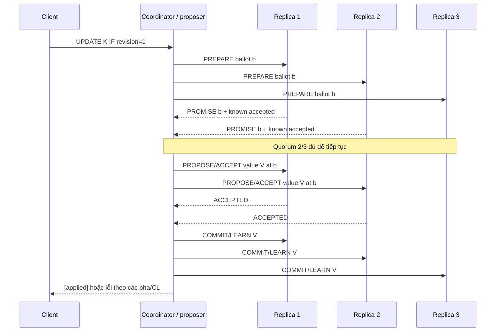

# Lightweight transaction và cơ chế đồng thuận theo phiên bản

## 1. Vấn đề: nhiều phiên bản của một trạng thái và nhiều người ghi

Apache Cassandra là hệ quản trị dữ liệu **wide-column phân tán**: partition key xác định nơi đặt dữ liệu, keyspace replication quyết định số replica, còn consistency level (CL) quyết định số phản hồi cần thiết. Với nhiều writer, một câu `INSERT` hoặc `UPDATE` thông thường không có điều kiện vẫn là một **mutation** được giải quyết theo timestamp; việc đọc trước rồi ghi sau **không** tự tạo khóa giao dịch.

Trong chương **LWT và đồng thời** của module `DATABASE_ENGINE_WIDE_COLUMN_CASSANDRA`, ta xét một đối tượng được nhiều ứng dụng Java cùng cập nhật. Chủ đề này có **ba loại “phiên bản” dễ bị nhầm**:

1. **Phiên bản nghiệp vụ — `revision`:** một cột `int` do ứng dụng quản lý để thực hiện optimistic concurrency, ví dụ chỉ đổi trạng thái khi `revision=7`.
2. **Phiên/ballot của Paxos:** định danh thứ tự của một đề xuất đồng thuận, dùng trong giao thức đảm bảo những proposer tranh nhau không cùng quyết định hai giá trị trái ngược. Đây **không** phải cột CQL `revision`.
3. **Biến thể triển khai giao thức — `paxos_variant`:** lựa chọn `v1`/`v2` của server Cassandra, có đặc tính về round trip và linearizable read khác nhau. Nó **không** phải CQL version, native protocol version hay Java Driver major version.

### Mục tiêu học tập

Sau bài học, bạn có thể:

- Mô tả cách Cassandra dùng **Paxos và lightweight transactions (LWT)** để thực hiện compare-and-set (CAS) trong phạm vi partition.
- Giải thích các pha **prepare/promise, propose/accept, commit/learn** ở mức khái niệm, và cơ chế **quorum giao nhau**.
- Viết `INSERT ... IF NOT EXISTS` và `UPDATE ... IF revision = ...`, đọc `[applied]`, xử lý xung đột/timeout.
- Phân biệt `SERIAL` và `LOCAL_SERIAL` với CL thông thường như `LOCAL_QUORUM`.
- Hiểu vai trò của `paxos_variant: v1` so với `v2` ở các nhánh Cassandra hỗ trợ, những điều kiện khi nâng cấp và mối quan hệ với Paxos repair.
- Thực hành CQL qua hai phiên `cqlsh`, kiểm tra trạng thái dữ liệu theo partition key và xử lý LWT từ Java Driver.
- Đánh giá chi phí, giới hạn, nguy cơ ghi không dùng CAS, hot partition, ABA và phương án phục hồi khi phản hồi giao dịch bị mất.

> **Phạm vi:** mã lab sử dụng Cassandra **5.0.9** trên một node Docker để kiểm tra cú pháp và cạnh tranh giữa client; không dùng nó chứng minh khả năng chịu lỗi của cụm RF=3. Các thay đổi `paxos_variant`/`paxos_state_purging` trên cluster đang vận hành là **thay đổi cấp cluster**, cần runbook độc lập, không phải bài tập thay config trực tiếp.

## 2. Vì sao đọc phiên bản rồi ghi vẫn bị race?

Giả sử người dùng giữ một chỗ ngồi. Bảng ứng dụng có cột `revision=1`, `state='FREE'`. Hai worker A và B cùng thực hiện:

```text
T0: A SELECT revision, state -> 1, FREE
T1: B SELECT revision, state -> 1, FREE
T2: A ở Java quyết định "còn chỗ"
T3: B ở Java quyết định "còn chỗ"
T4: A UPDATE thường -> RESERVED cho Alice
T5: B UPDATE thường -> RESERVED cho Bob
T6: cả A lẫn B có thể nhận phản hồi thành công
```

Đây là lỗi **time-of-check to time-of-use (TOCTOU)**. `LOCAL_QUORUM` hoặc `ALL` cho mỗi statement độc lập **không đặt khóa từ lần SELECT đến lần UPDATE**. Tương tự, thêm `synchronized` trong một tiến trình Java không bảo vệ các JVM/Pod khác.

Kết quả cuối còn chịu **mutation timestamp** và reconciliation của Cassandra: đừng suy “request đến sau luôn thắng” một cách tuyệt đối khi clock và network thay đổi.

### 2.1. So sánh hai cách ghi

| Cách triển khai | Câu CQL cuối | Hai người có thể cùng được báo thành công? |
|---|---|---|
| Read–then–write ở Java | `UPDATE ... WHERE key=...` | **Có** |
| Ghi thường với quorum | `UPDATE ... WHERE key=...` tại `LOCAL_QUORUM` | **Có**; quorum không giữ điều kiện ở hai request |
| Chỉ hỏi row có tồn tại | `UPDATE ... IF EXISTS` | **Có** nếu row luôn tồn tại; không bảo vệ state/revision |
| Compare-and-set | `UPDATE ... IF state='FREE' AND revision=1` | Không cùng vượt qua **cùng phiên bản ban đầu** khi các writer tuân thủ CAS |
| Tạo tên duy nhất | `INSERT ... IF NOT EXISTS` trên **khóa của tên** | Chỉ một claim được chấp thuận cho row chưa tồn tại, nếu không có xóa/tái tạo xen vào |

**Quy tắc:** kiểm tra phải nằm trong **chính conditional mutation**, chứ không chỉ là một `if` ở client.

## 3. Cơ sở của Paxos: đồng thuận một giá trị giữa replica

### 3.1. Vai trò và khái niệm

Trong một CAS trên một partition, Cassandra cần các replica phối hợp để thống nhất proposal hợp lệ, ngay cả khi nhiều coordinator gửi thao tác đồng thời.

| Thuật ngữ | Ý nghĩa đối với LWT |
|---|---|
| **Client** | Gửi `INSERT/UPDATE/DELETE ... IF ...` từ cqlsh hoặc Java |
| **Coordinator / proposer** | Node nhận request và điều phối các thông điệp consensus |
| **Replica / acceptor** | Node chịu trách nhiệm cho partition và tham gia hứa/nhận proposal |
| **Ballot** | Định danh phiên đề xuất có thứ tự đủ để so sánh proposal mới/cũ trong Paxos |
| **Promise** | Acceptor cam kết không nhận proposal có ballot thấp hơn mức đã hứa |
| **Accepted proposal** | Giá trị/đề xuất được acceptor chấp nhận trong một pha |
| **Chosen/committed value** | Giá trị đã đạt điều kiện consensus, cần được học/áp dụng theo cơ chế LWT |
| **Quorum** | Đa số replica tham gia đồng thuận; với RF=3 là 2/3 |

Một coordinator có thể thay đổi theo request. **Seed node không phải leader Paxos cố định**, và “coordinator” không có nghĩa node sở hữu dữ liệu duy nhất.

### 3.2. Minh họa thuật toán Paxos cổ điển



Sơ đồ này **giảng giải nguyên tắc**, **không phải packet trace hay hợp đồng số vòng mạng cố định** cho mọi phiên bản Cassandra. Cassandra tối ưu Paxos theo cấu hình, cached state, fast path và cách hoàn tất read/commit; không dùng sơ đồ để đoán một request chắc chắn phải có đúng N gói tin.

### 3.3. Vì sao hai quorum không dễ quyết định hai giá trị trái nhau?

Với RF=3, các tập 2 replica bất kỳ **luôn giao nhau**:

```text
Q1 = {R1, R2}
Q2 = {R2, R3}
               ^ R2 chung
```

Một acceptor giữ thông tin ballot đã promise/accepted, nên proposer mới phải xét trạng thái đã có để bảo toàn quyết định trước. Khi hai client tranh cùng điều kiện `revision=1`, cơ chế LWT phối hợp để chỉ một transition từ phiên bản đó được chấp thuận; transaction còn lại có thể gặp **condition false**, contention/retry hoặc timeout tùy thời điểm.

**Không cần mọi replica online:** một DC RF=3 có thể đạt quorum với 2 replica. Nhưng nếu chỉ 1 replica còn hoạt động, không đủ đa số cho consensus thông thường. Quorum đảm bảo safety theo điều kiện giao thức; **không** bảo đảm liveness khi network phân mảnh, tài nguyên cạn hoặc client timeout.

### 3.4. Ballot không phải timestamp của cột dữ liệu

| Giá trị | Người quản lý | Dùng để làm gì? | Được ứng dụng tăng bằng SQL/CQL? |
|---|---|---|---|
| `revision` (int) | Ứng dụng | Optimistic concurrency trên state của một row | **Có**, bằng `SET revision=... IF revision=...` |
| Paxos ballot | Giao thức consensus | Xác định thứ tự proposal và lời hứa acceptor | **Không**; server quản lý |
| `WRITETIME(column)` | Mutation path Cassandra | Timestamp ở cấp cell khi reconcile | Có thể cấp timestamp cho **ghi thường** trong một số trường hợp; **không ép** `USING TIMESTAMP` cho conditional mutation |
| `event_time` | Nghiệp vụ | Thời điểm xảy ra sự kiện ở ứng dụng | Có thể lưu trong cột `timestamp` |
| `paxos_variant` | Cấu hình server | Chọn cách triển khai Paxos v1/v2 | **Không** nằm trong câu CQL/row |

Tăng `revision` từ 1 lên 2 **không thay thế Paxos ballot**. Và ép `WRITETIME` lớn hơn mutation khác **không phải** cách xây CAS đúng.

## 4. LWT đảm bảo gì và không đảm bảo gì?

### 4.1. Linearizability có phạm vi

Với các conditional mutations dùng đúng giao thức, các thao tác cạnh tranh trên **cùng partition** có thể được lý giải như được quyết định theo một thứ tự nhất quán với ràng buộc thời gian thực: đây là tư tưởng **linearizability**.

Tuy nhiên cần đọc đúng phạm vi:

- LWT **không biến mọi `SELECT` thường** thành linearizable read. CL đọc, biến thể Paxos và tình trạng pha commit còn quan trọng.
- LWT **không tự bảo vệ mọi bảng** có dữ liệu nhân bản theo ứng dụng. Một CAS tại bảng `claims_by_handle` không tự cập nhật nguyên tử bảng `users_by_id` ở partition khác.
- LWT **không tạo unique index** cho cột `handle` nếu primary key lại là `user_id`.
- Mọi **đường ghi có thể tranh invariant** phải theo chính sách CAS; một service dùng `UPDATE` thường vẫn có thể phá quy tắc version.
- Một **timeout** không có nghĩa giao dịch đã thất bại. Nó có thể đã được quyết định nhưng response bị mất.
- Nếu muốn side effect ở Kafka, thanh toán hoặc email, Cassandra LWT **không** mang các hệ thống đó vào một transaction chung.

### 4.2. Phạm vi partition mới là ranh giới cần thiết kế

Giả sử muốn một tenant giữ một resource chỉ cho một owner:

```sql
PRIMARY KEY ((tenant_id, resource_id))
```

Mọi client tranh cặp `tenant_id/resource_id` sẽ CAS cùng partition. Ngược lại, `PRIMARY KEY (owner_id)` chỉ bảo vệ việc một owner có row hay chưa, không bảo vệ tính duy nhất theo resource.

Nếu cần invariant toàn tenant trên **hàng nghìn partition** (ví dụ tổng hạn mức tồn kho), một CAS riêng từng partition **không cung cấp transaction xuyên partition**. Phải thiết kế một partition/aggregate điều phối invariant hoặc dùng kiến trúc khác, đồng thời cân nhắc **hot partition** khi dồn mọi cập nhật vào một key.

## 5. Ba tầng phiên bản cần phân biệt khi vận hành

### 5.1. Application revision: optimistic locking

Một row có trạng thái `FREE, revision=1`. Client gửi:

```sql
UPDATE lwt003.reservations
SET owner_id='alice', state='HELD', revision=2
WHERE tenant_id='t1' AND resource_id='seat-42'
IF state='FREE' AND revision=1;
```

Nếu thành công, `[applied]=True`. Một client khác dùng `IF revision=1` sẽ không thể tiếp tục “thắng” cùng phiên bản nếu không có writer phá trạng thái/đưa revision về 1. Đó là **optimistic concurrency control (OCC)**: không giữ khóa lâu ở Java, mà phát hiện xung đột lúc ghi.

`revision` là cột nghiệp vụ. Cassandra **không tự tăng** nó cho mọi request. Client phải chủ động `SET revision=2` và `IF revision=1`; khi xung đột phải đọc lại trạng thái và quyết định transition mới.

### 5.2. Paxos ballot: phiên đề xuất consensus

Paxos dùng ballot để xử lý trường hợp proposer tranh nhau. Trong quá trình recovery, proposer với ballot cao hơn không được tùy ý bỏ qua giá trị đã được accept trước: nó phải tiếp tục xét các trạng thái promise/accepted theo giao thức.

Vì vậy:

- Không có câu CQL hợp lệ để “đặt ballot=9 cho row”.
- Ballot không bằng `revision` và không nên ghi vào domain model như một fencing token tùy tiện.
- Khi thấy request chậm do contention, nguyên nhân có thể là **nhiều proposal cùng partition**; tăng timestamp mutation hoặc nâng regular CL không giúp loại bỏ giao tranh.

### 5.3. paxos_variant: thế hệ thuật toán trong cassandra.yaml

Apache Cassandra 4.1 đưa vào **Paxos v2** bên cạnh cơ chế v1 cũ. Tài liệu Cassandra 5.x mô tả biến `paxos_variant` và các biến thể được tối ưu, trong đó `v2` được khuyến nghị; nhưng **đừng suy rằng mọi cài đặt 5.x tự bật v2**. Tệp cấu hình tương thích `cassandra.yaml` và tệp tùy chọn tính năng mới `cassandra_latest.yaml` có thể dùng mặc định khác nhau; image/package và cấu hình hiệu lực phải được kiểm tra trực tiếp.

**Không nhầm:**

- Cassandra **5.0.9**: phiên bản **server software**.
- `paxos_variant: v2`: biến thể **thuật toán đồng thuận**.
- Native protocol `vN`: giao thức **client ↔ Cassandra**, không liên quan cách version row.
- Java Driver **4.x**: phiên bản **thư viện client**, không chọn Paxos v1/v2 bằng số major.

## 6. Paxos v1 và v2: phiên bản thay đổi điều gì?

Theo tài liệu cấu hình chính thức, có thể hiểu các lựa chọn như sau:

| Lựa chọn | Mục đích | Round trip tham khảo của tài liệu | Đặc điểm cần chú ý |
|---|---|---|---|
| `v1` | Paxos legacy, chế độ tương thích | Khoảng **4 RT** cho LWT write và **3 RT** cho serial read | Mặc định được nêu cho cấu hình tương thích |
| `v2` | Paxos tối ưu | Khoảng **2 RT** write, **1 hoặc 2 RT** read | Được tài liệu khuyến nghị; giảm coordination latency |
| `v1_without_linearizable_reads_or_rejected_writes` | Legacy mode giảm chi phí đọc | Khoảng **4 RT** write, **2 RT** read | **Không** bảo đảm cùng semantics linearizable read/rejected write |
| `v2_without_linearizable_reads` | v2 giảm chi phí serial read | Khoảng **2 RT** write, **1 RT** read | Bỏ bảo đảm linearizable reads tương ứng |
| `v2_without_linearizable_reads_or_rejected_writes` | v2 thêm lược bỏ bảo đảm | Khoảng **2 RT** write, **1 RT** read | Có khác biệt bảo đảm cho cả read và rejected write |

**RT** là *round trip* mô tả đường đi của giao thức, **không** phải thời gian thực cố định: contention, timeout, multi-DC WAN, repair state, read path và lỗi mạng làm số vòng/thời gian thật thay đổi. Những tên variant có hậu tố `without_...` là **đánh đổi ngữ nghĩa**, không phải “bật chế độ nhanh hơn và vẫn giữ mọi bảo đảm như cũ”.

V2 cải thiện tính đúng đắn khi topology/range movement được thực hiện an toàn, và có tối ưu liên quan **Paxos repair/state purging**. Nhưng không dùng bảng này để tự đổi config của một cluster đang vận hành khi chưa có runbook và kiểm tra tương thích.

### 6.1. Cách xem cấu hình, không tự thay trong bài

Nếu chạy Cassandra Docker ở phần lab:

```bash
docker exec cassandra-lwt003 sh -c "grep -n -E '^[[:space:]]*#?[[:space:]]*(paxos_variant|paxos_state_purging)[[:space:]]*:' /etc/cassandra/cassandra.yaml"
docker exec cassandra-lwt003 nodetool version
```

Đầu ra `grep` có thể gồm **dòng comment**, không chứng minh option đó đang hiệu lực. Cần xem file startup, các source cấu hình được image hỗ trợ, giá trị default **đúng phiên bản** và log server. Một số biến tùy chọn có thể không xuất hiện trong `cassandra.yaml` vì đang sử dụng mặc định.

**Không giả định** `-e CASSANDRA_PAXOS_VARIANT=v2` sẽ được Docker Official Image tự chuyển vào file: entrypoint chỉ hỗ trợ một tập biến môi trường cụ thể. Không sửa hàng loạt `cassandra.yaml` của node thật từ một script lab.

### 6.2. Chuyển từ v1 sang v2 là thay đổi cluster, không phải CQL

Hướng dẫn cấu hình Apache dành cho nhánh hỗ trợ nêu các điều kiện điển hình khi **nâng v1 → v2**:

1. Các node đã ở phiên bản Cassandra **4.1+ đồng nhất theo kế hoạch được hỗ trợ**.
2. Thực hiện **full repair** thích hợp trên các primary ranges của **mỗi node**, tài liệu đưa ví dụ `nodetool repair --full -pr`, có giám sát và capacity.
3. Đặt `paxos_variant: v2` theo cấu hình versioned, rồi **rolling restart** các node theo runbook.
4. Giám sát latency, Paxos failures/unknown, read behavior, hints/repair/backlog, schema và peer connectivity; có kế hoạch revert variant khi cần.

Những bước trên là **kiến thức thiết kế quy trình**, **không phải lời khuyên chạy ngay**. Full repair tiêu tốn network, CPU, I/O và dung lượng tạm; phải biết topology, quãng thời gian triển khai, workload và cả phiên bản cluster. **Tuyệt đối không gọi `nodetool repair --full -pr` trên production chỉ để thử xem có nhanh hơn không**.

### 6.3. Paxos state purging và điều kiện đặc biệt của CL ANY

Cassandra có cấu hình `paxos_state_purging` liên quan vòng đời trạng thái Paxos/repair. Tài liệu giải thích khi dùng **v2** và chế độ **`paxos_state_purging: repaired`**, sau khi đáp ứng các điều kiện repair an toàn, một số tối ưu **commit consistency ANY** mới được xem là an toàn.

Đây là một **điều kiện kỹ thuật rất cụ thể**: **không lấy câu “ANY cho write rẻ” để cấu hình `CONSISTENCY ANY` làm mặc định cho mọi LWT**, đặc biệt ở v1 hoặc khi chưa có lịch Paxos repair. Thay đổi state purging sai thứ tự có thể ảnh hưởng tính đúng đắn; cần bám **upgrade notes của đúng nhánh Cassandra**, không tự đổi cả hai option cùng lúc.

## 7. Serial consistency và regular consistency: hai pha khác nhau

Trong LWT, phải phân biệt:

| Thuộc tính | Giá trị ví dụ | Vai trò |
|---|---|---|
| **Serial CL** | `SERIAL` hoặc `LOCAL_SERIAL` | Quorum dùng trong phần Paxos/kiểm tra điều kiện |
| **Regular/commit CL** | `LOCAL_QUORUM`, `QUORUM` hoặc mức phù hợp | Điều kiện phản hồi của pha commit/learn của mutation |
| **RF trong keyspace** | `dc1:3` | Bao nhiêu replica giữ partition ở DC |
| **Partition key** | `(tenant_id,resource_id)` | Replica nào tham gia consensus của đối tượng |

### 7.1. Ví dụ cqlsh

```text
CONSISTENCY LOCAL_QUORUM;
SERIAL CONSISTENCY SERIAL;
```

Đây là **lệnh của cqlsh**, không phải lệnh `ALTER KEYSPACE` hoặc CQL statement gửi nguyên văn từ Java.

Với RF=3 trong một DC, `LOCAL_QUORUM` cần hai replica; còn RF=1 của lab chỉ cần một replica. `SERIAL` và `LOCAL_SERIAL` cần được chọn theo topology:

- `SERIAL`: phạm vi serial consensus trên các replica phù hợp của cluster, cần cân nhắc WAN nếu nhiều DC.
- `LOCAL_SERIAL`: serial consensus giới hạn ở datacenter local; có thể giảm latency WAN nhưng **không tự có thứ tự CAS thống nhất toàn cầu** nếu các ứng dụng ở các DC khác nhau tranh một invariant chung.
- Không trộn `SERIAL` và `LOCAL_SERIAL` trên cùng invariant đa DC khi chưa đánh giá kỹ semantics/version, vì lựa chọn sai có thể tạo các hành vi khó phát hiện.

### 7.2. Tính số phản hồi cho RF=3

```text
N = 3
Quorum = floor(N/2) + 1 = 2

Q1 = {n1,n2}; Q2 = {n2,n3}
⇒ Q1 và Q2 giao nhau ít nhất một node
```

| Trạng thái trong DC RF=3 | Regular LOCAL_ONE | Regular LOCAL_QUORUM | Serial quorum LWT |
|---|---|---|---|
| Ba replica khỏe | Có thể thành công | Có thể thành công | Có thể thành công |
| Một replica down, hai khỏe | Có thể thành công | Có thể thành công | **Có thể** thành công nếu đủ các pha |
| Hai replica down, một khỏe | Một số ghi/đọc thường có thể phục vụ tại ONE | Không đủ hai phản hồi | Không đủ consensus quorum thông thường |

**“Có thể” không phải bảo đảm SLA**: network partition, disk, GC, coordinator chết hoặc quá tải có thể gây timeout dù số node `UN` đủ.

### 7.3. Linearizable read không giống SELECT thường

Không xem `SELECT ...` ở regular `LOCAL_ONE` là lần đọc tuyến tính theo mọi CAS vừa xảy ra. Khi cần đọc theo semantics serial, phải dùng cách đọc/CL và variant Paxos được server hỗ trợ, xét chi phí và cấu hình thực tế. Biến thể `...without_linearizable_reads` **đánh đổi chính bảo đảm đó**. Một SELECT từ coordinator n3 không có nghĩa dữ liệu được lấy duy nhất từ ổ đĩa n3.

## 8. Thực hành một node: tạo môi trường Cassandra 5.0.9

### 8.1. Mức tài nguyên và phạm vi

Ví dụ sử dụng Docker Engine/Desktop với Linux containers, host khoảng 8 GiB RAM tổng trở lên cho lab nhỏ, cấp 4 GiB cho container và heap 2 GiB. Đây là **tham khảo**; máy có ít đĩa/RAM có thể cần điều chỉnh và khởi động lâu. Dùng port host `9339` **chỉ mở trên loopback** vì lab chưa bật auth/TLS.

Chạy trên host có Docker CLI:

```bash
docker version
docker pull cassandra:5.0.9
docker network create lwt003-net
docker volume create lwt003_node_data

docker run -d --name cassandra-lwt003 --network lwt003-net --memory=4g --memory-swap=4g -e MAX_HEAP_SIZE=2G -e CASSANDRA_CLUSTER_NAME=lwt003-lab -e CASSANDRA_ENDPOINT_SNITCH=GossipingPropertyFileSnitch -e CASSANDRA_DC=dc1 -e CASSANDRA_RACK=rack1 -p 127.0.0.1:9339:9042 -v lwt003_node_data:/var/lib/cassandra cassandra:5.0.9
```

**Không** dùng lại container/volume cùng tên nếu chưa kiểm tra nguồn gốc; ví dụ giả định lab mới. Không publish cổng không có auth/TLS ra `0.0.0.0` trên LAN/internet. Mọi node Cassandra phải có data volume riêng.

### 8.2. Kiểm tra node sẵn sàng

```bash
docker ps -a --filter name=cassandra-lwt003
docker logs --tail 100 cassandra-lwt003
docker exec cassandra-lwt003 nodetool status
docker exec cassandra-lwt003 nodetool statusbinary
docker exec cassandra-lwt003 cqlsh -e "SELECT release_version, cluster_name, data_center, rack FROM system.local WHERE key='local';"
```

Đợi một node `UN`, `statusbinary=running` và CQL trả cluster `lwt003-lab`, DC `dc1`, rack `rack1`, server 5.0.9. `docker run -d` trả container ID **không** chứng minh CQL đã mở. Nếu lệnh lỗi ngay sau startup, kiểm tra log/CPU/đĩa và thử lại khi ready.

### 8.3. Khởi tạo keyspace và hai bảng

Mở cqlsh:

```bash
docker exec -it cassandra-lwt003 cqlsh
```

Trong `cqlsh>`:

```sql
CREATE KEYSPACE IF NOT EXISTS lwt003
WITH replication = {'class':'NetworkTopologyStrategy','dc1':1}
AND durable_writes = true;

-- Dùng riêng cho thử lỗi read-then-write không có LWT.
CREATE TABLE IF NOT EXISTS lwt003.naive_reservations (
    tenant_id text,
    resource_id text,
    owner_id text,
    state text,
    revision int,
    PRIMARY KEY ((tenant_id, resource_id))
);

-- Bảng dành cho LWT theo cùng một khóa tài nguyên.
CREATE TABLE IF NOT EXISTS lwt003.reservations (
    tenant_id text,
    resource_id text,
    owner_id text,
    request_id uuid,
    revision int,
    state text,
    updated_at timestamp,
    PRIMARY KEY ((tenant_id, resource_id))
);

DESCRIBE KEYSPACE lwt003;
```

`(tenant_id,resource_id)` là **composite partition key**: hai client tranh cùng tài nguyên của cùng tenant sẽ gặp cùng một điểm consensus; client ở tenant khác có thể dùng cùng `resource_id` mà không xung đột. `CREATE TABLE IF NOT EXISTS` chỉ là DDL guard, **không đảm bảo schema đã tồn tại giống mong đợi**; nên `DESCRIBE TABLE` để kiểm tra nếu volume không rỗng.

### 8.4. Đặt các mức consistency cho phiên cqlsh

```text
CONSISTENCY LOCAL_QUORUM;
SERIAL CONSISTENCY SERIAL;
```

Ở lab RF=1, các mức này vẫn có tác dụng về semantics nhưng chỉ có **một replica**, nên không phản ánh số round trip WAN, failover hoặc minority partition.

## 9. Thí nghiệm A: race với ghi thường và giải pháp CAS

### 9.1. Hai client cùng đọc phiên bản cũ

Mở **hai terminal**, mỗi terminal chạy:

```bash
docker exec -it cassandra-lwt003 cqlsh
```

Gọi là client A và B. Trong **mỗi phiên**, đặt CL như mục 8.4. Dùng row mới `race-naive-003`.

**Client A:**

```sql
SELECT owner_id, state, revision
FROM lwt003.naive_reservations
WHERE tenant_id='t1' AND resource_id='race-naive-003';
```

**Client B:** chạy **cùng SELECT trước khi A ghi**. Cả hai quan sát row chưa tồn tại. Sau đó:

**A:**

```sql
INSERT INTO lwt003.naive_reservations
    (tenant_id, resource_id, owner_id, state, revision)
VALUES ('t1', 'race-naive-003', 'alice', 'HELD', 1);
```

**B:**

```sql
INSERT INTO lwt003.naive_reservations
    (tenant_id, resource_id, owner_id, state, revision)
VALUES ('t1', 'race-naive-003', 'bob', 'HELD', 1);
```

Cả hai INSERT **có thể thành công**; client không được thông báo rằng “row đã có chủ khác”. Kiểm tra:

```sql
SELECT owner_id, state, revision
FROM lwt003.naive_reservations
WHERE tenant_id='t1' AND resource_id='race-naive-003';
```

Kết quả cuối có một owner theo mutation timestamp, nhưng đó **không phải tiêu chí thành công của quy tắc một người giữ chỗ**: cả A và B đã được chấp thuận. Không phụ thuộc Alice hay Bob là owner cuối khi diễn giải race.

### 9.2. Hai client dùng INSERT IF NOT EXISTS

Trên **bảng LWT** và khóa mới `race-claim-003`:

**A:**

```sql
INSERT INTO lwt003.reservations
    (tenant_id, resource_id, owner_id, request_id, revision, state, updated_at)
VALUES
    ('t1', 'race-claim-003', 'alice',
     30000000-0000-4000-8000-000000000001, 1, 'HELD',
     '2026-11-21T08:00:00Z')
IF NOT EXISTS;
```

Khi row chưa tồn tại, A thường thấy `[applied]=True`. Sau đó **B**:

```sql
INSERT INTO lwt003.reservations
    (tenant_id, resource_id, owner_id, request_id, revision, state, updated_at)
VALUES
    ('t1', 'race-claim-003', 'bob',
     30000000-0000-4000-8000-000000000002, 1, 'HELD',
     '2026-11-21T08:00:01Z')
IF NOT EXISTS;
```

B thường thấy `[applied]=False` và row vẫn thuộc Alice (khi thực hiện tuần tự như trên). Với một cuộc đua đồng thời thật sự trên khóa mới, **ai nhận true không cố định**; bảo đảm cần kiểm tra là **không có hai conditional mutations cùng thắng yêu cầu “chưa có row”** nếu không có xóa/recreate xen vào.

Đọc lại bằng **đúng partition key**:

```sql
SELECT owner_id, request_id, revision, state
FROM lwt003.reservations
WHERE tenant_id='t1' AND resource_id='race-claim-003';
```

**Đây là LWT** vì điều kiện `IF NOT EXISTS`, không phải vì khóa là UUID hay vì có `LOCAL_QUORUM`. Hai câu CQL sau khác bản chất: `CREATE TABLE IF NOT EXISTS` là DDL guard, còn `INSERT ... IF NOT EXISTS` là CAS của dữ liệu.

## 10. Thí nghiệm B: optimistic revision qua nhiều lần chuyển trạng thái

### 10.1. Tạo một row version=1

Chọn khóa mới `race-revision-003` để độc lập với ví dụ claim:

```sql
INSERT INTO lwt003.reservations
    (tenant_id, resource_id, owner_id, request_id, revision, state, updated_at)
VALUES
    ('t1', 'race-revision-003', 'unassigned',
     30000000-0000-4000-8000-000000000011, 1, 'FREE',
     '2026-11-21T09:00:00Z')
IF NOT EXISTS;

SELECT owner_id, state, revision
FROM lwt003.reservations
WHERE tenant_id='t1' AND resource_id='race-revision-003';
```

Trên dữ liệu mới, kết quả `unassigned/FREE/1`. Nếu `IF NOT EXISTS` báo False, kiểm tra row đã tồn tại; không ghi thường để “reset nhanh” state của CAS.

### 10.2. Client A thay đổi revision có điều kiện

```sql
UPDATE lwt003.reservations
SET owner_id='alice',
    state='HELD',
    revision=2,
    request_id=30000000-0000-4000-8000-000000000012,
    updated_at='2026-11-21T09:05:00Z'
WHERE tenant_id='t1' AND resource_id='race-revision-003'
IF state='FREE' AND revision=1;
```

Kỳ vọng `[applied]=True`. Câu lệnh quyết định **ở server**, không dựa vào việc A vừa SELECT thấy `FREE` ở Java.

### 10.3. Client B dùng revision cũ

```sql
UPDATE lwt003.reservations
SET owner_id='bob',
    state='HELD',
    revision=2,
    request_id=30000000-0000-4000-8000-000000000013,
    updated_at='2026-11-21T09:05:01Z'
WHERE tenant_id='t1' AND resource_id='race-revision-003'
IF state='FREE' AND revision=1;
```

B nhận `[applied]=False` nếu A đã áp dụng. Kiểm tra:

```sql
SELECT owner_id, state, revision, request_id
FROM lwt003.reservations
WHERE tenant_id='t1' AND resource_id='race-revision-003';
```

Khi B thấy `revision=2`, cách đúng là **đọc lại, kiểm tra nghiệp vụ và tính một transition mới** nếu được phép; không retry cùng `revision=1` vô hạn, càng không bỏ `IF` để ép ghi.

### 10.4. So IF EXISTS với IF version

Với row đã tồn tại, câu lệnh:

```sql
-- Phản ví dụ: row vẫn tồn tại nên có thể được áp dụng
-- dù Alice đã giữ chỗ. KHÔNG CHẠY trên row cần bảo vệ:
UPDATE lwt003.reservations
SET owner_id='bob', state='HELD', revision=2
WHERE tenant_id='t1' AND resource_id='race-revision-003'
IF EXISTS;
```

chỉ kiểm tra sự tồn tại, không kiểm tra version. Vì vậy, cùng một row có thể nhận **hai UPDATE IF EXISTS thành công** từ hai client. `IF EXISTS` hữu ích để không upsert row vắng mặt, **không** thay `IF revision=...` khi cần optimistic locking.

### 10.5. Một transition tiếp theo hợp lệ

Sau khi Alice giữ chỗ ở revision 2, thử xác nhận:

```sql
UPDATE lwt003.reservations
SET state='CONFIRMED', revision=3,
    updated_at='2026-11-21T09:10:00Z'
WHERE tenant_id='t1' AND resource_id='race-revision-003'
IF owner_id='alice' AND state='HELD' AND revision=2;
```

Kỳ vọng `True` nếu dữ liệu thực còn đúng. Điều kiện trên **owner, state và revision** mô tả một bước của **state machine**. Một lần `False` nghĩa request không được áp dụng, không phải Cassandra hỏng.

### 10.6. DELETE có điều kiện và ABA

```sql
-- Điều kiện cũ, trên row CONFIRMED/3 của Alice phải False.
DELETE FROM lwt003.reservations
WHERE tenant_id='t1' AND resource_id='race-revision-003'
IF owner_id='bob' AND revision=2;
```

Không tự động xóa row chỉ vì muốn chạy lại demo. Khi row bị xóa, Cassandra tạo tombstone và một request mới có thể `INSERT IF NOT EXISTS` lại theo khóa cũ. **ABA** xảy ra khi đối tượng trở lại trạng thái nhìn giống ban đầu nhưng đã trải qua vòng đời ownership khác. Với booking/payment thật, cần generation, request ID/idempotency, audit và quy tắc tái cấp tài nguyên.

## 11. Kết quả CAS: ba nhóm không thể gộp làm một

| Kết quả phía client | Ý nghĩa | Phản ứng ứng dụng |
|---|---|---|
| `[applied]=True` | Điều kiện đã được chấp thuận và mutation được áp dụng theo semantics LWT/commit CL | Trả success, lưu request ID |
| `[applied]=False` | Condition không thỏa ở thời điểm quyết định, **không có mutation của statement này** | Đọc current state nếu cần, trả conflict/rebase |
| Timeout, mất kết nối, unavailable, exception | **Chưa có kết quả CAS có thể tin cậy**; timeout có thể tới sau một quyết định | Ghi trạng thái `UNKNOWN`, reconcile, retry có giới hạn |

### 11.1. Một timeout không chứng minh CAS bị từ chối

```text
Client gửi IF revision=1  --->  Paxos replicas
                                   |
                                   +--- Có thể đã quyết định/commit
                                   |
                     mạng/response X
Client nhận timeout
=> Không biết chắc transaction cuối cùng đã áp dụng hay chưa.
```

Nếu retry `INSERT IF NOT EXISTS` trên khóa đó, response có thể là `False` vì **request đầu của chính client đã thành công**, không phải vì một người khác giành trước.

### 11.2. Reconcile bằng request_id

Một mẫu an toàn hơn (đơn giản hóa cho lab):

1. Sinh `request_id` **một lần** trước lần gửi đầu; giữ nguyên khi retry.
2. Ghi `request_id` cùng với `owner_id` và `revision` trong **cùng conditional mutation**.
3. `True` → ghi nhận thành công.
4. `False` → đọc lại row, so `owner_id/request_id`: nếu là request của mình, có thể đây là lần retry sau commit; nếu khác, đó có thể là conflict.
5. Timeout → ghi `UNKNOWN`, đọc lại theo key bằng CL phù hợp, cân nhắc serial read/hoàn tất Paxos theo semantics server và retry có backoff/hạn mức.
6. Nếu row có thể DELETE/TTL/reuse hoặc có side effect bên ngoài (Kafka, email, payment), bổ sung **generation/fencing/outbox/saga**; chỉ request ID có thể chưa đủ để chứng minh exactly-once.

Không viết `catch (Exception e) { return false; }` để gộp lỗi hạ tầng vào conflict nghiệp vụ. Một `False` có phản hồi hợp lệ khác hoàn toàn một request **không biết kết quả**.

## 12. Java Driver 4.x: đặt hai CL và kiểm tra wasApplied()

### 12.1. Môi trường và contact point

Ví dụ dùng Java 17 và Apache Cassandra Java Driver 4.x, package `com.datastax.oss.driver.api.core`. Khi app Java chạy trên **host**, contact point ban đầu là `127.0.0.1:9339`; khi chạy **trong một container thuộc Docker network `lwt003-net`**, dùng `cassandra-lwt003:9042`. Trong cluster nhiều node, driver còn cần route tới các peer addresses Cassandra quảng bá; kết nối được một contact point chưa chứng minh mọi peer có thể truy cập.

### 12.2. Ví dụ Java hoàn chỉnh: claim một resource bằng LWT

```java
import java.net.InetSocketAddress;
import java.util.UUID;

import com.datastax.oss.driver.api.core.CqlSession;
import com.datastax.oss.driver.api.core.DefaultConsistencyLevel;
import com.datastax.oss.driver.api.core.cql.BoundStatement;
import com.datastax.oss.driver.api.core.cql.PreparedStatement;
import com.datastax.oss.driver.api.core.cql.ResultSet;
import com.datastax.oss.driver.api.core.cql.Row;

public final class ClaimResource {
    public static void main(String[] args) {
        String host = required("CASSANDRA_HOST");
        int port = Integer.parseInt(required("CASSANDRA_PORT"));
        String dc = required("CASSANDRA_LOCAL_DC");
        String expectedCluster = required("EXPECTED_CLUSTER");

        try (CqlSession session = CqlSession.builder()
                .addContactPoint(new InetSocketAddress(host, port))
                .withLocalDatacenter(dc)
                .build()) {
            Row identity = session.execute(
                "SELECT cluster_name, data_center FROM system.local WHERE key='local'")
                .one();
            if (identity == null
                    || !expectedCluster.equals(identity.getString("cluster_name"))
                    || !dc.equals(identity.getString("data_center"))) {
                throw new IllegalStateException("Unexpected Cassandra cluster/DC");
            }

            PreparedStatement prepared = session.prepare(
                "INSERT INTO lwt003.reservations " +
                "(tenant_id, resource_id, owner_id, request_id, revision, state) " +
                "VALUES (?, ?, ?, ?, 1, 'HELD') IF NOT EXISTS");

            UUID requestId = UUID.randomUUID();
            BoundStatement stmt = prepared.bind(
                    "t1", "java-claim-003", "java-alice", requestId)
                    .setConsistencyLevel(DefaultConsistencyLevel.LOCAL_QUORUM)
                    .setSerialConsistencyLevel(DefaultConsistencyLevel.SERIAL);

            ResultSet result = session.execute(stmt);
            if (result.wasApplied()) {
                System.out.println("APPLIED request=" + requestId);
            } else {
                Row existing = session.execute(
                    "SELECT owner_id, request_id FROM lwt003.reservations " +
                    "WHERE tenant_id='t1' AND resource_id='java-claim-003'")
                    .one();
                System.out.println("NOT_APPLIED, existing=" +
                        (existing == null ? "unknown" : existing.getString("owner_id")));
            }
        }
    }

    private static String required(String name) {
        String v = System.getenv(name);
        if (v == null || v.isBlank()) {
            throw new IllegalArgumentException("Missing " + name);
        }
        return v;
    }
}
```

Biến môi trường minh họa khi Java chạy **trên host**:

```text
CASSANDRA_HOST=127.0.0.1
CASSANDRA_PORT=9339
CASSANDRA_LOCAL_DC=dc1
EXPECTED_CLUSTER=lwt003-lab
```

**Lưu ý quan trọng:** `ResultSet.wasApplied()` là cách đọc cột `[applied]` của conditional mutation. Với statement **không có IF**, API có thể trả `true` theo định nghĩa driver, **không** chứng minh INSERT đã tạo một row mới. Chỉ diễn giải nó như CAS result khi bạn **biết câu CQL có điều kiện**.

Nếu lệnh `session.execute(stmt)` ném exception, mã ví dụ sẽ propagate lỗi, **không** coi đó là `false`. Trong ứng dụng thật, cần tách timeout/unknown và dùng request ID bền vững để reconcile; `UUID.randomUUID()` mỗi lần chạy chương trình **không** tự bảo đảm retry xuyên process giữ cùng ID.

### 12.3. Prepared UPDATE với revision

Một đoạn Java sử dụng trong method đã có `session`:

```java
PreparedStatement cas = session.prepare(
    "UPDATE lwt003.reservations " +
    "SET owner_id=?, state=?, revision=?, request_id=? " +
    "WHERE tenant_id=? AND resource_id=? " +
    "IF state=? AND revision=?");

BoundStatement bound = cas.bind(
        "java-alice", "HELD", 2, requestId,
        "t1", "another-resource-003",
        "FREE", 1)
    .setConsistencyLevel(DefaultConsistencyLevel.LOCAL_QUORUM)
    .setSerialConsistencyLevel(DefaultConsistencyLevel.SERIAL);

ResultSet result = session.execute(bound);
if (!result.wasApplied()) {
    // Có phản hồi hợp lệ: điều kiện không thỏa.
    // Đọc lại state/revision trước khi quyết định retry.
}
```

Đoạn này là **snippet**, không phải chương trình có thể chạy một mình: cần tạo row `another-resource-003` ở `FREE/1` trước; `session` và `requestId` được cung cấp bởi ngữ cảnh gọi. Prepared statement/driver không tự thêm Paxos vào một `UPDATE` thiếu `IF`.

### 12.4. Tranh chấp thật sự bằng hai thread

Với ứng dụng Java, có thể dùng `CountDownLatch` để hai worker cùng được thả:

```java
// Snippet đặt trong method đã có session và prepared ở mục 12.2.
// Bổ sung imports: java.util.concurrent.* và java.util.UUID.
String resource = "race-" + UUID.randomUUID();
java.util.concurrent.CountDownLatch start =
        new java.util.concurrent.CountDownLatch(1);
java.util.concurrent.ExecutorService pool =
        java.util.concurrent.Executors.newFixedThreadPool(2);
try {
    java.util.concurrent.Callable<Boolean> a = () -> {
        start.await();
        return session.execute(prepared.bind(
                "t1", resource, "alice", UUID.randomUUID())
                .setConsistencyLevel(DefaultConsistencyLevel.LOCAL_QUORUM)
                .setSerialConsistencyLevel(DefaultConsistencyLevel.SERIAL))
                .wasApplied();
    };
    java.util.concurrent.Callable<Boolean> b = () -> {
        start.await();
        return session.execute(prepared.bind(
                "t1", resource, "bob", UUID.randomUUID())
                .setConsistencyLevel(DefaultConsistencyLevel.LOCAL_QUORUM)
                .setSerialConsistencyLevel(DefaultConsistencyLevel.SERIAL))
                .wasApplied();
    };
    java.util.concurrent.Future<Boolean> fa = pool.submit(a);
    java.util.concurrent.Future<Boolean> fb = pool.submit(b);
    start.countDown();
    boolean ra = fa.get();
    boolean rb = fb.get();
    int successes = (ra ? 1 : 0) + (rb ? 1 : 0);
    if (successes != 1) {
        throw new IllegalStateException("Expected one CAS winner: " + successes);
    }
    System.out.println("One winner: a=" + ra + ", b=" + rb);
} finally {
    pool.shutdownNow();
}
```

Đây là phép kiểm **nội dung logic** khi cả hai calls hoàn tất bình thường và key mới. Nếu một `Future.get()` ném exception, **không kết luận không ai thắng**; phải đọc row và phân tích lỗi/retry riêng. Một node RF=1 vẫn có thể kiểm chứng tranh chấp logic giữa client, nhưng **không đo quorum failure**.

## 13. Các lỗi suy luận khi nhìn vào phiên bản và response

### 13.1. Ngộ nhận “revision tăng nghĩa là mọi replica nhất quán”

Một cột `revision=2` trong SELECT từ một coordinator **không bảo đảm** dữ liệu trên SSTable của mọi replica có cùng giá trị tại cùng thời điểm. Trong RF=3, replica có thể tạm down, read path có thể lấy dữ liệu từ những node khác và hints/anti-entropy repair có vai trò riêng.

LWT giúp quyết định mutation có điều kiện; vẫn cần **repair, backup, monitoring, disk health và capacity**. Không coi replica là bản backup chống xóa nhầm: xóa bằng CAS thành công cũng có thể được nhân bản.

### 13.2. Ngộ nhận “Paxos v2 = server Cassandra 5.0 hoặc Java Driver v4”

Đây là ba hệ phiên bản **độc lập**. Cùng Cassandra 5.0.9, hai cluster có thể có lựa chọn `paxos_variant` khác theo cấu hình được áp dụng. Java Driver 4.x kết nối bằng native protocol được hỗ trợ và gửi CQL; nó không tự quy định thuật toán Paxos server sẽ dùng.

### 13.3. Ngộ nhận “ghi thường với WRITETIME cao có thể ghi đè CAS an toàn”

Nếu service A dùng `IF revision=2`, nhưng service B dùng `UPDATE` thường lên cùng row, B **không tham gia điều kiện đồng thuận của A**. B có thể phá mô hình optimistic concurrency. Muốn một invariant đúng, audit mọi đường ghi: HTTP handlers, batch jobs, Kafka consumers, scripts cqlsh và migration.

### 13.4. Ngộ nhận “CAS là transaction đa bảng”

Một bảng claim theo `(tenant,resource)` và bảng lịch sử theo `(tenant,owner)` nằm ở **hai partition khác nhau**. LWT trên bảng claim không tự tạo một transaction ACID xuyên cả hai. Có thể cần outbox, eventual propagation, compensation hoặc reconciliation; trong Cassandra phải thiết kế bảng **theo truy vấn** chứ không chuyển nguyên giả định SQL.

### 13.5. Ngộ nhận “Paxos ballot giải quyết ABA”

Ballot giúp **chọn một consensus proposal**, nhưng nghiệp vụ có thể trải qua:

```text
ABSENT -> Alice HELD -> RELEASED/DELETE -> ABSENT -> Bob HELD
```

Một retry rất muộn của Alice có thể không hiểu đây là **generation mới** nếu ứng dụng chỉ dựa vào trạng thái ABSENT. Khi tài nguyên có thể tái cấp, cần generation/lease/fencing token ở domain model và quy tắc xử lý request ID.

## 14. Đo hiệu năng LWT theo variant và contention

Không dùng số RT trong tài liệu để tuyên bố “v2 luôn nhanh gấp đôi” ở mọi hệ thống. Cần đo trên topology, RF, số DC, payload, Java Driver và khóa truy cập thật.

| Chỉ số | Ý nghĩa | Cách quan sát |
|---|---|---|
| CAS attempts/s | Tổng LWT requests | Client metric / request logs |
| `[applied]=true` | Số transition thắng | Application counter |
| `[applied]=false` | Conflict hợp lệ, không phải lỗi server | Application counter |
| Timeout/unknown | Response thất lạc/đường consensus chậm | Driver exceptions, trace IDs |
| p50/p95/p99 latency | Độ trễ coordination, tail latency | Histogram trong Java app |
| Concurrent writers/key | Mức **contention** ở một partition | Key-level aggregate (ẩn dữ liệu nhạy cảm) |
| RF/DC/CL/serial CL | Semantics/chi phí của request | Manifest test và statement config |
| `paxos_variant` hiệu lực | Khác biệt thuật toán | File cấu hình/log của **đúng node và bản server** |
| GC/CPU/đĩa/network | Lỗi hạ tầng ảnh hưởng LWT | JMX metrics, nodetool và host monitoring |
| Hints/repair backlog | Tình trạng replica không đồng bộ | Node metrics/runbook vận hành |

Các lệnh chẩn đoán lab:

```bash
docker exec cassandra-lwt003 nodetool status
docker exec cassandra-lwt003 nodetool statusbinary
docker exec cassandra-lwt003 nodetool tpstats
docker exec cassandra-lwt003 nodetool compactionstats
docker logs --tail 100 cassandra-lwt003
```

`nodetool status=UN` không có nghĩa Paxos không tranh chấp hoặc mọi CAS sẽ thành công. Kết quả `True/False` phải được instrument ở client; không thể suy đủ từ một `nodetool status`.

## 15. Upgrade/rollout: kiểm soát thay đổi biến thể Paxos

### 15.1. Manifest trước khi nghĩ đến v2

Với một cluster đang phục vụ:

| Mục cần ghi | Tại sao |
|---|---|
| Cassandra version trên **mọi node** | Tránh thay variant khi binary/mixed version chưa đủ điều kiện |
| `paxos_variant` và `paxos_state_purging` hiệu lực | Bảo đảm biết semantics hiện tại |
| Datacenter, RF, topology, number of replicas | Xác định quorum/range placement |
| Lịch/full repair và Paxos repair | Một số nâng cấp/optimizations phụ thuộc repair |
| `SERIAL/LOCAL_SERIAL` của mọi app | Tránh sự khác nhau giữa client ở nhiều DC |
| Commit/regular CL của LWT | Không mặc định dùng ANY trước khi kiểm tra điều kiện |
| Tỷ lệ CAS, contention, latency/timeout | Baseline để đo lợi/hại của v2 |
| Backup/restore/rollback runbook | Quản trị rủi ro topology và dữ liệu |

### 15.2. Quy trình thay đổi cần có approval

1. Dùng cluster **test/staging độc lập** có topology và traffic pattern đại diện; xác minh các điều kiện version và full repair được Apache yêu cầu.
2. Kiểm chứng bảo đảm linearizable read/rejected write mà ứng dụng cần; **không** chọn biến thể `without_...` chỉ vì giảm vòng mạng.
3. Chuẩn bị runbook chuyển v1 → v2 **có thứ tự** và rolling restart; ghi tiêu chí dừng, rollback, on-call và dashboard.
4. Đảm bảo ứng dụng không trộn serial scopes gây sai invariant; kiểm thử concurrent CAS/timeout/unknown và multi-DC nếu có.
5. Theo dõi latency, conflict, unknown, repair, JVM/đĩa và tác động trong quá trình chuyển; chỉ chốt production sau khi quan sát đủ.

**Không thay `paxos_state_purging` và CL `ANY` cùng lúc như một “tối ưu đơn giản”.** Một số thay đổi chế độ dọn state có ràng buộc không thể đảo tùy ý; phải dùng đúng upgrade guide của release đang chạy.

### 15.3. Repair của base table khác vai trò Paxos repair

Anti-entropy repair thông thường so sánh/đồng bộ **dữ liệu replica** theo token ranges, xử lý missed writes/tombstones và bảo vệ tính nhất quán lâu dài. Paxos repair còn liên quan **trạng thái consensus** cần được xử lý an toàn để áp dụng tối ưu/cleanup.

Không chạy `nodetool repair` như một healthcheck mỗi vài giây, không xóa/sửa trực tiếp `system.paxos` và không cho rằng một truy vấn SELECT thành công chứng minh toàn bộ Paxos state đã an toàn. Tác vụ repair có thể tạo tải CPU/đĩa/network lớn; cần đủ replica và giám sát.

## 16. Troubleshooting: từ triệu chứng đến nguyên nhân

| Triệu chứng | Giả thuyết | Phép kiểm/hướng xử lý |
|---|---|---|
| Hai client cùng được báo thành công khi giành chỗ | Một đường ghi dùng `INSERT/UPDATE` thường, hoặc `IF EXISTS` không kiểm trạng thái | Review mọi CQL, bắt buộc CAS theo key/revision |
| `IF NOT EXISTS` luôn False | Row đã có, retry sau commit, volume lab cũ | SELECT theo full partition key, so owner/request ID |
| `UPDATE IF revision=1` False | Client khác đã tăng revision hoặc dữ liệu cũ | Đọc lại row, tái tính transition; không bỏ IF |
| CAS timeout nhưng sau đó row đã thay | Response mất sau quyết định hoặc commit chưa được client biết | Phân loại UNKNOWN; reconcile request ID |
| LWT báo unavailable khi RF=3, hai node down | Không đủ quorum Paxos/regular CL | Kiểm tra ring/RF/DC và log, không tăng timeout để sửa thiếu replica |
| CAS chậm khi nhiều người tranh cùng khóa | Paxos contention/hot partition | Đo p95/p99, giảm tranh chấp, giới hạn concurrency |
| Java kết nối contact point nhưng peer không route | Sai Docker network/NAT/broadcast RPC | Kiểm tra từ **nơi Java chạy**, metadata/driver logs |
| Một DC thành công còn DC khác thất bại | Serial scope/regular CL hoặc topology khác nhau | Inventory `SERIAL/LOCAL_SERIAL`, DC/RF và policy app |
| Đổi `paxos_variant` nhưng không thấy cải thiện | Chưa áp dụng config/restart; bottleneck không phải round trip | Kiểm tra config hiệu lực, metrics, workload/contended keys |
| Không biết cluster đang v1 hay v2 | Đọc nhầm dòng comment/default hoặc bản config khác | Đọc startup config đúng version, log/manifest |
| Sau upgrade LWT gặp lỗi mới | Điều kiện phiên bản/repair chưa đáp ứng, mixed configuration hoặc semantics thay đổi | Dừng rollout, kiểm tra release notes/runbook, không chỉnh `system.paxos` |
| `WRITETIME` khác revision | Đây là hai khái niệm khác nhau | Đọc `revision` của app và `WRITETIME` của cell riêng |
| `DELETE` rồi claim lại gây side effect lặp | ABA, thiếu generation/idempotency | Thiết kế lifecycle, audit và fencing |
| Một SELECT từ n3 thấy dữ liệu mới nhưng n3 vừa down | Coordinator có thể hỏi replica khác hoặc read repair | Không suy local SSTable từ SELECT; quan sát hints/repair/CL |
| CAS thành công nhưng app vẫn cho hai người đặt chỗ | Side effect ngoài DB, đường ghi khác, key normalization khác hoặc multi-partition logic | Kiểm tra invariant/business key và toàn luồng |

**Thứ tự khoanh vùng:** xác định **invariant → partition key → CQL có IF hay không → response True/False/UNKNOWN → application revision → serial/regular CL → RF/DC/variant → logs/repair/metrics**. Không tự xóa volume hay ghi đè thường để buộc test thành công.

## 17. Bài tập tự kiểm tra và ca tình huống

### 17.1. Câu hỏi lý thuyết

1. Tại sao hai `SELECT` ở `LOCAL_QUORUM` theo sau bằng hai `UPDATE` ở `LOCAL_QUORUM` vẫn có thể gây lost update?
2. `revision=7` của bảng, Paxos ballot và `paxos_variant=v2` khác nhau ở đâu?
3. Với RF=3, vì sao hai quorum size 2 luôn có ít nhất một replica chung? Điều này giúp Paxos bảo vệ điều gì?
4. Trong pha prepare, acceptor promise điều gì? Vì sao proposer mới không thể bỏ qua giá trị đã accepted?
5. `IF EXISTS` có bảo vệ `state='FREE'` không? Viết lại câu CQL để đảm bảo chỉ một client được giữ chỗ.
6. LWT có cho phép unique constraint theo `handle` nếu partition key là `user_id` không? Cần đổi thiết kế key/table thế nào?
7. `[applied]=False` khác timeout/unknown như thế nào? Tại sao retry có thể nhận False dù request đầu của chính mình đã commit?
8. Nếu 1/3 replica down, LWT ở RF=3 có thể tiếp tục không? Điều kiện nào còn phải thỏa?
9. Vì sao một read ở `LOCAL_ONE` không mặc nhiên cung cấp linearizable read so với các CAS vừa thực hiện?
10. `SERIAL` và `LOCAL_SERIAL` khác nhau thế nào khi hai DC cùng tranh tài nguyên toàn cầu?
11. Bảo đảm nào có thể bị bỏ trong các variant tên `...without_linearizable_reads...`?
12. Tại sao không lấy số round trip của v2 để kết luận latency giảm đúng 50% trong production?
13. Tài liệu Apache yêu cầu lưu ý bước repair/rolling restart nào khi nâng v1 → v2? Có được làm ngay trên production bằng lệnh copy từ bài học không?
14. Vì sao không nên đặt commit consistency `ANY` cho LWT một cách mặc định?
15. Tại sao application revision không thay thế Paxos, và Paxos ballot cũng không giải quyết một ABA nghiệp vụ?
16. Tại sao việc ứng dụng Java dùng một `CqlSession`/prepared statement hợp lệ chưa bảo đảm ranh giới transaction xuyên hai bảng?
17. Có thể dùng `nodetool status=UN` hoặc `flush` để chứng minh tất cả pending Paxos state đã được đồng bộ/repair không?
18. Nếu một admin script ghi `UPDATE` thường vào row được app quản lý bằng CAS, điều gì có thể xảy ra?

### 17.2. Bài thực hành đối chiếu

Trên **lab một node riêng**:

1. Kiểm tra `nodetool status`, CQL version, cluster/DC và file cấu hình đang dùng. Ghi rõ **không kết luận khả năng chịu lỗi** từ RF=1.
2. Tạo `lwt003.naive_reservations` và `lwt003.reservations`; dùng hai `cqlsh` mô phỏng read-then-write thường để nhận diện race.
3. Chạy hai `INSERT ... IF NOT EXISTS` trên cùng key mới; ghi `[applied]`, owner và request ID.
4. Tạo row `FREE/revision=1`, để A chuyển sang `HELD/revision=2` bằng CAS, cho B cố đổi bằng revision cũ, rồi giải thích kết quả.
5. Chạy một transition có điều kiện `owner_id AND state AND revision`. Thử conditional DELETE sai điều kiện và xác minh row vẫn còn.
6. Dùng Java Driver (hoặc test harness) để cho hai task tranh một key random; khi cả hai trả kết quả bình thường, tổng số CAS được áp dụng phải đúng **1**.
7. Nêu phương án xử lý timeout/unknown bằng `request_id` và cách chống ABA khi resource bị delete/tái cấp.
8. Lập bản so sánh v1/v2 về latency semantics dựa trên **tài liệu đúng phiên bản**. **Không đổi `paxos_variant` trên cluster chung để thử**.

### 17.3. Bảng kết quả mong đợi

| Kịch bản | Quan sát mong đợi | Điều phải ghi trong báo cáo |
|---|---|---|
| Hai ghi thường sau khi cùng đọc “trống” | Cả hai có thể báo OK | Không có compare-and-set |
| Hai LWT `IF NOT EXISTS` | 1 True, 1 False **nếu hoàn tất bình thường, key mới** | Winner có thể là bất kỳ client |
| CAS A version1→2, B dùng version1 | A True, B False trong trình tự thử đã chỉ định | Revision mới và business state |
| B dùng `IF EXISTS` thay vì revision | Có thể được áp dụng dù row đã đổi | Điều kiện sai mục tiêu |
| CAS timeout | Không có `[applied]` đáng tin | Unknown và plan reconcile |
| Một node RF=1 | CQL/Paxos logic chạy được | Không chứng minh quorum khi node chết |
| Kiểm tra `paxos_variant` | Có nguồn config/default rõ ràng | Không suy từ server major version |

**Tiêu chí hoàn thành:** học viên giải thích được **Paxos quorum/ballot và CAS**, tách rõ ba hệ phiên bản, thiết kế đúng partition key, thực hiện thành công LWT và xử lý `[applied]`/timeout từ Java, đồng thời nhận biết quy trình an toàn khi nghiên cứu **paxos_variant v1/v2**. Đây là tiền đề cho các bài nâng cao về multi-DC, replication/consistency, Paxos repair, compaction và vận hành lỗi node.

## 18. Dọn lab và giữ dữ liệu

Nếu muốn dừng container và **giữ named volume**:

```bash
docker stop cassandra-lwt003
docker volume inspect lwt003_node_data
```

Nếu muốn xóa container và network, nhưng **không xóa dữ liệu**:

```bash
docker rm cassandra-lwt003
docker network rm lwt003-net
docker volume ls
```

Nếu container chưa dừng, `docker rm` có thể báo lỗi; hãy dùng `docker stop` trước. Không gọi `docker volume rm` hoặc `docker volume prune` khi còn cần dữ liệu. Dựng lại một node đã có volume cần giữ identity và cấu hình tương thích; với nhiều node còn phải quản lý IP/broadcast address theo quy trình.

Không thử kill node, sửa `system.paxos`, đổi `paxos_variant` hoặc full repair trên production chỉ để tái hiện bài học. Nhớ rằng một node và một volume **không thay thế backup, auth/TLS hay cluster HA**.

## 19. Nguồn tham khảo chính thức

- [Apache Cassandra — Guarantees](https://cassandra.apache.org/doc/stable/cassandra/architecture/guarantees.html): lightweight transactions và phạm vi linearizability.
- [Apache Cassandra — CQL Data Manipulation](https://cassandra.apache.org/doc/stable/cassandra/developing/cql/dml.html): `INSERT IF NOT EXISTS`, `UPDATE/DELETE IF` và cách trả `[applied]`.
- [Apache Cassandra — CQL language reference](https://cassandra.apache.org/doc/stable/cassandra/developing/cql/index.html): partition key, điều kiện CQL, mutation timestamp và schema.
- [Apache Cassandra — cassandra.yaml reference](https://cassandra.apache.org/doc/stable/cassandra/managing/configuration/cass_yaml_file.html): `paxos_variant`, các biến thể v1/v2, round trips, điều kiện upgrade/repair và state purging.
- [Apache Cassandra — Dynamo architecture](https://cassandra.apache.org/doc/stable/cassandra/architecture/dynamo.html): replica placement, coordinator và consistency level.
- [Apache Cassandra 4.1 — NEWS.txt](https://apache.googlesource.com/cassandra/+/refs/heads/cassandra-4.1/NEWS.txt): lịch sử Paxos v2 và Paxos repair.
- [Apache Cassandra — Repair](https://cassandra.apache.org/doc/stable/cassandra/managing/operating/repair.html): anti-entropy repair, chi phí và quy tắc vận hành.
- [Apache Cassandra — cqlsh](https://cassandra.apache.org/doc/stable/cassandra/managing/tools/cqlsh.html): `CONSISTENCY`, `SERIAL CONSISTENCY` và câu lệnh CQL.
- [Apache Cassandra Java Driver](https://github.com/apache/cassandra-java-driver): `CqlSession`, prepared statements, CL, serial CL và `ResultSet.wasApplied()`.
- [Docker Hub — Cassandra Official Image](https://hub.docker.com/_/cassandra): container, cấu hình hỗ trợ, volume và network.
