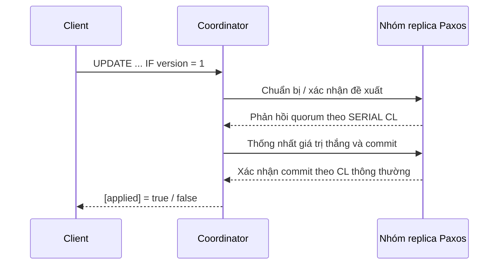

# Mức nhất quán thông thường và `SERIAL`/`LOCAL_SERIAL` trong Cassandra

## 1. Vì sao LWT cần hai loại mức nhất quán?

Apache Cassandra là cơ sở dữ liệu wide-column phân tán: dữ liệu được chia theo **partition key** và sao chép sang nhiều replica. Ứng dụng có thể chọn mức nhất quán (*consistency level*, viết tắt **CL**) cho từng truy vấn để cân bằng độ trễ, tính sẵn sàng và mức độ đồng bộ giữa các replica.

Khi chỉ đọc hoặc ghi thông thường, ứng dụng quan tâm **bao nhiêu replica cần phản hồi**. Nhưng khi nhiều client cùng tranh chấp quyền thay đổi một giá trị, chỉ chờ đủ replica là chưa đủ: hệ thống còn phải thống nhất **thao tác có điều kiện nào được thực hiện trước**.

Đó là lý do **Lightweight Transaction (LWT)** của Cassandra sử dụng cơ chế đồng thuận Paxos cho những lệnh có điều kiện như `INSERT ... IF NOT EXISTS` và `UPDATE ... IF ...`. Một lệnh LWT có thể sử dụng **hai cấu hình độc lập**:

1. **Mức nhất quán thông thường** (`ONE`, `QUORUM`, `LOCAL_QUORUM`, …): điều khiển mức xác nhận ở pha ghi/commit của giao dịch và áp dụng cho các thao tác đọc, ghi thông thường.
2. **Mức nhất quán tuần tự** (`SERIAL` hoặc `LOCAL_SERIAL`): điều khiển phạm vi quorum tham gia pha Paxos, nơi các yêu cầu LWT cạnh tranh được sắp thứ tự.

Điểm mấu chốt: **`QUORUM` không thay thế `SERIAL`; `SERIAL` cũng không thay thế mức nhất quán thông thường.** Chúng giải quyết hai câu hỏi khác nhau trong cùng một thao tác LWT.

## 2. Mức nhất quán thông thường kiểm soát điều gì?

Với thao tác đọc/ghi thông thường, mức nhất quán xác định số replica phải phản hồi trước khi coordinator trả kết quả cho client.

| Mức nhất quán | Ý nghĩa cơ bản | Khi thường cân nhắc |
| --- | --- | --- |
| `ONE` | Một replica phản hồi | Độ trễ thấp, chấp nhận khả năng đọc dữ liệu cũ |
| `LOCAL_ONE` | Một replica ở datacenter địa phương phản hồi | Đọc/ghi ưu tiên độ trễ nội bộ DC |
| `QUORUM` | Đa số replica của tập sao chép liên quan phản hồi | Muốn có quorum trong toàn bộ phạm vi replica |
| `LOCAL_QUORUM` | Đa số replica tại datacenter địa phương phản hồi | Ứng dụng chủ yếu hoạt động trong một DC |
| `EACH_QUORUM` | Khi ghi, đạt quorum ở từng DC | Yêu cầu xác nhận ghi ở mọi DC, chịu thêm độ trễ |
| `ALL` | Tất cả replica liên quan phản hồi | Ưu tiên xác nhận từ mọi replica, ít chịu lỗi hơn |

Ví dụ, với **replication factor (RF) = 3** trong một datacenter, `QUORUM` cần ít nhất **2/3 replica** phản hồi. Nếu một thao tác ghi được xác nhận ở quorum và một thao tác đọc tiếp theo cũng dùng quorum trên cùng tập replica, hai quorum có giao nhau. Quy tắc thường được dùng để lý giải là **`R + W > RF`**, trong đó `R` và `W` là số replica cần phản hồi khi đọc và ghi.

Tuy nhiên, giao nhau giữa các quorum không biến hai câu lệnh ghi thông thường thành thao tác *compare-and-set*. Cassandra vẫn có cơ chế hòa giải giá trị theo timestamp khi các bản ghi xung đột. Hai client đều có thể đọc `version = 1`, rồi cùng gửi `UPDATE` không điều kiện; quorum thông thường không tự kiểm tra rằng version vẫn bằng `1` lúc ghi.

```text
Ban đầu: version = 1

Client A: SELECT version  -> 1
Client B: SELECT version  -> 1
Client A: UPDATE version = 2, body = 'A'  (không có IF)
Client B: UPDATE version = 2, body = 'B'  (không có IF)

=> Cả hai UPDATE có thể được chấp nhận; không có bảo vệ chống lost update.
```

Vì vậy cần phân biệt:

- **Quorum thông thường**: các bản sao phản hồi đầy đủ cho thao tác đọc/ghi.
- **LWT với Paxos**: các yêu cầu có điều kiện trên cùng dữ liệu phải cạnh tranh qua một quy trình đồng thuận, nhờ đó điều kiện được kiểm tra cùng quyết định ghi.

## 3. `SERIAL` và `LOCAL_SERIAL` kiểm soát điều gì?

Trong LWT, coordinator tổ chức một vòng Paxos để các replica thống nhất kết quả của lệnh có điều kiện. Có thể hình dung ở mức khái niệm như sau:



Sơ đồ đơn giản hóa các bước Paxos thực tế; nó nhằm chỉ ra **hai điểm kiểm soát khác nhau**, không diễn tả số lượt trao đổi mạng cố định cho mọi phiên bản Cassandra.

| Thuộc tính | `SERIAL` | `LOCAL_SERIAL` |
| --- | --- | --- |
| Vai trò | CL của pha tuần tự/Paxos | CL của pha tuần tự/Paxos |
| Phạm vi quorum | Các replica thuộc phạm vi toàn cụm cho phân vùng đó | Các replica ở datacenter địa phương |
| Mục tiêu | Phối hợp LWT giữa các DC khi cần phạm vi toàn cục | Giảm trao đổi mạng liên DC cho LWT hoạt động trong một DC |
| Chi phí điển hình | Có thể cao hơn khi replica ở nhiều DC | Thường thấp hơn nếu mạng nội DC nhanh |
| Giới hạn phải nhớ | Vẫn cần chọn CL thông thường cho pha commit | Không dùng làm bảo đảm duy nhất cho cạnh tranh LWT xuyên DC |

`SERIAL` và `LOCAL_SERIAL` **không phải các mức ghi thông thường** kiểu `ONE` hay `LOCAL_QUORUM`. Chúng được dùng cho pha tuần tự của giao dịch có điều kiện. Một số đường đọc tuần tự trong Cassandra còn có thể sử dụng chúng để phát hiện và giúp hoàn tất giao dịch Paxos dở dang; một `SELECT` thông thường ở `LOCAL_QUORUM` không tự nhiên có hành vi đó.

### Một lệnh LWT có hai CL

Ví dụ một ứng dụng ghi từ DC địa phương với cấu hình:

```text
Consistency level        = LOCAL_QUORUM
Serial consistency level = LOCAL_SERIAL
```

Khi chạy `UPDATE ... IF ...`, Cassandra dùng `LOCAL_SERIAL` cho phần thỏa thuận Paxos và `LOCAL_QUORUM` cho phần xác nhận ghi thông thường. Nếu đổi `LOCAL_SERIAL` thành `SERIAL`, phạm vi đồng thuận đổi theo; cấu hình `LOCAL_QUORUM` của pha ghi vẫn là một lựa chọn riêng.

Không thể biến một `UPDATE` không có `IF` thành CAS chỉ bằng cách gắn `SERIAL` trong driver. Ngược lại, đặt `LOCAL_QUORUM` cho `UPDATE ... IF ...` mà bỏ qua việc hiểu serial CL cũng không loại bỏ pha Paxos.

## 4. Ví dụ CQL: kiểm tra và cập nhật version nguyên tử

Giả sử một ứng dụng Java lưu nội dung tài liệu theo `id` và dùng `version` để phát hiện cập nhật cạnh tranh. Vì `id` là partition key, thao tác có điều kiện được xét trên đúng phân vùng đó.

```sql
-- Ví dụ giả định datacenter thực tế có tên dc1 và RF = 3.
CREATE KEYSPACE IF NOT EXISTS lwt_demo
WITH replication = {'class': 'NetworkTopologyStrategy', 'dc1': 3};

USE lwt_demo;

CREATE TABLE IF NOT EXISTS doc_by_id (
    id text PRIMARY KEY,
    version int,
    body text
);

INSERT INTO doc_by_id (id, version, body)
VALUES ('doc-1', 1, 'Bản đầu')
IF NOT EXISTS;
```

Tên `dc1` là ví dụ; khi thực hành phải dùng đúng tên datacenter và replication factor được cấu hình trong cụm Cassandra của mình.

Trong `cqlsh`, có thể đặt hai mức nhất quán của phiên làm việc bằng các **lệnh cqlsh** sau (đây không phải câu lệnh CQL để đặt trong ứng dụng):

```text
CONSISTENCY LOCAL_QUORUM;
SERIAL CONSISTENCY LOCAL_SERIAL;
```

Sau đó, client A cập nhật với điều kiện version đang bằng `1`:

```sql
UPDATE doc_by_id
SET body = 'Nội dung từ A', version = 2
WHERE id = 'doc-1'
IF version = 1;
```

Nếu điều kiện đúng và LWT hoàn tất, Cassandra trả **`[applied] = true`**. Một client B cũng chạy lệnh với `IF version = 1` nhưng nội dung khác sau đó sẽ nhận **`[applied] = false`**, vì version hiện đã là `2`:

```sql
UPDATE doc_by_id
SET body = 'Nội dung từ B', version = 2
WHERE id = 'doc-1'
IF version = 1;
```

Kết quả thất bại có thể kèm giá trị hiện có của các cột liên quan; ví dụ dạng hiển thị rút gọn:

```text
 [applied] | version
-----------+---------
     False |       2
```

**Chú ý:** dữ liệu trả về khi điều kiện không thỏa là thông tin tại thời điểm Cassandra xử lý điều kiện, không phải một khóa giữ cho client. Nếu muốn thử lại, ứng dụng phải đọc/đánh giá trạng thái hiện tại và quyết định thao tác mới phù hợp với nghiệp vụ.

`INSERT ... IF NOT EXISTS` cũng là LWT: nó ngăn hai client cùng *tạo mới* một hàng có cùng primary key thành công. Với `UPDATE ... IF version = ?`, chỉ một yêu cầu có thể vượt qua điều kiện tại phiên bản đang tranh chấp, rồi các yêu cầu khác cần xử lý xung đột.

## 5. Phạm vi quorum trong cụm một DC và nhiều DC

Giả sử cụm có hai datacenter `dc1` và `dc2`, mỗi DC có **RF = 3** cho keyspace, tổng cộng sáu replica cho mỗi partition.

| Mức | Số replica tối thiểu theo ví dụ | Ý nghĩa |
| --- | --- | --- |
| `LOCAL_QUORUM` | 2/3 tại DC địa phương | Xác nhận đọc/ghi thông thường trong DC đó |
| `QUORUM` | 4/6 trên tập replica toàn cục | Xác nhận thông thường với đa số toàn cục |
| `LOCAL_SERIAL` | Quorum Paxos địa phương, tương ứng 2/3 | Quyết định LWT trong phạm vi local DC |
| `SERIAL` | Quorum Paxos toàn cục, tương ứng 4/6 | Quyết định LWT với phạm vi replica xuyên DC |

Con số trên để minh họa sự khác nhau về **phạm vi**. Hai mức có cùng số lượng replica cần phản hồi vẫn không có cùng vai trò: `LOCAL_QUORUM` xác nhận thao tác thông thường, còn `LOCAL_SERIAL` điều phối pha Paxos.

### Chọn cặp mức nhất quán theo bài toán

**Ứng dụng chủ yếu ghi tại một datacenter:**

```text
CL thông thường = LOCAL_QUORUM
CL tuần tự      = LOCAL_SERIAL
```

Đây là lựa chọn thực dụng để tránh chi phí Paxos xuyên DC, **nếu mọi client cạnh tranh trên cùng dữ liệu đều tuân theo phạm vi phối hợp địa phương** và yêu cầu nghiệp vụ không đòi CAS toàn cục.

**Nhiều datacenter có thể đồng thời tranh chấp cùng một khóa:**

```text
CL thông thường = QUORUM hoặc cấu hình ghi phù hợp SLA
CL tuần tự      = SERIAL
```

`SERIAL` phù hợp khi cần phối hợp thứ tự CAS xuyên DC. Mức ghi thông thường vẫn phải chọn theo yêu cầu xác nhận và khả năng chịu lỗi. Đừng mặc định dùng `LOCAL_SERIAL` cho tính duy nhất toàn hệ thống nếu các client ở nhiều DC đồng thời sửa cùng phân vùng; các quorum Paxos địa phương tại những DC khác nhau không bảo đảm có giao nhau.

Ngoài ra, không nên để các client tùy tiện trộn `SERIAL` và `LOCAL_SERIAL` cho **cùng tập khóa cần bảo đảm thứ tự toàn cục**. Một số thao tác dùng quorum cục bộ có thể làm suy yếu giả định phối hợp toàn cục của các thao tác còn lại.

## 6. Độ nhất quán và phạm vi nguyên tử của LWT

LWT hỗ trợ kiểu **compare-and-set (CAS)**: kiểm tra điều kiện và cập nhật được đồng thuận như một thao tác có điều kiện trên phân vùng liên quan. Đây là cơ sở để làm khóa đăng ký định danh, chuyển trạng thái, kiểm tra optimistic locking hoặc khởi tạo bản ghi một lần.

Tuy nhiên, cần phân định các giới hạn:

- **Theo phân vùng:** không suy diễn LWT của một hàng thành transaction ACID tùy ý giữa nhiều partition hoặc nhiều bảng có partition key khác nhau.
- **Đọc thường không tương đương đọc tuần tự:** một `SELECT` với `ONE` hay `LOCAL_ONE` vẫn có thể đọc replica chưa theo kịp; ngay cả khi các lệnh ghi có điều kiện đã dùng LWT, cách đọc và CL đọc vẫn quan trọng.
- **Điều kiện khác xác nhận ghi:** kết quả `[applied] = false` nghĩa là điều kiện không được thỏa nên cập nhật đó không được áp dụng; còn timeout/exception thì chưa đủ bằng chứng để kết luận thành công hay thất bại.
- **Không bảo vệ thao tác ngoài giao thức:** nếu một đường ghi khác dùng `UPDATE` vô điều kiện trên cùng dữ liệu, cơ chế kiểm tra version của các client LWT có thể bị phá vỡ về mặt nghiệp vụ. Cần thống nhất quy tắc cập nhật trong toàn ứng dụng.

Do đó, với yêu cầu "mỗi tài khoản chỉ được đăng ký một username", có thể mô hình hóa khóa cần độc nhất thành primary key và dùng `INSERT ... IF NOT EXISTS`. Với yêu cầu "cập nhật phiên bản tài liệu nếu chưa bị ai sửa", dùng `UPDATE ... IF version = ?`. Nhưng với ràng buộc trải trên nhiều partition, cần thiết kế lại mô hình theo truy vấn hoặc cơ chế điều phối bên ngoài; chỉ nâng CL sẽ không tạo ra transaction xuyên partition.

## 7. Kết nối Java: đặt rõ hai CL cho câu lệnh LWT

Ví dụ sử dụng **DataStax/Apache Cassandra Java Driver 4.x** với bảng `lwt_demo.doc_by_id`. `CqlSession` đã được tạo theo cấu hình kết nối của ứng dụng.

```java
import com.datastax.oss.driver.api.core.CqlSession;
import com.datastax.oss.driver.api.core.DefaultConsistencyLevel;
import com.datastax.oss.driver.api.core.cql.BoundStatement;
import com.datastax.oss.driver.api.core.cql.PreparedStatement;
import com.datastax.oss.driver.api.core.cql.ResultSet;

public final class DocumentRepository {
    private final CqlSession session;
    private final PreparedStatement updateIfVersion;

    public DocumentRepository(CqlSession session) {
        this.session = session;
        this.updateIfVersion = session.prepare(
            "UPDATE lwt_demo.doc_by_id " +
            "SET body = ?, version = ? " +
            "WHERE id = ? IF version = ?"
        );
    }

    public boolean update(String id, int expectedVersion, String newBody) {
        BoundStatement statement = updateIfVersion.bind(
                newBody, expectedVersion + 1, id, expectedVersion)
            .setConsistencyLevel(DefaultConsistencyLevel.LOCAL_QUORUM)
            .setSerialConsistencyLevel(DefaultConsistencyLevel.LOCAL_SERIAL);

        ResultSet result = session.execute(statement);
        return result.wasApplied();
    }
}
```

Ở đây:

1. `WHERE id = ?` định vị partition được cập nhật; `IF version = ?` là điều kiện CAS.
2. `setSerialConsistencyLevel(LOCAL_SERIAL)` đặt phạm vi quorum của pha Paxos.
3. `setConsistencyLevel(LOCAL_QUORUM)` đặt CL thông thường của pha xác nhận ghi.
4. `wasApplied()` cho biết điều kiện có được áp dụng khi truy vấn **trả kết quả thành công** hay không.

Trong ứng dụng ghi xuyên nhiều DC cần tuyến tính hóa CAS toàn cục, đánh giá việc thay `LOCAL_SERIAL` bằng `SERIAL` và thiết kế CL đọc/ghi tương ứng. Cấu hình nên thống nhất ở nơi tạo câu lệnh hoặc repository để mọi luồng cập nhật cùng khóa dùng chung một chính sách.

Hàm trên trả `false` nếu có tranh chấp version. Trong nghiệp vụ thực tế, có thể trả một kiểu kết quả giàu thông tin hơn (ví dụ `APPLIED`, `CONFLICT`, `UNKNOWN`) để phân biệt rõ **điều kiện sai** với **lỗi mạng hoặc timeout**; không biến mọi exception thành `false`.

## 8. Xử lý cạnh tranh, timeout và thất bại

LWT tốn nhiều trao đổi mạng hơn ghi thông thường vì phải phối hợp Paxos. Nếu hàng có tần suất tranh chấp cao, độ trễ và tỷ lệ thất bại/đụng độ có thể tăng. Xử lý phía ứng dụng cần khác nhau theo kết quả:

| Tình huống | Có thể kết luận gì? | Hành động phù hợp |
| --- | --- | --- |
| `[applied] = true` | Điều kiện đã được chấp nhận và thao tác trả về thành công | Tiếp tục luồng nghiệp vụ |
| `[applied] = false` | Điều kiện không thỏa tại lúc kiểm tra | Đọc lại trạng thái, báo xung đột hoặc tính lại thay đổi |
| Timeout hoặc mất kết nối | Kết quả **không xác định**; ghi có thể đã hoàn tất | Đối soát trạng thái trước khi quyết định thử lại |
| `Unavailable`/không đủ replica | Không đáp ứng được quorum yêu cầu tại thời điểm gọi | Theo dõi tình trạng cụm, áp dụng retry có kiểm soát khi hợp lý |
| Tranh chấp liên tục | Nhiều client cùng đòi sửa một khóa nóng | Giảm contention, giới hạn retry, thêm backoff và jitter |

Một tình huống dễ sai:

```text
Client gửi UPDATE ... IF version = 7
        |
        +-- Coordinator đã commit, nhưng phản hồi bị mất
        |
Client nhận timeout và không biết thao tác đã được áp dụng hay chưa
```

Nếu client lập tức gửi lại cùng lệnh, lần sau có thể nhận `[applied] = false` vì version đã lên `8` **do chính lần đầu của nó**. Vì vậy, không diễn giải `false` sau retry là bằng chứng lần đầu không thành công. Cần đọc trạng thái để đối soát với thay đổi dự định, hoặc dùng mã định danh thao tác (*operation ID*) được thiết kế vào mô hình dữ liệu nếu nghiệp vụ cần phân biệt các lần thực hiện.

Đừng tự động hạ `SERIAL` xuống `LOCAL_SERIAL`, hoặc hạ `LOCAL_QUORUM` xuống `ONE`, chỉ để truy vấn vượt qua tình trạng thiếu replica: làm vậy thay đổi phạm vi bảo đảm. **Repair**, **compaction** và **replication** hỗ trợ duy trì/lưu trữ dữ liệu phân tán, nhưng không thay thế việc thống nhất thứ tự của các câu lệnh CAS đang cạnh tranh.

## 9. Những nhầm lẫn phổ biến

| Nhầm lẫn | Cách hiểu đúng |
| --- | --- |
| "`QUORUM` đủ để chống lost update" | Quorum thường chỉ điều khiển phản hồi replica; cần `IF`/LWT hoặc chiến lược đồng thời khác để kiểm tra điều kiện trước ghi. |
| "`SERIAL` là mức nhất quán của mọi lần ghi" | `SERIAL` là mức dùng cho pha tuần tự/Paxos của LWT; vẫn phải xác định CL ghi thông thường. |
| "`LOCAL_SERIAL` giống hệt `SERIAL` vì cùng cần đa số" | Hai quorum có **phạm vi** khác nhau trong cụm đa DC; majority cục bộ không tương đương majority toàn cục. |
| "LWT bảo đảm transaction toàn bộ cơ sở dữ liệu" | Bảo đảm CAS gắn với khóa/phân vùng liên quan; không mở rộng tự động sang nhiều partition. |
| "`[applied] = false` có nghĩa Cassandra lỗi" | Thường đó là kết quả nghiệp vụ hợp lệ: điều kiện đã sai. |
| "Timeout nghĩa là chắc chắn chưa ghi" | Kết quả có thể không xác định; phải đối soát trước khi retry gây tác dụng phụ. |

## 10. Bài thực hành tự kiểm tra

**Bài 1 — Hai client tranh chấp.** Tạo `doc-1` với `version = 1`. Cho hai client cùng chạy `UPDATE ... IF version = 1` với nội dung khác nhau. Dự đoán số lần `[applied] = true`, kiểm tra version cuối cùng và giải thích tại sao `UPDATE` không có `IF` không cho bảo đảm tương tự.

**Bài 2 — Chọn phạm vi serial.** Một ứng dụng đặt tại `dc1` chỉ cập nhật dữ liệu trong `dc1`; ứng dụng thứ hai ở `dc2` bắt đầu cạnh tranh cùng khóa. Giải thích tại sao chính sách `LOCAL_SERIAL` trước đây cần được xem xét lại và `SERIAL` thay đổi phạm vi quorum nào.

**Bài 3 — Mất phản hồi.** Client gọi LWT để chuyển `version` từ `4` lên `5` rồi nhận timeout. Lần thử lại thấy `[applied] = false`. Hãy liệt kê những khả năng dẫn tới kết quả đó và thiết kế bước đối soát trước khi trả kết quả cho người dùng.

**Đáp án định hướng:**

- Bài 1: trên cùng trạng thái ban đầu, chỉ một điều kiện `version = 1` có thể được chấp nhận; client còn lại cần xử lý xung đột. Ghi thường không kiểm tra điều kiện này.
- Bài 2: quorum Paxos local ở hai DC có thể không giao nhau; muốn phối hợp CAS toàn cục phải dùng cùng một chính sách serial có phạm vi toàn cục và đánh giá CL ghi/đọc liên quan.
- Bài 3: lần đầu có thể đã commit, hoặc một client khác đã sửa version, hoặc trạng thái đã thay đổi theo cách khác. Đọc lại và so sánh dữ liệu/operation ID trước khi khẳng định kết quả; không suy ra thất bại từ timeout.

## Ghi nhớ

Với Cassandra, **consistency level thông thường** trả lời câu hỏi *bao nhiêu replica xác nhận đọc/ghi*, còn **serial consistency level** trả lời câu hỏi *những replica nào tham gia thống nhất quyết định của LWT*. `SERIAL` dành cho phạm vi Paxos toàn cục, `LOCAL_SERIAL` giới hạn theo datacenter địa phương. Sử dụng đúng cả hai, thiết kế partition key theo truy vấn và xử lý kết quả CAS/timeout rõ ràng là nền tảng để kiểm soát đồng thời an toàn trong ứng dụng Java dùng Cassandra.
