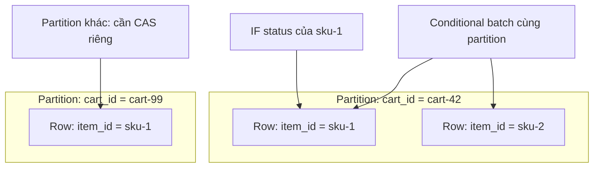

# Phạm vi điều kiện theo khóa/phân vùng và giới hạn kết hợp nhiều thao tác

## 1. Câu hỏi trọng tâm

Trong Apache Cassandra, `INSERT ... IF NOT EXISTS`, `UPDATE ... IF ...` và `DELETE ... IF ...` là **lightweight transaction (LWT)**: Cassandra dùng cơ chế đồng thuận dựa trên Paxos để quyết định một thay đổi có được áp dụng hay không. Nhưng chữ *transaction* ở đây không mang nghĩa một giao dịch SQL tùy ý có thể kiểm tra và sửa nhiều bảng, nhiều partition cùng lúc.

Giới hạn cần ghi nhớ là:

1. `WHERE` xác định **hàng đích** bằng khóa chính; các điều kiện `IF` kiểm tra **trạng thái dữ liệu liên quan đến hàng đích** (hoặc cột `STATIC` của partition theo quy tắc CQL).
2. Việc phối hợp LWT và cơ chế Paxos được tổ chức **theo partition**. Những hàng khác nhau có chung partition key có thể tham gia một **conditional batch** hợp lệ.
3. **Conditional batch chỉ được phép tác động một bảng và một partition**. Nó không tạo ra giao dịch CAS xuyên partition, xuyên bảng hoặc ràng buộc duy nhất trên toàn cluster.

Bài học thuộc chương **LWT và đồng thời** của mô-đun `DATABASE_ENGINE_WIDE_COLUMN_CASSANDRA`. Nó nối kiến thức về **mô hình wide-column, partition key, CQL, replication và consistency level** với một vấn đề ứng dụng Java thường gặp: nhiều request cùng tranh quyền thay đổi trạng thái. Các cú pháp minh họa theo CQL/LWT truyền thống; những tính năng transaction khác, nếu có ở một phiên bản Cassandra cụ thể, cần được đánh giá riêng và không được tự động quy cho `IF`/`BATCH`.

Sau bài này, bạn có thể nhìn vào `PRIMARY KEY` để xác định phạm vi điều kiện, dự đoán trường hợp đồng thời nào được CAS bảo vệ, tạo conditional batch hợp lệ, nhận biết những phối hợp bị từ chối và chọn cách xử lý khi một quy tắc nghiệp vụ liên quan nhiều partition.

## 2. Khóa chính quyết định ranh giới

Giả sử keyspace `shop_ks` đã tồn tại; thay tên keyspace cho phù hợp với môi trường thực hành:

```sql
CREATE TABLE shop_ks.cart_items (
    cart_id text,
    item_id text,
    status text,
    revision int,
    PRIMARY KEY ((cart_id), item_id)
);
```

Ở đây:

- **Partition key:** `cart_id`. Tất cả item của `cart-42` nằm trong **cùng một partition logic** và có chung cách định tuyến replica.
- **Clustering key:** `item_id`. `('cart-42', 'sku-1')` và `('cart-42', 'sku-2')` là **hai hàng khác nhau** trong cùng partition.
- **Full primary key:** `(cart_id, item_id)`. Đây là định danh hàng cần kiểm tra khi dùng điều kiện trên `status`, `revision`.



Paxos theo partition giúp Cassandra tuần tự hóa các quyết định LWT cạnh tranh trên cùng khóa phân vùng, nhưng **nội dung điều kiện vẫn là điều bạn viết trong CQL**. Hai request chèn hai `item_id` khác nhau, mỗi request dùng `IF NOT EXISTS`, có thể **đều thành công**: cả hai hàng ban đầu đều chưa tồn tại. Chúng không tự động kiểm tra điều kiện “cart chỉ có một item đang hoạt động”.

### Khóa phân vùng tổng hợp

Nếu schema là `PRIMARY KEY ((tenant_id, cart_id), item_id)` thì partition được xác định bằng **cặp** `(tenant_id, cart_id)`. Hai cart cùng `cart_id` nhưng khác `tenant_id` nằm ở những partition khác nhau. Không được suy phạm vi LWT theo tên một cột đơn lẻ hay theo việc hai hàng có cùng giá trị clustering key.

## 3. Một lệnh LWT: `WHERE` chọn hàng, `IF` kiểm tra dữ liệu

Đầu tiên tạo hàng dùng cho ví dụ, trong một môi trường thử nghiệm:

```sql
INSERT INTO shop_ks.cart_items (cart_id, item_id, status, revision)
VALUES ('cart-42', 'sku-1', 'AVAILABLE', 1)
IF NOT EXISTS;
```

`IF NOT EXISTS` kiểm tra **hàng có full primary key `('cart-42', 'sku-1')`** chưa tồn tại. Nó **không** có nghĩa partition `cart-42` đang trống, và cũng không ngăn chèn `sku-2` trong cùng cart. CQL thông thường không có `UNIQUE(status)` hay câu `IF NOT EXISTS` mang ý nghĩa duy nhất theo một cột bất kỳ.

Một cập nhật có điều kiện ở đúng hàng:

```sql
UPDATE shop_ks.cart_items
SET status = 'RESERVED', revision = 2
WHERE cart_id = 'cart-42' AND item_id = 'sku-1'
IF status = 'AVAILABLE' AND revision = 1;
```

Lệnh trên được áp dụng chỉ khi **cả hai điều kiện** đúng tại lúc Cassandra quyết định CAS. Nếu hai client đều đọc revision `1` và đồng thời yêu cầu chuyển sang revision `2`, thông thường chỉ một CAS có thể được áp dụng; client còn lại nhận kết quả không áp dụng vì điều kiện cũ không còn đúng. Đây là dạng **optimistic concurrency control** với version/revision.

Một lần thực thi có thể trả:

```text
 [applied]
-----------
      True
```

Nếu không thỏa, `cqlsh` hiển thị `[applied] = False` và thường kèm giá trị liên quan đến điều kiện hiện tại; tập cột trả về phụ thuộc loại lệnh và điều kiện. **`False` không phải lỗi mạng**: nó báo yêu cầu điều kiện không được áp dụng. Ngược lại, timeout/exception không chứng minh thành công hay thất bại; trạng thái thực tế có thể cần được đọc lại để hòa giải.

### Điều kiện trên hàng không phải điều kiện trên toàn partition

Tiếp tục chèn:

```sql
INSERT INTO shop_ks.cart_items (cart_id, item_id, status, revision)
VALUES ('cart-42', 'sku-2', 'AVAILABLE', 1)
IF NOT EXISTS;
```

Lệnh này vẫn có thể trả `[applied] = True` dù `sku-1` đã tồn tại, bởi `item_id` là một phần của primary key. Ví dụ cho thấy hai cấp khác nhau:

| Cấp độ | Điều gì được xác định? | Điều gì **không** được bảo đảm tự động? |
| --- | --- | --- |
| Full primary key `(cart_id, item_id)` | Hàng cụ thể mà `INSERT IF NOT EXISTS` hoặc `UPDATE ... IF` kiểm tra. | Trạng thái của mọi hàng khác cùng cart. |
| Partition key `cart_id` | Ranh giới placement và phối hợp Paxos cho các CAS liên quan partition. | Một quy tắc nghiệp vụ bao quát cả partition nếu CQL không biểu diễn, kiểm tra được quy tắc đó. |
| Bảng/keyspace khác | Một tập dữ liệu khác, kể cả khi cột khóa có cùng tên/giá trị. | Giao dịch CAS xuyên bảng bằng `BEGIN BATCH ... IF`. |

Khi cần ràng buộc “mỗi cart chỉ được có một đơn đặt chỗ đang mở”, một hàng đại diện duy nhất cho trạng thái của cart có thể phù hợp hơn việc kiểm tra từng `item_id` độc lập. Cần thiết kế schema dựa trên *invariant* phải giữ, đồng thời cân nhắc kích thước partition và nguy cơ hotspot.

## 4. Kết hợp nhiều điều kiện trong một hàng

`IF` của `UPDATE` hoặc `DELETE` có thể chứa các điều kiện hợp lệ trên nhiều cột, nối bằng `AND`:

```sql
UPDATE shop_ks.cart_items
SET status = 'SOLD', revision = 3
WHERE cart_id = 'cart-42' AND item_id = 'sku-1'
IF status = 'RESERVED' AND revision = 2;
```

Mọi điều kiện trên cùng hàng được kiểm tra như một lần CAS; không cần tách `SELECT` rồi `UPDATE`, vì hai thao tác riêng có thể bị chèn một thay đổi khác vào giữa. Tuy nhiên `IF` **không** phải nơi thực hiện truy vấn tổng hợp, `JOIN`, `SELECT` từ bảng khác hay kiểm tra một điều kiện nghiệp vụ tùy ý qua nhiều partition. Cú pháp và toán tử điều kiện cụ thể phụ thuộc phiên bản CQL; nên ưu tiên ví dụ đơn giản, có thể diễn đạt trực tiếp bằng các cột hiện có.

Với cột `STATIC`, một giá trị thuộc phạm vi partition và có thể được dùng khi cập nhật dữ liệu của partition theo quy tắc CQL dành cho static rows. Đừng nhầm điều này với khả năng đọc tự do tất cả hàng trong partition để tính toán điều kiện.

## 5. Conditional batch: nhiều hàng, nhưng cùng **một bảng và một partition**

Giả sử cần đặt chỗ **cả hai item** `sku-1` và `sku-2` của `cart-42`, và chỉ thực hiện khi cả hai vẫn đang `AVAILABLE` với `revision = 1`. Trong môi trường thử nghiệm, bảo đảm hai hàng có trạng thái ban đầu thích hợp trước khi chạy:

```sql
BEGIN BATCH
    UPDATE shop_ks.cart_items
    SET status = 'RESERVED', revision = 2
    WHERE cart_id = 'cart-42' AND item_id = 'sku-1'
    IF status = 'AVAILABLE' AND revision = 1;

    UPDATE shop_ks.cart_items
    SET status = 'RESERVED', revision = 2
    WHERE cart_id = 'cart-42' AND item_id = 'sku-2'
    IF status = 'AVAILABLE' AND revision = 1;
APPLY BATCH;
```

Điều kiện hợp lệ vì hai mutation cùng **bảng `shop_ks.cart_items`** và cùng **partition `cart_id = 'cart-42'`**. CQL gom các kiểm tra thành một quyết định CAS: **tất cả điều kiện đúng thì batch được áp dụng; một điều kiện sai thì toàn bộ batch không được áp dụng**. Điều này cho phép phối hợp nhiều hàng có clustering key khác nhau trong một partition với một ranh giới nhất quán.

Một conditional batch có thể kết hợp statement có `IF` và statement không có `IF`, miễn **toàn bộ statement trong batch** vẫn tuân thủ phạm vi một bảng/một partition và các quy tắc CQL tương ứng. Đừng suy rằng những statement đứng trước được thực thi xong rồi statement sau mới kiểm tra điều kiện; batch không hỗ trợ `SELECT` hoặc logic điều kiện đọc kết quả của mutation ngay trước trong cùng batch.

**Các giới hạn cú pháp quan trọng:** conditional batch không hỗ trợ timestamp do người dùng chỉ định (`USING TIMESTAMP`), không được dùng `IN` để chọn nhiều partition, và những lệnh `UPDATE`/`DELETE` có điều kiện không hỗ trợ `IN` trên clustering key để chọn nhiều hàng. Để sửa nhiều clustering row với điều kiện riêng, viết **các statement rõ ràng** trong cùng conditional batch như ví dụ trên.

Không nên đưa nhiều mutation ghi đè cùng một ô/cột vào một batch để tạo thứ tự xử lý; Cassandra xử lý xung đột dựa trên timestamp và không cung cấp ngữ nghĩa tuần tự kiểu “lệnh 2 thấy dữ liệu vừa được lệnh 1 ghi” như một chương trình mệnh lệnh.

## 6. Những phối hợp bị từ chối hoặc không tạo ràng buộc mong muốn

### 6.1. Hai partition khác nhau

```sql
-- SAI: các điều kiện thuộc hai partition khác nhau.
BEGIN BATCH
    UPDATE shop_ks.cart_items
    SET status = 'RESERVED'
    WHERE cart_id = 'cart-42' AND item_id = 'sku-1'
    IF status = 'AVAILABLE';

    UPDATE shop_ks.cart_items
    SET status = 'RESERVED'
    WHERE cart_id = 'cart-99' AND item_id = 'sku-1'
    IF status = 'AVAILABLE';
APPLY BATCH;
```

Với CQL/LWT thông thường, Cassandra từ chối kiểu batch này, thường với thông báo tương tự `Batch with conditions cannot span multiple partitions`. Cùng tên bảng không khiến các partition khác nhau trở thành một transaction.

### 6.2. Hai bảng khác nhau, dù trùng giá trị khóa

Giả sử ứng dụng có bảng `shop_ks.order_status` và `shop_ks.order_events`; mỗi bảng có một hàng với khóa văn bản `'order-7'`. Conditional batch không thể dùng điều kiện trên hàng của bảng này để bảo đảm một mutation của bảng còn lại cùng commit. Việc đặt giống tên hoặc giá trị partition key **không** xóa ranh giới giữa hai bảng. Cassandra từ chối batch chứa điều kiện và statement thuộc nhiều bảng, thường với lỗi `Batch with conditions cannot span multiple tables`.

Điều đó bao gồm cả tình huống một statement có `IF` và một statement không có `IF` nhưng trỏ sang bảng khác: vì cả nhóm là **conditional batch**, toàn bộ nhóm phải cùng bảng.

### 6.3. Nhiều LWT liên tiếp không tạo một transaction chung

```text
CAS #1: trừ số lượng còn lại của sản phẩm A   -> [applied] = True
CAS #2: cộng số lượng cho sản phẩm B          -> timeout / [applied] = False
```

Hai CAS riêng biệt có thể để hệ thống ở trạng thái “A đã đổi, B chưa đổi”. Không có thao tác *rollback tự động* xuyên hai partition. Tình huống chuyển tiền, chuyển tồn kho hoặc cập nhật nhiều projection là ví dụ cần thiết kế phối hợp cấp ứng dụng (theo dõi tiến trình, bù trừ có điều kiện, idempotency), hoặc chọn một cơ chế transaction khác có bảo đảm rõ ràng phù hợp phiên bản/hệ thống.

## 7. Vì sao `LOGGED BATCH` không thay thế LWT đa partition?

Đây là sự khác biệt quan trọng giữa ba cơ chế thường bị gọi chung là “atomic”:

| Cơ chế | Mục đích chính | Phạm vi có thể dựa vào |
| --- | --- | --- |
| `UPDATE`/`INSERT` thông thường | Ghi dữ liệu không cần so sánh trạng thái hiện tại. | Atomicity/isolation của mutation trong phạm vi một partition, nhưng **không kiểm tra** giá trị cũ. |
| `BEGIN BATCH` thông thường, không `IF` | Gộp các thay đổi; logged batch dùng batchlog hỗ trợ hoàn tất các mutation khi có lỗi. | Không tạo tính cô lập toàn cục hay điều kiện CAS xuyên nhiều partition; các thay đổi có thể được quan sát ở những thời điểm khác nhau. |
| `IF ...` hoặc conditional batch | Kiểm tra trạng thái và quyết định có áp dụng mutation qua Paxos. | Một điều kiện trên hàng/giá trị thích hợp hoặc nhiều điều kiện/mutation trong **cùng một bảng, một partition**. |

Một logged batch đa partition **có thể hợp lệ nếu không dùng `IF`**, nhưng không có khả năng “nếu cả hai tài khoản còn đủ số dư thì trừ và cộng đồng thời” vì không có so sánh trạng thái theo cách transaction SQL. `UNLOGGED BATCH` đa partition còn không có bảo đảm hoàn tất từ batchlog khi gặp lỗi. Tránh dùng batch lớn để thay thế thiết kế ghi theo partition: nó có thể tăng tải lên coordinator và làm xấu độ trễ.

## 8. Phạm vi nhất quán và các tình huống cạnh tranh

LWT có **hai khía cạnh consistency** cần hiểu khi thực hành: mức nhất quán của pha ghi/đọc thông thường (ví dụ `QUORUM`, `LOCAL_QUORUM`) và **serial consistency** cho Paxos (`SERIAL` hoặc `LOCAL_SERIAL`). `LOCAL_SERIAL` chỉ phối hợp ở phạm vi DC địa phương theo cách cấu hình; nó không được coi là bảo đảm toàn cục khi các writer ở nhiều DC dùng chế độ khác nhau. Lựa chọn nào phù hợp phụ thuộc yêu cầu nghiệp vụ và cách ứng dụng kết nối DC.

| Tình huống | Kết luận vận hành |
| --- | --- |
| Hai client CAS cùng hàng `sku-1` với `IF revision = 1` | Chỉ yêu cầu nào thấy điều kiện còn đúng tại thời điểm quyết định mới được áp dụng; yêu cầu còn lại có thể nhận `False`. |
| Hai client `INSERT IF NOT EXISTS` với cùng `cart_id`, **khác `item_id`** | Cả hai có thể thành công vì điều kiện tồn tại xét theo hai hàng khác nhau. |
| Một client dùng `IF`, client khác dùng `UPDATE` không điều kiện trên cùng dữ liệu | Writer không điều kiện có thể phá giả định nghiệp vụ; những đường ghi tham gia một invariant cần thống nhất cơ chế phối hợp. |
| CAS bị timeout hoặc mất kết nối sau khi gửi yêu cầu | Kết quả là **chưa biết**; không suy chắc mutation thất bại. Đọc lại và/hoặc dùng định danh thao tác để đối soát trước khi quyết định retry. |
| Conditional batch nhiều hàng cùng partition gặp một điều kiện sai | Toàn bộ batch không được áp dụng; ứng dụng xử lý nhánh thất bại bằng trạng thái hiện tại. |
| Nhiều CAS cùng partition có lưu lượng cao | Tăng contention, số vòng trao đổi Paxos và độ trễ; cần kiểm tra thiết kế partition và mức cạnh tranh. |

Các điều kiện `IF` phát sinh chi phí đồng thuận đáng kể so với write thông thường. Chỉ dùng cho ràng buộc cần kiểm soát cạnh tranh; không nên biến mọi thao tác insert/update thành LWT mà không có yêu cầu cụ thể. Đồng thời, thiết kế mọi biến thể nghiệp vụ vào một partition duy nhất có thể gây partition lớn hoặc hotspot, làm giảm khả năng mở rộng của Cassandra.

## 9. Tích hợp trong ứng dụng Java

Với DataStax/Apache Cassandra Java Driver 4.x, dùng prepared statement để cố định khóa và tham số điều kiện, rồi đọc kết quả `wasApplied()`:

```java
PreparedStatement reserve = session.prepare(
    "UPDATE shop_ks.cart_items " +
    "SET status = ?, revision = ? " +
    "WHERE cart_id = ? AND item_id = ? " +
    "IF status = ? AND revision = ?"
);

BoundStatement statement = reserve.bind(
    "RESERVED", 2,
    "cart-42", "sku-1",
    "AVAILABLE", 1
).setConsistencyLevel(DefaultConsistencyLevel.LOCAL_QUORUM)
 .setSerialConsistencyLevel(DefaultConsistencyLevel.LOCAL_SERIAL);

ResultSet result = session.execute(statement);
if (result.wasApplied()) {
    // Đã chuyển trạng thái thành công theo điều kiện.
} else {
    // Điều kiện không còn đúng; truy xuất trạng thái mới và xử lý xung đột.
}
```

Các lớp trên thuộc driver 4.x (`PreparedStatement`, `BoundStatement`, `ResultSet`, `DefaultConsistencyLevel`). Cấu hình `LOCAL_QUORUM` và `LOCAL_SERIAL` trong ví dụ **chỉ có ý nghĩa khi topology và yêu cầu nhất quán của ứng dụng phù hợp**; không sao chép máy móc sang hệ thống nhiều DC. Với serial consistency, nhóm phát triển nên thống nhất cách cấu hình trên tất cả đường ghi cần giữ cùng invariant.

Ứng dụng cần phân biệt rõ ba kết quả: **`wasApplied() == true`**, **`wasApplied() == false`** và **exception/timeout**. Kết quả `False` có thể dẫn đến trả HTTP `409 Conflict` hoặc luồng tải lại dữ liệu; timeout cần đối soát kết quả thực tế trước khi phát lại thao tác có thể gây tác dụng phụ. Với cập nhật version, nên lưu thêm mã định danh yêu cầu nếu luồng nghiệp vụ cần nhận biết một lần thực thi cũ đã được chấp nhận hay chưa.

## 10. Bài thực hành và câu hỏi tự kiểm tra

**Chuẩn bị:** tạo bảng `shop_ks.cart_items` trong môi trường thử nghiệm; sử dụng một cart riêng để tránh dữ liệu cũ. Thực hành theo thứ tự:

1. Chèn `('cart-42', 'sku-1')` bằng `IF NOT EXISTS`. Chạy lại lệnh và ghi nhận sự khác nhau giữa `True` và `False`.
2. Chèn `('cart-42', 'sku-2')` với `IF NOT EXISTS`. Giải thích vì sao thành công dù cùng `cart_id`.
3. Đưa hai hàng về `status = 'AVAILABLE'`, `revision = 1` trong môi trường thử nghiệm rồi chạy conditional batch ở mục 5. Xác minh **cả hai** chuyển sang `RESERVED`.
4. Đưa chỉ một hàng về `AVAILABLE`, giữ hàng còn lại ở trạng thái không thỏa điều kiện, rồi chạy lại batch. Xác minh không có thay đổi một phần.
5. Thử conditional batch đi qua `cart-42` và `cart-99`, sau đó ghi nhận lỗi xác thực phạm vi partition. Không áp dụng các lệnh ví dụ sai trên production.
6. Mô phỏng hai client cùng dùng điều kiện `revision = 1`; ghi lại kết quả `wasApplied` và xem cách client xử lý xung đột.

Trước khi triển khai một thao tác có điều kiện, hãy trả lời bốn câu hỏi: **(a)** partition key gồm những cột nào, **(b)** `IF` đang kiểm tra hàng hoặc cột nào, **(c)** tất cả mutation có ở cùng một bảng và một partition không, **(d)** nếu phản hồi CAS bị timeout, ứng dụng sẽ phát hiện kết quả và tiếp tục an toàn bằng cách nào?

## 11. Tài liệu đọc thêm

- [Apache Cassandra — CQL Data Manipulation](https://cassandra.apache.org/doc/latest/cassandra/developing/cql/dml.html): định nghĩa `INSERT`, `UPDATE`, `DELETE`, `IF` và `BATCH`.
- [Apache Cassandra — Good use of BATCH statement](https://cassandra.apache.org/doc/stable/cassandra/developing/cql/batch/batch-good-example.html): ví dụ batch trên cùng partition, trong đó có điều kiện và cột `STATIC`.
- [Apache Cassandra — CASSANDRA-10085](https://issues.apache.org/jira/browse/CASSANDRA-10085): giới hạn conditional batch không thể trải nhiều bảng.

LWT giải quyết bài toán **cạnh tranh trên dữ liệu mà bạn định vị và kiểm tra được**. Việc viết đúng partition key và đúng phạm vi điều kiện quyết định tính đúng đắn của ứng dụng, nhất là khi một yêu cầu nghiệp vụ có vẻ là “một thao tác” nhưng thực tế trải trên nhiều hàng, bảng hoặc partition khác nhau.
