# Giữ chỗ tài nguyên và những bất biến không thể suy ra từ một bản ghi

> **Chương:** LWT và đồng thời  
> **Học phần:** `DATABASE_ENGINE_WIDE_COLUMN_CASSANDRA`  
> **Trọng tâm:** Định nghĩa bất biến nghiệp vụ, mô hình hóa trạng thái giữ chỗ theo khóa phân vùng, dùng lightweight transaction (LWT) đúng phạm vi, và xử lý các bất biến liên quan nhiều bản ghi hoặc tài nguyên.

Trong Apache Cassandra, dữ liệu được phân tán qua các node theo **partition key** và thường được nhân bản (*replication*) qua nhiều replica. CQL cho phép truy vấn có điều kiện `IF` để phối hợp cập nhật đồng thời bằng **lightweight transaction** (LWT/Paxos). Đây là công cụ hữu ích để hai khách không thể đồng thời giữ **cùng một chỗ**. Nhưng một điều kiện đọc/ghi của một bản ghi không tự chứng minh được các quy tắc như “tổng số chỗ đã giữ không vượt 100”, “một khách chỉ có tối đa một chỗ trên toàn sự kiện”, hoặc “phòng họp và thiết bị đi kèm phải được giữ cùng nhau”.

Sau bài này, bạn sẽ biết cách xác định **phạm vi dữ liệu cần kiểm tra để chứng minh bất biến**, dùng LWT với trạng thái giữ chỗ theo một khóa, hiểu ranh giới giữa consistency level và serial consistency, thiết kế lại các ràng buộc liên quan nhiều bản ghi, và xử lý tranh chấp hoặc timeout từ ứng dụng Java.

## 1. Bắt đầu từ bất biến, không bắt đầu từ câu lệnh CQL

**Bất biến** (*invariant*) là điều kiện bắt buộc luôn đúng trong mọi trạng thái được hệ thống công nhận. Với hệ thống đặt chỗ, hãy phân biệt:

| Bất biến | Dữ liệu cần quan sát | LWT trên một bản ghi có đủ không? |
| --- | --- | --- |
| Một ghế trong một suất diễn có tối đa một người đang giữ | Trạng thái hiện tại của **đúng ghế và suất diễn** | Có, nếu mọi đường ghi dùng cùng khóa và cập nhật có điều kiện. |
| Một khách không có hai lượt giữ chỗ đang hoạt động ở hai ghế khác nhau | Ít nhất hai ghế hoặc một chỉ mục sở hữu theo khách | Không, nếu chỉ CAS riêng từng hàng ghế. |
| Tổng số giữ chỗ của sự kiện không vượt sức chứa | Tất cả lượt giữ hoặc một biểu diễn sức chứa chung | Không, nếu các cập nhật xảy ra trên nhiều hàng độc lập. |
| Một phòng và một thiết bị chiếu phải cùng được giữ hoặc cùng được giải phóng | Trạng thái của **hai tài nguyên** | Không, nếu hai tài nguyên thuộc hai phân vùng độc lập. |
| Không có hai khoảng đặt phòng giao nhau | Toàn bộ khoảng thời gian có thể chồng lấn của phòng đó | Không, nếu chỉ kiểm tra một hàng đại diện cho mỗi lần đặt. |

Một công thức dễ nhớ là: nếu quy tắc là `I(S)` với `S` gồm nhiều bản ghi, một thao tác chỉ kiểm tra `row_A` không đủ để suy ra `I(S)` sau khi `row_B` cũng thay đổi. Hệ thống cần **biểu diễn lại quy tắc thành tranh chấp trên cùng nguồn sự thật** hoặc chọn cơ chế giao dịch có khả năng kiểm tra toàn bộ tập dữ liệu liên quan.

Ví dụ, sức chứa sự kiện bằng 1 nhưng ứng dụng có hai bản ghi `seat-A` và `seat-B`, đều đang `AVAILABLE`:

```text
Khách A: IF seat-A.state = 'AVAILABLE'  → thành công → HELD
Khách B: IF seat-B.state = 'AVAILABLE'  → thành công → HELD

Mỗi CAS riêng đều hợp lệ, nhưng tổng số ghế HELD = 2 > capacity = 1.
```

LWT không bị lỗi trong ví dụ này: **bất biến đã bị đặt sai phạm vi**. Hai phép cập nhật độc lập chưa hề tranh chấp cùng một giá trị.

## 2. LWT bảo đảm điều gì?

Trong CQL, cú pháp như `INSERT ... IF NOT EXISTS`, `UPDATE ... IF ...` hoặc `DELETE ... IF ...` yêu cầu Cassandra thực hiện bước thỏa thuận kiểu Paxos trước khi chấp nhận thay đổi có điều kiện. Với cùng một khóa phân vùng, các thao tác LWT phù hợp có thể **tuần tự hóa** quyết định cạnh tranh: trong hai ứng dụng đồng thời cố chiếm đúng một chỗ chưa có chủ, chỉ một ứng dụng thắng.

```mermaid
sequenceDiagram
    participant A as Khách A
    participant C as Cassandra / Paxos
    participant B as Khách B
    A->>C: INSERT chỗ R, thời điểm T IF NOT EXISTS
    B->>C: INSERT chỗ R, thời điểm T IF NOT EXISTS
    C-->>A: [applied] = true
    C-->>B: [applied] = false; trả trạng thái hiện có
    Note over C: Một khóa giữ chỗ chỉ có một người thắng
```

LWT cung cấp một quyết định có điều kiện theo phạm vi phân vùng được tham gia giao thức. Nó **không** tự cung cấp giao dịch ACID tùy ý giữa nhiều phân vùng, không bảo vệ một truy vấn tổng hợp trên tất cả hàng, và không phối hợp nguyên tử với hệ thống thanh toán, email, message broker hay API bên ngoài.

Hai mức nhất quán thường được nhắc trong một lệnh LWT có vai trò khác nhau:

- `LOCAL_SERIAL` hoặc `SERIAL` là **serial consistency level** cho phần phối hợp có điều kiện/Paxos. `LOCAL_SERIAL` giới hạn phạm vi phối hợp ở data center cục bộ; `SERIAL` liên quan phạm vi rộng hơn tùy topology và replication. Cần dùng chính sách nhất quán phù hợp, tránh trộn tùy tiện các đường ghi đến nhiều DC.
- `LOCAL_QUORUM` hoặc `QUORUM` là **regular consistency level** của thao tác ghi/đọc. Nó quyết định số replica cần xác nhận ở phạm vi tương ứng, nhưng bản thân nó không thay thế phần kiểm tra `IF` và không tạo bất biến trên nhiều partition key.

LWT thường tốn thêm các vòng trao đổi giữa replica so với ghi CQL thông thường. Tài nguyên bị rất nhiều yêu cầu cùng tranh chấp trên một khóa có thể trở thành điểm nóng cả về throughput lẫn độ trễ. Sử dụng LWT cho nơi thực sự phải quyết định *ai thắng*, không đặt LWT lên tất cả đường ghi chỉ để thấy “an toàn hơn”.

## 3. Mô hình đúng: một chỗ cố định tương ứng một khóa

Giả sử ứng dụng cho giữ **một phòng tại một mốc bắt đầu cố định**. Mỗi cặp `(resource_id, slot_start)` là một suất độc lập; mọi yêu cầu chiếm cùng suất phải đến đúng khóa này.

```sql
-- Đã chọn keyspace Cassandra phù hợp qua USE <keyspace>.
CREATE TABLE slot_holds (
    resource_id text,
    slot_start timestamp,
    reservation_id uuid,
    holder_id text,
    state text,
    PRIMARY KEY ((resource_id, slot_start))
);
```

Ở đây toàn bộ `(resource_id, slot_start)` là **partition key**; một phân vùng tương ứng một suất. `reservation_id` là ID ổn định của yêu cầu giữ chỗ, dùng lại khi ứng dụng nhận lại cùng yêu cầu. Hai người đặt khác nhau phải tranh chấp đúng cùng khóa, dù họ kết nối đến những node Cassandra khác nhau.

### 3.1. Giữ chỗ lần đầu: `INSERT IF NOT EXISTS`

```sql
INSERT INTO slot_holds
    (resource_id, slot_start, reservation_id, holder_id, state)
VALUES
    ('room-7', '2026-11-24 09:00:00+0000',
     11111111-1111-1111-1111-111111111111, 'alice', 'HELD')
IF NOT EXISTS;
```

Nếu chưa có hàng cho khóa đó, kết quả của câu lệnh có `[applied] = true`. Nếu hàng đã tồn tại, `[applied] = false`; kết quả có thể kèm các cột đang tồn tại. Ứng dụng chỉ nên kết luận **giữ chỗ mới thành công** khi có xác nhận áp dụng; trường hợp không áp dụng phải phân biệt một khách khác đã giữ hay chính yêu cầu cũ đã giữ trước đó.

**Điều kiện bắt buộc:** không có code path khác ghi đè hàng bằng `INSERT`/`UPDATE` thông thường. Nếu một dịch vụ vẫn có thể `UPDATE slot_holds SET reservation_id = ...` không có `IF`, dịch vụ đó có thể phá vỡ bảo đảm của luồng giữ chỗ dù các dịch vụ còn lại đều dùng LWT.

### 3.2. Xác nhận và giải phóng bằng chuyển trạng thái có điều kiện

```sql
-- Chỉ chủ nhân của đúng reservation_id mới được xác nhận.
UPDATE slot_holds
SET state = 'CONFIRMED'
WHERE resource_id = 'room-7'
  AND slot_start = '2026-11-24 09:00:00+0000'
IF state = 'HELD'
   AND reservation_id = 11111111-1111-1111-1111-111111111111;

-- Ví dụ khác: hủy khi vẫn đang HELD, không hủy booking đã CONFIRMED.
UPDATE slot_holds
SET state = 'RELEASED'
WHERE resource_id = 'room-7'
  AND slot_start = '2026-11-24 09:00:00+0000'
IF state = 'HELD'
   AND reservation_id = 11111111-1111-1111-1111-111111111111;
```

Hai câu lệnh trên minh họa **hai nhánh chuyển trạng thái**, không phải trình tự phải chạy cả hai. Một nhánh thành công sẽ khiến nhánh đối nghịch thất bại. Khi hàng ở `RELEASED`, yêu cầu mới có thể chiếm lại suất bằng cách thay chủ sở hữu **có điều kiện**:

```sql
UPDATE slot_holds
SET reservation_id = 22222222-2222-2222-2222-222222222222,
    holder_id = 'bob',
    state = 'HELD'
WHERE resource_id = 'room-7'
  AND slot_start = '2026-11-24 09:00:00+0000'
IF state = 'RELEASED';
```

Nếu Alice gửi trễ lệnh hủy của mình sau khi Bob đã giữ, điều kiện `reservation_id = ...Alice...` sẽ thất bại. Chính thao tác kiểm tra **trạng thái và chủ sở hữu** trong cùng quyết định LWT giúp tránh việc hủy nhầm chỗ của người kế tiếp.

Một state machine cơ bản:

```mermaid
stateDiagram-v2
    [*] --> HELD: INSERT IF NOT EXISTS
    HELD --> CONFIRMED: IF state = HELD AND owner = request
    HELD --> RELEASED: IF state = HELD AND owner = request
    RELEASED --> HELD: IF state = RELEASED; đổi owner
    CONFIRMED --> [*]: Kết thúc theo quy tắc nghiệp vụ
```



Trong hệ thống thật, cần quy định riêng cách kết thúc `CONFIRMED`, gia hạn hoặc hết hạn `HELD`. Không nên mặc định có thể xóa một hàng rồi xem mọi retry cũ đều an toàn: sau khi xóa, cùng `INSERT IF NOT EXISTS` gửi trễ có thể **chiếm lại suất**. Giữ dấu vết trạng thái và ID yêu cầu, hoặc một sổ cái yêu cầu riêng có quy tắc chặn replay, khi điều kiện nghiệp vụ đòi hỏi.

## 4. Tại sao giữ một khoảng thời gian khó hơn giữ một suất?

Ví dụ một phòng cần được giữ từ 09:00 đến 11:00. Nếu mỗi hàng chỉ đại diện một yêu cầu đặt phòng với `(resource_id, reservation_id)` và hai lệnh:

```text
Khách A muốn: [09:00, 11:00)
Khách B muốn: [10:00, 12:00)
```

thì hai khách ghi **hai khóa khác nhau**. Mỗi `INSERT IF NOT EXISTS` đều có thể thành công, nhưng các khoảng thời gian vẫn giao nhau. Cassandra không có ràng buộc loại trừ khoảng thời gian toàn cục tự động tương đương `EXCLUDE` trong một số cơ sở dữ liệu quan hệ.

Các hướng thiết kế thực tế:

1. **Chuẩn hóa thành suất cố định:** nếu nghiệp vụ chia theo block 30 phút, một yêu cầu 09:00–11:00 chiếm bốn suất; phải giải quyết tính toàn vẹn của cả nhóm suất, không chỉ từng suất riêng lẻ.
2. **Gom dữ liệu cần quyết định trong cùng một phân vùng có giới hạn:** chẳng hạn các suất của một phòng trong một ngày, rồi thực hiện kiểm tra/chuyển trạng thái có điều kiện theo cơ chế được Cassandra hỗ trợ cho cùng partition. Cần xử lý trường hợp đặt qua ranh giới ngày và kiểm soát phân vùng không quá lớn hoặc quá nóng.
3. **Tạo một bộ điều phối lịch đặt có thứ tự rõ ràng:** mọi thay đổi ảnh hưởng cùng tài nguyên đi qua cùng nơi ra quyết định, lưu trạng thái và phiên bản để tránh tranh chấp ngoài luồng.
4. **Dùng cơ sở dữ liệu giao dịch phù hợp:** khi phải kiểm tra khoảng chồng lấn động hoặc bảo đảm nguyên tử trên nhiều tài nguyên/phân vùng, chọn nơi có ràng buộc và giao dịch theo đúng phạm vi yêu cầu.

Việc đọc các hàng hiện tại rồi ghi một hàng mới sau đó **không** phải giải pháp an toàn. Giữa `SELECT` và `INSERT`, một khách khác có thể đã giữ khoảng thời gian giao nhau (*time-of-check to time-of-use*).

## 5. Bất biến tổng sức chứa: biến điều kiện tổng hợp thành nguồn sự thật

Xét quy tắc: `active_holds <= capacity`. Nếu `active_holds` là số hàng `HELD` rải trên nhiều phân vùng, mỗi LWT ở từng hàng không biết tổng mới là bao nhiêu. Một truy vấn `COUNT(*)` trước khi ghi cũng không khóa tập dữ liệu đang được người khác sửa.

### Phương án A: một hàng hạn mức chịu cạnh tranh

```sql
CREATE TABLE remaining_capacity (
    event_id text PRIMARY KEY,
    remaining int
);

INSERT INTO remaining_capacity (event_id, remaining)
VALUES ('concert-25', 2)
IF NOT EXISTS;

-- Ứng dụng đã đọc remaining=2 và muốn trừ một đơn vị.
UPDATE remaining_capacity
SET remaining = 1
WHERE event_id = 'concert-25'
IF remaining = 2;
```

Nếu hai người cùng đọc `remaining = 2`, cả hai cùng thử đặt `1`, chỉ một cập nhật có điều kiện thành công. Người còn lại phải đọc giá trị mới rồi quyết định thử lại với kỳ vọng `remaining = 1`, hoặc thông báo hết chỗ nếu đã về 0. Không được thay thế bằng `SET remaining = remaining - 1` trên kiểu số nguyên thường: **Cassandra chỉ hỗ trợ dạng cộng/trừ như vậy cho cột `counter`, mà counter không hỗ trợ `IF`**.

Mô hình này bảo vệ **con số hạn mức trên một hàng**, song vẫn còn bài toán gắn chính xác một lượt giảm với một `reservation_id`. Nếu đã trừ hạn mức nhưng ghi chi tiết booking ở phân vùng khác bị lỗi, hạn mức và chi tiết có thể lệch; nếu ghi chi tiết trước rồi trừ hạn mức, có thể có booking chưa được cấp chỗ. Cần thiết kế nguồn sự thật và quy trình phục hồi phù hợp, không gọi hai bước đó là một giao dịch chung.

### Phương án B: biểu diễn mỗi suất sức chứa thành một token

Nếu sự kiện có đúng 100 chỗ, có thể tạo cố định **100 token khả dụng** (`token-001` đến `token-100`) và giữ từng token bằng LWT theo cùng một khóa của token. Quy tắc “tối đa 100 chỗ được giữ” khi đó xuất phát từ việc hệ thống chỉ có 100 token hợp lệ, mỗi token có tối đa một chủ sở hữu. Có thể phân phối yêu cầu lên các token để giảm điểm nóng so với một hàng `remaining`.

Điều kiện để chứng minh bất biến là mọi booking hợp lệ **phải sở hữu một token**; không có đường ghi tạo token thứ 101, không có hai lần cấp một token, và chi tiết booking phải được dẫn xuất/đối soát từ chủ sở hữu token. Đây là ví dụ biến một quy tắc tổng hợp thành nhiều quyết định cục bộ **nhờ giới hạn tập tài nguyên được phép tồn tại**; nó không tự giải quyết vấn đề “một người chỉ giữ một token” hoặc việc thu tiền đúng một lần.

## 6. Các bất biến xuyên nhiều khóa không thể tự ghép từ nhiều LWT

Giả sử một đơn đặt cần **cả phòng họp R và máy chiếu P**. Nếu chúng nằm ở hai partition key riêng:

```text
1. LWT giữ phòng R       → thành công
2. LWT giữ máy chiếu P   → thất bại vì người khác đã giữ
3. Đơn đặt chưa đầy đủ   → cần xử lý phần phòng R đang giữ
```

Không có chuyện hai LWT độc lập tự trở thành một giao dịch all-or-nothing. Đảo thứ tự cũng chỉ chuyển rủi ro sang tài nguyên kia. `BEGIN BATCH`/logged batch thông thường không cho phép kiểm tra và **cùng quyết định** một điều kiện Paxos xuyên các phân vùng tùy ý. Các cập nhật có điều kiện nhiều hàng có giới hạn phạm vi phân vùng; không thể dùng batch để tạo một ràng buộc serializable toàn cục.

Một quy trình đặt chỗ nhiều tài nguyên thường cần:

- **Trạng thái đơn đặt rõ ràng:** `PENDING`, `HELD_PARTIALLY`, `HELD_ALL`, `CONFIRMED`, `CANCELLED` hoặc các trạng thái tương đương. Chỉ báo thành công hoàn tất khi toàn bộ điều kiện nghiệp vụ đã thỏa.
- **Giữ từng tài nguyên có điều kiện:** gắn `reservation_id` bất biến vào từng lượt giữ; thao tác giải phóng phải kiểm tra chủ sở hữu hiện tại bằng LWT.
- **Bù trừ (*compensation*) và đối soát:** nếu giữ P thất bại, thử giải phóng R bằng CAS. Nếu lệnh giải phóng timeout thì phải theo dõi kết quả chưa biết; không được giả định đã giải phóng.
- **Chính sách hết hạn:** bộ xử lý nền có thể tìm giữ chỗ quá hạn và đề nghị chuyển trạng thái bằng CAS với đúng `reservation_id`/phiên bản. Không nên chỉ dùng TTL tự làm biến mất hàng rồi xem toàn bộ workflow đã kết thúc.
- **Mức bảo đảm được phát biểu chính xác:** quy trình kiểu saga có thể đạt **hoàn tất hoặc bù trừ về sau**, nhưng có thể tồn tại trạng thái giữ một phần trong quá trình xử lý; nếu cần nguyên tử tức thời xuyên tài nguyên, phải thay đổi phạm vi giao dịch hoặc công nghệ lưu trữ.

Nếu tài nguyên A đã được bù trừ rồi người khác nhận A, một lệnh bù trừ trễ **không được** hủy tài nguyên của người mới. Vì vậy `IF reservation_id = :my_reservation_id` quan trọng không kém `IF state = 'HELD'`.

### Hết hạn và *fencing token*

Một `expires_at` giúp nghiệp vụ biết hạn giữ chỗ, nhưng không tự ngăn người giữ cũ tiếp tục gọi API thanh toán hoặc sử dụng tài nguyên sau khi lease hết hạn. Nếu có tác vụ bên ngoài cần chặn chủ cũ, mỗi lần cấp quyền sở hữu mới nên tăng **generation/fencing token** theo cập nhật có điều kiện. Hệ thống thực thi tài nguyên phải từ chối yêu cầu có generation cũ. Chỉ so đồng hồ ở phía client, chỉ đặt TTL cho hàng Cassandra hoặc chỉ dùng UUID mới không thay thế được bước thực thi rào chắn này.

## 7. Ứng dụng Java: xử lý kết quả LWT và cạnh tranh

Ví dụ dùng **Apache Cassandra/DataStax Java Driver 4.x**. Giả sử `CqlSession` đã mở vào đúng keyspace và datacenter, bảng `slot_holds` đã tạo. `Instant` là kiểu Java tương ứng với `timestamp` của CQL.

```java
import java.time.Instant;
import java.util.UUID;

import com.datastax.oss.driver.api.core.CqlSession;
import com.datastax.oss.driver.api.core.DefaultConsistencyLevel;
import com.datastax.oss.driver.api.core.cql.BoundStatement;
import com.datastax.oss.driver.api.core.cql.PreparedStatement;
import com.datastax.oss.driver.api.core.cql.Row;

public final class SlotReservationRepository {
    public enum HoldOutcome { ACQUIRED, ALREADY_HELD_BY_REQUEST, CONFLICT }

    private final CqlSession session;
    private final PreparedStatement insertHold;

    public SlotReservationRepository(CqlSession session) {
        this.session = session;
        this.insertHold = session.prepare(
            "INSERT INTO slot_holds " +
            "(resource_id, slot_start, reservation_id, holder_id, state) " +
            "VALUES (?, ?, ?, ?, ?) IF NOT EXISTS");
    }

    public HoldOutcome tryHold(String resourceId, Instant slotStart,
                               UUID reservationId, String holderId) {
        BoundStatement request = insertHold
            .bind(resourceId, slotStart, reservationId, holderId, "HELD")
            .setConsistencyLevel(DefaultConsistencyLevel.LOCAL_QUORUM)
            .setSerialConsistencyLevel(DefaultConsistencyLevel.LOCAL_SERIAL)
            .setIdempotent(false);

        Row row = session.execute(request).one();
        if (row == null) {
            throw new IllegalStateException("Missing LWT result");
        }
        if (row.getBoolean("[applied]")) {
            return HoldOutcome.ACQUIRED;
        }

        UUID currentOwner = row.getUuid("reservation_id");
        String currentState = row.getString("state");
        if (reservationId.equals(currentOwner) && "HELD".equals(currentState)) {
            return HoldOutcome.ALREADY_HELD_BY_REQUEST;
        }
        return HoldOutcome.CONFLICT;
    }
}
```

**Đọc kết quả:** `[applied] = false` không nhất thiết nghĩa là lỗi hệ thống; đó có thể là kết quả cạnh tranh hợp lệ. Chỉ coi `ALREADY_HELD_BY_REQUEST` là trạng thái **hiện tại** cùng chủ sở hữu và `HELD`; nếu bản ghi đã `RELEASED`/`CONFIRMED`, cần điều phối theo state machine của đơn đặt. Nếu `LOCAL_SERIAL` không phù hợp với mô hình nhiều data center, cấu hình lại cả serial consistency và regular consistency theo yêu cầu nhất quán của ứng dụng.

**Xử lý timeout:** nếu `session.execute(request)` ném exception sau khi yêu cầu đã gửi, ứng dụng không chắc Paxos đã quyết định thành công hay chưa. `setIdempotent(false)` giúp tránh một số cơ chế phát lại tự động tùy driver/retry policy, nhưng không cung cấp giao dịch đúng-một-lần. Trong tầng dịch vụ, ghi lại `reservation_id` và trạng thái **kết quả chưa xác định**, đọc/đối soát trạng thái hiện tại bằng mức nhất quán phù hợp, rồi đưa ra quyết định theo quy tắc của workflow. Cùng một `reservation_id` phải được giữ xuyên HTTP retry, queue redelivery và restart. Khi hàng có thể được giải phóng và cấp lại, chỉ đọc hàng hiện tại có thể không đủ để kết luận lịch sử của một request: khi đó cần sổ cái trạng thái request hoặc nguồn sự kiện đáng tin cậy.

Không viết dạng dưới đây cho một quy trình giữ chỗ quan trọng:

```java
// SAI: timeout không chứng minh lần đầu chưa ghi thành công.
// try { session.execute(request); }
// catch (RuntimeException e) { session.execute(request); }
```

Với số lượng client tranh chấp lớn, nên có backoff/jitter và giới hạn số lần **cố giành chỗ sau khi biết chắc mình thua**, đồng thời phân biệt việc người dùng bắt đầu một request mới với việc khôi phục kết quả của request cũ. Không biến vòng lặp retry thành cuộc đua cập nhật không giới hạn trên một phân vùng.

## 8. Những lựa chọn thiết kế theo phạm vi bất biến

| Quy tắc cần bảo đảm | Nguồn sự thật có thể dùng | Điều kiện cần quan sát |
| --- | --- | --- |
| Một khách thắng một chỗ ở thời điểm cố định | Một hàng `slot_holds` theo `(resource_id, slot_start)` | Tất cả đường ghi phải dùng CAS và giữ `reservation_id` bền vững. |
| Tối đa N lượt giữ | Một hàng hạn mức có CAS **hoặc** N token được cấp phát cố định | Không có đường ghi vượt nguồn hạn mức/token; xử lý kết nối đến chi tiết reservation. |
| Một khách chỉ có một suất trên toàn hệ thống | Nguồn quyết định theo `customer_id`, hoặc giao dịch bao trùm cả quan hệ khách–suất | CAS riêng từng suất không bảo vệ bất biến theo khách. |
| Không có đặt phòng chồng lấn | Biểu diễn mọi khoảng cần tranh chấp trên một phạm vi có thể quyết định đồng nhất | Kiểm tra nhiều hàng bằng `SELECT` rồi chèn một hàng không đủ. |
| Phòng và thiết bị luôn được giữ cùng nhau ngay tại mọi thời điểm | Giao dịch nguyên tử trên cả hai tài nguyên hoặc thay đổi biên giới sở hữu | Saga chỉ bảo đảm xử lý/khôi phục theo tiến trình, không có trạng thái toàn-cục-nguyên-tử trong lúc chạy. |

Đối với các trạng thái phục vụ tra cứu, Cassandra thường được thiết kế **theo truy vấn**: có thể duy trì thêm `reservations_by_customer`, `bookings_by_day`, `resources_by_status`. Những bảng này hữu ích để đọc nhưng không đương nhiên là cơ sở ra quyết định đồng thời. Phải xác định bảng/khóa nào là **nguồn sự thật có thể tranh chấp**, bảng nào chỉ là projection có thể trễ, và cách khôi phục projection khi một bước ghi thất bại.

**Replication**, mức nhất quán đọc/ghi, **repair** và **compaction** giữ cho dữ liệu được nhân bản và lưu trữ vận hành đúng kỳ vọng; chúng không biết bất biến tổng sức chứa hay quan hệ phòng–thiết bị của nghiệp vụ. Repair không thể tự sửa một quyết định cấp phát hợp lệ ở từng phân vùng nhưng sai với tổng thể.

## 9. Thực hành và tự kiểm tra

### Thí nghiệm: hai khách cùng tranh một suất

1. Tạo bảng `slot_holds` từ phần 3 trong keyspace thử nghiệm có replication phù hợp.
2. Mở hai `cqlsh` hoặc hai tác vụ Java, đồng thời chạy `INSERT ... IF NOT EXISTS` vào **cùng** `(resource_id, slot_start)`, mỗi tác vụ một `reservation_id`.
3. Quan sát `[applied]`: dự kiến chỉ một yêu cầu áp dụng khi cả hai tranh cùng trạng thái trống; yêu cầu còn lại thấy xung đột.
4. Thử xác nhận bằng ID của bên thua; điều kiện `IF state = 'HELD' AND reservation_id = ...` phải thất bại.
5. Cho bên thắng chuyển `HELD -> RELEASED` rồi cho khách khác `UPDATE ... IF state='RELEASED'`. Cuối cùng gửi lệnh hủy trễ của bên thắng cũ và xác minh nó không hủy chỗ mới.

### Câu hỏi

**Câu 1.** Sự kiện có giới hạn 10 người. Mỗi khách giữ một hàng riêng bằng `INSERT IF NOT EXISTS`, rồi ứng dụng đọc `COUNT(*)` trước khi cho đặt. Điều gì có thể xảy ra khi 20 người đặt cùng lúc?

**Câu 2.** Hai LWT giữ phòng và máy chiếu đều dùng `LOCAL_QUORUM` + `LOCAL_SERIAL`. Điều đó đã tạo ra giao dịch all-or-nothing cho cả hai tài nguyên chưa? Vì sao?

**Câu 3.** Worker giải phóng một hold cũ nhưng timeout. Ngay sau đó một worker khác có thể cấp hold cho người mới. Điều kiện gì phải có trong một lệnh giải phóng được retry?

**Câu 4.** Một lệnh `INSERT ... IF NOT EXISTS` bị timeout. Sau đó `SELECT` không còn thấy `reservation_id` cũ. Có thể kết luận yêu cầu trước đó chưa bao giờ chiếm được chỗ không?

**Gợi ý trả lời:**

1. Có thể vượt 10 nếu các hàng khác nhau đều được tạo sau khi mỗi client quan sát tổng còn nhỏ hơn 10. `COUNT(*)` trước ghi không có tác dụng khóa một tập hàng; dùng token cố định hoặc hạn mức chung được CAS.
2. Chưa. Mỗi LWT có phạm vi điều kiện riêng; hai khóa phân vùng khác nhau không tạo quyết định nguyên tử chung. Cần thiết kế cùng phạm vi quyết định, hệ thống giao dịch phù hợp hoặc quy trình bù trừ với trạng thái từng bước.
3. Kiểm tra `reservation_id`/owner **cùng** trạng thái mong đợi, và với lease có thể cần so thêm phiên bản/fencing token. Một lệnh hủy vô điều kiện có thể phá hỏng lượt giữ mới.
4. Không. Nó có thể đã được áp dụng rồi được giải phóng hoặc cấp lại; trạng thái hiện tại không chứng minh toàn bộ lịch sử. Cần nhật ký request/booking có ID ổn định nếu nghiệp vụ đòi hỏi truy vết chính xác.

## Ghi nhớ

- Câu hỏi đầu tiên là **“Bất biến này phụ thuộc những bản ghi nào?”**, không phải “Có thể thêm `IF` vào câu CQL không?”.
- LWT/Paxos kiểm soát cạnh tranh **trong phạm vi khóa/phân vùng liên quan**, không tự tạo giao dịch nguyên tử cho nhiều partition key hay dịch vụ bên ngoài.
- Muốn giữ một suất duy nhất, mọi người phải tranh **cùng một khóa**, và mọi chuyển trạng thái phải kiểm tra chủ sở hữu/phiên bản phù hợp.
- Sức chứa, khoảng thời gian giao nhau, một khách giữ nhiều suất, hay nhiều tài nguyên cùng lúc phải được **mô hình hóa lại bất biến** hoặc đưa vào cơ chế giao dịch/điều phối có phạm vi tương ứng.
- Timeout có thể để lại kết quả chưa xác định. `reservation_id` bền vững, trạng thái request, CAS có điều kiện, đối soát và compensation là những thành phần của một workflow có thể phục hồi.
