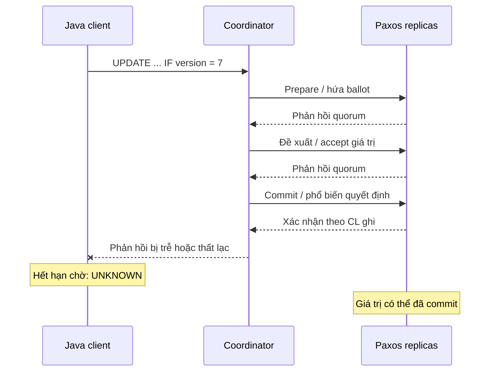
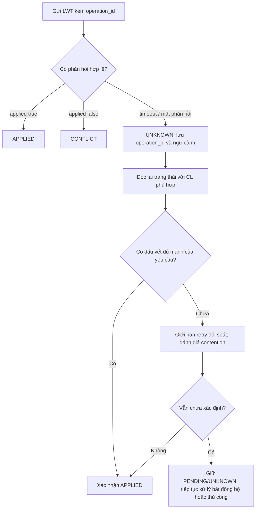

# Timeout khi LWT và kết quả commit chưa xác định trong Apache Cassandra

## 1. Bối cảnh: timeout khác với giao dịch thất bại

Apache Cassandra là hệ quản trị dữ liệu wide-column phân tán. Mỗi phân vùng được xác định bởi **partition key** và có thể được sao chép lên nhiều replica theo chiến lược replication. Cassandra cho phép chọn **consistency level (CL)** khi đọc/ghi, chẳng hạn `ONE`, `QUORUM` hoặc `LOCAL_QUORUM`.

Khi ứng dụng cần kiểm tra một điều kiện trước khi thay đổi dữ liệu, Cassandra cung cấp **Lightweight Transaction (LWT)** thông qua các câu lệnh CQL như `INSERT ... IF NOT EXISTS` hoặc `UPDATE ... IF version = ?`. LWT dùng Paxos để phối hợp các cập nhật cạnh tranh. Đây là công cụ quan trọng khi thiết kế bảng theo truy vấn và triển khai optimistic locking trong ứng dụng Java.

Một vấn đề vận hành dễ gây sai nghiệp vụ: **client nhận timeout sau khi gửi LWT không đồng nghĩa với Cassandra đã hủy giao dịch**.

Timeout thường chỉ cho biết bên chờ **không nhận được kết quả trong thời hạn yêu cầu**. Trong thời gian đó, một phần hoặc toàn bộ quá trình Paxos và commit có thể đã tiến hành. Kết quả thực sự của lần gọi có thể là:

- Điều kiện đúng và thay đổi đã được commit, nhưng phản hồi không tới client.
- Điều kiện sai, nhưng client không nhận được kết quả `[applied] = false`.
- Giao dịch chưa commit khi client ngừng chờ; một vòng Paxos/khôi phục tiếp theo có thể xác định kết quả.
- Giao dịch không hoàn tất do không đạt yêu cầu về replica, tranh chấp hoặc lỗi kết nối.

Do đó, sau một timeout có khả năng xảy ra **sau khi yêu cầu đã được gửi**, trạng thái an toàn ở tầng nghiệp vụ là **UNKNOWN (chưa xác định)**. Không được tự diễn giải thành `false`, cũng không được mặc định trả về thành công.

## 2. Kết quả LWT bình thường và kết quả thiếu thông tin

Xét bảng lưu tài liệu, mỗi hàng có một `id` và số phiên bản `version`:

```sql
CREATE KEYSPACE IF NOT EXISTS lwt_demo
WITH replication = {
  'class': 'NetworkTopologyStrategy',
  'dc1': 3
};

CREATE TABLE IF NOT EXISTS lwt_demo.document_by_id (
    id text PRIMARY KEY,
    version int,
    body text,
    last_operation_id uuid
);
```

Tên datacenter `dc1` và RF = 3 chỉ là ví dụ. Khi chạy thật, dùng đúng tên DC, replication factor và topology của cụm.

Tạo hàng ban đầu bằng LWT:

```sql
INSERT INTO lwt_demo.document_by_id
    (id, version, body, last_operation_id)
VALUES ('doc-7', 7, 'Bản số 7', null)
IF NOT EXISTS;
```

Sau đó client gửi:

```sql
UPDATE lwt_demo.document_by_id
SET version = 8,
    body = 'Bản số 8',
    last_operation_id = 11111111-1111-4111-8111-111111111111
WHERE id = 'doc-7'
IF version = 7;
```

Nếu client nhận phản hồi **thành công ở cấp giao thức**, có thể phân loại:

| Phản hồi | Kết luận từ lần gọi | Hành vi ứng dụng |
| --- | --- | --- |
| `[applied] = true` | Cassandra đã chấp nhận điều kiện và áp dụng thay đổi của lần gọi | Xác nhận nghiệp vụ hoàn tất |
| `[applied] = false` | Điều kiện đã không thỏa ở lần đánh giá này; thay đổi của lần gọi không được áp dụng | Trả xung đột hoặc đọc lại phiên bản |
| Timeout/mất phản hồi **sau khi gửi** | Chưa biết lần gọi có được áp dụng không | Đánh dấu `UNKNOWN`, đối soát trước khi quyết định tiếp |

Các lỗi chắc chắn xảy ra **trước khi yêu cầu được gửi**, chẳng hạn validate đầu vào tại client thất bại, có thể được phân loại riêng là không thực hiện. Không nên gộp mọi exception thành `UNKNOWN` khi ứng dụng có đủ bằng chứng yêu cầu chưa rời client.

> **Quy tắc quan trọng:** `[applied] = false` là một kết quả nghiệp vụ được Cassandra trả rõ ràng. Timeout là **không nhận được kết quả**, vì vậy không thể thay thế hai trạng thái cho nhau.

## 3. Timeout có thể xảy ra ở đâu trong quá trình LWT?

LWT sử dụng các bước đồng thuận Paxos trước khi commit. Chi tiết lượt trao đổi, tối ưu hóa và đường phục hồi phụ thuộc phiên bản Cassandra; sơ đồ sau thể hiện khái niệm:



Một số kịch bản thực tế:

1. **Trước khi quorum đồng thuận:** coordinator chưa nhận đủ phản hồi Paxos. Client có thể timeout khi chưa có thay đổi được commit; nhưng chỉ từ timeout không thể khẳng định trạng thái cuối cùng.
2. **Sau khi quorum chấp nhận đề xuất:** quyết định có thể đang được hoàn tất, trong khi client đã hết thời gian chờ. Giao dịch sau đó vẫn có thể được hoàn tất hoặc được một vòng Paxos tiếp theo phát hiện.
3. **Trong pha commit/ghi:** coordinator đang phổ biến quyết định tới replica, có replica đã nhận còn replica khác chưa phản hồi. Mức nhất quán ghi yêu cầu có thể chưa được xác nhận khi client timeout.
4. **Sau commit nhưng trước khi phản hồi tới client:** dữ liệu đã được áp dụng; lỗi mạng hoặc client-side timeout làm client không thấy `[applied] = true`.

Không thể chỉ nhìn thời gian timeout để xác định nó thuộc bước nào. Nếu driver báo một loại timeout cụ thể, thông tin đó có thể giúp khoanh vùng pha lỗi nhưng **không thay thế kiểm tra trạng thái nghiệp vụ**.

### Phân biệt các loại timeout

| Loại tình huống | Điều có thể khẳng định | Điều vẫn chưa rõ |
| --- | --- | --- |
| Driver hết thời hạn request ở phía client | Client ngừng chờ phản hồi | Coordinator/replica còn xử lý hay đã commit |
| Server báo timeout khi phối hợp CAS/Paxos | Các phản hồi cần thiết chưa đến đúng hạn tại bước liên quan | Quyết định có thể đã được chấp nhận hoặc sẽ được hoàn tất |
| Server báo timeout trong pha ghi/commit | Chưa có đủ xác nhận ghi theo CL yêu cầu trong thời hạn | Giá trị cuối cùng đã đến bao nhiêu replica, có được hoàn tất hay không |
| Kết nối đứt sau khi gửi | Kênh phản hồi bị mất | Trạng thái giao dịch tại cluster |

Cassandra và driver có thể đặt tên exception khác nhau theo phiên bản và từng điểm lỗi. Vì vậy, nên phân loại dựa trên **giai đoạn gửi yêu cầu, loại lỗi và thông tin đủ tin cậy**, thay vì suy luận cứng từ tên exception.

## 4. Vì sao retry ngay có thể trả kết quả đánh lừa?

Giả sử ban đầu `version = 7`, client A muốn đặt `version = 8`, dùng LWT `IF version = 7`.

```text
Thời điểm    Cassandra                         Client A
---------    --------------------------------  -------------------------
t0           version = 7                       gửi UPDATE ... IF version=7
t1           Paxos chấp nhận cập nhật          đang đợi
t2           commit version = 8                đã hết timeout, nhận lỗi
t3           version = 8                       retry cùng UPDATE ... IF version=7
t4           điều kiện version = 7 sai         nhận [applied] = false
```

Ở `t4`, `false` chỉ nói rằng **lần retry không vượt qua điều kiện**. Nó **không chứng minh lần đầu thất bại**; thực tế lần đầu đã ghi thành công.

Hai tình huống cũng có thể cho kết quả quan sát tương tự:

- Client B đã ghi trước từ `7` sang `8`; lần đầu của A chưa bao giờ được áp dụng.
- Lần đầu của A đã ghi thành công; sau đó một client khác tiếp tục cập nhật dữ liệu, làm trạng thái hiện tại khác mong đợi.

Vì vậy, một lần đọc thấy `version = 8` cũng **không đủ** để kết luận A là tác giả của cập nhật. Muốn đối soát cần thêm dấu vết nghiệp vụ, chẳng hạn `operation_id`, và thiết kế chính sách lưu giữ dấu vết phù hợp.

## 5. Thiết kế giao thức kết quả: APPLIED, CONFLICT, UNKNOWN

Ở tầng service Java, nên có mô hình kết quả độc lập với các exception của driver:

| Trạng thái | Điều kiện để gán | Hướng xử lý |
| --- | --- | --- |
| `APPLIED` | Nhận phản hồi LWT thành công với `[applied] = true` hoặc có bằng chứng đối soát đủ mạnh | Tiếp tục bước nghiệp vụ tiếp theo |
| `CONFLICT` | Nhận `[applied] = false` rõ ràng cho thao tác đang xét | Báo phiên bản đã đổi, không tự ghi đè |
| `UNKNOWN` | Yêu cầu có thể đã đến Cassandra nhưng không nhận được kết quả đáng tin cậy | Ghi nhận operation ID, lên lịch/tiến hành đối soát |
| `NOT_SENT` | Có bằng chứng yêu cầu thất bại trước khi gửi | Có thể sửa đầu vào hoặc gửi mới theo chính sách |

Sự khác biệt giữa `CONFLICT` và `UNKNOWN` cần thể hiện trong API và UI. Ví dụ HTTP `409 Conflict` thường phù hợp với xung đột có xác nhận; một lời nhắn như “Đang xác minh kết quả cập nhật” phù hợp hơn với trạng thái chưa rõ. Không nên báo “Cập nhật thất bại” rồi để người dùng bấm thao tác lại nhiều lần khi thao tác có thể đã được thực hiện.

Đặc biệt với một hệ thống có **tác dụng phụ ngoài Cassandra** (gửi email, tính phí, tạo đơn hàng), không phát sinh tác dụng phụ lần hai dựa đơn thuần vào việc client retry LWT. Các tác dụng phụ cần có khóa idempotency hoặc cơ chế điều phối đáng tin cậy riêng.

## 6. Thêm `operation_id` để hỗ trợ đối soát

Định danh thao tác giúp ứng dụng phân biệt “bản ghi đang ở version mong đợi” với “có dấu vết rằng chính yêu cầu này đã ghi”.

Ví dụ, cùng một lệnh `UPDATE` có điều kiện ghi đồng thời:

```sql
UPDATE lwt_demo.document_by_id
SET version = 8,
    body = 'Bản số 8',
    last_operation_id = 11111111-1111-4111-8111-111111111111
WHERE id = 'doc-7'
IF version = 7;
```

Nếu nhận timeout, **đừng tạo UUID khác để retry cùng thao tác logic**. Ghi lại `operation_id` của yêu cầu trước và kiểm tra:

```sql
SELECT version, body, last_operation_id
FROM lwt_demo.document_by_id
WHERE id = 'doc-7';
```

Nếu giá trị đọc được có `last_operation_id` bằng UUID vừa gửi, điều đó cho thấy **dấu vết của yêu cầu này đang có trong hàng** và có thể là bằng chứng thành công hữu ích. Tuy nhiên:

- Nếu `last_operation_id` **khác**, không kết luận ngay yêu cầu cũ chưa commit. Một cập nhật về sau có thể đã ghi đè trường này.
- Nếu dữ liệu **chưa thay đổi**, yêu cầu cũ vẫn có thể đang chờ hoàn tất hoặc giá trị đã commit chưa được lượt đọc vừa rồi quan sát được.
- Một `SELECT` thông thường tại CL thấp có thể đọc bản sao chậm; hãy chọn CL đọc phù hợp phạm vi nhất quán của ứng dụng.
- `last_operation_id` chỉ lưu **thao tác cuối cùng**. Nếu cần kết luận lịch sử bền vững cho từng request, phải thiết kế **nhật ký idempotency/operation** không bị ghi đè, đặt đúng ranh giới nguyên tử hoặc sử dụng cơ chế điều phối bên ngoài. Một cột UUID đơn lẻ không tự tạo transaction giữa nhiều partition.

Ví dụ trên là kỹ thuật hỗ trợ xác minh, chưa phải giao thức *exactly-once* hoàn chỉnh.

## 7. Quy trình đối soát sau một timeout

Quy trình gợi ý khi server đã có khả năng nhận yêu cầu:



Các bước thực hiện:

1. **Ghi nhận trước khi retry:** partition key, operation ID, expected version, payload (hoặc hash), thời điểm, CL thường, serial CL, số lần gửi và loại exception.
2. **Đọc lại trạng thái có chủ đích:** dùng CL đủ phù hợp với topology; nếu cần quan sát/hoàn tất một trạng thái Paxos còn treo, xem xét khả năng **serial read** của Cassandra theo tài liệu và phiên bản đang dùng.
3. **Đánh giá bằng chứng:** so sánh version, nội dung và operation ID; phân biệt “đúng kết quả hiện tại” với “đã chứng minh request cụ thể thành công”.
4. **Retry có giới hạn:** chỉ retry theo chính sách nghiệp vụ đã phân tích khả năng trùng lặp; dùng backoff, jitter, deadline và hạn chế concurrency trên cùng khóa nóng.
5. **Nếu chưa đủ bằng chứng:** giữ `UNKNOWN` hoặc `PENDING`, mở đường đối soát sau; tránh ép trạng thái thành `FAILED` hoặc `APPLIED`.

Một lượt đọc sau timeout **không phải** hàng rào bảo đảm rằng không còn ghi đang tiến hành. Trước khi thiết kế auto-retry, cần kiểm soát cả khả năng một vòng đồng thuận trước đó đang tiếp tục và khả năng client khác cạnh tranh trên cùng partition.

### Khi nào có thể retry?

| Hoàn cảnh | Đề xuất |
| --- | --- |
| `[applied] = false` đã nhận rõ | Không retry mù cùng expected version; xử lý conflict |
| Timeout có thể xảy ra sau khi gửi | Đối soát trước; nếu retry, dùng cùng định danh thao tác và chấp nhận kết quả retry có thể khác lần đầu |
| Lỗi kiểm tra đầu vào trước khi gửi | Sửa dữ liệu/câu lệnh rồi gửi lại |
| Không đủ replica hoặc contention kéo dài | Hạn chế retry, điều tra hạ tầng và giảm khóa nóng |
| Tác vụ có side effect khó đảo ngược | Cần idempotency end-to-end hoặc phê duyệt/đối soát trước khi phát sinh lại |

## 8. Hai CL của LWT ảnh hưởng đến timeout ra sao?

Trong một LWT, có **hai loại consistency** cần theo dõi:

1. **Serial consistency** `SERIAL` hoặc `LOCAL_SERIAL`: chọn phạm vi quorum Paxos quyết định thao tác có điều kiện.
2. **Consistency thông thường** như `QUORUM` hoặc `LOCAL_QUORUM`: chọn phạm vi xác nhận phần ghi/commit.

Với hai DC `dc1`, `dc2`, mỗi DC có RF = 3 cho cùng keyspace, ví dụ:

| Mức | Quorum minh họa | Ý nghĩa |
| --- | --- | --- |
| `LOCAL_SERIAL` | 2 trong 3 replica ở DC địa phương | Đồng thuận Paxos trong một DC |
| `SERIAL` | 4 trong tổng 6 replica | Đồng thuận Paxos phạm vi toàn cục |
| `LOCAL_QUORUM` | 2 trong 3 replica ở DC địa phương | Xác nhận đọc/ghi thường trong một DC |
| `QUORUM` | 4 trong tổng 6 replica | Xác nhận đọc/ghi thường toàn cục |

Lưu ý rằng số lượng tương tự không có nghĩa hai CL tương đương: `LOCAL_SERIAL` và `LOCAL_QUORUM` dùng cho **hai pha khác nhau**. Nếu chọn `SERIAL` trong topology nhiều DC, thời gian trao đổi mạng xuyên DC có thể tăng. Nếu chọn `LOCAL_SERIAL`, chỉ sử dụng trong phạm vi bảo đảm phù hợp với nghiệp vụ; các client cạnh tranh ở nhiều DC không được mặc định có CAS tuyến tính hóa toàn cục từ các quorum địa phương độc lập.

Không “chữa” timeout bằng cách tự động hạ `SERIAL` xuống `LOCAL_SERIAL` hoặc hạ `LOCAL_QUORUM` xuống `ONE`. Việc này thay đổi ranh giới bảo đảm nhất quán. Replication, repair và compaction có vai trò lưu trữ/đồng bộ dữ liệu nhưng **không thay thế Paxos** trong kiểm tra điều kiện.

## 9. Java Driver 4.x: giữ kết quả LWT và phân loại lỗi riêng

Ví dụ sau sử dụng API `com.datastax.oss.driver.api` của Cassandra Java Driver 4.x. `CqlSession` được ứng dụng tạo trước với địa chỉ contact points, local datacenter và cấu hình xác thực phù hợp.

```java
import java.util.UUID;

import com.datastax.oss.driver.api.core.CqlSession;
import com.datastax.oss.driver.api.core.DefaultConsistencyLevel;
import com.datastax.oss.driver.api.core.cql.BoundStatement;
import com.datastax.oss.driver.api.core.cql.PreparedStatement;
import com.datastax.oss.driver.api.core.cql.ResultSet;

public final class DocumentRepository {
    public enum Outcome { APPLIED, CONFLICT }

    private final CqlSession session;
    private final PreparedStatement updateIfVersion;

    public DocumentRepository(CqlSession session) {
        this.session = session;
        this.updateIfVersion = session.prepare(
            "UPDATE lwt_demo.document_by_id " +
            "SET version = ?, body = ?, last_operation_id = ? " +
            "WHERE id = ? IF version = ?"
        );
    }

    public Outcome updateOnce(
            String documentId, int expectedVersion,
            String newBody, UUID operationId) {
        BoundStatement statement = updateIfVersion.bind(
                expectedVersion + 1, newBody, operationId,
                documentId, expectedVersion)
            .setConsistencyLevel(DefaultConsistencyLevel.LOCAL_QUORUM)
            .setSerialConsistencyLevel(DefaultConsistencyLevel.LOCAL_SERIAL)
            .setIdempotent(false);

        ResultSet result = session.execute(statement);
        return result.wasApplied() ? Outcome.APPLIED : Outcome.CONFLICT;
    }
}
```

Đoạn code này chỉ phân loại hai **phản hồi đã nhận thành công**. Exception từ `session.execute()` được đẩy lên tầng service để phân biệt lỗi chắc chắn trước khi gửi và lỗi khiến kết quả trở nên không xác định. Không đặt `catch (Exception) { return CONFLICT; }` vì điều đó làm mất thông tin quan trọng.

Đánh dấu `setIdempotent(false)` thể hiện chính sách thận trọng: không cho driver giả định an toàn để tự retry hoặc thực hiện speculative execution đối với câu lệnh này. Với LWT, việc lặp lại cùng câu lệnh có điều kiện có thể không nhân đôi cùng một cập nhật, **nhưng kết quả `[applied]` giữa các lần thử có thể khác nhau** và mọi side effect bên ngoài vẫn cần bảo vệ riêng.

Tầng service có thể biểu diễn luồng như sau (mã giả, phần phân loại exception phải dựa trên driver và đường gửi thực tế):

```text
operationId = ID ổn định cho một yêu cầu nghiệp vụ
ghi nhận yêu cầu ở trạng thái PENDING
try:
    result = repository.updateOnce(..., operationId)
    nếu APPLIED: xác nhận thành công
    nếu CONFLICT: báo xung đột (không retry cùng expectedVersion)
catch lỗi:
    nếu có bằng chứng chắc chắn request chưa gửi: NOT_SENT
    nếu request có thể đã gửi nhưng không có kết quả: UNKNOWN
    nếu lỗi cấu hình/lập trình: báo lỗi cấu hình và điều tra
với UNKNOWN:
    đối soát theo operationId + trạng thái hiện tại
    nếu chưa phân định được: tiếp tục giữ UNKNOWN/PENDING
```

Nếu muốn triển khai tự động, nên đặt giới hạn tổng thời gian, số lần thử, hàng đợi đối soát và chính sách hiển thị trạng thái cho người dùng. Không gửi vô hạn các CAS lên cùng một partition nóng.

## 10. Tình huống vận hành và cách chẩn đoán

Khi timeout LWT tăng đột biến, cần nhìn cả **giao dịch** và **hạ tầng cụm**:

| Dấu hiệu | Khả năng cần kiểm tra | Biện pháp phù hợp |
| --- | --- | --- |
| Timeout tập trung ở một partition | Nhiều client tranh chấp cùng khóa, Paxos contention | Phân bổ lưu lượng, giảm số writer cạnh tranh, throttle |
| Timeout tăng cùng độ trễ mạng liên DC | Quorum Paxos hoặc commit vượt qua ranh giới DC | Kiểm tra topology, serial CL, network latency |
| Chỉ một số node có lỗi kéo dài | Replica quá tải, GC pause, mất kết nối, hàng đợi tắc | Kiểm tra sức khỏe node, CPU/GC, disk/network |
| Client timeout trước khi thấy lỗi server | Deadline driver quá ngắn so với độ trễ thực tế | Đối chiếu timeout client/server, histogram latency |
| Retry tạo nhiều lần `[applied] = false` | Lần trước đã commit hoặc đối thủ đã đổi version | Đối soát với operation ID; đừng tự coi đó là thất bại |
| Quorum không đủ | Replica không sẵn sàng hoặc DC bị cô lập | Khôi phục replica/kết nối và đánh giá tính sẵn sàng |

Ghi log có cấu trúc để điều tra: `operation_id`, `partition_key` (có thể hash nếu nhạy cảm), `expected_version`, serial CL, normal CL, thời gian bắt đầu/kết thúc, exception class, số retry và trạng thái cuối. Giữ log không lộ dữ liệu nhạy cảm. Theo dõi tỷ lệ `UNKNOWN`, thời gian đối soát, latency CAS, contention và mức sẵn sàng của replica; **không chỉ đo tỷ lệ HTTP lỗi** vì một thao tác có thể thành công ở Cassandra dù client nhận timeout.

## 11. Ba bài tập tình huống

### Bài tập 1 — Retry sau khi mất phản hồi

Ban đầu `version = 10`. Client A gửi `UPDATE ... SET version = 11 IF version = 10` và timeout. Sau đó A thử lại, lần này nhận `[applied] = false`. Hỏi:

1. Có được trả về “lần đầu chắc chắn thất bại” không?
2. Có được trả về “lần đầu chắc chắn thành công” chỉ vì hiện tại `version = 11` không?
3. Cần bổ sung gì vào thiết kế nếu nghiệp vụ muốn xác định request nào đã cập nhật?

### Bài tập 2 — Lỗi chỉ xảy ra ở DC thứ hai

Cụm có `dc1` và `dc2`, mỗi DC RF = 3. Hệ thống dùng `SERIAL` để phối hợp CAS xuyên DC và gặp timeout khi đường mạng liên DC kém. Một người đề nghị chuyển ngay sang `LOCAL_SERIAL` để giảm lỗi. Hãy giải thích rủi ro nếu cả hai DC có thể cùng sửa một khóa.

### Bài tập 3 — Chặn gửi thông báo trùng

Ứng dụng đặt đơn hàng bằng LWT rồi gửi email xác nhận. Request LWT timeout. Người dùng bấm “Đặt lại” trong khi lần đầu có thể đã commit. Hãy thiết kế trạng thái API và cơ chế bảo đảm email không được gửi hai lần cho cùng một đơn hàng.

**Gợi ý đáp án:**

- **Bài 1:** Cả hai câu kết luận chắc chắn đều sai. Retry thất bại có thể do lần đầu đã ghi hoặc một writer khác đã đổi version. Dùng operation ID và lịch sử đủ bền để đối soát; tránh dựa độc nhất vào version.
- **Bài 2:** Quorum local ở hai DC không có giao nhau bắt buộc. Giảm phạm vi serial có thể mất bảo đảm thứ tự CAS toàn cục. Cần giải quyết topology, lỗi mạng, chính sách nhất quán và giới hạn truy cập trước khi đổi CL.
- **Bài 3:** Tạo mã yêu cầu duy nhất và trạng thái `PENDING/UNKNOWN`, đối soát dữ liệu trước khi báo thành công/thất bại. Gửi thông báo qua cơ chế có idempotency/deduplication theo order ID, và chỉ cho phép workflow phát sinh side effect một lần theo trạng thái đã xác nhận.

## 12. Checklist áp dụng trong dự án Java

- [ ] Lệnh cần CAS thực sự dùng `IF` và partition key được thiết kế đúng với phạm vi điều kiện.
- [ ] Serial CL và normal CL được cấu hình có chủ đích, nhất quán giữa các writer cạnh tranh.
- [ ] Mọi yêu cầu nghiệp vụ có operation ID ổn định qua retry.
- [ ] Service phân biệt `APPLIED`, `CONFLICT`, `UNKNOWN` và các lỗi chưa gửi.
- [ ] Có quy trình đối soát có giới hạn, xử lý đọc dữ liệu mới/cũ và giao dịch còn đang diễn ra.
- [ ] Retry, speculative execution và side effect được kiểm soát riêng.
- [ ] Có khả năng quan sát timeout, contention và thời gian xử lý `UNKNOWN`.

## Ghi nhớ

Trong Apache Cassandra, **timeout của LWT là mất thông tin về kết quả, không phải bằng chứng rollback**. Chỉ dùng `[applied] = true/false` khi thật sự đã nhận được phản hồi tương ứng. Với timeout có khả năng xảy ra sau khi gửi, bảo toàn `UNKNOWN`, đối soát dựa trên định danh thao tác và trạng thái dữ liệu, điều chỉnh retry theo mức nhất quán và phạm vi Paxos. Tư duy này giúp ứng dụng Java xử lý đồng thời an toàn hơn ngay cả khi replica, coordinator hoặc mạng gặp lỗi.
