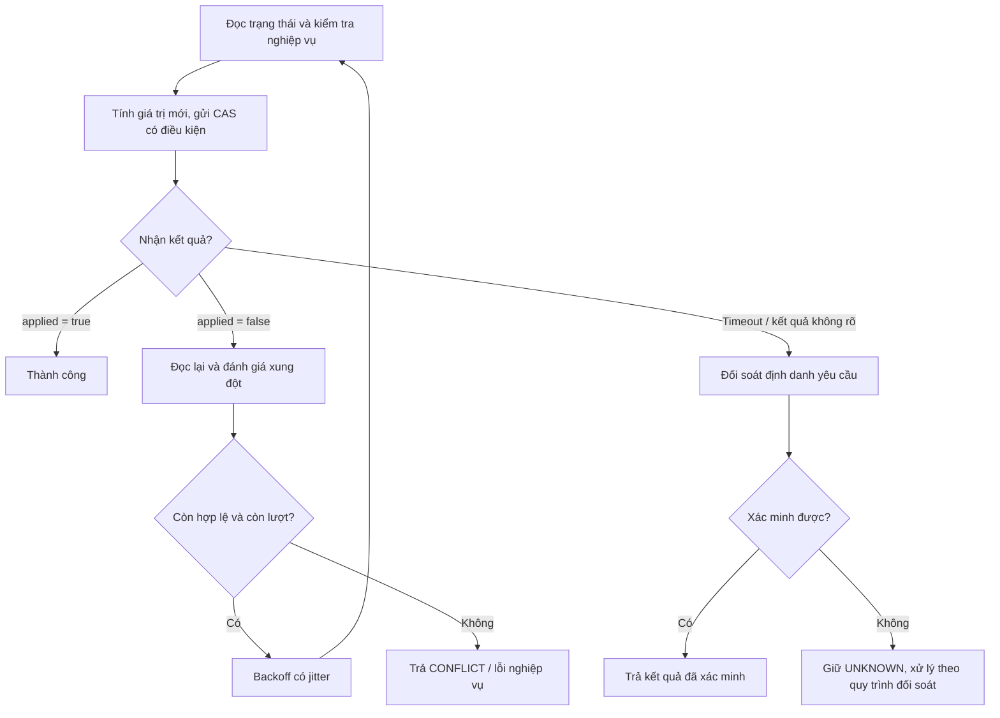

# Thử lại LWT, xử lý cạnh tranh và tránh thay đổi điều kiện ngoài ý muốn

> **Chương:** LWT và đồng thời  
> **Phạm vi:** Apache Cassandra, CQL và kết nối từ ứng dụng Java; trọng tâm là chính sách thử lại khi dùng *lightweight transaction* (LWT) để cập nhật dữ liệu đang có nhiều tác nhân cạnh tranh.

## 1. Vì sao một lần thử lại có thể làm sai dữ liệu?

Apache Cassandra là cơ sở dữ liệu phân tán theo mô hình *wide-column*: partition key quyết định cách phân phối dữ liệu đến các replica, còn schema nên được thiết kế từ truy vấn dự kiến. Với thao tác ghi thường, Cassandra ưu tiên khả năng ghi phân tán và không tự kiểm tra một điều kiện nghiệp vụ mà ứng dụng đã đọc trước đó. LWT cung cấp thao tác ghi có điều kiện như `INSERT ... IF NOT EXISTS` và `UPDATE ... IF version = ?`, sử dụng Paxos để phối hợp và chốt kết quả so sánh trước khi ghi (*compare-and-set*, CAS).

Ví dụ một kho còn `5` sản phẩm, phiên bản `8`. Hai dịch vụ đều đọc trạng thái này:

- A muốn bán `1` sản phẩm, dự định ghi `available = 4, version = 9`.
- B muốn bán `3` sản phẩm, dự định ghi `available = 2, version = 9`.

Cả hai cùng gửi CAS với điều kiện `IF version = 8`. **Chỉ một điều kiện có thể thắng trên trạng thái đó**. Tác nhân thua phải đọc lại và tính lại từ trạng thái mới. Nếu B thắng (kho còn `2`) mà A tự thay điều kiện thành `IF version = 9` nhưng **giữ nguyên giá trị dự kiến `4`**, A có thể ghi số lượng từ `2` lên `4`: thao tác thử lại đã vô tình hoàn tác kết quả bán hàng của B.

Quy tắc cốt lõi là: **thay đổi điều kiện CAS đồng nghĩa với một quyết định mới dựa trên trạng thái mới**, do đó phải đọc lại, kiểm tra lại bất biến nghiệp vụ và tính lại giá trị ghi. Không biến một CAS bị từ chối thành ghi vô điều kiện.

## 2. Ba kết quả phải phân biệt trước khi thử lại

Kết quả từ CQL LWT có cột đặc biệt `[applied]`. Một lỗi mạng không có cột này và không tương đương với một CAS bị từ chối.

| Quan sát của client | Kết luận có thể đưa ra | Hành động phù hợp |
| --- | --- | --- |
| Nhận `[applied] = true` | Điều kiện tại thời điểm CAS thỏa; thay đổi của lệnh đó đã được áp dụng. | Xác nhận thao tác thành công; không gửi lại để "chắc ăn". |
| Nhận `[applied] = false` | Điều kiện không thỏa; **lệnh ghi có điều kiện này không được áp dụng**. | Phân tích xung đột, đọc lại dữ liệu cần thiết, rồi mới quyết định thử một CAS mới. |
| Timeout, mất kết nối hoặc kết quả không rõ | Client **không biết chắc** CAS đã được chốt hay chưa. | Chuyển sang trạng thái `UNKNOWN`, đối soát với định danh yêu cầu hoặc một cơ chế theo dõi bền vững trước khi kết luận. |

Khi điều kiện `IF version = 8 AND state = 'ACTIVE'` thất bại, Cassandra trả lại `[applied]` cùng giá trị hiện tại của **các cột được dùng trong mệnh đề `IF`** (ở đây là `version` và `state`). Dữ liệu `available` không mặc nhiên xuất hiện. Với `INSERT ... IF NOT EXISTS` thất bại, kết quả có thể bao gồm dữ liệu dòng đã tồn tại; với `IF EXISTS` thất bại, không nên chờ các cột nội dung của dòng.

Vì thế, nếu cần tính lại số lượng tồn kho, **đừng suy ra số lượng từ một dòng CAS chỉ chứa `version`**. Hãy `SELECT` lại những cột liên quan và áp dụng mức nhất quán phù hợp.

Lưu ý: `[applied] = false` là xung đột điều kiện *đã biết*, còn timeout là tình trạng *chưa biết kết quả*. Nếu lần ghi trước đã thành công nhưng phản hồi bị mất, gửi lại cùng điều kiện cũ thường nhận `false` vì phiên bản đã tăng. Kết quả `false` của **lần gửi lại** không chứng minh lần gửi đầu đã thất bại.

## 3. Thực hành CQL với phiên bản và định danh yêu cầu

Giả sử đã chọn một keyspace dùng để thực hành. Bảng được truy vấn theo `sku` (partition key) nhằm giữ các phép CAS của cùng một mặt hàng trong phạm vi một partition.

```cql
CREATE TABLE IF NOT EXISTS inventory_by_sku (
    sku text PRIMARY KEY,
    available int,
    version bigint,
    state text,
    last_op_id uuid
);

INSERT INTO inventory_by_sku (sku, available, version, state)
VALUES ('BOOK-42', 5, 8, 'ACTIVE')
IF NOT EXISTS;
```

`version` là phiên bản do **ứng dụng quản lý**. Mọi tác nhân có quyền thay `available` hoặc `state` cần tuân thủ cùng quy tắc cập nhật phiên bản và điều kiện LWT; một lệnh `UPDATE` thường bỏ qua CAS có thể làm vô hiệu cách bảo vệ này.

### A. Cập nhật có điều kiện đúng

Dịch vụ A đọc thấy `available = 5`, `version = 8` và `state = 'ACTIVE'`. A muốn trừ một sản phẩm và dùng định danh nghiệp vụ cố định cho yêu cầu:

```cql
UPDATE inventory_by_sku
SET available = 4,
    version = 9,
    last_op_id = 11111111-1111-4111-8111-111111111111
WHERE sku = 'BOOK-42'
IF version = 8 AND state = 'ACTIVE';
```

Nếu lệnh được áp dụng, Cassandra trả:

```text
 [applied]
-----------
      True
```

Sau đó B vẫn đang cầm dữ liệu cũ và gửi:

```cql
UPDATE inventory_by_sku
SET available = 2,
    version = 9,
    last_op_id = 22222222-2222-4222-8222-222222222222
WHERE sku = 'BOOK-42'
IF version = 8 AND state = 'ACTIVE';
```

Kết quả minh họa:

```text
 [applied] | version | state
-----------+---------+--------
     False |       9 | ACTIVE
```

B chưa bán được ba sản phẩm. Phiên bản hiện tại là `9`; số lượng tồn kho hiện tại cần được đọc lại nếu B muốn thử tiếp.

```cql
SELECT available, version, state, last_op_id
FROM inventory_by_sku
WHERE sku = 'BOOK-42';
```

Giả sử lúc đọc lại `available = 4`, `version = 9` và `state = 'ACTIVE'`, B có thể tính lại kết quả bán ba sản phẩm là `available = 1`. Nếu quy tắc nghiệp vụ vẫn cho phép, B gửi **CAS mới** với `version = 9`, `available = 1`, `version = 10` và *cùng `last_op_id` của yêu cầu B*. Nếu trước khi CAS mới chạy có tác nhân khác nâng phiên bản, B lại nhận `false` và phải đánh giá lại.

### B. Phản ví dụ: sửa điều kiện nhưng giữ giá trị đã tính trước

```cql
-- KHÔNG LÀM: chỉ sửa expected version sau khi đã bị từ chối,
-- nhưng vẫn dùng dữ liệu SET tính từ ảnh chụp cũ.
UPDATE inventory_by_sku
SET available = 2, version = 10
WHERE sku = 'BOOK-42'
IF version = 9;
```

Trong ví dụ, B dự kiến `available = 2` từ trạng thái `5`, trong khi A đã trừ một sản phẩm xuống `4`. Nếu B thực sự bán ba sản phẩm, số lượng đúng phải là `1`. Lệnh "thử lại" trên chỉ đặt số lượng thành `2`, làm sai lệch tổng hàng đã bán.

Hai biến thể rủi ro khác:

```cql
-- KHÔNG LÀM: bỏ kiểm tra phiên bản khi đang tranh chấp.
UPDATE inventory_by_sku
SET available = 2
WHERE sku = 'BOOK-42';

-- KHÔNG LÀM: đổi điều kiện sang IF EXISTS để ép lệnh đi qua.
UPDATE inventory_by_sku
SET available = 2
WHERE sku = 'BOOK-42'
IF EXISTS;
```

`IF EXISTS` chỉ kiểm tra dòng tồn tại; nó không bảo vệ phiên bản đã đọc và không thay thế được điều kiện CAS ban đầu.

## 4. Vòng thử lại an toàn khi `[applied] = false`

Chỉ nên thử lại xung đột *phiên bản* khi nghiệp vụ còn cho phép. Một vòng xử lý hợp lý:

1. **Nhận diện kết quả:** nếu `[applied] = true`, hoàn tất; nếu `false`, ghi nhận xung đột; nếu không có phản hồi xác định, đi theo nhánh đối soát kết quả chưa rõ.
2. **Đọc lại trạng thái cần thiết:** tải `available`, `version`, `state` và trường định danh yêu cầu nếu có; không dựa vào những cột mà kết quả `IF` không trả về.
3. **Kiểm tra lại bất biến:** dòng còn tồn tại không, mặt hàng còn mở bán không, số lượng đủ không, yêu cầu đã hoàn thành trước đó chưa, giới hạn nghiệp vụ có thay đổi không?
4. **Tính lại thay đổi:** ví dụ với yêu cầu bán `3` sản phẩm, tính `newAvailable = currentAvailable - 3` sau khi xác nhận `currentAvailable >= 3`.
5. **Tạo CAS mới từ trạng thái vừa quan sát:** `SET available = newAvailable, version = currentVersion + 1` với `IF version = currentVersion AND state = 'ACTIVE'`. Điều kiện và giá trị `SET` phải cùng dựa trên **một ảnh chụp trạng thái**.
6. **Giới hạn số lượt và độ trễ:** đặt ngân sách retry hữu hạn, backoff có jitter khi xung đột; khi hết ngân sách, trả kết quả `CONFLICT` hoặc yêu cầu xử lý lại từ tầng ứng dụng.



**Không nên thử lại vô hạn.** Với partition key nóng, nhiều CAS cùng tranh một partition làm tăng số lần thất bại và độ trễ Paxos. Có thể dùng backoff tăng dần kèm jitter (chẳng hạn một độ trễ ngẫu nhiên trong khoảng từ `0` đến một giới hạn tăng theo số lượt), giới hạn tổng thời gian và đẩy các tác vụ không cấp thiết sang hàng đợi theo khóa.

Cũng không nên coi mọi `false` là lý do retry: nếu `state = 'CLOSED'`, yêu cầu chuyển trạng thái không còn hợp lệ; nếu `available` không đủ, đó là từ chối nghiệp vụ. Thử lại không có ích cho tới khi dữ liệu hoặc yêu cầu thay đổi có chủ đích.

## 5. Timeout: thử lại cùng CAS vẫn chưa đủ để biết chuyện gì xảy ra

Với LWT phân tán, một replica hoặc coordinator có thể hoàn tất đủ bước Paxos để áp dụng ghi, nhưng phản hồi về client bị trễ hoặc bị mất. Ngay cả khi client nhận lỗi timeout, phía Cassandra **có thể đã áp dụng** thao tác đó.

Xét yêu cầu A có mã `11111111-1111-4111-8111-111111111111`:

1. A gửi lệnh CAS `version: 8 → 9`, `available: 5 → 4`.
2. Client hết thời gian chờ và báo timeout.
3. Nếu A gửi lại **nguyên lệnh cũ**, có thể nhận `[applied] = false` vì phiên bản hiện là `9`. Điều này không cho biết lần đầu là A đã ghi thành công, hay tác nhân khác đã chiếm phiên bản `9`.
4. A đọc lại `last_op_id`. Nếu giá trị là ID của A và dữ liệu khớp tác động A muốn thực hiện, đó là bằng chứng hữu ích cho việc đối soát.
5. Nếu một yêu cầu B đã cập nhật tiếp và ghi đè `last_op_id`, A **không thể kết luận** từ cột `last_op_id` đơn lẻ rằng yêu cầu A có từng được áp dụng hay chưa.

Do đó, hãy dùng **một định danh nghiệp vụ ổn định** cho mọi lần thử của cùng một yêu cầu. Khi yêu cầu liên quan đến thanh toán, trừ tồn kho hoặc gửi thông báo, cần cơ chế idempotency/ghi nhận tác vụ bền vững để theo dõi trạng thái lâu dài. Cột `last_op_id` trong một dòng chỉ lưu **yêu cầu gần nhất**, không phải nhật ký đầy đủ, và không tự tạo ra giao dịch nguyên tử với một dịch vụ bên ngoài.

Nếu hệ thống không thể phân biệt "đã áp dụng rồi" và "chưa áp dụng", nên trả `UNKNOWN` để tầng nghiệp vụ đối soát, thay vì báo thành công hoặc tự phát lại hành động có tác dụng kép. Một câu `SELECT` thường với mức nhất quán thấp cũng không phải chứng cứ tuyệt đối rằng một CAS đang chờ đã bị từ chối; với yêu cầu cần kiểm tra tình trạng Paxos, cân nhắc đọc ở mức `SERIAL` hoặc `LOCAL_SERIAL` theo topology và thiết kế nhất quán của hệ thống.

## 6. Mẫu Java Driver 4.x: một lần CAS và phân loại kết quả

Ví dụ dưới đây thực hiện **một lần** cập nhật tồn kho dựa trên dữ liệu đã được đọc và xác thực ở tầng nghiệp vụ. Lớp gọi sẽ quyết định thử lại theo sơ đồ ở phần trước. Phương thức `wasApplied()` phân biệt kết quả LWT thành công và thất bại; timeout được ghi nhận riêng là `UNKNOWN`.

```java
import java.util.UUID;

import com.datastax.oss.driver.api.core.CqlSession;
import com.datastax.oss.driver.api.core.DefaultConsistencyLevel;
import com.datastax.oss.driver.api.core.DriverTimeoutException;
import com.datastax.oss.driver.api.core.cql.BoundStatement;
import com.datastax.oss.driver.api.core.cql.PreparedStatement;
import com.datastax.oss.driver.api.core.cql.ResultSet;
import com.datastax.oss.driver.api.core.cql.Row;
import com.datastax.oss.driver.api.core.servererrors.WriteTimeoutException;

public final class ConditionalInventoryWrite {
    public enum Outcome {
        APPLIED, CONFLICT, UNKNOWN
    }

    // newAvailable đã được tính từ cùng trạng thái
    // đã cung cấp observedVersion cho phép kiểm tra IF.
    public static Outcome attemptOnce(
            CqlSession session,
            String sku,
            int newAvailable,
            long observedVersion,
            UUID requestId) {

        PreparedStatement prepared = session.prepare(
            "UPDATE inventory_by_sku " +
            "SET available = ?, version = ?, last_op_id = ? " +
            "WHERE sku = ? IF version = ? AND state = 'ACTIVE'"
        );

        BoundStatement statement = prepared.bind(
                newAvailable,
                observedVersion + 1,
                requestId,
                sku,
                observedVersion)
            .setConsistencyLevel(DefaultConsistencyLevel.LOCAL_QUORUM)
            .setSerialConsistencyLevel(DefaultConsistencyLevel.LOCAL_SERIAL)
            .setIdempotent(false);

        try {
            ResultSet result = session.execute(statement);
            if (result.wasApplied()) {
                return Outcome.APPLIED;
            }

            // Chỉ các cột nêu trong IF được bảo đảm xuất hiện
            // khi điều kiện UPDATE thất bại.
            Row conflict = result.one();
            if (conflict == null) {
                throw new IllegalStateException("LWT thiếu dòng kết quả");
            }

            Long actualVersion = conflict.isNull("version")
                    ? null : conflict.getLong("version");
            String actualState = conflict.getString("state");

            System.out.printf(
                "CAS conflict: sku=%s, actualVersion=%s, state=%s%n",
                sku, actualVersion, actualState
            );
            return Outcome.CONFLICT;

        } catch (DriverTimeoutException | WriteTimeoutException e) {
            // Kết quả của thao tác vừa gửi chưa được xác nhận.
            // Không kết luận false và không gửi lại mù quáng.
            return Outcome.UNKNOWN;
        }
    }
}
```

Điểm cần chú ý khi dùng mẫu:

- `newAvailable` **không được** tính từ một trạng thái khác với `observedVersion`. Tầng gọi cần đọc dòng, xác nhận `state` và lượng hàng còn đủ, rồi mới gọi `attemptOnce`.
- Khi nhận `CONFLICT`, tầng gọi phải `SELECT` lại đầy đủ các trường cần thiết, kiểm tra nghiệp vụ, tính lại `newAvailable` và dùng phiên bản mới. Không chỉ tăng `observedVersion` rồi gọi lại với `newAvailable` cũ.
- Khi nhận `UNKNOWN`, tầng gọi cần đối soát bằng `requestId` hoặc cơ chế idempotency bền vững. Code trên chỉ bắt hai loại timeout thường gặp để minh họa; lỗi kết nối, lỗi ghi khác hoặc ngoại lệ trong ứng dụng phải được phân loại riêng theo tính chất đã gửi/chưa gửi và không được tự xem là CAS thất bại.
- `setIdempotent(false)` thể hiện rằng driver không nên suy đoán việc gửi lại là an toàn. Nếu ứng dụng hoặc lớp HTTP/message queue còn có retry, các lớp đó cũng phải tuân thủ cùng quy tắc. Không nên bật speculative execution tùy tiện cho thao tác có điều kiện.
- `LOCAL_QUORUM` là mức nhất quán cho pha ghi thông thường; `LOCAL_SERIAL` là mức cho pha CAS/serial trong datacenter cục bộ. Có thể dùng `QUORUM`/`SERIAL` tùy thiết kế đa datacenter. Không trộn cấu hình một cách ngẫu nhiên giữa các tác nhân.
- Phương thức minh họa `attemptOnce` cố ý chưa cài vòng lặp, đọc lại hay backoff: những quyết định này phụ thuộc vào ngân sách thời gian, quy tắc nghiệp vụ và trạng thái `UNKNOWN` của từng yêu cầu.

## 7. Những lỗi thiết kế thường gây tranh chấp hoặc ghi sai

| Sai lầm | Hệ quả | Cách khắc phục |
| --- | --- | --- |
| Nhận `false` rồi sửa `IF version = 8` thành `IF version = 9` mà giữ nguyên `SET`. | Ghi đè kết quả của tác nhân khác. | Đọc lại, tính lại `SET` và tạo một CAS mới. |
| Đổi `IF version = ?` thành `IF EXISTS`, hoặc bỏ `IF`. | Mất điều kiện chống cập nhật trên dữ liệu cũ. | Giữ điều kiện bảo vệ các bất biến nghiệp vụ. |
| Coi timeout là `false` và tạo ngay yêu cầu mới. | Có thể thực hiện trùng thao tác đã thành công. | Giữ mã yêu cầu cố định, đối soát kết quả chưa rõ. |
| Sinh `requestId` mới cho mỗi lần retry của cùng một yêu cầu. | Khó nhận diện cùng một hành động đã được áp dụng. | Sinh ID một lần ở biên nghiệp vụ, truyền xuyên suốt các lần thử. |
| Chỉ kiểm tra `version`, trong khi tác nhân khác sửa `state` không tăng phiên bản. | Lệnh có thể vượt qua điều kiện trạng thái không còn hợp lệ. | Tất cả đường ghi cùng tuân thủ phiên bản/LWT; kiểm tra thêm điều kiện trạng thái khi cần. |
| Retry không giới hạn trên một partition nóng. | Tăng độ trễ, áp lực Paxos và tỉ lệ xung đột. | Giới hạn lượt, backoff, giám sát tranh chấp và điều tiết tải. |
| Dùng `last_op_id` như một lịch sử idempotency vĩnh viễn. | Không thể xác minh các yêu cầu cũ sau khi cột này bị ghi đè. | Thiết kế nhật ký/idempotency bền vững phù hợp phạm vi nghiệp vụ. |

Đặc biệt, khi nhiều dịch vụ cùng ghi một partition, **không phối hợp LWT với các ghi thông thường bỏ qua điều kiện** đối với những trường đang cần bảo vệ. LWT không biến mọi thao tác độc lập ngoài nó thành một giao dịch tuyến tính có thứ tự.

## 8. Kiểm soát tải và quan sát vận hành

LWT phải thực hiện thêm nhiều lượt giao tiếp Paxos nên thường tốn chi phí hơn `INSERT`/`UPDATE` thông thường. Chỉ dùng CAS ở nơi cần ràng buộc nguyên tử; chọn partition key phù hợp mẫu truy vấn và giảm việc nhiều tác nhân cùng tranh một khóa nóng.

Theo dõi ít nhất:

- Tỉ lệ `[applied] = false` theo loại thao tác và partition key (hoặc nhóm khóa đã được ẩn thông tin nhạy cảm).
- Số lượt retry trung bình, tỉ lệ hết ngân sách retry và số yêu cầu ở trạng thái `UNKNOWN`.
- Latency p95/p99 của LWT, timeout và lỗi replica/coordinator.
- Tỉ lệ từ chối nghiệp vụ thực sự (hết hàng, trạng thái đóng) so với xung đột phiên bản có thể tính lại.
- Tần suất thao tác idempotency phải đối soát do phản hồi bị mất.

Những số liệu này giúp phân biệt một hệ thống thật sự tranh chấp cao với hệ thống đang retry mù quáng hoặc đang đánh dấu sai các lỗi nghiệp vụ thành lỗi hạ tầng. Replication, consistency level và topology đa datacenter cần được xét cùng nhau khi chọn `SERIAL` hay `LOCAL_SERIAL`.

## 9. Bài tập kiểm chứng

1. Tạo bảng `inventory_by_sku` trong keyspace thử nghiệm, chèn `BOOK-42` với `available=5`, `version=8`. Gửi CAS A, sau đó gửi CAS B với cùng `version=8` và giải thích vì sao B nhận `false`.
2. Thử viết câu retry cho B. Trình bày rõ `SELECT` nào được thực hiện, phép tính lại số lượng và điều kiện `IF` mới. Kiểm tra rằng sau khi A bán `1` và B bán `3`, kho còn `1`, nếu cả hai giao dịch được phép.
3. Thử `IF state='ACTIVE' AND version=?`, sau đó chuyển `state` thành `CLOSED` bằng một thao tác quản lý có tăng phiên bản; giải thích vì sao ứng dụng không được tiếp tục CAS chỉ vì phiên bản thay đổi.
4. Giả lập client mất phản hồi sau khi gửi A. Nếu đọc lại thấy `last_op_id` của A, bạn suy luận được gì? Nếu đọc lại thấy `last_op_id` của B, vì sao chưa thể khẳng định A chưa từng thành công?
5. Đề xuất ngân sách retry cho một API bán hàng và các chỉ số giám sát để phát hiện tranh chấp trên SKU bán chạy.

**Ghi nhớ:** `[applied] = false` là tín hiệu để **tính lại trên dữ liệu mới**, không phải chỉ việc sửa `IF`. Timeout đòi hỏi **đối soát kết quả chưa rõ**. Một yêu cầu nghiệp vụ phải giữ cùng định danh qua các lần thử, còn điều kiện CAS và giá trị `SET` phải luôn mô tả đúng cùng một trạng thái đã được kiểm tra.
