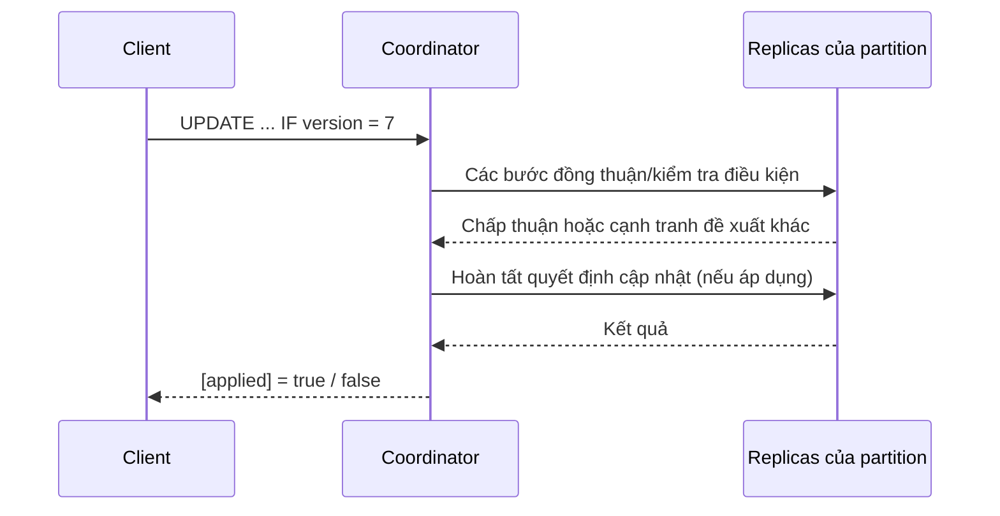

# Đo chi phí LWT và kiểm chứng lịch sử cập nhật đồng thời trong Apache Cassandra

## 1. Bài toán và mục tiêu

Trong hệ quản trị **wide-column phân tán Apache Cassandra**, cập nhật thông thường tối ưu cho ghi có độ trễ thấp và tính sẵn sàng theo mức nhất quán được chọn. Khi cần thao tác có điều kiện như “chỉ tạo nếu chưa tồn tại” hoặc “chỉ cập nhật khi phiên bản hiện tại đúng như đã đọc”, Cassandra cung cấp **lightweight transaction (LWT)** qua cú pháp CQL `IF NOT EXISTS` hoặc `IF ...`. LWT dùng giao thức đồng thuận dựa trên Paxos để phối hợp các replica của một partition. Đổi lại bảo đảm so sánh–ghi có điều kiện, nó có thêm chi phí trao đổi thông điệp và dễ chịu tác động của tranh chấp.

Bài này thuộc chương **LWT và đồng thời** của mô-đun `DATABASE_ENGINE_WIDE_COLUMN_CASSANDRA`. Trọng tâm là hai câu hỏi liên quan nhưng cần đo riêng:

1. **Chi phí LWT thực tế là bao nhiêu?** So sánh latency, throughput, tài nguyên và tỉ lệ áp dụng điều kiện khi thay đổi số client, số khóa nóng, consistency level, topology và tỉ lệ contention.
2. **Các cập nhật đồng thời có tạo thành một lịch sử hợp lệ không?** Ghi lại thời điểm bắt đầu/kết thúc và kết quả từng lệnh CAS; tìm thứ tự tuần tự phù hợp với quy tắc nghiệp vụ **và** thứ tự thời gian của các lệnh không chồng lấn.

Mục tiêu không phải tìm ra một con số “LWT chậm gấp X lần” áp dụng mọi cụm. Kết quả phụ thuộc phiên bản Cassandra, số replica, mạng, mức tải, loại yêu cầu, số partition, khóa nóng và cách client retry. Đồng thời, một biểu đồ độ trễ đẹp **không chứng minh** lịch sử cập nhật đúng.

## 2. LWT bảo đảm điều gì, và chi phí phát sinh ở đâu?

Ví dụ thay thế an toàn cho một thao tác có điều kiện:

```sql
-- Thực hiện khi version hiện tại đúng bằng 7.
UPDATE lwt_lab.account_by_id
SET balance = 420, version = 8
WHERE account_id = 00000000-0000-0000-0000-000000000001
IF version = 7;
```

Với cùng partition, nếu hai client đồng thời gửi `IF version = 7`, **không thể có hai lần cập nhật thành công cùng quan sát version 7**, với điều kiện chỉ có các thao tác LWT tuân thủ mô hình và không có thao tác khác ghi đè/đặt lại version. Kết quả CQL trả cột `[applied]`: `true` khi điều kiện được áp dụng, `false` khi điều kiện không thỏa; khi thất bại, phản hồi thường chứa các giá trị hiện tại của cột liên quan để client có thể xử lý xung đột.

Sơ đồ khái niệm:



Đây là sơ đồ **trừu tượng**. Các pha Paxos, đường đi nhanh/chậm và số lượt mạng cụ thể thay đổi theo phiên bản và trạng thái tranh chấp; không nên mặc định mọi LWT luôn tiêu tốn cố định bốn lượt mạng. So với `UPDATE` thông thường, chi phí LWT chủ yếu đến từ việc cần đạt đồng thuận, đọc/đánh giá điều kiện, xử lý cạnh tranh và hoàn tất kết quả.

### Hai loại consistency level phải phân biệt

| Thiết lập | Vai trò | Ví dụ |
| --- | --- | --- |
| **Regular/write consistency** | Số replica cần xác nhận phần ghi theo yêu cầu của CQL | `LOCAL_QUORUM` |
| **Serial consistency** | Phạm vi đồng thuận cho thao tác LWT | `SERIAL` hoặc `LOCAL_SERIAL` |

`SERIAL` áp dụng phạm vi toàn cụm theo quy tắc của giao thức; `LOCAL_SERIAL` chỉ áp dụng cho replica thuộc DC cục bộ khi cấu hình/topology phù hợp. Việc so sánh hai chế độ cần ghi rõ data center của client, RF mỗi DC và mức nhất quán ghi, vì thay đổi phạm vi điều phối có thể thay đổi cả latency lẫn bảo đảm khi có sự cố xuyên DC.

**Phạm vi bảo đảm:** LWT hỗ trợ so sánh–cập nhật có điều kiện mang tính tuyến tính hóa trên **một partition**. Không tự suy ra giao dịch ACID tổng quát, thứ tự tuyến tính toàn cụm giữa **nhiều partition** hay khả năng cập nhật nguyên tử nhiều bảng phân tán. Tránh trộn ghi thông thường và LWT lên cùng hàng/partition trong bài kiểm chứng: ghi không điều kiện không tham gia cùng quy tắc CAS và có thể làm mô hình lịch sử trở nên vô nghĩa.

## 3. Tạo dữ liệu thí nghiệm có thể lặp lại

Ví dụ dưới đây dùng CQL và keyspace kiểm thử. Chọn tên DC đúng với `nodetool status` của môi trường; `dc1` là **giả định minh họa**. Không chạy trên keyspace production.

```sql
CREATE KEYSPACE IF NOT EXISTS lwt_lab
WITH replication = {
  'class': 'NetworkTopologyStrategy',
  'dc1': 3
};

CREATE TABLE IF NOT EXISTS lwt_lab.account_by_id (
    account_id uuid PRIMARY KEY,
    balance bigint,
    version bigint,
    updated_by text
);

-- Khởi tạo hàng một lần; kiểm tra [applied] = true hoặc hàng đã tồn tại.
INSERT INTO lwt_lab.account_by_id (account_id, balance, version, updated_by)
VALUES (00000000-0000-0000-0000-000000000001, 0, 0, 'seed')
IF NOT EXISTS;
```

Lệnh thường dùng để cập nhật thử nghiệm:

```sql
-- Baseline không điều kiện: chỉ đo chi phí đường ghi thường.
UPDATE lwt_lab.account_by_id
SET balance = 10, version = 1, updated_by = 'baseline'
WHERE account_id = 00000000-0000-0000-0000-000000000001;

-- LWT CAS: chỉ áp dụng nếu version đang bằng 1.
UPDATE lwt_lab.account_by_id
SET balance = 20, version = 2, updated_by = 'client-a'
WHERE account_id = 00000000-0000-0000-0000-000000000001
IF version = 1;

-- Cùng mục tiêu nhưng sẽ [applied] = false sau khi CAS trên đã thành công.
UPDATE lwt_lab.account_by_id
SET balance = 30, version = 2, updated_by = 'client-b'
WHERE account_id = 00000000-0000-0000-0000-000000000001
IF version = 1;
```

Ba lệnh minh họa cách hoạt động, **không** phải chuỗi phải dùng nguyên xi cho benchmark. Nếu làm nhiều lượt, cần seed/reset dữ liệu **trước** mỗi lượt và tách khỏi thời gian đo. Không reset version bằng `UPDATE` thường trong khi đang thu thập lịch sử CAS. Mọi tác nhân ghi vào partition được kiểm chứng phải được kiểm soát và ghi log.

Chọn `account_id` UUID theo tập khóa cố định, giữ payload và kích thước bảng tương đương giữa các lần chạy. Mỗi account là một **partition**; chuyển từ một UUID nóng sang hàng nghìn UUID giúp phân biệt tranh chấp trên cùng partition với chi phí giao thức thuần túy. Đối với kiểm thử lịch sử, ưu tiên **mỗi account có một cặp trạng thái (balance, version)** nhỏ, không dùng counter CQL vì counter có ngữ nghĩa cập nhật khác.

## 4. Thiết kế benchmark: đo đúng điều cần đo

### 4.1. Kiểm soát biến thí nghiệm

Ghi lại cấu hình với mỗi lượt đo:

| Nhóm | Thông tin bắt buộc |
| --- | --- |
| Cassandra | Phiên bản, số node và DC, RF theo DC, topology/rack, partitioner, cấu hình LWT/Paxos liên quan |
| Phần cứng | CPU, RAM, ổ đĩa, mạng; vị trí client so với DC |
| Dữ liệu | Số partition, tỉ lệ khóa nóng, kích thước row, dữ liệu khởi tạo, số truy vấn trên mỗi khóa |
| Client Java | Phiên bản driver, pool/concurrency, retry, speculative execution, timeout, contact points/local DC |
| Consistency | Regular CL, serial CL, kiểu CQL; ghi rõ `UPDATE`, `IF version` hay `IF NOT EXISTS` |
| Công suất đưa vào | Request/giây dự kiến, số worker, thời gian warm-up, thời gian đo, lặp bao nhiêu lần |

So sánh `UPDATE` thường với `UPDATE ... IF` giúp thấy **chi phí bổ sung của điều kiện**, nhưng chúng **không tương đương chức năng**. Không lấy baseline không điều kiện làm bằng chứng hệ thống còn giữ được chống lost update. Để đánh giá lựa chọn kiến trúc, cần xem **cả** độ trễ **và** bảo đảm đúng dữ liệu.

### 4.2. Ma trận workload nên chạy

| Workload | Phân phối khóa và tỷ lệ thành công | Mục đích |
| --- | --- | --- |
| A. Regular write | Nhiều partition, `UPDATE` không điều kiện | Đường cơ sở ghi thường |
| B. LWT ít tranh chấp | Nhiều partition; mỗi key chỉ có một client hoạt động tại một thời điểm | Chi phí LWT khi `[applied]≈100%` |
| C. LWT điều kiện thất bại | Nhiều partition; cung cấp version cũ có chủ đích | Chi phí đánh giá điều kiện thất bại |
| D. LWT khóa nóng | Nhiều client cùng CAS trên **một partition** | Đo contention, retry, tail latency |
| E. LWT phân phối lệch | Ví dụ 80% yêu cầu vào 20% khóa, cùng tổng yêu cầu | Đo skew như ứng dụng thật |
| F. LWT nhiều client | Tăng mức concurrency theo từng nấc, giữ tỷ lệ và dạng khóa | Tìm điểm bão hòa và throughput hữu ích |

Ở workload B, để điều kiện luôn đúng, mỗi thao tác phải dùng version mới nhất của chính partition đó và đảm bảo không có client khác đồng thời ghi partition ấy. Ở workload D, nhiều client có thể cùng đọc `version = 7` rồi cùng gửi `IF version = 7`; **một thành công, các thao tác khác thường bị từ chối**, trừ khi client tính lại điều kiện và thực hiện lượt CAS mới. Nhờ đó, phân biệt được “tổng số nỗ lực CAS” với “số cập nhật nghiệp vụ thực sự hoàn tất”.

### 4.3. Quy trình chạy

1. Tạo/seed tập khóa cố định; xác minh mọi node ở trạng thái `UN`, không có thay đổi topology hay tác vụ bảo trì bất thường. Ghi phiên bản Cassandra và driver.
2. Warm-up đủ để session, connection, prepared statement, cache và JIT Java ổn định. **Không** đưa số liệu warm-up vào kết quả.
3. Chạy từng workload ở cùng cường độ yêu cầu, sau đó tăng dần concurrency và offered load. Ghi riêng chế độ phát tải **closed-loop** (client chờ phản hồi mới gửi tiếp) và **open-loop** (phát theo tốc độ định trước), vì closed-loop có thể che đậy hàng đợi khi server chậm.
4. Ghi thời gian theo monotonic clock **bao trùm từ trước khi gửi đến lúc có kết quả/lỗi**, gồm timeout và các nỗ lực retry. Công cụ phát tải phải tính cả yêu cầu đến hạn nhưng không được phục vụ để tránh *coordinated omission* khi báo p99.
5. Mỗi lượt chạy đủ dài để số mẫu p99 có ý nghĩa, lặp nhiều lượt tại cùng cấu hình, nêu độ biến thiên giữa các lượt. Không gộp percentile từ các lượt đã phân phối khác nhau như thể chúng là một workload đồng nhất.
6. Thu thập metrics máy chủ cùng cửa sổ thời gian; kết thúc một lượt khi đủ điều kiện, chờ hệ thống ổn định rồi mới chuyển workload tiếp theo.

### 4.4. Các chỉ số và công thức

| Chỉ số | Cách đo | Ý nghĩa |
| --- | --- | --- |
| **Client latency p50/p95/p99/p99.9** | Phân phối thời gian mọi attempt, kèm riêng thành công/thất bại/timeout | Độ trễ trung vị và đuôi |
| **Attempt throughput** | Số request/CAS attempt xử lý mỗi giây | Lưu lượng hệ thống phải gánh |
| **Applied goodput** | Số CAS `[applied] = true` xác nhận được mỗi giây | Cập nhật hữu ích theo điều kiện |
| **Not-applied rate** | Số CAS `[applied] = false` / số phản hồi CAS hợp lệ | Tranh chấp, version cũ hoặc điều kiện nghiệp vụ không thỏa |
| **Timeout/unknown rate** | Số attempt không biết có áp dụng hay không / tổng attempt | Phần lịch sử còn chưa kết luận |
| **Server resource** | CPU, GC, disk I/O, network, pending task, metric Paxos/CAS phù hợp bản Cassandra | Chi phí backend và điểm nghẽn |

```text
latency_overhead_p99 = p99(LWT latency) / p99(regular UPDATE latency)
applied_goodput      = confirmed_applied_CAS / measurement_seconds
conflict_fraction    = known_not_applied_CAS / known_completed_CAS
unknown_fraction     = unknown_outcome_attempts / total_attempts
```

Tính `latency_overhead_p99` chỉ khi hai phép đo có cùng topology, CL ghi, payload và mức tải đủ so sánh được; dùng **hai p99** độc lập, không coi đó là tỷ số độ trễ cho từng request. Khi một CAS bị từ chối, `[applied] = false` vẫn là **một kết quả hợp lệ của giao thức**: đó là thành công của phép kiểm tra điều kiện, không phải lỗi hạ tầng. Đánh giá goodput theo yêu cầu nghiệp vụ: nếu client lặp CAS đến khi tăng version thành công, báo riêng **attempts per logical operation** và **end-to-end latency per logical operation**.

**Ví dụ số đo giả định**, chỉ để minh họa cách đọc báo cáo:

| Kịch bản | p99 client | Attempt/s | Applied/s | False/s | Timeout/s |
| --- | ---: | ---: | ---: | ---: | ---: |
| Regular, nhiều khóa | 7 ms | 7.000 | — | — | 0 |
| LWT, nhiều khóa | 25 ms | 3.000 | 2.990 | 10 | 0 |
| LWT, một khóa nóng | 210 ms | 800 | 140 | 650 | 10 |

Không kết luận “LWT luôn chậm 3,6 lần” từ hàng thứ nhất/hàng thứ hai nếu throughput hoặc độ bão hòa khác nhau. Bảng cho thấy ở khóa nóng, **attempt/s có thể còn khá cao nhưng applied/s rất thấp**: nhiều client tiêu tốn tài nguyên để nhận `[applied] = false`.

### 4.5. Metrics nên tương quan

Khi p99 tăng, đối chiếu biểu đồ theo **cùng mốc thời gian**:

- Latency của client, số attempt đang chờ, connection saturation, retry và timeout.
- Thời gian/đếm CAS/Paxos tại Cassandra, read/write latency, pending thread/task và request error; tên metric, JMX domain và các pha có thể khác giữa phiên bản. Tra cứu metrics của **phiên bản đang chạy** thay vì mặc định một tên metric tồn tại ở mọi bản.
- CPU, GC pause, disk utilization, network RTT, compaction backlog và trạng thái replica.
- `nodetool status`, `nodetool tpstats`, `nodetool tablestats lwt_lab.account_by_id` khi điều tra; chỉ bật tracing chọn lọc vì tracing cũng tạo thêm tải.

Nếu latency LWT tăng cùng **not-applied rate**, đầu tiên kiểm tra hot partition và lỗi retry trên version cũ. Nếu cả regular write cũng tăng, kiểm tra bão hòa tài nguyên hoặc mạng. Nếu chỉ một DC chậm, đối chiếu `SERIAL`/`LOCAL_SERIAL`, client local DC và giao tiếp liên DC. Không dùng thay đổi consistency level như cách làm đẹp biểu đồ mà không phân tích ảnh hưởng đến tính đúng.

## 5. Ghi lịch sử cập nhật đồng thời để kiểm chứng

Một benchmark **hiệu năng** cần histogram và server metrics; một bài kiểm chứng **tính đúng** cần lịch sử từng thao tác (*operation history*) với đủ dữ liệu để tái tạo ngữ nghĩa CAS. Tập hợp `SELECT` trạng thái cuối **không đủ** chứng minh mọi cập nhật đồng thời diễn ra hợp lệ.

### 5.1. Mô hình trạng thái và hợp đồng CAS

Với mỗi `account_id`, mô hình tuần tự hóa:

```text
State(account_id) = (balance, version, updated_by)

CAS(account_id, expected_version, new_balance, new_version, actor):
    nếu state.version == expected_version:
        state = (new_balance, new_version, actor)
        trả về applied = true
    ngược lại:
        không thay đổi state
        trả về applied = false và giá trị state phù hợp
```

Để biến version thành bộ đếm tăng dần, **quy ước ứng dụng** đặt `new_version = expected_version + 1`; Cassandra không tự tăng version. Không có quy tắc này, hai client có thể viết lại giá trị version nếu ứng dụng cố ý làm như vậy, nên checker phải mô phỏng **đúng toàn bộ giá trị được gửi**, không tự giả định version luôn tăng.

Khi test bằng `IF version = x`, ghi đầy đủ `new_balance`, `new_version`, `updated_by` và cả phiên bản kỳ vọng. Câu trả lời `[applied] = false` có thể chứa các cột hiện tại; những cột này là dữ kiện kiểm chứng bổ sung, song chỉ so sánh cột thực sự được trả và phù hợp phiên bản driver/Cassandra.

### 5.2. Schema log thao tác

| Trường | Lý do |
| --- | --- |
| `op_id`, `logical_op_id`, `attempt_no` | Phân biệt thao tác nghiệp vụ với attempt/retry |
| `client_id`, `account_id` | Tái dựng các chuỗi theo client và partition |
| `invoke_time`, `complete_time` | Ràng buộc thứ tự thực tế |
| `expected_version`, `new_version`, `new_balance` | Đánh giá điều kiện, mô phỏng chuyển trạng thái |
| `outcome` | `applied`, `not_applied` hoặc `unknown` |
| `observed_version` | Giá trị version khi `[applied] = false`, nếu có |
| `regular_cl`, `serial_cl`, `coordinator` | Tái hiện môi trường và điều tra lỗi |
| `exception`, `request_timeout`, `retry_count` | Truy vết phản hồi thiếu và cơ chế retry |

Mỗi request cần ghi sự kiện **invoke trước khi gửi** và sự kiện **complete khi có phản hồi/lỗi**. Lưu log bền vững **ngoài chính partition đang kiểm tra**, ví dụ một file append-only có thứ tự sự kiện và mã checksum cho lượt kiểm thử. Tránh chỉ log sau thành công: nếu ứng dụng crash, lịch sử bị thiếu các invocation đang chờ, dẫn đến kết luận sai.

Độ trễ trên **một client** đo bằng monotonic clock (ví dụ `System.nanoTime()`). Để suy ra quan hệ thời gian **giữa các máy client**, phải dùng nguồn thời gian được đồng bộ có độ lệch đo được, hoặc thu sự kiện qua một runner/chương trình thu lịch sử chung. Nếu độ lệch đồng hồ chưa xác định, **không áp đặt** thứ tự giữa các request gần nhau chỉ vì timestamp wall-clock khác vài mili giây; đánh dấu khoảng không chắc chắn để tránh tạo false positive.

### 5.3. Ví dụ lịch sử có thể hợp lệ

Giả sử ban đầu `version = 0`. Thời gian dưới đây là miligiây từ cùng đồng hồ đơn điệu của bộ kiểm thử; `A`, `B` là hai client:

| Op | Bắt đầu | Kết thúc | Điều kiện/ghi | Kết quả |
| --- | ---: | ---: | --- | --- |
| `A` | 0 | 30 | `IF v=0 THEN v=1` | `applied=true` |
| `B` | 10 | 20 | `IF v=0 THEN v=1` | `applied=false, observed_v=1` |
| `C` | 40 | 60 | `IF v=1 THEN v=2` | `applied=true` |

`A` và `B` **chồng lấn thời gian**. Một thứ tự tuần tự hợp lệ là `A → B → C`: A áp dụng version 1, B thấy version hiện hành 1 nên điều kiện `v=0` sai, C cập nhật version 2. B có thể trả lời trước A dù A được **tuyến tính hóa** trước B, bởi A và B chưa kết thúc theo thứ tự buộc phải tôn trọng.

Ngược lại, lịch sử sau **không hợp lệ** khi không có thao tác reset/version khác và mọi đáp án đều được xác nhận:

| Op | Bắt đầu | Kết thúc | Điều kiện/ghi | Kết quả |
| --- | ---: | ---: | --- | --- |
| `A` | 0 | 10 | `IF v=0 THEN v=1` | `applied=true` |
| `B` | 20 | 30 | `IF v=0 THEN v=1` | `applied=true` |

Vì `A` đã **kết thúc trước khi** `B` bắt đầu, B phải được đặt sau A theo thời gian thực; trạng thái sau A là `v=1`, nên B không thể cùng thành công với điều kiện `v=0`. Đây là phản ví dụ nhỏ, dễ báo cáo, tốt hơn việc chỉ nói “có hai đáp án true”.

### 5.4. Định nghĩa linearizability và thuật toán kiểm

Một lịch sử là **linearizable** nếu tồn tại thứ tự tuần tự của các thao tác sao cho:

1. Mỗi thao tác tuân thủ mô hình CAS trên trạng thái vừa tạo bởi thao tác trước.
2. Nếu thao tác X **kết thúc trước khi** Y được gọi, X phải đứng trước Y.
3. Các thao tác chồng lấn có thể được đặt theo bất kỳ thứ tự nào phù hợp (không nhất thiết theo thời điểm bắt đầu hoặc nhận kết quả).

Với một `account_id`, viết checker kiểu duyệt trạng thái và quay lui (*backtracking*):

```text
check(history, initial_state):
    remaining = các op hoàn tất có response và các op outcome=unknown
    tìm một chuỗi tuyến tính có thể giải thích history:
        chọn op mà các op bắt buộc đứng trước đã được chọn
        nếu op trả applied=true:
            chỉ hợp lệ nếu expected_version == current.version;
            áp dụng giá trị new_balance/new_version/updated_by
        nếu op trả applied=false:
            chỉ hợp lệ nếu điều kiện sai;
            đối chiếu observed_version nếu đã được trả
            giữ nguyên state
        nếu op outcome=unknown:
            cho phép nhánh không áp dụng HOẶC nhánh đã áp dụng,
            tương ứng với các trạng thái có thể có
        tiếp tục đến hết; PASS nếu có ít nhất một thứ tự hợp lệ
```

Đây là **phác thảo**, chưa phải một checker tối ưu/đầy đủ để dùng trên dữ liệu lớn. Thực tế cần mô hình các invocation còn treo, các thao tác chưa phản hồi và số lần retry, đồng thời giới hạn không gian trạng thái. Có thể dùng công cụ kiểm lịch sử như **Knossos/Jepsen** hoặc **Porcupine** với mô hình CAS tự định nghĩa và xác minh cách biểu diễn thao tác unknown, real-time ordering, trạng thái khởi tạo. Checker chạy trên từng partition trước; với nhiều partition độc lập, việc tách lịch sử giúp giảm không gian tìm kiếm, nhưng kết quả không chứng minh có giao dịch nguyên tử xuyên partition.

**Phản hồi chưa biết không phải thất bại CAS.** Khi request timeout hoặc kết nối mất sau khi đã gửi, server có thể đã áp dụng thay đổi nhưng client chưa nhận được phản hồi. Không gán `applied=false` cho timeout. Nếu checker buộc một quyết định cho unknown, báo rõ giả định; nếu không thể kết luận, báo **inconclusive** và cung cấp lịch sử phản ví dụ/thiếu dữ liệu.

### 5.5. Mục tiêu kiểm chứng và giới hạn quan sát

- Kiểm chứng mạnh nhất ở đây là **lịch sử các thao tác LWT có điều kiện trên cùng partition**, với trạng thái khởi tạo biết trước và không có writer ngoài log.
- `SELECT` thông thường ở `ONE` hoặc một mức đọc khác **không tự nhiên** được phép thêm vào cùng checker như một phép đọc tuyến tính hóa. Cassandra cho phép nhiều lựa chọn consistency khác nhau; muốn kiểm chứng cả read, phải thiết kế cụ thể **giao thức đọc** có bảo đảm yêu cầu và mô hình riêng cho nó.
- Một trạng thái cuối đúng **không** bảo đảm các thao tác trung gian đúng; ngược lại, đọc cuối khi replica chưa hội tụ cũng không đủ kết luận một CAS đã vi phạm.
- Nếu checker trả **PASS**, chỉ khẳng định không tìm thấy vi phạm trong **các lịch sử và giả định đã kiểm**. Không chứng minh mọi lỗi không tồn tại.
- Khi tìm thấy phản ví dụ, giữ nguyên log thô, timestamps, config, seed, phiên bản và lỗi mạng để tái lập; kiểm tra trước khả năng client tự retry sai, log thiếu hoặc đồng hồ sai.

## 6. Mẫu Java Driver 4.x ghi attempt CAS

Ví dụ này dùng prepared statement và hai consistency level rõ ràng. Dành cho **Java 17+** nếu sử dụng text block; nếu dự án dùng Java cũ, thay text block bằng chuỗi thông thường. Giả sử `CqlSession session` đã được tạo với local data center và credential phù hợp.

```java
import com.datastax.oss.driver.api.core.CqlSession;
import com.datastax.oss.driver.api.core.DefaultConsistencyLevel;
import com.datastax.oss.driver.api.core.cql.BoundStatement;
import com.datastax.oss.driver.api.core.cql.PreparedStatement;
import com.datastax.oss.driver.api.core.cql.ResultSet;
import com.datastax.oss.driver.api.core.cql.Row;
import java.util.UUID;

// Chuẩn bị một lần, tái sử dụng giữa các attempt.
PreparedStatement cas = session.prepare("""
    UPDATE lwt_lab.account_by_id
    SET balance = ?, version = ?, updated_by = ?
    WHERE account_id = ?
    IF version = ?
    """);

UUID id = UUID.fromString("00000000-0000-0000-0000-000000000001");
long expectedVersion = 7;
BoundStatement request = cas.boundStatementBuilder()
    .setLong(0, 420)
    .setLong(1, expectedVersion + 1)
    .setString(2, "client-a")
    .setUuid(3, id)
    .setLong(4, expectedVersion)
    .setConsistencyLevel(DefaultConsistencyLevel.LOCAL_QUORUM)
    .setSerialConsistencyLevel(DefaultConsistencyLevel.LOCAL_SERIAL)
    .setIdempotent(false)
    .build();

long startNs = System.nanoTime();
String outcome;
Long observedVersion = null;
try {
    ResultSet result = session.execute(request);
    Row row = result.one();
    if (row == null) {
        throw new IllegalStateException("Missing LWT [applied] row");
    }
    boolean applied = row.getBoolean("[applied]");
    outcome = applied ? "applied" : "not_applied";
    if (!applied && !row.isNull("version")) {
        observedVersion = row.getLong("version");
    }
    // result.getExecutionInfo().getCoordinator() giúp lưu coordinator.
} catch (RuntimeException error) {
    // Khi chưa biết yêu cầu đã tới server hay chưa, log 'unknown';
    // phân loại lỗi chi tiết sau. Không suy diễn timeout = not_applied.
    outcome = "unknown";
    // Ghi loại lỗi, stack trace, timeout/retry để điều tra.
} finally {
    long elapsedNs = System.nanoTime() - startNs;
    // Ghi event hoàn tất: op_id, attempt_no, key, expected/new values,
    // elapsedNs, outcome, observedVersion, CL, serial CL, coordinator...
}
```

`setIdempotent(false)` giúp tránh coi một CAS như câu ghi bình thường có thể retry tùy ý; chính sách retry thực tế còn phụ thuộc loại lỗi, cấu hình driver và ứng dụng. Code trên là phần lõi để minh họa thu thập attempt, **chưa** bao gồm event log bền vững, queue xuất metrics, hoặc quản lý vòng đời session. Trong triển khai thật, cần tạo `op_id` duy nhất **trước khi gửi**, ghi `invoke` ngay lúc bắt đầu, ghi `complete` sau khi có kết quả, và đảm bảo log không chặn gây sai lệch đo latency (có thể tách chi phí ghi log thành hai thước đo).

### Cách xử lý xung đột và timeout

1. Khi `[applied] = false`, kết quả đã xác định: phiên bản hoặc điều kiện không còn phù hợp. Ứng dụng có thể đọc/trích trạng thái hiện tại, tính lại nghiệp vụ, rồi tạo **logical operation mới** hoặc một attempt mới có trace rõ ràng. Không retry vô hạn với cùng `expected_version`.
2. Khi timeout/mất kết nối, kết quả **không xác định** nếu request có thể đã tới replica. Tra cứu lại theo yêu cầu nghiệp vụ, cân nhắc mã giao dịch/định danh và phiên bản đã ghi; một retry cùng `IF version` có thể nhận `false` vì attempt trước thực ra đã thành công. Không xem phản hồi `false` của retry là bằng chứng attempt đầu tiên thất bại.
3. Nếu yêu cầu nghiệp vụ là “tăng số dư đúng một lần”, chuẩn CAS chỉ đủ chặn **hai ghi cùng expected version**. Muốn chống lặp ở mức nghiệp vụ sau timeout/crash, cần thiết kế thêm idempotency key/deduplication hoặc mô hình sự kiện thích hợp; thiết kế đó phải được xác minh riêng.

## 7. Thử nghiệm cạnh tranh, mất kết nối và khả năng phục hồi

Chạy trước trong cụm kiểm thử ổn định, rồi **thực hiện fault injection có chủ đích** với log đầy đủ. Tách các ca để biết nguyên nhân vi phạm nếu có:

| Thử nghiệm | Thao tác | Điều phải theo dõi |
| --- | --- | --- |
| Cùng version, hai client | A/B cùng `IF version = x` trên một key | Tối đa một kết quả `applied=true` nếu không reset version |
| Nhiều client, khóa nóng | 8/16/32 worker tranh một partition | Applied/s, false/s, p99, retries, backlog |
| Nhiều partition | Mỗi worker dùng khóa riêng | Chi phí LWT khi ít contention |
| Coordinator timeout | Tăng độ trễ hoặc ngắt đường client trong môi trường lab | Unknown attempts; checker không coi là `false` |
| Replica lỗi | Dừng một replica trong phạm vi lab, theo RF và CL đã ghi | Availability, timeout, thời gian phục hồi, tính hợp lệ history |
| Cross-DC | So `SERIAL` và `LOCAL_SERIAL` ở topology phù hợp | Network/latency và khác biệt phạm vi điều phối |

Không xem một lệnh báo timeout hoặc hai lệnh có p99 cao là bằng chứng Paxos sai. Nếu kiểm chứng có phản ví dụ, rút gọn lịch sử xuống số thao tác ít nhất còn vi phạm, cung cấp `op_id`, interval, input, output và trạng thái khởi tạo. Nếu lỗi chỉ xuất hiện khi có ghi không điều kiện xen vào, tách riêng thí nghiệm: lúc đó giả định “chỉ CAS” đã bị phá vỡ.

## 8. Bản báo cáo mẫu cho nhóm phát triển/vận hành

Mỗi cuộc đo nên có phần dữ liệu tối thiểu:

```text
Cluster: Cassandra <version>; DC=dc1, RF=3, nodes=3
Client: Java Driver 4.x; local DC=dc1
Statement: UPDATE ... IF version = ?
Regular CL: LOCAL_QUORUM; Serial CL: LOCAL_SERIAL
Workload: 16 clients, 1 hot partition, constant offered load
Duration: warm-up 2m / measure 10m (ví dụ, không phải chuẩn bắt buộc)
Latency: p50=<...> p95=<...> p99=<...>; timeout=<...>
Outcome: attempts=<...>, applied=<...>, not_applied=<...>, unknown=<...>
Resource: CPU/disk/network/Paxos-CAS metrics <...>
History checker: model=<...>, operations=<...>, result=PASS|FAIL|INCONCLUSIVE
Evidence: raw history path, seed, commit of load generator, clock accuracy,
          server config + metrics window + minimal counterexample if FAIL
```

**Cách kết luận:** nếu LWT trên nhiều partition có p99 chấp nhận được và lịch sử hợp lệ, chi phí có thể phù hợp với yêu cầu CAS. Nếu một partition nóng khiến goodput thấp và p99 cao, cần xem lại **partition key**, cách phân tán tranh chấp hoặc giới hạn đồng thời theo khóa; tăng token/vnode trên các node không chia một partition nóng. Nếu lịch sử không kiểm chứng được do các timeout chưa có lời giải hoặc log thiếu, báo **INCONCLUSIVE** và cải thiện khả năng quan sát trước khi đưa ra tuyên bố về tính đúng.

## 9. Câu hỏi tự kiểm tra

1. Vì sao so p99 của `UPDATE` thường và `UPDATE ... IF` không đủ để quyết định bỏ LWT?
2. Với 100 client tranh cùng một `account_id`, vì sao attempt throughput có thể cao nhưng applied goodput rất thấp?
3. Hai CAS cùng `IF version = 5` đều trả `[applied] = true`; cần kiểm tra thêm điều kiện nào trước khi kết luận lịch sử sai?
4. Vì sao `A` bắt đầu trước `B` nhưng phản hồi sau `B` không nhất thiết vi phạm linearizability?
5. Timeout của một CAS nên biểu diễn ra sao trong lịch sử? Vì sao retry rồi nhận `false` không đủ kết luận attempt đầu tiên không được áp dụng?
6. Khi kiểm chứng lịch sử từ ba host khác nhau, thông tin gì cần có để suy ra đúng thứ tự thời gian?

**Thông điệp chính:** dùng LWT khi cần bảo đảm cập nhật có điều kiện trên partition, đo **chi phí thực tế và successful goodput** dưới contention, và kiểm chứng bằng **lịch sử invoke/complete cùng mô hình CAS và ràng buộc thời gian thực**. Chỉ số hiệu năng và phép kiểm chứng linearizability trả lời hai câu hỏi khác nhau; một thiết kế Cassandra đáng tin cậy cần hiểu cả hai.
