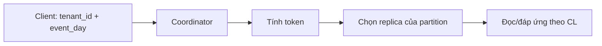
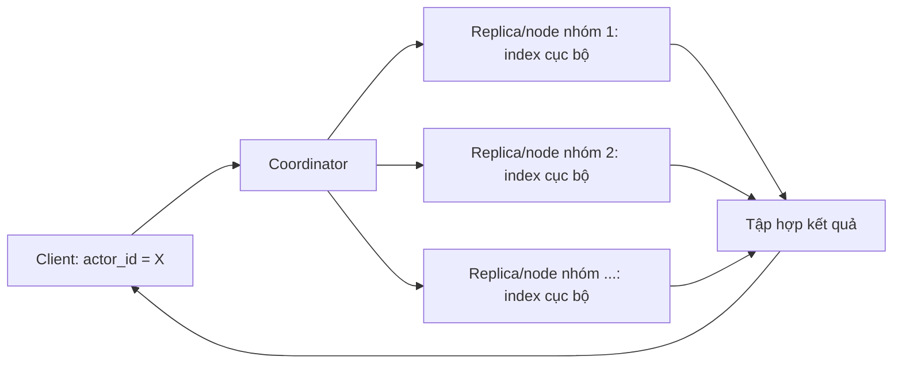

# Chọn cột, độ phân biệt và phân bố truy vấn để đánh giá chỉ mục

> **Chương:** Chỉ mục  
> **Mô-đun:** `DATABASE_ENGINE_WIDE_COLUMN_CASSANDRA` — Apache Cassandra, hệ cơ sở dữ liệu wide-column phân tán.  
> **Mục tiêu:** Chọn cột cần lập chỉ mục dựa trên dữ liệu và tải truy vấn thực tế, thay vì mặc định tạo index cho mọi cột có mặt trong mệnh đề `WHERE`.

Cassandra được thiết kế để đặt các partition lên nhiều node theo **partition key, token và replication strategy**. Vì vậy, hiệu quả của một chỉ mục không chỉ phụ thuộc việc cột có bao nhiêu giá trị khác nhau. Ta còn phải xem **một giá trị khớp bao nhiêu hàng, truy vấn đó xảy ra thường xuyên đến mức nào, có giới hạn phạm vi theo partition/thời gian hay không, và chúng ta phải hỏi bao nhiêu node**.

Bài này tập trung vào lựa chọn chỉ mục cho dữ liệu wide-column, kết hợp thiết kế bảng theo truy vấn, CQL, mức nhất quán, chi phí ghi/compaction và vận hành từ ứng dụng Java. Các ví dụ về **Storage-Attached Index (SAI)** áp dụng khi bản Cassandra triển khai hỗ trợ SAI (đặc biệt Apache Cassandra 5.0 trở lên); **legacy secondary index (2i)** và phiên bản khác cần đánh giá theo cơ chế riêng. Không nên áp một cú pháp hay kết luận hiệu năng cho mọi bản Cassandra.

## 1. Kết quả học tập

Sau khi học, bạn có thể:

1. Phân biệt **cardinality (độ phân biệt)**, **selectivity (độ chọn lọc)**, **skew (độ lệch phân bố)** và **query frequency (tần suất truy vấn)**.
2. Tính độ chọn lọc cho **giá trị thực sự được truy vấn**, thay vì chỉ nhìn số giá trị khác nhau của cột.
3. Giải thích vì sao index trên dữ liệu phân tán không tự biến một truy vấn thiếu partition key thành một lượt đọc đơn node.
4. Chọn giữa **không lập chỉ mục**, **SAI/2i phù hợp**, **bảng truy vấn riêng**, hoặc **hệ thống tìm kiếm/phân tích chuyên dụng**.
5. Thiết kế thử nghiệm đo độ trễ, fan-out, phân bố tải và chi phí ghi để chấp nhận hoặc loại bỏ một chỉ mục.

## 2. Điểm xuất phát: Cassandra đọc nhanh nhất khi biết partition key

Xét bảng sự kiện, được thiết kế để người dùng xem sự kiện của một tenant trong từng ngày:

```sql
-- Giả sử keyspace lab đã được tạo với replication phù hợp cho môi trường thử nghiệm.
CREATE TABLE lab.events_by_tenant_day (
    tenant_id uuid,
    event_day date,
    created_at timestamp,
    event_id timeuuid,
    actor_id uuid,
    status text,
    event_type text,
    payload text,
    PRIMARY KEY ((tenant_id, event_day), created_at, event_id)
) WITH CLUSTERING ORDER BY (created_at DESC, event_id DESC);
```

Khóa phân vùng là **`(tenant_id, event_day)`**. Cassandra băm **đúng tổ hợp đó** thành token; các clustering columns `created_at` và `event_id` chỉ quyết định thứ tự hàng trong cùng partition.

Truy vấn khớp cách thiết kế bảng:

```sql
SELECT created_at, event_id, status, event_type
FROM lab.events_by_tenant_day
WHERE tenant_id = 11111111-1111-1111-1111-111111111111
  AND event_day = '2026-11-21'
LIMIT 50;
```

Vì cung cấp đủ partition key, coordinator có thể định vị tập replica chịu trách nhiệm qua token và truy vấn trong một phạm vi dữ liệu được tổ chức phù hợp. Truy vấn tiếp theo có dạng khác:

```sql
-- Cần cân nhắc index hoặc mô hình bảng khác:
-- "Tìm mọi sự kiện do một actor thực hiện trên nhiều tenant/ngày"
SELECT tenant_id, event_day, created_at, event_id
FROM lab.events_by_tenant_day
WHERE actor_id = 22222222-2222-2222-2222-222222222222
LIMIT 50;
```

`actor_id` không thuộc partition key. Nếu chưa có cấu trúc truy cập hỗ trợ, câu truy vấn trên không hợp lệ như một phép tra cứu hiệu quả bằng khóa phân vùng. Chỉ mục có thể cho phép tra cứu theo `actor_id`, nhưng **không tự thay đổi partition key gốc**. Truy vấn có thể phải phối hợp nhiều replica/nút vì không biết trước token của các partition chứa actor đó.

### 2.1. Index không phải bảng thứ hai theo thứ tự tùy ý

Trong hệ CSDL quan hệ, ta thường liên tưởng index đến B-tree cho phép tìm bản ghi theo cột. Với Cassandra:

- **Đường truy cập chính** là partition key, giúp xác định vị trí replica trong cluster.
- **Chỉ mục phụ** lưu cấu trúc tra cứu theo cột khác tại nơi lưu dữ liệu; các cơ chế index khác nhau có cách xây dựng và truy vấn khác nhau.
- **SAI** có cấu trúc index gắn với vòng đời lưu trữ SSTable và bộ nhớ; hỗ trợ lọc hiệu quả cho một số mẫu truy vấn, nhưng vẫn có chi phí phân tán khi thiếu partition key.
- **Replica và consistency level (CL)** vẫn tham gia xử lý đọc/ghi. Index không bỏ qua replication, quorum hoặc kiểm tra tính hợp lệ dữ liệu.

Câu hỏi cần trả lời trước khi tạo index: **truy vấn này cần lấy một tập nhỏ hàng được phân bố rộng, hay muốn xử lý một tập dữ liệu lớn mà schema hiện tại không tối ưu?**

## 3. Bốn biến số cần phân biệt rõ

### 3.1. Cardinality — cột có bao nhiêu giá trị khác nhau?

Gọi:

- `N`: số hàng trong phạm vi đang đánh giá.
- `D`: số giá trị phân biệt của cột.
- `n(v)`: số hàng mang giá trị `v`.

Ví dụ với 10 triệu sự kiện:

| Cột | Ví dụ cardinality | Diễn giải |
|---|---:|---|
| `status` | 3 | Thấp, chỉ có SUCCESS/ERROR/PENDING |
| `event_type` | 25 | Tương đối thấp |
| `actor_id` | 400.000 | Cao, nhiều actor khác nhau |
| `event_id` | Gần 10.000.000 | Rất cao, gần như duy nhất |

**Cardinality cao không đồng nghĩa index chắc chắn tốt.** Có thể `actor_id` thông thường chỉ có 8 sự kiện, nhưng một actor đặc biệt tạo ra 350.000 sự kiện. Cùng một cột, hai giá trị có chi phí truy vấn rất khác nhau.

Cardinality cũng phải được xét trong **phạm vi đúng**: toàn cluster, một datacenter, một tenant, hoặc một partition/ngày. Một giá trị có thể hiếm trên toàn hệ thống nhưng cực kỳ phổ biến trong một tenant.

### 3.2. Selectivity — giá trị được hỏi khớp bao nhiêu hàng?

Định nghĩa thường dùng:

\[
s(v)=\frac{n(v)}{N}
\]

Tỷ lệ `s(v)` **càng nhỏ**, truy vấn theo giá trị đó càng **chọn lọc** (có ít kết quả khớp hơn trong phạm vi N). Một cách diễn đạt khác là **độ loại bỏ** `1 - s(v)`: tỷ lệ hàng không khớp.

| Giá trị được truy vấn | `n(v)` trên 10 triệu hàng | `s(v)` | Nhận xét |
|---|---:|---:|---|
| `status = 'SUCCESS'` | 8.000.000 | 80% | Rất kém chọn lọc |
| `status = 'ERROR'` | 40.000 | 0,4% | Chọn lọc hơn SUCCESS, nhưng vẫn tới 40.000 hàng |
| `actor_id = X` (actor thường) | 12 | 0,00012% | Tập kết quả nhỏ |
| `actor_id = Y` (actor tạo tải lớn) | 350.000 | 3,5% | Cùng cột, độ chọn lọc khác hẳn |

Tất cả số liệu trong bảng là **giả định để học cách đánh giá**, không phải benchmark Cassandra.

Lưu ý: `s(v)` không phải thời gian thực thi. Nó không cho biết dữ liệu nằm trên bao nhiêu node/SSTable, số tombstone, dung lượng mỗi hàng, mức đồng thời, hoặc tốc độ tải từ replica.

### 3.3. Skew — giá trị nào tập trung quá nhiều dữ liệu?

Trong dữ liệu thực, phân bố thường không đều. Nếu chỉ dùng công thức trung bình `N/D`, ta có thể dự đoán sai nghiêm trọng.

Ví dụ `N = 10.000.000` và `D(actor_id) = 400.000`:

\[
\text{Trung bình}=10.000.000/400.000=25\ \text{sự kiện/actor}
\]

Tuy nhiên actor Y có 350.000 sự kiện, gấp 14.000 lần trung bình. Khi client truy vấn actor Y:

- Index có thể trả về danh sách candidate rất lớn.
- Lượng đọc dữ liệu gốc, bộ nhớ coordinator, mạng và p99 latency tăng.
- Nếu giá trị Y được hỏi liên tục, một tập node/replica có thể nhận tải không cân đối.
- `LIMIT 50` giới hạn số hàng trả về; **không bảo đảm** server chỉ làm lượng công việc tương đương 50 hàng khi cần tìm/ghép kết quả từ nhiều partition.

Cần thống kê **top values** (giá trị phổ biến nhất), percentiles của `n(v)` và sự phân bố theo tenant/ngày. Phân bố đều là một giả định cần kiểm chứng, không phải điều kiện sẵn có.

### 3.4. Query distribution — ai hỏi, hỏi gì, hỏi bao nhiêu lần?

Ngay cả một giá trị rất chọn lọc vẫn có thể là index tồi nếu ứng dụng hỏi nó 10.000 lần/giây trên toàn cụm.

Nên quan sát:

- **QPS theo mẫu truy vấn:** số lần gọi theo loại `WHERE`, không chỉ tổng QPS toàn dịch vụ.
- **QPS theo giá trị:** top `actor_id`, `status` nào được hỏi nhiều nhất; phân bố có lệch hay không.
- **Phạm vi đọc:** có biết partition key không, cần một ngày hay toàn lịch sử, có giới hạn tenant không?
- **Tỷ lệ đọc/ghi và fan-out:** bao nhiêu node, SSTable hoặc partition tham gia; số ghi/index updates tăng thêm.
- **Mục tiêu người dùng:** tra cứu top vài chục kết quả, xuất toàn bộ lịch sử hay thống kê tổng hợp?
- **SLO:** p95/p99 latency dưới tải thật; mức CL; mức độ chấp nhận timeout và retry.
- **Sự tăng trưởng:** giá trị hiếm hiện tại có thể thành phổ biến sau sáu tháng.

## 4. Vì sao phân bố truy vấn quan trọng trên một cụm phân tán?

Giả sử có sáu node cùng lưu các replica của bảng. Với truy vấn có đủ partition key, đường đi điển hình:



Khi chỉ tìm bằng `actor_id` (không có partition key), index được xây trên dữ liệu của các node, không phải một bản đồ khóa toàn cục duy nhất. Sơ đồ khái niệm:



Đây là **sơ đồ đơn giản hóa**: số node thực tế được liên hệ và kế hoạch thực thi phụ thuộc loại index, token/range, replication, predicates và phiên bản Cassandra. Điểm cần nhớ là **index không đương nhiên cho biết một partition nằm ở đâu nếu truy vấn không có đầy đủ partition key**.

Vì vậy phải tách hai câu hỏi:

1. **Index có giảm công việc tìm ứng viên ở mỗi node không?** Độ chọn lọc và loại chỉ mục có thể giúp.
2. **Toàn hệ thống có phải fan-out đến nhiều node không?** Nếu có, hàng nghìn truy vấn/giây sẽ tốn nhiều network requests/coordinator work ngay cả khi mỗi truy vấn trả về ít hàng.

### 4.1. Một ước lượng chi phí để suy luận, không phải công thức benchmark

Đặt:

- `Q` = số truy vấn mỗi giây theo mẫu.
- `F` = số nút/nhánh replica được liên hệ trung bình cho truy vấn.
- `R` = số hàng ứng viên/khớp phải xử lý trung bình.
- `W` = số ghi mỗi giây vào bảng có index.

Ta có thể ghi nhận các đại lượng quan sát:

\[
\text{lượt liên hệ nút mỗi giây}\ \approx Q\times F
\]

\[
\text{khối lượng xử lý kết quả mỗi giây}\ \propto Q\times R
\]

Đây chỉ là **mô hình so sánh**. Chi phí thực còn phụ thuộc per-node selectivity, cache, SSTable, kích thước hàng, tombstone, mức CL và các tối ưu của engine. Nó không phải công thức dự đoán thời gian truy vấn.

Ví dụ cùng `F = 6`:

- Truy vấn X: `Q = 10`/giây → khoảng 60 lượt liên hệ node/giây.
- Truy vấn Y: `Q = 2.000`/giây → khoảng 12.000 lượt liên hệ node/giây.

Nếu cả hai có `R = 12`, Y vẫn có thể trở thành gánh nặng cho coordinator/network vì tần suất quá cao. Đây là lý do **selectivity tốt chưa đủ để chốt phương án index**.

## 5. Bảng quyết định: cột nào thực sự đáng thử index?

Giả sử 10 triệu sự kiện, workload minh họa:

| Mẫu truy vấn | Tần suất giả định | Đặc điểm dữ liệu | Hướng xử lý ưu tiên |
|---|---:|---|---|
| Sự kiện theo `tenant_id + event_day` | 800 QPS | Có đầy đủ partition key, lấy 50 bản ghi gần nhất | **Không cần index**; schema đã phù hợp |
| Tra cứu theo `actor_id = X` | 20 QPS | Đa số actor có 5–30 sự kiện, vài actor rất lớn | **Thử SAI** nếu phiên bản hỗ trợ, đo trường hợp lệch |
| Tra cứu theo `actor_id = X` | 2.000 QPS | Kết quả ít nhưng fan-out rộng | **Cân nhắc bảng theo actor** để đọc trực tiếp bằng partition key |
| `status = 'SUCCESS'` toàn hệ thống | 100 QPS | Khớp 80% bảng | **Tránh index cho truy vấn này**; giới hạn phạm vi hoặc thiết kế luồng/bảng tổng hợp |
| `status = 'ERROR'` toàn lịch sử | 5 QPS | Khớp 0,4% nhưng 40.000 hàng | Thử đo SAI nếu cần tra cứu; với dashboard liên tục, **bucket theo ngày/tenant** |
| Xuất tất cả sự kiện 12 tháng | 1 yêu cầu/phút | Phải đọc lượng lớn dữ liệu | **Thiết kế pipeline/export/analytics**; index không phải lời giải cho bulk scan |

**Không có ngưỡng thần kỳ** như “cardinality trên 1.000 thì lập chỉ mục” hoặc “dưới 1% thì chắc chắn nhanh”. Cần phối hợp kích thước tập kết quả tuyệt đối, fan-out, QPS, tải ghi và p99.

### 5.1. Thứ tự ưu tiên thường hợp lý

1. **Truy vấn đã có đủ partition key và clustering slice?** Tối ưu bằng schema, giới hạn ngày/tenant, page size, kiểm soát partition size trước.
2. **Truy vấn mới ít xảy ra, kết quả rất ít?** SAI có thể là một lựa chọn để thử nghiệm nếu phù hợp phiên bản/kiểu dữ liệu.
3. **Truy vấn lặp lại nhiều, ổn định, có SLO chặt?** Xem xét bảng riêng có partition key theo truy vấn; chi phí nhân bản dữ liệu thường đổi lấy đường đọc dự đoán được.
4. **Truy vấn quét rộng, lọc/nhóm/tổng hợp nhiều chiều?** Cân nhắc một lớp tìm kiếm, OLAP hoặc tính trước kết quả, thay vì kỳ vọng Cassandra index thay vai trò công cụ phân tích.
5. **Tải ghi cực cao?** Đo chi phí cập nhật chỉ mục, flush/compaction/repair và giới hạn tài nguyên trước khi quyết định.

## 6. Phân biệt SAI, legacy 2i và bảng theo truy vấn

| Tiêu chí | Storage-Attached Index (SAI) | Legacy secondary index (2i) | Bảng theo truy vấn |
|---|---|---|---|
| Vai trò | Hỗ trợ truy vấn lọc cột được index; phù hợp nhiều mẫu tra cứu có chọn lọc | Cơ chế index cũ, hạn chế và chi phí cần cân nhắc kỹ | Thiết kế partition key/clustering trực tiếp cho mẫu truy vấn |
| Điều kiện | Cần Cassandra/bản phân phối hỗ trợ SAI và đúng giới hạn kiểu dữ liệu/toán tử | Cần đánh giá theo phiên bản; không mặc định hiệu năng như SAI | Cần thay đổi mô hình dữ liệu và đường ghi |
| Khi thiếu partition key | Vẫn có thể phải liên hệ nhiều nút | Vẫn có thể phân tán và tốn kém | Thường biết partition key của bảng mới |
| Trường hợp tốt | Lọc tập nhỏ, truy vấn ít/vừa, biết phân bố dữ liệu | Workload hẹp đã kiểm chứng trên bản đang vận hành | Workload lặp lại nhiều, yêu cầu độ trễ ổn định |
| Chi phí | Dung lượng index, write path, flush/compaction và tài nguyên truy vấn | Dung lượng và chi phí duy trì chỉ mục cũ | Lưu thêm bản ghi, đồng bộ hai bảng, vận hành đường ghi |
| Rủi ro | Giá trị nóng, fan-out, giới hạn truy vấn/kiểu dữ liệu | Lệch tải, truy vấn rộng, khó dự đoán ở quy mô lớn | Dữ liệu đồng bộ lệch nếu dual-write không được thiết kế và phục hồi tốt |

Lưu ý vận hành:

- **SAI** và **legacy 2i** có kiến trúc khác nhau; không so sánh chỉ bằng câu `CREATE INDEX`. Hãy xác định chính xác Cassandra version/engine và kiểu index đang được tạo.
- **SASI** là một cơ chế index khác từng xuất hiện trong một số bản Cassandra; không mặc định chọn SASI cho thiết kế mới khi chưa có lý do tương thích, tài liệu phiên bản và kiểm chứng.
- **Materialized view** không phải lựa chọn mặc định thay cho bảng theo truy vấn. Nếu đánh giá, cần xét hỗ trợ phiên bản, tính nhất quán, chi phí vận hành và giới hạn của cơ chế này.
- **SAI không bảo đảm global sorting hoặc aggregation**. `LIMIT 50` trong truy vấn qua index không có nghĩa trả về “50 bản ghi mới nhất toàn cluster” nếu không có một mô hình ordering phù hợp.

## 7. Thực hành CQL: thử chọn cột trên một workload

### 7.1. Baseline không index

Giả sử `lab.events_by_tenant_day` đã có dữ liệu phân bố trên nhiều tenant/ngày. Đặt mức nhất quán và bật truy vết trong **cqlsh**, chỉ cho một lượng truy vấn mẫu khi thí nghiệm:

```sql
CONSISTENCY LOCAL_QUORUM;
TRACING ON;

SELECT created_at, event_id, status
FROM lab.events_by_tenant_day
WHERE tenant_id = 11111111-1111-1111-1111-111111111111
  AND event_day = '2026-11-21'
LIMIT 50;

TRACING OFF;
```

Đây là đường đọc theo partition key. Cần ghi lại p50/p95/p99 dưới tải thực tế, số row trả về, page size và dấu hiệu đọc tombstone/SSTable. Không nên kết luận bằng một lần chạy trong `cqlsh` do ảnh hưởng của cache và khối lượng concurrent khác biệt.

### 7.2. Thử SAI trên actor_id

**Chỉ thực hiện nếu bản Cassandra trong lab hỗ trợ SAI và cú pháp này.** SAI thường được tạo bằng `CREATE CUSTOM INDEX ... USING 'StorageAttachedIndex'` trên Cassandra 5.x; kiểm tra tài liệu bản đang chạy trước khi áp dụng lên production.

```sql
CREATE CUSTOM INDEX IF NOT EXISTS events_actor_sai
ON lab.events_by_tenant_day (actor_id)
USING 'StorageAttachedIndex';

SELECT tenant_id, event_day, created_at, event_id, status
FROM lab.events_by_tenant_day
WHERE actor_id = 22222222-2222-2222-2222-222222222222
LIMIT 50;
```

Để đánh giá đúng, đo riêng:

- Actor phổ thông có vài hàng.
- Actor ít gặp nhưng có partition rải rộng ở nhiều ngày.
- Actor rất lớn (ví dụ 350.000 hàng).
- Actor không tồn tại.
- Đọc `LIMIT 10` và `LIMIT 100`; đồng thời thử truy vấn phân trang qua driver khi cần nhiều kết quả.

Nếu phương án này hữu ích cho lookup không thường xuyên, hãy lưu lại **điều kiện sử dụng**, chẳng hạn không dùng nó cho tác vụ quét toàn lịch sử của một actor rất lớn.

### 7.3. Đánh giá status với phân bố không đều

Đừng chỉ hỏi “status có 3 giá trị, có index được không?”. Hãy hỏi:

- Bao nhiêu % hàng là `SUCCESS` và phần nào tập trung trong một số tenant?
- `ERROR` có thật sự hiếm trong từng tuần, hay từng đợt sự cố làm tăng đột biến?
- Dashboard cần **10 bản ghi gần nhất** hay **đếm tất cả lỗi**?
- Có yêu cầu lọc thời gian hay tenant ngay từ đầu không?
- Truy vấn phát sinh 5 QPS trong lab hay 500 QPS ở production?

Nếu muốn thử cả index status trong một **thí nghiệm riêng**, có thể tạo SAI khi engine hỗ trợ:

```sql
CREATE CUSTOM INDEX IF NOT EXISTS events_status_sai
ON lab.events_by_tenant_day (status)
USING 'StorageAttachedIndex';

SELECT tenant_id, event_day, created_at, event_id
FROM lab.events_by_tenant_day
WHERE status = 'ERROR'
LIMIT 100;
```

Đo cả `ERROR` lẫn `SUCCESS` trước khi kết luận. Với trạng thái rất phổ biến, index có thể phải giải quyết tập kết quả khổng lồ; nếu hệ thống cần dashboard theo thời gian, cấu trúc bảng/aggregate theo ngày và loại lỗi thường có tính dự đoán tốt hơn.

### 7.4. Kết hợp nhiều điều kiện đã lập index

Trên phiên bản SAI hỗ trợ kết hợp các predicates tương ứng, có thể thử:

```sql
SELECT tenant_id, event_day, created_at, event_id
FROM lab.events_by_tenant_day
WHERE actor_id = 22222222-2222-2222-2222-222222222222
  AND status = 'ERROR'
LIMIT 50;
```

Tập kết quả giao của hai điều kiện có thể nhỏ, nhưng **mỗi điều kiện riêng lẻ có thể rất phổ biến**. Hiệu quả còn phụ thuộc planner, phân bố theo node, chi phí đọc dữ liệu gốc và phiên bản. Không suy từ việc có hai index rằng query sẽ chỉ liên hệ một node. Cũng không suy ra rằng mọi tổ hợp `OR`, `ORDER BY`, `GROUP BY` hoặc kiểu dữ liệu đều được hỗ trợ; cần kiểm tra rõ CQL/SAI compatibility.

## 8. Khi bảng theo truy vấn tốt hơn index

Nếu sản phẩm thường xuyên hiển thị lịch sử gần đây của actor trong từng ngày, ta có thể viết thêm một bảng:

```sql
CREATE TABLE lab.events_by_actor_day (
    actor_id uuid,
    event_day date,
    created_at timestamp,
    event_id timeuuid,
    tenant_id uuid,
    status text,
    event_type text,
    PRIMARY KEY ((actor_id, event_day), created_at, event_id)
) WITH CLUSTERING ORDER BY (created_at DESC, event_id DESC);
```

Truy vấn:

```sql
SELECT tenant_id, created_at, event_id, status, event_type
FROM lab.events_by_actor_day
WHERE actor_id = 22222222-2222-2222-2222-222222222222
  AND event_day = '2026-11-21'
LIMIT 50;
```

**Trade-off:**

- **Ưu điểm:** truy vấn có partition key đầy đủ, có thứ tự theo `created_at` trong ngày, có thể phân trang hợp lý và ít phụ thuộc quét index phân tán.
- **Nhược điểm:** phải ghi dữ liệu vào cả `events_by_tenant_day` và `events_by_actor_day`, tốn thêm đĩa/compaction/repair; cần cơ chế ghi, retry và kiểm tra đối soát để hạn chế sai lệch.
- **Giới hạn:** với actor ghi hàng triệu event/ngày, partition theo actor/ngày vẫn có thể quá lớn hoặc quá nóng. Cần cân nhắc bucket nhỏ hơn (giờ, shard có chiến lược đọc/ghi phù hợp), rồi đo lại theo tải thực tế.

Cassandra không hứa transaction đa bảng thông thường sẽ cung cấp atomicity cho mọi kiểu dual-write. Với đường ghi nhiều bảng, ứng dụng có thể cần idempotent write, retry có kiểm soát, CDC/queue, quy trình backfill và đối soát.

### 8.1. Khi dùng index vẫn hợp lý hơn

Nếu màn hình quản trị hiếm khi tìm actor bằng mã, tập kết quả thường chỉ vài hàng, yêu cầu độ trễ vừa phải và không muốn mở rộng đường ghi cho một truy vấn phụ, SAI có thể tránh nhân bản một bảng chỉ dùng rất ít. Quyết định là **đổi chi phí đọc phân tán lấy chi phí lưu trữ/ghi/duy trì dữ liệu**, dựa trên benchmark.

## 9. Thiết kế thí nghiệm đúng: đo theo dữ liệu và tải thực

### 9.1. Lập bảng đầu vào

Trước khi thử index, cần tối thiểu:

| Nhóm | Số liệu cần thu |
|---|---|
| Schema | Partition key, clustering, RF theo DC, loại index hiện tại, Cassandra version |
| Dữ liệu | Số hàng ước lượng, dung lượng, kích thước partition, tombstone, TTL, độ tăng trưởng |
| Cột | Cardinality `D`, phân phối `n(v)`, top 1/10/100 giá trị, giá trị null/missing |
| Truy vấn | Các tổ hợp `WHERE`, `LIMIT`, page size, CQL ordering, CL |
| Tải | QPS theo dạng truy vấn và giá trị, tỷ lệ đọc/ghi, peak concurrency |
| Hạ tầng | DC/rack, dung lượng đĩa dự phòng, CPU, I/O, network, compaction |
| Kết quả | p50/p95/p99, timeout/unavailable, node fan-out, row và SSTable read, chi phí ghi sau tạo index |

**Không lấy `COUNT(*)` trên toàn bảng production để “đếm nhanh N”**: Cassandra không tối ưu phép đếm quét rộng kiểu này. Dùng thống kê ứng dụng, telemetry ingestion, sampling hoặc job thống kê dành riêng cho dữ liệu.

### 9.2. So sánh ba phương án dưới cùng điều kiện

Đặt ba ứng viên:

- A. Giữ schema cũ và chỉ đọc theo partition key.
- B. Tạo SAI cho cột ứng viên (chỉ trên engine hỗ trợ).
- C. Bổ sung bảng theo truy vấn với partition key mới.

Tổ chức benchmark qua **cùng phân bố giá trị**:

1. Tạo tập dữ liệu gần với production, gồm hàng phổ biến, giá trị hiếm, hot actor, partition lớn và tombstone/TTL nếu có.
2. Chạy baseline không index trên đường truy vấn hiện hữu và tải ghi chuẩn.
3. Thử index với dữ liệu đầy đủ, đợi quá trình build index hoàn tất; đo latency/writes/compaction và queries theo các phân vị.
4. Thử bảng theo truy vấn, bao gồm chi phí ghi kép, phục hồi, bổ sung dữ liệu lịch sử và đọc có giới hạn thời gian.
5. Đo **steady state** và **burst**: QPS thấp, QPS cao, giá trị phổ biến, giá trị không tồn tại, tăng tỷ lệ ghi.
6. Đánh giá p99, độ ổn định và resource headroom; loại phương án gây timeouts, hot node hoặc compaction debt không chấp nhận được.

Những con số “nhanh gấp 10 lần” chỉ có ý nghĩa nếu kèm loại cluster, RF/CL, size, QPS, distribution, truy vấn cụ thể và phương pháp đo.

### 9.3. Dấu hiệu cần xem trên Cassandra

Có thể dùng các lệnh quan sát phù hợp bản triển khai:

```bash
nodetool status
nodetool tablestats lab.events_by_tenant_day
nodetool compactionstats
nodetool tpstats
```

Kết hợp metric từ dashboard/driver: coordinator read latency, timeouts, unavailable, số request tới node, saturation và p95/p99. `TRACING ON` trong cqlsh giúp khảo sát đường đi của **một vài truy vấn**, nhưng tracing liên tục trên production sẽ tốn tài nguyên; không dùng nó làm công cụ benchmark tải lớn.

### 9.4. Bảng quyết định kết quả

Lập một “phiếu quyết định” mỗi cột ứng viên:

| Câu hỏi | Ví dụ câu trả lời đạt yêu cầu |
|---|---|
| Truy vấn thật sự nào cần cột này? | “Tra cứu actor trong vài phút gần nhất, 15 QPS, không cần global sort” |
| Giá trị phổ biến nhất khớp bao nhiêu hàng? | “Median 12, p99 2.500, max 350.000 hàng” |
| Index gây fan-out bao nhiêu? | “Đo trên cụm 6 node ở CL mong muốn; có phân bố theo giá trị” |
| Tải tăng thêm ở write/compaction? | “Có baseline và kết quả sau khi build index ổn định” |
| Kết quả có đạt SLO trong peak không? | “p99 dưới ngưỡng sản phẩm, không tăng timeout bất thường” |
| Khi dữ liệu ×10 hoặc hot value xuất hiện? | “Có thử scenario tăng trưởng và kế hoạch chuyển schema” |

Nếu một hàng còn “chưa biết”, kết luận hợp lý thường là **cần đo hoặc thu thập thông tin**, không phải tự động thêm index.

## 10. Tình huống sai thường gặp

### 10.1. “Cột chỉ có hai giá trị, tạo index sẽ rất nhanh”

Ví dụ `is_active` có `true` ở 97% hàng. Query `WHERE is_active = true` có thể trả rất nhiều kết quả và chịu chi phí network/đọc rộng. Cần thu hẹp domain theo partition key, thời gian, hoặc thiết kế view/bảng riêng cho nghiệp vụ.

### 10.2. “Cột gần như duy nhất, index chắc chắn tốt”

`external_ref` gần duy nhất nên tra cứu một giá trị có tính chọn lọc cao. Nhưng nếu lookup đó là luồng nóng 5.000 QPS toàn cluster, fan-out có thể đắt hơn bảng `by_external_ref` được thiết kế riêng. **High-cardinality là tín hiệu tốt để xem xét, không phải quyết định cuối.**

### 10.3. “Có LIMIT 10 thì dù status khớp triệu hàng vẫn nhẹ”

`LIMIT` giới hạn số hàng hiển thị, không chứng minh index tự tìm được những hàng mong muốn theo thứ tự toàn cục. Với truy vấn “10 lỗi mới nhất toàn hệ thống”, cần mô hình dữ liệu có thời gian/bucket và cách tổng hợp có kiểm soát, hoặc một hệ thống phù hợp kiểu truy vấn đó.

### 10.4. “Đã thêm index thì không cần repair hoặc quan sát compaction”

Index được duy trì cùng dữ liệu lưu trữ, phát sinh chi phí trong write/flush/compaction và cần xử lý build/rebuild theo phiên bản. Replica consistency, repair và sao chép vẫn là trách nhiệm của Cassandra. Một index không thay thế backup hoặc repair.

### 10.5. “Trên 100.000 hàng trong lab rất nhanh nên production cũng vậy”

Benchmark với tập dữ liệu nhỏ thường không thể hiện fan-out, tombstone, compaction debt, cache miss và giá trị nóng. Cần mẫu dữ liệu phân bố thực, cluster nhiều node, replication và CL giống vận hành.

### 10.6. “Dùng ALLOW FILTERING như một giải pháp index”

`ALLOW FILTERING` cho phép một số truy vấn phải lọc rộng; nó **không tự tạo index hoặc tối ưu truy vấn**. Câu lệnh chạy được không đồng nghĩa đáp ứng SLO. Hãy xem lại mô hình bảng, index được hỗ trợ hoặc đường truy vấn.

## 11. Liên hệ tới ứng dụng Java

Driver Java có thể định tuyến theo token hiệu quả khi statement cung cấp đầy đủ partition key và metadata phù hợp. Khi chỉ lọc một cột có SAI mà thiếu partition key, đừng kỳ vọng token-aware routing tự biết một replica đích duy nhất.

Minh họa **Java Driver 4.x** trên hệ hỗ trợ SAI, sau khi đã tạo index `actor_id`:

```java
try (CqlSession session = CqlSession.builder()
        .addContactPoint(new InetSocketAddress("127.0.0.1", 9042))
        .withLocalDatacenter("dc1")
        .build()) {
    PreparedStatement statement = session.prepare(
        "SELECT tenant_id, event_day, created_at, event_id " +
        "FROM lab.events_by_tenant_day " +
        "WHERE actor_id = ? LIMIT 50"
    );

    UUID actorId = UUID.fromString("22222222-2222-2222-2222-222222222222");
    BoundStatement bound = statement.bind(actorId)
        .setConsistencyLevel(DefaultConsistencyLevel.LOCAL_QUORUM)
        .setPageSize(50);

    ResultSet rows = session.execute(bound);
    rows.forEach(row -> System.out.println(row.getUuid("tenant_id")));
}
```

Lớp minh họa thuộc các gói `com.datastax.oss.driver.api.core.CqlSession`, `...cql.PreparedStatement`, `...cql.BoundStatement`, `...cql.ResultSet` và `...DefaultConsistencyLevel`; cùng với `java.net.InetSocketAddress`, `java.util.UUID`. Điều chỉnh theo dependency đang dùng.

Ứng dụng cần ghi nhận **query shape**, actor/value class, request count, p99, timeout và số trang đọc. Với Java Driver, thao tác đọc phân trang có thể phát sinh nhiều round trip; `pageSize` là gợi ý kích thước trang, không phải phép giới hạn tổng dữ liệu hoặc bằng chứng truy vấn rẻ.

Khi index bị quá tải, tránh vòng retry vô hạn: retry khiến QPS ở coordinator cao hơn và có thể làm sự cố nghiêm trọng thêm. Đối với truy vấn cực nóng, cân nhắc giới hạn QPS, cache phù hợp, key-based table hoặc một API lọc phạm vi thời gian.

## 12. Bài tập ứng dụng

**Bài 1 — Phân biệt D và s(v).**  
Bảng có 20 triệu hàng. Cột `state` có 5 giá trị, trong đó `'OPEN'` xuất hiện ở 17 triệu hàng và `'FAILED'` ở 15.000 hàng. Hãy tính `s('OPEN')` và `s('FAILED')`, rồi giải thích vì sao hai phép lọc không thể được đánh giá chỉ bằng `D = 5`.

**Bài 2 — Cột có cardinality cao.**  
Cột `user_id` có 2 triệu giá trị khác nhau. Truy vấn `user_id = ?` được gọi 1.500 QPS và chỉ trả 1–5 hàng. Cluster có 10 node; phần lớn request không có partition key. Nêu hai phép đo cần có trước khi chọn SAI thay vì bảng `by_user_id`.

**Bài 3 — Top values bị lệch.**  
Một cột `category` có 100 giá trị, nhưng một giá trị chiếm 70% dữ liệu. Dashboard lọc category này và đòi 20 bản ghi mới nhất toàn DC. Vì sao `LIMIT 20` và index chưa đủ để cam kết p99 thấp/đúng thứ tự?

**Bài 4 — Thiết kế bảng mới.**  
Ứng dụng cần xem 50 sự kiện gần nhất của actor trong mỗi ngày. Đề xuất partition key và clustering columns cho bảng mới, đồng thời nêu một rủi ro vận hành nếu actor tạo 10 triệu sự kiện/ngày.

**Bài 5 — Quyết định có dẫn chứng.**  
Một truy vấn index có p50 tốt nhưng p99 rất xấu khi QPS cao. Hãy nêu những metric hoặc phân bố nào bạn sẽ kiểm tra để xác định do hot value, fan-out, compaction hay timeout.

### Gợi ý trả lời

1. `s('OPEN') = 17/20 = 85%`; `s('FAILED') = 15.000/20.000.000 = 0,075%`. Hai giá trị trong cùng cột có độ chọn lọc rất khác nhau.
2. Ít nhất đo **fan-out/coordinator latency ở QPS đích** và **p95/p99 theo giá trị nóng**, kèm write/compaction overhead; với QPS này cần benchmark bảng theo user.
3. Index lọc tập lớn, `LIMIT` không tạo global ordering; thiết kế bảng theo bucket/thời gian hoặc đường tổng hợp có thứ tự phù hợp.
4. Ví dụ `PRIMARY KEY ((actor_id, event_day), created_at, event_id)`; dùng clustering DESC theo thời gian. Actor cực nóng có thể tạo partition quá lớn/hot, cần bucket hoặc sharding.
5. So sánh p99 theo nhóm giá trị, node fan-out, per-node CPU/IO/network, read latency, compaction/tombstone và retry/timeout dưới peak.

## 13. Checklist trước khi chấp thuận một index

- [ ] Có **mẫu truy vấn thật** và nhu cầu chức năng rõ ràng.
- [ ] Đã xác định đầy đủ partition key hiện tại và tại sao không đáp ứng query.
- [ ] Có cardinality, phân bố `n(v)`, top values và selectivity cho **giá trị thực sự được hỏi**.
- [ ] Có QPS/peak QPS theo query shape và theo hot values.
- [ ] Có đánh giá fan-out và mức CL phù hợp trên cluster nhiều node.
- [ ] Đã phân biệt SAI, 2i và cơ chế cụ thể của phiên bản triển khai.
- [ ] Có baseline trước/sau về p50/p95/p99, timeout, read/write, compaction và headroom.
- [ ] Đã so với bảng theo truy vấn hoặc mô hình xử lý phân tích khi workload cần.
- [ ] Đã xem xét data growth, TTL/tombstone, phân trang, bảo trì và phương án xử lý khi index không đạt SLO.

**Ghi nhớ:** Lựa chọn chỉ mục trong Cassandra là **quyết định theo dữ liệu và workload**. Độ phân biệt cho biết có bao nhiêu giá trị; độ chọn lọc cho biết **giá trị cụ thể** khớp bao nhiêu hàng; phân bố truy vấn cho biết **những giá trị đó bị hỏi bao nhiêu lần và qua bao nhiêu node**. Chỉ khi ghép đủ ba góc nhìn với chi phí ghi/compaction và SLO, ta mới có cơ sở để quyết định tạo SAI, giữ đường truy vấn theo partition key, hay thiết kế bảng riêng.
