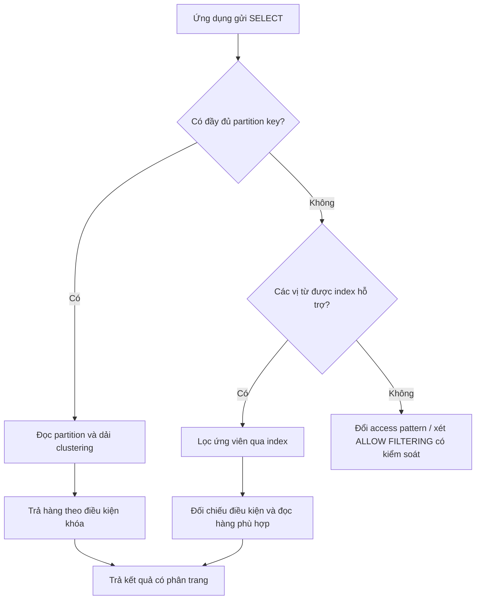

# Điều kiện lọc kết hợp và phạm vi cú pháp được hỗ trợ

**Chương:** Chỉ mục  
**Module:** `DATABASE_ENGINE_WIDE_COLUMN_CASSANDRA` — Apache Cassandra (wide-column database)

Bài học thuộc phạm vi: *Hiểu kiến trúc phân tán và mô hình wide-column của Apache Cassandra, đặc biệt khóa phân vùng, thiết kế bảng theo truy vấn và mức nhất quán đọc ghi. Thực hành CQL, replication, compaction, repair, xử lý lỗi và kết nối từ ứng dụng Java.*

Một câu SQL quen thuộc như `WHERE category = 'ssd' AND price < 2000000 ORDER BY price` có thể hợp lệ trên hệ quản trị quan hệ, nhưng không mặc nhiên hợp lệ hoặc hiệu quả trên Cassandra. Cassandra phân phối dữ liệu theo **partition key**, sắp xếp trong partition theo **clustering columns**, và chỉ lập chỉ mục thứ cấp cho những cột được khai báo. Vì vậy, trước khi ghép các điều kiện trong `WHERE`, phải trả lời ba câu hỏi riêng:

1. **Ngữ pháp CQL:** Toán tử và cách nối điều kiện có được phiên bản Cassandra hỗ trợ không?
2. **Đường truy cập dữ liệu:** Truy vấn có dùng đầy đủ partition key, clustering key, hoặc chỉ mục thích hợp không?
3. **Chi phí vận hành:** Truy vấn được chấp nhận có phải quét quá nhiều partition, đối chiếu tập kết quả lớn hoặc gửi yêu cầu tới nhiều node không?

Mục tiêu là kiểm tra cả ba lớp trên bằng thí nghiệm có thể chạy lại, đặc biệt khi kết hợp điều kiện trên nhiều cột đã có **Storage-Attached Index (SAI)**.

## 1. Mục tiêu học tập và phạm vi phiên bản

Hoàn thành bài này, bạn cần:

- Dự đoán truy vấn nào có thể chạy chỉ với partition/clustering key và truy vấn nào phụ thuộc vào chỉ mục.
- Viết và đọc hiểu các điều kiện kết hợp bằng `AND`, `=`, `>`, `>=`, `<`, `<=`; tránh suy diễn tùy tiện về `OR`, `IN`, `LIKE` và `ORDER BY`.
- Phân biệt lọc bằng SAI với lọc bằng cơ chế cũ (legacy secondary index/2i) hoặc `ALLOW FILTERING`.
- Đo kết quả và độ trễ của lọc nhiều điều kiện khi giá trị phổ biến, giá trị hiếm hoặc khi node phải trao đổi dữ liệu.
- Chọn khi nào tiếp tục dùng chỉ mục và khi nào tạo bảng mới theo truy vấn.

**Phạm vi thực hành chính:** Apache Cassandra **5.0 trở lên**, có SAI tích hợp. Các lệnh `CREATE CUSTOM INDEX ... USING 'StorageAttachedIndex'` ở phần thực hành cần đúng phiên bản hỗ trợ SAI. Với Apache Cassandra 4.x, đừng sao chép các lệnh SAI và kỳ vọng chạy được: hãy kiểm tra khả năng của phiên bản, dùng truy vấn theo khóa hoặc cơ chế chỉ mục thật sự có sẵn. Một số hệ cung cấp Cassandra-compatible hoặc bản phân phối riêng có tập tính năng khác nhau; ví dụ trong bài không tự động áp dụng cho mọi sản phẩm đó.

Trong CQL, một câu có thể **đúng cú pháp nhưng không có đường truy cập hợp lệ**, hoặc **thực thi được nhưng không phù hợp tải production**. Đánh giá hai tình huống này tách biệt.

## 2. Bản đồ: cột nào có thể lọc như thế nào?

Xét một bảng điển hình:

```sql
CREATE TABLE shop.orders_by_customer (
    customer_id uuid,
    ordered_at timestamp,
    order_id uuid,
    state text,
    total_cents bigint,
    PRIMARY KEY ((customer_id), ordered_at, order_id)
) WITH CLUSTERING ORDER BY (ordered_at DESC, order_id ASC);
```

Câu lệnh trên minh họa cấu trúc khóa; `shop` phải là keyspace đã tồn tại trước khi chạy.

| Vai trò cột | Đường truy cập tự nhiên | Ví dụ | Điều cần nhớ |
| --- | --- | --- | --- |
| `customer_id` — partition key | `=`, và có thể truy vấn danh sách partition bằng `IN` trong giới hạn cú pháp CQL | `customer_id = ?` | Đủ partition key giúp định vị dữ liệu trước khi đọc clustering rows. |
| `ordered_at` — clustering column đầu | So sánh bằng hoặc range trong một partition đã xác định | `customer_id = ? AND ordered_at >= ?` | Cassandra đọc một khoảng có thứ tự trong partition, không cần secondary index cho tình huống này. |
| `order_id` — clustering column tiếp theo | Bị ràng buộc bởi thứ tự các clustering columns đứng trước | `customer_id = ? AND ordered_at = ? AND order_id = ?` | Không bỏ qua tiền tố rồi kỳ vọng chọn riêng một clustering column ở giữa. |
| `state`, `total_cents` — cột thường | Cần index phù hợp, hoặc mô hình dữ liệu khác, nếu lọc trên nhiều partition | `state = 'PAID'` | Cột có mặt trong `SELECT` không có nghĩa là dùng được trong `WHERE`. |

Các điều kiện trên primary key là **truy cập dữ liệu theo cấu trúc lưu trữ**. Lọc bằng index là **đường truy cập bổ sung**. Đừng xem index như cách biến mọi phép kết hợp SQL thành truy vấn Cassandra hiệu quả.

Ví dụ phù hợp thiết kế bảng theo truy vấn:

```sql
-- Truy vấn đúng partition và khoảng thời gian:
SELECT ordered_at, order_id, state, total_cents
FROM shop.orders_by_customer
WHERE customer_id = 00000000-0000-0000-0000-000000000101
  AND ordered_at >= '2026-11-01T00:00:00Z'
  AND ordered_at <  '2026-12-01T00:00:00Z';
```

Ở đây `AND` kết hợp **điều kiện khóa**, không đòi index thứ cấp.

## 3. Thiết lập bộ dữ liệu SAI để thử tổ hợp điều kiện

Thực hiện trên **cluster thử nghiệm**, chạy Cassandra 5.0+, với tên datacenter thực tế được kiểm tra trước. Ví dụ dùng `datacenter1` và replication factor 1 để bài có thể chạy trên một node; RF=1 chỉ phục vụ thực hành, không phải cấu hình chịu lỗi cho môi trường thật.

```bash
nodetool status
cqlsh
```

Trong `cqlsh`:

```sql
SELECT data_center, release_version FROM system.local;

CREATE KEYSPACE IF NOT EXISTS lab_indexes
WITH replication = {
    'class': 'NetworkTopologyStrategy',
    'datacenter1': 1
};

CREATE TABLE IF NOT EXISTS lab_indexes.items_by_id (
    item_id uuid PRIMARY KEY,
    category text,
    brand text,
    price_cents bigint,
    state text,
    title text
);

CREATE CUSTOM INDEX IF NOT EXISTS idx_items_category
ON lab_indexes.items_by_id (category)
USING 'StorageAttachedIndex';

CREATE CUSTOM INDEX IF NOT EXISTS idx_items_brand
ON lab_indexes.items_by_id (brand)
USING 'StorageAttachedIndex';

CREATE CUSTOM INDEX IF NOT EXISTS idx_items_price
ON lab_indexes.items_by_id (price_cents)
USING 'StorageAttachedIndex';

-- Cố ý CHƯA tạo index trên state và title.
```

Nếu datacenter không phải `datacenter1`, đổi tên tương ứng trong câu `CREATE KEYSPACE`. Chờ các chỉ mục được xây dựng hoàn tất trước khi so sánh kết quả; index build có thể bất đồng bộ nếu dữ liệu đã tồn tại. Kiểm tra schema qua `system_schema.indexes` và log/tracing, thay vì suy từ việc lệnh `CREATE` đã trả kết quả.

Chèn dữ liệu có cả giá trị lặp và giá trị khác nhau:

```sql
INSERT INTO lab_indexes.items_by_id (item_id, category, brand, price_cents, state, title)
VALUES (00000000-0000-0000-0000-000000000001, 'ssd', 'Aster', 1200000, 'ACTIVE', 'SSD 1 TB');

INSERT INTO lab_indexes.items_by_id (item_id, category, brand, price_cents, state, title)
VALUES (00000000-0000-0000-0000-000000000002, 'ssd', 'Aster', 1900000, 'ACTIVE', 'SSD 2 TB');

INSERT INTO lab_indexes.items_by_id (item_id, category, brand, price_cents, state, title)
VALUES (00000000-0000-0000-0000-000000000003, 'ssd', 'Boreal', 1600000, 'INACTIVE', 'SSD 512 GB');

INSERT INTO lab_indexes.items_by_id (item_id, category, brand, price_cents, state, title)
VALUES (00000000-0000-0000-0000-000000000004, 'ram', 'Aster', 1100000, 'ACTIVE', 'RAM 16 GB');

INSERT INTO lab_indexes.items_by_id (item_id, category, brand, price_cents, state, title)
VALUES (00000000-0000-0000-0000-000000000005, 'ram', 'Boreal', 2200000, 'ACTIVE', 'RAM 32 GB');

INSERT INTO lab_indexes.items_by_id (item_id, category, brand, price_cents, state, title)
VALUES (00000000-0000-0000-0000-000000000006, 'ssd', 'Aster', 2500000, 'INACTIVE', 'SSD Pro');

CONSISTENCY ONE
```

Dữ liệu nhỏ để dễ tự kiểm. Khi đánh giá hiệu năng, cần thêm bộ dữ liệu đủ lớn và phân bố khóa thực tế; sáu hàng không phản ánh độ khuếch tán read request, cardinality hay chi phí kết hợp posting lists của index.

## 4. `AND` với các cột đã lập SAI

### 4.1. Giao của hai điều kiện bằng

```sql
SELECT item_id, category, brand, price_cents
FROM lab_indexes.items_by_id
WHERE category = 'ssd'
  AND brand = 'Aster';
```

Kết quả dự kiến: ba ID kết thúc bằng `001`, `002`, `006`. Các giá trị `category` và `brand` đều có chỉ mục SAI nên hệ thống có thể dùng chúng để thu hẹp tập ứng viên.

Dễ hiểu bằng logic tập hợp:

- Tập A = các item có `category = 'ssd'` ⇒ {001, 002, 003, 006}.
- Tập B = các item có `brand = 'Aster'` ⇒ {001, 002, 004, 006}.
- `A AND B` ⇒ {001, 002, 006}.

Đây là **diễn giải logic**, không phải cam kết Cassandra luôn thực hiện đúng hai bước rồi tạo giao một cách vật lý. Kế hoạch thực thi và chi phí phụ thuộc phiên bản, thống kê và cách SAI xử lý truy vấn.

### 4.2. Giao điều kiện bằng và khoảng số

```sql
SELECT item_id, category, brand, price_cents
FROM lab_indexes.items_by_id
WHERE category = 'ssd'
  AND brand = 'Aster'
  AND price_cents >= 1500000
  AND price_cents <  2200000;
```

Kết quả dự kiến: **duy nhất ID 002** (giá 1.900.000). Điều kiện khoảng trên `price_cents` được hỗ trợ nhờ SAI kiểu số, đồng thời kết hợp với các điều kiện bằng bằng `AND`. Hai giới hạn `>=` và `<` cho phép mô tả khoảng nửa mở `[1.500.000, 2.200.000)`. Có thể dùng `>`/`<=` tùy tính chất khoảng.

Kiểm tra ranh giới bằng cách đổi `price_cents < 2200000` thành `price_cents <= 1900000`, hoặc `price_cents < 1900000`. Với dữ liệu hiện tại, trường hợp sau loại ID 002. Không suy ra khả năng so sánh khoảng cho **mọi kiểu dữ liệu** từ ví dụ số: loại dữ liệu, kiểu chỉ mục và phiên bản đều ảnh hưởng toán tử được hỗ trợ.

### 4.3. `AND` giữa indexed và unindexed columns

Thử câu sau **chưa có index trên `state`**:

```sql
SELECT item_id, category, state
FROM lab_indexes.items_by_id
WHERE category = 'ssd'
  AND state = 'ACTIVE';
```

Nếu hệ thống từ chối vì cần filtering, đó là hành vi đúng cần nhận diện. Có chỉ mục trên `category` không tự động tạo đường truy cập được hỗ trợ và tối ưu cho điều kiện `state`. Một số phiên bản/cấu hình có thể cho phép quét hậu lọc trong các trường hợp riêng; **không** nên lấy việc câu lệnh từng chạy thành công làm bảo đảm nó đủ hiệu quả ở dữ liệu lớn.

Cách làm đúng cho truy vấn thường xuyên là lập chỉ mục trên `state` (nếu phù hợp với workload và cardinality), hoặc tạo bảng phục vụ riêng truy vấn:

```sql
CREATE CUSTOM INDEX IF NOT EXISTS idx_items_state
ON lab_indexes.items_by_id (state)
USING 'StorageAttachedIndex';

SELECT item_id, category, state
FROM lab_indexes.items_by_id
WHERE category = 'ssd'
  AND state = 'ACTIVE';
```

Kết quả dự kiến sau khi index sẵn sàng: `001` và `002`.

**Lưu ý vận hành:** `state = 'ACTIVE'` có thể trùng phần lớn dữ liệu. Một index cho giá trị ít chọn lọc có thể vẫn phải xét rất nhiều item; thí nghiệm trên vài bản ghi không đánh giá được chi phí thật. Nếu cần trả danh sách sản phẩm ACTIVE theo phân trang, thứ tự, vùng hoặc category với tần suất lớn, hãy xem mô hình bảng theo truy vấn ở mục 9.

## 5. Phạm vi cú pháp: những gì thường được và không được

Bảng dưới tách **ngữ pháp CQL** khỏi **đường truy cập**. Cột “kết luận” nói về Apache Cassandra 5.x trong ngữ cảnh bài, không thay thế tài liệu phiên bản cụ thể hoặc kiểm tra thực tế.

| Cú pháp/ý định | Ví dụ rút gọn | Kết luận khi dùng Cassandra + SAI |
| --- | --- | --- |
| `AND` giữa các cột SAI | `category = 'ssd' AND brand = 'Aster'` | Có thể dùng để kết hợp điều kiện đã được index hỗ trợ. |
| Equality + range số trên SAI | `category = 'ssd' AND price_cents >= 1500000` | Có thể dùng khi kiểu cột và index hỗ trợ range. |
| Nhiều giới hạn trên cùng cột số | `price_cents >= 100 AND price_cents < 200` | Dùng được cho kiểu số được SAI hỗ trợ, tạo khoảng. |
| Phép `OR` tổng quát | `category = 'ssd' OR brand = 'Aster'` | Không phải cú pháp Boolean `WHERE` tổng quát của CQL trong phạm vi này. Thay bằng nhiều truy vấn và hợp kết quả, hoặc đổi mô hình. |
| `IN` trên partition key | `item_id IN (uuid1, uuid2)` | CQL hỗ trợ truy vấn một tập partition key, nhưng cần kiểm soát số lượng khóa và chi phí fan-out. |
| `IN` như thay thế `OR` trên mọi index | `category IN ('ssd','ram')` | Không được giả định là được hỗ trợ/tối ưu chỉ vì cột có SAI; kiểm tra theo đúng phiên bản và loại chỉ mục. |
| `LIKE` kiểu SQL | `title LIKE '%SSD%'` | Không được mặc nhiên hỗ trợ bởi SAI; full-text/substring search cần công cụ và chiến lược riêng. |
| `CONTAINS` trên collection | `tags CONTAINS 'java'` | Toán tử dành cho phần tử collection với mô hình/index thích hợp, **không** phải tìm substring trong chuỗi text. |
| `CONTAINS KEY` trên map | `attrs CONTAINS KEY 'color'` | Chỉ áp dụng map, với index/đường truy cập được hỗ trợ. |
| `ORDER BY` cột SAI bất kỳ | `ORDER BY price_cents ASC` | Index lọc không tạo quyền sắp xếp tự do. CQL `ORDER BY` chủ yếu gắn với clustering order trong các điều kiện hợp lệ. |
| `LIMIT n` | `LIMIT 20` | Giới hạn số hàng trả về, không đảm bảo giới hạn số partition/index entries phải duyệt. |
| `ALLOW FILTERING` | `... WHERE state = 'ACTIVE' ALLOW FILTERING` | Có thể cho phép quét/lọc bổ sung theo các quy tắc CQL, nhưng dễ tốn tài nguyên; không phải lệnh “sử dụng index”. |
| `!=`, hàm số học tùy ý, regex | `price_cents * 2 > 100` | Không giả định giống `WHERE` trong SQL quan hệ; cần viết lại truy vấn/thiết kế dữ liệu. |

**Quy tắc:** “Chỉ mục tồn tại” chỉ là một điều kiện cần trong một số trường hợp. CQL vẫn áp đặt quy tắc về toán tử, cột, khóa, thứ tự và filtering. Đừng suy ra `AND` có SAI thì mọi biểu thức `(A OR B) AND (C NOT D)` đều được hỗ trợ.

### 5.1. `OR` và `IN`: hai ý nghĩa khác nhau

CQL không cung cấp phép `OR` tùy ý như SQL quan hệ:

```sql
-- MINH HỌA TRUY VẤN KHÔNG NÊN DÙNG / KHÔNG ĐƯỢC HỖ TRỢ:
-- SELECT item_id FROM lab_indexes.items_by_id
-- WHERE category = 'ssd' OR brand = 'Boreal';
```

Nếu nghiệp vụ cần hợp của nhiều tập, thực hiện hai truy vấn hợp lệ rồi hợp theo `item_id` ở tầng ứng dụng:

```sql
SELECT item_id FROM lab_indexes.items_by_id
WHERE category = 'ssd';

SELECT item_id FROM lab_indexes.items_by_id
WHERE brand = 'Boreal';
```

Khi hợp, phải khử trùng lặp `item_id`, tính đến pagination, deadline, CL và khả năng dữ liệu thay đổi giữa hai lần đọc. Hai truy vấn không cho snapshot nguyên tử của cùng thời điểm.

Mặt khác, `IN` trên khóa phân vùng có ý nghĩa “tìm trong một **danh sách khóa cụ thể**”:

```sql
SELECT item_id, title
FROM lab_indexes.items_by_id
WHERE item_id IN (
    00000000-0000-0000-0000-000000000001,
    00000000-0000-0000-0000-000000000004
);
```

Câu trên trả hai hàng xác định theo primary key, **khác bản chất** với tìm mọi hàng thỏa một trong hai điều kiện index. Không chuyển danh sách `IN` lớn không giới hạn thành một request vì nó có thể phát sinh nhiều truy vấn nội bộ tới các partition.

### 5.2. `CONTAINS` không đồng nghĩa `LIKE`

Giả sử bảng có cột `tags set<text>`. Ý định:

```sql
-- Toán tử trên collection, cần cấu trúc bảng/index đáp ứng:
-- SELECT item_id FROM ... WHERE tags CONTAINS 'hardware';
```

Nó kiểm tra **phần tử** collection, không tìm đoạn văn “hardware” trong `title`. Đối với map có cú pháp `CONTAINS KEY` và kiểu index áp dụng cho keys/values/entries khác nhau; cần đối chiếu đúng loại index, phiên bản và schema. Không suy luận rằng một index text SAI mặc định hỗ trợ tìm bất kỳ substring hoặc fuzzy match.

**SASI**, nếu gặp trong tài liệu/cluster cũ, là một cơ chế chỉ mục có bộ giới hạn và các lựa chọn analyzer riêng. Các ví dụ `LIKE` ở SASI không phải hợp đồng ngôn ngữ chung cho legacy 2i hay SAI. Khi cần full-text, tiếng Việt có dấu, ranking hoặc phân tích ngôn ngữ, hãy cân nhắc hệ tìm kiếm chuyên dụng hoặc tạo khóa tìm kiếm chuẩn hóa theo nhu cầu.

### 5.3. `ORDER BY` và `GROUP BY` không được mở rộng tùy ý bởi SAI

Một index trên `price_cents` phục vụ chọn ứng viên, **không** biến bảng `items_by_id` thành bảng đã sắp xếp vật lý theo giá.

```sql
-- Đây không phải truy vấn sắp xếp hợp lệ chỉ vì có SAI trên price_cents:
-- SELECT * FROM lab_indexes.items_by_id
-- WHERE category = 'ssd' ORDER BY price_cents ASC;
```

Muốn lấy “20 sản phẩm SSD giá tăng dần” ở tải cao, hãy thiết kế bảng theo mục đích:

```sql
CREATE TABLE lab_indexes.items_by_category_price (
    category text,
    price_cents bigint,
    item_id uuid,
    brand text,
    title text,
    PRIMARY KEY ((category), price_cents, item_id)
) WITH CLUSTERING ORDER BY (price_cents ASC, item_id ASC);

-- Dữ liệu trong bảng mới cần được ứng dụng/pipeline duy trì riêng.
SELECT price_cents, item_id, title
FROM lab_indexes.items_by_category_price
WHERE category = 'ssd'
LIMIT 20;
```

Ví dụ bảng mới có **partition theo category**; nếu một category cực lớn, phải bổ sung chiến lược chia bucket và xử lý phân trang/hợp kết quả phù hợp. Câu lệnh `CREATE TABLE` không tự đồng bộ dữ liệu với bảng gốc.

Tương tự, `GROUP BY` trong CQL có giới hạn chặt theo primary key và thứ tự cột. Không dùng SAI để giả lập báo cáo `GROUP BY brand, date` trên toàn cluster như SQL warehouse.

## 6. `ALLOW FILTERING`: đúng cú pháp chưa chắc đúng thiết kế

Câu truy vấn chỉ có điều kiện trên cột không lập chỉ mục:

```sql
-- Thường bị từ chối khi chưa có điều kiện định vị dữ liệu phù hợp.
SELECT item_id FROM lab_indexes.items_by_id
WHERE title = 'SSD 1 TB';
```

Bạn có thể thấy thông báo tương tự `Cannot execute this query as it might involve data filtering`. CQL có lựa chọn:

```sql
SELECT item_id FROM lab_indexes.items_by_id
WHERE title = 'SSD 1 TB'
ALLOW FILTERING;
```

Trong lab sáu hàng, kết quả có thể đến rất nhanh. Ở quy mô hàng triệu partition, coordinator có thể phải đọc/loại bỏ nhiều dữ liệu trước khi tìm đủ hàng phù hợp. `ALLOW FILTERING` là **xác nhận chấp nhận lọc tốn kém khi hệ thống cho phép**, không phải cách buộc Cassandra dùng SAI hoặc tự tạo chỉ mục.

Nếu vừa có điều kiện indexed vừa có điều kiện chưa indexed:

```sql
-- Ví dụ tình huống cần cân nhắc hậu lọc:
SELECT item_id FROM lab_indexes.items_by_id
WHERE brand = 'Aster'
  AND title = 'SSD 1 TB'
ALLOW FILTERING;
```

Đừng suy ra rằng vì có index trên `brand` thì lượng dữ liệu truy cập luôn nhỏ. Nếu `brand` xuất hiện trong đa số hàng, số ứng viên vẫn lớn. Cũng không nên tự động gắn `ALLOW FILTERING` cho tất cả truy vấn mà driver báo lỗi: điều đó có thể che bug thiết kế khóa, tạo latency không ổn định và làm tăng tải node.

**Cách xử lý an toàn khi câu bị từ chối:**

1. Ghi nguyên văn câu CQL, schema khóa, loại index và thông báo lỗi.
2. Kiểm tra lọc có thể chuyển sang partition/clustering key không.
3. Nếu đây là access pattern hiếm và có chọn lọc, đánh giá tạo index phù hợp.
4. Nếu cần thứ tự, phân trang ổn định hoặc truy vấn phổ biến trên tập lớn, thiết kế bảng theo truy vấn thay vì dùng `ALLOW FILTERING`.

Không có phương án chung duy nhất; chọn theo cardinality, tần suất, SLA, quy mô partition và chi phí ghi/chỉ mục.

## 7. Thực nghiệm từng bước và bảng dự đoán

Sau phần 3 và khi index sẵn sàng, hãy chạy mỗi câu bằng `cqlsh`, ghi “kỳ vọng” trước rồi đối chiếu thực tế. Tại bài lab này, `CONSISTENCY ONE` là lựa chọn thực hành RF=1; trong production, read consistency phải theo mục tiêu nghiệp vụ và topology.

| Mã | Điều kiện | Dự đoán với dữ liệu mẫu | Điểm cần kiểm tra |
| --- | --- | --- | --- |
| Q1 | `category = 'ssd'` | 4 hàng (001, 002, 003, 006) | Equality trên một index. |
| Q2 | `category = 'ssd' AND brand = 'Aster'` | 3 hàng (001, 002, 006) | Giao của hai điều kiện indexed. |
| Q3 | Q2 và `price_cents >= 1500000 AND price_cents < 2200000` | 1 hàng (002) | Giao thêm khoảng số. |
| Q4 | `category = 'ssd' AND state = 'ACTIVE'` trước khi tạo index state | Có thể bị từ chối vì filtering | Kiểm tra thông báo, không “sửa” bằng phỏng đoán. |
| Q5 | Q4 sau khi tạo index state và chờ sẵn sàng | 2 hàng (001, 002) | Lọc bằng nhiều index. |
| Q6 | `category = 'ssd' OR brand = 'Boreal'` | Không phải truy vấn CQL Boolean `OR` tổng quát | Chia hai SELECT, hợp/dedup ở ứng dụng. |
| Q7 | `item_id IN (001, 004)` | 2 hàng (001, 004) | Tìm theo tập khóa phân vùng. |
| Q8 | `title = 'SSD 1 TB' ALLOW FILTERING` | 1 hàng (001), nếu câu được chấp nhận | Có thể quét nhiều dữ liệu, không thích hợp suy hiệu năng từ lab. |
| Q9 | `category = 'ssd' ORDER BY price_cents` | Không trở thành sort hợp lệ nhờ SAI | Dùng bảng `items_by_category_price` cho sorted access. |

Q4 là phép thử “trước khi tạo index”; nếu bạn đã chạy mục 4.3 và index `state` tồn tại, bỏ mục Q4 hoặc tạo bảng lab khác để kiểm tra. Tránh `DROP INDEX` trong khi ứng dụng khác đang dùng.

### 7.1. Quan sát truy vấn bằng tracing

`cqlsh` hỗ trợ bật tracing cho truy vấn trong phiên thử nghiệm:

```sql
TRACING ON;

SELECT item_id FROM lab_indexes.items_by_id
WHERE category = 'ssd' AND brand = 'Aster';

SELECT item_id FROM lab_indexes.items_by_id
WHERE category = 'ssd'
  AND brand = 'Aster'
  AND price_cents >= 1500000
  AND price_cents < 2200000;

TRACING OFF;
```

Trích xuất từ trace các sự kiện liên quan tới index lookup, gửi yêu cầu đến replica, đọc base row và thời gian hoàn thành (nếu được ghi). Trace là công cụ chẩn đoán, có chi phí; chỉ bật có kiểm soát. Đừng giả định Cassandra cung cấp `EXPLAIN` SQL tổng quát như PostgreSQL.

Kiểm tra định nghĩa index trong schema:

```sql
SELECT keyspace_name, table_name, index_name, kind, options
FROM system_schema.indexes
WHERE keyspace_name = 'lab_indexes';
```

Kết quả phải cho phép xác nhận tên cột và implementation của các index vừa tạo. Nếu tên datacenter/phiên bản không phù hợp, hãy sửa **môi trường lab** trước khi kết luận cú pháp lọc không được hỗ trợ.

### 7.2. Cần đo gì ngoài “có trả kết quả”?

Khi nhân dữ liệu tới quy mô lớn, so sánh ít nhất:

- **Latency**: p50/p95/p99 theo từng mẫu Q1–Q5, không chỉ thời gian của một lần SELECT.
- **Tính chọn lọc**: số hàng phù hợp trên tổng hàng; phân bố giá trị hiếm/phổ biến và phân bố theo node.
- **Fan-out và tài nguyên**: thông tin trace/metric cho request tới replica, CPU, đọc đĩa và bộ nhớ index.
- **Read consistency**: dùng cùng CL khi so sánh; nếu có ghi đồng thời, đọc ở các thời điểm khác nhau có thể khác nhau mà không liên quan cú pháp index.
- **Pagination**: `LIMIT 10` không tự bảo đảm ít tài nguyên; với driver Java, dùng paging state và page size có kiểm soát thay vì tự dựng `OFFSET`.

Giữ mỗi lần thử cùng tập dữ liệu và điều kiện. Nếu bạn thay index, cluster topology hoặc volume dữ liệu giữa hai lượt, phải ghi rõ vì không còn là so sánh trực tiếp.

## 8. Khi kết hợp nhiều điều kiện dẫn tới dữ liệu phân tán

Sơ đồ khái niệm:



Index trong Cassandra không gom toàn bộ dữ liệu về một node để thực hiện SQL join tùy ý. Với bảng `items_by_id` có partition key là UUID, các hàng cùng category có thể thuộc rất nhiều partition phân bố trên nhiều replica. SAI có thể giúp chọn các hàng cần đọc nhưng vẫn có chi phí index lookup, tương tác nhiều replica và fetch base rows.

Khi thêm nhiều điều kiện `AND`:

- Nếu mỗi điều kiện loại bỏ nhiều ứng viên, kết hợp các chỉ mục có thể tiết kiệm công việc.
- Nếu một điều kiện gần như luôn đúng (ví dụ `state = 'ACTIVE'` cho 99% hàng), nó ít giúp giảm số ứng viên.
- Nếu yêu cầu sắp xếp xuyên nhiều partition hoặc trả “top N”, một secondary index chỉ để lọc thường không đáp ứng trực tiếp.
- Nếu query có latency ổn định, rất thường xuyên và cần kết quả theo thứ tự, một bảng được thiết kế theo truy vấn có thể tốt hơn giao nhiều chỉ mục.

Không có quy tắc “càng nhiều index càng nhanh”: mỗi index còn phát sinh chi phí ghi, lưu trữ, compaction, vận hành và có thể làm thay đổi thời gian ingest.

## 9. Thiết kế lại bảng theo tổ hợp điều kiện cố định

Giả sử giao diện cần lấy các sản phẩm **đang hoạt động** theo `category`, `brand` và sắp xếp tăng theo `price_cents`. Mẫu truy cập cố định có thể được tối ưu bằng bảng chuyên dụng:

```sql
CREATE TABLE lab_indexes.active_items_by_category_brand_price (
    category text,
    brand text,
    price_cents bigint,
    item_id uuid,
    title text,
    PRIMARY KEY ((category, brand), price_cents, item_id)
) WITH CLUSTERING ORDER BY (price_cents ASC, item_id ASC);
```

Khi ghi một sản phẩm đang ACTIVE, ứng dụng cần ghi hoặc cập nhật thêm vào bảng này. Khi sản phẩm không còn ACTIVE, ứng dụng cần xóa hàng tương ứng và điều phối tính nhất quán theo nghiệp vụ. Cassandra không tự duy trì bảng này từ `items_by_id`.

Truy vấn:

```sql
SELECT price_cents, item_id, title
FROM lab_indexes.active_items_by_category_brand_price
WHERE category = 'ssd'
  AND brand = 'Aster'
  AND price_cents >= 1500000
  AND price_cents <  2200000
LIMIT 20;
```

Ở đây:

- `(category, brand)` là một **composite partition key**, xác định nhóm hàng cần đọc.
- `price_cents` là clustering column, nên khoảng giá chạy trên các hàng có thứ tự.
- `item_id` phá hòa cho các sản phẩm cùng giá.
- “ACTIVE” được thể hiện bằng **nội dung bảng chuyên dụng**: chỉ duy trì hàng active, không cần thêm `state` vào `WHERE`.

Đổi lại, bảng cần cơ chế đồng bộ và kiểm soát partition quá lớn. Nếu cần lọc linh hoạt nhiều loại thuộc tính không biết trước, SAI có thể thích hợp hơn việc tạo vô hạn bảng theo tổ hợp. Chọn phương án từ **truy vấn thật và số liệu thực tế**.

## 10. Ví dụ truy vấn và phân trang từ Java

Với Java Driver 4.x, dùng prepared statement và khai báo consistency level tương ứng với yêu cầu ứng dụng; tránh nối trực tiếp chuỗi do người dùng nhập thành điều kiện CQL.

```java
import com.datastax.oss.driver.api.core.CqlSession;
import com.datastax.oss.driver.api.core.DefaultConsistencyLevel;
import com.datastax.oss.driver.api.core.cql.PreparedStatement;
import com.datastax.oss.driver.api.core.cql.ResultSet;
import com.datastax.oss.driver.api.core.cql.Row;

public final class ItemSearch {
    public static void search(CqlSession session,
                              String category,
                              String brand,
                              long minPrice,
                              long maxPriceExclusive) {

        PreparedStatement statement = session.prepare(
            "SELECT item_id, title, price_cents " +
            "FROM lab_indexes.items_by_id " +
            "WHERE category = ? AND brand = ? " +
            "AND price_cents >= ? AND price_cents < ?"
        );

        ResultSet result = session.execute(
            statement.bind(category, brand, minPrice, maxPriceExclusive)
                     .setConsistencyLevel(DefaultConsistencyLevel.ONE)
                     .setPageSize(100)
        );

        // Driver có thể tải các trang tiếp theo khi lặp; không nhất thiết
        // tất cả hàng đã được lấy sẵn ngay ở câu execute.
        for (Row row : result) {
            System.out.println(row.getUuid("item_id") + " | " +
                row.getString("title") + " | " +
                row.getLong("price_cents"));
        }
    }
}
```

Đây là ví dụ đọc tại RF=1 của lab. Trong production, cần cấu hình local datacenter/contact points, CL phù hợp với RF, timeout, số trang tối đa, chính sách retry và quan sát metrics. `setPageSize(100)` điều khiển kích thước trang, **không** biến một truy vấn có hàng triệu kết quả thành thao tác rẻ; vòng `for` có thể tải tiếp nhiều trang đến khi hết.

Nếu người dùng thêm lọc mới như `state` hoặc tìm substring trên `title`, backend phải kiểm tra tính năng và schema trước khi xây dựng câu CQL. Không nên tự động thêm `ALLOW FILTERING` khi bị lỗi truy vấn. Với bộ lọc tùy chọn, tạo các prepared statements cho những tổ hợp **được schema và phiên bản hỗ trợ**.

## 11. Lỗi thường gặp và cách suy luận

| Triệu chứng | Nguyên nhân cần xem xét | Cách khắc phục |
| --- | --- | --- |
| `WHERE A AND B` bị từ chối dù A có SAI | B chưa được index hoặc toán tử trên B không được hỗ trợ; quy tắc filtering của phiên bản hiện tại | Xem schema, câu lỗi, phiên bản; thêm index phù hợp hoặc đổi truy vấn/bảng. |
| `OR` gây lỗi cú pháp | Không có Boolean OR tổng quát trong CQL theo phạm vi đã chọn | Dùng nhiều truy vấn hợp kết quả có dedup hoặc thay access pattern. |
| `LIKE '%x%'` không dùng được | Đang nhầm text equality/range index với substring/full-text search | Xác định tính năng index được dùng; cân nhắc search engine hoặc mô hình key truy vấn riêng. |
| `ALLOW FILTERING` giúp chạy nhưng timeout ở dữ liệu thật | Quét dữ liệu quá rộng, cardinality xấu hoặc fan-out lớn | Loại bỏ lọc rộng, tạo đúng index hoặc bảng theo truy vấn. |
| `LIMIT 10` vẫn chậm | Hệ thống phải xử lý nhiều ứng viên trước khi tìm 10 hàng | Đo trace/metrics và tính chọn lọc; xem thiết kế clustering. |
| `ORDER BY price_cents` bị từ chối | Index SAI không tạo ordering trên primary key | Dùng clustering theo price trong partition được chọn. |
| Q2/Q3 trả khác dữ liệu mẫu | Dữ liệu lab cũ, index chưa sẵn sàng, CL/topology, write chưa hoàn tất hoặc lỗi chép ID | Đối chiếu từng UUID bằng primary key, xác nhận schema/index và thời điểm. |
| Thử `IN` với hàng nghìn khóa quá chậm | Truy vấn nhiều partition và lượng kết quả lớn | Chia theo batch nhỏ có kiểm soát, giới hạn fan-out; xem lại access pattern. |

Khi đối chiếu kết quả sau ghi, hãy nhớ Cassandra có **replication** và CL đọc/ghi riêng. Một truy vấn thiếu hàng không tự chứng minh lỗi index: cần xác minh hàng theo primary key, mức nhất quán, trạng thái node và thời điểm ghi. Các vấn đề repair/compaction cần được đánh giá độc lập với ngữ pháp lọc.

## 12. Bài tập tự kiểm tra

1. Với bảng `items_by_id` và chỉ mục trên `category`, `brand`, `price_cents`, viết truy vấn lấy sản phẩm SSD của Aster có giá từ 1.500.000 đến dưới 2.200.000. Giải thích từng điều kiện và dự đoán UUID.
2. Bỏ index `brand`. Điều gì khiến `WHERE category='ssd' AND brand='Aster'` có thể thất bại? Vì sao không thể kết luận chỉ từ chữ `AND` rằng hệ thống sẽ đọc hiệu quả?
3. Phân biệt `OR` với `IN` trên partition key qua hai yêu cầu: “lấy chính xác 2 UUID” và “lấy tất cả SSD hoặc RAM”. Yêu cầu nào có thể thực hiện trực tiếp bằng `item_id IN (...)`?
4. Vì sao `CONTAINS` trên `set<text>` không phải thay thế cho `LIKE '%word%'` trên `text`?
5. `ORDER BY price_cents` có được hỗ trợ chỉ vì tồn tại SAI trên giá không? Viết lại một bảng theo truy vấn cho yêu cầu “sản phẩm active trong một category và brand, tăng theo giá”.
6. Thêm `LIMIT 20` vào truy vấn quét rộng có bảo đảm truy vấn chỉ đọc 20 hàng không? Nêu hai số liệu cần đo để kiểm tra.
7. Đề xuất một trường hợp dùng SAI để lọc kết hợp linh hoạt và một trường hợp nên thiết kế bảng theo truy vấn. Giải thích bằng tần suất, tính chọn lọc, thứ tự kết quả và chi phí cập nhật.

### Checklist trước khi đưa một điều kiện kết hợp vào ứng dụng

- [ ] Xác nhận phiên bản Cassandra, loại chỉ mục, trạng thái build index và schema thực tế.
- [ ] Phân biệt điều kiện trên partition/clustering key với điều kiện cần index.
- [ ] Kiểm tra **từng toán tử** của `WHERE`; không suy từ SQL quan hệ.
- [ ] Xác minh câu kết hợp chạy được trên môi trường tương ứng, rồi thử với dữ liệu đủ lớn.
- [ ] Đo latency, tỷ lệ bản ghi phù hợp, fan-out, read CL và số trang đọc.
- [ ] Không dùng `ALLOW FILTERING` như cách mặc định sửa lỗi truy vấn.
- [ ] Với `OR`, sorting hoặc pagination xuyên partition, cân nhắc thay access pattern/bảng trước khi thêm index.
- [ ] Có phương án kiểm tra dữ liệu bằng primary key khi kết quả lọc không đúng kỳ vọng.

**Ghi nhớ:** Trong Cassandra, `WHERE A AND B` chỉ mô tả điều kiện logic. Nó trở thành một truy vấn tốt khi **ngữ pháp CQL hỗ trợ**, **khóa/chỉ mục tạo được đường đọc phù hợp** và **chi phí trên dữ liệu thật chấp nhận được**. SAI mở rộng những phép lọc kết hợp khả dụng; nó không thay thế tư duy thiết kế dữ liệu theo truy vấn.

