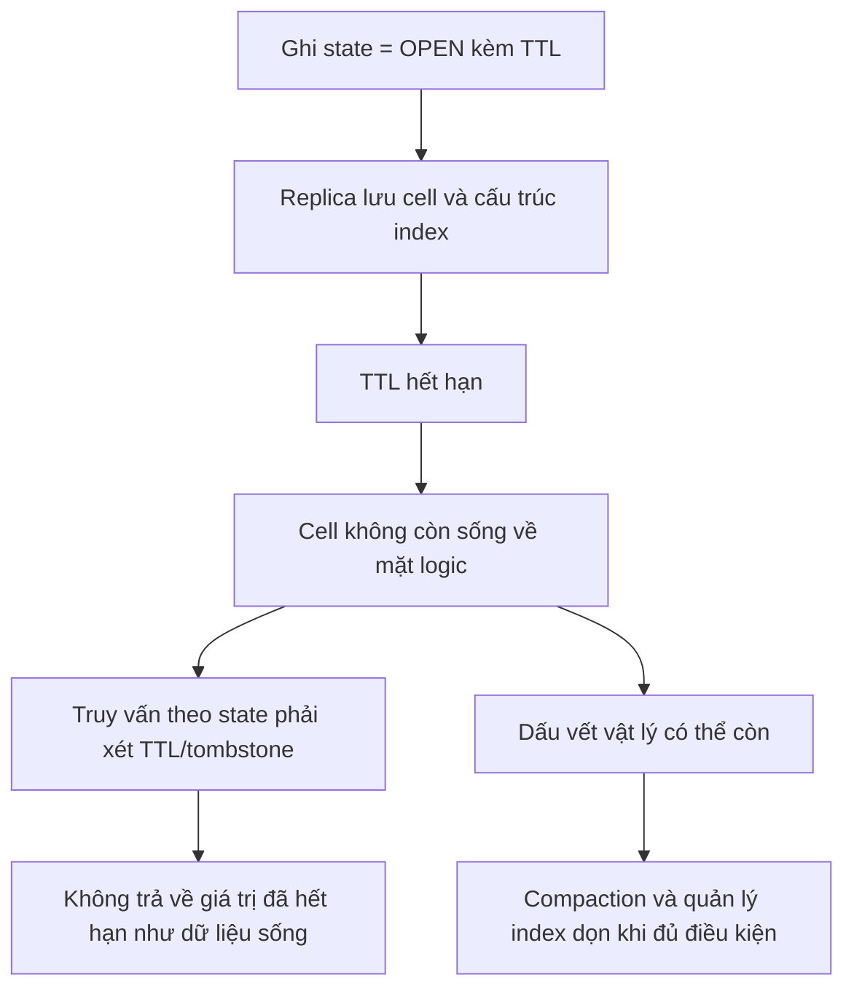

# Chỉ mục khi dữ liệu hết hạn hoặc có tombstone trong Apache Cassandra

## 1. Vấn đề cần hiểu

Trong Apache Cassandra, **chỉ mục (index)** giúp tìm dữ liệu theo một cột không nằm trong đường truy vấn chính của `PRIMARY KEY`. Tuy nhiên, dữ liệu trong hệ thống wide-column phân tán không biến mất ngay khỏi đĩa khi hết **TTL (time to live)** hoặc khi ứng dụng thực hiện `DELETE`. Cassandra thường ghi nhận trạng thái xóa bằng **tombstone**, rồi dọn các bản ghi vật lý ở thời điểm thích hợp.

Điều này tạo ra hai khái niệm khác nhau:

- **Dữ liệu có còn hiệu lực về mặt logic không?** Một ô đã hết TTL hoặc bị tombstone che phủ không được xem là dữ liệu đang sống tại thời điểm đọc.
- **Dấu vết vật lý còn trong SSTable và cấu trúc chỉ mục không?** Một bản ghi cũ hoặc mục chỉ mục liên quan có thể tồn tại một thời gian trước khi compaction và cơ chế quản lý index xử lý nó.

Nếu nhầm hai câu hỏi này, ứng dụng có thể thiết kế truy vấn gây đọc nhiều tombstone, đánh giá sai chi phí của index hoặc tưởng rằng chỉ cần đợi TTL là dung lượng đĩa được thu hồi ngay.

Bài này thuộc chương **Chỉ mục** của mô-đun `DATABASE_ENGINE_WIDE_COLUMN_CASSANDRA`, tập trung vào mối liên hệ giữa thiết kế bảng theo truy vấn, partition key, replication, compaction, repair và kết nối Java khi dữ liệu được xóa/hết hạn.

### Sau bài học, bạn có thể

1. Phân biệt dữ liệu hết hạn, tombstone, phần tử index còn sót về mặt vật lý và dữ liệu được trả về trong truy vấn.
2. Giải thích ảnh hưởng của TTL/`DELETE` tới secondary index và Storage-Attached Index (SAI), ở mức phù hợp với phiên bản Cassandra đang sử dụng.
3. Thực hành CQL để quan sát việc hết TTL của cột được đánh index và việc xóa cột.
4. Nhận diện truy vấn chậm vì tombstone/index churn; đề xuất cách cải thiện bằng thiết kế bảng, retention và vận hành cụm.

## 2. TTL và tombstone hoạt động như thế nào?

**TTL** là thời hạn tồn tại của dữ liệu được ghi vào Cassandra, tính bằng giây. TTL được áp dụng cho **giá trị ô (cell)** của các cột thông thường, không áp dụng cho thành phần khóa chính. Các ô trong cùng hàng có thể có TTL khác nhau. Khi hết hạn, giá trị được coi là không còn sống, dù bản ghi vật lý có thể vẫn tồn tại.

**Tombstone** là dấu mốc xóa mang thông tin thời gian để các replica và cơ chế hòa giải dữ liệu biết một giá trị cũ đã bị xóa. Tombstone xuất hiện khi ứng dụng xóa dữ liệu bằng CQL và cũng gắn với dữ liệu đã hết TTL. Đây là phần thiết yếu của mô hình dữ liệu phân tán, không đơn thuần là “rác” cần dọn càng nhanh càng tốt.

| Tình huống | Tác động logic | Điều có thể còn trên đĩa |
| --- | --- | --- |
| `INSERT ... USING TTL 120` | Các giá trị chịu TTL không còn sống sau thời hạn | Cell hết hạn, thông tin TTL/xóa và cấu trúc index liên quan |
| `UPDATE ... USING TTL 120 SET state = ...` | Chỉ các giá trị được cập nhật với TTL đó hết hạn | Các cột khác trong hàng vẫn sống; dữ liệu cũ/index cũ có thể chờ compaction |
| `DELETE state FROM ...` | Cột `state` không còn giá trị hợp lệ | Tombstone của cột và dấu vết giá trị/index đã tồn tại |
| `DELETE FROM ... WHERE ...` | Hàng hoặc phạm vi được chỉ định bị xóa logic | Tombstone che phủ dữ liệu trong các SSTable khác nhau |
| Cập nhật giá trị đã được index | Giá trị mới có thể thay thế giá trị cũ theo quy tắc timestamp | Phiên bản cũ hoặc entry index liên quan có thể tồn tại tới lúc được hợp nhất/dọn |

Tại thời điểm **hết TTL**, client thường không gửi thêm một lệnh `DELETE` mới. Cassandra sử dụng metadata TTL và thời gian ghi để nhận biết giá trị đã hết hiệu lực trong quá trình đọc và dọn vật lý về sau.

### TTL của một cột khác TTL của toàn bộ hàng

Giả sử hàng có `event_id`, `state` và `detail`:

- `state` được ghi với TTL 90 giây.
- `detail` được ghi không có TTL.

Sau 90 giây, `state` hết hạn nhưng `detail` vẫn sống. Một truy vấn theo `event_id` có thể đọc được hàng với `state` là `null` và `detail` còn nguyên; một truy vấn theo index `state = 'OPEN'` không nên coi hàng đó là kết quả hợp lệ theo trạng thái đã hết hạn.

Vì vậy, thiết kế xóa/hết hạn phải xét **mức ô, hàng và phân vùng**, không mặc định TTL của một cột sẽ xóa toàn bộ bản ghi.

## 3. Chỉ mục nằm ở đâu trong kiến trúc phân tán?

Trong Cassandra, secondary index thường là **chỉ mục cục bộ của replica**: mỗi node quản lý phần index tương ứng với dữ liệu mà node đó nắm giữ. Đây không phải một “bảng tra toàn cục” độc lập có thể trả lời mọi truy vấn mà không liên hệ tới các replica lưu dữ liệu.

Hai cơ chế thường gặp là:

| Cơ chế | Tổ chức khái quát | Điều cần quan tâm với TTL và tombstone |
| --- | --- | --- |
| **Secondary index truyền thống (2i)** | Lưu cấu trúc tra cứu giá trị cột sang khóa dữ liệu trên từng node; hoạt động gắn với quá trình ghi của dữ liệu gốc | Giá trị cũ/xóa có thể để lại tombstone và công việc đọc/dọn index, nhất là khi cột thay đổi liên tục |
| **Storage-Attached Index (SAI)** | Tạo thành phần index gắn với dữ liệu/SSTable và dùng cấu trúc tra cứu riêng cho các giá trị | Mục tham chiếu tới dữ liệu hết hạn/đã xóa có thể còn trong tệp index cho tới khi được quản lý qua flush/compaction; tính sống của dữ liệu vẫn phải được xét |

**Lưu ý phiên bản:** hỗ trợ SAI, cú pháp tạo chỉ mục và chi tiết nội bộ phụ thuộc phiên bản/phân phối Cassandra. Hãy kiểm tra tính năng có sẵn trên cụm trước khi chọn 2i hay SAI. Các ví dụ CQL dưới đây dùng **secondary index truyền thống** để tránh yêu cầu một phiên bản có SAI cụ thể.

Với mọi loại index, **tính đúng đắn của kết quả phải dựa trên dữ liệu hiện còn hiệu lực**, gồm timestamp, TTL, tombstone và mức nhất quán của lần đọc. Một mục tra cứu vật lý còn tồn tại **không chứng minh** hàng tương ứng còn sống hoặc còn thỏa giá trị được index.

### Luồng một giá trị được index rồi hết hạn



Sơ đồ diễn tả **vòng đời logic và vật lý**, không hàm ý rằng Cassandra luôn thực hiện một thao tác cập nhật index tức thời tại đúng giây TTL vừa hết. Cách lọc ứng viên và tổ chức tệp khác nhau giữa 2i, SAI và các phiên bản.

## 4. Thực hành CQL: cột đã được index hết TTL

Ví dụ giả định datacenter tên `dc1` có replication factor = 3. Đổi tên DC và RF để khớp cụm thực tế.

```sql
CREATE KEYSPACE IF NOT EXISTS index_lab
WITH replication = {
    'class': 'NetworkTopologyStrategy',
    'dc1': 3
};

CREATE TABLE IF NOT EXISTS index_lab.events_by_id (
    event_id uuid PRIMARY KEY,
    state text,
    detail text,
    created_at timestamp
);

CREATE INDEX IF NOT EXISTS events_state_idx
ON index_lab.events_by_id (state);
```

Bảng gốc tra cứu nhanh theo `event_id`. Index `state` cho phép truy vấn theo trạng thái nhưng có chi phí riêng; đây là thí nghiệm chức năng, chưa phải thiết kế tối ưu để quét mọi sự kiện của hệ thống lớn.

### Bước 1 — Ghi dữ liệu có cột sống lâu và cột sống ngắn

```sql
INSERT INTO index_lab.events_by_id (event_id, detail, created_at)
VALUES (
    aaaaaaaa-aaaa-4aaa-8aaa-aaaaaaaaaaaa,
    'Chi tiết lưu dài hạn',
    toTimestamp(now())
);

UPDATE index_lab.events_by_id
USING TTL 90
SET state = 'OPEN'
WHERE event_id = aaaaaaaa-aaaa-4aaa-8aaa-aaaaaaaaaaaa;
```

Chỉ cột `state` của lệnh `UPDATE` này được cấp TTL 90 giây; `detail` và `created_at` đã tồn tại trước đó không tự kế thừa TTL.

### Bước 2 — Quan sát trước khi TTL hết hạn

```sql
SELECT event_id, state, detail, TTL(state) AS state_ttl
FROM index_lab.events_by_id
WHERE event_id = aaaaaaaa-aaaa-4aaa-8aaa-aaaaaaaaaaaa;

SELECT event_id, state
FROM index_lab.events_by_id
WHERE state = 'OPEN';
```

Trong lần đọc đầu, `TTL(state)` trả số giây sống còn lại (thường giảm dần theo thời gian). Truy vấn theo `state = 'OPEN'` có thể tìm thấy bản ghi ví dụ trong lúc giá trị còn sống. Với môi trường có nhiều sự kiện, kết quả còn gồm các bản ghi khác cùng trạng thái.

### Bước 3 — Quan sát sau khi đã quá 90 giây

Chạy lại hai lệnh `SELECT` sau khi TTL hết hạn:

- Truy vấn bằng primary key vẫn có thể trả `detail` và `created_at`, trong khi `state` và `TTL(state)` không còn giá trị sống.
- Truy vấn dựa vào index `state = 'OPEN'` không còn được coi hàng ví dụ là kết quả hợp lệ khi giá trị `state` đã hết hạn.
- Kích thước SSTable/index **không nhất thiết giảm ngay**. Đây là kết quả dự kiến vì dọn dữ liệu vật lý diễn ra sau, không đồng bộ với thời điểm hết TTL.

Đối với replication và consistency level, các replica có thể nhận ghi ở những thời điểm khác nhau hoặc bị chậm. Dùng mức đọc đủ phù hợp (chẳng hạn `LOCAL_QUORUM` nếu topology và yêu cầu ứng dụng cho phép) khi cần quan sát kết quả ổn định hơn; không dùng một lần đọc `ONE` ở replica chậm làm bằng chứng rằng toàn cụm đã hội tụ.

## 5. Thực hành CQL: xóa cột được index

Tạo hàng khác:

```sql
INSERT INTO index_lab.events_by_id (event_id, state, detail, created_at)
VALUES (
    bbbbbbbb-bbbb-4bbb-8bbb-bbbbbbbbbbbb,
    'OPEN',
    'Chi tiết vẫn cần lưu',
    toTimestamp(now())
);

DELETE state
FROM index_lab.events_by_id
WHERE event_id = bbbbbbbb-bbbb-4bbb-8bbb-bbbbbbbbbbbb;
```

Sau khi thao tác xóa được xác nhận ở mức nhất quán phù hợp:

```sql
SELECT event_id, state, detail
FROM index_lab.events_by_id
WHERE event_id = bbbbbbbb-bbbb-4bbb-8bbb-bbbbbbbbbbbb;

SELECT event_id, state
FROM index_lab.events_by_id
WHERE state = 'OPEN';
```

Kết quả mong đợi:

1. Hàng vẫn có thể tồn tại do `detail` chưa bị xóa.
2. Cột `state` của hàng này không còn sống.
3. Truy vấn theo chỉ mục `state = 'OPEN'` không được tính hàng này là bản ghi mang trạng thái `OPEN` hiện tại; sự quan sát thực tế vẫn chịu ảnh hưởng của replica được liên hệ và mức nhất quán đã chọn.
4. Tombstone và cấu trúc index liên quan có thể vẫn chiếm dung lượng cho đến khi điều kiện dọn vật lý được đáp ứng.

**Phân biệt:** `DELETE state` chỉ xóa giá trị cột. `DELETE FROM ... WHERE event_id = ...` xóa logic cả hàng, còn lệnh xóa dải clustering trong bảng nhiều hàng/phân vùng có thể tạo range tombstone. Các dạng tombstone này có phạm vi khác nhau và ảnh hưởng tới việc đọc index ở mức khác nhau.

## 6. Vì sao truy vấn index có thể chậm sau nhiều lần hết TTL/xóa?

Giả sử dịch vụ tạo hàng triệu sự kiện có `state = 'PENDING'`, TTL ngắn, sau đó không ngừng cập nhật trạng thái. Ứng dụng luôn truy vấn:

```sql
SELECT event_id, state, detail
FROM index_lab.events_by_id
WHERE state = 'PENDING';
```

Khi dữ liệu hết TTL hoặc bị xóa nhiều, một truy vấn index có thể phải trả chi phí của:

- **Tra cứu và lọc các ứng viên cũ:** cấu trúc index có thể còn dấu vết từ các phiên bản cột/hàng không còn sống; hệ thống phải xét metadata của bản ghi hiện tại trước khi chấp nhận kết quả.
- **Đọc nhiều SSTable:** dữ liệu mới, dữ liệu cũ và tombstone nằm trong các SSTable khác nhau; compaction chưa chắc đã hợp nhất chúng.
- **Quét nhiều node/partition:** index cục bộ trên replica không tự biến một truy vấn trạng thái phổ biến thành đọc đúng một partition.
- **Phân trang và khối lượng kết quả:** khi `state` có rất nhiều hàng, paging chỉ chia nhỏ kết quả truyền về; tổng lượng dữ liệu cần xử lý vẫn cao.
- **Churn của index:** cột indexed thay đổi liên tục làm tăng ghi, flush, compaction và công việc duy trì index.

Không phải cứ có tombstone là truy vấn sai. Vấn đề chủ yếu là **chi phí tìm ra các bản ghi còn sống** và lượng I/O/CPU bị tiêu tốn khi rất nhiều dữ liệu cũ phải được xem xét. Ngoài ra, một node còn lag có thể tạm thời phản ánh trạng thái khác node đã nhận thay đổi; chọn CL phù hợp và sửa tình trạng replica là hai vấn đề riêng với hiệu suất.

### Hình dung độ lớn công việc

```text
1.000.000 hàng từng có state = 'PENDING'
  ├─  50.000 còn sống
  └─ 950.000 đã hết TTL / bị xóa / bị thay thế

Truy vấn theo state cần trả dữ liệu đang sống.
Tùy loại index, cách dọn và trạng thái SSTable:
  -> một phần dấu vết cũ vẫn có thể cần được kiểm tra/lọc
  -> số hàng trả về không phản ánh đầy đủ khối lượng công việc nội bộ.
```

Các con số là tình huống minh họa, **không phải công thức xác định số index entry sẽ bị quét**. Mức chi phí phụ thuộc phiên bản, loại index, cấu trúc dữ liệu và tình trạng compaction.

## 7. Compaction, gc_grace_seconds và repair có vai trò gì?

Cassandra dùng mô hình LSM-tree, ghi vào memtable rồi flush thành SSTable. **Compaction** hợp nhất các SSTable, loại bỏ những phiên bản bị che khuất và có thể dọn dữ liệu hết hạn/tombstone **khi an toàn**.

`gc_grace_seconds` là khoảng đệm quan trọng để các replica đã bỏ lỡ lệnh xóa có cơ hội biết tombstone thông qua quá trình sửa chữa/đồng bộ. Xóa tombstone quá sớm khi còn replica mang dữ liệu cũ có nguy cơ khiến dữ liệu bị xóa “sống lại” (*zombie data*) khi replica đó quay lại phục vụ.

| Thành phần | Đúng với index và tombstone | Không nên hiểu nhầm |
| --- | --- | --- |
| **TTL** | Đặt hạn sống logic của giá trị | Đến giờ TTL là entry biến mất vật lý ngay |
| **Tombstone** | Ghi nhận thông tin xóa để áp dụng đúng khi đọc/hòa giải | Tombstone luôn là lỗi và có thể xóa tùy ý |
| **Compaction** | Hợp nhất SSTable, có thể loại bỏ dữ liệu cũ/tombstone/index không còn cần thiết | Một lần compaction bất kỳ sẽ luôn dọn hết tombstone |
| **gc_grace_seconds** | Giữ thông tin xóa đủ lâu theo chính sách an toàn của cụm | Đặt bằng 0 để tăng tốc mà không có rủi ro |
| **Repair** | Giúp các replica hội tụ dữ liệu và dấu xóa bị bỏ lỡ | Thay cho Paxos, thay cho compaction hoặc tự động giải quyết thiết kế index kém |

Việc dọn tombstone còn phụ thuộc các điều kiện như tuổi tombstone, sự chồng lấn của SSTable và thông tin cần giữ để ngăn bản ghi cũ xuất hiện lại. Vì vậy, **không bảo đảm compaction sẽ thu hồi dung lượng đúng ngay khi `gc_grace_seconds` trôi qua**.

Đối với bảng dùng TTL cao và dữ liệu chủ yếu được ghi theo thời gian, **TimeWindowCompactionStrategy (TWCS)** có thể phù hợp khi các cửa sổ dữ liệu ít bị cập nhật chéo và retention được thiết kế hợp lý. Nhưng TWCS không tự khắc phục truy vấn index có độ chọn lọc thấp hoặc dữ liệu từ nhiều khoảng thời gian bị trộn trong cùng SSTable.

Nên giữ lịch repair phù hợp với chính sách tombstone và yêu cầu phiên bản Cassandra. Khi có bất thường nghiêm trọng về index, hãy dùng công cụ xác minh/rebuild index phù hợp **theo phiên bản đang chạy**; rebuild index không phải thay thế cho mô hình dữ liệu tốt hay là thao tác dọn TTL định kỳ.

## 8. Thiết kế bảng theo truy vấn: khi nào nên bỏ index?

Một index trên cột `state` có thể hữu ích khi dữ liệu đủ chọn lọc và phạm vi truy vấn phù hợp. Nhưng nếu câu hỏi thực sự là:

> “Lấy tối đa 100 sự kiện trạng thái OPEN của tenant X trong ngày Y, theo thời gian mới nhất.”

Thì một bảng định hướng truy vấn có thể tốt hơn việc dùng index toàn hệ thống trên `state`:

```sql
CREATE TABLE IF NOT EXISTS index_lab.events_by_tenant_day_state (
    tenant_id text,
    event_day date,
    state text,
    event_time timestamp,
    event_id uuid,
    detail text,
    PRIMARY KEY ((tenant_id, event_day, state), event_time, event_id)
) WITH CLUSTERING ORDER BY (event_time DESC, event_id ASC);
```

Truy vấn:

```sql
SELECT event_id, event_time, detail
FROM index_lab.events_by_tenant_day_state
WHERE tenant_id = 'tenant-a'
  AND event_day = '2026-11-21'
  AND state = 'OPEN'
LIMIT 100;
```

Ở đây, bộ ba `(tenant_id, event_day, state)` tạo **partition key**, còn `event_time`, `event_id` là clustering columns. Cassandra định vị trực tiếp partition đã thiết kế cho truy vấn và trả kết quả theo thứ tự mong muốn; không cần tìm qua index trạng thái trên toàn cụm.

Tuy nhiên, thiết kế này cũng có điều kiện:

- Partition không nên phát triển quá lớn; cần chọn độ rộng bucket ngày/giờ và số lượng hàng hợp lý.
- Nếu sự kiện đổi `state`, ứng dụng phải xử lý việc **xóa khỏi phân vùng trạng thái cũ và ghi vào phân vùng trạng thái mới**. Hai phân vùng không có một CAS xuyên partition tự động.
- Nếu giữ một bảng `events_by_id` cùng bảng truy vấn, cần đồng bộ hai hình chiếu dữ liệu theo chính sách nghiệp vụ; replication không tự thực hiện dual write giữa hai bảng.
- TTL trên bảng truy vấn cần được quản lý nhất quán với retention của sự kiện. Việc nhiều bảng hết hạn tại các thời điểm khác nhau có thể tạo ra góc nhìn khác nhau trong thời gian hội tụ.

**Chọn index hay bảng riêng** dựa trên partition key, kiểu truy vấn, tính chọn lọc của giá trị, tốc độ thay đổi, TTL, số node được liên hệ và yêu cầu độ trễ. `ALLOW FILTERING` không phải giải pháp mặc định cho truy vấn chậm do schema.

## 9. Ứng dụng Java: đọc qua index nhưng vẫn thiết kế truy vấn có giới hạn

Ví dụ dùng **Apache Cassandra Java Driver 4.x** với `CqlSession` đã được cấu hình cho cụm và datacenter thích hợp:

```java
import com.datastax.oss.driver.api.core.CqlSession;
import com.datastax.oss.driver.api.core.DefaultConsistencyLevel;
import com.datastax.oss.driver.api.core.cql.BoundStatement;
import com.datastax.oss.driver.api.core.cql.PreparedStatement;
import com.datastax.oss.driver.api.core.cql.ResultSet;
import com.datastax.oss.driver.api.core.cql.Row;

import java.util.ArrayList;
import java.util.List;
import java.util.UUID;

public final class EventRepository {
    private final CqlSession session;
    private final PreparedStatement byState;

    public EventRepository(CqlSession session) {
        this.session = session;
        this.byState = session.prepare(
            "SELECT event_id, state FROM index_lab.events_by_id " +
            "WHERE state = ?"
        );
    }

    public List<UUID> findCurrentIdsByState(String state) {
        BoundStatement statement = byState.bind(state)
            .setConsistencyLevel(DefaultConsistencyLevel.LOCAL_QUORUM)
            .setPageSize(100);

        ResultSet resultSet = session.execute(statement);
        List<UUID> ids = new ArrayList<>();
        for (Row row : resultSet) {
            ids.add(row.getUuid("event_id"));
        }
        return ids;
    }
}
```

Ví dụ trên minh họa cách đặt CL và page size trong driver. Nó **vẫn duyệt toàn bộ các trang kết quả** nếu caller chạy hết vòng lặp; `setPageSize(100)` không phải giới hạn tổng số hàng. Trong hệ thống sản xuất, nên thêm cơ chế giới hạn/budget ở tầng ứng dụng và ưu tiên partition key định hướng truy vấn nếu trạng thái `OPEN` có lượng hàng lớn.

Không cache vô thời hạn kết quả tra cứu index mà không có chính sách invalidation: giá trị có TTL hoặc bị `DELETE` sẽ không tự làm một cache bên ngoài Cassandra biết phải xóa. Nếu ứng dụng cần kiểm tra trạng thái hiện tại của một sự kiện cụ thể, đọc trực tiếp bằng primary key với CL phù hợp thường rõ ràng hơn.

## 10. Chẩn đoán khi index và tombstone gây tải

Khi truy vấn index chậm sau một đợt dữ liệu hết TTL hàng loạt, hãy kiểm tra có hệ thống:

1. **Mẫu truy vấn:** đang đọc một partition cụ thể hay tìm theo giá trị cột trên rất nhiều partition? Có cần phân trang hoặc đổi schema?
2. **TTL và lưu lượng ghi:** bao nhiêu giá trị hết hạn mỗi giây? Cột index có bị cập nhật nhiều lần trên cùng hàng không?
3. **Replica và consistency:** CL đọc/ghi, số replica sẵn sàng, độ trễ inter-DC, trạng thái repair có phù hợp không?
4. **Tombstone và SSTable:** metrics/log cảnh báo tombstone, số SSTable cần đọc, áp lực compaction, dung lượng đĩa/CPU/GC.
5. **Đường truy vấn index:** dùng tracing có kiểm soát để biết truy vấn liên hệ node nào và tiêu tốn thời gian ở đâu; không bật tracing liên tục trên toàn bộ traffic.

Có thể thực hành trong `cqlsh`:

```text
CONSISTENCY LOCAL_QUORUM;
TRACING ON;
```

Sau đó chạy một truy vấn mẫu `SELECT ... WHERE state = 'OPEN'`, đọc trace rồi tắt:

```text
TRACING OFF;
```

Các lệnh trên là **lệnh của cqlsh**, không phải cú pháp CQL để gửi từ Java Driver. Dùng tracing tiết kiệm vì chính nó cũng có chi phí. Tùy phiên bản và quy trình vận hành, `nodetool tablestats` và `nodetool compactionstats` có thể hỗ trợ kiểm tra số liệu liên quan tới SSTable và compaction; đừng chỉ dựa vào một chỉ số để kết luận index hỏng.

### Bảng triệu chứng và hành động

| Triệu chứng | Giả thuyết cần kiểm tra | Hướng xử lý |
| --- | --- | --- |
| Hết TTL nhưng dung lượng đĩa chưa giảm | SSTable/index còn dấu vết vật lý; chưa đủ điều kiện purge | Kiểm tra compaction, retention và độ tuổi tombstone |
| Truy vấn theo index rất chậm khi nhiều hàng đã hết hạn | Churn, nhiều ứng viên cũ hoặc quá nhiều partition/row được xét | Đo trace/metrics, hạn chế tập truy vấn, xem xét bảng theo truy vấn |
| Kết quả giữa các lần đọc không ổn định | Replica lag, CL thấp, ghi/xóa diễn ra đồng thời | Kiểm tra replication, repair và chọn CL phù hợp |
| Lỗi timeout/tombstone warning tăng | Quét nhiều dữ liệu bị xóa và SSTable hoặc cluster quá tải | Giảm scan, cải thiện schema/retention, xử lý tải cụm |
| Đã compaction nhưng vẫn còn tombstone | Purge chưa an toàn hoặc vẫn có SSTable chồng lấn | Kiểm tra chính sách gc_grace và điều kiện an toàn |
| Cần truy vấn thường xuyên theo trạng thái chung cho mọi tenant | Độ chọn lọc thấp và fanout lớn | Cân nhắc projection keyed theo tenant/time/state |

Đặc biệt, **không giảm `gc_grace_seconds` về 0 hoặc ép dọn tombstone hàng loạt chỉ để giảm latency** khi chưa chứng minh quy trình repair và điều kiện an toàn. Chọn mô hình dữ liệu phù hợp thường đem lại tác động bền vững hơn.

## 11. Những hiểu lầm thường gặp

| Nhận định sai | Cách hiểu đúng |
| --- | --- |
| “TTL hết là dữ liệu và index bị xóa khỏi đĩa tức khắc.” | TTL làm giá trị hết hiệu lực về mặt logic; dọn vật lý diễn ra về sau. |
| “Còn entry index nghĩa là hàng phải được trả về.” | Kết quả phải tuân theo liveness/tombstone/timestamp của dữ liệu thực, cùng mức nhất quán của truy vấn. |
| “Index giải quyết mọi truy vấn không theo primary key.” | Index có chi phí fanout, cập nhật và đọc; bảng thiết kế theo truy vấn có thể thích hợp hơn. |
| “Tombstone toàn là dữ liệu vô ích.” | Tombstone giữ thông tin xóa cần thiết cho hệ phân tán và bảo vệ trước zombie data. |
| “Compaction lúc nào cũng xóa toàn bộ tombstone.” | Chỉ dọn khi đáp ứng điều kiện an toàn và cấu trúc SSTable cho phép. |
| “SAI không có chi phí khi TTL/xóa liên tục.” | SAI có kiến trúc khác 2i nhưng vẫn chịu tác động dữ liệu hết hạn, dọn index và compaction. |
| “`setPageSize(100)` giới hạn truy vấn tối đa 100 hàng.” | Nó quy định kích thước trang; lặp toàn bộ `ResultSet` vẫn có thể đọc nhiều trang. |

## 12. Bài thực hành tự kiểm tra

**Bài 1 — TTL một cột.** Một hàng có `id`, `state` (TTL 60 giây) và `detail` (không TTL). Sau hai phút, truy vấn theo primary key và truy vấn qua index `state` có thể khác nhau như thế nào? Vì sao kích thước đĩa chưa chắc giảm?

**Bài 2 — Xóa và ghi đè.** Hai client cập nhật `state` từ `OPEN` sang `CLOSED` rồi xóa `state`. Hãy giải thích ý nghĩa của timestamp, tombstone, replica lag và lý do không thể dựa vào sự tồn tại vật lý của index để suy ra trạng thái hiện tại.

**Bài 3 — Tối ưu truy vấn.** Một hệ thống lưu 50 triệu sự kiện/ngày, phần lớn `state = 'DONE'` và TTL là 24 giờ. API liên tục yêu cầu 100 sự kiện mới nhất của một tenant trong ngày. So sánh index toàn cụm trên `state` với bảng `events_by_tenant_day_state`; chỉ ra ưu điểm và rủi ro dual write.

**Bài 4 — Vận hành.** Sau đợt hết TTL hàng loạt, truy vấn theo index tăng từ 50 ms lên vài giây. Hãy đề xuất các metrics/log/trace cần quan sát và giải thích vì sao đặt `gc_grace_seconds = 0` không phải phản ứng mặc định.

**Định hướng trả lời:**

- **Bài 1:** `detail` còn sống nên đọc theo PK có thể thấy hàng, trong khi cột `state` hết hạn không còn thỏa truy vấn index. Dấu vết vật lý chờ điều kiện dọn.
- **Bài 2:** Giá trị hiện hành được xác định theo quy tắc hòa giải/timestamp và dấu xóa; replica chậm có thể quan sát khác trong lúc chưa hội tụ. Index vật lý không đồng nghĩa dữ liệu sống.
- **Bài 3:** Partition key theo tenant/day/state giới hạn nơi đọc và hỗ trợ thứ tự theo thời gian. Đổi trạng thái đòi duy trì nhiều hình chiếu, cần xử lý sự nhất quán và TTL của chúng.
- **Bài 4:** Theo dõi query latency, trace, tombstone warnings, SSTable/compaction, số lượng hàng/quy mô partition, CL và sức khỏe replica. Giảm grace tùy tiện có rủi ro zombie data.

## Ghi nhớ

Trong Cassandra, **hết TTL hoặc có tombstone là trạng thái xóa logic; index và SSTable có thể vẫn chứa dấu vết vật lý** cho đến khi các cơ chế dọn dữ liệu có đủ điều kiện. Để truy vấn chính xác và hiệu quả, hãy phối hợp **partition key theo truy vấn**, đánh giá 2i/SAI theo phiên bản và workload, chọn consistency level phù hợp, duy trì repair/compaction an toàn và kiểm soát chi phí khi dữ liệu hết hạn liên tục.
