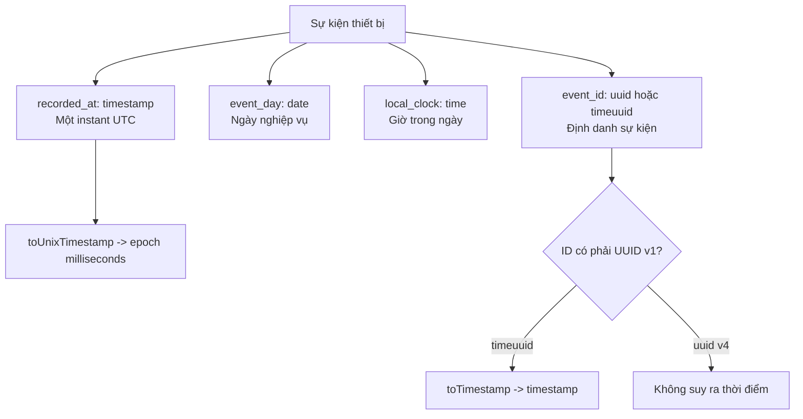
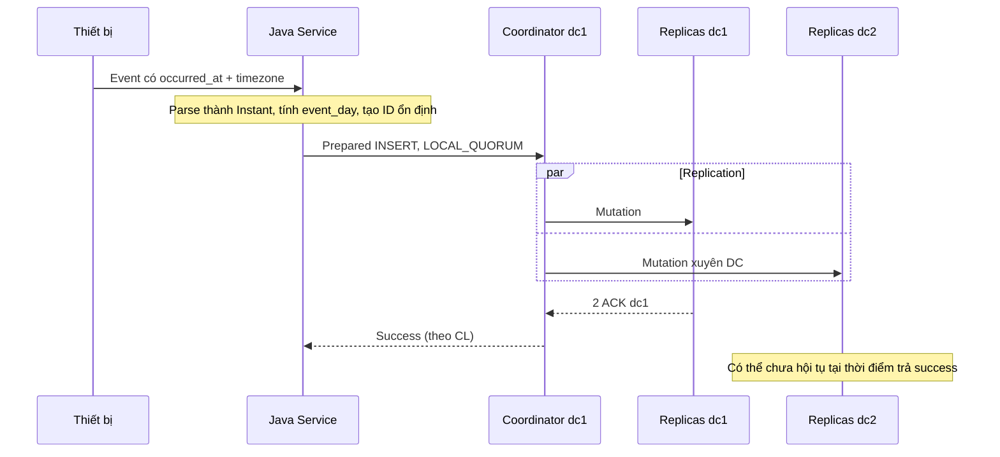

# Hàm chuyển kiểu, UUID/timeuuid và xử lý ngày giờ

Trong Apache Cassandra, nhiều lỗi dữ liệu không đến từ replica bị mất mà đến từ việc **hiểu sai kiểu CQL**: lưu thời điểm dưới dạng chuỗi rồi lọc sai thứ tự, dùng `uuid` ngẫu nhiên như khóa có thứ tự thời gian, đổi `timestamp` thành `date` mà quên múi giờ, hoặc gọi `now()` lần nữa khi retry một phép ghi. Các lỗi này đặc biệt khó phát hiện trong cluster phân tán vì cùng một partition có thể được đọc qua những coordinator khác nhau, còn ứng dụng Java và máy chủ có thể sử dụng múi giờ mặc định khác nhau.

Bài thuộc chương **CQL nâng cao** của module **DATABASE_ENGINE_WIDE_COLUMN_CASSANDRA**, kết nối kiến thức kiểu dữ liệu, thiết kế bảng wide-column theo truy vấn, replication, consistency level, xử lý lỗi và Java Driver. Mục tiêu là hiểu **cách giá trị được lưu và so sánh**, không chỉ ghi nhớ tên hàm.

Sau bài học, bạn có thể:

- Phân biệt `uuid`, `timeuuid`, `timestamp`, `date`, `time` và thời gian Unix.
- Dùng `CAST(expression AS type)` đúng phạm vi, hiểu giới hạn của việc chuyển kiểu.
- Sử dụng `now()`, `toTimestamp`, `toDate`, `toUnixTimestamp`, `minTimeuuid`, `maxTimeuuid` với điều kiện phù hợp.
- Thiết kế bảng sự kiện có khóa phân vùng và clustering theo thời gian, truy vấn bằng khoảng **nửa mở** `[start, end)`.
- Dùng `Instant`, `LocalDate`, `LocalTime`, `ZoneId` và `UUID` trong Java Driver 4.x.
- Tránh nhầm **thời điểm sự kiện**, **thời điểm ghi**, **CQL TTL**, **writetime** và **timestamp của timeuuid**.

## 1. Bản đồ các kiểu thời gian và định danh CQL

| Kiểu CQL | Giá trị biểu diễn | Đặc tính quan trọng | Kiểu Java Driver 4.x thường dùng |
|---|---|---|---|
| `uuid` | UUID 128-bit, không ràng buộc phải mã hóa thời gian. | Thường dùng UUID v4 cho ID ngẫu nhiên; không thể suy thời điểm từ UUID v4. | `java.util.UUID` |
| `timeuuid` | UUID **version 1** có thành phần thời gian. | CQL có thứ tự timeuuid hữu ích cho clustering; không phải đồng hồ nghiệp vụ chính xác tuyệt đối. | `java.util.UUID` (phải là UUID v1 phù hợp) |
| `timestamp` | Một **instant** trên trục thời gian Unix. | Độ chính xác lưu trữ thường **mili-giây**; không lưu tên múi giờ gốc. | `java.time.Instant` |
| `date` | Một **ngày lịch** không chứa giờ/múi giờ. | Phù hợp bucket ngày đã được tính theo múi giờ nghiệp vụ. | `java.time.LocalDate` |
| `time` | Giờ trong ngày không có ngày/múi giờ. | Có độ phân giải nano-giây về mặt kiểu dữ liệu; không phải một instant độc lập. | `java.time.LocalTime` |
| `bigint` chứa Unix time | Số nguyên do ứng dụng quy ước, ví dụ mili-giây từ 1970-01-01T00:00:00Z. | Phải ghi rõ **đơn vị**, vì epoch seconds, milliseconds và microseconds khác nhau. | `long` / `Long` |
| `duration` | Khoảng thời gian gồm tháng, ngày và nano-giây theo mô hình Cassandra. | Không tương đương số mili-giây cố định cho mọi trường hợp. | Tùy API driver/phiên bản, cần kiểm tra mapping cụ thể. |

**Điểm mấu chốt:** `timestamp` biểu diễn **khi nào** trên trục UTC; `date` biểu diễn **ngày lịch**; `time` là **giờ trong ngày**; `timeuuid` là **ID có thành phần thời gian**, không phải một `timestamp` được đổi tên.



Sơ đồ mô tả **ngữ nghĩa**, không nói Cassandra tự tạo hoặc giữ quan hệ giữa các cột. Nếu ứng dụng ghi `event_day` không khớp `recorded_at`, database vẫn có thể lưu cả hai; tính nhất quán giữa chúng là trách nhiệm thiết kế của ứng dụng.

## 2. Chọn mô hình dữ liệu trước khi chọn hàm chuyển kiểu

Ví dụ hệ thống IoT cần hai truy vấn:

1. Lấy 20 điểm đo mới nhất của **một thiết bị trong một ngày**.
2. Lấy các sự kiện kết nối của **một thiết bị trong một khoảng thời gian**, theo thứ tự thời điểm.

Vì Cassandra tối ưu bảng theo mẫu truy vấn, ta minh họa hai bảng. Đây là schema dành cho **cluster test có DC `dc1` và `dc2` đủ số node cho RF=3**:

```sql
CREATE KEYSPACE telemetry
WITH replication = {
    'class': 'NetworkTopologyStrategy',
    'dc1': 3,
    'dc2': 3
};

CREATE TABLE telemetry.samples_by_device_day (
    tenant_id uuid,
    device_id uuid,
    event_day date,
    recorded_at timestamp,
    event_id uuid,
    local_clock time,
    reading_count int,
    PRIMARY KEY (
        (tenant_id, device_id, event_day),
        recorded_at,
        event_id
    )
) WITH CLUSTERING ORDER BY (
    recorded_at DESC, event_id ASC
);

CREATE TABLE telemetry.events_by_device_day (
    device_id uuid,
    event_day date,
    event_id timeuuid,
    event_type text,
    PRIMARY KEY ((device_id, event_day), event_id)
) WITH CLUSTERING ORDER BY (event_id DESC);
```

Trong `samples_by_device_day`:

- `(tenant_id, device_id, event_day)` là **partition key tổng hợp**; cả ba giá trị được mã hóa và băm để xác định token/replica.
- `recorded_at` là clustering column, giúp truy vấn theo **khoảng thời gian** sau khi đã chỉ định đầy đủ partition key.
- `event_id uuid` giúp phân biệt hai sự kiện có cùng mili-giây `recorded_at`; UUID v4 không được dùng để suy thời điểm.
- `local_clock time` chỉ lưu giờ trong ngày để hiển thị/phân tích phù hợp, **không thay thế** `recorded_at timestamp`.

Trong `events_by_device_day`, `event_id timeuuid` vừa là ID vừa mang thành phần thời gian để sắp xếp trong **một partition ngày/thiết bị**. Nếu cần ID sự kiện ổn định qua retries, phải tạo ID đúng một lần trước khi gửi hoặc dùng một chiến lược idempotency khác.

**Cảnh báo:** ví dụ RF=3 ở hai DC cần đủ node và đúng tên DC. Với một Cassandra instance duy nhất, không sao chép nguyên cấu hình này rồi mong mọi thao tác quorum hoạt động. Hãy thay RF và DC theo môi trường test.

## 3. CAST: chuyển kiểu biểu thức trong CQL

Cú pháp cơ bản:

```sql
CAST(expression AS target_type)
```

`CAST` chuyển giá trị sang **một kiểu được Cassandra hỗ trợ** trong ngữ cảnh biểu thức; không phải trình phân tích cú pháp tùy ý cho chuỗi ngày giờ, cũng không phải lệnh thay đổi schema.

Giả sử `reading_count` là `int`. Có thể trả nó dưới dạng kiểu số dấu phẩy động:

```sql
SELECT recorded_at,
       reading_count,
       CAST(reading_count AS double) AS count_as_double
FROM telemetry.samples_by_device_day
WHERE tenant_id = 11111111-1111-1111-1111-111111111111
  AND device_id = 22222222-2222-2222-2222-222222222222
  AND event_day = '2026-11-21'
LIMIT 20;
```

| Tình huống | Cách xử lý | Lưu ý |
|---|---|---|
| `int` → `double` | `CAST(reading_count AS double)` | Kiểu kết quả thay đổi, nhưng bảng vẫn lưu `int`. |
| `timestamp` → ngày lịch | `toDate(recorded_at)` | Hàm thời gian chuyên biệt dễ hiểu hơn giả định ép kiểu tùy ý. |
| `timeuuid` → thời điểm | `toTimestamp(event_id)` | Phải là UUID v1/timeuuid hợp lệ. |
| Chuỗi `'21/11/2026'` → timestamp | Chuẩn hóa và parse có múi giờ ở client rồi bind kiểu `timestamp`. | Không trông đợi `CAST` hiểu mọi định dạng vùng miền. |
| `blob` ↔ kiểu nguyên thủy | Nhóm hàm như `intAsBlob`, `blobAsInt` ở những phiên bản hỗ trợ. | Chuyển đổi **biểu diễn nhị phân**, không phải cách xử lý JSON/text tùy ý. |

**Không được suy ra mọi cặp kiểu đều chuyển được.** Một số chuyển đổi số có thể làm mất độ chính xác hoặc gây tràn/thu hẹp miền giá trị; các phép chuyển đổi sai kiểu có thể bị Cassandra từ chối. Kiểm tra cặp nguồn–đích trong tài liệu của phiên bản đang chạy.

### CAST khác ALTER TABLE

`CAST(reading_count AS double)` trong `SELECT` **không** đổi kiểu cột trong schema, không sửa SSTable và không backfill dữ liệu. Muốn thay kiểu lưu trữ của một cột, cần xác minh khả năng `ALTER TABLE` của Cassandra hoặc thiết kế **cột/bảng mới rồi di chuyển dữ liệu** theo quy trình an toàn.

### CAST không biến một truy vấn thành tối ưu

Việc đặt `CAST` trong phần `SELECT` không làm Cassandra có index mới hoặc thay cách partition được chọn. Với dữ liệu lớn, vẫn cần đầy đủ **partition key** và clustering range phù hợp. Không dùng ép kiểu trong ý tưởng `WHERE` để chữa một thiết kế bảng không phục vụ được mẫu truy vấn.

## 4. Nhóm hàm chuyển đổi thời gian trong CQL

Các hàm CQL thường gặp:

| Hàm | Đầu vào điển hình | Kết quả | Mục đích |
|---|---|---|---|
| `toTimestamp(value)` | `date` hoặc `timeuuid` | `timestamp` | Chuyển ngày/UUID v1 thành instant kiểu Cassandra. |
| `toDate(value)` | `timestamp` hoặc `timeuuid` | `date` | Lấy phần ngày theo ngữ nghĩa chuyển đổi của Cassandra. |
| `toUnixTimestamp(value)` | `timestamp`, `date` hoặc `timeuuid` theo phiên bản | `bigint` | Số mili-giây tính từ Unix epoch. |
| `now()` | Không tham số | `timeuuid` | Sinh UUID v1 theo đồng hồ tại lúc thực thi, phù hợp một số khóa sự kiện. |
| `minTimeuuid(timestamp)` | Giá trị thời điểm | `timeuuid` biên dưới tổng hợp | Tạo **mốc lọc khoảng** cho clustering `timeuuid`. |
| `maxTimeuuid(timestamp)` | Giá trị thời điểm | `timeuuid` biên trên tổng hợp | Tạo **mốc lọc khoảng** với semantics biên trên. |
| `uuid()` | Không tham số, ở những phiên bản hỗ trợ | `uuid` ngẫu nhiên | Sinh ID không có thứ tự thời gian. |

Một số tên hàm lịch sử như `dateOf(timeuuid)` hoặc `unixTimestampOf(timeuuid)` có thể gặp trong code cũ; trên các bản hỗ trợ, nên ưu tiên **`toTimestamp`** và **`toUnixTimestamp`** khi viết mới. Các hàm `currentTimestamp()`, `currentDate()`, `currentTime()`, `currentTimeUUID()` có trong những release CQL nhất định; cần đối chiếu phiên bản thay vì mặc định chúng có ở mọi cluster.

### Ví dụ đọc conversion ngay trên một bảng

```sql
SELECT recorded_at,
       toDate(recorded_at) AS converted_day,
       toUnixTimestamp(recorded_at) AS epoch_millis
FROM telemetry.samples_by_device_day
WHERE tenant_id = 11111111-1111-1111-1111-111111111111
  AND device_id = 22222222-2222-2222-2222-222222222222
  AND event_day = '2026-11-21'
LIMIT 10;
```

Kết quả `epoch_millis` có **đơn vị mili-giây**. Không nhầm với `WRITETIME(column)`, thường biểu diễn timestamp ghi nội bộ tính bằng **microsecond**.

## 5. UUID: định danh không đồng nghĩa thời điểm

**UUID** có 128 bit, nhưng các **version** có cách tạo khác nhau. Trong CQL, kiểu `uuid` có thể chứa các UUID thông thường; riêng kiểu `timeuuid` được thiết kế cho UUID **version 1** có phần thời gian.

| Đặc tính | `uuid` ngẫu nhiên (thường v4) | `timeuuid` (v1) |
|---|---|---|
| Mục tiêu chính | Định danh gần như duy nhất, không ngụ ý thứ tự thời gian. | Định danh có thành phần timestamp để sắp theo thời gian. |
| Cách sinh minh họa | `UUID.randomUUID()` trong Java, hoặc `uuid()` nếu bản CQL hỗ trợ. | `now()` trong CQL hoặc thư viện tạo UUID v1 phù hợp. |
| Lấy timestamp sự kiện? | **Không**, không có timestamp có nghĩa trong v4. | Có thể dùng `toTimestamp(timeuuid)`. |
| Lọc bằng `minTimeuuid` | Không hợp lệ về ngữ nghĩa. | Phù hợp khi cột là clustering `timeuuid`. |
| Dùng làm token xác thực bí mật? | Không mặc định. | Không; UUID v1 có thông tin thời gian/định danh tạo ra, không phải secret. |

**UUID không phải một clock toàn cụm.** Hai coordinator có thể có độ lệch đồng hồ. Một UUID v1 chứa thời gian tạo theo clock và dữ liệu phụ để phân biệt ID; nó không bảo đảm chính xác “thứ tự thực tế” của tất cả sự kiện xuyên DC khi máy lệch giờ.

### Vì sao Java UUID.randomUUID() không dùng cho timeuuid?

`UUID.randomUUID()` của JDK thông thường sinh UUID **version 4**. Nó phù hợp cột `uuid` nhưng không phải ID đúng loại cho cột `timeuuid`. Nếu ứng dụng cần tạo timeuuid trước khi gửi, hãy dùng **trình tạo UUID v1 tương thích với driver/phiên bản được kiểm chứng** và giữ nguyên ID đó cho mọi lần retry của cùng một sự kiện.

Một UUID v1 còn có thông tin thời gian 100-nanosecond tick trong **định dạng ID**; điều này **không** có nghĩa đồng hồ máy đạt độ chính xác thực tế 100 nano-giây hoặc có total order đáng tin cậy giữa mọi host.

## 6. now(): tạo timeuuid, không phải ghi timestamp ứng dụng

Bảng `events_by_device_day` có clustering key `event_id timeuuid`:

```sql
INSERT INTO telemetry.events_by_device_day
    (device_id, event_day, event_id, event_type)
VALUES (
    22222222-2222-2222-2222-222222222222,
    '2026-11-21',
    now(),
    'CONNECTED'
);

SELECT event_id,
       toTimestamp(event_id) AS event_at,
       toDate(event_id) AS event_date,
       toUnixTimestamp(event_id) AS event_epoch_ms,
       event_type
FROM telemetry.events_by_device_day
WHERE device_id = 22222222-2222-2222-2222-222222222222
  AND event_day = '2026-11-21'
LIMIT 20;
```

Trong ví dụ, `now()` sinh một **timeuuid** tại thời điểm server xử lý expression. Nó không trả về kiểu `timestamp`. Nếu muốn một `timestamp` từ timeuuid đã lưu, dùng `toTimestamp(event_id)`.

**Rủi ro retry:** mỗi lần thực thi `now()` có thể sinh ID mới. Nếu client timeout sau khi một số replica đã ghi rồi gửi lại nguyên `INSERT` trên, hệ thống có thể lưu **hai event khác ID** cho cùng sự kiện nghiệp vụ. Với event có yêu cầu exactly-once ở mức ứng dụng, tạo/giữ event ID ổn định trước khi gửi và thiết kế retry có kiểm soát.

### Đồng hồ thời gian thực và thời gian sự kiện

`now()` phản ánh thời điểm tạo ID ở phía thực thi, không nhất thiết là lúc thiết bị phát sinh sự kiện. Nếu thiết bị mất mạng rồi gửi lại dữ liệu của hôm qua, dùng `now()` làm “thời gian đo” sẽ đặt nó vào hôm nay. Nên giữ riêng **`occurred_at`/`recorded_at` do nguồn dữ liệu cung cấp**, và thời điểm **ingested_at** do hệ thống nhận dữ liệu xác định, khi nghiệp vụ cần phân biệt.

## 7. minTimeuuid và maxTimeuuid: biên lọc, không phải ID sự kiện

Với clustering key kiểu `timeuuid`, muốn đọc các sự kiện trong một khoảng thời gian ta có thể dùng **hàm tạo biên tổng hợp**:

```sql
SELECT event_id, event_type
FROM telemetry.events_by_device_day
WHERE device_id = 22222222-2222-2222-2222-222222222222
  AND event_day = '2026-11-21'
  AND event_id >= minTimeuuid('2026-11-20 17:00:00+0000')
  AND event_id <  minTimeuuid('2026-11-21 17:00:00+0000')
ORDER BY event_id DESC
LIMIT 50;
```

Đây là **khoảng nửa mở** cho ngày **2026-11-21 theo giờ Việt Nam (UTC+07:00)**: đầu ngày địa phương tương ứng 17:00 UTC của hôm trước, và đầu ngày kế tiếp tương ứng 17:00 UTC của ngày đang xét.

**Chú ý:** `event_day` phải đã được ứng dụng tính theo **cùng quy ước múi giờ**. Nếu ứng dụng gán `event_day` theo UTC nhưng lọc `minTimeuuid` theo ngày Việt Nam, hai điều kiện có thể loại bỏ dữ liệu hợp lệ.

### Tại sao dùng [start, end)?

- `>= start` bao gồm sự kiện nằm đúng đầu khoảng.
- `< next_start` loại sự kiện đúng đầu khoảng tiếp theo.
- Hai khoảng liên tiếp không chồng lên nhau và không để lọt khoảng trống do chọn “23:59:59.999”.
- Dùng `minTimeuuid` tạo cận dưới tổng hợp giúp truy vấn giá trị UUID v1 bắt đầu từ mốc đã cho.

`maxTimeuuid(timestamp)` tạo một **cận trên tổng hợp** hữu ích cho những biến thể điều kiện biên. Tuy nhiên, nên thống nhất dạng **`>= minTimeuuid(start)` và `< minTimeuuid(end)`** cho các khoảng nửa mở, thay vì pha trộn bao gồm/loại trừ không nhất quán.

### Synthetic UUID không phải dữ liệu để INSERT

`minTimeuuid` và `maxTimeuuid` không phải công cụ tạo ID thật cho event. Kết quả của chúng chỉ phục vụ **so sánh range**, có giá trị tổng hợp chứ không đại diện một sự kiện đã xảy ra. Truy vấn bảng có primary key `uuid` v4 bằng `minTimeuuid` là sai mục tiêu và không biến UUID ngẫu nhiên thành dữ liệu có thứ tự thời gian.

## 8. Timeuuid: thứ tự clustering và giới hạn thực tế

Nếu `event_id timeuuid` là clustering column với `DESC`, Cassandra có thể duyệt các event trong một partition theo thứ tự thời gian biểu diễn bởi UUID v1. Nhưng cần xét:

1. **Clock skew:** hai node tạo timeuuid có clock lệch nhau; thứ tự timeuuid có thể không phản ánh thứ tự nghiệp vụ của các sự kiện.
2. **Độ chính xác:** `toTimestamp(timeuuid)` đưa về `timestamp` mili-giây; hai timeuuid khác nhau vẫn có thể cùng timestamp sau chuyển đổi.
3. **Tính duy nhất:** trình tạo v1 phù hợp phải quản lý clock sequence/node component, không tự xây ID bằng cách ghép timestamp thủ công.
4. **Partition boundary:** clustering chỉ sắp xếp **trong một partition**. Nó không biến mọi event của toàn cluster thành một log thời gian toàn cục.
5. **Pagination:** nên dùng paging state của driver hoặc điều kiện range có thứ tự và partition key rõ ràng, không dùng `toTimestamp(event_id)` làm cursor duy nhất vì mất phần phân biệt ID.

Nếu nghiệp vụ yêu cầu **thứ tự nguyên nhân–kết quả tuyệt đối** giữa nhiều writer, chỉ dùng timeuuid là chưa đủ. Cần thiết kế sequence, đồng thuận hoặc cơ chế ordering ở cấp nghiệp vụ thích hợp.

## 9. timestamp và múi giờ: lưu instant, không lưu tên zone

`timestamp` trong Cassandra biểu diễn thời điểm trên trục Unix epoch. Khi parse literal có timezone, nó quy về một instant; **tên zone gốc như Asia/Ho_Chi_Minh không được lưu trong trường timestamp**.

Hai chuỗi sau chỉ cùng một thời điểm:

```text
Giờ Việt Nam: 2026-11-21 08:30:00 +0700
Giờ UTC:      2026-11-21 01:30:00 +0000
Java Instant: 2026-11-21T01:30:00Z
```

Nếu ghi dưới dạng chuỗi timestamp, **nên nêu offset/timezone tường minh**:

```sql
INSERT INTO telemetry.samples_by_device_day
    (tenant_id, device_id, event_day,
     recorded_at, event_id, local_clock, reading_count)
VALUES (
    11111111-1111-1111-1111-111111111111,
    22222222-2222-2222-2222-222222222222,
    '2026-11-21',
    '2026-11-21 08:30:00+0700',
    33333333-3333-4333-8333-333333333333,
    '08:30:00',
    17
);
```

Ở đây `event_id` chỉ là một UUID hợp lệ minh họa (dành cho cột `uuid`), không phải timeuuid. Nếu dùng literal timestamp **không có offset**, cách công cụ/client hoặc cấu hình môi trường diễn giải có thể làm sai kỳ vọng. Trong Java, tốt hơn hết là truyền `Instant` dưới dạng **typed bound parameter** thay vì ghép chuỗi ngày giờ vào câu CQL.

### Vì sao hiển thị lệch 7 giờ không nhất thiết là dữ liệu sai?

Giá trị `timestamp` có thể được hiển thị theo múi giờ của `cqlsh`/client; cùng instant có thể hiện `01:30 UTC` hoặc `08:30 UTC+07:00`. Hãy kiểm tra **epoch millis** hoặc chuyển đổi về cùng `ZoneId` trước khi so sánh, thay vì dựa vào chữ giờ hiển thị.

## 10. date và time: không có timezone, không thể thay timestamp

`date` là **ngày lịch**: `2026-11-21`. `time` là **giờ trong ngày**: `08:30:00` hoặc chính xác hơn `08:30:00.123456789` nếu nguồn cần. Cả hai **không chứa thông tin múi giờ**.

| Giá trị | Ý nghĩa đúng | Không thể suy ra nếu thiếu dữ liệu khác |
|---|---|---|
| `date = 2026-11-21` | Ngày lịch theo quy ước của dữ liệu. | Đây là ngày ở UTC, Việt Nam hay New York? |
| `time = 08:30:00` | Thời điểm trong ngày trên đồng hồ. | Ngày nào, zone nào, instant UTC nào? |
| `timestamp = 2026-11-21T01:30Z` | Instant xác định được. | Người dùng ban đầu nhập tên múi giờ nào? |
| `date` + `time` + `ZoneId` | Có thể diễn giải thành thời điểm theo quy tắc zone. | Nếu rơi vào DST gap/overlap, có thể cần chính sách xử lý. |

Ở Việt Nam, `Asia/Ho_Chi_Minh` hiện dùng offset UTC+07:00. Nhưng khi dữ liệu có múi giờ thay đổi theo mùa, ví dụ ở một số vùng có **daylight saving time (DST)**, ngày địa phương có thể dài **23 hoặc 25 giờ**, không luôn 24 giờ. Vì vậy không lấy `startInstant + 86_400_000 ms` làm cận cuối ngày địa phương cho mọi timezone.

### toDate(timestamp) và ngày địa phương

`toDate(recorded_at)` chuyển từ instant sang kiểu `date` theo quy tắc hàm của Cassandra. **Không coi nó là phép tính ngày nghiệp vụ theo timezone tùy ý của khách hàng**. Nếu event được nhóm theo ngày `Asia/Ho_Chi_Minh` hay một zone riêng của tenant, hãy **tính ngày đó ở ứng dụng với ZoneId rõ ràng** rồi lưu vào `event_day`.

### duration khác một mốc thời gian

`duration` có thể biểu diễn **tháng + ngày + nano-giây**, nên “một tháng” không có số mili-giây cố định khi chưa biết ngày bắt đầu. Đừng dùng `duration` thay `timestamp` làm dấu mốc sự kiện, và đừng tùy tiện quy đổi mọi tháng thành 30 ngày.

## 11. Truy vấn khoảng thời gian trên clustering timestamp

Trong bảng `samples_by_device_day`, `recorded_at timestamp` là clustering column đầu tiên, còn `event_id uuid` là clustering column thứ hai. Sau khi xác định đầy đủ partition key, có thể lọc `recorded_at` bằng range.

Ví dụ lấy các phép đo của **ngày 21/11/2026 theo múi giờ Việt Nam**:

```sql
SELECT recorded_at,
       event_id,
       reading_count,
       local_clock
FROM telemetry.samples_by_device_day
WHERE tenant_id = 11111111-1111-1111-1111-111111111111
  AND device_id = 22222222-2222-2222-2222-222222222222
  AND event_day = '2026-11-21'
  AND recorded_at >= '2026-11-20 17:00:00+0000'
  AND recorded_at <  '2026-11-21 17:00:00+0000'
LIMIT 50;
```

Vì partition có `event_day`, việc xác định ngày/zone đúng giúp truy vấn chỉ một partition, còn range giúp giới hạn phần clustering cần đọc. Cassandra không cần scan toàn keyspace hay lọc các cột thời gian không phải clustering.

### Tại sao không dùng BETWEEN '00:00' AND '23:59:59'?

**Khoảng nửa mở** `[start, nextStart)` rõ ràng hơn:

- `recorded_at >= start` gồm giá trị đúng lúc 00:00.
- `recorded_at < nextStart` loại các event đúng đầu ngày kế tiếp.
- Không phải đoán độ chính xác thật của kiểu hoặc thêm `.999999`.
- Hỗ trợ tính khoảng ngày theo `ZoneId`, kể cả ngày có thay đổi DST.

Nếu truy vấn chỉ cần “20 phép đo gần nhất trong ngày”, có thể bỏ điều kiện range và tận dụng thứ tự clustering DESC:

```sql
SELECT recorded_at, event_id, reading_count
FROM telemetry.samples_by_device_day
WHERE tenant_id = 11111111-1111-1111-1111-111111111111
  AND device_id = 22222222-2222-2222-2222-222222222222
  AND event_day = '2026-11-21'
LIMIT 20;
```

**Giới hạn:** Cassandra không tự phân tán một partition quá nóng chỉ vì có điều kiện `LIMIT`; partition key vẫn quyết định natural replicas. Nếu một thiết bị ghi khối lượng cực lớn mỗi ngày, cần cân nhắc bucket giờ hoặc mô hình khác thay vì chỉ tinh chỉnh hàm thời gian.

## 12. Chuyển đổi ngày giờ ở server hay ở ứng dụng?

Cassandra có các hàm hỗ trợ chuyển đổi, nhưng quyết định **ngày nghiệp vụ thuộc múi giờ nào** thường cần được xác định ở ứng dụng/domain layer. Bảng sau tách trách nhiệm:

| Công việc | Nên làm ở đâu? | Lý do |
|---|---|---|
| Parse ISO 8601 có offset từ API | Ứng dụng Java. | Có thể kiểm tra định dạng, zone, validation trước khi bind CQL. |
| Chuyển `LocalDateTime + ZoneId` thành instant | Ứng dụng Java. | Nắm rõ quy tắc DST và múi giờ tenant. |
| Tính `event_day` để chia partition | Ứng dụng Java. | Tránh mỗi coordinator/khách hàng hiểu ngày theo quy tắc khác. |
| Chuyển `timeuuid` đã lưu thành `timestamp` để hiển thị nhanh | `toTimestamp(event_id)` trong `SELECT` hoặc phía Java. | Hàm CQL tiện khi source là timeuuid. |
| Lấy epoch milliseconds từ CQL timestamp | `toUnixTimestamp(recorded_at)` nếu cần. | Trả đơn vị thống nhất cho đối chiếu/log. |
| Định tuyến đọc theo ngày/khoảng thời gian | Thiết kế partition + clustering, query có typed bounds. | Sargable theo đường Cassandra, không cần lọc sau khi đọc quá nhiều dữ liệu. |
| Tính toán business duration qua các zone/DST | Thường ở ứng dụng. | Không thể thay thế bằng một phép CAST đơn giản. |

### Những hàm “thời điểm hiện tại” phụ thuộc nơi thực thi

`now()` hoặc các hàm thời gian hiện tại khác được thực thi trong bối cảnh request của Cassandra, không phải đồng hồ cảm biến gốc. Nếu request được xử lý lại trên coordinator khác, kết quả thời gian có thể khác.

Ví dụ trên các release CQL hỗ trợ:

```sql
-- Hàm và tên chính xác phụ thuộc phiên bản Cassandra đang chạy.
SELECT now() AS generated_timeuuid
FROM system.local;
```

Lệnh trên minh họa `now()` trả `timeuuid`; nó không phải một “transaction clock” có khả năng bảo đảm thứ tự tuyệt đối giữa các DC. Khi cần thời gian ingestion, ứng dụng có thể tự cấp một `Instant` duy nhất cho event, hoặc chọn cơ chế server-time có chủ đích và ghi rõ ngữ nghĩa.

## 13. Java Driver 4.x: bind đúng Instant, LocalDate và LocalTime

Đối với Java, nên dùng **`java.time`** thay vì chuyển thời gian thành text để nối CQL. Driver 4.x thường map:

- CQL `timestamp` ↔ `Instant`.
- CQL `date` ↔ `LocalDate`.
- CQL `time` ↔ `LocalTime`.
- CQL `uuid`/`timeuuid` ↔ `UUID`.

Ví dụ này chuẩn hóa thời gian theo `Asia/Ho_Chi_Minh`, tạo event ID một lần trước khi ghi và truy vấn một khoảng thời gian:

```java
import com.datastax.oss.driver.api.core.CqlSession;
import com.datastax.oss.driver.api.core.DefaultConsistencyLevel;
import com.datastax.oss.driver.api.core.cql.BoundStatement;
import com.datastax.oss.driver.api.core.cql.PreparedStatement;
import com.datastax.oss.driver.api.core.cql.Row;

import java.net.InetSocketAddress;
import java.time.Instant;
import java.time.LocalDate;
import java.time.LocalDateTime;
import java.time.LocalTime;
import java.time.ZoneId;
import java.time.ZonedDateTime;
import java.util.UUID;

public class CassandraDateTimeExample {
    public static void main(String[] args) {
        UUID tenantId = UUID.fromString(
            "11111111-1111-1111-1111-111111111111");
        UUID deviceId = UUID.fromString(
            "22222222-2222-2222-2222-222222222222");
        UUID eventId = UUID.randomUUID(); // v4, đúng cho cột uuid

        ZoneId businessZone = ZoneId.of("Asia/Ho_Chi_Minh");
        LocalDateTime localInput =
            LocalDateTime.of(2026, 11, 21, 8, 30, 0);
        ZonedDateTime zoned = localInput.atZone(businessZone);

        Instant recordedAt = zoned.toInstant();
        LocalDate eventDay = zoned.toLocalDate();
        LocalTime localClock = zoned.toLocalTime();

        // Khoảng nửa mở theo ngày địa phương.
        Instant dayStart = eventDay.atStartOfDay(businessZone).toInstant();
        Instant nextDayStart = eventDay.plusDays(1)
            .atStartOfDay(businessZone).toInstant();

        // IP tài liệu, thay bằng contact points của cluster thật.
        try (CqlSession session = CqlSession.builder()
                .addContactPoint(new InetSocketAddress("192.0.2.11", 9042))
                .addContactPoint(new InetSocketAddress("192.0.2.12", 9042))
                .withLocalDatacenter("dc1")
                .build()) {

            PreparedStatement insert = session.prepare(
                "INSERT INTO telemetry.samples_by_device_day " +
                "(tenant_id, device_id, event_day, recorded_at, " +
                "event_id, local_clock, reading_count) " +
                "VALUES (?, ?, ?, ?, ?, ?, ?)");

            BoundStatement write = insert.bind(
                    tenantId, deviceId, eventDay, recordedAt,
                    eventId, localClock, 17)
                .setConsistencyLevel(DefaultConsistencyLevel.LOCAL_QUORUM);
            session.execute(write);

            PreparedStatement select = session.prepare(
                "SELECT event_day, recorded_at, event_id, " +
                "local_clock, reading_count " +
                "FROM telemetry.samples_by_device_day " +
                "WHERE tenant_id = ? AND device_id = ? " +
                "AND event_day = ? AND recorded_at >= ? " +
                "AND recorded_at < ? LIMIT 50");

            BoundStatement query = select.bind(
                    tenantId, deviceId, eventDay, dayStart, nextDayStart)
                .setConsistencyLevel(DefaultConsistencyLevel.LOCAL_QUORUM)
                .setIdempotent(true); // SELECT không có side effect

            for (Row row : session.execute(query)) {
                Instant utcInstant = row.getInstant("recorded_at");
                System.out.printf(
                    "day=%s, utc=%s, local=%s, clock=%s, id=%s, count=%d%n",
                    row.getLocalDate("event_day"),
                    utcInstant,
                    utcInstant.atZone(businessZone),
                    row.getLocalTime("local_clock"),
                    row.getUuid("event_id"),
                    row.getInt("reading_count"));
            }
        }
    }
}
```

**Lưu ý triển khai:**

- Dải `192.0.2.0/24` chỉ dùng trong tài liệu, phải thay bằng endpoint thật; `dc1` phải trùng DC thực tế.
- Cần tạo schema, đủ replica cho RF và cấu hình TLS/authentication phù hợp trước khi chạy.
- Driver nên giữ `CqlSession` lâu dài; đây chỉ là chương trình minh họa.
- Java `Instant` hỗ trợ precision đến nanosecond, nhưng CQL `timestamp` thường lưu **mili-giây**. Không dùng giá trị nanosecond đã bind để suy Cassandra lưu nguyên vẹn toàn bộ phần lẻ.
- Với dữ liệu của nhiều tenant/timezone, `eventDay` phải được tính theo quy tắc nghiệp vụ **trước khi bind**, không phụ thuộc timezone mặc định JVM.
- Event ID được tạo trước lần ghi đầu; nếu cần retry cùng event, **tái sử dụng ID, giá trị event và timestamp** theo quy tắc nghiệp vụ.

### Vì sao dùng atStartOfDay(zone) thay vì cộng 24 giờ?

`eventDay.plusDays(1).atStartOfDay(zone)` tìm đầu ngày lịch tiếp theo theo quy tắc timezone. Ở zone có DST, khoảng giữa hai đầu ngày có thể dài **23/25 giờ**. Cộng cố định `86_400_000 ms` sẽ tạo cận cuối sai ở ngày đổi giờ.

### Vì sao không dùng LocalDateTime làm timestamp trực tiếp?

`LocalDateTime` **không chứa offset hoặc ZoneId**. Ví dụ `2026-11-21 08:30` chưa đủ để xác định instant nếu người gửi có thể ở nhiều múi giờ. Cần gắn đúng zone/offset, xử lý những thời điểm mơ hồ hoặc không tồn tại trong vùng DST, rồi chuyển về `Instant`.

## 14. Java và timeuuid: đúng kiểu và đúng chiến lược retry

Java Driver trả `timeuuid` như `UUID`. Tuy nhiên, nếu muốn **ghi một khóa timeuuid mới**, nguồn tạo ID phải là trình tạo **UUID version 1** phù hợp.

Hai cách tiếp cận:

| Cách | Ưu điểm | Rủi ro cần giải quyết |
|---|---|---|
| CQL `now()` trong `INSERT` | Dễ thử nghiệm từ `cqlsh`; không cần tự sinh ID. | Retry tạo ID mới, event ghi muộn mang thời gian ingestion. |
| Sinh UUID v1 một lần ở ứng dụng, bind kiểu `UUID` | Giữ khóa ổn định khi retry; có thể gắn vào request ID nghiệp vụ. | Cần trình tạo UUID v1 đáng tin cậy; clock skew và version hợp lệ. |

Không bind `UUID.randomUUID()` vào cột `timeuuid`. Với một **ID nghiệp vụ độc lập** không cần thứ tự thời gian, `uuid` v4 thường đơn giản hơn. Với mục tiêu **truy vấn lịch sử theo thời gian**, có thể dùng cột `timestamp` để sắp thứ tự và một cột `uuid` để phân biệt sự kiện, hoặc dùng `timeuuid` nếu hiểu đủ hạn chế của nó.

Ví dụ đọc timeuuid qua driver có thể sử dụng prepared statement:

```java
PreparedStatement ps = session.prepare(
    "SELECT event_id, event_type, toTimestamp(event_id) AS occurred_at " +
    "FROM telemetry.events_by_device_day " +
    "WHERE device_id = ? AND event_day = ? LIMIT 20");

BoundStatement statement = ps.bind(
    deviceId, LocalDate.of(2026, 11, 21));

for (Row row : session.execute(statement)) {
    UUID timeUuid = row.getUuid("event_id");
    Instant occurredAt = row.getInstant("occurred_at");
    System.out.printf("%s at %s%n", timeUuid, occurredAt);
}
```

Đoạn code là **phần nối thêm bên trong một chương trình đã có `session` và `deviceId`**, không phải file Java độc lập thứ hai. `toTimestamp(timeuuid)` được dùng trong projection; không dùng timestamp kết quả làm duy nhất cursor nếu cần phân biệt hai UUID nằm trong cùng mili-giây.

## 15. CQL functions trong SELECT không phải phép lọc tùy ý

Một hiểu nhầm là thấy `toDate(recorded_at)` trong projection thì có thể viết mọi dạng `WHERE toDate(recorded_at) = '2026-11-21'` rồi mong Cassandra dùng index/time-range hiệu quả.

Trong mô hình Cassandra thông thường, **lọc hiệu quả phụ thuộc partition key và clustering columns**, không dựa trên việc chạy một hàm tùy ý cho từng row. CQL không phải công cụ SQL quan hệ tổng quát có thể tự tối ưu mọi expression trong `WHERE`.

Đường nên dùng:

```sql
-- Tốt: xác định đúng partition và range của clustering timestamp.
SELECT recorded_at, reading_count
FROM telemetry.samples_by_device_day
WHERE tenant_id = 11111111-1111-1111-1111-111111111111
  AND device_id = 22222222-2222-2222-2222-222222222222
  AND event_day = '2026-11-21'
  AND recorded_at >= '2026-11-20 17:00:00+0000'
  AND recorded_at <  '2026-11-21 17:00:00+0000';
```

Nếu bạn cần truy vấn “tất cả thiết bị lỗi trong một giờ” mà partition key hiện tại bắt buộc có `device_id`, chỉ thêm `CAST` hay `toDate` không sửa được bài toán. Cần **bảng theo truy vấn**, bucket, index phù hợp được đánh giá riêng hoặc pipeline phân tích khác.

### Chuyển đổi kiểu không làm token đổi theo mong muốn

Token của một partition được tạo từ **giá trị partition key với kiểu dữ liệu cụ thể và biểu diễn nhị phân đúng**. Chuyển một số nguyên thành chuỗi rồi tự hash ở Java không tái tạo token Cassandra; dùng `token(...)`/metadata của driver hoặc công cụ tương ứng để điều tra nếu cần.

## 16. Thời điểm sự kiện, thời điểm ghi và TTL là ba thứ khác nhau

Xét một thiết bị ghi nhận nhiệt độ lúc 08:30 nhưng mất mạng, đến 09:15 mới gửi bản ghi:

| Khái niệm | Giá trị minh họa | Vai trò |
|---|---|---|
| `recorded_at timestamp` | 08:30 giờ Việt Nam. | Thời điểm **sự kiện xảy ra**, do nguồn dữ liệu mô tả. |
| Thời gian ingestion | 09:15 giờ Việt Nam. | Khi hệ thống nhận/ghi sự kiện. |
| `WRITETIME(reading_count)` | Một timestamp nội bộ tính bằng microsecond. | Timestamp dùng cho hòa giải các giá trị cell trong Cassandra, không tự là `recorded_at`. |
| `TTL(reading_count)` | Số giây còn hiệu lực tại lúc đọc, nếu cột có TTL. | Thời gian tồn tại còn lại của cell, **không phải tuổi sự kiện**. |

Ví dụ ghi một cell với TTL 24 giờ tính từ thời điểm write (theo semantics TTL của Cassandra), không phải 24 giờ tính từ `recorded_at`:

```sql
INSERT INTO telemetry.samples_by_device_day
    (tenant_id, device_id, event_day, recorded_at,
     event_id, local_clock, reading_count)
VALUES (
    11111111-1111-1111-1111-111111111111,
    22222222-2222-2222-2222-222222222222,
    '2026-11-21',
    '2026-11-21 08:30:00+0700',
    44444444-4444-4444-8444-444444444444,
    '08:30:00',
    19
) USING TTL 86400;

SELECT recorded_at,
       WRITETIME(reading_count) AS internal_write_us,
       TTL(reading_count) AS seconds_remaining
FROM telemetry.samples_by_device_day
WHERE tenant_id = 11111111-1111-1111-1111-111111111111
  AND device_id = 22222222-2222-2222-2222-222222222222
  AND event_day = '2026-11-21'
LIMIT 20;
```

**Quan trọng về đơn vị:** `toUnixTimestamp(recorded_at)` trả epoch **milliseconds**, còn `WRITETIME(reading_count)` trả timestamp cell tính **microseconds**. So sánh trực tiếp hai số lớn mà quên chia/nhân 1.000 dễ dẫn đến lỗi thứ tự hoặc báo cáo sai.

### USING TIMESTAMP không đặt thời gian sự kiện

CQL có khái niệm `USING TIMESTAMP` để cung cấp **timestamp ghi nội bộ** của mutation (đơn vị microseconds trong CQL), phục vụ cơ chế hòa giải dựa trên timestamp. Nó **không tự ghi vào cột `recorded_at`**, không đổi `event_day` và không tạo timeuuid. Tùy biến timestamp ghi cần đặc biệt thận trọng vì ghi đến muộn với timestamp lớn có thể thắng giá trị khác theo last-write-wins, trong khi timestamp nhỏ có thể bị che.

### TTL và retry

Nếu một phép ghi có TTL bị timeout rồi gửi lại ở thời điểm khác, thời điểm hết hạn có thể khác tùy cách tạo/áp dụng mutation. Vì vậy “cùng partition key và cùng giá trị” **không tự đảm bảo** retry giữ nguyên semantics khi dùng TTL, timestamp tự động hay cập nhật cạnh tranh. Cần chính sách retry, idempotency và retention rõ ràng ở lớp ứng dụng.

## 17. Đồng hồ, replication và consistency level

Hàm chuyển đổi thời gian chỉ đổi **biểu diễn giá trị**; nó không thay đổi cơ chế replication. Với keyspace `telemetry`:

- `RF_dc1 = 3`, `RF_dc2 = 3` xác định số natural replicas mong muốn trong từng DC.
- `LOCAL_QUORUM` khi coordinator ở `dc1` cần **hai phản hồi từ các replica `dc1`**, không phải đủ hai phản hồi bất kỳ ở cả cluster.
- Một giá trị `timestamp` hoặc `timeuuid` được ghi có thể chưa tới mọi replica của DC xa khi client vừa nhận success ở CL địa phương.
- Đọc lại với CL thấp từ replica chưa hội tụ có thể thấy giá trị cũ; chuyển `timeuuid` thành `timestamp` **không** giải quyết vấn đề đó.

Với ghi cạnh tranh, Cassandra dựa vào **timestamp của cell/mutation và quy tắc hòa giải**; nếu các producer dùng clock không đồng bộ hoặc tự đặt timestamps không nhất quán, thứ tự cập nhật có thể khác thứ tự nghiệp vụ.



Một lỗi liên DC có thể khiến hai phía ghi/đọc ở `LOCAL_QUORUM` riêng và tạm thấy trạng thái khác nhau. Timeuuid có thành phần thời gian **không thay** tính nhất quán của request, cũng không cung cấp giao dịch toàn cụm. Nếu nghiệp vụ yêu cầu cập nhật có điều kiện, hãy cân nhắc LWT và hiểu riêng chi phí/semantics của nó.

## 18. Các lỗi hay gặp khi xử lý kiểu và ngày giờ

| Triệu chứng | Nguyên nhân có thể | Hướng khắc phục |
|---|---|---|
| Giá trị timestamp hiển thị lệch 7 giờ | Client hiển thị ở UTC thay vì UTC+07, hoặc input thiếu offset. | So sánh `Instant`/epoch ms; hiển thị theo `ZoneId` rõ ràng. |
| Event đúng ngày trong app nhưng query ngày đó không thấy | `event_day` được tính ở một zone, range dùng zone khác. | Chọn một quy ước ngày nghiệp vụ và áp cho cả write/query. |
| `InvalidType` khi bind `UUID.randomUUID()` vào `timeuuid` | UUID v4 không phải v1. | Dùng loại cột `uuid` hoặc tạo UUID v1 hợp lệ. |
| Retry một `INSERT ... now()` tạo hai row | `now()` sinh ID mới mỗi lần. | Tạo event ID ổn định trước khi ghi; không retry mù. |
| Hai `timeuuid` có cùng `toTimestamp` | Chuyển về timestamp mili-giây làm mất phần độ phân giải ID. | Dùng full UUID cho ID/cursor, không chỉ timestamp. |
| Query ngày địa phương thiếu dữ liệu ở ranh giới | Dùng 00:00 UTC thay vì local midnight; cận trên inclusive sai. | Dùng `[start, nextStart)` theo `ZoneId`. |
| CAST bị từ chối hoặc mất độ chính xác | Cặp kiểu không hỗ trợ hoặc narrowing numeric. | Kiểm tra conversion matrix/kiểu kết quả của version. |
| TTL còn nhiều dù sự kiện cũ | TTL tính theo thời điểm ghi, không phải timestamp sự kiện. | Thiết kế retention theo ingestion/event-time rõ ràng. |
| Epoch trả số quá lớn hoặc quá nhỏ | Nhầm giây, milli-giây, micro-giây. | Ghi rõ đơn vị, dùng `Instant.ofEpochMilli`/phép chuyển tương ứng. |
| Query theo `toDate(column)` không chạy/không tối ưu | Hàm projection không thay điều kiện partition/clustering. | Thiết kế bucket `date` trong khóa và range `timestamp`. |
| Dữ liệu “đi ngược thời gian” sau replica hội tụ | Clock skew, timestamp ghi cạnh tranh, event đến muộn. | Đồng bộ đồng hồ, tách event-time và write-time, kiểm soát timestamp. |

### Bốn câu hỏi chẩn đoán nhanh

1. **Giá trị có kiểu gì?** `uuid` hay `timeuuid`, `timestamp` hay `date`?
2. **Đơn vị là gì?** Seconds, milliseconds, microseconds hay nanoseconds?
3. **Múi giờ thuộc đâu?** UTC instant, offset tại client, hay ngày nghiệp vụ theo `ZoneId`?
4. **Đây là thời điểm nào?** Event-time, ingestion-time, cell write-time hay TTL expiry?

Chỉ khi trả lời được cả bốn câu, mới nên suy một giá trị đã bị “lưu sai giờ”.

## 19. Quy trình kiểm tra trong môi trường thử nghiệm

Một bài lab an toàn gồm các bước sau:

1. Tạo keyspace/bảng ở mục 2, điều chỉnh RF theo topology **của cluster test**.
2. Chèn hai điểm đo tại cùng mili-giây `recorded_at` nhưng có `event_id uuid` khác nhau; kiểm tra primary key phân biệt hai row.
3. Đọc `toDate(recorded_at)`, `toUnixTimestamp(recorded_at)`, `CAST(reading_count AS double)`; ghi nhận kiểu/đơn vị của kết quả.
4. Ghi một event bằng `now()` vào bảng có clustering `timeuuid` rồi đọc `toTimestamp(event_id)`.
5. Lọc event bằng `minTimeuuid(start)` và `minTimeuuid(nextStart)` với hai đầu ngày theo zone đã chọn.
6. Chạy mẫu Java, đối chiếu `recordedAt` với `eventDay` và `localClock`; kiểm tra giá trị UTC và local có cùng instant không.
7. Thử với ngày ranh giới tháng/năm và một zone có DST trong unit test Java, **không** thay đổi timezone hệ điều hành của node production.
8. Thử `TTL` ở môi trường test, so sánh `TTL(column)` và `WRITETIME(column)` theo đơn vị.
9. Thử cơ chế retry giả lập ở lớp ứng dụng với **cùng event ID**; không cần làm node Cassandra mất mạng để hiểu rủi ro của `now()`.
10. Kiểm tra query không dùng `ALLOW FILTERING` và không scan những partition không cần thiết.

Có thể dùng các câu đọc-only để quan sát schema và cluster:

```sql
SELECT keyspace_name, replication
FROM system_schema.keyspaces
WHERE keyspace_name = 'telemetry';

SELECT table_name, column_name, kind, type
FROM system_schema.columns
WHERE keyspace_name = 'telemetry'
  AND table_name = 'events_by_device_day';
```

```bash
nodetool status
```

`nodetool status` giúp kiểm tra DC/rack và trạng thái node, **không** chứng minh mọi replica đã lưu cùng giá trị hay mọi clock đồng bộ. Nếu gặp timeout/`Unavailable`, cần đối chiếu RF, CL, node coordinator và trạng thái replica trước khi quy lỗi cho hàm ngày giờ.

## 20. Bài tập tình huống có lời giải

**Bài A — Đổi giờ Việt Nam sang UTC.** Sự kiện diễn ra lúc `2026-11-21 08:30:00+0700`. Instant UTC tương ứng là gì? **`2026-11-21T01:30:00Z`**. Cùng instant có thể được hiển thị bằng nhiều múi giờ.

**Bài B — Ngày địa phương và UTC.** Đầu ngày `2026-11-21` theo UTC+07 tương ứng mấy giờ UTC? **`2026-11-20 17:00:00Z`**. Đầu ngày tiếp theo tương ứng `2026-11-21 17:00:00Z`.

**Bài C — UUID v4.** Java tạo `UUID.randomUUID()` và muốn `toTimestamp(uuid_value)` trả thời gian sự kiện. Có hợp lệ về ngữ nghĩa không? **Không**; UUID v4 không có timestamp event. Dùng `timestamp` riêng hoặc UUID v1/timeuuid phù hợp.

**Bài D — Retry now().** Hai lần `INSERT` cùng device/day/event_type nhưng mỗi lần gọi `now()`. Có thể có hai row không? **Có**, vì hai lần sinh timeuuid có thể cho ID khác nhau, tạo hai clustering keys.

**Bài E — Precision.** Hai timeuuid khác nhau được tạo rất gần nhau, khi `toTimestamp` đều trả cùng mili-giây. Có thể dùng timestamp đó làm ID duy nhất không? **Không**, đã mất phần phân biệt của timeuuid.

**Bài F — Range nửa mở.** Sự kiện đúng đầu ngày kế tiếp có xuất hiện trong `event_id < minTimeuuid(nextStart)` không? **Không**; cận trên bị loại, phù hợp tránh trùng giữa hai khoảng ngày.

**Bài G — TTL.** Sự kiện xảy ra hôm qua nhưng được ghi hôm nay với `USING TTL 86400`. Nó hết hạn một ngày sau event-time hay khoảng một ngày sau write? **Theo semantics TTL của thời điểm ghi**, không theo `recorded_at` tự động.

**Bài H — Quorum.** RF=3 ở `dc1`, client ghi `LOCAL_QUORUM`. Hàm `toUnixTimestamp` có làm giảm số ACK cần đợi không? **Không**, cần hai phản hồi địa phương, vì conversion không đổi RF/CL.

**Bài I — Chia bucket.** Event `2026-11-21T00:30:00+07:00` là ngày 21 tại Việt Nam nhưng còn ngày 20 UTC. Bucket nào đúng? **Phụ thuộc quy tắc nghiệp vụ đã chọn**; không thể dùng tùy tiện cả hai.

**Bài J — CAST.** `SELECT CAST(reading_count AS double)` có sửa cột `reading_count` từ `int` sang `double` không? **Không**, chỉ chuyển giá trị trong kết quả projection.

**Bài K — Duration.** “1 tháng” có luôn bằng 30 ngày trong mọi phép tính thời gian không? **Không**, độ dài tháng thay đổi và DST có thể ảnh hưởng instant tương ứng của ngày/giờ địa phương.

**Bài L — Hot partition.** Một thiết bị tạo hàng triệu event mỗi giờ nhưng `event_day` bucket ngày, có nên chỉ thêm `minTimeuuid` để xử lý hot partition không? **Không**. Range giúp truy vấn, không chia tải ghi của một partition; cần xem lại bucketing hoặc mô hình dữ liệu.

## 21. Những hiểu nhầm cần loại bỏ

| Hiểu nhầm | Diễn giải đúng |
|---|---|
| “UUID nào cũng lấy được timestamp.” | Chỉ một số version như UUID v1/timeuuid mang thành phần thời gian; UUID v4 ngẫu nhiên không có ý nghĩa đó. |
| “timeuuid là timestamp độ chính xác tuyệt đối 100 ns.” | Đó là độ phân giải trường ID, không bảo đảm độ chính xác đồng hồ hoặc thứ tự nhân quả. |
| “now() trả timestamp.” | `now()` trả `timeuuid`; dùng `toTimestamp` khi cần kiểu timestamp. |
| “minTimeuuid tạo ID sự kiện sớm nhất.” | Nó tạo **biên so sánh tổng hợp**, không phải ID nghiệp vụ. |
| “CAST có thể parse mọi chuỗi ngày giờ.” | Chỉ hỗ trợ các chuyển đổi định nghĩa sẵn; parse múi giờ/định dạng nghiệp vụ nên ở Java. |
| “CQL timestamp lưu timezone gốc.” | Timestamp biểu diễn instant; zone gốc không được giữ trong chính giá trị. |
| “Date và time ghép lại luôn thành một instant.” | Thiếu `ZoneId`/offset, và có thể gặp DST ambiguity. |
| “toDate(timestamp) là ngày địa phương của mọi tenant.” | Ngày nghiệp vụ tùy zone phải được ứng dụng xác định rõ. |
| “TTL bắt đầu từ event-time.” | TTL của cell theo semantics thời điểm ghi, không lấy trực tiếp cột event-time. |
| “WRITETIME là epoch millis.” | Thường là microseconds, khác `toUnixTimestamp` milliseconds. |
| “Ghi thành công LOCAL_QUORUM nghĩa mọi DC có giá trị mới.” | Chỉ xác nhận quorum ở DC coordinator; replica xa có thể chưa hội tụ. |
| “Thêm hàm vào WHERE sẽ tự có index.” | Cassandra vẫn cần mô hình partition/clustering phù hợp, không tự tối ưu mọi expression. |

## 22. Tổng kết: chọn kiểu theo câu hỏi nghiệp vụ

```text
Ứng dụng nhận một sự kiện
       |
       +--> Có thời điểm sự kiện + offset/zone?
       |       |
       |       +--> Parse tại Java -> Instant -> CQL timestamp
       |       |
       |       +--> eventDay = Instant ở ZoneId nghiệp vụ -> CQL date
       |
       +--> Có cần ID bất biến qua retry?
       |       |
       |       +--> Không cần thứ tự trong ID -> uuid (thường v4)
       |       |
       |       +--> Cần clustering theo UUID v1 time -> timeuuid
       |               |                         |
       |               +--> toTimestamp           +--> minTimeuuid/maxTimeuuid
       |
       +--> Cần hiển thị giờ trong ngày?
       |       +--> CQL time, không thay timestamp
       |
       +--> Cần tính/hiển thị epoch?
       |       +--> toUnixTimestamp -> milliseconds
       |
       +--> Cần lọc theo khoảng?
               +--> Partition key đầy đủ + clustering range [start, end)
```

**Quy tắc chọn nhanh:** dùng `timestamp` cho **instant**; dùng `date` cho **ngày lịch đã xác định zone**; dùng `time` cho **giờ trong ngày**; dùng `uuid` cho **ID không mang thời gian**; dùng `timeuuid` khi thực sự cần **ID v1 có thứ tự thời gian bên trong partition**. `CAST` chỉ đổi kiểu trong phạm vi hỗ trợ, còn các hàm `toTimestamp`/`toDate`/`toUnixTimestamp` giúp chuyển biểu diễn thời gian có chủ đích.

Trước khi lưu hoặc truy vấn, hãy xác định **kiểu, đơn vị, múi giờ, thời điểm nghiệp vụ và khóa phân vùng**. Sau khi ghi, vẫn phải xét **RF/CL, replica, timeout và retry**: một phép chuyển đổi thời gian đúng không tự biến một hệ thống phân tán thành hệ thống có đồng hồ toàn cục hoặc bảo đảm exactly-once. Kết hợp mô hình CQL rõ ràng với `java.time` và prepared statements là nền tảng để xử lý thời gian trong Cassandra chính xác, có thể kiểm chứng và dễ vận hành.
