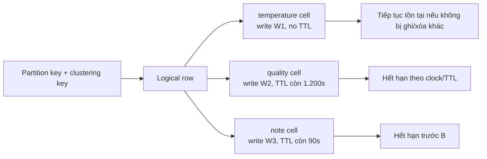
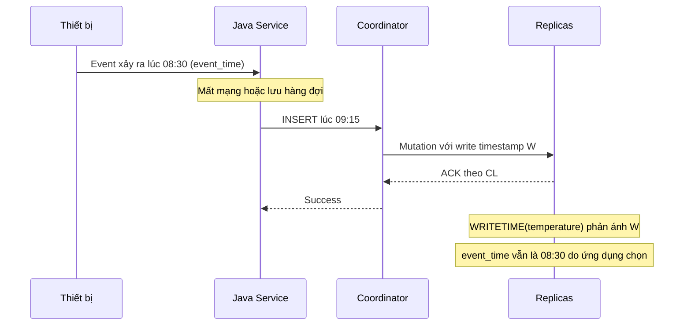
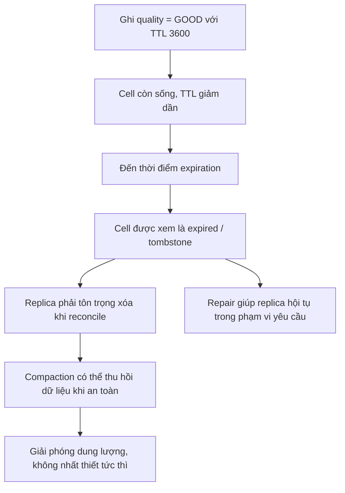
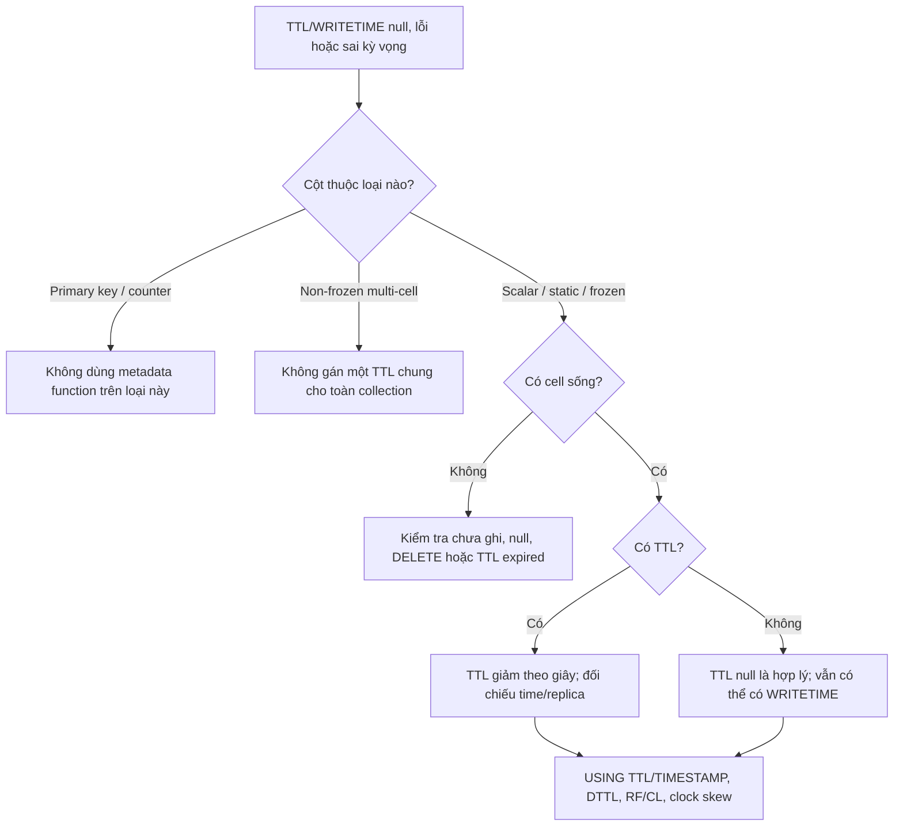

# WRITETIME/TTL và điều kiện áp dụng trên từng loại cột

Trong Apache Cassandra, một hàng CQL không phải một bản ghi quan hệ đơn giản chỉ có một thời điểm cập nhật và một thời điểm hết hạn. Dữ liệu wide-column có thể được lưu dưới dạng **những cell** với metadata riêng, trong đó có **write timestamp** và, khi được áp dụng, **time-to-live (TTL)**. Vì vậy hai cột trong cùng một hàng có thể được ghi vào hai thời điểm khác nhau, có TTL khác nhau hoặc một cột tồn tại lâu dài trong khi cột còn lại đã hết hạn.

Hai hàm CQL nâng cao thường dùng để quan sát hiện tượng này là:

- `WRITETIME(column)`: trả về **timestamp ghi của giá trị cell đang nhìn thấy**, thường tính bằng **microsecond từ Unix epoch**. Đây là timestamp dùng cho cơ chế phân giải phiên bản dữ liệu của Cassandra, **không nhất thiết là thời điểm thực tế mutation đến server**.
- `TTL(column)`: trả về **số giây TTL còn lại** của giá trị cell đang nhìn thấy khi cell có thời gian hết hạn. Nếu giá trị hiện hữu không có TTL, kết quả thường là `null`.

Nhưng **không phải mọi loại cột đều hỗ trợ hai hàm này**. Khóa phân vùng, khóa clustering, counter và collection lưu theo nhiều cell có các quy tắc khác cột scalar thông thường. Để sử dụng đúng, cần hiểu **loại cột**, **đơn vị thời gian**, **cách ghi/ghi đè**, **tombstone**, **replication** và **consistency level**.

Bài này thuộc chương **CQL nâng cao** của module `DATABASE_ENGINE_WIDE_COLUMN_CASSANDRA`, liên hệ trực tiếp với khóa phân vùng, thiết kế bảng theo truy vấn, CQL, repair, compaction, xử lý lỗi và Java Driver.

Sau bài học, bạn có thể:

1. Đọc và giải thích `WRITETIME`/`TTL` trên giá trị hợp lệ mà không nhầm với cột `event_time`.
2. Phân biệt hành vi của cột thường, `static`, primary key, `counter`, collection `frozen` và collection nhiều cell.
3. Điều khiển TTL của các mutation với `USING TTL` và hiểu tác động của `default_time_to_live`.
4. Phân biệt **hết hạn TTL**, **ghi giá trị null**, **UNSET**, **xóa cell** và **hòa giải timestamp**.
5. Tránh retry không an toàn khi dùng `USING TIMESTAMP`, TTL hoặc ghi có timeout.
6. Viết CQL và Java Driver 4.x để kiểm tra TTL/write time, quan sát metadata và thiết kế retention phù hợp.

## 1. Tư duy theo cell, không chỉ theo row

Giả sử cùng một row của thiết bị D có:

| Cell | Giá trị hiện tại | Thời điểm ghi logic | TTL còn lại |
|---|---|---|---|
| `temperature` | `36.7` | Write timestamp `W1` | Không có TTL |
| `quality` | `'GOOD'` | Write timestamp `W2` | 1.200 giây |
| `note` | `'recheck'` | Write timestamp `W3` | 90 giây |

CQL trả row dưới dạng nhiều cột, nhưng Cassandra có thể quản lý metadata của **các cell không phải khóa** theo cách riêng. Vì vậy không nên hỏi “TTL của cả row là bao nhiêu?” nếu thực chất các cell có thời hạn khác nhau.



Sơ đồ là mô hình khái niệm: Cassandra còn có row/partition tombstone, cell deletion, marker và cách lưu trữ phụ thuộc phiên bản. **Chìa khóa không mang TTL giống cell thông thường**; khi mọi giá trị không phải khóa biến mất, một row có thể không còn được trả về như trước.

### Đơn vị thời gian phải nhớ

| Giá trị | Đơn vị | Có phải thời điểm sự kiện? |
|---|---|---|
| `WRITETIME(temperature)` | **Microseconds** từ Unix epoch | Không mặc định. |
| `TTL(quality)` | **Seconds còn lại** | Không, là thời lượng còn hiệu lực. |
| `toUnixTimestamp(event_time)` | **Milliseconds** từ Unix epoch | Nếu `event_time` được thiết kế là thời điểm sự kiện. |
| `event_day date` | Ngày lịch | Không có giờ/múi giờ trong giá trị. |
| `USING TTL 3600` | Giây TTL **được yêu cầu khi ghi** | Không phải epoch time. |
| `USING TIMESTAMP 1735689600000000` | Microseconds timestamp ghi **được chỉ định** | Không mặc định là event time. |

Không so sánh trực tiếp `WRITETIME` với `toUnixTimestamp` mà quên hệ số **1.000**. Không trừ `TTL` vào một epoch timestamp nếu chưa chuẩn hóa đơn vị và hiểu thời điểm đánh giá.

## 2. Schema minh họa: nhiều loại cột trong một bảng

Ta xây dựng ví dụ giám sát thiết bị theo ngày. Trong cluster test nhiều DC với topology tương ứng, có thể định nghĩa:

```sql
CREATE KEYSPACE telemetry
WITH replication = {
    'class': 'NetworkTopologyStrategy',
    'dc1': 3,
    'dc2': 3
};

CREATE TABLE telemetry.readings_by_device_day (
    tenant_id uuid,
    device_id uuid,
    event_day date,
    event_time timestamp,
    event_id uuid,
    temperature double,
    quality text,
    note text,
    tags set<text>,
    extra frozen<map<text, text>>,
    device_state text static,
    PRIMARY KEY (
        (tenant_id, device_id, event_day),
        event_time,
        event_id
    )
) WITH CLUSTERING ORDER BY (
    event_time DESC,
    event_id ASC
) AND default_time_to_live = 0;
```

Các loại cột:

- `tenant_id`, `device_id`, `event_day`: **partition key**; cả ba cùng xác định token và tập natural replicas.
- `event_time`, `event_id`: **clustering key**; phân biệt/sắp xếp row trong partition.
- `temperature`, `quality`, `note`: **regular scalar cells**; ví dụ phù hợp để quan sát `WRITETIME` và `TTL`.
- `device_state`: **static column**; một giá trị thuộc **partition** chứ không lặp độc lập theo từng row clustering.
- `tags set<text>`: **collection không frozen**, nhiều phần tử có thể được lưu dưới dạng nhiều cell.
- `extra frozen<map<text,text>>`: collection **frozen**, giá trị của cột được xử lý như một cell duy nhất.

**Giới hạn ví dụ:** đặt `device_state` là `static` trong partition theo **thiết bị/ngày**, nghĩa là có một trạng thái static cho *mỗi thiết bị/ngày*, không phải một trạng thái duy nhất của thiết bị xuyên mọi ngày. Nếu cần trạng thái toàn thiết bị, nên thiết kế bảng `device_state_by_id` riêng. Đây là hệ quả của data model, không phải hạn chế của TTL.

RF = 3 trong `dc1` và `dc2` chỉ phù hợp nếu môi trường thật có đủ replica. Một cluster một node cần keyspace/replication khác cho lab.

## 3. Ghi dữ liệu và đọc WRITETIME/TTL cơ bản

Chèn một hàng có TTL một giờ để quan sát:

```sql
INSERT INTO telemetry.readings_by_device_day (
    tenant_id, device_id, event_day, event_time, event_id,
    temperature, quality, note
) VALUES (
    11111111-1111-1111-1111-111111111111,
    22222222-2222-2222-2222-222222222222,
    '2026-11-21',
    '2026-11-21 08:30:00+0700',
    33333333-3333-4333-8333-333333333333,
    36.7,
    'GOOD',
    'initial reading'
) USING TTL 3600;
```

Sau đó, truy vấn:

```sql
SELECT event_time,
       event_id,
       temperature,
       WRITETIME(temperature) AS temperature_write_us,
       TTL(temperature) AS temperature_ttl_s,
       quality,
       WRITETIME(quality) AS quality_write_us,
       TTL(quality) AS quality_ttl_s,
       note,
       TTL(note) AS note_ttl_s
FROM telemetry.readings_by_device_day
WHERE tenant_id = 11111111-1111-1111-1111-111111111111
  AND device_id = 22222222-2222-2222-2222-222222222222
  AND event_day = '2026-11-21'
LIMIT 20;
```

Diễn giải:

1. `USING TTL 3600` yêu cầu TTL 3.600 giây cho những cell thích hợp được mutation này ghi. **Các primary key không có TTL cell giống cột thường.**
2. `TTL(temperature)`, `TTL(quality)` và `TTL(note)` thường giảm dần theo thời gian. Chúng không bắt buộc bằng đúng 3.600 vì đồng hồ đã trôi từ lúc ghi.
3. `WRITETIME(temperature)` và `WRITETIME(quality)` có thể cùng timestamp khi được ghi trong một mutation, nhưng các cập nhật sau có thể làm chúng khác nhau.
4. `event_time` có giá trị 08:30 do ứng dụng truyền vào; **không suy** `WRITETIME(temperature)` bằng 08:30.

Mỗi hàng có thể chứa metadata khác nhau. Một phép đọc `LOCAL_ONE` từ replica chậm hội tụ có thể thấy phiên bản cũ và TTL khác phép đọc quorum trong một khoảng thời gian lỗi; điều này liên quan replication và CL, không phải lỗi của hàm `TTL`.

## 4. WRITETIME thực sự trả timestamp nào?

**`WRITETIME(column)` trả write timestamp logic của cell thắng khi đọc**, không phải:

- Thời điểm thiết bị ghi nhận dữ liệu.
- Thời điểm SSTable được flush/compact.
- Thời điểm coordinator trả success cho Java Driver.
- Thời điểm cuối cùng một người đọc hàng.
- Thời điểm giá trị sẽ hết hạn.

Trong Cassandra, timestamp này được dùng khi hòa giải các phiên bản cell và tombstone. Thông thường timestamp mặc định được gán theo đường ghi/CQL, hoặc client có thể **cung cấp timestamp tường minh**.



**Ghi muộn:** thiết bị ghi nhận sự kiện hôm qua nhưng chỉ gửi hôm nay. `event_time` có thể là hôm qua, trong khi `WRITETIME` gắn với thời điểm mutation được tạo/gán timestamp hôm nay. Nếu ứng dụng chủ động dùng `USING TIMESTAMP`, write timestamp thậm chí có thể nằm **trong quá khứ hoặc tương lai** so với đồng hồ lúc đọc.

### Kết quả có thể null

`WRITETIME(quality)` có thể trả `null` khi không có một giá trị cell đang sống cho `quality` ở kết quả đọc, chẳng hạn cột chưa được ghi hoặc đã bị xóa/hết hạn. Không dùng `WRITETIME` để truy vết lịch sử tất cả mutation, vì các phiên bản đã bị che hoặc tombstone không hiển thị như một audit log hoàn chỉnh.

## 5. TTL: thời lượng còn lại, không phải ngày hết hạn cố định trong cột

`TTL(column)` thường trả về **số giây còn lại** trước khi cell được coi là hết hạn. Nếu cell đang sống mà không có TTL, giá trị trả về thường là `null`. Vì vậy phải đọc **cả giá trị cell lẫn TTL**:

| Kết quả CQL | Diễn giải hợp lý |
|---|---|
| `quality = 'GOOD'`, `TTL(quality) = 1800` | Cell hiện tồn tại, có TTL còn khoảng 1.800 giây. |
| `quality = 'GOOD'`, `TTL(quality) = null` | Cell hiện tồn tại và không có TTL trên cell đang đọc. |
| `quality = null`, `TTL(quality) = null` | Không thấy cell có giá trị sống; có thể chưa từng ghi, bị xóa hoặc đã hết hạn. |
| `temperature = 36.7`, `TTL(quality) = 900` | Metadata của cột `quality` không mô tả TTL của `temperature`. |

**Không có hàm mặc định “TTL(row)”** phù hợp với mọi bảng wide-column. Khi một bảng có nhiều cell với thời hạn khác nhau, phải nêu rõ **cột** đang đo.

### TTL được tính từ mutation, không từ event_time

Thiết bị đo lúc 08:30 nhưng server nhận lúc 09:15, rồi ghi với `USING TTL 3600`. Cell có thể tồn tại đến xấp xỉ 10:15 theo semantics và đồng hồ của Cassandra, **không tự hết hạn lúc 09:30**. Nếu nghiệp vụ retention dựa trên thời điểm sự kiện thay vì ingestion, cần tính TTL còn lại ở ứng dụng với chính sách nhất quán và kiểm tra hành vi khi event đến muộn.

### TTL không phải cron xóa tức thì

Khi TTL hết hạn, Cassandra có thể coi cell là **expired/tombstoned** và không trả giá trị sống. File SSTable chứa dữ liệu lịch sử không nhất thiết biến mất đúng giây hết hạn; việc thu hồi dung lượng phụ thuộc compaction và điều kiện an toàn liên quan replica/tombstone.

## 6. Ghi một cột có TTL khác cột khác

Ở lần ghi ban đầu, `temperature`, `quality` và `note` cùng nhận TTL 3.600 giây. Giờ cập nhật riêng `note` với TTL 10 phút:

```sql
UPDATE telemetry.readings_by_device_day
USING TTL 600
SET note = 'manual review'
WHERE tenant_id = 11111111-1111-1111-1111-111111111111
  AND device_id = 22222222-2222-2222-2222-222222222222
  AND event_day = '2026-11-21'
  AND event_time = '2026-11-21 08:30:00+0700'
  AND event_id = 33333333-3333-4333-8333-333333333333;
```

Khi đọc lại `WRITETIME/TTL` của ba cột, bạn có thể thấy:

| Cột | Điều thay đổi sau UPDATE note | Điều không tự đổi |
|---|---|---|
| `note` | Giá trị, write timestamp, TTL mới của cell. | Partition key và clustering key vẫn như cũ. |
| `quality` | Không được gán bởi lệnh này. | Giá trị/write timestamp/TTL riêng vẫn tiếp tục theo thời gian. |
| `temperature` | Không được gán bởi lệnh này. | Không nhận TTL 600 chỉ vì cùng logical row. |

`UPDATE` **cột nào thì ảnh hưởng cell được ghi của cột đó**. Phần còn lại của row không tự chuyển sang cùng timestamp hoặc cùng TTL. Đây là một khác biệt lớn với trực giác “một row có updated_at chung” trong nhiều hệ thống quan hệ.

### Thêm một cell sống lâu dài

Trong một bảng có `default_time_to_live = 0` như ví dụ:

```sql
UPDATE telemetry.readings_by_device_day
USING TTL 0
SET quality = 'ARCHIVED'
WHERE tenant_id = 11111111-1111-1111-1111-111111111111
  AND device_id = 22222222-2222-2222-2222-222222222222
  AND event_day = '2026-11-21'
  AND event_time = '2026-11-21 08:30:00+0700'
  AND event_id = 33333333-3333-4333-8333-333333333333;
```

Với ngữ nghĩa phù hợp ở phiên bản đang chạy, `USING TTL 0` **không cấp TTL dương cho giá trị mới**; nó là **một lần ghi mới**, không phải thao tác sửa metadata của phiên bản cũ mà không tạo mutation. Trên bảng có `default_time_to_live` khác 0, cần kiểm tra chính xác hành vi tương tác của TTL 0 với DTTL theo release và chính sách bảng, **không coi TTL 0 là lối tắt luôn vô hiệu hóa mọi retention**.

## 7. Điều kiện áp dụng theo loại cột: bảng quyết định

| Loại cột/giá trị | `WRITETIME(col)` | `TTL(col)` | Lý do, giới hạn |
|---|---|---|---|
| **Regular scalar**: `text`, `int`, `double`, `timestamp`, `uuid`, `date`, `boolean`, v.v. | **Có**, khi có cell sống phù hợp. | **Có**, trả giây còn lại nếu cell có TTL. | Trường hợp chuẩn để quan sát metadata cell. |
| **Static scalar** | **Thường được hỗ trợ** theo semantics cell static. | **Thường được hỗ trợ** nếu giá trị static được ghi có TTL. | Metadata ở mức **partition**, không phải mỗi clustering row. |
| **Partition-key column** | **Không**. | **Không**. | Thành phần khóa chính, không phải regular expiring cell. |
| **Clustering-key column** | **Không**. | **Không**. | Thành phần định danh/thứ tự row, không dùng `TTL(key)`. |
| **Counter column** | **Không dùng**. | **Không dùng**. | Counter có mutation/replication semantics riêng, không hỗ trợ TTL kiểu cột thường. |
| **Non-frozen collection**: `list`, `set`, `map` | **Không dùng hàm trên toàn cột như một single cell**. | **Không dùng hàm trên toàn cột như một single cell**. | Collection có thể gồm nhiều cell với metadata riêng từng phần tử. |
| **Frozen collection** | **Thường có thể dùng** trên cả giá trị frozen. | **Thường có thể dùng** trên cả giá trị frozen. | Frozen được xử lý như **một cell**; thay đổi cần ghi lại toàn giá trị. |
| **Frozen UDT/tuple** | Áp dụng theo **single-cell semantics** khi bản hỗ trợ. | Áp dụng theo **single-cell semantics** khi bản hỗ trợ. | Không được suy áp dụng tương tự cho UDT nhiều cell. |
| **Non-frozen UDT** | Không coi toàn cột là một cell duy nhất. | Không coi toàn cột là một cell duy nhất. | Field có thể có metadata riêng; cú pháp truy vấn field tùy phiên bản. |
| **Cell null/không hiện hữu/đã xóa hoặc hết hạn** | Thường `null`. | Thường `null`. | Không có một giá trị sống để báo metadata như cell thường. |

**Lưu ý về phiên bản:** cách hỗ trợ truy vấn metadata của **phần tử riêng lẻ trong collection/field của UDT** có thể khác giữa các release và cú pháp selection. Bài này không giả định một cú pháp `WRITETIME(collection)`/`TTL(collection)` áp dụng cho toàn bộ non-frozen collection. Với bài toán cần expiry rõ ràng cho từng phần tử, hãy xác minh API/CQL đúng bản hoặc **mô hình mỗi phần tử thành một row** có khóa riêng.

## 8. Primary key: vì sao không có TTL hay WRITETIME như cell?

Đây là một ràng buộc trực tiếp liên quan mô hình wide-column:

```sql
-- Các cột khóa trong ví dụ:
-- Partition key: (tenant_id, device_id, event_day)
-- Clustering key: (event_time, event_id)

-- Hợp lệ: hỏi metadata của regular column temperature.
SELECT temperature,
       WRITETIME(temperature),
       TTL(temperature)
FROM telemetry.readings_by_device_day
WHERE tenant_id = 11111111-1111-1111-1111-111111111111
  AND device_id = 22222222-2222-2222-2222-222222222222
  AND event_day = '2026-11-21'
LIMIT 10;
```

Không viết `WRITETIME(tenant_id)`, `TTL(device_id)`, `TTL(event_day)` hay `WRITETIME(event_time)`: chúng là **primary-key components**. Một row có thể ngừng xuất hiện khi các cell sống đã hết hạn, nhưng không có nghĩa Cassandra đã áp TTL trực tiếp lên khóa giống như một cell thông thường.

### Không dùng điều kiện TTL trên khóa để tìm dữ liệu sắp hết hạn

Cassandra không tự cung cấp một index của “những row sắp hết TTL” chỉ vì có hàm `TTL`. Nếu nghiệp vụ cần lấy tất cả event có thời hạn hết trong giờ tới, nên lưu **expires_at** hoặc một bucket truy vấn phù hợp trong bảng được thiết kế cho mục đích đó, rồi quản lý việc dọn/kiểm tra theo semantics nghiệp vụ. Không dùng quét toàn cluster và gọi `TTL` cho mọi row như một lịch xóa chung.

## 9. Static column: metadata ở mức partition

`device_state text static` được chia sẻ cho các row trong cùng partition `(tenant_id, device_id, event_day)`. Có thể cập nhật static mà **không cần chỉ rõ clustering key**:

```sql
UPDATE telemetry.readings_by_device_day
USING TTL 1800
SET device_state = 'ONLINE'
WHERE tenant_id = 11111111-1111-1111-1111-111111111111
  AND device_id = 22222222-2222-2222-2222-222222222222
  AND event_day = '2026-11-21';

SELECT device_state,
       WRITETIME(device_state) AS state_write_us,
       TTL(device_state) AS state_ttl_s
FROM telemetry.readings_by_device_day
WHERE tenant_id = 11111111-1111-1111-1111-111111111111
  AND device_id = 22222222-2222-2222-2222-222222222222
  AND event_day = '2026-11-21'
LIMIT 10;
```

**Diễn giải:** cùng một giá trị static và metadata có thể xuất hiện trong nhiều row được trả về thuộc cùng partition. Đây **không phải nhiều bản sao độc lập** của static cell. Nếu `device_state` hết hạn, các regular cells `temperature`/`quality` không tự hết hạn theo.

Trạng thái static trong ví dụ thuộc **thiết bị/ngày**. Với yêu cầu chỉ có một trạng thái hiện tại cho toàn thiết bị, hãy dùng bảng với partition key theo thiết bị, tránh nhân trạng thái qua các ngày.

## 10. Counter: metadata TTL và WRITETIME không áp dụng như cột thường

Counter trong Cassandra có cơ chế cập nhật và đối chiếu khác ordinary scalar cells. Ví dụ riêng:

```sql
CREATE TABLE telemetry.events_count_by_device (
    device_id uuid PRIMARY KEY,
    total counter
);

UPDATE telemetry.events_count_by_device
SET total = total + 1
WHERE device_id = 22222222-2222-2222-2222-222222222222;

SELECT device_id, total
FROM telemetry.events_count_by_device
WHERE device_id = 22222222-2222-2222-2222-222222222222;
```

**Không dùng `TTL(total)` hoặc `WRITETIME(total)`** để suy tương tự ordinary numeric cell, và không dùng `USING TTL` cho một counter increment. Counter mutation **không idempotent** theo kiểu “gửi lại cũng như cũ”: nếu client timeout rồi tự retry `total = total + 1`, phép cộng có thể được thực hiện nhiều lần.

Nếu bài toán là “số lượt trong từng giờ, tự hết hạn sau 30 ngày”, hãy cân nhắc mô hình ghi event/range theo ngày và aggregate theo pipeline hoặc một storage phù hợp; đừng dựa vào TTL trên counter để có expiration tự động.

## 11. Collection: multi-cell khác frozen

Xem hai cột trong bảng:

- `tags set<text>`: **non-frozen set**, mỗi phần tử có thể được lưu và thay đổi với metadata riêng.
- `extra frozen<map<text,text>>`: **frozen map**, toàn giá trị được xử lý như một cell.

Ví dụ:

```sql
UPDATE telemetry.readings_by_device_day
USING TTL 900
SET tags = tags + {'calibrated'}
WHERE tenant_id = 11111111-1111-1111-1111-111111111111
  AND device_id = 22222222-2222-2222-2222-222222222222
  AND event_day = '2026-11-21'
  AND event_time = '2026-11-21 08:30:00+0700'
  AND event_id = 33333333-3333-4333-8333-333333333333;

UPDATE telemetry.readings_by_device_day
USING TTL 900
SET extra = {'source': 'sensor-v2', 'unit': 'C'}
WHERE tenant_id = 11111111-1111-1111-1111-111111111111
  AND device_id = 22222222-2222-2222-2222-222222222222
  AND event_day = '2026-11-21'
  AND event_time = '2026-11-21 08:30:00+0700'
  AND event_id = 33333333-3333-4333-8333-333333333333;
```

Đối với non-frozen collection, **không có một timestamp/TTL đơn nhất** đại diện mọi phần tử đang sống. Hai phần tử được cập nhật ở hai lần ghi khác nhau có thể có TTL khác nhau. Với frozen map, khi cập nhật toàn cột, nó giống **một scalar cell** về write timestamp và expiration.

```sql
-- Truy vấn metadata whole-cell của giá trị frozen.
SELECT extra,
       WRITETIME(extra) AS extra_write_us,
       TTL(extra) AS extra_ttl_s
FROM telemetry.readings_by_device_day
WHERE tenant_id = 11111111-1111-1111-1111-111111111111
  AND device_id = 22222222-2222-2222-2222-222222222222
  AND event_day = '2026-11-21'
LIMIT 10;
```

**Không thay ví dụ trên bằng `TTL(tags)` rồi mặc định Cassandra sẽ chọn một “TTL của tập hợp”.** Tùy phiên bản, CQL có thể hỗ trợ cách truy xuất metadata của từng thành phần/field theo cú pháp riêng, nhưng phải kiểm tra trước khi áp dụng. Khi có yêu cầu hết hạn từng tag độc lập, thiết kế **`tags_by_device` với tag là clustering key và metadata ở một cell thường** sẽ dễ quan sát hơn.

### Frozen là đánh đổi, không chỉ là mẹo làm TTL chạy được

`frozen<map<text,text>>` phù hợp khi giá trị nhỏ và thường **thay toàn bộ**. Nếu collection rất lớn hoặc thay từng phần tử liên tục, frozen có thể tạo chi phí rewrite đáng kể; non-frozen lại có chi phí tombstone/metadata theo phần tử. Lựa chọn phải dựa vào mẫu truy vấn và thao tác cập nhật, không chỉ vì muốn gọi `WRITETIME`.

## 12. UDT, tuple và các kiểu phức hợp

**User-defined type (UDT)** và **tuple** là những kiểu CQL phức hợp. Khi được lưu dưới dạng **frozen**, toàn giá trị được mã hóa như một cell; khi một UDT được lưu theo dạng không frozen, các field có thể được xử lý dưới dạng những cell riêng.

| Hình thức | Hành vi cập nhật | Cách nghĩ về TTL/WRITETIME |
|---|---|---|
| `frozen<udt_type>` | Thường ghi lại toàn giá trị. | Có thể đánh giá metadata ở mức **single cell** nếu bản hỗ trợ. |
| UDT không frozen | Có thể cập nhật field riêng theo khả năng CQL phiên bản. | Không giả định `TTL(udt_column)` đại diện một TTL thống nhất cho mọi field. |
| `tuple<...>` | Một giá trị cấu trúc có thứ tự field; trong CQL các tuple được xử lý với ngữ nghĩa frozen phù hợp. | Xem xét metadata của toàn cell, không biến các phần tuple thành các row độc lập. |

Ví dụ minh họa cấu trúc loại địa điểm:

```sql
CREATE TYPE telemetry.location_udt (
    city text,
    country text
);

-- Khi thật sự cần bổ sung cột, chạy qua migration có kiểm soát.
ALTER TABLE telemetry.readings_by_device_day
ADD location frozen<telemetry.location_udt>;
```

Lệnh tạo UDT và `ALTER TABLE` là **DDL**, không phải ví dụ phải thực hiện lặp lại mỗi lần ứng dụng khởi động. Ở môi trường production, cần schema agreement/metadata readiness phù hợp release trước khi ứng dụng dùng cột mới.

**Vấn đề quan trọng:** vì dữ liệu phi quan hệ thường được thiết kế theo truy vấn, không nên cố dùng một UDT cực lớn với hàng trăm field chỉ để tập trung mọi metadata vào một cell có TTL duy nhất. Khi cần cập nhật/expire nhiều thành phần độc lập, chia thành các regular columns hoặc các row theo clustering key có thể hợp lý hơn.

## 13. NULL, DELETE và UNSET: cùng không thấy giá trị nhưng semantics khác

Một nguồn nhầm lẫn lớn là thấy `TTL(note) = null` rồi kết luận người viết “không đặt TTL”. Đó chỉ là một khả năng. Cần phân biệt các tình huống:

| Thao tác | Có tạo mutation ảnh hưởng cell? | Hệ quả quan sát |
|---|---|---|
| **Không ghi cột `note`** khi INSERT/UPDATE | Không có mutation cho cell đó trong thao tác hiện tại. | Giữ nguyên phiên bản cũ nếu đã tồn tại và chưa bị xóa. |
| **Ghi `note = null`** theo CQL/driver | Thường tạo **tombstone/delete semantics** cho cell. | Cell có thể không hiện hữu; `WRITETIME/TTL(note)` không là audit của việc xóa. |
| **`DELETE note FROM ...`** | Ghi deletion/tombstone. | Giá trị cũ bị che theo timestamp; metadata cell sống không còn như trước. |
| **Bind tham số UNSET** (nơi được hỗ trợ) | Bỏ qua cột/parameter tương ứng trong mutation. | Không dùng UNSET để xóa; giá trị và TTL cũ không tự đổi bởi thao tác đó. |
| **Cột đã hết TTL** | Không cần một UPDATE mới từ client. | Cell không còn giá trị sống khi hết hạn; tombstone/GC xảy ra theo cơ chế lưu trữ. |

Ví dụ xóa **chỉ một regular column** của row:

```sql
DELETE note
FROM telemetry.readings_by_device_day
WHERE tenant_id = 11111111-1111-1111-1111-111111111111
  AND device_id = 22222222-2222-2222-2222-222222222222
  AND event_day = '2026-11-21'
  AND event_time = '2026-11-21 08:30:00+0700'
  AND event_id = 33333333-3333-4333-8333-333333333333;
```

Sau đó, `note` có thể đọc ra null trong khi `temperature` vẫn còn sống. **`WRITETIME(note)` không cho bạn timestamp của tombstone như một trường audit chuẩn**. Nếu nghiệp vụ cần “ai xóa, lúc nào, lý do gì”, nên tự lưu event/audit records có schema và retention phù hợp.

### NULL khác “không cập nhật”

Đối với prepared statements, cần phân biệt:

- **Đặt tham số bằng null:** nghĩa là yêu cầu ghi giá trị null/deletion theo semantics CQL.
- **Để UNSET:** nghĩa là không sửa cell đó trong mutation (khi driver/CQL hỗ trợ).

Không truyền toàn bộ DTO Java có các field null vào một câu `UPDATE` rồi mặc định null nghĩa là “giữ nguyên dữ liệu”. Cách làm đó dễ tạo tombstone ngoài ý muốn, làm tăng I/O, read amplification và chi phí compaction.

## 14. default_time_to_live: TTL ở mức bảng

Cassandra có table option `default_time_to_live` (DTTL), tính bằng giây. Trong schema ví dụ, option được đặt bằng `0` để mặc định không cấp TTL ở mức bảng.

Trong một migration test có kiểm soát:

```sql
ALTER TABLE telemetry.readings_by_device_day
WITH default_time_to_live = 86400;
```

Ý nghĩa tổng quát: **các cell thích hợp được ghi mới** vào bảng có thể nhận TTL mặc định một ngày khi lệnh ghi không chọn TTL tường minh, theo semantics của release. DTTL không có nghĩa tất cả cell đã được ghi trước đó tự được “viết lại” cùng thời hạn mới.

**Những điểm phải kiểm tra:**

1. **Dữ liệu có sẵn:** thay DTTL không phải chiến dịch backfill hay rewrite tất cả SSTable.
2. **Lệnh ghi có `USING TTL`:** thời gian do lệnh chỉ định và DTTL có quan hệ ưu tiên theo quy tắc của phiên bản; đừng suy máy móc từ một ví dụ cũ.
3. **`USING TTL 0`:** cần kiểm tra rõ tương tác với DTTL khác 0; không dựa vào một câu lệnh thử để tuyên bố mọi retention đã bị hủy.
4. **Counter table:** không dùng DTTL như cách thêm expiration cho counter.
5. **LWT/conditional updates:** các giới hạn timestamp/TTL và ngữ nghĩa điều kiện có thể khác mutation thường.
6. **TTL cực dài:** Cassandra có giới hạn phạm vi thời điểm hết hạn tùy phiên bản, hệ điều hành và cấu hình; cần kiểm tra rủi ro overflow (bao gồm mốc thời gian 2038 trong những release/hệ thống liên quan).

### Vì sao retention của bảng cần gắn với data model?

Bảng time-series thường được bucket theo ngày/giờ và đặt retention rõ ràng. DTTL có thể hỗ trợ expiry cell, nhưng **các truy vấn vẫn phải nhắm partition key phù hợp**. Khi TTL làm nhiều cell hết hạn, tombstone còn chiếm công việc đọc/compaction cho tới khi đủ điều kiện thu hồi. Đừng coi đặt DTTL là giải pháp tự động cho partition nóng hoặc đĩa gần đầy.

**Thực hành an toàn:** nếu cần đổi DTTL production, hãy xác nhận phiên bản Cassandra, tỷ lệ data churn, chiến lược compaction, lịch repair, GC grace, snapshot/backup và ràng buộc retention của ứng dụng trước khi chạy DDL.

## 15. USING TIMESTAMP: đặt write timestamp không đồng nghĩa đặt event_time

Cassandra hỗ trợ gán **timestamp ghi logic** cho mutation trong những trường hợp CQL cho phép. Ví dụ:

```sql
-- Chỉ minh họa: timestamp bên dưới là giá trị microseconds tùy chọn.
-- Đừng chạy vô điều kiện trên row production.
UPDATE telemetry.readings_by_device_day
USING TIMESTAMP 1735689600000000
SET quality = 'REVIEWED'
WHERE tenant_id = 11111111-1111-1111-1111-111111111111
  AND device_id = 22222222-2222-2222-2222-222222222222
  AND event_day = '2026-11-21'
  AND event_time = '2026-11-21 08:30:00+0700'
  AND event_id = 33333333-3333-4333-8333-333333333333;
```

Giá trị `1735689600000000` là **microseconds**, không phải milliseconds. Nếu nó thấp hơn write timestamp của phiên bản `quality` hiện có, update có thể **không trở thành giá trị thắng** khi hòa giải. Do đó việc quan sát `WRITETIME(quality)` sau lệnh này có thể vẫn trả timestamp của cell cũ.

### Write timestamp và last-write-wins

Với ordinary cells, Cassandra so sánh timestamp để quyết định phiên bản hiệu lực. Từ “last” trong **last-write-wins** chủ yếu liên quan **timestamp logic**, không nhất thiết là lần ghi đến server sau cùng theo đồng hồ người dùng.

| Tình huống | Hệ quả |
|---|---|
| Mutation đến sau nhưng có timestamp **nhỏ hơn** | Giá trị mới gửi có thể **không thắng** phiên bản đang lưu. |
| Mutation có timestamp **lớn hơn** | Có thể thắng giá trị trước, dù event-time nghiệp vụ cũ hơn. |
| Hai mutation có cùng timestamp | Cassandra dùng quy tắc hòa giải/tie-break phù hợp; không suy “node nào trả ACK trước sẽ thắng”. |
| Tombstone có timestamp phù hợp | Có thể che giá trị cũ theo semantics deletion. |

Không tự coi `WRITETIME` là nguồn thời gian **tin cậy để sắp xếp thứ tự sự kiện nghiệp vụ**. Nếu cần đo lúc thiết bị phát sinh event, hãy lưu cột `event_time timestamp` rõ ràng và giải quyết clock skew ở nguồn.

### Không dùng timestamp thủ công như cách “sửa xung đột” nhanh

Ghi một timestamp trong tương lai quá xa có thể khiến các ghi hợp lệ về sau với timestamp thực tế thấp hơn bị che trong thời gian dài. Việc sửa dữ liệu khi có timestamps sai đòi hỏi đánh giá tính nhất quán và tombstone; không tự tạo mutation “thật lớn” trên production để ghi đè mọi thứ.

## 16. TTL, tombstone, compaction và repair

TTL không chỉ là một đồng hồ đếm ngược ở Java. Khi cell hết hạn, Cassandra phải xử lý **dấu vết xóa** một cách an toàn trên cluster phân tán.



**Ba cơ chế không được đánh đồng:**

- **TTL expiration:** quyết định cell có còn được coi là sống tại thời điểm đọc.
- **Compaction:** hợp nhất SSTable và loại một số tombstone/dữ liệu cũ **khi điều kiện an toàn cho phép**.
- **Anti-entropy repair:** đối chiếu replica để giải quyết dữ liệu khác biệt, kể cả khi một replica offline đã bỏ lỡ các mutation/tombstone.

### Rủi ro deleted-data resurrection

Giả sử replica C mất kết nối lâu, không nhận được deletion hoặc các thông tin cần thiết. Nếu tombstone ở replica khác bị thu hồi trước khi C được đồng bộ trong điều kiện rủi ro, dữ liệu cũ ở C có thể xuất hiện trở lại (**resurrection**). `gc_grace_seconds` và lịch repair liên quan tới an toàn retention, nhưng **giảm `gc_grace_seconds` không phải phương án giảm tombstone vô điều kiện**.

Với bảng có TTL nặng, cần cân nhắc chiến lược compaction phù hợp dữ liệu thời gian (ví dụ TWCS trong đúng workload) và tổ chức repair đều đặn. Không gọi `TTL(note)` rồi kết luận dữ liệu đã bị xóa vật lý khỏi tất cả SSTable ngay khi kết quả chuyển sang null.

### Tài nguyên vận hành

Hàng triệu cell TTL hết hạn có thể tạo nhiều tombstone. Các câu `SELECT` quét nhiều partition/range có tombstone có thể chậm dù phần trả về rất nhỏ. Compaction/repair có thể tranh chấp disk I/O, CPU và network với client requests, dẫn tới `ReadTimeout`/`WriteTimeout`. Việc chọn TTL nên gắn với **capacity planning và truy vấn** chứ không chỉ quy định lưu giữ.

## 17. TTL/WRITETIME nhìn từ replica và consistency level

`TTL` và `WRITETIME` được tính/quan sát qua **đường đọc CQL**. Trong cluster phân tán:

1. Partition key xác định token và tập natural replicas theo `NetworkTopologyStrategy`/RF.
2. Coordinator liên hệ replica theo CL của request.
3. Các replica có thể tạm giữ các phiên bản khác nhau do lỗi mạng hoặc mutation chưa hội tụ.
4. Kết quả `WRITETIME(column)`/`TTL(column)` phản ánh **giá trị có hiệu lực tại đường đọc cụ thể**, không chứng minh mọi replica đồng bộ tức thì.

Với `RF_dc1 = 3` và `RF_dc2 = 3`:

| CL từ coordinator `dc1` | Điều kiện trong ví dụ | Hàm TTL có “tăng độ nhất quán” không? |
|---|---|---|
| `LOCAL_ONE` | Một replica `dc1` phản hồi. | **Không**; có thể đọc bản cũ nếu replica chưa hội tụ. |
| `LOCAL_QUORUM` | Hai replica `dc1` phản hồi. | **Không tự tăng CL**, nhưng request có điều kiện quorum địa phương. |
| `QUORUM` | Bốn trong sáu replica phản hồi. | Hàm không làm giảm số phản hồi cần. |
| `ALL` | Toàn bộ replica theo RF đáp ứng. | Rất nhạy với replica down/chậm. |

### Vì sao TTL có thể lệch vài giây?

`TTL` là **thời gian còn lại tại lúc đánh giá**, không phải hằng số do ứng dụng lưu. Hai phép SELECT cách nhau vài giây tự nhiên trả TTL khác nhau; đồng hồ và khả năng hội tụ ở replica có thể tạo khác biệt thêm. Không xây hệ thống kiểm tra exactly-equal TTL trên mọi node ở mọi thời điểm.

`WRITETIME` tương đối ổn định khi không có mutation thắng khác, nhưng giá trị bạn đọc có thể đổi sau khi **một phiên bản mới hơn được hòa giải**, kể cả ứng dụng chưa chủ động thực hiện SELECT lần thứ hai.

### Timeout ghi không đồng nghĩa rollback

Nếu client dùng `UPDATE ... USING TTL 600` và gặp `WriteTimeout`, có thể một số replica đã nhận mutation, số khác chưa. Retry có thể mang timestamp và thời điểm hết hạn khác, ngay cả khi cùng giá trị logic. Vì vậy chỉ retry tự động khi hiểu rõ **idempotency, timestamp, TTL và ngữ nghĩa nghiệp vụ**.

## 18. Query design: không dùng TTL như index thời gian

Một thiết kế thường gây vấn đề:

> “Tìm tất cả row trên toàn cluster có `TTL(quality) < 600` rồi xử lý.”

Trong Cassandra thông thường, `TTL` là **hàm projection/quan sát cell**, không phải cấu trúc partition/index có thể tối ưu một truy vấn quét mọi row. Không dựa vào `WHERE TTL(quality) < 600` như một phương án tìm kiếm mặc định; nhiều dạng expression trong `WHERE` không được CQL hỗ trợ theo cách SQL quan hệ.

Thay vào đó, nếu nghiệp vụ cần lập lịch xử lý các event sắp hết hạn:

- Lưu **`expires_at timestamp`** theo quy tắc nghiệp vụ, được tính trước khi ghi.
- Thiết kế **bảng theo bucket thời gian** cho workload “quét các mục đến hạn trong giờ N”, với partition/clustering key phục vụ đúng truy vấn.
- Dùng idempotency để tránh job xử lý lặp.
- Xác minh dữ liệu vẫn còn sống trước hành động nếu có race giữa TTL và job.

Ví dụ một bảng riêng cho lịch xử lý:

```sql
CREATE TABLE telemetry.rechecks_by_hour (
    bucket_hour timestamp,
    expires_at timestamp,
    device_id uuid,
    event_id uuid,
    PRIMARY KEY ((bucket_hour), expires_at, device_id, event_id)
) WITH CLUSTERING ORDER BY (
    expires_at ASC,
    device_id ASC,
    event_id ASC
);
```

Đây là **một mô hình minh họa**, không phải tạo index toàn cục cho TTL. Cần thiết kế shard/bucket đủ phân tán, tránh một `bucket_hour` nóng và bảo đảm dọn các mục đã xử lý. Bảng có thể được cấp TTL để xóa dữ liệu lịch sử theo chính sách, nhưng job vẫn phải hiểu expiry và race condition ở mức nghiệp vụ.

## 19. Java Driver 4.x: bind TTL và đọc metadata cell

Apache Cassandra Java Driver 4.x có API để bind `USING TTL ?`, đọc `bigint`/`int` từ các alias `WRITETIME`/`TTL` và chọn CL. Ví dụ dùng table `telemetry.readings_by_device_day` đã tạo.

```java
import com.datastax.oss.driver.api.core.CqlSession;
import com.datastax.oss.driver.api.core.DefaultConsistencyLevel;
import com.datastax.oss.driver.api.core.cql.BoundStatement;
import com.datastax.oss.driver.api.core.cql.PreparedStatement;
import com.datastax.oss.driver.api.core.cql.Row;

import java.net.InetSocketAddress;
import java.time.Instant;
import java.time.LocalDate;
import java.util.UUID;

public class CassandraCellMetadataExample {
    public static void main(String[] args) {
        UUID tenant = UUID.fromString(
            "11111111-1111-1111-1111-111111111111");
        UUID device = UUID.fromString(
            "22222222-2222-2222-2222-222222222222");
        UUID event = UUID.fromString(
            "33333333-3333-4333-8333-333333333333");
        LocalDate day = LocalDate.of(2026, 11, 21);
        Instant eventTime = Instant.parse("2026-11-21T01:30:00Z");

        // 192.0.2.0/24 là IP tài liệu; thay contact points thật.
        try (CqlSession session = CqlSession.builder()
                .addContactPoint(new InetSocketAddress("192.0.2.11", 9042))
                .addContactPoint(new InetSocketAddress("192.0.2.12", 9042))
                .withLocalDatacenter("dc1")
                .build()) {

            PreparedStatement insert = session.prepare(
                "INSERT INTO telemetry.readings_by_device_day " +
                "(tenant_id, device_id, event_day, event_time, event_id, " +
                "temperature, quality, note) " +
                "VALUES (?, ?, ?, ?, ?, ?, ?, ?) USING TTL ?");

            // ID, payload và TTL được xác định trước lần gửi đầu tiên.
            BoundStatement write = insert.bind(
                    tenant, device, day, eventTime, event,
                    36.7d, "GOOD", "initial reading", 3600)
                .setConsistencyLevel(DefaultConsistencyLevel.LOCAL_QUORUM);
            session.execute(write);

            PreparedStatement select = session.prepare(
                "SELECT temperature, quality, note, " +
                "WRITETIME(temperature) AS write_us, " +
                "TTL(temperature) AS ttl_s, " +
                "WRITETIME(note) AS note_write_us, " +
                "TTL(note) AS note_ttl_s " +
                "FROM telemetry.readings_by_device_day " +
                "WHERE tenant_id = ? AND device_id = ? " +
                "AND event_day = ? AND event_time = ? AND event_id = ?");

            BoundStatement read = select
                .bind(tenant, device, day, eventTime, event)
                .setConsistencyLevel(DefaultConsistencyLevel.LOCAL_QUORUM)
                .setIdempotent(true);

            Row row = session.execute(read).one();
            if (row == null) {
                System.out.println("Row không hiển thị, có thể chưa có/đã hết hạn");
                return;
            }

            Long writeUs = row.isNull("write_us")
                ? null : row.getLong("write_us");
            Integer ttlSeconds = row.isNull("ttl_s")
                ? null : row.getInt("ttl_s");

            Double temperature = row.isNull("temperature")
                ? null : row.getDouble("temperature");
            System.out.println("temperature=" + temperature);
            System.out.println("write time (us)=" + writeUs);
            System.out.println("TTL left (s)=" + ttlSeconds);

            if (writeUs != null) {
                long seconds = Math.floorDiv(writeUs, 1_000_000L);
                long nanos = Math.floorMod(writeUs, 1_000_000L) * 1_000L;
                Instant writeInstant = Instant.ofEpochSecond(seconds, nanos);
                System.out.println("write instant UTC=" + writeInstant);
            }
        }
    }
}
```

**Những điểm quan trọng của code:**

- `USING TTL ?` là **tham số kiểu giây**, ở đây 3.600.
- `WRITETIME(temperature)` trả `bigint`, nên Java dùng `getLong`; `TTL(temperature)` trả số giây, nên dùng `getInt`.
- Cần `row.isNull(alias)` trước khi đọc giá trị có thể null. Một TTL null có thể nghĩa **không TTL** hoặc **không có cell sống**; xem thêm giá trị cột.
- `writeUs` là microseconds, vì thế chuyển về `Instant` bằng **chia 1.000.000** (và phần dư) chứ không dùng trực tiếp `Instant.ofEpochMilli(writeUs)`.
- `eventTime` là timestamp nghiệp vụ; `writeInstant` là timestamp logic của cell. Không mặc định hai giá trị bằng nhau.
- `LOCAL_QUORUM` yêu cầu đủ replica địa phương; trên test cluster RF/DC khác, cần điều chỉnh tương ứng.
- Nên tái sử dụng một `CqlSession` cho ứng dụng; ví dụ bỏ qua cấu hình TLS/authentication/metrics vì phụ thuộc môi trường thực.

### Null/UNSET khi dùng prepared statement

Khi cập nhật partial DTO, nếu field không có ý định thay đổi, hãy dùng cách **không ghi field đó** hoặc chức năng **UNSET** phù hợp API driver/version, thay vì bind `null` và tạo deletion. Điều này giữ nguyên metadata/TTL cũ của cell bị bỏ qua; còn bind `null` có thể tạo tombstone.

**Lưu ý retry:** nếu phép ghi TTL bị timeout, không mặc định gọi `execute(write)` lặp vô hạn. Cần đánh giá phiên bản dữ liệu, deadline, idempotency và việc expiry có thể dịch khi tạo mutation mới.

## 20. Lab: quan sát metadata thay đổi theo thời gian

Một lab an toàn nên dùng **cluster thử nghiệm**, không cần cố ý làm hỏng replica hoặc chạy compaction nặng trên production.

### Bước 1 — Kiểm tra schema và RF

Tạo bảng từ mục 2 với RF/DC phù hợp topology thật; sau đó kiểm tra:

```sql
SELECT keyspace_name, replication
FROM system_schema.keyspaces
WHERE keyspace_name = 'telemetry';

SELECT table_name, column_name, kind, type
FROM system_schema.columns
WHERE keyspace_name = 'telemetry'
  AND table_name = 'readings_by_device_day';
```

```bash
nodetool status
```

`nodetool status` có thể cho biết DC/rack/liveness, nhưng **không chứng minh** dữ liệu ở mọi replica đã cùng phiên bản hoặc TTL.

### Bước 2 — Ghi ba regular cells cùng TTL

Chạy `INSERT ... USING TTL 3600` ở mục 3. Đọc `temperature`, `quality`, `note` cùng `WRITETIME/TTL`. Ghi nhận một bảng thời điểm T0:

| Mốc | `temperature` | `TTL(temperature)` | `TTL(quality)` | `TTL(note)` |
|---|---|---|---|---|
| T0 | `36.7` | Xấp xỉ 3.600 | Xấp xỉ 3.600 | Xấp xỉ 3.600 |
| T0 + vài giây | `36.7` | Giảm | Giảm | Giảm |

**Không kỳ vọng các số TTL bằng chính xác** trong mọi lần đọc; chúng là seconds remaining tại thời điểm quan sát.

### Bước 3 — Chỉ cập nhật note

Chạy `UPDATE ... USING TTL 600 SET note = ...` ở mục 6. So sánh:

- `WRITETIME(note)` thường đổi sang timestamp của mutation mới **nếu mutation thắng**.
- `TTL(note)` trở về khoảng 600 giây rồi tiếp tục giảm.
- `WRITETIME(temperature)` thường giữ nguyên, trong khi `TTL(temperature)` tiếp tục giảm theo thời gian.

Việc note có TTL mới **không reset TTL của temperature**.

### Bước 4 — Ghi giá trị không TTL trên một cột

Với bảng DTTL=0, dùng `USING TTL 0` cập nhật `quality` và xác minh `TTL(quality)` trở thành null khi cell sống không có TTL. Nếu DTTL đã được thay đổi khác 0, **không dùng giả định này khi chưa kiểm tra semantics bản chạy**.

### Bước 5 — Xóa note và quan sát kết quả

Thực hiện `DELETE note` ở mục 13, rồi đọc lại. `note` có thể null và `TTL(note)` null, nhưng không kết luận đây là một cell “vĩnh viễn không TTL”: thực tế đang không có cell sống được trả về.

### Bước 6 — Kiểm tra collection/frozen

Ghi `tags` và `extra` theo mục 11, thử đọc `TTL(extra)`/`WRITETIME(extra)`. Không tự giả định `TTL(tags)` phải hoạt động trên toàn non-frozen set. Nếu muốn kiểm tra metadata từng phần tử, hãy đọc tài liệu CQL của bản đang chạy và thử **đúng cú pháp** trên cluster test.

### Bước 7 — Đổi cách quan sát theo CL

Trong `cqlsh`:

```sql
CONSISTENCY LOCAL_ONE;
-- Chạy SELECT WRITETIME/TTL ở mục 3.

CONSISTENCY LOCAL_QUORUM;
-- Chạy lại đúng SELECT trong cùng partition.
```

Nếu kết quả khác nhau, đừng vội quy là lỗi hàm `TTL`. Đánh giá **replica placement, thời gian đã trôi, mutation đang hội tụ và coordinator**. Trong cluster khỏe/ổn định, dữ liệu cell thường cùng phiên bản, còn TTL giảm theo thời gian quan sát.

### Bước 8 — Diễn giải thay vì gây timeout

Mô phỏng trong unit test ứng dụng: một ghi TTL đã tới quorum nhưng client mất phản hồi. Đặt câu hỏi nên retry cùng tham số hay tạo mutation mới, có cần giữ nguyên write timestamp/expiry nghiệp vụ không và làm thế nào xác minh row. Không cần làm mất mạng cluster chỉ để hiểu **kết quả ghi không chắc chắn**.

## 21. Runbook khi TTL hoặc WRITETIME “không đúng kỳ vọng”

Nếu một CQL SELECT báo lỗi, trả null hoặc thời gian khác dự kiến, kiểm tra theo thứ tự:

1. **Loại cột:** khóa chính, regular scalar, static, counter, collection non-frozen hay frozen? Nếu không phải cell đơn có thể dùng các hàm whole-column, dừng và chỉnh truy vấn.
2. **Dữ liệu có sống không:** `SELECT column` cùng `TTL/WRITETIME`. Không suy từ TTL null một mình.
3. **Đơn vị:** `TTL` là giây; `WRITETIME` microsecond; `toUnixTimestamp` millisecond; application event-time là một giá trị riêng.
4. **Đường ghi:** có `USING TTL`, `USING TIMESTAMP`, table DTTL, ghi null, UNSET hoặc DELETE không?
5. **Phiên bản thắng:** mutation gần nhất theo thời gian thực có thể không thắng nếu timestamp thấp hơn; xem cạnh tranh ghi và clock skew.
6. **Tình trạng replica:** partition key, RF, CL, DC coordinator và replication delay có làm bạn thấy phiên bản cũ không?
7. **Phạm vi static/collection:** static tồn tại theo partition; non-frozen collection có metadata theo phần tử.
8. **TTL expiry/compaction:** cell hết hạn logic không tương đương SSTable đã được thu hồi; tombstone và repair có liên quan.
9. **Múi giờ/event-time:** write timestamp không phải `event_time`; mọi phép so sánh Instant phải quy về cùng trục thời gian/đơn vị.
10. **Hành vi theo release:** khi gặp hàm bị từ chối hoặc DTTL khác mong đợi, kiểm tra CQL/Cassandra version, schema và tài liệu chính thức tương ứng.



### Những log/metrics cần đối chiếu khi có sự cố thật

| Quan sát | Công cụ gợi ý | Không được suy diễn |
|---|---|---|
| DC/rack và trạng thái peer | `nodetool status`, `gossipinfo` | Node `UN` không bảo đảm mọi cell đã hội tụ. |
| CQL request, CL và coordinator | Driver metrics/logs, tracing có chọn lọc | `WRITETIME` không phải timestamp của mọi bước request. |
| Compaction/tombstone pressure | `nodetool compactionstats`, `tablestats`, metrics | TTL hết hạn không làm disk giảm ngay. |
| Streaming/repair sau mất replica | `nodetool netstats` và repair logs | Gossip hội tụ không chứng minh dữ liệu hội tụ. |
| Schema/DTTL thực đang dùng | `system_schema.tables` hoặc `DESCRIBE TABLE` qua `cqlsh` | Không sửa bảng hệ thống trực tiếp. |
| Clock/epoch unit | JVM/host clock và phép chuyển `Instant` | Giờ hiển thị địa phương không phải write timestamp raw. |

Đừng chạy `nodetool repair`/`compact` lớn hoặc thay `gc_grace_seconds` chỉ vì `TTL(col)` có vẻ không như mong đợi. Trước tiên cần xác định **đúng loại cell và mutation**, rồi mới lựa chọn thao tác vận hành.

## 22. Bài tập suy luận có đáp án

**Bài A — Hai cột khác TTL.** Ghi `temperature` và `note` với TTL 3.600 giây, sau đó cập nhật riêng `note` dùng TTL 600 giây. `TTL(temperature)` có tự reset về 600 không? **Không.** Mutation mới chỉ thay metadata của cell `note`.

**Bài B — Cột sống lâu dài.** `quality = 'GOOD'` nhưng `TTL(quality) = null`. Có thể kết luận chất lượng không còn tồn tại? **Không.** Giá trị còn sống và có thể không có TTL.

**Bài C — Cell đã hết hạn.** `quality = null` và `TTL(quality) = null`. Có chắc cột chưa từng được ghi không? **Không.** Có thể từng được ghi rồi bị xóa hoặc hết TTL.

**Bài D — Event-time khác write-time.** Thiết bị đo lúc 08:30, server nhận ghi 09:15. `WRITETIME(temperature)` có bắt buộc tương ứng 08:30 không? **Không**. Nó là timestamp logic của mutation, còn 08:30 là giá trị cột event.

**Bài E — Primary key.** Bảng có `event_time` là clustering key. Có gọi `TTL(event_time)` để biết row tồn tại bao lâu không? **Không**; không áp `TTL` như cell thường lên primary-key column.

**Bài F — Counter.** Counter `total` được tăng với `total = total + 1`. Có thể thêm TTL 600 vào phép tăng để tự hết hạn không? **Không** theo semantics counter thông thường; retry tăng counter cũng có nguy cơ tăng hai lần.

**Bài G — Non-frozen set.** `tags` có hai phần tử được thêm bằng hai mutation khác nhau. Có một TTL/WRITETIME chung của cả set không? **Không mặc định**: multi-cell collection có metadata phần tử riêng.

**Bài H — Frozen map.** `extra frozen<map<...>>` được ghi với TTL. `TTL(extra)` mô tả một entry hay cả giá trị frozen? **Metadata của toàn frozen cell** theo khả năng hỗ trợ của release.

**Bài I — Static cell.** `device_state` là static theo partition thiết bị/ngày. Đọc 10 clustering rows cùng partition có thể thấy cùng metadata static không? **Có**, vì không có 10 static cells khác nhau.

**Bài J — Timestamp thấp hơn.** Mutation đến sau nhưng được gán `USING TIMESTAMP` nhỏ hơn timestamp của phiên bản trước. `WRITETIME` có chắc chuyển sang giá trị vừa gửi không? **Không**; mutation có thể không thắng.

**Bài K — Đơn vị.** `WRITETIME(note) = 1735689600000000` và một hệ thống khác ghi epoch millis `1735689600000`. Hai số có thể biểu diễn cùng instant không? **Có** nếu dữ liệu tương ứng; số microseconds lớn hơn milliseconds 1.000 lần.

**Bài L — DTTL.** Bảng vừa đổi `default_time_to_live` từ 0 sang 86.400. Có chắc mọi cell lịch sử được áp TTL mới ngay không? **Không**, đổi option không phải rewrite tất cả dữ liệu cũ.

**Bài M — TTL và disk.** Sau một giờ, `TTL(note)` không còn kết quả sống. Disk usage có phải giảm tức thì đúng số byte note không? **Không**; compaction và điều kiện tombstone GC quyết định thu hồi vật lý.

**Bài N — Quorum.** `TTL(note)` ở `LOCAL_ONE` khác kết quả đọc `LOCAL_QUORUM` sau một đợt lỗi mạng. Có chắc hàm tính sai không? **Không**. Có thể hai đường đọc nhìn các phiên bản cell khác nhau hoặc thời gian quan sát khác nhau.

**Bài O — UNSET và null.** Java muốn cập nhật temperature nhưng giữ nguyên note. Nên đặt note thành null để “không đổi” không? **Không**. Không ghi note hoặc dùng UNSET phù hợp; null có semantics deletion.

**Bài P — Thiết kế lọc sắp hết hạn.** Có thể dùng `WHERE TTL(quality) < 600` để quét hiệu quả toàn cluster không? **Không nên**. Thiết kế bảng/index theo ngày đến hạn hoặc expires_at phù hợp workload.

## 23. Những hiểu nhầm thường gặp

| Hiểu nhầm | Cách hiểu đúng |
|---|---|
| “Mỗi row Cassandra có một WRITETIME duy nhất.” | Metadata thường gắn với từng cell; các cột có thể có timestamps khác nhau. |
| “WRITETIME là lúc sensor phát sinh event.” | Đó là timestamp logic dùng cho hòa giải cell; event-time là cột nghiệp vụ riêng. |
| “TTL trả thời điểm hết hạn dưới dạng epoch.” | TTL trả **số giây còn lại** hoặc null. |
| “TTL null chắc chắn là dữ liệu không TTL.” | Nếu cell null/missing, TTL cũng có thể null. |
| “Ghi TTL 600 lên một cột sẽ đổi TTL tất cả cột cùng row.” | Chỉ các cell được mutation ghi bị ảnh hưởng theo semantics tương ứng. |
| “Có thể TTL(primary key) để biết tuổi partition.” | Primary-key components không dùng TTL/WRITETIME như regular cells. |
| “Counter hỗ trợ TTL như int.” | Counter có semantics riêng và không hỗ trợ TTL kiểu ghi thường. |
| “Non-frozen collection có TTL chung cho cả cột.” | Collection nhiều cell có thể chứa các metadata riêng. |
| “Frozen luôn tốt hơn vì hỗ trợ WRITETIME.” | Frozen có đánh đổi rewrite và kích thước; chọn theo workload. |
| “Static column thuộc từng clustering row.” | Static cell thuộc partition. |
| “USING TTL 0 luôn thắng mọi DTTL.” | Phải kiểm tra tương tác với table default TTL và phiên bản. |
| “USING TIMESTAMP đổi giá trị cột event_time.” | Nó đặt timestamp của mutation, không tự sửa cột nghiệp vụ. |
| “Mutation mới gửi sau chắc chắn thắng.” | Cassandra hòa giải theo timestamp, không chỉ thứ tự request đến. |
| “TTL hết hạn thì dữ liệu bị xóa vật lý tức thì.” | Thu hồi SSTable/tombstone phụ thuộc compaction và điều kiện an toàn. |
| “Quorum thành công nghĩa mọi DC đã đồng bộ.” | CL/RF và phạm vi replica quyết định điều được xác nhận. |
| “Có thể bật repair mạnh để sửa mọi TTL sai.” | Trước tiên phải phân biệt type, mutation, clock, DTTL và trạng thái replica. |

## 24. Tổng kết

Để hiểu `WRITETIME` và `TTL`, hãy đi theo chuỗi:

```text
Một row Cassandra được định danh bằng:
  partition key + clustering columns
               |
               v
Regular/static/frozen cells lưu giá trị + metadata khi phù hợp
               |
               +--> WRITETIME(column) : write timestamp microseconds
               |
               +--> TTL(column)       : số giây còn lại hoặc null
               |
               +--> NULL/UNSET/DELETE : semantics cập nhật khác nhau
               |
               v
Điều kiện của loại cột:
  - Primary key             : không TTL/WRITETIME như cell thường
  - Counter                 : không TTL và query metadata như scalar
  - Non-frozen collection   : nhiều cell, không có một TTL chung
  - Frozen value            : một cell, metadata ở mức toàn giá trị
  - Static                  : một cell theo partition
               |
               v
Replica + RF + CL + tombstone/repair/compaction
               |
               v
Kết quả đọc thực tế và retention của ứng dụng
```

**`WRITETIME` trả thời điểm ghi logic của cell theo đơn vị microsecond; `TTL` trả số giây còn lại của cell có TTL.** Không phải mọi loại cột đều dùng được hai hàm, và kết quả null phải được diễn giải cùng với giá trị cell và loại dữ liệu. Các thao tác `USING TTL`, `USING TIMESTAMP`, DTTL, null/UNSET/DELETE và sự kiện replica chưa hội tụ đều có thể thay đổi kết quả đọc.

Đối với Cassandra wide-column, hãy thiết kế **partition key và clustering columns trước**, chọn retention theo yêu cầu truy vấn, dùng prepared statements trong Java, phân biệt thời điểm sự kiện với write timestamp và lập lịch repair/compaction phù hợp. Khi đánh giá lỗi, luôn đối chiếu **kiểu cột → mutation → timestamp/TTL → replica/CL → dữ liệu sống/tombstone** thay vì quy mọi khác biệt thời gian thành lỗi của một hàm CQL.
