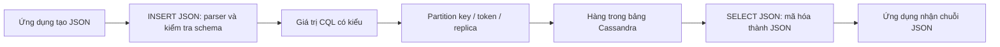

# SELECT JSON/INSERT JSON và phân biệt định dạng trao đổi với kiểu lưu trữ

## 1. Mục tiêu: JSON trong CQL là gì?

Apache Cassandra là cơ sở dữ liệu phân tán theo mô hình **wide-column**, trong đó **schema CQL, partition key và clustering columns** quyết định cách lưu và truy vấn dữ liệu. Từ Cassandra 2.2, CQL hỗ trợ **`SELECT JSON`** để xuất hàng dưới dạng JSON và **`INSERT JSON`** để nhận hàng từ một đối tượng JSON. Hai cú pháp này thay đổi **cách biểu diễn dữ liệu tại giao diện CQL**, chứ **không** chuyển Cassandra thành cơ sở dữ liệu tài liệu (document database) có schema tự do.

Bài thuộc chương **CQL nâng cao** của mô-đun `DATABASE_ENGINE_WIDE_COLUMN_CASSANDRA`. Kiến thức kết nối trực tiếp với thiết kế bảng theo truy vấn, phân vùng, replication, consistency, hiệu năng ghi/compaction và kết nối ứng dụng Java.

Sau bài học, người học sẽ:

1. Viết được `SELECT JSON` và `INSERT JSON` trên bảng có schema thực, đọc đúng kết quả và lỗi.
2. Phân biệt **JSON dùng để trao đổi** với **kiểu dữ liệu CQL được lưu** trên hàng và các replica.
3. Xử lý đúng cột **vắng mặt**, giá trị **`null`**, `DEFAULT NULL` và `DEFAULT UNSET`, tránh vô tình xóa dữ liệu/tạo tombstone.
4. Chọn kiểu ánh xạ cho số, timestamp, UUID, collection và field có tên phân biệt chữ hoa/chữ thường.
5. Hiểu khi nào nên dùng JSON tại biên ứng dụng Java và khi nào nên dùng prepared statement với cột có kiểu rõ ràng.

## 2. Mô hình hoạt động: JSON không phải kiểu cột đặc biệt



| Thành phần | Điều gì thực sự diễn ra? |
| --- | --- |
| `INSERT JSON` | Cassandra đọc một **JSON object** biểu diễn **một hàng**, ánh xạ các key với **tên cột đã khai báo**, kiểm tra kiểu rồi ghi theo cơ chế CQL. |
| `SELECT JSON` | Cassandra đọc hàng bằng truy vấn CQL bình thường rồi tuần tự hóa các cột được chọn thành **một chuỗi JSON trên mỗi hàng kết quả**. |
| Schema | `CREATE TABLE` vẫn khai báo cột, kiểu CQL, partition key, clustering key và các quy tắc liên quan. |
| Partition và replication | Vẫn dựa trên partition key đã được mã hóa theo kiểu CQL; việc truyền dữ liệu dưới dạng JSON không làm đổi token hay replica. |
| Trường JSON tùy ý | Không được phép tự phát sinh cột. Key JSON không có trong schema sẽ làm câu lệnh không hợp lệ; muốn lưu cấu trúc linh hoạt phải thiết kế kiểu `map`, UDT hoặc cột `text/blob` thích hợp. |

**Nguyên tắc quan trọng:** JSON là **định dạng trao đổi/serialization**; `text`, `uuid`, `decimal`, `timestamp`, `set<text>` và `map<text,text>` mới là **kiểu CQL** của cột. Cassandra không có kiểu cột JSON/JSONB mặc định tương đương một số hệ quản trị khác.

## 3. Bảng ví dụ xuyên suốt

Giả sử keyspace `demo_ks` đã được tạo trong cluster thử nghiệm. Tạo bảng truy vấn đơn hàng theo khách hàng:

```sql
CREATE TABLE demo_ks.orders_by_customer (
    customer_id text,
    order_id uuid,
    status text,
    total decimal,
    created_at timestamp,
    paid boolean,
    tags set<text>,
    attributes map<text, text>,
    PRIMARY KEY ((customer_id), order_id)
);
```

Thiết kế này minh họa hai cấp khóa:

- **`customer_id` là partition key**: dữ liệu được phân vùng và tìm replica dựa trên giá trị này.
- **`order_id` là clustering column**: phân biệt các đơn trong partition của một khách hàng.

Các trường còn lại có kiểu xác định. Một JSON object dùng để ghi hàng **bắt buộc cung cấp các thành phần khóa chính** `customer_id` và `order_id`. Dù payload là JSON, bạn không thể dùng một đối tượng như `{"tracking_number":"X"}` để thay thế khóa chính hay để Cassandra tự tạo cột `tracking_number`.

## 4. `SELECT JSON`: mỗi hàng thành một đối tượng JSON

Sau khi chèn dữ liệu ở mục 5, chạy:

```sql
SELECT JSON customer_id, order_id, status, total, paid, tags
FROM demo_ks.orders_by_customer
WHERE customer_id = 'cust-42'
  AND order_id = 11111111-2222-3333-4444-555555555555;
```

Ví dụ **minh họa cấu trúc** của một giá trị trong cột kết quả `[json]`:

```json
{
  "customer_id": "cust-42",
  "order_id": "11111111-2222-3333-4444-555555555555",
  "status": "NEW",
  "total": 125.50,
  "paid": false,
  "tags": ["mobile", "new"]
}
```

Đây là **một ô kết quả CQL chứa chuỗi JSON**, được xuống dòng cho dễ đọc. Thứ tự key, thứ tự các phần tử của kiểu `set` và định dạng hiển thị số có thể khác; ứng dụng phải so sánh **giá trị có ý nghĩa**, không so khớp toàn bộ chuỗi JSON từng byte.

Bạn cũng có thể dùng:

```sql
-- Một object JSON cho MỖI hàng trong partition được trả về.
SELECT JSON *
FROM demo_ks.orders_by_customer
WHERE customer_id = 'cust-42'
LIMIT 10;

-- Chỉ tuần tự hóa các selector đã chọn.
SELECT JSON order_id, status, ttl(status)
FROM demo_ks.orders_by_customer
WHERE customer_id = 'cust-42';
```

**Đừng nhầm:** Với 10 hàng, `SELECT JSON` tạo **10 giá trị JSON riêng**, chứ không tạo một JSON array duy nhất gồm 10 phần tử. `ttl(status)` là giá trị tính trong truy vấn, có thể xuất hiện với key dạng `"ttl(status)"`; đó không phải cột mới trong bảng.

Các quy tắc truy vấn thông thường **vẫn áp dụng**: `WHERE` phải phù hợp với khóa/index và mô hình dữ liệu, `LIMIT`/`ORDER BY` chịu những giới hạn CQL như trước. `SELECT JSON` **không** hỗ trợ truy vấn tự do theo JSON path kiểu `$.attributes.channel` và không làm một truy vấn scan toàn bảng trở nên rẻ hơn.

## 5. `INSERT JSON`: một object ánh xạ vào một hàng có kiểu

Một cách ghi hàng hoàn chỉnh:

```sql
INSERT INTO demo_ks.orders_by_customer JSON
'{
  "customer_id": "cust-42",
  "order_id": "11111111-2222-3333-4444-555555555555",
  "status": "NEW",
  "total": "125.50",
  "created_at": "2026-11-21 09:30:00+0000",
  "paid": false,
  "tags": ["mobile", "new"],
  "attributes": {"channel": "app", "source": "promotion"}
}'
DEFAULT UNSET;
```

**Vì sao các giá trị JSON này hợp lệ?**

- `customer_id` và `status` là chuỗi, được lưu dưới kiểu CQL `text`.
- `order_id` là **chuỗi JSON biểu diễn UUID**, được kiểm tra và lưu như CQL `uuid`.
- `total` được gửi dưới dạng **chuỗi số thập phân**, Cassandra chuyển sang kiểu `decimal`. Cách này tránh việc một số thư viện JSON phía client làm tròn một số thập phân lớn **trước khi gửi**.
- `created_at` là chuỗi thời điểm hợp lệ để chuyển thành `timestamp`; cần nhất quán múi giờ trong ứng dụng.
- `paid` là boolean JSON `false`, được lưu thành CQL `boolean`.
- `tags` là **array trong JSON** nhưng trở thành **`set<text>` trong Cassandra**: tập hợp có tính duy nhất, không có thứ tự logic như một JSON array.
- `attributes` là **JSON object** nhưng ánh xạ vào **`map<text,text>`**, không phải một cột tài liệu JSON tùy ý.

Nếu bảng chưa có hàng, `INSERT JSON` tạo hàng. Nếu hàng có cùng primary key đã tồn tại, câu lệnh **có thể cập nhật/ghi đè** các cột theo quy tắc timestamp của Cassandra; `INSERT` mặc định không phải lệnh “chỉ thêm mới”.

Muốn chèn chỉ khi hàng chưa tồn tại, có thể dùng:

```sql
INSERT INTO demo_ks.orders_by_customer
JSON '{"customer_id":"cust-42",
       "order_id":"aaaaaaaa-bbbb-cccc-dddd-eeeeeeeeeeee",
       "status":"NEW"}'
IF NOT EXISTS;
```

`IF NOT EXISTS` là **LWT/Paxos**: có chi phí đồng thuận và trả kết quả `[applied]`. Nó **không** thay đổi cách JSON ánh xạ vào schema. Với dữ liệu có nhiều request cạnh tranh, cần cân nhắc LWT dựa trên yêu cầu nghiệp vụ thay vì dùng mặc định cho mọi ghi.

## 6. Phân biệt `DEFAULT NULL`, `DEFAULT UNSET` và `null` hiện diện trong JSON

Đây là phần thường gây mất dữ liệu khi dùng `INSERT JSON` như một thao tác cập nhật một phần.

Giả sử hàng `('cust-42', 11111111-2222-3333-4444-555555555555)` đang có `status='NEW'`, `total=125.50`, `paid=false` và `tags={'mobile','new'}`.

### 6.1. Bỏ qua cột và `DEFAULT NULL`

```sql
-- DEFAULT NULL là hành vi MẶC ĐỊNH nếu không ghi chỉ thị.
INSERT INTO demo_ks.orders_by_customer
JSON '{"customer_id":"cust-42",
       "order_id":"11111111-2222-3333-4444-555555555555",
       "status":"PAID"}'
DEFAULT NULL;
```

Các cột không có trong object, ví dụ `total`, `paid`, `tags` và `attributes`, được coi như **`NULL`**. Với cột đang có giá trị, Cassandra phát sinh thao tác xóa/tombstone; chúng không được tự động giữ nguyên. **Chỉ gửi ba key không có nghĩa “chỉ sửa `status`”** khi dùng mặc định này.

### 6.2. Bỏ qua cột và `DEFAULT UNSET`

Để thay đổi `status` nhưng **giữ nguyên các cột không xuất hiện**:

```sql
INSERT INTO demo_ks.orders_by_customer
JSON '{"customer_id":"cust-42",
       "order_id":"11111111-2222-3333-4444-555555555555",
       "status":"PAID"}'
DEFAULT UNSET;
```

Trong chế độ này, những cột không có key tương ứng được **bỏ qua**, nên giá trị hiện có của `total`, `paid` và `tags` được giữ nguyên. Đây thường là lựa chọn thích hợp cho payload JSON chỉ chứa một phần các cột, nếu đúng ngữ nghĩa nghiệp vụ.

### 6.3. Key có mặt nhưng giá trị là `null`

```sql
INSERT INTO demo_ks.orders_by_customer
JSON '{"customer_id":"cust-42",
       "order_id":"11111111-2222-3333-4444-555555555555",
       "status":null}'
DEFAULT UNSET;
```

`DEFAULT UNSET` **không cứu** cột `status` trong trường hợp này. Key `status` **có mặt** và giá trị `null` biểu thị **xóa giá trị cột**. Không được gửi `null` cho những thành phần khóa chính bắt buộc.

| Payload / tùy chọn | `status` | `total` (không có trong JSON) | Tác động |
| --- | --- | --- | --- |
| `{"status":"PAID"} DEFAULT NULL` (kèm đủ khóa chính) | Ghi `PAID` | Đặt `NULL` / tombstone | Có nguy cơ xóa ngoài ý muốn. |
| `{"status":"PAID"} DEFAULT UNSET` (kèm đủ khóa chính) | Ghi `PAID` | **Giữ nguyên** | Phù hợp cập nhật từng phần. |
| `{"status":null} DEFAULT UNSET` (kèm đủ khóa chính) | **Xóa** `status` | **Giữ nguyên** | Phân biệt rõ `null` với thiếu key. |

**Tác động vận hành:** Mỗi lần xóa giá trị cột có thể tạo **tombstone**. Nếu API nhận nhiều JSON nhỏ và luôn `INSERT JSON` theo mặc định, số tombstone có thể tăng, ảnh hưởng đọc và compaction. Dùng `DEFAULT UNSET` là quyết định ngữ nghĩa ghi, **không** thay thế việc đo hiệu năng, theo dõi tombstone hoặc thiết kế TTL/repair phù hợp.

## 7. Bảng ánh xạ JSON ↔ kiểu CQL

Cassandra chuyển đổi qua schema ở thời điểm ghi và sinh JSON phù hợp khi đọc. Không thể suy kiểu lưu trữ chỉ từ hình thức JSON:

| Kiểu cột CQL | Hình thức JSON thường gặp | Điểm cần kiểm tra |
| --- | --- | --- |
| `text`, `varchar`, `ascii` | `"hello"` | Phải là chuỗi, ký tự được escape theo JSON. |
| `int`, `bigint`, `varint` | `42` | Phạm vi số được kiểm tra theo kiểu CQL; `bigint/varint` có thể vượt số nguyên an toàn của JavaScript. |
| `decimal`, `float`, `double` | `125.50` hoặc chuỗi số được chấp nhận | Cẩn thận mất độ chính xác khi client giải mã JSON number bằng IEEE-754. |
| `boolean` | `true` hoặc `false` | Không đồng nghĩa với chuỗi văn bản `"true"`, dù một số kiểu đơn cho phép chuỗi theo cú pháp CQL. |
| `uuid`, `timeuuid` | `"11111111-..."` | Vẫn được kiểm tra là UUID hợp lệ. |
| `date`, `time`, `timestamp` | Chuỗi biểu diễn thời gian | Chú ý chuẩn thời gian, độ chính xác và múi giờ; `timestamp` khi xuất là chuỗi. |
| `inet` | `"192.0.2.10"` | Phải là địa chỉ IP hợp lệ. |
| `blob` | `"0x0123abcd"` | Chuỗi hex với tiền tố `0x`, không phải object JSON. |
| `list<T>` và `set<T>` | `[v1, v2]` | Cùng dạng JSON array nhưng CQL `set` không bảo đảm thứ tự và loại trùng lặp. |
| `map<K,V>` | `{"key":"value"}` | JSON object, key JSON ở dạng chuỗi; CQL vẫn kiểm tra kiểu khóa/giá trị của map. |
| `tuple<...>` | `[v1, v2]` | Thứ tự và số vị trí do kiểu tuple quy định. |
| User-defined type (UDT) | `{"field_a":v1}` | Chỉ những field đã khai báo trong UDT được chấp nhận; đây không phải schema tự do. |

Ví dụ dễ nhầm: `tags` khai báo `set<text>` và `attributes` khai báo `map<text,text>`. Dù trên đường truyền chúng lần lượt trông giống array/object JSON, Cassandra vẫn lưu và xử lý bằng **kiểu collection của CQL**. Truy vấn theo collection chịu giới hạn và cơ chế index CQL, không có cú pháp JSON path tự động.

**Lưu ý số học:** `SELECT JSON` có thể trả `decimal` dưới dạng JSON number; nhiều trình đọc JSON phía client chuyển sang `double` và có thể làm tròn. Với số tiền hoặc ID số nguyên lớn, cần chọn thư viện JSON cấu hình `BigDecimal`/`BigInteger` hoặc đọc trực tiếp kiểu có cấu trúc bằng Java Driver; không giả định JSON round-trip bảo toàn mọi định dạng biểu diễn.

## 8. Tên cột và escaping: hai lớp dấu nháy khác nhau

Tên cột CQL **không đặt trong dấu nháy kép** được chuẩn hóa thành chữ thường. Nếu tạo cột phân biệt hoa/thường bằng quoted identifier, JSON key cần chứa **cả dấu nháy kép của định danh CQL** đã được escape.

```sql
CREATE TABLE demo_ks.quoted_names (
    id int PRIMARY KEY,
    "DisplayName" text
);

INSERT INTO demo_ks.quoted_names
JSON '{"id":1, "\"DisplayName\"":"Lan"}'
DEFAULT UNSET;

SELECT JSON * FROM demo_ks.quoted_names WHERE id = 1;
```

Trong JSON kết quả, tên key tương ứng được mã hóa giống `"\"DisplayName\""`. Nếu ghi `"DisplayName"` không có dấu nháy của định danh CQL, câu lệnh có thể không khớp cột quoted identifier. Vì nhiều lớp escape dễ gây nhầm (JSON, chuỗi CQL, chuỗi Java), trong schema mới nên ưu tiên tên cột `lower_snake_case`.

Với nội dung có dấu nháy đơn, còn cần escape **literal chuỗi CQL** (dấu nháy đơn lặp đôi), ngoài escaping chuẩn JSON. Trong ứng dụng Java, ưu tiên **bind parameter** cho toàn bộ chuỗi JSON để không phải nối text đầu vào vào câu CQL.

## 9. `to_json()` và `from_json()`: chuyển đổi một cột

Hai hàm thường đi kèm nhưng **không** đồng nghĩa với toàn bộ `SELECT JSON`/`INSERT JSON`:

```sql
-- Chuyển một giá trị CQL thành chuỗi JSON.
SELECT order_id, to_json(tags) AS tags_json
FROM demo_ks.orders_by_customer
WHERE customer_id = 'cust-42';

-- Chuyển JSON array thành giá trị kiểu set<text> tại vị trí của cột tags.
UPDATE demo_ks.orders_by_customer
SET tags = from_json('["mobile", "vip"]')
WHERE customer_id = 'cust-42'
  AND order_id = 11111111-2222-3333-4444-555555555555;
```

`to_json()` được dùng trong **danh sách SELECT** để tuần tự hóa **một giá trị**. `from_json()` chuyển **một giá trị JSON** về kiểu CQL ở những vị trí được hỗ trợ như `VALUES` của `INSERT` hoặc giá trị cập nhật trong `UPDATE`. Không có nghĩa Cassandra đã thêm kiểu cột JSON. Không dùng `from_json()` như một selector ở đầu danh sách `SELECT`.

## 10. Lựa chọn lưu mô hình CQL hay một payload JSON dạng text

Giả sử API nhận một đơn hàng có các thuộc tính `customerId`, `orderId`, `total`, `status`. Có hai hướng thiết kế với mục đích khác nhau:

| Hướng | Ví dụ | Nên chọn khi |
| --- | --- | --- |
| **Cột CQL có kiểu** + nhận/trả JSON ở biên | `total decimal`, `status text`, `created_at timestamp`; dùng `INSERT JSON`/`SELECT JSON` hoặc Driver typed API | Ứng dụng cần truy vấn theo khóa, kiểm soát kiểu, dùng collection/UDT và cập nhật từng cột. |
| **Một chuỗi JSON lưu trong `text`** | Cột `raw_payload text` chứa chuỗi `{"foo":42}` | Chỉ cần giữ nguyên payload để xuất lại hoặc phục vụ audit; không cần truy vấn các trường lồng nhau bằng CQL. |

Nếu lưu JSON vào `raw_payload text`, Cassandra xem đó là **chuỗi văn bản**, không tự chuyển `foo` thành cột hay cung cấp truy vấn JSON path. Nếu muốn tìm “các đơn theo trạng thái và thời gian”, cần **thiết kế bảng theo truy vấn** (ví dụ partition theo trạng thái/bucket và clustering theo thời gian), có thể bổ sung bảng denormalized, đồng bộ cập nhật và chọn consistency phù hợp. `SELECT JSON` không sửa được sai lầm chọn partition key hoặc lọc quá rộng.

Điểm này quan trọng với Cassandra phân tán: payload JSON ở tầng API không thay đổi partitioning, replication, memtable/SSTable, compaction hay repair. Những cơ chế đó vẫn vận hành trên dữ liệu có kiểu đã được ghi trong bảng.

## 11. Dùng với Java Driver

Java Driver 4.x có thể bind **một chuỗi JSON** vào `INSERT JSON ?`, do đó không cần ghép payload trực tiếp vào câu lệnh:

```java
// jsonPayload được tạo bằng thư viện JSON (ví dụ Jackson),
// gồm đủ customer_id và order_id, giá trị khớp schema.
String jsonPayload = objectMapper.writeValueAsString(requestBody);

PreparedStatement insert = session.prepare(
    "INSERT INTO demo_ks.orders_by_customer JSON ? DEFAULT UNSET"
);
session.execute(insert.bind(jsonPayload));

PreparedStatement query = session.prepare(
    "SELECT JSON customer_id, order_id, status, total " +
    "FROM demo_ks.orders_by_customer " +
    "WHERE customer_id = ? AND order_id = ?"
);

Row row = session.execute(query.bind(
    "cust-42",
    UUID.fromString("11111111-2222-3333-4444-555555555555")
)).one();

if (row != null) {
    String json = row.getString(0); // Giá trị JSON của một hàng.
    // Chuyển thành DTO / trả qua HTTP, tùy yêu cầu.
}
```

Đây là phần thân minh họa, giả sử `session` đã kết nối và `objectMapper`/`requestBody` đã được khai báo. Lưu ý **tên thuộc tính trong DTO Java** như `customerId` thường **không tự khớp** `customer_id` trong bảng: cần cấu hình mapping/serialization thích hợp. Mọi giá trị gửi vẫn phải hợp lệ với kiểu CQL và đủ thành phần khóa chính.

Trong các tác vụ dùng nhiều thao tác trên cùng schema, **prepared statements bind các cột có kiểu** thường thuận tiện hơn để quản lý UUID, decimal và timestamp, đồng thời cho phép Driver biết rõ routing key:

```java
PreparedStatement update = session.prepare(
    "UPDATE demo_ks.orders_by_customer SET status = ? " +
    "WHERE customer_id = ? AND order_id = ?"
);
session.execute(update.bind(
    "PAID", "cust-42",
    UUID.fromString("11111111-2222-3333-4444-555555555555")
));
```

Đặt `DEFAULT UNSET` chỉ xử lý các cột **vắng mặt trong JSON**, không thay cho retry an toàn, idempotency hay kiểm tra cạnh tranh bằng LWT khi cần. Đọc/ghi nhất quán còn phụ thuộc consistency level và trạng thái replica của cluster.

## 12. Các lỗi thường gặp và cách kiểm tra

| Hiện tượng | Nguyên nhân phổ biến | Cách khắc phục |
| --- | --- | --- |
| `INSERT JSON` báo thiếu primary key | Object không chứa `customer_id` hoặc `order_id` | Cung cấp **đủ** partition/clustering key, kiểm tra đúng tên cột. |
| Báo cột không tồn tại | JSON key viết sai, khác tên schema hoặc quoted identifier | `DESCRIBE TABLE`, xem chính xác tên cột và escaping. |
| Báo giá trị không hợp lệ | UUID sai định dạng, số vượt phạm vi, timestamp không parse được, JSON sai cấu trúc | Xác minh loại JSON đầu vào và kiểu CQL của cột, parse/validate trước ở API. |
| Các cột cũ biến mất sau ghi JSON ngắn | `INSERT JSON` dùng `DEFAULT NULL` ngầm định | Với partial update, dùng `DEFAULT UNSET` và phân biệt key vắng mặt với `null`. |
| `SELECT JSON` trả một chuỗi thay vì mảng | CQL tạo object theo **từng hàng** | Gom nhiều hàng thành array ở ứng dụng nếu API yêu cầu. |
| Số tiền sai vài chữ số sau khi qua JSON | Bộ giải mã JSON phía client dùng `double` | Ưu tiên `BigDecimal` và giữ số chính xác từ đầu vào. |
| Kết quả JSON khác thứ tự field/array set | JSON object không có nghĩa thứ tự, CQL set cũng không có thứ tự | So sánh bằng cấu trúc/giá trị; không dựa vào chuỗi byte hoặc thứ tự set. |
| Truy vấn JSON vẫn không lọc được theo field tùy ý | `SELECT JSON` không tạo index hoặc query engine tài liệu | Thiết kế schema theo truy vấn và tạo index phù hợp nếu thật sự cần. |
| Độ trễ, tombstone tăng sau tích hợp API | Ghi `DEFAULT NULL`/`null` thường xuyên hoặc payload rộng | Rà soát ngữ nghĩa ghi, theo dõi metrics, compaction và cách cập nhật cột. |

## 13. Bài thực hành có thể tái hiện

Thực hiện trên **keyspace thử nghiệm** và một `customer_id` riêng; các ví dụ `INSERT` sẽ thay đổi dữ liệu:

1. Tạo `orders_by_customer` như mục 3. Ghi một hàng đầy đủ bằng `INSERT JSON ... DEFAULT UNSET`; xem lại bằng `SELECT` thường và `SELECT JSON`. Xác nhận `order_id` đọc bằng driver có kiểu `UUID`, `total` có kiểu `BigDecimal`.
2. Ghi cùng khóa với JSON **chỉ chứa** `status` và hai thành phần khóa chính, dùng `DEFAULT UNSET`. Kiểm tra `total`/`tags` còn nguyên.
3. Đặt lại hàng đầy đủ, lặp lại JSON ngắn nhưng dùng `DEFAULT NULL`. Quan sát các cột bị xóa. Thảo luận ảnh hưởng của tombstone nếu thao tác này chạy hàng nghìn lần.
4. Đặt lại hàng, thử `"status":null` cùng `DEFAULT UNSET`. Giải thích vì sao `status` bị xóa dù những cột không xuất hiện vẫn được giữ lại.
5. Thử gửi `"unknown_field":"x"` hoặc bỏ `order_id`; ghi lại lỗi kiểm tra schema/primary key.
6. Chèn một `tags` có phần tử trùng nhau trong JSON array, sau đó `SELECT JSON tags`; giải thích sự khác nhau giữa `set` và `list`.
7. Dùng `SELECT JSON ... LIMIT 2` trên hai đơn của cùng khách hàng. Kiểm tra có **hai JSON object độc lập**, không phải một mảng JSON.

**Tự kiểm tra:** Với đầu vào `{"customer_id":"cust-42","order_id":"...","status":"PAID"}`, trước khi chạy phải trả lời: (a) còn thiếu cột nào của hàng đang tồn tại, (b) với `DEFAULT NULL` các cột đó thế nào, (c) với `DEFAULT UNSET` chúng thế nào, (d) liệu JSON có thay đổi cách Cassandra chọn partition/replica, (e) cần làm gì nếu phải truy vấn theo trạng thái trên toàn bộ khách hàng?

## 14. Tài liệu chuẩn để tra cứu

- [Apache Cassandra — JSON Support](https://cassandra.apache.org/doc/stable/cassandra/developing/cql/json.html): `SELECT JSON`, `INSERT JSON`, `DEFAULT NULL`/`DEFAULT UNSET`, bảng ánh xạ kiểu, `to_json()`/`from_json()`.
- [Apache Cassandra — CQL Data Manipulation](https://cassandra.apache.org/doc/stable/cassandra/developing/cql/dml.html): cú pháp `SELECT`, `INSERT`, `IF NOT EXISTS` và giới hạn truy vấn.
- [Apache Cassandra Java Driver 4.x — JSON INSERT Query Builder](https://apache.github.io/cassandra-java-driver/4.18.1/query_builder/insert/): JSON literal, `JSON ?`, `defaultUnset()` và `defaultNull()`.

**Kết luận thực hành:** Dùng JSON khi nó thuận tiện cho **trao đổi dữ liệu** qua CQL/API, nhưng luôn kiểm tra schema, giá trị khóa chính, kiểu và hành vi của cột thiếu. Dùng `DEFAULT UNSET` khi thực sự muốn giữ những cột không gửi; dùng `null` hoặc `DEFAULT NULL` khi chủ ý xóa. Muốn truy vấn hiệu quả và đảm bảo nhất quán, vẫn phải thiết kế bảng, partition và cơ chế ghi theo đặc tính phân tán của Cassandra.
