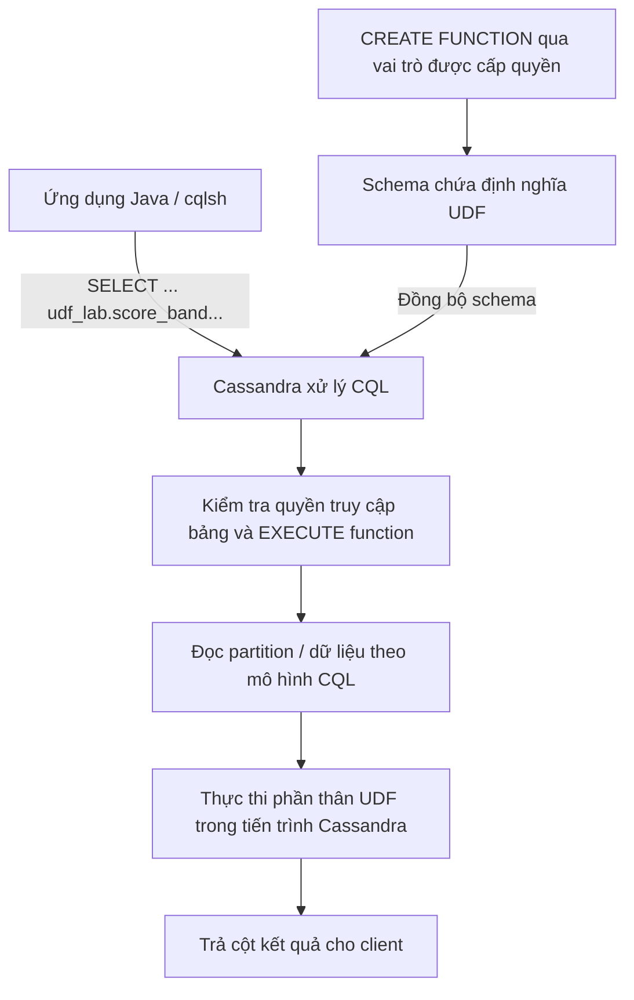

# User-defined function (UDF) trong Cassandra: cấu hình cho phép và ranh giới bảo mật

## 1. UDF là gì và khi nào cần quan tâm?

Trong **Apache Cassandra**, CQL (*Cassandra Query Language*) cung cấp các hàm dựng sẵn để chuyển đổi hoặc xử lý dữ liệu. **User-defined function (UDF)** cho phép người có quyền định nghĩa thêm một hàm với tham số, kiểu kết quả và phần thân do họ cung cấp. Ví dụ, một hàm có thể ánh xạ điểm rủi ro từ cột `score` sang nhãn `low`, `medium` hoặc `high` ngay trong câu `SELECT`.

Chủ đề này thuộc chương **CQL nâng cao** của mô-đun `DATABASE_ENGINE_WIDE_COLUMN_CASSANDRA`, nhằm hiểu kiến trúc phân tán, khóa phân vùng, mô hình wide-column, nhất quán đọc/ghi và cách ứng dụng Java tương tác với Cassandra. UDF là tiện ích mở rộng ngữ nghĩa truy vấn, **không thay thế thiết kế bảng theo truy vấn, partition key, replication, compaction hay repair**.

UDF đồng thời là quyết định bảo mật quan trọng: phần thân hàm được thực thi trong môi trường **máy chủ Cassandra**, nơi đang phục vụ nhiều truy vấn. Bật UDF mở ra khả năng đưa mã do người dùng định nghĩa vào luồng xử lý của cơ sở dữ liệu. Vì vậy Apache Cassandra mặc định **không bật UDF**; dù có cơ chế sandbox, tài liệu chính thức cũng nhấn mạnh sandbox không hoàn hảo.

Kết thúc bài này, người học có thể:

1. Viết, gọi, thay thế và xóa một scalar UDF bằng CQL.
2. Phân biệt tên cấu hình cho phép UDF giữa các phiên bản Cassandra.
3. Cấp đúng quyền `CREATE`, `ALTER`, `DROP`, `EXECUTE` với phạm vi tối thiểu.
4. Nhận diện ranh giới bảo mật giữa CQL client, Cassandra server, sandbox và tài nguyên JVM.
5. Đánh giá chi phí thực thi, xử lý lỗi và phương án thay thế bằng Java/application layer.

## 2. UDF nằm ở đâu trong kiến trúc Cassandra?

`CREATE FUNCTION` tạo một đối tượng **schema** thuộc một keyspace. Định nghĩa hàm được phân phối đến các node tương tự các thay đổi schema khác; ứng dụng không cần mang mã Java của UDF theo mỗi request. Khi CQL gọi hàm, mã đó được đánh giá trong quá trình máy chủ Cassandra thực hiện truy vấn.



Sơ đồ là mô hình khái niệm. Vị trí thực thi cụ thể theo đường xử lý câu lệnh có thể khác nhau; điều thiết yếu là **UDF chạy phía server, không chạy bên trong tiến trình Java client**.

| Khái niệm | Mục đích | Có thể thay cho UDF không? |
| --- | --- | --- |
| **Native CQL function** | Hàm có sẵn do Cassandra cung cấp, ví dụ `CAST`, `toTimestamp` trong ngữ cảnh hỗ trợ | Nên ưu tiên khi đáp ứng nghiệp vụ |
| **Scalar UDF** | Nhận đối số và trả một kết quả, ví dụ `score_band(score)` | Dùng khi phải xử lý trong truy vấn và đã duyệt rủi ro |
| **User-defined aggregate (UDA)** | Tổng hợp nhiều hàng với hàm trạng thái/kết quả liên quan | Không đồng nghĩa scalar UDF; thường phụ thuộc UDF |
| **Logic trong ứng dụng Java** | Chuyển đổi, xác thực và xử lý nghiệp vụ sau khi đọc | Thường an toàn, dễ test, deploy và quan sát hơn |
| **Dữ liệu tiền tính/materialized theo truy vấn** | Lưu sẵn nhãn hoặc trạng thái cần lọc/lấy nhanh | Thường phù hợp khi tiêu chí là truy vấn hiệu quả theo nhãn |

UDF **không** tự tạo index, không tự phân phối một partition nóng sang nhiều node và không làm các điều kiện truy vấn không phù hợp với partition key bỗng trở nên hiệu quả. Với Cassandra, **mô hình khóa theo truy vấn** vẫn quyết định phần lớn khả năng mở rộng.

## 3. Ví dụ CQL: tạo và gọi một Java UDF

### 3.1. Chuẩn bị keyspace và bảng thử nghiệm

Giả sử đang làm việc trong cụm **lab** đã cho phép UDF. Tên data center `dc1` bên dưới là ví dụ, phải thay bằng tên DC thật được báo qua `nodetool status`. RF = 1 chỉ dùng minh họa trên lab một node; khi vận hành thật cần topology/RF theo yêu cầu chịu lỗi.

```sql
CREATE KEYSPACE IF NOT EXISTS udf_lab
WITH replication = {
    'class': 'NetworkTopologyStrategy',
    'dc1': 1
};

CREATE TABLE IF NOT EXISTS udf_lab.customer_score_by_id (
    customer_id uuid PRIMARY KEY,
    score int,
    updated_at timestamp
);

INSERT INTO udf_lab.customer_score_by_id (customer_id, score, updated_at)
VALUES (
    11111111-1111-1111-1111-111111111111,
    86,
    '2026-11-21T00:00:00Z'
);
```

Bảng dùng `customer_id` làm **partition key**, nên ví dụ đọc một khách hàng bằng khóa chính sẽ không cần quét toàn bảng. Không khuyến khích mở rộng ví dụ này thành `SELECT` không có `WHERE` trên bảng production.

### 3.2. Định nghĩa scalar UDF

```sql
CREATE FUNCTION IF NOT EXISTS udf_lab.score_band(score int)
RETURNS NULL ON NULL INPUT
RETURNS text
LANGUAGE java
AS $$
    if (score >= 80) {
        return "high";
    }
    if (score >= 50) {
        return "medium";
    }
    return "low";
$$;
```

Giải thích các phần:

| Cú pháp | Ý nghĩa |
| --- | --- |
| `udf_lab.score_band` | Hàm thuộc keyspace `udf_lab` |
| `score int` | Tên và kiểu của một đối số |
| `RETURNS NULL ON NULL INPUT` | Nếu bất kỳ đối số nào là `null`, Cassandra trả `null` mà không gọi thân hàm |
| `RETURNS text` | Kiểu CQL của kết quả |
| `LANGUAGE java` | Phần thân biểu diễn bằng ngôn ngữ Java được Cassandra hỗ trợ |
| `AS $$ ... $$` | Nội dung mã của hàm được phân tách bằng cặp `$$` trong CQL |
| `IF NOT EXISTS` | Chỉ tạo nếu chữ ký hàm chưa tồn tại; **không cập nhật** mã hàm cũ |

Phần thân phải trả giá trị tương thích với `RETURNS text`. Đây là **mã thân hàm**, không phải một class Java tự chứa với `main`. UDF nên thuần túy: kết quả chỉ phụ thuộc tham số, không lưu trạng thái, không sinh ngẫu nhiên, không truy cập dịch vụ bên ngoài và không cố tạo tác dụng phụ.

Gọi UDF:

```sql
SELECT
    customer_id,
    score,
    udf_lab.score_band(score) AS risk_band
FROM udf_lab.customer_score_by_id
WHERE customer_id = 11111111-1111-1111-1111-111111111111;
```

Với dữ liệu mẫu, `risk_band` nhận `high`. Đây là ví dụ chuyển đổi **trên một bản ghi đã được định vị bằng partition key**; UDF không thay đổi cách Cassandra tìm replica cho partition.

### 3.3. Null, kiểu dữ liệu và overload

Hai lựa chọn xử lý null là **khác nhau**:

- `RETURNS NULL ON NULL INPUT`: Cassandra không gọi hàm nếu có đối số null; phù hợp với phép chuyển đổi không định nghĩa cho null.
- `CALLED ON NULL INPUT`: Cassandra gọi hàm kể cả đối số null. Người viết phải tự xử lý null trong phần thân và dùng kiểu Java phù hợp; nếu không có thể gây exception, làm thất bại cả statement.

`score_band(int)` và `score_band(double)` có thể là **hai overload** khác chữ ký. Chữ ký bao gồm **keyspace, tên hàm và kiểu tham số**; tên tham số không dùng để phân biệt overload. Để thay đổi mã của **cùng chữ ký**, dùng `CREATE OR REPLACE FUNCTION` sau khi đã xem xét quyền và tác động; `OR REPLACE` và `IF NOT EXISTS` **không dùng cùng một câu lệnh**.

Để xóa đúng overload:

```sql
-- Chỉ thực hiện khi đã xác minh không còn truy vấn phụ thuộc.
DROP FUNCTION IF EXISTS udf_lab.score_band(int);
```

Hàm trong keyspace hệ thống không được hỗ trợ. Với kiểu UDT, tuple hoặc collection, cú pháp và ánh xạ kiểu Java phức tạp hơn; cần kiểm tra theo **phiên bản Cassandra**, tránh suy diễn mọi kiểu Java có thể truyền trực tiếp.

## 4. Cấu hình cho phép UDF: chọn đúng theo phiên bản

Không thể chỉ gửi `CREATE FUNCTION` từ cqlsh để tự bật UDF. **Đây là tính năng cấu hình ở máy chủ**, bị tắt theo mặc định vì rủi ro thực thi mã trong database process. Đội vận hành phải xác định phiên bản Cassandra và triển khai cấu hình nhất quán trên tất cả node chịu trách nhiệm xử lý truy vấn có UDF.

| Phiên bản Apache Cassandra | Khóa cấu hình UDF Java | Ghi chú |
| --- | --- | --- |
| **3.11 / 4.0** | `enable_user_defined_functions` | Mặc định `false` trong các tài liệu cấu hình tương ứng |
| **4.1 / 5.0** | `user_defined_functions_enabled` | Tên mới sau đợt chuẩn hóa cấu hình; mặc định `false` |
| Bản khác / bản đóng gói vendor | Xem `cassandra.yaml` và tài liệu **đúng phiên bản** | Không tự trộn tên cũ và mới |

Ví dụ cấu hình **Cassandra 4.1/5.0** trong file `cassandra.yaml`, **chỉ dành cho môi trường thí nghiệm do quản trị viên kiểm soát**:

```yaml
# Lab/trusted environment; không mặc định áp dụng cho production.
user_defined_functions_enabled: true
```

Với Cassandra **4.0**, khóa tương ứng là:

```yaml
enable_user_defined_functions: true
```

Việc đổi cấu hình cần quy trình deploy/restart phù hợp phiên bản và chính sách vận hành; không nên cho rằng chỉnh một file hoặc một node sẽ bật tức thì trên cả cụm. Trong lúc rolling restart, các node có khả năng xử lý UDF khác nhau có thể khiến kết quả yêu cầu không đồng nhất. Chỉ thử các câu lệnh UDF sau khi kiểm tra tất cả node đích và trạng thái schema.

### 4.1. Scripted UDF khác Java UDF

Ở các bản cũ, có khóa cấu hình **riêng** cho scripted UDF:

```yaml
# Cassandra 4.1: giữ tắt ở lab nếu chỉ cần Java UDF.
scripted_user_defined_functions_enabled: false
```

Ở Cassandra 4.0, tên cũ là `enable_scripted_user_defined_functions`. Scripted UDF như JavaScript được đánh dấu **deprecated từ Cassandra 4.1** và việc loại bỏ đã được triển khai cho lộ trình Cassandra 5.0. Không nên xây hệ thống mới phụ thuộc `LANGUAGE javascript` hoặc giả định tùy chọn scripted có mặt ở mọi bản Cassandra mới.

Bật Java UDF **không** đòi hỏi bật scripted UDF. Đừng bật rộng cả hai chỉ để ví dụ `LANGUAGE java` chạy được.

### 4.2. Cấu hình timeout và thực thi trong luồng riêng

Một số phiên bản cung cấp các thiết lập liên quan như:

- `user_defined_functions_threads_enabled`: điều khiển cách UDF được thực thi trong luồng riêng theo khả năng phiên bản.
- `user_defined_functions_warn_timeout` và `user_defined_functions_fail_timeout`: ngưỡng cảnh báo/thất bại cho UDF; tên và đơn vị đã thay đổi theo phiên bản.

Những thiết lập này là **cơ chế giới hạn/giám sát vận hành**, không phải bảo đảm cô lập an toàn mã tùy ý. Timeout ở tầng request không nhất thiết có thể hủy ngay mọi công việc đang chạy trong JVM. Không tăng timeout để che giấu UDF tốn CPU; trước tiên phải đo mã, số row đi qua hàm và trạng thái thread/GC.

### 4.3. Quy trình bật trong lab có kiểm soát

1. Xác định phiên bản Cassandra, JDK tương thích, DC/rack và bản cấu hình đang dùng; lưu bản sao cấu hình phục vụ rollback.
2. Bật đúng khóa UDF theo phiên bản **trên các node cần thiết**, giữ scripted UDF tắt nếu không cần.
3. Thực hiện thay đổi/restart theo quy trình của cụm; sau mỗi đợt kiểm tra `nodetool status`, log khởi động và trạng thái schema.
4. Với vai trò quản trị, tạo **một** hàm Java nhỏ, xác định như `score_band` và thử trên một partition của keyspace lab.
5. Đo latency, exception và tài nguyên khi gọi hàm; cấp quyền `EXECUTE` cho role thử nghiệm có giới hạn.
6. Nếu không dùng nữa, gỡ phụ thuộc và thu hồi quyền; tắt UDF nếu policy cho phép, theo một đợt thay đổi cấu hình được lập kế hoạch.

Không thay đổi `cassandra.yaml` production chỉ vì một truy vấn demo yêu cầu UDF. Đánh giá khả năng tính toán trong Java application hoặc ghi sẵn cột kết quả trước.

## 5. Quyền truy cập function và ranh giới giữa các role

Từ góc độ bảo mật, **bật tính năng** chỉ là một lớp. Cassandra còn hỗ trợ tài nguyên phân quyền theo function: `ALL FUNCTIONS`, `ALL FUNCTIONS IN KEYSPACE <ks>`, và `FUNCTION <ks>.<name>(<types>)`. Các quyền này khác quyền đọc/ghi bảng.

| Quyền | Áp dụng lên tài nguyên function | Khả năng |
| --- | --- | --- |
| `CREATE` | Tất cả function hoặc tất cả function trong một keyspace | Tạo UDF/UDA |
| `ALTER` | Function cụ thể hoặc cấp bao quát | Thay thế định nghĩa đã tồn tại |
| `DROP` | Function cụ thể hoặc cấp bao quát | Xóa định nghĩa |
| `EXECUTE` | Function cụ thể hoặc cấp bao quát | Gọi function trong CQL |
| `AUTHORIZE` | Function hoặc cấp bao quát | Cấp/thu hồi quyền trên function |
| `SELECT` | **Table**, không phải function | Đọc dữ liệu bảng mà câu lệnh dùng |

Lưu ý quyền `EXECUTE` trên UDF **không tự cấp `SELECT` trên bảng**; ngược lại, `SELECT` bảng không tự cấp quyền tạo/thay thế UDF. Khi tạo một tài nguyên mới, role tạo nó thường được tự động cấp các quyền áp dụng cho tài nguyên đó. **Không giao quyền tạo hoặc thay thế mã UDF cho tài khoản ứng dụng chỉ cần truy vấn.**

Giả sử vai trò `udf_author` và `score_reader` đã được quản trị viên tạo, xác thực và kiểm tra theo chính sách. Ví dụ cho quyền tối thiểu:

```sql
-- DBA cấp quyền tạo function trong một keyspace,
-- tránh GRANT CREATE ON ALL FUNCTIONS trên toàn cụm nếu không cần.
GRANT CREATE ON ALL FUNCTIONS IN KEYSPACE udf_lab TO udf_author;

-- Chỉ role đọc mới được gọi đúng overload đã duyệt.
GRANT EXECUTE ON FUNCTION udf_lab.score_band(int) TO score_reader;

-- Truy vấn SELECT ví dụ cần thêm quyền truy cập bảng.
GRANT SELECT ON TABLE udf_lab.customer_score_by_id TO score_reader;
```

Với một pipeline phát hành được kiểm soát, nên tách tài khoản **tạo/thay thế hàm** khỏi tài khoản **chạy truy vấn**, sử dụng review và change log cho mỗi phiên bản source. Khi không cần quyền:

```sql
REVOKE CREATE ON ALL FUNCTIONS IN KEYSPACE udf_lab FROM udf_author;
REVOKE EXECUTE ON FUNCTION udf_lab.score_band(int) FROM score_reader;
```

**Điều kiện để ví dụ phân quyền có tác dụng:** cụm phải triển khai authentication và authorization đúng cách, chẳng hạn sử dụng thành phần xác thực/ủy quyền tương ứng với Cassandra và policy của tổ chức. Với cấu hình cho phép tất cả (`AllowAllAuthenticator` / `AllowAllAuthorizer`), không thể coi câu lệnh `GRANT` là ranh giới an toàn đang được thực thi. Kiểm thử bằng **vai trò thực tế**: role không có `EXECUTE` phải bị từ chối khi gọi hàm; role chỉ có `EXECUTE` phải vẫn bị hạn chế truy cập bảng không được cấp `SELECT`.

### 5.1. Vì sao quyền CREATE/ALTER đặc biệt nhạy cảm?

Mã UDF có thể tác động tới **CPU, heap, GC, độ trễ request và tính sẵn sàng của node**. Một role được phép thay mã UDF có thể đưa mã rất tốn tài nguyên vào luồng truy vấn của các role khác. Ngay cả khi sandbox cố hạn chế API nguy hiểm, **không có lý do để đối xử với UDF như mã không đáng tin cậy được cô lập tuyệt đối**.

Ranh giới cần phân biệt:

| Lớp | Kiểm soát được gì | Không bảo đảm điều gì |
| --- | --- | --- |
| **CQL role/permission** | Ai tạo, thay đổi, xóa hoặc gọi UDF; quyền đọc/ghi bảng | Không chứng minh phần thân hàm là mã an toàn |
| **Sandbox UDF** | Cố giới hạn hành vi thực thi theo phiên bản/JDK | Không phải ranh giới bảo mật hoàn hảo, không thay threat modeling |
| **Timeout/luồng thực thi** | Giảm tác động của một số hàm chạy lâu | Không bảo đảm hủy mọi mã, cô lập heap/CPU hoàn toàn |
| **Chạy thử và code review** | Phát hiện null, exception, thuật toán tốn tài nguyên, dữ liệu biên | Không thể bao phủ mọi điều kiện lỗi production |
| **Giám sát, rollback, change management** | Phát hiện hồi quy và thu hồi thay đổi | Không ngăn được sự cố nếu quyền quản trị đã bị lạm dụng |

Vì thế, **UDF author** phải là role tin cậy với quy trình duyệt mã. Ở hệ thống chia sẻ nhiều tenant không có sự tin cậy lẫn nhau, không nên coi việc bật UDF rồi trao quyền tự tạo mã cho các tenant là thiết kế cô lập phù hợp. Có thể phải tách hẳn cụm hoặc chuyển xử lý về tầng ứng dụng.

## 6. Rủi ro bảo mật và vận hành cần kiểm tra

### 6.1. Mã chạy ở phía máy chủ

Sai lầm phổ biến là nghĩ `LANGUAGE java` trong `CREATE FUNCTION` sẽ chạy tại JVM của ứng dụng Java. Thực tế, Java Driver chỉ gửi CQL và nhận kết quả. Phần thân chạy trong hạ tầng Cassandra, dùng tài nguyên của cụm. Vì thế:

- Không thiết kế UDF để mở file, đọc secret, gọi URL hay thực thi lệnh hệ điều hành. Sandbox có thể chặn, nhưng **phòng tuyến đầu tiên là không cho mã đó xuất hiện** trong UDF.
- Không dùng UDF để gọi dịch vụ ngoài hoặc phụ thuộc network I/O. Truy vấn cơ sở dữ liệu có thể bị kéo dài do mạng/đích từ xa, gây tải và lỗi dây chuyền.
- Tránh mã có vòng lặp theo input không giới hạn, phân bổ bộ nhớ lớn, gọi đệ quy sâu hoặc tạo nhiều object cho từng hàng.
- Tránh ném exception do input xấu. Một exception trong UDF có thể khiến **toàn bộ statement thất bại**; việc gọi lại tùy tiện có thể khuếch đại tải.

### 6.2. Input không hợp lệ, null và dữ liệu nhạy cảm

Với mã `score_band`, điều kiện `score >= 80` giả định điểm là số hợp lệ. Nếu nghiệp vụ chỉ cho phép `score` từ 0 đến 100, cần quyết định và kiểm thử rõ điều gì xảy ra với `-5` hoặc `1000`. Tránh để lỗi dữ liệu âm thầm trở thành nhãn hợp lệ sai. UDF không thay thế validate tại nguồn ghi.

Không ghi các giá trị nhạy cảm hoặc mã nguồn UDF chứa bí mật vào log ứng dụng. Với hệ thống có audit log, cần kiểm tra việc log câu lệnh `CREATE FUNCTION` có thể chứa nội dung source và giá trị nhúng. Mã UDF chỉ nên biểu diễn logic thuần, không chứa API key, token truy cập hoặc password.

### 6.3. Khác biệt phiên bản và tương thích JVM

Cassandra dùng môi trường chạy Java do từng release hỗ trợ. Một đoạn mã biên dịch trong ứng dụng Java 21 **không mặc nhiên** hợp lệ trong compiler/runtime UDF của một node Cassandra khác. Nên tránh phụ thuộc thư viện ngoài, API không được hỗ trợ hoặc các tính năng ngôn ngữ mới không có ở phiên bản đang chạy.

JavaScript UDF đã bị deprecated ở Cassandra 4.1 và có thay đổi trong dòng 5.x; không lên kế hoạch mới dựa vào `LANGUAGE javascript`. Khi nâng cấp cụm, kiểm tra compatibility của **mọi function trong schema** trước, không chỉ câu lệnh `CREATE TABLE` và driver.

## 7. Đo hiệu năng UDF: chi phí theo từng hàng

Giả sử câu lệnh trả về 500 hàng và tính một UDF cho cột `score` của từng hàng. Chi phí CPU, cấp phát và exception tiềm tàng xảy ra **theo số lần hàm được gọi**, cộng chi phí đọc dữ liệu và chuyển kết quả. Một UDF nhỏ trên một partition có thể hợp lý; cùng hàm chạy trong truy vấn quét rộng dễ tăng p99 và GC.

```text
request_total_time
  ≈ query_plan + replica_read + coordination
    + sum(UDF_execution_cost per evaluated row)
    + serialization + network + client_processing
```

Đây là mô hình định tính, **không phải** công thức dự đoán latency chính xác. Vì các thành phần có thể chồng lấn, không cộng các số đo bừa bãi như thể chúng độc lập.

Để đánh giá có nên đưa biến đổi vào database:

| Phương án | Ưu điểm | Nhược điểm |
| --- | --- | --- |
| UDF ngay trong `SELECT` | Không cần thêm bước biến đổi ở client; logic tập trung vào schema | CPU và rủi ro mã nằm trong Cassandra; cần cho phép và cấp quyền |
| Tính trong Java sau khi đọc | Dễ unit test, version hóa, timeout và phân tách bảo mật | Có thể chuyển nhiều dữ liệu thô hơn và lặp logic giữa dịch vụ |
| Lưu sẵn `risk_band` lúc ghi | Lấy nhãn nhanh, có thể thiết kế bảng theo mẫu truy vấn | Phải duy trì đồng bộ khi quy tắc nhãn thay đổi |
| Native CQL function | Sử dụng tính năng có sẵn, ít mã tự quản hơn | Có thể không đáp ứng logic nghiệp vụ riêng |

Quy trình đo tối thiểu:

1. Chuẩn bị dữ liệu cố định, số partition và số hàng tương đương giữa các lượt; tách warm-up khỏi số liệu chính.
2. Đo câu `SELECT` cùng điều kiện partition key **không gọi UDF**, sau đó gọi UDF; giữ nguyên consistency level và page size.
3. Ghi p50/p95/p99 latency phía client, rows/s, CPU, GC, heap và tỷ lệ lỗi; tăng số hàng trả về và concurrency theo các nấc kiểm soát.
4. So sánh với cách chuyển đổi tại ứng dụng Java. Chú ý cả chi phí **truyền dữ liệu qua mạng** và **thông lượng hữu ích**, không kết luận chỉ bằng một p99.
5. Lặp lại ở dữ liệu biên: null, điểm ngoài miền nghiệp vụ, nhiều hàng trên partition, nhiều client đồng thời. Xem tác động tới truy vấn **không dùng UDF** khi cụm cùng tải.

UDF **không phải công cụ thay thế index hay `WHERE` theo khóa**. Nếu muốn lọc mọi khách hàng “high risk”, bảng theo mô hình truy vấn `customers_by_risk_band` hoặc chỉ mục có cơ sở phù hợp thường hữu ích hơn phép biến đổi ở phần kết quả của một truy vấn rộng.

## 8. Gọi UDF từ ứng dụng Java

Với Java Driver 4.x, ứng dụng không cần nạp mã Java UDF. Ứng dụng chỉ gửi câu CQL có gọi tên hàm, dùng role có quyền `EXECUTE` và `SELECT` tương ứng. Ví dụ:

```java
import com.datastax.oss.driver.api.core.CqlSession;
import com.datastax.oss.driver.api.core.cql.PreparedStatement;
import com.datastax.oss.driver.api.core.cql.BoundStatement;
import com.datastax.oss.driver.api.core.cql.Row;
import java.util.UUID;

// Giả sử session đã kết nối đúng local data center và role có quyền.
PreparedStatement query = session.prepare(
    "SELECT score, udf_lab.score_band(score) AS risk_band " +
    "FROM udf_lab.customer_score_by_id WHERE customer_id = ?"
);

UUID customerId =
    UUID.fromString("11111111-1111-1111-1111-111111111111");
BoundStatement statement = query.bind(customerId);
Row row = session.execute(statement).one();

if (row != null) {
    Integer score = row.isNull("score") ? null : row.getInt("score");
    String riskBand = row.getString("risk_band");
    System.out.println("score=" + score + ", riskBand=" + riskBand);
}
```

Code minh họa giả định đã có `CqlSession session`, không phải lớp Java hoàn chỉnh có `main`. Phần Java client **không** cần biết nội dung `AS $$ ... $$`, nhưng nên có integration test để phát hiện thay đổi tên, chữ ký hoặc kết quả của function. Nếu đã có sẵn dữ liệu và logic phân loại ở ứng dụng, hãy cân nhắc dùng lại Java method thuần túy thay vì yêu cầu bật UDF toàn cụm.

## 9. Chẩn đoán lỗi thường gặp

| Triệu chứng | Nguyên nhân cần kiểm tra | Hướng xác minh |
| --- | --- | --- |
| `CREATE FUNCTION` bị từ chối do tính năng không bật | Cấu hình UDF mặc định `false`; đặt sai tên khóa; node chưa nhận cấu hình | Kiểm tra phiên bản, `cassandra.yaml` và log của từng node |
| Lỗi `Unauthorized` khi tạo/gọi | Role thiếu `CREATE`/`EXECUTE` hoặc thiếu quyền trên bảng | Đăng nhập đúng role và xem phân quyền hiện hành |
| Hàm được tạo nhưng truy vấn báo không có hàm/chữ ký | Keyspace, overload hoặc kiểu tham số không khớp; schema chưa đồng bộ | Kiểm tra định nghĩa chính xác, kiểu `int` vs `bigint` và trạng thái schema |
| `null` làm statement thất bại | `CALLED ON NULL INPUT` nhưng mã không xử lý null; sai ánh xạ kiểu | Unit test từng nhánh null, cân nhắc `RETURNS NULL ON NULL INPUT` |
| Hàm gây exception khi xử lý dữ liệu | Input ngoài miền, lỗi số học, mã không tương thích | Tái hiện bằng input tối thiểu; review code và log an toàn |
| Chậm hoặc timeout khi gọi UDF | CPU/GC/memory, quá nhiều lần gọi trên hàng, logic tốn tài nguyên | So baseline không UDF, theo dõi latency và số row thực thi |
| Scripted UDF không chạy sau upgrade | JavaScript đã deprecated/không còn được hỗ trợ tương ứng | Đọc release notes theo version, chuyển Java UDF hoặc app |

Người vận hành có thể xem metadata định nghĩa trong schema bằng CQL, miễn role có quyền phù hợp:

```sql
SELECT
    keyspace_name,
    function_name,
    argument_types,
    language
FROM system_schema.functions
WHERE keyspace_name = 'udf_lab';
```

Khi cần điều tra lỗi, giữ lại phiên bản Cassandra/JDK, phiên bản function/schema, request mẫu, mức nhất quán, p99 và log server. Việc `nodetool status` trả về mọi node `UN` **không tự chứng minh** cấu hình UDF đồng nhất trên mọi node.

## 10. Quy trình thay đổi và rollback cho một UDF

Một quy trình phát hành UDF đáng tin cậy nên giữ mã nguồn trong hệ thống version control của dự án ứng dụng/DB migration, có review độc lập và có kiểm thử trên cụm lab giống production:

1. **Trước triển khai:** xác định lý do cần UDF; xem liệu native function, Java application hoặc cột tiền tính đáp ứng tốt hơn không.
2. **Rà soát source:** bảo đảm mã thuần túy, có giới hạn độ phức tạp, không phụ thuộc I/O bên ngoài, test null và input lỗi; kiểm tra phiên bản.
3. **Phân quyền:** role deploy chỉ được `CREATE`/`ALTER` theo keyspace/function cần thiết; role runtime chỉ được `EXECUTE` cho đúng chữ ký và quyền bảng tương ứng.
4. **Canary:** thử ít truy vấn có partition key, theo dõi p95/p99, CPU, GC, exception và tải nền.
5. **Triển khai:** nếu thay logic hàm hiện hữu, ghi rõ thay đổi hành vi trả về; các client có thể thấy kết quả khác trong thời gian schema/triển khai chuyển tiếp. Với thay đổi không tương thích, cân nhắc hàm **phiên bản mới** như `score_band_v2` và chuyển client từng bước.
6. **Rollback:** chuyển client khỏi hàm lỗi, thu hồi `EXECUTE` không cần thiết, khôi phục định nghĩa đã được duyệt hoặc xóa overload không còn tham chiếu. Chỉ tắt cấu hình toàn cụm sau khi đã xác nhận không còn câu lệnh phụ thuộc.

Không nhầm `DROP FUNCTION` với việc xóa dữ liệu bảng; hàm là đối tượng schema, nhưng xóa nó có thể làm **câu truy vấn ứng dụng thất bại ngay** nếu còn tham chiếu. Đồng thời, chỉnh sửa `CREATE OR REPLACE` có thể ảnh hưởng nhiều ứng dụng đang dùng chung một chữ ký.

## 11. Bài tập thực hành và câu hỏi kiểm tra

### Thực hành trên lab

1. Tạo keyspace, bảng và `score_band(int)`. Dùng `SELECT` theo `customer_id` để kiểm tra điểm 86 cho `high`; thêm dữ liệu điểm 50, 79, 80 và null để kiểm tra ranh giới.
2. Tạo hai role test: role được `SELECT` nhưng không được `EXECUTE`, và role có cả hai quyền. Xác minh lỗi trước và kết quả sau khi DBA cấp quyền đúng chữ ký.
3. Thử `CREATE FUNCTION IF NOT EXISTS` lần thứ hai với một thân hàm khác; kiểm tra vì sao kết quả vẫn dùng định nghĩa cũ. Trên lab, thay bằng `CREATE OR REPLACE FUNCTION` sau khi được cấp quyền `ALTER`.
4. Đo cùng một truy vấn có/không có UDF dưới tải nhỏ, đo p95/p99, kiểm tra ảnh hưởng khi tăng số hàng và concurrency. Đối chiếu với cách gọi một Java method tương đương ở client.
5. Thu hồi `EXECUTE` của role test rồi xác minh request bị từ chối; sau đó khôi phục quyền nếu cần cho bài lab.

### Câu hỏi tự kiểm tra

1. Vì sao `CREATE FUNCTION` và `EXECUTE FUNCTION` cần quyền riêng, dù cùng nằm trong keyspace?
2. Bật `user_defined_functions_enabled: true` trên một node có đủ để toàn cụm nhất quán hỗ trợ UDF chưa?
3. `RETURNS NULL ON NULL INPUT` khác `CALLED ON NULL INPUT` thế nào, và exception trong UDF ảnh hưởng gì đến statement?
4. Vì sao sandbox và timeout không cho phép mở quyền `CREATE` cho người dùng không đáng tin?
5. Khi một query lấy 10.000 hàng rồi gọi UDF cho từng hàng, phần nào của cụm có thể chịu thêm tải, và nên đo chỉ số nào?
6. Vì sao Java Driver không cần tải phần thân UDF, nhưng ứng dụng vẫn cần integration test chữ ký/kết quả?
7. Khi nâng cấp Cassandra 4.0 lên 4.1 hoặc 5.0, vì sao phải xem lại tên khóa config và các scripted UDF?

## 12. Nguồn tham khảo chính thức

- [Apache Cassandra — CQL Functions](https://cassandra.apache.org/doc/stable/cassandra/developing/cql/functions.html): cú pháp `CREATE/DROP FUNCTION`, xử lý null, overload và trạng thái scripted UDF.
- [Apache Cassandra — Database Roles and Permissions](https://cassandra.apache.org/doc/stable/cassandra/developing/cql/security.html): cấu trúc tài nguyên function, `GRANT/REVOKE` và phân quyền `CREATE`/`EXECUTE`.
- [Apache Cassandra — cassandra.yaml (phiên bản ổn định)](https://cassandra.apache.org/doc/stable/cassandra/managing/configuration/cass_yaml_file.html): thiết lập mặc định của UDF.
- [Apache Cassandra — cấu hình 4.0](https://cassandra.apache.org/doc/4.0/cassandra/configuration/cass_yaml_file.html): tên khóa cũ `enable_user_defined_functions`.
- [Apache Cassandra — đổi tên thông số cấu hình](https://cassandra.apache.org/doc/stable/cassandra/managing/configuration/configuration.html): ánh xạ tên cũ/mới và các thiết lập liên quan.

**Ghi nhớ:** UDF là **mã do người dùng định nghĩa chạy trong Cassandra**, được lưu trong schema và có thể được gọi từ CQL. Muốn dùng phải bật đúng cấu hình **theo phiên bản**, cấp quyền **đúng function**, kiểm thử và theo dõi **chi phí lẫn rủi ro**. Trong đa số bài toán xử lý nghiệp vụ hoặc lọc dữ liệu quy mô lớn, hãy đánh giá logic ở ứng dụng hoặc thiết kế bảng theo truy vấn trước khi bật khả năng thực thi mã trên database server.
