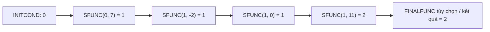
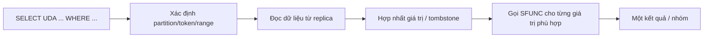

# User-defined aggregate và chi phí thực thi theo tập dữ liệu

**User-defined aggregate (UDA)** trong Apache Cassandra cho phép định nghĩa một phép tổng hợp mới trên các hàng mà truy vấn CQL đọc được. Ví dụ: ngoài các hàm có sẵn như `COUNT`, `SUM`, `AVG`, `MIN`, `MAX`, ứng dụng muốn đếm bao nhiêu sự kiện có điểm dương theo từng ngày. UDA có thể giải quyết phép tính đó ở phía Cassandra, nhưng kết quả chỉ có **một hàng** không có nghĩa rằng Cassandra chỉ đọc **một hàng**: chi phí phụ thuộc chủ yếu vào số hàng được truy vấn, phạm vi partition, kích thước trạng thái tổng hợp và độ phức tạp của mã chạy trên mỗi hàng.

Bài học thuộc chương **CQL nâng cao** của mô-đun **DATABASE_ENGINE_WIDE_COLUMN_CASSANDRA**. Nội dung kết hợp đặc điểm của Cassandra—khóa phân vùng, thiết kế bảng theo truy vấn, replication, consistency, compaction/repair và Java driver—để người học biết khi nào nên dùng UDA, khi nào nên tính trước dữ liệu và cách kiểm chứng chi phí thay vì đoán từ kích thước kết quả.

## 1. Mục tiêu học tập

Sau bài này, bạn có thể:

1. Phân biệt **UDF** (hàm xử lý một giá trị/hàng) với **UDA** (hàm tích lũy nhiều hàng) và các aggregate có sẵn.
2. Giải thích chính xác vai trò của `SFUNC`, `STYPE`, `INITCOND` và `FINALFUNC`.
3. Tạo UDF/UDA bằng CQL, chạy truy vấn trên một partition đã biết và xác minh kết quả bằng dữ liệu mẫu.
4. Ước lượng chi phí theo số **hàng cần đọc**, partition, tombstone và độ phức tạp của trạng thái, không theo số hàng đầu ra.
5. Phân tích tác động của null, kiểu số, tràn số, dữ liệu lớn, GROUP BY, consistency và timeout.
6. Đo kiểm UDA có kiểm soát, rồi đề xuất bảng tổng hợp trước hoặc pipeline xử lý ngoài Cassandra khi truy vấn quá tốn kém.

## 2. UDF, UDA và phép tổng hợp tích hợp sẵn

| Loại | Ví dụ | Hoạt động trên | Đặc điểm |
| --- | --- | --- | --- |
| **Scalar UDF** | `normalize_score(score)` | Giá trị đầu vào của một hàng | Trả một giá trị; có thể gọi trong biểu thức SELECT hoặc dùng làm thành phần của UDA. |
| **Native aggregate** | `COUNT(*)`, `SUM(score)`, `AVG(score)` | Tập hàng mà SELECT trả về | Được Cassandra cung cấp sẵn; nên ưu tiên nếu đáp ứng yêu cầu. |
| **UDA** | `count_positive(score)` | Tập hàng mà SELECT trả về | Dùng một hàm cập nhật trạng thái cho từng hàng; có thể thêm hàm chuyển trạng thái cuối thành kết quả. |

Ví dụ với các điểm `[7, -2, 0, 11]`:

- `COUNT(score)` trả **4** vì bốn hàng có giá trị score khác null.
- `SUM(score)` trả **16**.
- UDA `count_positive(score)` trả **2**, vì chỉ `7` và `11` lớn hơn 0.

UDA không phải “view đã vật hóa” hay một cột số liệu được cập nhật tự động mỗi khi INSERT. Mỗi lần gọi bằng SELECT, Cassandra phải thực hiện phép tổng hợp đối với **những hàng thuộc phạm vi truy vấn đó**. Khi muốn xem số đếm cập nhật gần thời gian thực cho nhiều partition rộng, cần cân nhắc mô hình bảng tổng hợp riêng.

## 3. Máy trạng thái của một UDA

Một UDA thực hiện việc “gấp” (fold) một luồng giá trị thành trạng thái:

```text
state_0 = INITCOND
state_1 = SFUNC(state_0, value_1)
state_2 = SFUNC(state_1, value_2)
...
state_n = SFUNC(state_(n-1), value_n)
result  = FINALFUNC(state_n)  // nếu có; nếu không, result = state_n
```



Các thành phần của `CREATE AGGREGATE`:

| Thành phần | Vai trò | Ràng buộc quan trọng |
| --- | --- | --- |
| **SFUNC** | UDF cập nhật trạng thái trên một giá trị đầu vào. | Tham số **đầu tiên** phải có kiểu `STYPE`; các tham số tiếp theo khớp chữ ký UDA; kết quả phải có kiểu `STYPE`. |
| **STYPE** | Kiểu của trạng thái trung gian. | Bắt buộc; nên nhỏ, có giới hạn và không cần giữ toàn bộ các hàng. |
| **INITCOND** | Giá trị trạng thái ban đầu. | Không bắt buộc theo cú pháp, mặc định null. Thường nên đặt giá trị trung tính, ví dụ `0` cho phép đếm. |
| **FINALFUNC** | UDF biến trạng thái cuối thành kiểu đầu ra. | Không bắt buộc; nhận đúng một tham số kiểu `STYPE`; có thể trả kiểu khác. |

**Null** cần được xử lý rõ ràng. Với `CALLED ON NULL INPUT`, SFUNC có thể được gọi với giá trị null nên phải tự kiểm tra. Với `RETURNS NULL ON NULL INPUT`, hàm không được gọi khi có tham số null, và trạng thái aggregate không cập nhật cho hàng đó; trong cấu hình kiểu này, cần có INITCOND khác null để tạo trạng thái hợp lệ. Với tập đầu vào rỗng, hãy kiểm chứng ngữ nghĩa mong muốn của INITCOND và FINALFUNC trong phiên bản đang chạy.

**Không dùng UDF/UDA cho hiệu ứng phụ** (gọi HTTP, ghi hệ thống khác, cấp ID hoặc cập nhật counter bên ngoài). Một câu SELECT có thể được retry, timeout, bị thực thi nhiều lần hoặc không hoàn tất; hàm tổng hợp nên thuần túy, xác định theo đầu vào và không phụ thuộc trạng thái toàn cục.

## 4. Điều kiện tiên quyết và rủi ro khi bật UDF

UDA được định nghĩa qua UDF, vì vậy cần chức năng **user-defined functions** được cho phép trên cụm. Trong Apache Cassandra, UDF thường **bị tắt mặc định** vì rủi ro an toàn và hiệu năng; tùy phiên bản và môi trường triển khai, quản trị viên phải cấu hình tùy chọn `user_defined_functions_enabled` trong `cassandra.yaml` và triển khai nhất quán trên các nút. Không tự chỉnh cấu hình production để làm bài lab; dịch vụ managed có thể khóa hoàn toàn chức năng này. Phần ví dụ dùng **LANGUAGE java**; không giả định JavaScript hay ngôn ngữ scripting khác còn được hỗ trợ ở mọi phiên bản.

Trước khi thực hành:

1. Có cụm **lab** hoặc môi trường thử nghiệm đã cho phép tạo UDF/UDA, với quyền CQL thích hợp.
2. Xác nhận phiên bản Cassandra, chính sách UDF, giới hạn runtime và topology DC/rack.
3. Sử dụng keyspace có **NetworkTopologyStrategy** phù hợp số nút lab; ví dụ bên dưới giả định data center tên `dc1`, RF = 3 và đủ replica.
4. Chỉ chạy các truy vấn tổng hợp toàn bảng khi bộ dữ liệu thực sự nhỏ và đã dự kiến chi phí quét.

## 5. Thực hành CQL: đếm sự kiện có score dương

### Bước 1 — Tạo keyspace và bảng theo truy vấn

Tình huống: mỗi tenant sinh nhiều sự kiện theo ngày. Truy vấn nghiệp vụ cần đếm sự kiện có score dương của **một tenant trong một ngày**, nên khóa phân vùng được thiết kế là cặp `(tenant_id, event_day)`.

```sql
CREATE KEYSPACE IF NOT EXISTS agg_lab
WITH replication = {
  'class': 'NetworkTopologyStrategy',
  'dc1': 3
}
AND durable_writes = true;

CREATE TABLE IF NOT EXISTS agg_lab.events_by_tenant_day (
  tenant_id text,
  event_day date,
  event_id timeuuid,
  score int,
  PRIMARY KEY ((tenant_id, event_day), event_id)
) WITH CLUSTERING ORDER BY (event_id ASC);
```

**Ý nghĩa khóa:** CQL có thể đọc trực tiếp partition `('tenant-a', '2026-11-21')`. Mọi hàng của partition có chung replica và được sắp xếp theo `event_id` trong phạm vi partition. Thiết kế này tránh phải tìm tất cả sự kiện của mọi tenant khi chỉ cần một tenant/ngày. Tuy vậy, một tenant/ngày có quá nhiều sự kiện vẫn có thể trở thành **partition lớn**; khi đó cần chia thêm bucket theo giờ hoặc bucket nhân tạo và tổng hợp kết quả ở ứng dụng/pipeline.

### Bước 2 — Tạo UDF cập nhật trạng thái

```sql
CREATE FUNCTION IF NOT EXISTS agg_lab.positive_state(
  state bigint,
  v int
)
CALLED ON NULL INPUT
RETURNS bigint
LANGUAGE java
AS $$
  if (state == null) {
    state = 0L;
  }
  if (v == null) {
    return state;
  }
  return state + (v > 0 ? 1L : 0L);
$$;
```

Trong thân UDF Java, `state` biểu diễn kiểu `bigint` và `v` kiểu `int`; các giá trị có thể null vì đã khai báo `CALLED ON NULL INPUT`. Mỗi lần gặp score dương, hàm cộng 1 vào trạng thái. Dùng `bigint` thay vì `int` để giảm rủi ro tràn số khi đếm nhiều hàng; `bigint` vẫn có giới hạn riêng.

### Bước 3 — Gắn UDF vào UDA

```sql
CREATE AGGREGATE IF NOT EXISTS agg_lab.count_positive(int)
SFUNC agg_lab.positive_state
STYPE bigint
INITCOND 0;
```

Ở đây:

- Chữ ký aggregate là `count_positive(int)`; một hàng đầu vào truyền một `score int`.
- `SFUNC` nhận `(bigint, int)` và trả `bigint`.
- `STYPE bigint` lưu một số đếm, kích thước gần như cố định bất kể có 10 hay 10 triệu hàng.
- Không khai báo `FINALFUNC`, nên kết quả UDA chính là số đếm `bigint`.

Nếu câu `CREATE FUNCTION` báo tính năng bị tắt hoặc không có quyền, kiểm tra cài đặt/permission với quản trị viên; **không** chuyển ví dụ thành một hàm cài thêm ở ứng dụng mà vẫn gọi là UDA trong Cassandra.

### Bước 4 — Nạp dữ liệu và truy vấn

```sql
CONSISTENCY LOCAL_QUORUM;

INSERT INTO agg_lab.events_by_tenant_day
  (tenant_id, event_day, event_id, score)
VALUES ('tenant-a', '2026-11-21', now(), 7);

INSERT INTO agg_lab.events_by_tenant_day
  (tenant_id, event_day, event_id, score)
VALUES ('tenant-a', '2026-11-21', now(), -2);

INSERT INTO agg_lab.events_by_tenant_day
  (tenant_id, event_day, event_id, score)
VALUES ('tenant-a', '2026-11-21', now(), 0);

INSERT INTO agg_lab.events_by_tenant_day
  (tenant_id, event_day, event_id, score)
VALUES ('tenant-a', '2026-11-21', now(), 11);

INSERT INTO agg_lab.events_by_tenant_day
  (tenant_id, event_day, event_id, score)
VALUES ('tenant-b', '2026-11-21', now(), 9);

SELECT agg_lab.count_positive(score) AS positive_count
FROM agg_lab.events_by_tenant_day
WHERE tenant_id = 'tenant-a'
  AND event_day = '2026-11-21';
```

Kết quả kỳ vọng cho **tenant-a/ngày 2026-11-21** là `positive_count = 2`; sự kiện `tenant-b` **không** được tính. Vì sử dụng `now()`, mỗi lệnh INSERT tạo một event_id mới; khi chạy lại toàn bộ các INSERT, bạn sẽ có thêm hàng mới và tổng sẽ tăng. Muốn tái lập chính xác số liệu, hãy dùng event_id cố định trong một key thử nghiệm mới hoặc dọn dữ liệu lab có kiểm soát.

Đối chiếu với native aggregates trong **cùng partition**:

```sql
SELECT COUNT(*) AS total_rows,
       COUNT(score) AS non_null_scores,
       SUM(score) AS score_sum,
       AVG(score) AS score_avg
FROM agg_lab.events_by_tenant_day
WHERE tenant_id = 'tenant-a'
  AND event_day = '2026-11-21';
```

Với bốn hàng mẫu vừa tạo, kỳ vọng `total_rows = 4`, `non_null_scores = 4`, `score_sum = 16`. `AVG(score)` cho kết quả theo ngữ nghĩa/kiểu dữ liệu của hàm native trong phiên bản đang dùng; ở ví dụ này trung bình toán học là 4. Đối với phép tính đã có sẵn, **ưu tiên hàm native** thay vì tạo UDF mới.

### Bước 5 — FINALFUNC tùy chọn

Nếu cần định dạng kết quả thành text, thêm một UDF nhận **trạng thái cuối**:

```sql
CREATE FUNCTION IF NOT EXISTS agg_lab.render_positive_count(n bigint)
CALLED ON NULL INPUT
RETURNS text
LANGUAGE java
AS $$
  return "count=" + (n == null ? 0L : n.longValue());
$$;

CREATE AGGREGATE IF NOT EXISTS agg_lab.positive_count_text(int)
SFUNC agg_lab.positive_state
STYPE bigint
FINALFUNC agg_lab.render_positive_count
INITCOND 0;

SELECT agg_lab.positive_count_text(score) AS summary
FROM agg_lab.events_by_tenant_day
WHERE tenant_id = 'tenant-a'
  AND event_day = '2026-11-21';
```

Kết quả dự kiến `summary = 'count=2'`. `FINALFUNC` chỉ được gọi sau khi tích lũy xong, **không phải mỗi hàng**. Ví dụ này minh họa cú pháp; trong ứng dụng thực tế, thường nên trả số từ Cassandra rồi định dạng ở Java/API để tránh thêm UDF không cần thiết.

## 6. Vì sao dữ liệu quyết định chi phí?

UDA không có chỉ mục/giá trị tổng hợp được lưu sẵn chỉ vì bạn đã tạo `CREATE AGGREGATE`. Truy vấn phải tìm các partition phù hợp, đọc dữ liệu cần thiết, đưa các giá trị vào SFUNC và trả kết quả. Việc replica phải hợp nhất dữ liệu từ memtable/SSTable, xử lý tombstone và đáp ứng consistency level tạo thêm chi phí.

Hình dung:



**Mô hình ước lượng**, không phải công thức thời gian thực tuyệt đối:

```text
P = số partition cần truy cập
R = số hàng thực sự cần đọc/đưa vào aggregate
T = lượng tombstone/phiên bản dữ liệu phải xử lý trong quá trình đọc
M = kích thước state trung gian cho mỗi nhóm
C = chi phí CPU của một lần SFUNC

Chi phí ~ định tuyến(P) + đọc/ghép dữ liệu(R, T, SSTables, network)
           + R * C + finalization + overhead nhất quán/phân trang
Bộ nhớ state ~ O(M) cho mỗi trạng thái aggregate đang xử lý
```

Đây là cách **tư duy về các thành phần chi phí**, không có hệ số cố định để tính latency. Dữ liệu có cache, phân phối token, số SSTable, tombstone, replica load và mức consistency khác nhau có thể khiến hai tập cùng R có độ trễ khác nhau. Với SFUNC có thời gian gần như hằng số, số lần gọi xấp xỉ số giá trị đầu vào phù hợp; nếu hàm bỏ qua null theo cách khai báo hoặc engine có tối ưu riêng, số lần gọi thực tế có thể thấp hơn.

| Trường hợp | Phạm vi dữ liệu | Quy mô SFUNC cần xét | Nhận định |
| --- | --- | --- | --- |
| **A. Một partition nhỏ** | 1 tenant/ngày, 100 hàng | Khoảng 100 giá trị | Hợp lý để thử, nhưng vẫn phải đo. |
| **B. Một partition lớn** | 1 tenant/ngày, 100.000 hàng | Khoảng 100.000 giá trị | Đọc dài, nguy cơ hot/wide partition, timeout và CPU coordinator. |
| **C. Nhiều partition** | 100 tenant/ngày, mỗi partition 1.000 hàng | Khoảng 100.000 giá trị **cộng** điều phối nhiều partition | Chi phí mạng, fan-out và tail latency tăng; số partition cũng quan trọng. |
| **D. Quét toàn bảng** | 10 triệu hàng, không giới hạn khóa | Có thể cần xử lý cỡ 10 triệu giá trị | Không phù hợp làm truy vấn đồng bộ thường xuyên của API; dễ chiếm tài nguyên cụm. |
| **E. Truy vấn khóa + khoảng clustering nhỏ** | Partition 100.000 hàng, chỉ đọc 2.000 hàng theo khoảng khóa | Khoảng 2.000 giá trị | Có thể giảm chi phí nếu predicate đi theo primary key và không buộc filtering rộng. |

**Quan trọng:** số hàng trong bảng, số hàng *được quét để lọc* và số hàng *đưa vào SFUNC* không nhất thiết bằng nhau. Dùng `ALLOW FILTERING` có thể khiến Cassandra quét lượng dữ liệu rất lớn dù kết quả lọc ít. Số hàng đầu ra của một aggregate thường chỉ là **một** (hoặc một mỗi nhóm), hoàn toàn không thể dùng làm thước đo lượng dữ liệu đã đọc.

### Ví dụ giới hạn bằng khóa clustering

Do `event_id` là clustering key kiểu timeuuid, có thể giới hạn khoảng thời gian trong **partition cụ thể**:

```sql
SELECT agg_lab.count_positive(score) AS positive_count
FROM agg_lab.events_by_tenant_day
WHERE tenant_id = 'tenant-a'
  AND event_day = '2026-11-21'
  AND event_id >= minTimeuuid('2026-11-21 08:00:00+0000')
  AND event_id <  minTimeuuid('2026-11-21 09:00:00+0000');
```

Đây là ví dụ giới hạn theo **clustering range** có hỗ trợ bởi thiết kế khóa. Nếu nhu cầu chính là tổng hợp theo giờ, có thể lập bảng với partition `(tenant_id, event_day, hour_bucket)` để truy vấn đúng bucket; đánh đổi là cần kết hợp nhiều bucket cho báo cáo ngày.

## 7. GROUP BY của CQL không tương đương SQL tùy ý

Trong Cassandra, `GROUP BY` chỉ chấp nhận các cột **primary key theo thứ tự cho phép** (partition key và tiền tố clustering key), với các giới hạn của CQL. Không thể mặc định dùng `GROUP BY score` như SQL để nhóm toàn bộ dữ liệu theo một cột thường. Với bảng `events_by_tenant_day`, việc nhóm theo một cột không phải khóa, hoặc truy vấn chỉ theo `tenant_id` mà bỏ `event_day`, không được giải quyết tự động bằng UDA.

Nếu cần báo cáo “số sự kiện score dương cho mọi tenant theo từng ngày”:

1. Truy vấn một danh sách tenant/ngày **đã biết** bằng các partition key cụ thể rồi tổng hợp ngoài Cassandra, có giới hạn fan-out.
2. Xây bảng tổng hợp trước theo đúng chiều truy vấn `(tenant_id, day)`.
3. Với nhu cầu phân tích rộng, đưa dữ liệu sang hệ thống phân tích/batch/stream thích hợp.

Không dùng `ALLOW FILTERING` như một phép chữa tổng quát cho schema sai: nó có thể cho phép quét rộng nhưng không tạo đường truy cập hiệu quả hay phép GROUP BY tùy ý.

## 8. Chi phí của SFUNC và kiểu trạng thái

Chi phí không chỉ do `R`. Một SFUNC viết kém có thể làm tăng CPU, cấp phát heap hoặc garbage collection (GC) trên các nút Cassandra:

| Thiết kế SFUNC/STYPE | Chi phí tương đối | Rủi ro |
| --- | --- | --- |
| `bigint` cộng 1 | Cập nhật hằng số, state nhỏ | Tràn 64-bit nếu dữ liệu cực lớn; cần định nghĩa xử lý. |
| `tuple<count,sum>` với hai số | State nhỏ, cập nhật hằng số | Tràn số, null, chia cho 0 ở FINALFUNC. |
| `list<...>` thêm từng giá trị vào state | State tăng theo số hàng | Cấp phát, serialization, GC/OOM, giới hạn kích thước giá trị. |
| Tạo nhiều chuỗi/object trên mỗi hàng | CPU/cấp phát tăng theo R | Độ trễ cao ngay cả với partition vừa. |
| Thuật toán duyệt lại toàn bộ state mỗi lần | Có thể gần **O(R²)** | Chậm nghiêm trọng khi R tăng, khó dự đoán timeout. |

Để tính trung bình theo cách ổn định hơn, state có thể giữ **tổng và số lượng** rồi FINALFUNC chia. Cần chọn kiểu số đủ rộng, quy định cách xử lý null, tổng bằng 0 và trường hợp số thực có sai số làm tròn. Với phép thống kê có yêu cầu chính xác tài chính, không nên dùng `double` chỉ vì thuận tiện.

**Thứ tự hàng và nhóm**: đừng viết SFUNC phụ thuộc vào thứ tự xử lý của các hàng trên nhiều partition, hoặc giả định thao tác số thực cho kết quả bit-for-bit như nhau dưới mọi cách tính. Phép tổng hợp nên có ngữ nghĩa bất biến mong muốn; nếu nghiệp vụ thực sự cần thứ tự, thiết kế truy vấn theo clustering key đã định và kiểm chứng quy tắc cụ thể.

## 9. COUNT/UDA dưới consistency, replication và vòng đời dữ liệu

- **Consistency:** `LOCAL_QUORUM` khiến thao tác đọc phối hợp với đủ replica trong DC cục bộ theo RF; UDA vẫn chỉ phản ánh *ảnh chụp dữ liệu mà yêu cầu đọc có thể quan sát*, không tạo snapshot giao dịch xuyên nhiều partition đang có writer đồng thời.
- **Replication:** Cassandra không nhân số hàng được báo cáo lên theo RF. Ba replica của cùng một partition là ba bản sao để phục vụ đọc/ghi, **không phải ba sự kiện riêng** để SFUNC đếm ba lần.
- **Compaction:** nhiều SSTable và các phiên bản dữ liệu có thể làm tăng chi phí phục vụ truy vấn; compaction giúp tổ chức lại dữ liệu nhưng tốn I/O, không biến phép tổng hợp thành số liệu lưu sẵn.
- **TTL và tombstone:** khi dữ liệu hết hạn/xóa, kết quả truy vấn thay đổi theo trạng thái nhìn thấy; việc xử lý tombstone có thể đắt dù còn ít hàng live. Đừng đánh giá chi phí chỉ từ `COUNT(*)` các hàng còn sống.
- **Repair:** phục hồi/hội tụ bản sao giúp duy trì độ chính xác của dữ liệu được đọc sau sự cố. UDA không thay thế repair và không giải quyết các thiếu nhất quán do replication hoặc lỗi vận hành.
- **Ghi đồng thời:** kết quả một aggregate chạy trong lúc nhiều partition đang được cập nhật không nên được xem như báo cáo nhất quán tức thời trên toàn cluster.

Với API cần số liệu **chính xác tuyệt đối tại một thời điểm** cho nhiều partition, cần định nghĩa rõ ngữ nghĩa snapshot/đồng bộ và chọn hệ thống hoặc quy trình hỗ trợ phù hợp, thay vì gắn UDA lên truy vấn rộng rồi mặc định có tính chất giao dịch.

## 10. Đo kiểm đúng cách thay vì dự đoán theo cú pháp

### Quy trình benchmark trong lab

1. Chuẩn bị các bộ dữ liệu có quy mô đã biết: chẳng hạn **100 / 1.000 / 10.000 / 100.000 hàng** trên các partition thử nghiệm riêng. Không phát sinh tải lớn vào cụm production.
2. Chạy truy vấn có **đủ partition key**, ở consistency giống nhau; so sánh UDA với native aggregate hoặc thao tác tương đương khi phù hợp.
3. Ghi **p50, p95, p99** qua nhiều lượt đo (đừng kết luận từ một lần chạy), timeout, lỗi UDF, throughput, CPU/GC của coordinator và replica, network/disk I/O.
4. Phân biệt lượt đọc lạnh và ấm cache; cùng lượt chạy nên giữ trạng thái cluster và traffic tương đối ổn định.
5. Bật tracing cho **một vài truy vấn đại diện**, không bật đại trà dưới tải cao:

```sql
TRACING ON;

SELECT agg_lab.count_positive(score) AS positive_count
FROM agg_lab.events_by_tenant_day
WHERE tenant_id = 'tenant-a'
  AND event_day = '2026-11-21';

TRACING OFF;
```

6. Thử trường hợp nhiều tombstone, partition lớn, mất replica và UDF ném exception **trên lab** để thấy ranh giới timeout/lỗi. Dữ liệu nạp thêm phải được ghi nhận chính xác để so sánh.

| Chỉ số cần báo cáo | Câu hỏi nó trả lời |
| --- | --- |
| Số partition và hàng phù hợp | Truy vấn thực sự phải duyệt phạm vi nào? |
| Latency p50/p95/p99 | Độ trễ điển hình và đuôi lớn ra sao khi R tăng? |
| CPU/GC nút thực thi | SFUNC có đẩy tải sang máy chủ Cassandra không? |
| Disk I/O, SSTables/tombstones | Đọc dữ liệu và dọn tombstone làm tăng chi phí thế nào? |
| Timeout/exception | UDA gặp ngưỡng vận hành ở đâu; có cần giới hạn input không? |
| So sánh native aggregate và UDA | Mã UDF thêm chi phí bao nhiêu so với phép tính sẵn có? |

**Diễn giải kết quả:** nếu thời gian tăng cùng số hàng đọc, tối ưu biểu thức UDF chỉ giúp một phần; thay đổi **đường truy cập dữ liệu và quy mô đầu vào** thường có tác động lớn hơn. Nếu CPU tăng bất thường dù số hàng ổn định, kiểm tra triển khai SFUNC (cấp phát object, thuật toán, null/exception).

## 11. Đưa kết quả UDA vào ứng dụng Java

Ví dụ Java Driver 4.x minh họa truy vấn đúng partition; `CqlSession` đã cấu hình contact points, local DC, authentication và timeout theo môi trường:

```java
import java.time.LocalDate;
import com.datastax.oss.driver.api.core.ConsistencyLevel;
import com.datastax.oss.driver.api.core.cql.PreparedStatement;
import com.datastax.oss.driver.api.core.cql.BoundStatement;
import com.datastax.oss.driver.api.core.cql.Row;

PreparedStatement stmt = session.prepare(
    "SELECT agg_lab.count_positive(score) AS positive_count " +
    "FROM agg_lab.events_by_tenant_day " +
    "WHERE tenant_id = ? AND event_day = ?");

BoundStatement query = stmt.bind(
        "tenant-a", LocalDate.of(2026, 11, 21))
    .setConsistencyLevel(ConsistencyLevel.LOCAL_QUORUM);

Row row = session.execute(query).one();
long count = row == null || row.isNull("positive_count")
    ? 0L
    : row.getLong("positive_count");
```

Mẫu này sử dụng **prepared statement** để tránh ghép chuỗi đầu vào, và truyền đầy đủ khóa phân vùng để giới hạn chi phí. `setPageSize` trên một truy vấn aggregate không biến kết quả một hàng thành phép tính rẻ: vẫn phải xét toàn bộ dữ liệu thuộc phạm vi truy vấn. Ứng dụng nên có timeout hợp lý, log số partition/khung thời gian truy vấn, giới hạn fan-out và đo p95/p99 khi R tăng.

**Lưu ý dữ liệu rỗng:** đoạn ví dụ ánh xạ null về 0 chỉ hợp lý khi ngữ nghĩa nghiệp vụ là đếm; với UDA trả trung bình hoặc tỉ lệ, null có thể mang nghĩa “không có dữ liệu” và không nên ép về 0.

## 12. Khi nào không nên dùng UDA?

| Nhu cầu | Phương án gợi ý | Vì sao |
| --- | --- | --- |
| Đếm/tính tổng đơn giản trong một partition nhỏ | `COUNT` / `SUM` native | Ít mã tự quản lý, thường tránh được overhead UDF. |
| Phép tính tùy biến trên một partition có kích thước được giới hạn | UDA với SFUNC nhỏ, đo kiểm | Đọc có phạm vi xác định và số lần gọi SFUNC có thể kiểm soát. |
| Dashboard truy vấn liên tục trên hàng triệu event | Bảng tổng hợp theo tenant/ngày/giờ, cập nhật qua stream/batch | Truy vấn tra cứu một hàng thay vì đọc lại mọi event. |
| Số liệu phân tích trên nhiều partition hoặc toàn cluster | Engine phân tích chuyên dụng / job ngoài Cassandra | Phù hợp với quét, grouping, song song và workload phân tích. |
| Cần cập nhật counter đồng thời với INSERT sự kiện như một giao dịch nhiều partition | Quy trình có idempotency, đối soát hoặc pipeline phù hợp | Cassandra counter và các bảng riêng không tự tạo giao dịch xuyên partition. |
| UDF bị cấm vì bảo mật/managed service | Tổng hợp trong Java trên tập dữ liệu nhỏ hoặc xử lý ngoài cụm | Không cần mở quyền chạy mã tùy biến trên Cassandra. |

### Mẫu bảng tổng hợp trước

Khi yêu cầu chính là “số score dương theo từng tenant và ngày”, một bảng đọc tối ưu có thể là:

```sql
CREATE TABLE IF NOT EXISTS agg_lab.positive_count_by_tenant_day (
  tenant_id text,
  event_day date,
  positive_count bigint,
  updated_at timestamp,
  PRIMARY KEY ((tenant_id, event_day))
);

SELECT positive_count, updated_at
FROM agg_lab.positive_count_by_tenant_day
WHERE tenant_id = 'tenant-a'
  AND event_day = '2026-11-21';
```

Đây là **schema đọc**, chưa phải cơ chế cập nhật số đếm. Việc duy trì bảng phải được thiết kế riêng: sự kiện trùng/retry, thay đổi score, xóa, TTL và thất bại giữa ghi event và cập nhật aggregate đều phải được xử lý. Một pipeline idempotent có thể tái tính/đối soát từng bucket định kỳ. Nếu cập nhật bằng Cassandra counter, cần hiểu counter không tự bảo đảm đồng bộ nguyên tử với bảng sự kiện và các retry thiếu kiểm soát có thể gây đếm trùng.

## 13. Lỗi thường gặp và cách tự kiểm tra

| Lỗi suy luận | Vì sao sai / khắc phục |
| --- | --- |
| “UDA chỉ trả một hàng nên đọc rất nhanh.” | Một kết quả có thể cần duyệt hàng triệu hàng. Luôn xét phạm vi khóa và R. |
| “`CREATE AGGREGATE` lưu sẵn tổng.” | UDA là **định nghĩa cách tính** khi SELECT; muốn lưu sẵn phải xây bảng/pipeline tổng hợp. |
| “`GROUP BY` trong Cassandra giống PostgreSQL.” | CQL giới hạn nhóm theo primary key và thứ tự hỗ trợ. |
| “`ALLOW FILTERING` làm UDA chạy được thì đã tối ưu.” | Nó có thể cho phép quét rộng và gây latency khó đoán. |
| “Dùng `LIMIT 1` chắc chắn chỉ gọi SFUNC một lần.” | Không suy số hàng xử lý từ số hàng kết quả. Đọc ngữ nghĩa LIMIT cụ thể và đo trên phiên bản đang chạy. |
| “UDF có thể giữ mọi giá trị vào list để tính sau.” | State tăng với R, gây GC/OOM; dùng state nhỏ/bounded hoặc chuyển workload sang engine khác. |
| “Một hàm tổng hợp được phép gọi API để ghi log nghiệp vụ.” | SELECT có thể timeout/retry; UDF không nên có hiệu ứng phụ, runtime còn bị sandbox. |
| “RF = 3 nên mỗi hàng được tính ba lần.” | Replica là bản sao của partition, không phải ba bản ghi nghiệp vụ. |
| “Đếm hàng sống ít tức truy vấn ít chi phí.” | Tombstone, SSTables và đường truy cập còn quyết định chi phí. |
| “Bảng rollup và bảng sự kiện tự nhất quán nguyên tử.” | Hai partition/bảng cần quy trình cập nhật và đối soát. |

## 14. Bài tập thực hành

**Bài A — Khảo sát ngữ nghĩa.** Tạo UDA `count_positive(int)` và nạp bốn hàng mẫu `7, -2, 0, 11` vào đúng một partition. Xác nhận kết quả 2, rồi nạp thêm một hàng `score = 5` và xác nhận kết quả tăng thành 3. Đối chiếu với `COUNT(score)` và `SUM(score)`. Thử thêm một hàng không có score để xem cách UDF xử lý null.

**Bài B — Khảo sát chi phí.** Chuẩn bị ít nhất ba partition lab tương ứng 100, 1.000 và 10.000 hàng. Chạy cùng một UDA, thu độ trễ nhiều lượt, quan sát tracing/CPU và trình bày đồ thị `latency` theo `R`. Không ghi con số từ ví dụ ước lượng thành “benchmark thực tế”; kết quả phải đo trong cụm của bạn.

**Bài C — Thiết kế thay thế.** Nếu tenant lớn có một triệu sự kiện/ngày và dashboard truy vấn mỗi 5 giây, hãy thiết kế `positive_count_by_tenant_day` hoặc bucket theo giờ. Giải thích cách pipeline chịu được retry/duplicate, có cơ chế sửa sai và độ trễ cập nhật mà dashboard chấp nhận.

**Tiêu chí hoàn thành:** người học giải thích được **(a)** SFUNC được gọi trên tập đầu vào nào, **(b)** phạm vi partition/clustering nào làm thay đổi R, **(c)** state có kích thước và độ phức tạp ra sao, và **(d)** khi nào nên chuyển từ UDA truy vấn trực tiếp sang bảng tổng hợp trước.

## 15. Câu hỏi tự đánh giá

1. Vì sao UDA `count_positive` không thể rẻ đi chỉ bằng cách thay đổi tên hàm hoặc alias của cột kết quả?
2. Nếu cùng đọc 10.000 hàng, một SFUNC cộng số và một SFUNC duyệt list 10.000 phần tử sẽ có sự khác biệt nào về độ phức tạp?
3. `INITCOND 0` giải quyết trường hợp nào? Vì sao kiểu `STYPE` phải khớp tham số đầu của SFUNC?
4. `FINALFUNC` được gọi khi nào? Nó có làm giảm số hàng cần đọc không?
5. Vì sao không nên dùng `GROUP BY score` trên một cột thường của Cassandra để mô phỏng SQL?
6. Vì sao `COUNT(*)` hoặc UDA trên toàn bảng là truy vấn nguy hiểm khi dữ liệu và số partition tăng lớn?
7. Nếu ứng dụng cần xem số đếm mỗi giây, bạn sẽ chọn UDA hay rollup? Cần làm gì để giữ số liệu đúng khi có retry và xóa dữ liệu?

## 16. Tài liệu tham khảo

- [Apache Cassandra — Functions (UDF, native aggregates, UDA)](https://cassandra.apache.org/doc/latest/cassandra/developing/cql/functions.html): cú pháp `CREATE FUNCTION`/`CREATE AGGREGATE`, `SFUNC`, `STYPE`, `FINALFUNC`, `INITCOND`, ví dụ UDA và cấu hình cho phép UDF.
- [Apache Cassandra — Data Manipulation (SELECT, GROUP BY, LIMIT, ALLOW FILTERING)](https://cassandra.apache.org/doc/latest/cassandra/developing/cql/dml.html): ràng buộc truy vấn, grouping và cảnh báo về quét rộng.
- [Apache Cassandra — cassandra.yaml Configuration](https://cassandra.apache.org/doc/stable/cassandra/managing/configuration/cass_yaml_file.html): tùy chọn `user_defined_functions_enabled` và các tham số vận hành.

**Ghi nhớ:** UDA là **một phép tính trên dữ liệu được truy vấn**, không phải kết quả tổng hợp được cập nhật sẵn. Chọn khóa phân vùng và clustering key để kiểm soát số hàng đầu vào, giữ trạng thái SFUNC nhỏ và an toàn, đo CPU/latency trên dữ liệu thật, và chuyển workload phân tích lớn sang mô hình tổng hợp trước hoặc hệ thống chuyên dụng khi chi phí không còn phù hợp với mục tiêu đọc nhanh của Cassandra.
