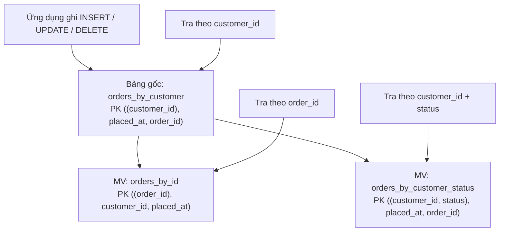

# Materialized view, bảng gốc và quan hệ khóa

**Chương:** CQL nâng cao  
**Module:** `DATABASE_ENGINE_WIDE_COLUMN_CASSANDRA` — Apache Cassandra

Trong phạm vi module này, chúng ta tìm hiểu kiến trúc phân tán và mô hình wide-column của Cassandra; thiết kế bảng theo truy vấn, partition key, consistency level, replication, CQL, vận hành và cách kết nối từ ứng dụng Java. Bài này tập trung vào một câu hỏi thực tế: **khi cùng dữ liệu cần được truy vấn theo nhiều khóa khác nhau, quan hệ giữa bảng gốc (base table) và materialized view (MV) được hình thành và duy trì như thế nào?**

Một materialized view trong Cassandra là **một cấu trúc lưu trữ vật lý** do Cassandra duy trì từ dữ liệu của **một bảng gốc**. Nó cho phép truy vấn cùng hàng logic qua **primary key khác**; không phải view SQL thuần chỉ lưu định nghĩa câu `SELECT`. Tuy nhiên, view không phải transaction xuyên nhiều bảng, không phải phép `JOIN` và cũng không thay thế nguyên tắc thiết kế dữ liệu theo truy vấn.

## 1. Mục tiêu học tập

Sau khi học, bạn có thể:

1. Phân biệt bảng gốc, materialized view, bảng tự denormalize và secondary index.
2. Chỉ rõ cách **primary key của view** phải liên hệ với **primary key của bảng gốc**.
3. Viết `CREATE MATERIALIZED VIEW` có điều kiện `IS NOT NULL` hợp lệ, kiểm tra vì sao một số định nghĩa bị từ chối.
4. Theo dõi thao tác `INSERT`, `UPDATE`, `DELETE` ở bảng gốc và sự thay đổi tương ứng của view.
5. Giải thích tình trạng **eventual consistency**, chi phí read-before-write, view build, lỗi một phần, repair và các rủi ro vận hành.
6. Chọn MV hay bảng được duy trì từ ứng dụng khi có thêm một access pattern.
7. Truy vấn cả bảng gốc và view bằng Java Driver mà không coi phản hồi ghi base là cam kết đọc view tức thời.

**Giới hạn ví dụ:** cú pháp hướng tới Apache Cassandra 4.1/5.x với tính năng materialized views được bật và được hỗ trợ trong cluster. Một số bản phân phối hoặc cấu hình có thể khóa/tắt MV hay có hạn chế khác. Kiểm tra phiên bản, cấu hình và chính sách sử dụng MV trước khi triển khai trong production; đừng mặc định rằng một ví dụ đúng cú pháp là phương án vận hành tốt nhất.

## 2. Bảng gốc, view và vì sao cần đổi khóa

Giả sử ứng dụng thương mại điện tử thường đọc các đơn hàng theo khách hàng, mới nhất trước:

```sql
CREATE TABLE lab_mv.orders_by_customer (
    customer_id uuid,
    placed_at timestamp,
    order_id uuid,
    status text,
    total_cents bigint,
    PRIMARY KEY ((customer_id), placed_at, order_id)
) WITH CLUSTERING ORDER BY (placed_at DESC, order_id ASC);
```

Với bảng này:

- `customer_id` là **partition key**. Các hàng của một khách nằm trong cùng partition logic.
- `placed_at` và `order_id` là **clustering columns**. Chúng xác định duy nhất hàng trong partition và quy định thứ tự lưu trữ.
- `status` và `total_cents` là các cột thường. Chúng không tự trở thành đường truy cập hiệu quả của câu `WHERE`.
- Primary key bảng gốc là tập `{customer_id, placed_at, order_id}`. Việc đổi `status` hay `total_cents` không đổi định danh hàng gốc.

Truy vấn được thiết kế sẵn:

```sql
SELECT placed_at, order_id, status, total_cents
FROM lab_mv.orders_by_customer
WHERE customer_id = 10000000-0000-4000-8000-000000000001
LIMIT 20;
```

Nhưng dịch vụ khác cần:

- Tra đơn hàng bằng **`order_id`** khi khách gửi mã đơn mà không biết `customer_id`.
- Liệt kê các đơn **`PAID`** của một khách, có thể sắp theo `placed_at`.

Bảng gốc không có đường truy cập khóa tự nhiên cho `WHERE order_id = ?` khi thiếu `customer_id`, và cũng không tự hỗ trợ truy vấn `WHERE customer_id = ? AND status = ?` một cách hiệu quả trên dữ liệu lớn. Materialized view cho phép đổi cách tổ chức khóa để phục vụ các truy vấn ấy.

### Sơ đồ quan hệ



Các mũi tên từ bảng gốc đến MV biểu diễn cơ chế Cassandra duy trì dữ liệu phát sinh; **không có phép sao chép nguyên tử đồng thời cho mọi observer**.

## 3. Quy tắc quan trọng nhất: primary key của view

### 3.1. Không được làm mất định danh hàng gốc

Với bảng gốc:

```text
Base PRIMARY KEY = ((customer_id), placed_at, order_id)
Base PK columns = {customer_id, placed_at, order_id}
```

Một view hợp lệ có thể có:

```text
View A PRIMARY KEY = ((order_id), customer_id, placed_at)
View B PRIMARY KEY = ((customer_id, status), placed_at, order_id)
```

**Mọi cột thuộc primary key của bảng gốc phải có mặt trong primary key của view.** Bằng cách đó, nếu hai hàng gốc có cùng giá trị ở cột được dùng làm khóa tra cứu mới, chúng vẫn không bị ghi đè vào cùng một hàng view.

Ví dụ: hai khách khác nhau có thể phát sinh cùng một `placed_at` hoặc một số giá trị `status`. Nếu view chỉ đặt `PRIMARY KEY (status)`, hàng của hàng nghìn đơn `PAID` sẽ trùng khóa và không còn ánh xạ đúng một-một từ các hàng gốc.

Quy tắc cốt lõi của Cassandra MV:

| Thành phần | Quy định |
| --- | --- |
| Các cột thuộc PK gốc | **Đều phải nằm trong PK view**, dù thứ tự hoặc cách phân chia partition/clustering có thể thay đổi. |
| Cột không nằm trong PK gốc | Chỉ được thêm **tối đa một** cột như vậy vào PK view. |
| Các cột tạo thành PK view | Phải có điều kiện `IS NOT NULL` phù hợp trong `WHERE` của định nghĩa view. |
| Nguồn dữ liệu | View lấy dữ liệu từ **một** base table, không từ phép join nhiều bảng. |
| Truy vấn trên view | Tuân theo quy tắc partition key/clustering key của **chính view**. |
| Ghi dữ liệu | Ghi, sửa, xóa vào bảng gốc; view được hệ thống duy trì, không cập nhật trực tiếp bằng DML thông thường. |

Giới hạn một cột không thuộc PK gốc có thể gây bất ngờ. Chẳng hạn, nếu `status` và `channel` đều là cột thường, việc cố dùng cả hai làm **các thành phần mới** của view PK là không hợp lệ. Trường hợp cần khóa theo nhiều thuộc tính bổ sung có thể phù hợp hơn với **bảng theo truy vấn được ứng dụng duy trì**.

### 3.2. Tại sao phải có `IS NOT NULL`?

Một cột thường có thể chưa được ghi hoặc đã bị xóa (tương ứng giá trị null). Trong khi đó, **primary key không được null**. Khi bạn nâng `status` từ cột thường thành một phần PK của MV, Cassandra cần biết hàng nào có đủ giá trị để xuất hiện trong view.

```sql
-- Hàng gốc với status = null:
-- Vẫn tồn tại trong orders_by_customer theo customer_id + placed_at + order_id.
-- Không thể tạo hàng tương ứng ở MV mà status là thành phần PK.
```

Vì vậy view theo `status` cần `status IS NOT NULL` bên cạnh kiểm tra các cột PK gốc. Điều này là **điều kiện đủ để có khóa view**; đừng hiểu là MV hỗ trợ mọi biểu thức lọc `WHERE` như SQL (ví dụ arbitrary `OR`, `JOIN`, group hoặc aggregate).

### 3.3. Cột được chọn và cột tạo khóa khác nhau

Định nghĩa:

```sql
SELECT customer_id, placed_at, order_id, status, total_cents
...
PRIMARY KEY ((customer_id, status), placed_at, order_id)
```

Có nghĩa:

- `customer_id`, `status`, `placed_at`, `order_id`: tạo **định danh và đường đọc** của hàng view.
- `total_cents`: cột được **chiếu (projected)** vào view để trả về cho client, nhưng không tham gia phân phối hoặc sắp xếp.
- Thêm `total_cents` vào danh sách `SELECT` **không** cho phép `WHERE total_cents > ?` trên view nếu không có đường truy cập khác.

Nếu bỏ một cột cần hiển thị khỏi phần `SELECT`, không thể kỳ vọng view chứa sẵn cột đó. Còn các cột của base PK bắt buộc tham gia khóa view theo quy tắc trên.

## 4. Tạo môi trường thực hành

Dùng cluster thử nghiệm ba node, cùng một datacenter, ví dụ `datacenter1`. Trong phòng lab, kiểm tra trạng thái node trước khi tạo schema:

```bash
nodetool status
cqlsh
```

Trong `cqlsh`:

```sql
SELECT data_center, release_version FROM system.local;
```

Dưới đây đặt RF=3 trong datacenter `datacenter1`. Nếu cluster có tên datacenter khác hoặc ít hơn ba replica, cần điều chỉnh cấu hình **theo môi trường thực tế** trước khi làm; trong bài chọn ba node để thí nghiệm `LOCAL_QUORUM`. Không chạy trực tiếp trên dữ liệu production.

```sql
CREATE KEYSPACE IF NOT EXISTS lab_mv
WITH replication = {
  'class': 'NetworkTopologyStrategy',
  'datacenter1': 3
}
AND durable_writes = true;

CREATE TABLE IF NOT EXISTS lab_mv.orders_by_customer (
    customer_id uuid,
    placed_at timestamp,
    order_id uuid,
    status text,
    total_cents bigint,
    PRIMARY KEY ((customer_id), placed_at, order_id)
) WITH CLUSTERING ORDER BY (placed_at DESC, order_id ASC);
```

Thử lệnh `CREATE MATERIALIZED VIEW` ở mục sau. Nếu bị từ chối vì tính năng bị tắt, cấu hình không cho phép hoặc phiên bản không hỗ trợ, **dừng phần thực hành MV**, ghi nguyên thông báo lỗi rồi kiểm tra tài liệu và chính sách phiên bản được vận hành. Không tự đổi cấu hình production chỉ để chạy bài lab.

## 5. View thứ nhất: tra cứu đơn hàng theo `order_id`

Đầu tiên tạo view đổi partition key từ `customer_id` sang `order_id`:

```sql
CREATE MATERIALIZED VIEW IF NOT EXISTS lab_mv.orders_by_id AS
    SELECT customer_id, placed_at, order_id, status, total_cents
    FROM lab_mv.orders_by_customer
    WHERE customer_id IS NOT NULL
      AND placed_at IS NOT NULL
      AND order_id IS NOT NULL
    PRIMARY KEY ((order_id), customer_id, placed_at);
```

So sánh từng phần:

| Bảng | Partition key | Clustering columns | Kiểu truy vấn chủ đạo |
| --- | --- | --- | --- |
| `orders_by_customer` (base) | `customer_id` | `placed_at, order_id` | Tất cả đơn của một khách theo thời gian. |
| `orders_by_id` (MV) | `order_id` | `customer_id, placed_at` | Tìm hàng theo mã đơn từ bất kỳ khách nào. |

View giữ **đủ ba cột PK gốc** trong khóa mới và không thêm cột thường vào khóa. Do đó câu `WHERE` chỉ cần kiểm tra null trên ba cột gốc.

### 5.1. Nạp dữ liệu và quan sát ánh xạ

```sql
CONSISTENCY LOCAL_QUORUM

INSERT INTO lab_mv.orders_by_customer
    (customer_id, placed_at, order_id, status, total_cents)
VALUES (
    10000000-0000-4000-8000-000000000001,
    '2026-11-20T09:00:00Z',
    20000000-0000-4000-8000-000000000101,
    'NEW',
    150000
);

INSERT INTO lab_mv.orders_by_customer
    (customer_id, placed_at, order_id, status, total_cents)
VALUES (
    10000000-0000-4000-8000-000000000001,
    '2026-11-20T10:00:00Z',
    20000000-0000-4000-8000-000000000102,
    'PAID',
    250000
);

INSERT INTO lab_mv.orders_by_customer
    (customer_id, placed_at, order_id, status, total_cents)
VALUES (
    10000000-0000-4000-8000-000000000002,
    '2026-11-20T11:00:00Z',
    20000000-0000-4000-8000-000000000103,
    'PAID',
    300000
);

SELECT placed_at, order_id, status
FROM lab_mv.orders_by_customer
WHERE customer_id = 10000000-0000-4000-8000-000000000001;

SELECT customer_id, placed_at, order_id, status
FROM lab_mv.orders_by_id
WHERE order_id = 20000000-0000-4000-8000-000000000102;
```

Dự kiến khi MV đã được xây và đã hội tụ:

- Truy vấn base theo khách `...0001` trả hai đơn: `...0102` và `...0101` (thứ tự thời gian giảm dần).
- Truy vấn view theo `order_id = ...0102` trả một hàng của khách `...0001`, trạng thái `PAID`.
- Truy vấn theo một `order_id` không có trong dữ liệu trả rỗng, **sau khi** đã xác minh view hoạt động và không có ghi đang chờ đồng bộ.

Không dựa vào một lần `SELECT` ngay sau `INSERT` để kết luận view chắc chắn hỏng nếu chưa thấy hàng: cần kiểm tra trạng thái build, replicas, consistency level và độ trễ lan truyền cập nhật.

### 5.2. Nếu `order_id` vốn đã duy nhất thì tại sao giữ PK gốc?

Nghiệp vụ có thể bảo đảm `order_id` là UUID duy nhất. Tuy nhiên MV vẫn phải đưa **các cột PK gốc** vào khóa view. Quy tắc này dựa trên ánh xạ dữ liệu trong Cassandra, không dựa vào cam kết duy nhất do code ứng dụng tự đặt.

Hơn nữa, `order_id` chỉ là partition key của view; người dùng có thể dùng nó để định vị hàng, còn `customer_id` và `placed_at` giữ nguyên khả năng phân biệt hàng gốc. Không loại bỏ chúng khỏi `PRIMARY KEY` vì cho rằng UUID “chắc chắn không bao giờ trùng”.

## 6. View thứ hai: thêm một cột thường vào khóa view

Để lấy đơn hàng theo **khách + trạng thái**, tạo view:

```sql
CREATE MATERIALIZED VIEW IF NOT EXISTS lab_mv.orders_by_customer_status AS
    SELECT customer_id, placed_at, order_id, status, total_cents
    FROM lab_mv.orders_by_customer
    WHERE customer_id IS NOT NULL
      AND placed_at IS NOT NULL
      AND order_id IS NOT NULL
      AND status IS NOT NULL
    PRIMARY KEY ((customer_id, status), placed_at, order_id)
    WITH CLUSTERING ORDER BY (placed_at DESC, order_id ASC);
```

Ở đây khóa view có bốn cột: ba cột thuộc PK gốc và **một cột bổ sung** là `status`. Cột `status` chuyển từ cột thường ở base thành một phần **composite partition key** của view.

Hai truy vấn:

```sql
SELECT placed_at, order_id, status, total_cents
FROM lab_mv.orders_by_customer_status
WHERE customer_id = 10000000-0000-4000-8000-000000000001
  AND status = 'PAID'
LIMIT 20;

SELECT placed_at, order_id, status, total_cents
FROM lab_mv.orders_by_customer_status
WHERE customer_id = 10000000-0000-4000-8000-000000000001
  AND status = 'NEW';
```

Với ba hàng dữ liệu mẫu và khi MV đồng bộ:

- `customer_id = ...0001 AND status = 'PAID'` trả đơn `...0102`.
- `customer_id = ...0001 AND status = 'NEW'` trả đơn `...0101`.

**Vì sao composite partition key quan trọng?** Các hàng thuộc cùng cặp `(customer_id, status)` được gom trong cùng partition logic và sắp xếp theo `placed_at`. Truy vấn “20 đơn PAID gần nhất của khách A” đi đúng đường truy cập này. Nếu partition của khách quá lớn, cần đánh giá thêm phân vùng theo thời gian hoặc cách thiết kế khác; không đưa cột tùy ý vào view PK nếu vượt giới hạn MV.

## 7. Ghi vào base và theo dõi sự thay đổi ở view

### 7.1. Cập nhật cột được hiển thị nhưng không thuộc khóa view

Đổi tổng tiền của đơn `...0102`:

```sql
UPDATE lab_mv.orders_by_customer
SET total_cents = 270000
WHERE customer_id = 10000000-0000-4000-8000-000000000001
  AND placed_at = '2026-11-20T10:00:00Z'
  AND order_id = 20000000-0000-4000-8000-000000000102;
```

Khi các view cập nhật xong, `total_cents` trong cả `orders_by_id` và `orders_by_customer_status` sẽ là `270000`. Không có hàng mới trong view theo status: giá trị dùng làm PK view không đổi.

### 7.2. Cập nhật một cột thường đang làm khóa view

Đổi đơn `...0101` từ `NEW` sang `PAID`:

```sql
UPDATE lab_mv.orders_by_customer
SET status = 'PAID'
WHERE customer_id = 10000000-0000-4000-8000-000000000001
  AND placed_at = '2026-11-20T09:00:00Z'
  AND order_id = 20000000-0000-4000-8000-000000000101;
```

Khi dữ liệu ổn định:

| Vị trí | Trước khi đổi | Sau khi các cập nhật view hoàn tất |
| --- | --- | --- |
| Base `orders_by_customer` | Một hàng `...0101` có `status='NEW'` | Vẫn cùng khóa base; `status='PAID'`. |
| MV `orders_by_id` | Hàng theo `order_id=...0101` có `NEW` | Vẫn cùng khóa view; `status='PAID'`. |
| MV `orders_by_customer_status` | Hàng trong partition `(...0001, 'NEW')` | Hàng cũ phải rời partition `NEW` và xuất hiện tại partition `(...0001, 'PAID')`. |

Ở view thứ hai, đổi `status` là **đổi primary key của hàng view** dù primary key bảng gốc không đổi. Cassandra phải xử lý quan hệ giữa trạng thái cũ và mới, có thể dẫn đến đọc trước ghi và chi phí phát mutation tới view lớn hơn một cập nhật cột thường.

Trong thời gian truyền cập nhật, client đọc các view có thể gặp dữ liệu cũ, dữ liệu mới hoặc các quan sát chưa đồng bộ giữa những view khác nhau. **Không xây giao dịch yêu cầu trạng thái base và mọi view thay đổi nguyên tử trong một thời điểm.**

Sau khi chờ build/update hoàn tất, đối chiếu:

```sql
SELECT order_id, status
FROM lab_mv.orders_by_customer
WHERE customer_id = 10000000-0000-4000-8000-000000000001;

SELECT order_id, status
FROM lab_mv.orders_by_customer_status
WHERE customer_id = 10000000-0000-4000-8000-000000000001
  AND status = 'NEW';

SELECT order_id, status
FROM lab_mv.orders_by_customer_status
WHERE customer_id = 10000000-0000-4000-8000-000000000001
  AND status = 'PAID';
```

Kỳ vọng: partition `NEW` của khách `...0001` không còn đơn `...0101`; partition `PAID` của khách có cả `...0101` và `...0102`.

### 7.3. Thao tác DELETE ở bảng gốc

```sql
DELETE FROM lab_mv.orders_by_customer
WHERE customer_id = 10000000-0000-4000-8000-000000000002
  AND placed_at = '2026-11-20T11:00:00Z'
  AND order_id = 20000000-0000-4000-8000-000000000103;
```

Sau khi view hội tụ, hàng `...0103` cũng phải biến mất khỏi `orders_by_id` và `orders_by_customer_status`. Lệnh `DELETE` tạo tombstone theo cơ chế Cassandra; bản ghi có thể còn tồn tại vật lý một thời gian trong SSTable cho tới lúc compaction thích hợp. **Không** xem việc đọc không thấy hàng là bằng chứng dữ liệu vật lý lập tức bị xóa ở mọi replica.

Với TTL trên cột làm khóa view (chẳng hạn `status`), khi cột hết hạn, hàng base có thể còn các cột khác nhưng không còn đủ giá trị để thuộc MV theo status. Tránh thử TTL rất ngắn trong các bài kiểm chứng không kiểm soát thời điểm, vì kết quả thay đổi theo thời gian và sự hội tụ của replica.

### 7.4. Không ghi trực tiếp vào MV

Một câu như sau **không phải cách cập nhật dữ liệu hợp lệ**:

```sql
-- Minh họa thao tác không được thực hiện:
-- UPDATE lab_mv.orders_by_customer_status
-- SET total_cents = 999
-- WHERE customer_id = ... AND status = 'PAID' ...;
```

View là cấu trúc do hệ thống duy trì. Mọi mutation nghiệp vụ phải đi tới **bảng gốc**. Nếu cần tự quản lý bản ghi, bù trừ và sự đồng bộ của nhiều bảng, hãy dùng các bảng denormalize được ứng dụng điều phối thay vì cố sử dụng MV như bảng ghi độc lập.

## 8. Các định nghĩa sai thường gặp và cách sửa

### Trường hợp A — Thiếu cột PK gốc

```sql
-- KHÔNG HỢP LỆ: bỏ placed_at, order_id của base PK
-- CREATE MATERIALIZED VIEW lab_mv.bad_status AS
-- SELECT customer_id, placed_at, order_id, status
-- FROM lab_mv.orders_by_customer
-- WHERE customer_id IS NOT NULL AND status IS NOT NULL
-- PRIMARY KEY ((customer_id, status));
```

Lý do: một khách có thể có nhiều đơn cùng `status`. Các hàng sẽ đụng nhau ở PK view, nên view bắt buộc giữ toàn bộ cột PK gốc.

**Sửa:** `PRIMARY KEY ((customer_id, status), placed_at, order_id)` và `WHERE` có `IS NOT NULL` cho cả bốn cột.

### Trường hợp B — Dùng hai cột mới không thuộc PK gốc

Giả sử base có thêm `channel text` nhưng `channel` không nằm trong PK gốc:

```sql
-- KHÔNG HỢP LỆ theo quy tắc tối đa một non-base-PK column mới
-- PRIMARY KEY ((customer_id, status, channel), placed_at, order_id)
```

**Sửa:** chọn đúng một cột bổ sung phù hợp truy vấn hoặc thiết kế một bảng mới với `(customer_id, status, channel)` làm partition key do ứng dụng duy trì. Sửa primary key của base chỉ để “lách” giới hạn MV là thay đổi lớn trong mô hình dữ liệu; không nên làm nếu không xét lại toàn bộ access pattern và kích thước partition.

### Trường hợp C — Thiếu `IS NOT NULL` cho cột mới của view PK

```sql
-- THIẾU: status IS NOT NULL
-- CREATE MATERIALIZED VIEW ...
-- WHERE customer_id IS NOT NULL
--   AND placed_at IS NOT NULL
--   AND order_id IS NOT NULL
-- PRIMARY KEY ((customer_id, status), placed_at, order_id);
```

**Sửa:** thêm `AND status IS NOT NULL`. Nếu bản ghi base không có status, bản ghi đó **không** thuộc view theo status, dù vẫn tồn tại trong base.

### Trường hợp D — Tưởng `WHERE` của MV là SQL filter bất kỳ

```sql
-- KHÔNG DÙNG MV như một view lọc điều kiện nghiệp vụ tổng quát:
-- WHERE status = 'PAID' AND total_cents > 100000
```

Trong phạm vi MV của Apache Cassandra, định nghĩa view bị ràng buộc chặt bởi khóa và các điều kiện `IS NOT NULL`; nó không cung cấp ngôn ngữ SQL view tự do gồm `JOIN`, `GROUP BY`, `ORDER BY` tùy ý hay phép chọn tổng quát trên cột thường. Muốn chứa **chỉ các đơn PAID** theo một quy tắc nghiệp vụ phức tạp, thiết kế bảng mục tiêu và cập nhật từ code/event pipeline, hoặc cân nhắc chỉ mục SAI cho kiểu truy vấn phù hợp.

### Trường hợp E — Truy vấn sai khóa view

```sql
-- orders_by_customer_status có partition key (customer_id, status).
-- Câu này không định vị đầy đủ composite partition key:
-- SELECT * FROM lab_mv.orders_by_customer_status
-- WHERE status = 'PAID';
```

Mặc dù `status` được đưa vào partition key, nó **không** phải partition key độc lập. Muốn đọc mọi khách có đơn PAID, cần mô hình khác, chẳng hạn view theo `status` (có nguy cơ tạo partition rất lớn) hoặc bảng theo bucket/tenant/thời gian. Cần suy luận từ **khóa của view cụ thể** mỗi lần đọc.

## 9. Tính nhất quán, replication và hậu quả của lỗi

### 9.1. Phân biệt trạng thái ACK ghi base với khả năng đọc view

Cassandra có consistency level cho từng request. Ví dụ ở RF=3 cùng datacenter, `LOCAL_QUORUM` đòi hai replica cho thao tác được tính trên nhóm replica tương ứng. Nhưng **ghi base thành công ở `LOCAL_QUORUM` không phải một transaction bao gồm mọi replica của mọi MV**.

Đối với dữ liệu chưa hội tụ, có thể quan sát:

```text
t0: Ứng dụng ghi base: status NEW -> PAID
t1: Client nhận ACK cho mutation base ở write CL đã chọn
t2: Đọc base thấy PAID
t3: Đọc MV theo NEW vẫn thấy hàng cũ hoặc MV PAID chưa có hàng
t4: Các bản cập nhật view/hệ thống phục hồi hoàn tất, kết quả hội tụ
```

Dòng thời gian trên là **một tình huống có thể xảy ra**, không phải thứ tự bắt buộc của mọi lần ghi. Quá trình xử lý MV bao gồm phối hợp giữa base replicas và view replicas; mất kết nối, node chậm, timestamp, tombstone và cấu hình cluster đều ảnh hưởng thời điểm quan sát.

Vì vậy:

- Không đọc view ngay sau một write rồi yêu cầu mọi kết quả phải phản ánh trạng thái mới theo một giao dịch tuyến tính hóa.
- Không coi `CONSISTENCY ALL` trên một lần `SELECT` MV là bằng chứng base và MV đã cập nhật atomically.
- Khi trả kết quả của workflow quan trọng, xác định rõ **nguồn sự thật**, thường là bảng gốc, và mức chậm/tái kiểm tra có thể chấp nhận.
- Sau timeout, ghi lại request ID, cột khóa, consistency level và thời gian; đối chiếu **cả base lẫn view**. Một view trả rỗng không chứng minh write base đã thất bại.

### 9.2. Xây dựng view trên dữ liệu sẵn có

Tạo MV sau khi base đã có nhiều hàng có thể cần **backfill/view build**. Không kết luận view chứa đủ lịch sử ngay sau khi câu `CREATE MATERIALIZED VIEW` trả thành công. Ở những phiên bản cung cấp lệnh tương ứng, có thể kiểm tra:

```bash
nodetool viewbuildstatus lab_mv orders_by_customer_status
```

Kiểm tra `nodetool help viewbuildstatus` trên chính cluster để xác nhận cú pháp/tính khả dụng, xem log vận hành và trạng thái từng node. Chỉ so sánh kết quả lịch sử sau khi build hoàn tất, rồi tiếp tục lưu ý độ trễ cập nhật đang chạy.

### 9.3. Mất node, tombstone và repair

Materialized view có **dữ liệu vật lý và replica riêng theo partition key view**. Dù base và view có chung nội dung logic, một hàng có thể được gán đến **replica khác** sau khi view đổi partition key. Khi node hỏng, network partition hoặc anti-entropy chưa hoàn tất, sự lệch giữa base và view khó suy ra từ một truy vấn `SELECT`.

Để chẩn đoán:

1. Xác nhận node khỏe bằng `nodetool status`, schema agreement và topology/replication thực tế.
2. Kiểm tra build status của từng view, log mutation/view, lỗi và metrics liên quan.
3. Đọc hàng gốc bằng **đủ primary key gốc**, rồi đọc từng view bằng **đủ partition key view**.
4. So sánh `status`, `total_cents`, timestamp kỳ vọng và tình trạng xóa/TTL; phân biệt hàng chưa xây, cập nhật chưa truyền và hàng bị xóa đúng nghiệp vụ.
5. Tuân thủ quy trình repair/phục hồi đã xác minh cho **phiên bản Cassandra và dạng dữ liệu MV** của cluster. Không tự giả định một lệnh repair bất kỳ sẽ lập tức sửa mọi sai lệch logic.

**Không tắt `gc_grace_seconds` hoặc xóa tombstone thủ công** để “sửa nhanh” view trong cluster phân tán. Cấu hình tombstone, compaction và repair liên quan đến nguy cơ dữ liệu đã xóa xuất hiện trở lại nếu replica không hội tụ đúng cách.

## 10. Đổi khóa có những chi phí gì?

Ví dụ một mutation của `orders_by_customer` có thể phải cập nhật cả `orders_by_id` lẫn `orders_by_customer_status`.

| Mặt chi phí | Lý do |
| --- | --- |
| Ghi và network | Ngoài ghi base, hệ thống còn phải xử lý các mutation tương ứng cho từng MV và truyền tới view replicas. |
| Đọc trước ghi | Khi cột thường nằm trong PK view thay đổi, Cassandra có thể cần biết giá trị cũ để xóa vị trí view cũ và ghi vị trí mới. |
| Dung lượng | View là dữ liệu được lưu; các cột chiếu và index/metadata bổ sung làm tăng storage. |
| Compaction và tombstone | Cập nhật/xóa tạo dữ liệu lịch sử, tombstone và việc dọn dẹp ở nhiều cấu trúc. |
| Khởi tạo view | Cần build dữ liệu hiện có và theo dõi build status. |
| Vận hành/khắc phục lỗi | Có thêm replica, trạng thái có thể lệch tạm thời, metrics và quy trình đối soát. |
| Thay đổi schema | Các view phụ thuộc base, nên thay đổi cột/khóa và lifecycle đòi quản lý schema có chủ đích. |

**MV không phải cache miễn phí**. Dù giúp giảm code duy trì nhiều bản sao thủ công, nó chuyển chi phí sang write path và vận hành Cassandra. Với workload write-heavy, nhiều MV hoặc cột làm khóa view thay đổi thường xuyên, cần benchmark thật để đánh giá throughput và tail latency.

## 11. So sánh MV, bảng theo truy vấn và chỉ mục

| Tiêu chí | Materialized view | Bảng denormalize do ứng dụng duy trì | Secondary index / SAI |
| --- | --- | --- | --- |
| Nguồn ghi | Ghi vào base, Cassandra duy trì view | Ứng dụng/event pipeline chủ động ghi nhiều bảng | Ghi vào bảng được index, Cassandra duy trì index |
| Khóa truy vấn | PK riêng của view, nhưng bị ràng buộc với PK base | PK do nhu cầu truy vấn quyết định | Truy vấn theo toán tử/cột mà loại index hỗ trợ |
| Linh hoạt biến đổi dữ liệu | Hạn chế, một base, quy tắc PK chặt | Linh hoạt hơn: bucket, tổng hợp, lọc nghiệp vụ, tổ chức dữ liệu | Phù hợp lọc linh hoạt theo các thuộc tính đã index |
| Đồng bộ | Có thể lệch tạm thời so với base | Tự quản lý tính nhất quán, retry, idempotency | Index có mô hình đồng bộ/khả dụng tùy implementation |
| Chi phí | Ghi view, view build, repair/monitoring | Nhiều write, logic bù trừ, dữ liệu lặp | Index storage/write overhead và chi phí query |
| Phù hợp | Access pattern bổ sung thỏa ràng buộc MV, rủi ro consistency chấp nhận được | Luồng nghiệp vụ cần schema truy vấn riêng và kiểm soát trạng thái | Bộ lọc đa chiều, chọn lọc, được phiên bản/index hỗ trợ |

**Ví dụ chọn cách làm:**

- Cần tra theo `order_id`, không yêu cầu read-after-write tức thời xuyên base và view, schema ổn định: MV `orders_by_id` **có thể** là lựa chọn, sau khi xác nhận khả năng vận hành.
- Cần “top 20 đơn PAID mỗi tenant theo tháng”, dữ liệu hàng chục triệu bản ghi và cần chia bucket: bảng theo truy vấn với composite key và bucket thời gian có thể kiểm soát kích thước partition tốt hơn.
- Cần tra hàng theo nhiều trường tùy chọn (các toán tử được hỗ trợ, kết quả không cần sắp xếp tự do): đánh giá SAI và độ chọn lọc trước khi thêm nhiều MV.
- Cần bảo đảm một mutation và read model thay đổi đồng bộ theo chuẩn nghiệp vụ rất chặt: xác định cơ chế transaction/ghi nhận sự kiện/đối soát phù hợp; MV mặc định không cấp bảo đảm transaction như vậy.

Không nên tạo một MV cho từng bộ lọc giao diện khi các bộ lọc thay đổi liên tục.

## 12. Java: ghi base, truy vấn view và xử lý kết quả chưa hội tụ

Ví dụ dùng Java Driver 4.x (package `com.datastax.oss.driver.api`). Ứng dụng ghi **base table**, rồi có thể tra cứu theo view bằng truy vấn khác. Mẫu này giả sử cluster thử nghiệm có RF=3 tại một datacenter, các view đã được tạo và build hoàn tất.

```java
import com.datastax.oss.driver.api.core.CqlSession;
import com.datastax.oss.driver.api.core.DefaultConsistencyLevel;
import com.datastax.oss.driver.api.core.cql.PreparedStatement;
import com.datastax.oss.driver.api.core.cql.Row;

import java.time.Instant;
import java.util.UUID;

public final class MaterializedViewDemo {
    public static void run(CqlSession session) {
        UUID customerId = UUID.fromString(
            "10000000-0000-4000-8000-000000000003");
        UUID orderId = UUID.fromString(
            "20000000-0000-4000-8000-000000000104");
        Instant placedAt = Instant.parse("2026-11-20T12:00:00Z");

        PreparedStatement insertBase = session.prepare(
            "INSERT INTO lab_mv.orders_by_customer " +
            "(customer_id, placed_at, order_id, status, total_cents) " +
            "VALUES (?, ?, ?, ?, ?)");

        session.execute(
            insertBase.bind(customerId, placedAt, orderId, "NEW", 190000L)
                      .setConsistencyLevel(
                          DefaultConsistencyLevel.LOCAL_QUORUM));

        PreparedStatement byId = session.prepare(
            "SELECT customer_id, placed_at, status, total_cents " +
            "FROM lab_mv.orders_by_id WHERE order_id = ?");

        // Kết quả ngay sau ACK base có thể chưa phản ánh view mới.
        Row viewRow = session.execute(
            byId.bind(orderId)
                .setConsistencyLevel(
                    DefaultConsistencyLevel.LOCAL_QUORUM)).one();

        if (viewRow == null) {
            System.out.println(
                "View chưa có hàng ở lần đọc này; cần kiểm tra lại " +
                "theo chính sách đồng bộ/đối soát.");
        } else {
            System.out.println(
                viewRow.getUuid("customer_id") + " " +
                viewRow.getInstant("placed_at") + " " +
                viewRow.getString("status") + " " +
                viewRow.getLong("total_cents"));
        }
    }
}
```

Đừng biến `Row == null` thành kết luận “đơn hàng không tồn tại” nếu mục tiêu là xác nhận kết quả **ngay sau ghi base**. Với API có yêu cầu read-after-write mạnh, có thể trả dữ liệu đã được xác nhận từ write context, đọc lại base bằng khóa đầy đủ, hoặc thực hiện đối soát có deadline và backoff theo thiết kế. Không retry vô hạn và không tạo vòng lặp thăm dò liên tục các view. Khi query bị timeout/unavailable, bắt và xử lý exception riêng: **query lỗi không đồng nghĩa trả tập rỗng**.

Khi cần dùng MV để đọc chính cho người dùng, API phải quy định rõ mô hình consistency, khả năng dữ liệu chậm, thời điểm trả “đang xử lý” và chiến lược khôi phục.

## 13. Bài thực hành đối chiếu base và view

Thử trong môi trường lab có log theo từng bước. Tạo một bảng nhật ký quan sát:

| Mốc | Mutation base | Query base | Query `orders_by_id` | Query `orders_by_customer_status` | Kết luận |
| --- | --- | --- | --- | --- | --- |
| T0 | `INSERT` `...0101` status NEW | Chưa đọc | Chưa đọc | Chưa đọc | Ghi thời điểm/CL |
| T1 | Không | Đọc theo `customer_id` | Đọc theo `order_id` | Đọc theo customer + NEW | Quan sát sau insert |
| T2 | `UPDATE` status NEW → PAID | Đọc lại base | Đọc lại cùng `order_id` | Đọc NEW rồi PAID | Phân biệt dữ liệu cũ/mới |
| T3 | Không | Đọc lại | Đọc lại | Đọc lại | Xác nhận hội tụ |
| T4 | `DELETE` hàng gốc | Đọc lại | Đọc lại | Đọc lại | Theo dõi tombstone và xóa |

**Quy trình gợi ý:**

1. Ghi trước các primary key dùng cho mỗi truy vấn; luôn dùng cùng UUID và timestamp được chỉ ra trong bài.
2. Đảm bảo MV build xong; ghi mỗi bước với consistency level đã chọn.
3. Đọc **base trước**, sau đó đọc từng view theo khóa của riêng nó. Ghi cả trường hợp trả rỗng hoặc request lỗi.
4. Khi thấy lệch, kiểm tra topology/replica/log và đọc lại có giới hạn; lưu thời điểm để đo cửa sổ lệch.
5. Không sửa trực tiếp MV. Nếu lệch kéo dài, chuyển sang quy trình khắc phục theo phiên bản và bằng chứng vận hành.

Cần phân biệt **ba khái niệm** trong kết quả:

- *Hàng logic*: một đơn được định danh bởi `(customer_id, placed_at, order_id)` ở base.
- *Khóa truy vấn*: view có thể định vị cùng đơn bằng `order_id` hoặc `(customer_id, status)`.
- *Replica*: mỗi bảng/view có thể lưu nhiều bản sao trên các node; CL quyết định yêu cầu bao nhiêu replica tham gia đọc/ghi.

Một trường hợp “không thấy trong view” có thể do view chưa build xong, cập nhật chưa hội tụ, đọc sai khóa view, cột khóa view null, hoặc lỗi replica. Không có một nguyên nhân chung cho tất cả.

## 14. Câu hỏi kiểm tra hiểu sâu

1. Base dùng `PRIMARY KEY ((customer_id), placed_at, order_id)`. Vì sao view chỉ dùng `PRIMARY KEY (order_id)` không thỏa quy tắc Cassandra MV dù ứng dụng cam kết `order_id` duy nhất?
2. Tại sao `status IS NOT NULL` cần có khi `status` trở thành một thành phần khóa view? Bản ghi base có `status = null` sẽ ở đâu?
3. Khi cập nhật `total_cents`, primary key của `orders_by_customer_status` thay đổi không? Khi cập nhật `status` thì sao?
4. Có thể định nghĩa một MV với `PRIMARY KEY ((customer_id, status, channel), placed_at, order_id)` nếu `status` và `channel` đều là cột thường không? Nêu giải pháp khác.
5. Một lần `INSERT` base trả success tại `LOCAL_QUORUM`, ngay sau đó `SELECT` MV trả rỗng. Kết luận “lệnh ghi thất bại” có đúng không? Bạn cần kiểm tra gì?
6. Khác nhau giữa “MV là bảng có PK khác” và “MV là phép SQL JOIN/aggregate” là gì?
7. Nếu số đơn của một khách không giới hạn, view theo `(customer_id, status)` có rủi ro partition quá lớn không? Bạn sẽ đổi mô hình dữ liệu ra sao?
8. Vì sao `CREATE MATERIALIZED VIEW` trên một base nhiều năm dữ liệu cần bước xác minh view build trước khi đối chiếu đầy đủ?
9. Trong trường hợp ứng dụng phải đọc đúng trạng thái đơn ngay sau khi thanh toán, bạn chọn MV làm nguồn sự thật hay base? Giải thích yêu cầu nhất quán và phương án điều phối.
10. Một mutation có timestamp, TTL và tombstone có thể ảnh hưởng quan sát base/view thế nào trước khi repair và compaction hoàn tất?

### Checklist khi dùng MV trong hệ thống thật

- [ ] Xác nhận cluster/phiên bản cho phép và hỗ trợ materialized views theo chính sách vận hành.
- [ ] Chứng minh **mọi cột base PK** đều có trong view PK; tối đa một cột thêm từ non-base-PK.
- [ ] Có `IS NOT NULL` cho các cột thuộc PK view và hiểu hàng null bị loại.
- [ ] Query thực tế xác định đúng partition key của view, không dựa vào filtering tùy ý.
- [ ] Hiểu rõ ứng dụng luôn ghi vào base và thiết kế xử lý view chậm/hỏng tạm thời.
- [ ] Kiểm tra view build, replica health, repair strategy và cách giám sát độ lệch.
- [ ] Benchmark chi phí ghi, storage, compaction và kích thước partition khi thêm view.
- [ ] Nếu phải lọc/aggregate/đổi thứ tự phức tạp, so sánh với bảng theo truy vấn hoặc SAI.
- [ ] Có dữ liệu đối chứng từ base trước khi kết luận bản ghi “mất” trong view.

**Ghi nhớ:** Materialized view cung cấp **một cách tổ chức khóa khác** cho dữ liệu của bảng gốc. Mối liên hệ bắt buộc giữa các khóa bảo đảm hàng gốc có thể được phân biệt trong view, nhưng không bảo đảm trạng thái base/view luôn được quan sát đồng thời. Thiết kế đúng primary key, hiểu điều kiện `IS NOT NULL` và đo chi phí đồng bộ là điều kiện cốt lõi để sử dụng MV an toàn.

