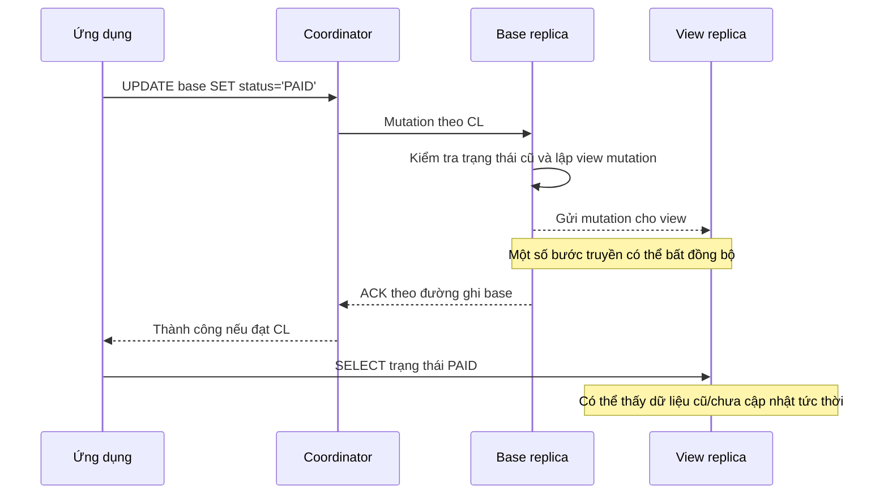
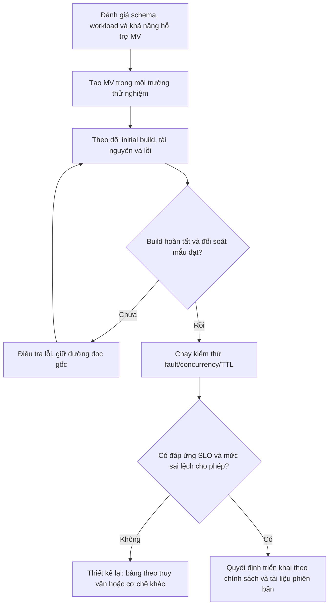

# Tính nhất quán, vận hành và kiểm thử khi dùng view dẫn xuất

> **Chương:** CQL nâng cao  
> **Mô-đun:** `DATABASE_ENGINE_WIDE_COLUMN_CASSANDRA` — Apache Cassandra, cơ sở dữ liệu wide-column phân tán.  
> **Phạm vi:** Materialized view của Cassandra và các bảng đọc dẫn xuất do ứng dụng tự duy trì; cách đánh giá tính nhất quán, vận hành và kiểm thử trước khi đưa vào hệ thống.

Cassandra thiết kế dữ liệu theo **truy vấn**: một bảng thường tối ưu cho một nhóm cách đọc có cùng partition key và clustering columns. Khi yêu cầu mới cần tra cứu cùng bản ghi bằng một khóa khác, ta có thể tạo **view dẫn xuất**: một cách tổ chức dữ liệu thứ hai phục vụ đường đọc mới.

Nhưng việc đọc nhanh bằng khóa mới đi kèm câu hỏi khó: **khi bảng gốc đã ghi thành công, view đã chắc chắn phản ánh đúng bản ghi chưa?** Với Cassandra, đặc biệt khi có mạng không ổn định, node lỗi, concurrent writes, tombstone hoặc tiến trình backfill, không thể trả lời chỉ bằng cách nhìn một câu lệnh `CREATE MATERIALIZED VIEW`.

Bài này giải thích những bảo đảm thực tế, cách xây dựng vòng đời vận hành và bộ kiểm thử cho view dẫn xuất. Nội dung gắn với partition key, replication, consistency level (CL), CQL, repair/compaction và truy cập Java Driver.

> **Lưu ý phiên bản:** Tài liệu cấu hình Apache Cassandra 5.0 mô tả materialized views (MV) là **tính năng thử nghiệm, không khuyến nghị cho production**, với `materialized_views_enabled: false` theo mặc định. Ví dụ CQL về MV trong bài dành cho **lab đã được cấu hình hỗ trợ**. Một số bản phân phối/phiên bản có khác biệt về thao tác build và rebuild; cần tra tài liệu đúng phiên bản trước khi vận hành.

## 1. Phân biệt hai loại view dẫn xuất

Trong thực tế, “view dẫn xuất” có thể chỉ hai mô hình khác nhau:

| Thuộc tính | Cassandra materialized view (MV) | Bảng đọc dẫn xuất do ứng dụng duy trì |
|---|---|---|
| Cách tạo | `CREATE MATERIALIZED VIEW` trong CQL | `CREATE TABLE` với partition key theo truy vấn |
| Ai cập nhật | Cơ chế nội bộ Cassandra khi bảng gốc thay đổi | Ứng dụng, event consumer, CDC hoặc backfill |
| Cách ghi | Chỉ ghi vào **bảng gốc**; không `INSERT/UPDATE/DELETE` trực tiếp vào MV | Ghi vào từng bảng theo giao thức ứng dụng |
| Phạm vi thiết kế | Bị giới hạn bởi các quy tắc khóa và điều kiện của MV | Chủ động chọn key, bucket, chuyển đổi dữ liệu, lọc |
| Tính mới của dữ liệu | View update có thể tới sau khi base write đã được ACK | Phụ thuộc thứ tự ghi, hàng đợi, retry và cơ chế đồng bộ |
| Chi phí | Dung lượng view, read-before-write, write path, mạng, build/compaction | Ghi nhiều bảng, lưu trữ thêm, đối soát, retry và vận hành consumer |
| Rủi ro nổi bật | Sai lệch base–view khi lỗi; hạn chế repair/rebuild theo phiên bản | Dual-write không atomic; event trễ/trùng/sai thứ tự |

Trong phần đầu ta xét **MV được Cassandra quản lý**. Các phần sau chỉ rõ điểm tương đồng và khác biệt khi ứng dụng chủ động duy trì bảng đọc.

### 1.1. Những khái niệm phải tách riêng

- **Đúng schema (schema correctness):** view nhận đúng cột và khóa, phù hợp kiểu truy vấn.
- **Nhất quán giữa các replica (replica consistency):** các replica của **cùng một bảng** có thể có những bản ghi chưa giống nhau trong một giai đoạn lỗi/propagation.
- **Nhất quán giữa base và view (base–view consistency):** view phải phản ánh trạng thái mong muốn của bảng gốc theo quy tắc chuyển đổi.
- **Read-after-write freshness:** một client đọc view ngay sau khi ghi base có nhìn thấy thay đổi vừa ghi hay không.
- **Đúng sau khi hội tụ (eventual convergence):** khi mạng và replica ổn định, một thời gian sau trạng thái hai bên phù hợp. Không được đồng nhất với cam kết hội tụ trong **một số mili giây cố định**.
- **Khả năng phục hồi sai lệch:** khi view thiếu/thừa bản ghi, có thể xác định và sửa nó bằng thủ tục được kiểm chứng không?

Hai truy vấn đều dùng `LOCAL_QUORUM` vẫn **không tự tạo transaction xuyên bảng** giữa base và view.

## 2. Bài toán minh họa: tra cứu đơn hàng theo khách hàng và trạng thái

Giả sử hệ thống cần hai đường đọc:

1. Xem danh sách đơn của khách hàng theo thứ tự tạo gần đây.
2. Xem đơn có một trạng thái cụ thể của khách hàng, ví dụ `PENDING`.

Bảng gốc đặt partition key theo khách hàng:

```sql
-- Tạo keyspace lab trong môi trường thử nghiệm có DC tên dc1.
-- Không áp nguyên giá trị RF này cho production khi chưa xét topology thực tế.
CREATE KEYSPACE IF NOT EXISTS lab_mv
WITH replication = {
    'class': 'NetworkTopologyStrategy',
    'dc1': 3
};

CREATE TABLE IF NOT EXISTS lab_mv.orders_by_customer (
    customer_id uuid,
    order_id timeuuid,
    status text,
    placed_at timestamp,
    amount decimal,
    PRIMARY KEY ((customer_id), order_id)
) WITH CLUSTERING ORDER BY (order_id DESC);
```

Đường đọc phù hợp bảng gốc:

```sql
SELECT order_id, status, placed_at, amount
FROM lab_mv.orders_by_customer
WHERE customer_id = 11111111-1111-1111-1111-111111111111
LIMIT 20;
```

Để đọc trực tiếp theo `customer_id + status`, về mặt ý tưởng ta muốn view có khóa phân vùng `(customer_id, status)`; khóa `order_id` vẫn giữ khả năng phân biệt từng đơn.

### 2.1. Định nghĩa materialized view hợp lệ trong lab

**Điều kiện:** Cassandra/bản phân phối đang dùng hỗ trợ MV và tính năng đã được bật theo cấu hình lab. Nếu không, lệnh bên dưới bị từ chối; không bật MV chỉ để chạy bài trên cụm production.

```sql
CREATE MATERIALIZED VIEW IF NOT EXISTS lab_mv.orders_by_customer_status AS
    SELECT customer_id, order_id, status, placed_at, amount
    FROM lab_mv.orders_by_customer
    WHERE customer_id IS NOT NULL
      AND order_id IS NOT NULL
      AND status IS NOT NULL
    PRIMARY KEY ((customer_id, status), order_id)
    WITH CLUSTERING ORDER BY (order_id DESC);
```

Truy vấn trên view:

```sql
SELECT order_id, placed_at, amount
FROM lab_mv.orders_by_customer_status
WHERE customer_id = 11111111-1111-1111-1111-111111111111
  AND status = 'PENDING'
LIMIT 20;
```

**Vì sao định nghĩa này đáp ứng các quy tắc MV?**

- Khóa của view **giữ đủ mọi thành phần khóa chính gốc**: `customer_id` và `order_id`.
- View đưa vào primary key **một** cột không thuộc primary key gốc: `status`.
- Các thành phần khóa view đều bị ràng buộc `IS NOT NULL`. Một dòng có `status = null` không có dòng tương ứng trong view này.
- View không tự thực hiện `GROUP BY`, tổng hợp, phép tính, `JOIN` hay `ORDER BY` trong phần `SELECT` định nghĩa. Tùy chọn `WITH CLUSTERING ORDER BY` là cấu hình lưu trữ của view, khác với câu `SELECT ... ORDER BY`.
- Chỉ sử dụng cột vốn tồn tại ở bảng gốc; không dùng static columns.

Theo các giới hạn MV được Apache Cassandra công bố, view không được tùy tiện có hai cột regular mới trong primary key, không bỏ các primary-key columns gốc, và không dùng `WHERE` theo nghiệp vụ kiểu `status = 'PENDING'` trong chính định nghĩa view.

### 2.2. Một số thiết kế dễ mắc lỗi

| Thiết kế | Vấn đề |
|---|---|
| `PRIMARY KEY ((status), order_id)` | Thiếu `customer_id` thuộc khóa gốc |
| `PRIMARY KEY ((status, amount), customer_id, order_id)` | Thêm **hai** regular columns gốc vào khóa view (`status` và `amount`) |
| `WHERE status = 'PENDING'` trong `CREATE MATERIALIZED VIEW` | Điều kiện MV bị giới hạn; không dùng tùy ý predicate nghiệp vụ như query thường |
| `PRIMARY KEY ((status), customer_id, order_id)` với rất ít trạng thái | Có thể tạo partition cực lớn/hot cho `PENDING` |
| `INSERT INTO lab_mv.orders_by_customer_status ...` | MV không được ghi trực tiếp |

Nếu nghiệp vụ cần biến đổi/nhóm dữ liệu phức tạp hoặc nhiều khóa mới, **bảng dẫn xuất do ứng dụng quản lý** thường có không gian thiết kế rộng hơn.

## 3. Luồng cập nhật MV và giới hạn về tính nhất quán

Một thay đổi ở bảng gốc có thể đòi hỏi thay đổi khóa của view. Ví dụ chuyển `status` từ `PENDING` sang `PAID`:

- Dòng trong partition view `(customer_id, 'PENDING')` không còn phù hợp.
- Dòng tương ứng phải xuất hiện trong partition view `(customer_id, 'PAID')`.
- Hai partition view có thể nằm ở **các token khác nhau**, nên cập nhật không phải lúc nào cũng chỉ xảy ra trên một node.

Sơ đồ khái niệm:



Đây là mô hình giải thích, **không phải thứ tự gói tin tuyệt đối** cho mọi bản Cassandra. Cơ chế MV sử dụng các bước xử lý tại base replica, read-before-write/đối chiếu trạng thái, các view mutations và giao tiếp tới view replicas; trong một số đường xử lý có local batchlog và truyền mutation bất đồng bộ để bảo vệ tính bền vững.

### 3.1. Viết base thành công không có nghĩa view đã đọc được ngay

Giả sử keyspace có RF = 3 trong một datacenter:

| Hành động | CL | Điều có thể kết luận | Điều **không** thể kết luận |
|---|---|---|---|
| `UPDATE base` thành công | `LOCAL_QUORUM` | Đường ghi base đã đạt số ACK yêu cầu trong local DC | Mọi replica của MV đã phản ánh trạng thái mới |
| `SELECT base` sau ghi | `LOCAL_QUORUM` | Đọc trên bảng gốc theo CL yêu cầu | Trạng thái view được cập nhật atomically với base |
| `SELECT MV` ngay sau ghi | `LOCAL_QUORUM` | Kết quả từ các replica view theo CL yêu cầu | Read-after-write tuyến tính giữa **hai bảng** |
| `SELECT MV` sau khi hệ thống yên ổn | `LOCAL_QUORUM` | Có thể quan sát trạng thái đã hội tụ | Không phải bằng chứng mọi dữ liệu trong toàn cluster đều đúng |

Với RF = 3 full replicas trong một DC, quorum thường là 2. Nhưng “2 ACK base” không tương đương “2 ACK view”, và **không có transaction một lần ghi atomically áp dụng lên hai bảng** chỉ nhờ đặt CL giống nhau.

### 3.2. Các trạng thái trung gian có thể thấy

Một lần chuyển `PENDING → PAID` có thể khiến client nhìn thấy trong khoảng ngắn:

1. Đọc base trả `PAID`, đọc view cũ vẫn thấy dòng `PENDING`.
2. Đọc base trả `PAID` nhưng partition view `PAID` chưa có hàng.
3. Trong quá trình propagation, việc kiểm tra hai partition view khác nhau có thể quan sát trạng thái tạm thời chưa đồng nhất.

Không nên mặc định lỗi ngay khi một phép đọc thực hiện **ngay tức khắc** sau ghi không thấy view mới. Ngược lại, cũng không được xem mọi sai lệch kéo dài là “eventual consistency bình thường”: nó có thể là lỗi build, replica không hồi phục, timestamp/tombstone conflict hoặc view đã mất đồng bộ.

### 3.3. Timestamp, đồng thời và idempotency

Cassandra giải quyết xung đột theo timestamp của cell và quy tắc reconciliation. Nếu hai client gần như đồng thời đặt `PAID` và `CANCELLED`:

- Kết quả cuối ở base phụ thuộc thứ tự timestamp/reconciliation, không nhất thiết bằng “request đến sau trong đồng hồ ứng dụng”.
- View phải xử lý việc **xóa mapping trạng thái cũ** và **tạo mapping trạng thái mới**.
- Thời điểm các view replicas áp dụng mutation có thể khác nhau.
- Retry sau timeout có thể tạo lại thay đổi hoặc đè dữ liệu nếu thiết kế không quản lý được timestamp và điều kiện nghiệp vụ.

Với trạng thái kinh doanh cần quy tắc “chỉ cho phép `PENDING → PAID` một lần”, thiết kế guard/conditional update phù hợp ở base (ví dụ LWT khi thật sự cần), rồi coi view là projection phục vụ đọc. **Không dùng việc thấy dòng trong MV làm bằng chứng giao dịch đã cam kết theo nghiệp vụ.**

## 4. Các phép thay đổi dữ liệu và hệ quả với view

| Thao tác trên base | Điều mong đợi ở view sau khi hội tụ | Điều cần kiểm thử |
|---|---|---|
| Insert có `status = PENDING` | Có dòng tại partition `(customer_id, PENDING)` | View build đã xong? Có bị trễ/mất mutation? |
| Insert với `status = null` | Không có dòng cho khóa view thiếu `status` | Điều kiện `IS NOT NULL` |
| Update `PENDING → PAID` | Dòng biến mất khỏi partition cũ, xuất hiện ở partition mới | Không còn “ghost row” ở khóa cũ sau khi hội tụ |
| Update `amount`, không đổi `status` | Dòng ở cùng khóa view, giá trị được cập nhật | Cột không thuộc khóa view và ảnh hưởng của update |
| Delete một dòng base | Dòng tương ứng không còn trong view | Tombstone, propagation, node down |
| TTL hết hạn | Dữ liệu hết hạn theo semantics TTL/column tương ứng | Có bản ghi cũ còn lộ ở view hay không |
| Reinsert cùng khóa, timestamp khác | View khớp trạng thái thắng reconciliation | Timestamp race, tombstone shadowing |
| Ghi cùng lúc từ hai coordinator | View cuối phải phản ánh kết quả base theo quy tắc phiên bản | Trễ, trùng, mất bản ghi |

Đặc biệt thận trọng với **delete** hoặc gán `null` cho cột ở base. Tài liệu Cassandra nêu một trường hợp có thể che khuất những update bị bỏ lỡ nếu xóa cột **không được chọn vào MV**. Đây là một giới hạn cụ thể cần tránh trong thiết kế/test cho phiên bản bị ảnh hưởng; không thể khắc phục bằng `SELECT` kiểm tra một lần.

## 5. Vòng đời vận hành: từ tạo view tới đọc production

### 5.1. Trước khi tạo

1. Xác định phiên bản Cassandra, tính năng MV có được hỗ trợ/bật không và chính sách của tổ chức. Apache Cassandra 5.0 đánh dấu MV experimental; ưu tiên phân tích bảng tự quản lý nếu yêu cầu production nghiêm ngặt.
2. Kiểm tra base table: partition key, clustering, static columns, TTL, compaction strategy, repair policy, RF theo datacenter.
3. Tính **phân bố khóa view**. Nếu `status` chỉ vài giá trị, đừng đặt partition key chỉ bằng `status` vì hot/wide partition; ví dụ đã kết hợp `customer_id`.
4. Ước lượng write amplification và storage amplification. Một cập nhật thay khóa view có thể phát sinh delete/insert vào nhiều view partition.
5. Xác định yêu cầu freshness: dashboard chấp nhận chậm vài giây hay giao dịch cần read-your-write ngay?
6. Chuẩn bị khả năng rollback/fallback query và đối soát.

### 5.2. Khi tạo MV trên bảng đã có dữ liệu: initial build

`CREATE MATERIALIZED VIEW` tạo cấu trúc schema và hệ thống bắt đầu xây dựng dữ liệu MV từ base. **Schema xuất hiện không có nghĩa initial build hoàn tất.** Nếu mở traffic đọc MV quá sớm, có thể thiếu dữ liệu lịch sử.

Trong lab Cassandra hỗ trợ MV:

```bash
# Quan sát trạng thái node và mức tải
nodetool status
nodetool compactionstats
nodetool tpstats

# Kiểm tra tiến độ build MV theo keyspace và tên view
nodetool viewbuildstatus lab_mv orders_by_customer_status
```

`nodetool viewbuildstatus` là lệnh được tài liệu Apache Cassandra 5.0 mô tả. Cần xác minh trên mọi node liên quan theo hướng dẫn phiên bản và quan sát log build; một kết quả từ một thời điểm/node không đủ chứng nhận tính đúng đắn xuyên cụm.

Một trình tự triển khai thận trọng:



### 5.3. Trong vận hành liên tục

Theo dõi đồng thời **chất lượng dữ liệu** và **sức khỏe hệ thống**:

| Tín hiệu | Vì sao quan trọng? | Dấu hiệu cần điều tra |
|---|---|---|
| Base write latency/p95/p99 | MV có thêm chi phí xử lý, có thể read-before-write | P99 tăng mạnh sau thêm view |
| View read latency và lỗi | Dữ liệu view cũng đi qua token/replica/CL | Timeout, unavailability, đọc thiếu |
| Node/replica status | Node down có thể làm chậm propagation | Một node phụ trách base/view bị Down |
| View build status, log | Initial build/backfill có thể chưa hoàn tất | Build treo, lỗi từ node cụ thể |
| Batchlog/hints và MV-specific metrics | Theo dõi mutation chưa truyền/đã retry | Tồn đọng kéo dài hoặc lỗi propagation |
| Compaction, disk, tombstone | MV thêm SSTable và xóa mapping cũ | Dung lượng tăng, compaction debt, nhiều tombstone |
| Độ lệch base–view | Là thước đo trực tiếp tính đúng đắn | Dòng thiếu/thừa kéo dài sau khi hệ thống đã ổn định |

Metric cụ thể như `ViewWriteMetrics` và tên JMX/Prometheus phụ thuộc phiên bản/bản phân phối; khi viết dashboard phải **xác minh tên metric thực có**, không giả định mọi cluster xuất cùng một tên.

### 5.4. Repair, rebuild và recovery không thể đánh đồng

Ba thao tác thường dễ nhầm:

- **Repair của base:** đối chiếu replica của bảng gốc theo quy trình anti-entropy. Nó **không phải cam kết tự động sửa mọi sai lệch logic giữa base và MV**.
- **Initial build của view:** tạo dữ liệu view từ base khi MV mới được khai báo; chỉ cần xét lại khi build chưa xong/hỏng hoặc khi có quy trình rebuild.
- **Rebuild của view:** tái tạo/cập nhật view từ dữ liệu nguồn theo lệnh/cơ chế **cụ thể của phiên bản**. Không phải cùng lệnh với `nodetool rebuild`, vì `rebuild` thông thường liên quan streaming dữ liệu giữa các DC/node.

Một số bản phân phối hỗ trợ `nodetool rebuild_view` để xây dựng lại MV của base; bản Apache/phiên bản đang chạy có thể khác hoặc không cung cấp lệnh này. **Không chép lệnh recovery của một bản phân phối vào cụm khác.** Trước khi thao tác:

1. Kiểm tra `nodetool help` và tài liệu MV/recovery của phiên bản triển khai.
2. Chụp snapshot/backup phù hợp, đánh giá dung lượng trống và tránh thay đổi topology cạnh tranh.
3. Xác định lỗi thuộc **replica của base**, **view build**, hay **logic base–view divergence**.
4. Thực hiện quy trình khôi phục được hỗ trợ và đối soát sau đó; không tuyên bố “repair đã chữa mọi MV” nếu chưa xác minh.

Một số tài liệu bản phân phối cũng cảnh báo **incremental repair trên base có MV** có thể bị giới hạn. Cần kiểm tra tương thích cụ thể; không khẳng định mọi chế độ repair đều hoạt động như bảng thông thường.

### 5.5. Thay đổi schema và xóa MV

- Cân nhắc kỹ khi thêm/xóa cột, thay đổi TTL, compaction hay xóa bảng gốc. Kiểm tra quy tắc MV của phiên bản trước từng DDL.
- Xây dựng đường đọc dự phòng nếu MV có thể bị drop/rebuild trong bảo trì.
- `DROP MATERIALIZED VIEW` xóa view và dữ liệu dẫn xuất, **không** thay thế việc xóa bản ghi gốc theo nghiệp vụ.
- Sau khi xóa view, kiểm tra resource, disk, compaction và client code còn tham chiếu tới view hay không.

Ví dụ lệnh DDL **chỉ dùng trong lab**:

```sql
-- Chỉ thực hiện nếu đã chắc chắn không còn cần view thử nghiệm:
DROP MATERIALIZED VIEW IF EXISTS lab_mv.orders_by_customer_status;
```

## 6. Bộ kiểm thử chức năng với CQL

Mục tiêu là kiểm tra **quan hệ giữa hai mô hình dữ liệu** qua nhiều bước, không chỉ “câu SELECT chạy được”. Tất cả các bước dưới đây thực hiện trên keyspace/test cluster có MV đã build xong.

### 6.1. Insert rồi quan sát hội tụ

Chọn một cặp khóa cố định để truy vấn lại:

```sql
CONSISTENCY LOCAL_QUORUM;

INSERT INTO lab_mv.orders_by_customer (
    customer_id, order_id, status, placed_at, amount
) VALUES (
    11111111-1111-1111-1111-111111111111,
    7c627d5a-a6b0-11ef-8ae8-0242ac120002,
    'PENDING',
    '2026-11-21 08:00:00+0000',
    120.00
);

-- Bảng gốc
SELECT status, amount FROM lab_mv.orders_by_customer
WHERE customer_id = 11111111-1111-1111-1111-111111111111
  AND order_id = 7c627d5a-a6b0-11ef-8ae8-0242ac120002;

-- View, với partition key customer_id + status
SELECT order_id, amount FROM lab_mv.orders_by_customer_status
WHERE customer_id = 11111111-1111-1111-1111-111111111111
  AND status = 'PENDING';
```

Nếu view chưa có hàng ngay sau insert, **ghi nhận độ trễ** và retry có thời hạn trong bộ kiểm thử. Nếu vẫn thiếu sau khi cluster ổn định, thu log/metric; không chỉ tăng `sleep` vô hạn rồi bỏ qua.

### 6.2. Thay khóa view: PENDING → PAID

```sql
UPDATE lab_mv.orders_by_customer
SET status = 'PAID'
WHERE customer_id = 11111111-1111-1111-1111-111111111111
  AND order_id = 7c627d5a-a6b0-11ef-8ae8-0242ac120002;

SELECT order_id FROM lab_mv.orders_by_customer_status
WHERE customer_id = 11111111-1111-1111-1111-111111111111
  AND status = 'PENDING';

SELECT order_id FROM lab_mv.orders_by_customer_status
WHERE customer_id = 11111111-1111-1111-1111-111111111111
  AND status = 'PAID';
```

Kiểm tra **hai điều kiện cùng lúc sau hội tụ**:

- Trong view `PENDING`: đơn cũ không còn.
- Trong view `PAID`: đúng một đơn xuất hiện, mang giá trị `amount` phù hợp.

Chỉ kiểm tra “PAID xuất hiện” là chưa đủ, vì bản sao stale trong partition `PENDING` cũng gây lỗi nghiệp vụ.

### 6.3. Update cột không thuộc khóa

```sql
UPDATE lab_mv.orders_by_customer
SET amount = 125.00
WHERE customer_id = 11111111-1111-1111-1111-111111111111
  AND order_id = 7c627d5a-a6b0-11ef-8ae8-0242ac120002;

SELECT amount FROM lab_mv.orders_by_customer_status
WHERE customer_id = 11111111-1111-1111-1111-111111111111
  AND status = 'PAID'
  AND order_id = 7c627d5a-a6b0-11ef-8ae8-0242ac120002;
```

Sau khi view hội tụ, `amount` phải khớp bảng gốc. Nếu cột đã cập nhật ở base nhưng view vẫn giữ giá trị cũ kéo dài, cần điều tra propagation/replica.

### 6.4. Delete dòng gốc và xác nhận không còn “ghost row”

```sql
DELETE FROM lab_mv.orders_by_customer
WHERE customer_id = 11111111-1111-1111-1111-111111111111
  AND order_id = 7c627d5a-a6b0-11ef-8ae8-0242ac120002;

SELECT order_id FROM lab_mv.orders_by_customer_status
WHERE customer_id = 11111111-1111-1111-1111-111111111111
  AND status = 'PAID'
  AND order_id = 7c627d5a-a6b0-11ef-8ae8-0242ac120002;
```

Không dùng xóa view trực tiếp để “dọn” vì MV chỉ nhận thay đổi từ base. Nếu có divergence bền vững, dùng quy trình phục hồi phù hợp phiên bản, sau đó kiểm tra lại các view partitions có liên quan.

### 6.5. Test TTL và null trên tập dữ liệu riêng

Đừng tái sử dụng dữ liệu của test trước vì tombstone/timestamp có thể khiến kết quả khó giải thích. Với dữ liệu thử nghiệm độc lập:

```sql
-- Một đơn với TTL ngắn trên các regular columns.
INSERT INTO lab_mv.orders_by_customer (
    customer_id, order_id, status, placed_at, amount
) VALUES (
    33333333-3333-3333-3333-333333333333,
    8c627d5a-a6b0-11ef-8ae8-0242ac120002,
    'PENDING',
    '2026-11-21 09:00:00+0000',
    50.00
) USING TTL 30;
```

Theo dõi trong/qua mốc hết TTL và sau khi ổn định. **TTL gắn với cell/column**, không nhất thiết xóa ngay mọi dấu vết trên đĩa; tombstone được dọn theo compaction và cơ chế `gc_grace_seconds`. Kiểm thử phải so sánh **kết quả logic của CQL**, không nhầm “dữ liệu còn trên SSTable” với “row còn sống”.

Với trường hợp `status = null`, kiểm tra view không có mapping cho `status` sau hội tụ. Khi cập nhật từ giá trị không-null sang null, cần kiểm tra thêm mapping cũ được xóa đúng; hãy chạy test trên phiên bản cụ thể vì liên quan tombstone và các giới hạn MV đã công bố.

## 7. Bộ kiểm thử lỗi và phân tán

Một test chức năng thành công trên một node **chưa** kiểm tra được tính đúng đắn khi replication gặp lỗi. Hãy tạo môi trường thử nghiệm nhiều node (ví dụ RF = 3 trong một DC) và xác định rõ CL.

| Kịch bản | Cách kích hoạt trong lab | Bất biến cần kiểm tra sau khi ổn định |
|---|---|---|
| Node phụ trách base tạm thời Down | Cách ly một replica, tiếp tục write ở CL cho phép | Base và view hội tụ khi node quay lại |
| Node phụ trách view tạm thời Down | Cách ly node chứa view replica, thực hiện update status | Không còn mapping cũ/mất mapping mới kéo dài |
| Timeout lúc ghi | Thêm network delay để gây timeout, retry theo policy | Không tự đếm một lần timeout là “ghi thất bại chắc chắn”; dữ liệu cuối đúng |
| Hai writer đổi status đồng thời | Gửi hai mutation khác trạng thái/timestamp | Base có một trạng thái thắng, view cuối phù hợp trạng thái ấy |
| Delete trong lúc replica Down | Xóa base, phục hồi replica | Không còn ghost row trong view sau repair/recovery phù hợp |
| TTL trong lúc node mất kết nối | Ghi TTL, tắt một node qua mốc hết hạn | View cuối không hiển thị row đã hết hạn |
| Build MV trên bảng có sẵn | Tạo view trên base lớn, vừa build vừa có cập nhật | Lịch sử + thay đổi mới đầy đủ sau build và đối soát |
| Bootstrap/replace/repair | Thay đổi topology trong lab, theo dõi streaming | View còn đúng sau recovery, không tăng sai lệch bền vững |
| Dung lượng/compaction bị nghẽn | Tạo write bursts có kiểm soát | Độ trễ, lỗi và build backlog nằm trong giới hạn |

Các phép thử node failure chỉ thực hiện trong **lab được phép phá hỏng**. Ghi rõ trước mỗi lần thử: node bị cô lập là base replica, view replica hay cả hai, CL, thời điểm gửi mutation, cách phục hồi, và chính sách retry.

### 7.1. Mô tả bất biến dưới dạng tập hợp

Với đơn hàng có `status != null` và dữ liệu đã hội tụ, đặt:

- `B` = tập bản ghi base hiện tại.
- `V` = tập bản ghi view khi đọc đủ các partition liên quan.
- `f(b)` = phép chiếu bản ghi base sang khóa view và các cột được chọn.

Bất biến mong muốn:

\[
V = \{f(b) \mid b \in B,\ b.status \neq null\}
\]

Cần so sánh **cả hai chiều**:

- **Missing:** có `f(b)` ở base nhưng không ở view.
- **Extra/ghost:** có row ở view nhưng không có bản ghi base tương ứng với đúng trạng thái.
- **Different:** cùng khóa nhưng dữ liệu `amount/placed_at` sai.
- **Duplicate logical state:** cùng một đơn có mặt ở nhiều partition `status` khác nhau sau khi đáng ra đã hội tụ.

Với dữ liệu rất lớn, thực hiện đối soát theo từng partition/bucket hoặc snapshot của một tập có kiểm soát. Tránh quét toàn cluster bằng `SELECT *` hoặc `COUNT(*)` trong request production. Có thể dùng pipeline đối soát được thiết kế riêng.

### 7.2. Không biến eventual consistency thành test flaky

Test nào gọi `SELECT MV` **ngay sau `UPDATE base`** rồi luôn kỳ vọng thấy đúng tức thì có thể thất bại ngẫu nhiên, ngay cả khi cơ chế đang vận hành bình thường.

Hãy phân biệt:

1. **Kiểm thử freshness:** đo độ trễ propagation như một phân phối (p50/p95/p99); xác định mục tiêu nội bộ nếu nghiệp vụ chấp nhận trễ.
2. **Kiểm thử convergence:** đợi có giới hạn dưới điều kiện cluster ổn định; nếu quá hạn, thất bại và thu thông tin debug.
3. **Kiểm thử durability/recovery:** đưa replica vào lỗi, phục hồi, repair/rebuild khi quy trình yêu cầu, rồi đối chiếu đủ dữ liệu.
4. **Kiểm thử correctness of conflicting mutations:** áp timestamp/ordering được kiểm soát và so sánh kết quả cuối.

Khoảng đợi 5 hoặc 30 giây trong test chỉ là **ngưỡng do đội kỹ thuật đặt ra**, không phải bảo đảm latency của Cassandra MV.

## 8. Kiểm thử với Java Driver

Ứng dụng Java nên ghi base bằng prepared statement, đọc base và view bằng **hai câu truy vấn riêng**, chỉ chấp nhận kết luận “view đã hội tụ” khi điều kiện được kiểm tra trực tiếp.

Ví dụ Java Driver 4.x cho **test tích hợp** (giản lược phần khởi tạo cluster, exception handling và test framework):

```java
import com.datastax.oss.driver.api.core.CqlSession;
import com.datastax.oss.driver.api.core.DefaultConsistencyLevel;
import com.datastax.oss.driver.api.core.cql.*;
import java.net.InetSocketAddress;
import java.time.Duration;
import java.time.Instant;
import java.util.UUID;

public class MaterializedViewLabTest {
    private static final String BASE_UPDATE =
        "UPDATE lab_mv.orders_by_customer SET status = ? " +
        "WHERE customer_id = ? AND order_id = ?";

    private static final String VIEW_SELECT =
        "SELECT order_id FROM lab_mv.orders_by_customer_status " +
        "WHERE customer_id = ? AND status = ? AND order_id = ?";

    static boolean viewContains(
            CqlSession session,
            PreparedStatement select,
            UUID customerId,
            String status,
            UUID orderId) {
        BoundStatement stmt = select.bind(customerId, status, orderId)
            .setConsistencyLevel(DefaultConsistencyLevel.LOCAL_QUORUM);
        return session.execute(stmt).one() != null;
    }

    public static void main(String[] args) throws InterruptedException {
        UUID customerId =
            UUID.fromString("11111111-1111-1111-1111-111111111111");
        UUID orderId =
            UUID.fromString("7c627d5a-a6b0-11ef-8ae8-0242ac120002");

        try (CqlSession session = CqlSession.builder()
                .addContactPoint(new InetSocketAddress("127.0.0.1", 9042))
                .withLocalDatacenter("dc1")
                .build()) {
            PreparedStatement update = session.prepare(BASE_UPDATE);
            PreparedStatement select = session.prepare(VIEW_SELECT);

            session.execute(update.bind("PAID", customerId, orderId)
                .setConsistencyLevel(DefaultConsistencyLevel.LOCAL_QUORUM));

            Instant deadline = Instant.now().plus(Duration.ofSeconds(10));
            boolean converged = false;
            while (Instant.now().isBefore(deadline)) {
                boolean newPresent =
                    viewContains(session, select, customerId, "PAID", orderId);
                boolean oldAbsent =
                    !viewContains(session, select, customerId, "PENDING", orderId);
                if (newPresent && oldAbsent) {
                    converged = true;
                    break;
                }
                Thread.sleep(100);
            }

            if (!converged) {
                throw new AssertionError(
                    "MV did not converge within the test deadline");
            }
        }
    }
}
```

**Điều kiện test:** bản ghi phải được tạo trước với trạng thái `PENDING`, initial view build đã hoàn tất, và cluster đúng DC/CL. `order_id` là `timeuuid`, biểu diễn được bằng `UUID` trong Java Driver. Đoạn mã này chỉ phù hợp **test**, không nên poll mỗi 100 ms cho mọi request nghiệp vụ ở production.

Với code production:

- Nếu một API cần xác nhận ngay kết quả chuyển trạng thái, đọc lại base hoặc dùng cơ chế đảm bảo nghiệp vụ ở nguồn dữ liệu đáng tin cậy.
- Nếu view dùng cho tìm kiếm/báo cáo chấp nhận trễ, công khai freshness budget và đo propagation lag.
- Giới hạn retry sau timeout; timeout không chứng minh mutation chưa được áp dụng. Thiết kế idempotency, request ID hoặc điều kiện chuyển trạng thái phù hợp.
- Phân trang có kiểm soát, giới hạn kích thước partition và quan sát p99/throttling; thêm MV không bảo đảm một kiểu truy vấn mới luôn rẻ.

## 9. Khi ứng dụng tự quản lý bảng dẫn xuất

Vì MV là tính năng experimental trong tài liệu Apache Cassandra 5.0, nhiều hệ thống chọn **tạo bảng theo truy vấn và duy trì qua application/event pipeline**.

Ví dụ cùng dữ liệu, một bảng phục vụ trạng thái:

```sql
CREATE TABLE IF NOT EXISTS lab_mv.orders_by_customer_status_manual (
    customer_id uuid,
    status text,
    order_id timeuuid,
    placed_at timestamp,
    amount decimal,
    PRIMARY KEY ((customer_id, status), order_id)
) WITH CLUSTERING ORDER BY (order_id DESC);
```

Ở đây bảng mới là **table CQL bình thường**. Khi chuyển `PENDING → PAID`, ứng dụng phải:

1. Cập nhật trạng thái trong bảng nguồn theo quy tắc nghiệp vụ.
2. Ghi hàng vào partition `PAID` của bảng dẫn xuất.
3. Xóa hàng khỏi partition `PENDING`.
4. Theo dõi và khôi phục nếu chỉ một phần trong các bước thành công.

Các bước này **không tự atomic chỉ vì được gửi trong cùng một CQL batch**. Cassandra logged batch có mục đích lưu trữ/đảm bảo phát lại nhóm mutations theo semantics riêng, không phải transaction đa bảng theo nghĩa quan hệ, không cung cấp isolation/linearizability cho mọi reader.

### 9.1. Hai cách đồng bộ phổ biến

| Cách | Điểm mạnh | Điểm khó |
|---|---|---|
| Ghi đồng bộ nhiều bảng trong request | Đường cập nhật đơn giản, có thể giảm độ trễ tới view trong tình huống bình thường | Partial success, timeout “unknown outcome”, race giữa nhiều writer |
| Ghi nguồn + event/CDC + consumer | Có thể phát lại, backfill, theo dõi lag và xử lý tải đọc độc lập | Event có thể trùng/sai thứ tự; cần thiết kế idempotency, dedupe và khôi phục |

Một consumer đủ an toàn cần định nghĩa **source of truth**, version của bản ghi, thứ tự cập nhật, quy tắc xử lý event cũ đến sau, khóa idempotency và chiến lược đối soát.

Nếu view thay đổi khóa theo `status`, event chỉ chứa trạng thái mới thường **không đủ** để xóa đúng row thuộc trạng thái cũ. Cần mang old status, đọc nguồn đúng cách, hoặc thiết kế quy trình tái lập projection để loại mapping thừa.

### 9.2. Đảm bảo chất lượng bằng đối soát

Ghi nhận các chỉ số:

- Số mutation nguồn và số mutation view đã xử lý theo thời gian.
- Độ trễ từ thay đổi nguồn tới lúc view đọc được.
- Event trùng, retry, dead-letter và khoảng trống trong chuỗi sự kiện.
- Số bản ghi **missing/extra/different**, phân theo tenant/ngày.
- Tỷ lệ các lần đối soát sửa thành công và thời gian phục hồi.

Với bảng tự quản lý, **repair Cassandra** chỉ đối chiếu replica của mỗi bảng; nó không hiểu “hai bảng phải chứa cùng business object”. Đối soát business-level luôn cần do ứng dụng hoặc công cụ vận hành thiết kế.

## 10. Ra quyết định theo yêu cầu consistency và vận hành

| Yêu cầu | Lựa chọn nên xem xét |
|---|---|
| Cần transaction/đọc ngay sau ghi xuyên hai kiểu khóa | Không dựa vào MV làm cam kết tuyến tính; ưu tiên một nguồn có giao thức transaction đúng yêu cầu |
| Tra cứu thêm theo khóa khác, độ trễ cập nhật chấp nhận được | Đánh giá MV trong lab nếu phiên bản cho phép; so sánh bảng tự quản lý và index |
| View cần aggregate, join, transform phức tạp | Bảng dẫn xuất do ứng dụng/pipeline quản lý hoặc công cụ xử lý chuyên dụng |
| Workload đọc lớn, phải biết partition key | Thiết kế bảng theo query shape và bucket phù hợp |
| Kết quả là hệ thống kiểm toán/tài chính | Xác định nguồn dữ liệu có thẩm quyền, reconciliation và quy trình khôi phục; không lấy sự xuất hiện ở MV làm duy nhất chứng từ |
| Có node thường xuyên lỗi, cần tự động sửa sai lệch | Ưu tiên phương án có replay/rebuild/đối soát được kiểm chứng; xem xét giới hạn MV theo phiên bản |

Chọn model bằng **thứ tự ưu tiên nghiệp vụ**: đúng dữ liệu → phục hồi được sau lỗi → đáp ứng latency/SLO → chi phí ghi/lưu trữ. Một phép `SELECT` nhanh không đủ để chấp nhận view nếu không kiểm chứng dữ liệu trong tình huống xấu.

## 11. Câu hỏi tự kiểm tra

1. Vì sao ghi bảng gốc thành công với `LOCAL_QUORUM` chưa bảo đảm đọc view ngay sau đó cũng thấy bản ghi mới?
2. Khi đổi `status` từ `PENDING` sang `PAID`, vì sao phải kiểm tra cả partition cũ và partition mới của view?
3. Nêu hai ràng buộc về primary key của Cassandra MV theo tài liệu CQL.
4. `nodetool viewbuildstatus` cho biết gì, và tại sao chưa đủ để kết luận view đúng tuyệt đối?
5. Nếu một node bị mất dữ liệu MV, vì sao chạy repair base không nhất thiết sửa được toàn bộ sai lệch base–view?
6. Một consumer ghi bảng dẫn xuất nhận sự kiện `PAID` trước `PENDING` do network reorder. Cần thông tin/giao thức nào để tránh trạng thái bị quay ngược?
7. Khi kiểm thử TTL, vì sao không nên chỉ nhìn số byte SSTable để kết luận dữ liệu đã hết hiệu lực?
8. Vì sao `LOGGED BATCH` không thay thế giao thức transaction đa bảng theo nghĩa quan hệ?

**Gợi ý trả lời:** (1) Mutation cho view có thể được propagate bất đồng bộ; CL của hai bảng không tạo giao dịch chéo. (2) Tránh ghost row và mất row. (3) Giữ tất cả cột khóa chính gốc và chỉ thêm tối đa một cột regular vào khóa view. (4) Theo dõi initial build, chưa đối soát từng row. (5) Repair replica không mặc nhiên tái sinh mọi view mutation logic. (6) Version/timestamp có kiểm soát, idempotency, reconcile và xử lý event cũ. (7) TTL tạo semantics đọc và tombstone, SSTable có thể chờ compaction. (8) Batch không cung cấp isolation và read-after-write cross-table như transaction quan hệ.

## 12. Checklist kiểm chứng trước khi dùng view dẫn xuất

**Thiết kế**

- [ ] Đã phân biệt rõ MV nội bộ và bảng dẫn xuất do ứng dụng duy trì.
- [ ] Đã xác định Cassandra/bản phân phối/phiên bản, tính năng được hỗ trợ, giới hạn production.
- [ ] Khóa view đáp ứng rules CQL, phân phối partition hợp lý, không tạo hot partition.
- [ ] Đã định nghĩa nguồn dữ liệu có thẩm quyền và tính mới mà nghiệp vụ cần.
- [ ] Đã dự trù chi phí read-before-write, mạng, dung lượng, tombstone, compaction và repair.

**Kiểm thử**

- [ ] Insert, update thường, đổi khóa view, delete, null, TTL đều có test.
- [ ] Test kiểm tra **cả mapping mới và mapping cũ** sau hội tụ.
- [ ] Test concurrent updates, retry sau timeout và timestamp conflicts.
- [ ] Test node down/restore, repair/rebuild và view initial build khi bảng gốc có sẵn dữ liệu.
- [ ] Có đối soát missing/extra/different, đo p99 và propagation lag.

**Vận hành**

- [ ] Có health dashboard, log và chỉ số MV/build theo đúng phiên bản.
- [ ] Có backup, runbook phục hồi và fallback khi view không tin cậy.
- [ ] Có lịch đối soát và cách sửa bất đồng giữa hai cấu trúc dữ liệu.
- [ ] Có cơ chế dừng/phục hồi view khi tài nguyên hoặc correctness vượt ngưỡng.
- [ ] Đã kiểm tra tác động của thay đổi schema, RF, topology và chính sách repair.

## 13. Tài liệu tham khảo

- [Apache Cassandra — Materialized Views (CQL syntax và giới hạn; tài liệu hiện hiển thị bản 5.0)](https://cassandra.apache.org/doc/latest/cassandra/developing/cql/mvs.html).
- [Apache Cassandra — cassandra.yaml: materialized_views_enabled và các cấu hình MV](https://cassandra.apache.org/doc/stable/cassandra/managing/configuration/cass_yaml_file.html).
- [Apache Cassandra — nodetool viewbuildstatus](https://cassandra.apache.org/doc/latest/cassandra/managing/tools/nodetool/viewbuildstatus.html).
- [Apache Cassandra — Repair (nguyên lý anti-entropy giữa replica)](https://cassandra.apache.org/doc/stable/cassandra/managing/operating/repair.html).
- [DataStax — Materialized views, propagation và consistency](https://docs.datastax.com/en/cql/cassandra-5.0/develop/materialized-views-concepts.html) — tài liệu bản phân phối; xác minh khác biệt trước khi áp dụng cho Apache Cassandra.

**Ghi nhớ:** View dẫn xuất giúp đọc bằng khóa khác nhưng tạo thêm một trạng thái dữ liệu phải duy trì. **CL của bảng gốc không bảo đảm MV được cập nhật atomically hay đọc thấy ngay.** Chất lượng của một giải pháp view được đo bằng khả năng giữ đúng dữ liệu sau insert/update/delete, phục hồi sau lỗi và đối soát được khi có lệch — bên cạnh tốc độ truy vấn.
