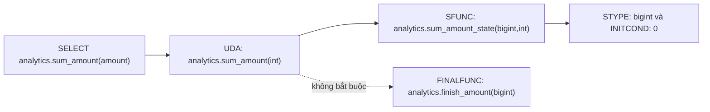
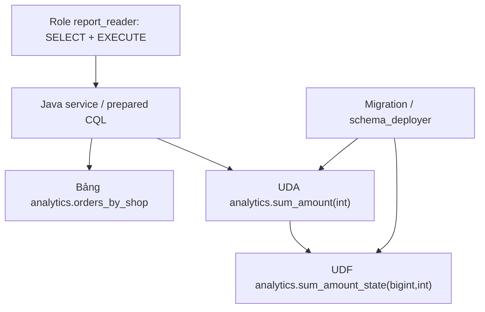

# Quyền thực thi function/aggregate và dependency của schema

> **Chương:** CQL nâng cao  
> **Học phần:** `DATABASE_ENGINE_WIDE_COLUMN_CASSANDRA`

Trong Apache Cassandra, **function** và **aggregate** có thể là thành phần của schema, có quyền truy cập riêng và có quan hệ phụ thuộc lẫn nhau. Việc một role được phép đọc bảng không có nghĩa role đó được phép gọi mọi user-defined function (UDF) hay user-defined aggregate (UDA). Tương tự, quyền tạo aggregate không tự bảo đảm rằng role có quyền thực thi các hàm state/final được aggregate tham chiếu.

Bài học đặt hai câu hỏi thực tế: **Ai được phép gọi hoặc thay đổi function/aggregate?** Và **cần triển khai, thay thế, thu hồi hay xóa chúng theo thứ tự nào để không làm hỏng truy vấn ứng dụng?** Các ví dụ dùng CQL và minh họa nơi ứng dụng Java tương tác với Cassandra; thiết kế bảng theo truy vấn, khóa phân vùng, replication, consistency level, compaction và repair vẫn là bối cảnh vận hành, nhưng không thay thế hệ thống phân quyền schema.

**Mục tiêu sau bài học:**

- Phân biệt UDF, UDA, hàm built-in và chữ ký xác định một function.
- Phân biệt quyền `SELECT`/`MODIFY` trên bảng với `EXECUTE` trên function/aggregate.
- Cấp, thu hồi, kiểm tra quyền theo role với phạm vi tối thiểu.
- Nhận diện phụ thuộc của `UDA → SFUNC → FINALFUNC` và phụ thuộc từ truy vấn/ứng dụng đến schema.
- Lập thứ tự migration ít gây gián đoạn: tạo mới → cấp quyền → chuyển client → dọn phụ thuộc cũ.

## 1. Phân biệt function và aggregate

**Scalar function** nhận đối số và trả một giá trị cho mỗi lần gọi. Cassandra có hàm built-in như `cast`, `token`, một số hàm xử lý dữ liệu; **UDF** là function do người dùng định nghĩa, thông thường với mã Java chạy phía server.

**Aggregate** tính kết quả từ tập các hàng của một câu lệnh `SELECT`. Ngoài aggregate built-in như `count`, `sum`, `avg`, Cassandra có **UDA**. Một UDA phụ thuộc vào các UDF khác:

- `SFUNC` (*state function*): nhận trạng thái hiện tại (`STYPE`) làm đối số đầu tiên và giá trị của hàng tiếp theo làm các đối số còn lại; trả trạng thái mới.
- `FINALFUNC` (*final function*, tùy chọn): nhận trạng thái cuối cùng và trả kết quả cuối.
- `INITCOND` (*initial condition*, tùy chọn): giá trị trạng thái ban đầu; nếu không khai báo, mặc định là `null`.
- `STYPE`: kiểu của trạng thái trung gian; bắt buộc khai báo.



Các function/aggregate do người dùng định nghĩa thuộc **keyspace**, là một phần của **schema Cassandra** và được đồng bộ đến các node. Cụm Cassandra phải bật hỗ trợ UDF theo chính sách vận hành (thiết lập `user_defined_functions_enabled`; mặc định thường tắt để giảm rủi ro chạy mã trên server). Việc có cú pháp `CREATE FUNCTION` không có nghĩa một cụm bất kỳ đã cho phép thực thi UDF.

### Chữ ký là danh tính của function

Một resource function được xác định bằng **keyspace + tên function + danh sách kiểu đối số**, ví dụ:

```text
analytics.normalize_score(int)
analytics.normalize_score(bigint)
analytics.sum_amount_state(bigint, int)
analytics.sum_amount(int)                  -- UDA
```

`normalize_score(int)` và `normalize_score(bigint)` là **hai overload khác nhau**. Quyền gán cho overload thứ nhất không tự áp dụng cho overload thứ hai. Tên tham số (`value`, `state`, v.v.) không phải là phần dùng để phân biệt chữ ký; **kiểu và thứ tự kiểu** mới quan trọng. Luôn chỉ rõ keyspace và kiểu tham số trong migration để tránh nhầm hàm.

## 2. Ví dụ schema: UDF và aggregate

Giả sử một ứng dụng bán hàng truy vấn tổng giá trị đơn hàng theo `shop_id`. Bảng mô hình hóa theo partition key để giới hạn phạm vi đọc: tổng hợp toàn bộ dữ liệu của một keyspace không phải thói quen tốt cho Cassandra phân tán.

```sql
-- Keyspace analytics đã tồn tại và đã cấu hình replication phù hợp.
CREATE TABLE analytics.orders_by_shop (
    shop_id text,
    order_id timeuuid,
    amount int,
    PRIMARY KEY ((shop_id), order_id)
);

INSERT INTO analytics.orders_by_shop (shop_id, order_id, amount)
VALUES ('shop-01', now(), 120);

INSERT INTO analytics.orders_by_shop (shop_id, order_id, amount)
VALUES ('shop-01', now(), 80);
```

Tạo UDF chuyển một giá trị `int` sang giá trị gấp đôi (đơn giản để kiểm thử quyền):

```sql
CREATE FUNCTION analytics.double_amount(v int)
    RETURNS NULL ON NULL INPUT
    RETURNS int
    LANGUAGE java
    AS $$
        return v * 2;
    $$;
```

UDF này phục vụ ví dụ minh họa cú pháp. Trong sản xuất, phép toán quá đơn giản thường thực hiện được ở ứng dụng, tránh tăng chi phí tính toán trên node Cassandra. Ngoài ra, kiểu `int` có giới hạn và phép nhân có thể tràn số.

Để minh họa dependency, tạo state function và UDA tổng các `amount` có kết quả `bigint`:

```sql
CREATE FUNCTION analytics.sum_amount_state(s bigint, v int)
    CALLED ON NULL INPUT
    RETURNS bigint
    LANGUAGE java
    AS $$
        long current = (s == null) ? 0L : s.longValue();
        long delta = (v == null) ? 0L : v.longValue();
        return current + delta;
    $$;

CREATE AGGREGATE analytics.sum_amount(int)
    SFUNC sum_amount_state
    STYPE bigint
    INITCOND 0;
```

`sum_amount(int)` phụ thuộc vào UDF `sum_amount_state(bigint, int)`. Aggregate này không cần `FINALFUNC`, nên kết quả trả về có kiểu `bigint` như trạng thái; dùng `bigint` giúp giảm nguy cơ tràn so với cộng trên `int`, dù bản thân `bigint` vẫn hữu hạn.

```sql
SELECT analytics.double_amount(amount)
FROM analytics.orders_by_shop
WHERE shop_id = 'shop-01';

SELECT analytics.sum_amount(amount)
FROM analytics.orders_by_shop
WHERE shop_id = 'shop-01';
-- Với hai dòng mẫu và không có cập nhật khác, tổng là 200.
```

**Tác động đến thiết kế truy vấn:** aggregate vẫn phải xử lý các hàng phù hợp với `WHERE`. UDA không thay thế data modeling, chỉ số hay phân vùng. Khi partition có số lượng hàng rất lớn, aggregate trên truy vấn có thể tăng chi phí CPU, I/O và độ trễ; hãy cân nhắc bảng tổng hợp được duy trì riêng nếu ứng dụng cần đọc thường xuyên ở quy mô lớn.

## 3. Quyền thực thi khác quyền đọc hoặc sửa dữ liệu

Cassandra sử dụng role và resource để quản lý authorization. Với authorizer hỗ trợ kiểm soát quyền (thường là `CassandraAuthorizer`), quyền `EXECUTE` trên function có ý nghĩa khác `SELECT`/`MODIFY` trên bảng.

| Quyền | Resource ví dụ | Mục đích |
| --- | --- | --- |
| `SELECT` | `TABLE analytics.orders_by_shop` | Đọc dữ liệu bảng, bao gồm hàng đầu vào cho `SELECT` gọi UDF/UDA. |
| `MODIFY` | `TABLE analytics.orders_by_shop` | Ghi/sửa/xóa dữ liệu qua CQL tương ứng. |
| `EXECUTE` | `FUNCTION analytics.double_amount(int)` | Cho phép dùng UDF được chỉ định trong những câu CQL hỗ trợ function. |
| `EXECUTE` | `FUNCTION analytics.sum_amount(int)` | Cho phép gọi aggregate cụ thể. |
| `CREATE` | `ALL FUNCTIONS IN KEYSPACE analytics` | Tạo UDF/UDA trong keyspace đã chọn. |
| `ALTER` | `FUNCTION analytics.double_amount(int)` | Thay thế function với chữ ký đã tồn tại qua `CREATE OR REPLACE`. |
| `DROP` | `FUNCTION analytics.double_amount(int)` | Xóa function cụ thể. |
| `AUTHORIZE` | Function hoặc phạm vi function tương ứng | Cho phép cấp/thu hồi quyền trên resource đó. |

**Hai lớp kiểm tra riêng:** `SELECT analytics.double_amount(amount) FROM analytics.orders_by_shop ...` cần quyền đọc bảng **và** quyền thực thi UDF. Có `EXECUTE` mà thiếu `SELECT` vẫn không được đọc dữ liệu bảng. Có `SELECT` mà thiếu `EXECUTE` vẫn không được chạy UDF đang được bảo vệ.

Chạy các lệnh bên dưới bằng role quản trị đã có quyền cấp phát; ví dụ giả định `report_reader`, `schema_deployer` đã được quản trị viên tạo:

```sql
-- Chỉ đọc dữ liệu của bảng cần báo cáo.
GRANT SELECT ON TABLE analytics.orders_by_shop TO report_reader;

-- Cấp quyền gọi đúng 1 overload UDF và 1 aggregate.
GRANT EXECUTE ON FUNCTION analytics.double_amount(int) TO report_reader;
GRANT EXECUTE ON FUNCTION analytics.sum_amount(int) TO report_reader;

-- Để triển khai UDF/UDA mới trong keyspace analytics:
GRANT CREATE ON ALL FUNCTIONS IN KEYSPACE analytics TO schema_deployer;

-- Người tạo UDA cần EXECUTE trên các UDF mà aggregate tham chiếu.
GRANT EXECUTE ON FUNCTION
    analytics.sum_amount_state(bigint, int) TO schema_deployer;
```

Quyền thực thi UDF phụ thuộc được **kiểm tra khi tạo UDA**: người tạo aggregate cần quyền dùng `SFUNC` và `FINALFUNC` nếu có. Ở phía người dùng cuối, quyền gọi `sum_amount(int)` và quyền đọc bảng là trọng tâm; không nên cấp tất cả quyền trên các hàm nội bộ chỉ để chạy một aggregate nếu không thực sự cần.

### Phạm vi cấp quyền: từng function, keyspace, toàn cụm

Cú pháp `GRANT` hỗ trợ ba cấp tài nguyên function:

```sql
-- Hẹp nhất: một function/overload được chỉ định.
GRANT EXECUTE ON FUNCTION analytics.double_amount(int)
TO report_reader;

-- Rộng hơn: các function trong keyspace.
GRANT EXECUTE ON ALL FUNCTIONS IN KEYSPACE analytics
TO report_reader;

-- Rộng nhất: toàn bộ user-defined functions/aggregates trong cụm.
GRANT EXECUTE ON ALL FUNCTIONS
TO report_reader;
```

Quyền cấp ở tài nguyên cha áp dụng xuống các tài nguyên con tương ứng; cấp `EXECUTE ON ALL FUNCTIONS IN KEYSPACE` có thể khiến role gọi được cả các function tạo thêm trong tương lai trong keyspace đó. Cấp phạm vi nhỏ nhất giúp tránh phát sinh quyền ngoài dự kiến khi schema tiến hóa.

**Mẫu phân quyền theo role:** tạo một role không đăng nhập làm nhóm quyền, sau đó gán nhóm cho role đăng nhập. Cách này giảm việc lặp lại nhiều câu `GRANT` khi có nhiều service account.

```sql
CREATE ROLE analytics_readers WITH LOGIN = false;

GRANT SELECT ON TABLE analytics.orders_by_shop TO analytics_readers;
GRANT EXECUTE ON FUNCTION analytics.sum_amount(int)
TO analytics_readers;

-- Giả sử role app_reporting đã tồn tại.
GRANT analytics_readers TO app_reporting;
```

Role tạo resource mới thường tự nhận các quyền phù hợp trên resource vừa tạo, nhưng **không** có nghĩa mọi role khác được phép gọi resource đó. Superuser, kế thừa role và cấu hình authorizer có thể làm kết quả kiểm tra khác kỳ vọng; luôn xác minh bằng đúng danh tính mà ứng dụng sử dụng.

## 4. Thu hồi và kiểm tra quyền

Để thu hẹp quyền, dùng `REVOKE` với **đúng resource** trước đây đã cấp:

```sql
REVOKE EXECUTE ON FUNCTION analytics.double_amount(int)
FROM report_reader;

-- Kiểm tra các quyền role nhận trực tiếp hoặc qua kế thừa:
LIST ALL PERMISSIONS OF report_reader;

-- Kiểm tra quyền liên quan đến một function xác định:
LIST ALL PERMISSIONS ON FUNCTION analytics.sum_amount(int)
OF report_reader;
```

Lưu ý: thu hồi quyền được cấp trực tiếp trên một function **không triệt tiêu** quyền vẫn đang kế thừa từ role khác, hoặc từ `EXECUTE ON ALL FUNCTIONS IN KEYSPACE analytics` hay `ALL FUNCTIONS`. Nếu muốn thu hồi hiệu lực thực tế, phải kiểm tra cả nguồn kế thừa và quyền cấp ở phạm vi cha. Hãy dùng một user không phải superuser để xác nhận trường hợp được phép và bị từ chối.

Cũng cần phân biệt **quyền sửa schema** và **quyền thực thi**:

- `CREATE ON ALL FUNCTIONS IN KEYSPACE`: thêm function/aggregate mới.
- `ALTER ON FUNCTION` hoặc trên nhóm function: thay thế định nghĩa hiện có bằng `CREATE OR REPLACE`.
- `DROP ON FUNCTION` hoặc nhóm function: xóa định nghĩa.
- `AUTHORIZE` trên resource phù hợp: quản lý `GRANT`/`REVOKE` đối với resource.

Không cấp `CREATE`, `ALTER`, `DROP` cho role chỉ chạy báo cáo. Một người dùng có quyền `EXECUTE` không mặc nhiên có quyền thay đổi Java source của UDF.

## 5. Dependency của schema: vì sao thứ tự migration quan trọng?

Hãy nhìn dependency theo hai lớp: **phụ thuộc schema do Cassandra quản lý** và **phụ thuộc ứng dụng**.



Với `sum_amount(int)`:

1. **UDA tham chiếu UDF bằng chữ ký.** State function phải nhận `STYPE` làm tham số thứ nhất và các kiểu tham số aggregate ở phần còn lại; kết quả phải khớp với `STYPE`.
2. **Hàm final (nếu có) cũng là dependency.** Nó phải nhận một giá trị đúng kiểu `STYPE`; kiểu trả về quyết định kiểu kết quả aggregate.
3. **Quyền là một dependency vận hành.** Schema tồn tại nhưng role mới chưa được cấp `EXECUTE` thì truy vấn vẫn thất bại.
4. **Ứng dụng là dependency ngoài schema.** Câu CQL và mã Java có thể đang tham chiếu function cụ thể; thay chữ ký hoặc xóa function phá đường gọi của chúng.
5. **Schema được lan truyền trong cụm.** Sau DDL, cần xác minh các node đã thống nhất schema và việc chuẩn bị/truy vấn của client hoạt động với phiên bản mới; consistency level đọc/ghi dữ liệu không thay thế kiểm tra schema agreement.

Ví dụ một kế hoạch sai:

```sql
-- Ví dụ KHÔNG NÊN làm đầu tiên khi UDA vẫn đang sử dụng hàm:
DROP FUNCTION analytics.sum_amount_state(bigint, int);
```

Ở các phiên bản Cassandra thông dụng, việc xóa UDF đang được UDA tham chiếu bị từ chối để tránh aggregate có phụ thuộc không tồn tại. Dù thao tác được từ chối, quy trình triển khai sẽ mắc kẹt nếu không biết thứ tự đúng: cần đổi hoặc xóa aggregate phụ thuộc trước khi xóa state/final function cũ.

### Migration an toàn hơn: versioning thay cho sửa trực tiếp

Giả sử muốn đổi cách tính từ `sum_amount` sang `sum_amount_v2`, làm theo quy trình:

1. **Tạo UDF mới** `sum_amount_state_v2(bigint, int)` (và `FINALFUNC` mới nếu cần), giữ nguyên function cũ.
2. **Cấp `EXECUTE` cho role triển khai** trên UDF phụ thuộc mới; tạo `UDA sum_amount_v2(int)`.
3. **Cấp `EXECUTE` cho role ứng dụng** đối với aggregate mới. Kiểm tra `SELECT` bảng được giữ.
4. **Chạy truy vấn so sánh trên tập dữ liệu đại diện** và kiểm tra schema agreement của cụm, độ trễ, chi phí thực thi, trường hợp `null` và dữ liệu lớn.
5. **Chuyển ứng dụng Java** dùng chữ ký mới; làm mới prepared statements liên quan khi cần; giám sát lỗi `Unauthorized`, `InvalidRequest`, lỗi không tìm thấy function và độ trễ.
6. **Xác nhận không còn consumer cũ**, sau đó thu hồi quyền gọi aggregate cũ, `DROP AGGREGATE` cũ, rồi mới `DROP FUNCTION` state/final cũ nếu không UDA nào khác còn tham chiếu.

```sql
-- Các dòng dưới là phần DỌN DẸP sau khi đã chuyển tất cả consumer:
REVOKE EXECUTE ON FUNCTION analytics.sum_amount(int)
FROM report_reader;

DROP AGGREGATE IF EXISTS analytics.sum_amount(int);
DROP FUNCTION IF EXISTS analytics.sum_amount_state(bigint, int);
```

Tách các thay đổi này thành các migration có thể kiểm tra. CQL DDL không nên được giả định như một giao dịch schema duy nhất có rollback tự động cho toàn bộ chuỗi thao tác. Phải ghi lại bản định nghĩa UDF/UDA trước khi triển khai để có đường khôi phục.

### Thay đổi overload và kiểu trả về

`CREATE OR REPLACE FUNCTION analytics.normalize_score(v int) ...` nhắm tới **chữ ký hiện có**; trong khi `CREATE FUNCTION ... (v bigint)` tạo **một overload khác**. Đừng kỳ vọng việc đã cấp `EXECUTE` cho `normalize_score(int)` sẽ cho phép gọi overload `normalize_score(bigint)`. Khi thay đổi hợp đồng tham số hoặc kiểu kết quả, phiên bản mới với tên rõ ràng thường an toàn hơn cho các client đang chạy.

Nếu function là phụ thuộc của aggregate, việc thay đổi kiểu trạng thái hoặc kết quả của state function cần đi cùng thay đổi `UDA`. Trước khi sửa hoặc xóa UDF, truy vết aggregate nào dùng `SFUNC`/`FINALFUNC` đó và kiểm tra chữ ký sau migration.

## 6. Xử lý lỗi trong ứng dụng Java

Trong ứng dụng Java dùng Cassandra Java Driver, việc sử dụng function không cấp quyền có thể khiến yêu cầu CQL thất bại dù cùng role vẫn `SELECT` bình thường trên bảng.

```java
import com.datastax.oss.driver.api.core.CqlSession;
import com.datastax.oss.driver.api.core.cql.PreparedStatement;
import com.datastax.oss.driver.api.core.cql.Row;

public final class OrderReport {
    private final CqlSession session;
    private final PreparedStatement totalForShop;

    public OrderReport(CqlSession session) {
        this.session = session;
        this.totalForShop = session.prepare(
            "SELECT analytics.sum_amount(amount) AS total " +
            "FROM analytics.orders_by_shop WHERE shop_id = ?");
    }

    public long total(String shopId) {
        Row row = session.execute(totalForShop.bind(shopId)).one();
        if (row == null || row.isNull("total")) {
            return 0L; // Quy ước riêng của ứng dụng khi kết quả rỗng.
        }
        return row.getLong("total");
    }
}
```

**Ví dụ kết nối này giả định** session đã thiết lập với role có `SELECT` bảng và `EXECUTE` aggregate; không đưa mật khẩu vào source. Tùy bản driver và thời điểm kiểm tra quyền, một lỗi authorization có thể xuất hiện lúc `prepare` hoặc lúc `execute`. Hãy xử lý lỗi như lỗi cấu hình/quyền cần sửa ở triển khai, không lặp lại vô hạn; retry cùng quyền hiện tại không giải quyết thiếu `EXECUTE`.

Khi triển khai mới, nhóm ứng dụng nên kiểm tra:

- Statement chạy bằng **đúng role dùng trong môi trường thực tế**.
- Function/aggregate đúng **keyspace và chữ ký**; kiểu bind parameter không vô tình chọn overload khác.
- Schema agreement sau migration và đường re-prepare statement khi schema thay đổi.
- `SELECT` trên bảng nguồn và `EXECUTE` trên function đều đã được cấp.
- Quyền cấp trên role cha/role con và tác động của `REVOKE`.
- Thời gian xử lý aggregate trên partition đủ lớn; Cassandra chạy UDF trên server nên mã nặng có thể ảnh hưởng độ trễ.

## 7. Câu hỏi tự kiểm tra và tình huống

**Tình huống 1.** Role `app_reporting` được cấp `SELECT ON TABLE analytics.orders_by_shop` nhưng chưa được cấp `EXECUTE` trên `analytics.sum_amount(int)`. Query `SELECT amount ...` hoạt động, còn `SELECT analytics.sum_amount(amount) ...` bị từ chối. Cần cấp thêm gì?

**Tình huống 2.** Role đã có `EXECUTE ON FUNCTION analytics.double_amount(int)`. Sau khi một developer tạo overload `analytics.double_amount(bigint)`, truy vấn dùng giá trị `bigint` bị từ chối. Vì sao?

**Tình huống 3.** Muốn xóa `sum_amount_state(bigint,int)`, nhưng `sum_amount(int)` còn dùng hàm đó. Đâu là thứ tự thay đổi đúng?

**Tình huống 4.** Quản trị viên `REVOKE EXECUTE ON FUNCTION analytics.sum_amount(int) FROM report_reader`; ứng dụng vẫn gọi được. Hai hướng kiểm tra nào hợp lý?

<details>
<summary>Gợi ý đáp án</summary>

1. Cấp `GRANT EXECUTE ON FUNCTION analytics.sum_amount(int) TO app_reporting;` hoặc cấp thông qua role nhóm phù hợp; xác minh còn quyền `SELECT`.
2. Quyền gắn với **chữ ký**; `(int)` và `(bigint)` là hai resource khác nhau. Cần xác nhận overload được gọi và cấp quyền cụ thể.
3. Di chuyển các consumer sang UDA mới nếu cần; khi không ai sử dụng UDA cũ, `DROP AGGREGATE analytics.sum_amount(int)` trước, rồi `DROP FUNCTION analytics.sum_amount_state(bigint,int)`. Kiểm tra không còn UDA khác cùng tham chiếu UDF.
4. Xem `LIST ALL PERMISSIONS OF report_reader` để tìm quyền từ role cha hoặc `EXECUTE ON ALL FUNCTIONS [IN KEYSPACE ...]`; đồng thời xác minh ứng dụng thực sự kết nối bằng role nào, có phải superuser hay không.

</details>

## 8. Checklist migration và vận hành

| Hạng mục | Câu hỏi cần xác minh | Nếu bỏ qua |
| --- | --- | --- |
| Chữ ký | Đã ghi đầy đủ keyspace, tên và kiểu đối số? | Cấp quyền nhầm overload, drop nhầm function. |
| Phân quyền | Role triển khai có `CREATE`/`ALTER` và `EXECUTE` trên dependencies; role app có `SELECT` và `EXECUTE` thích hợp? | DDL hoặc query thất bại dù schema tồn tại. |
| Dependency | UDA nào dùng state/final function này? | Không thể drop, hoặc migration tạo ra phụ thuộc sai. |
| Phạm vi | Có thực sự cần `ALL FUNCTIONS` không? | Mở rộng khả năng gọi các function ngoài mục đích. |
| Phân tán | Schema đã đồng bộ giữa các node và client đã nhận phiên bản mới? | Lỗi truy vấn không ổn định trong thời gian triển khai. |
| Hiệu năng | Aggregate có quét nhiều hàng trong partition không? | Tăng CPU và độ trễ đọc; cần cân nhắc bảng tổng hợp theo truy vấn. |
| Giám sát | Có ghi nhận Unauthorized, schema error và độ trễ UDA? | Khó phân biệt lỗi quyền với lỗi dữ liệu hoặc truy vấn. |

**Ghi nhớ:**

- `EXECUTE` là quyền riêng của function resource; `SELECT` trên bảng không tự mang theo quyền đó.
- Chữ ký `keyspace.function(type1, type2, ...)` là đơn vị để cấp quyền và quản lý overload.
- `CREATE AGGREGATE` phụ thuộc vào `SFUNC`, có thể phụ thuộc `FINALFUNC`, nên người tạo cần quyền `EXECUTE` trên các hàm tham chiếu.
- Thay đổi schema có tác động đến role, aggregate và các truy vấn ứng dụng. Ưu tiên mở rộng trước, chuyển consumer, rồi mới thu hồi/xóa tài nguyên cũ.

### Tài liệu tham khảo chính thức

- [Apache Cassandra — Functions, UDF, UDA, signatures](https://cassandra.apache.org/doc/stable/cassandra/developing/cql/functions.html)
- [Apache Cassandra — Database Roles, GRANT/REVOKE, resource permissions](https://cassandra.apache.org/doc/stable/cassandra/developing/cql/security.html)

