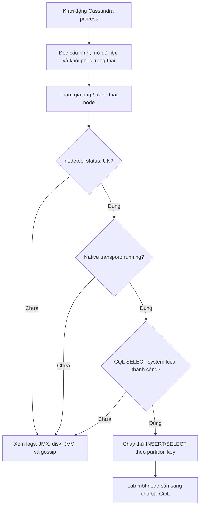

# Khởi tạo một nút và kiểm tra trạng thái sẵn sàng

## 1. Mục tiêu và phạm vi

Apache Cassandra là hệ quản trị cơ sở dữ liệu **wide-column phân tán**. Một cụm Cassandra được tạo bởi các **node** (nút) cùng chia sẻ dữ liệu theo token ring. Trước khi nghiên cứu partition key, thiết kế bảng theo truy vấn, replication, consistency level, compaction, repair, xử lý lỗi và kết nối từ Java, cần biết cách khởi tạo một node và xác định chính xác lúc nào node đã sẵn sàng phục vụ CQL.

Sau bài học, bạn sẽ:

1. Phân biệt **process đang chạy**, **node tham gia ring**, **CQL native transport hoạt động** và **truy vấn thực sự thành công**.
2. Dựng một node Cassandra 5.0 bằng Docker với cấu hình datacenter/rack và dữ liệu bền vững; biết cách áp dụng các bước xác minh tương tự cho bản cài Linux/VM.
3. Đọc kết quả `nodetool status`, `nodetool statusbinary`, `nodetool info` và `system.local`.
4. Thực hiện bài kiểm tra CQL tạo keyspace, tạo bảng, ghi và đọc theo partition key.
5. Viết kiểm tra readiness đơn giản có timeout, đọc log khi node không khởi động và phân biệt lỗi network với lỗi CQL.
6. Xác định các giới hạn của lab **một node** so với cluster có replication và nhiều failure domain.

**Phạm vi:** một node Cassandra mới trong mạng thực hành cô lập. Đây là môi trường để học CQL và kiểm tra trạng thái khởi động; nó **không có dự phòng node** và chưa đủ để đánh giá consistency, repair hay khả năng chịu lỗi của hệ thống phân tán.

## 2. “Đang chạy” khác “sẵn sàng” thế nào?

Quá trình khởi động có thể bao gồm nạp cấu hình/JVM, mở dữ liệu trên đĩa, khôi phục commitlog, khởi tạo dịch vụ nội bộ, trao đổi thông tin gossip và mở cổng native transport. Thứ tự, log và thời gian cụ thể phụ thuộc phiên bản và tình trạng dữ liệu; không lấy một dòng log riêng lẻ làm bằng chứng cuối cùng.



| Mức kiểm tra | Câu hỏi cần trả lời | Công cụ | Điều **chưa** được chứng minh |
|---|---|---|---|
| 1. **Process/liveness** | Container/dịch vụ còn chạy? | `docker ps`, `docker inspect` hoặc `systemctl status cassandra` | Node có thể vẫn đang bootstrap hoặc native transport chưa mở |
| 2. **Ring membership** | Node đã ở trạng thái **Up/Normal**? | `nodetool status` | CQL có thể chưa nhận request hoặc đang có lỗi cục bộ |
| 3. **Native transport** | Cổng giao thức CQL đang được Cassandra phục vụ? | `nodetool statusbinary`; kiểm tra listener 9042 | TCP mở không bảo đảm query thành công |
| 4. **CQL query** | Có thể thực thi truy vấn metadata? | `cqlsh -e "SELECT ... FROM system.local;"` | Quyền truy cập, schema và đường ghi/đọc của ứng dụng chưa được xác nhận |
| 5. **Functional smoke test** | Tạo schema, INSERT và SELECT theo partition key có hoạt động? | `cqlsh` hoặc Java driver | Không chứng minh HA, replication, tail latency hay repair khỏe |

Trong cluster nhiều node, kết quả `nodetool status` là góc nhìn từ node được hỏi. Một node báo `UN` chỉ cho biết **góc nhìn ring/gossip tương ứng**, không phải chứng nhận mọi node đều có thể liên lạc và mọi replica đồng bộ.

## 3. Chuẩn bị môi trường thực hành

### 3.1. Công cụ và tài nguyên

Ví dụ chính sử dụng **Docker Engine/Docker Desktop chạy Linux containers** và image `cassandra:5.0.9`. Đây là phiên bản được **ghim cho ví dụ**, không phải lời khẳng định nó luôn là bản mới nhất.

Điều kiện khởi đầu khuyến nghị:

- Host đủ tài nguyên cho Cassandra và Docker: để lab dễ chạy nên có khoảng **8 GiB RAM tổng trở lên**, Docker VM/container được cấp khoảng **4 GiB** và SSD còn khoảng **20 GiB**; đây là gợi ý thực hành, không phải sizing production.
- Có Docker CLI hoạt động; có mạng để tải image hoặc image đã được tải trước.
- **Cổng host 9042** chưa bị dùng bởi Cassandra/ứng dụng khác.
- Máy có đồng hồ hệ thống được đồng bộ; trong môi trường VM/Docker Desktop, kiểm tra cả đồng hồ và bộ nhớ của VM.
- Các lệnh `docker` bên dưới chạy trên **host**; các lệnh sau `docker exec` thực thi **bên trong container**.

Kiểm tra Docker:

```bash
docker version
docker info
docker ps
```

Nếu `docker version` không kết nối được tới daemon, khởi động Docker Engine/Desktop và kiểm tra quyền truy cập trước khi tiếp tục. Một môi trường lab khác có thể đã dùng cổng 9042; dừng lab đó theo đúng quy trình lưu dữ liệu trước khi chạy ví dụ này.

### 3.2. Những biến cấu hình cần biết

| Khái niệm | Giá trị lab | Tác dụng |
|---|---|---|
| Cluster name | `ready-lab` | Tên nhận diện cluster, không tự khiến các node cùng tên tham gia cùng một cluster |
| Datacenter | `datacenter1` | Nhóm replica theo vị trí logic, được dùng trong `NetworkTopologyStrategy` và Java driver |
| Rack | `rack1` | Đơn vị topology bên trong datacenter |
| Endpoint snitch | `GossipingPropertyFileSnitch` | Cho phép Cassandra lấy thông tin DC/rack từ cấu hình tương ứng |
| CQL port | `9042/TCP` | Native transport cho `cqlsh` và Java driver |
| JMX | Mặc định thường dùng cổng `7199` nội bộ | `nodetool` dùng để hỏi trạng thái/quản trị; không cần publish ra host cho lab |
| Data directory | `/var/lib/cassandra` trong image | Chứa dữ liệu bền vững, commitlog và các thành phần lưu trữ |

Chỉ tạo **một** node và để Docker image quản lý các tham số listen/broadcast/seed mặc định tương ứng. Không dùng cấu hình lab này để đưa một node vào cluster production: việc join cluster thật đòi hỏi version, seeds, network, topology, replication và quy trình bootstrap riêng.

## 4. Khởi tạo node bằng Docker

### 4.1. Tạo volume và khởi chạy

Đầu tiên tải image và tạo named volume để dữ liệu không biến mất khi xóa container:

```bash
docker pull cassandra:5.0.9
docker volume create cassandra_ready_data
```

Chạy node (cú pháp nhiều dòng dành cho **Bash/Linux/macOS**):

```bash
docker run -d \
  --name cassandra-ready-lab \
  -p 127.0.0.1:9042:9042 \
  -e CASSANDRA_CLUSTER_NAME=ready-lab \
  -e CASSANDRA_ENDPOINT_SNITCH=GossipingPropertyFileSnitch \
  -e CASSANDRA_DC=datacenter1 \
  -e CASSANDRA_RACK=rack1 \
  -v cassandra_ready_data:/var/lib/cassandra \
  cassandra:5.0.9
```

Trong **PowerShell**, dùng lệnh một dòng tương đương vì dấu `\` của Bash không phải ký hiệu nối dòng PowerShell:

```powershell
docker run -d --name cassandra-ready-lab -p 127.0.0.1:9042:9042 -e CASSANDRA_CLUSTER_NAME=ready-lab -e CASSANDRA_ENDPOINT_SNITCH=GossipingPropertyFileSnitch -e CASSANDRA_DC=datacenter1 -e CASSANDRA_RACK=rack1 -v cassandra_ready_data:/var/lib/cassandra cassandra:5.0.9
```

Ý nghĩa của các lựa chọn:

- `-d` chạy ở chế độ detached, **chỉ xác nhận Docker đã tạo/khởi động container**, chưa khẳng định Cassandra sẵn sàng.
- `-p 127.0.0.1:9042:9042` chỉ publish CQL trên loopback của host, không quảng bá cổng trực tiếp ra mạng ngoài.
- `GossipingPropertyFileSnitch` cùng `CASSANDRA_DC/RACK` tạo topology logic cho bài lab.
- `cassandra_ready_data` lưu thư mục `/var/lib/cassandra`; không dùng cùng volume này đồng thời cho nhiều container Cassandra.
- Không publish JMX/gossip/streaming ports để phục vụ một node đơn giản.

**Không chọn `--rm`** cho bài cần đọc log sau lỗi. Nếu Docker báo port đã được sử dụng, hãy xác định container/service chiếm 9042 trước khi đổi port. Nếu đổi thành `-p 127.0.0.1:9144:9042` thì client CQL **trên host** kết nối 9144, còn client **trong container** vẫn kết nối 9042.

### 4.2. Quan sát giai đoạn khởi động

```bash
docker ps --filter name=cassandra-ready-lab
docker logs --tail 100 cassandra-ready-lab
docker stats --no-stream cassandra-ready-lab
```

Một số lưu ý khi diễn giải:

- Container có trạng thái `Up` nghĩa là process chính còn chạy, **không phải health check**.
- Cassandra có thể mất thời gian để khởi tạo system keyspace, mở commitlog, tải schema và nhận kết nối; không có số giây cố định áp dụng cho mọi laptop/VM.
- Nếu container không xuất hiện trong `docker ps`, thử `docker ps -a --filter name=cassandra-ready-lab` và đọc log để biết nó đã thoát chưa.
- Nếu `docker stats` cho thấy bộ nhớ chạm giới hạn, CPU cao hoặc máy ảo thiếu đĩa, giải quyết thiếu tài nguyên trước khi kết luận lỗi Cassandra.

### 4.3. Mức 1: kiểm tra process đang chạy

```bash
docker inspect --format "{{.State.Running}}" cassandra-ready-lab
docker inspect --format "{{.State.ExitCode}}" cassandra-ready-lab
docker inspect --format "{{.State.OOMKilled}}" cassandra-ready-lab
```

Kỳ vọng `State.Running=true` và không có dấu hiệu OOM. `ExitCode` có ý nghĩa nhất khi process đã dừng; không lấy `ExitCode=0` từ một container đang chạy làm bằng chứng CQL sẵn sàng.

## 5. Kiểm tra trạng thái node bằng nodetool

### 5.1. Mức 2: ring membership

Chạy `nodetool` **bên trong container** để công cụ liên hệ JMX của Cassandra cùng môi trường:

```bash
docker exec cassandra-ready-lab nodetool status
```

Ví dụ định dạng kết quả (IP, load, host ID và token thay đổi theo máy):

```text
Datacenter: datacenter1
=======================
Status=Up/Down
|/ State=Normal/Leaving/Joining/Moving
--  Address      Load      Tokens  Owns (effective)  Host ID       Rack
UN  172.17.0.2   ...       ...     ...               <UUID>        rack1
```

**Cách đọc hai ký tự trạng thái:**

| Mã | Ý nghĩa | Xử lý trong lab |
|---|---|---|
| `UN` | **Up / Normal**: node đang hoạt động và ở trạng thái bình thường trong ring | Có thể tiếp tục kiểm tra native transport và CQL |
| `UJ` | **Up / Joining**: node đang tham gia ring/bootstrap | Chưa đánh dấu sẵn sàng; theo dõi log, network và bootstrap |
| `UL` | **Up / Leaving**: node đang rời ring | Không sử dụng làm baseline cho một node mới |
| `UM` | **Up / Moving**: token range đang được di chuyển | Chưa xem là trạng thái bình thường của lab |
| `DN` | **Down / Normal**: node bị coi là down từ góc nhìn node đang được hỏi | Điều tra lỗi kết nối, process, gossip và host |

Ở **lab một node mới**, kỳ vọng thấy **một dòng `UN`** dưới `Datacenter: datacenter1`, với rack là `rack1`. Node có thể xuất hiện bằng IP mạng nội bộ Docker (như `172.x.x.x`), khác với `127.0.0.1` dùng khi kết nối từ host: điều này bình thường do có port mapping/NAT.

Nếu ngay khi khởi động `nodetool status` báo không kết nối được JMX, chưa vội kết luận node chết; JVM/JMX có thể chưa sẵn sàng hoặc Cassandra đã dừng. Kiểm tra `docker ps -a` và `docker logs`. Một node **chỉ có một replica** không có khả năng phục vụ dữ liệu nếu node đó mất hẳn.

### 5.2. Kiểm tra phiên bản và thông tin node

```bash
docker exec cassandra-ready-lab nodetool version
docker exec cassandra-ready-lab nodetool info
docker exec cassandra-ready-lab nodetool describecluster
docker exec cassandra-ready-lab java -version
```

| Lệnh | Mục đích |
|---|---|
| `nodetool version` | Ghi lại phiên bản server thực tế; không suy từ image tag |
| `nodetool info` | Xem thông tin node như host ID, tokens, heap, uptime, data load và các trạng thái được công cụ hỗ trợ |
| `nodetool describecluster` | Xem tên cluster, partitioner, snitch và thông tin schema của cluster |
| `java -version` trong container | Xác nhận JVM đang chạy ở môi trường server; tách biệt JDK trên host dùng cho ứng dụng Java |

Đối với cùng một node và cùng volume dữ liệu, `host_id` thường được giữ qua các lần restart. Nếu xóa volume rồi bootstrap một node hoàn toàn mới, host ID/tokens có thể thay đổi. Vì vậy, **không xem hai container cùng tên là cùng một node Cassandra** nếu dữ liệu nền đã bị xóa.

### 5.3. Mức 3: native transport có mở không?

```bash
docker exec cassandra-ready-lab nodetool statusbinary
docker exec cassandra-ready-lab nodetool statusgossip
```

`nodetool statusbinary` trả `running` khi native transport của Cassandra đang hoạt động và `not running` khi chưa/không còn phục vụ. `nodetool statusgossip` cho biết trạng thái gossip, có ích khi chẩn đoán ring. Các lệnh này dùng **JMX**, khác với kết nối CQL trực tiếp qua cổng 9042.

Kỳ vọng cho lab: `statusbinary = running` và `statusgossip = running`. Nếu `statusbinary` là `not running`, kiểm tra log, cấu hình native transport và tình trạng khởi động; **không** dùng `nodetool enablebinary` để che lỗi khi chưa hiểu nguyên nhân.

## 6. Xác minh bằng CQL

### 6.1. Mức 4: đọc metadata từ system.local

Sử dụng `cqlsh` được đóng gói trong image:

```bash
docker exec cassandra-ready-lab cqlsh -e "SELECT release_version, cluster_name, data_center, host_id FROM system.local;"
```

Kỳ vọng:

- `release_version` là `5.0.9` nếu image đang chạy đúng bản đã chọn.
- `cluster_name` là `ready-lab`.
- `data_center` là `datacenter1`.
- `host_id` có giá trị UUID xác định node.

Đây là **bằng chứng mạnh hơn** việc chỉ mở cổng TCP vì Cassandra phải nhận request và thực thi truy vấn CQL. Nếu `cqlsh` báo *Connection refused*, có thể service vẫn đang khởi động; kiểm tra lần lượt container/process → `nodetool status` → `statusbinary` → log.

Để sử dụng shell tương tác:

```bash
docker exec -it cassandra-ready-lab cqlsh
```

Ở prompt `cqlsh>`:

```sql
SHOW VERSION;
SHOW HOST;
SELECT cluster_name, data_center, release_version FROM system.local;
```

`SHOW VERSION` hiển thị thông tin cqlsh/server/CQL/native protocol; `SHOW HOST` cho biết endpoint kết nối hiện tại. Cả hai là **lệnh riêng của cqlsh**, không phải CQL query từ ứng dụng Java.

### 6.2. Mức 5: tạo schema, ghi và đọc theo partition key

Trong `cqlsh`, tạo keyspace riêng cho lab:

```sql
CREATE KEYSPACE IF NOT EXISTS ready_lab
WITH replication = {
  'class': 'NetworkTopologyStrategy',
  'datacenter1': 1
};

CREATE TABLE IF NOT EXISTS ready_lab.events_by_device (
  device_id text,
  event_id timeuuid,
  event_type text,
  PRIMARY KEY ((device_id), event_id)
) WITH CLUSTERING ORDER BY (event_id DESC);

INSERT INTO ready_lab.events_by_device
  (device_id, event_id, event_type)
VALUES ('device-001', now(), 'node-ready');

SELECT device_id, event_id, event_type
FROM ready_lab.events_by_device
WHERE device_id = 'device-001'
LIMIT 10;
```

Kỳ vọng truy vấn trả **một dòng** với `device_id = 'device-001'` và `event_type = 'node-ready'`. Nếu đã chạy đoạn này nhiều lần, vì mỗi lần `now()` tạo một timeuuid mới, có thể có **nhiều dòng**; khi đó kiểm tra có ít nhất một dòng tương ứng và dùng `TRUNCATE ready_lab.events_by_device;` nếu muốn chạy lại với bảng rỗng. `TRUNCATE` xóa toàn bộ dữ liệu bảng, chỉ thực hiện với bảng lab được tạo cho bài.

Vì sao mô hình này phù hợp Cassandra?

- `device_id` là **partition key**: các sự kiện của một thiết bị cùng partition, định tuyến theo token của partition key.
- `event_id` là **clustering column** giúp sắp xếp các sự kiện trong partition theo thứ tự giảm dần.
- Câu `SELECT` có `WHERE device_id = ...` nên đọc đúng partition theo cách thiết kế bảng hướng truy vấn, không cần quét toàn cluster.
- `NetworkTopologyStrategy` định nghĩa số replica theo datacenter. Với `'datacenter1': 1` và **một node**, chỉ có **một bản sao**; `LOCAL_QUORUM` trong trường hợp này vẫn chỉ có một replica và không tạo ra khả năng chịu lỗi.

Thao tác tạo bảng/ghi/đọc thành công cho thấy **đường dữ liệu cơ bản** hoạt động trên node này. Nó không có nghĩa cluster đã qua kiểm thử compaction, repair, replication nhiều node hoặc khả năng chịu lỗi; những chủ đề đó cần môi trường và workload riêng.

### 6.3. Quan sát dữ liệu và tác vụ nền sau smoke test

Thoát `cqlsh` rồi chạy trong terminal host:

```bash
docker exec cassandra-ready-lab nodetool tablestats ready_lab
docker exec cassandra-ready-lab nodetool tpstats
docker exec cassandra-ready-lab nodetool compactionstats
docker exec cassandra-ready-lab sh -c "df -h /var/lib/cassandra"
```

`tablestats` cho thông số của bảng, `tpstats` cho tình trạng thread pools, `compactionstats` cho công việc compaction đang/chờ xử lý. **Không có pending compaction** sau một write nhỏ là hoàn toàn có thể bình thường. Trạng thái `UN` và một câu SELECT thành công cũng **không thay thế** giám sát CPU, RAM, ổ đĩa, GC pause, read/write latency và timeout khi chạy tải thực.

## 7. Tự động chờ node sẵn sàng trong script lab

Một lỗi phổ biến trong Docker Compose hoặc kịch bản test là khởi chạy Java app ngay sau `docker run -d`. Cassandra có thể chưa mở CQL, khiến kết nối đầu tiên thất bại dù vài giây sau node khỏe.

### 7.1. Lệnh kiểm tra đơn lẻ

Trên máy đã có container:

```bash
docker exec cassandra-ready-lab cqlsh -e "SELECT release_version FROM system.local;"
```

Với lab, **lệnh thành công (exit code 0)** là dấu hiệu CQL đã thực thi query. Nó vẫn cần kết hợp kiểm tra ring/statusbinary khi bạn muốn đánh dấu “node ready”.

### 7.2. Ví dụ chờ có giới hạn trong Bash

Nếu muốn dùng trong một script Bash tự tạo, ví dụ sau thử lại trong tối đa khoảng 150 giây (chỉ minh họa; máy chậm có thể cần nhiều thời gian hơn):

```bash
#!/usr/bin/env bash

set -u
ready=0

for attempt in {1..30}; do
  # status được chạy trong container: một dòng UN là đủ cho lab một node.
  status="$(docker exec cassandra-ready-lab nodetool status 2>/dev/null)" || status=""
  binary="$(docker exec cassandra-ready-lab nodetool statusbinary 2>/dev/null)" || binary=""

  if printf '%s\n' "$status" | grep -Eq '^UN[[:space:]]' \
     && [ "$binary" = "running" ] \
     && docker exec cassandra-ready-lab cqlsh \
         -e "SELECT release_version FROM system.local;" >/dev/null 2>&1; then
    ready=1
    break
  fi

  echo "Cassandra chua san sang (lan $attempt/30)"
  sleep 5
done

if [ "$ready" -eq 1 ]; then
  echo "READY: UN, native transport running, SELECT system.local thanh cong"
else
  echo "NOT READY: xem log va tai nguyen Cassandra" >&2
  docker logs --tail 80 cassandra-ready-lab >&2
  exit 1
fi
```

Lưu đoạn mã trên thành một **script lab riêng**, ví dụ `check-ready.sh`, rồi chạy bằng Bash. Không dán nguyên lệnh `exit 1` vào phiên tương tác nếu không muốn phiên shell kết thúc. Đoạn script dùng một dòng `UN` vì môi trường **chỉ có một node**; với cluster nhiều node phải xác định **đúng host ID/địa chỉ của node cần kiểm tra** và không suy trạng thái toàn cluster từ một dòng bất kỳ.

Ví dụ intentionally kiểm tra ba lớp khác nhau:

1. Node ở ring có trạng thái `UN`.
2. Native transport của Cassandra báo `running`.
3. Truy vấn CQL chạy thành công.

Không cần cố “chờ đúng 30 lần” ở mọi môi trường; số lần, khoảng nghỉ và timeout phải dựa trên tốc độ khởi động thực tế. Với các health probe chạy liên tục, không nên gọi `cqlsh` quá dày vì mỗi lần đều khởi chạy một process Python; cân nhắc driver session dùng lại hoặc cơ chế probe phù hợp trong hệ vận hành.

### 7.3. Ý nghĩa khi ứng dụng Java khởi động

Trong ứng dụng Java, tạo `CqlSession` sau khi cấu hình contact point/local datacenter, rồi chạy truy vấn nhẹ để xác minh session đã phục vụ request. Ví dụ phần mã:

```java
import java.net.InetSocketAddress;
import com.datastax.oss.driver.api.core.CqlSession;
import com.datastax.oss.driver.api.core.cql.Row;

public class CassandraReadiness {
    public static void main(String[] args) {
        try (CqlSession session = CqlSession.builder()
                .addContactPoint(new InetSocketAddress("127.0.0.1", 9042))
                .withLocalDatacenter("datacenter1")
                .build()) {
            Row row = session.execute(
                    "SELECT release_version FROM system.local").one();
            if (row == null) {
                throw new IllegalStateException("system.local khong co ket qua");
            }
            System.out.println("Cassandra ready: " + row.getString("release_version"));
        }
    }
}
```

Ví dụ dành cho **ứng dụng Java 17 + Apache Cassandra Java Driver 4.x** (ví dụ dependency `org.apache.cassandra:java-driver-core:4.19.4`). Cấu hình contact point `127.0.0.1:9042` ở đây giả định **ứng dụng chạy trên host** và cổng Docker đã publish 9042. Nếu Java chạy trong **container khác**, `127.0.0.1` là chính container Java; cần dùng DNS của Docker network và đảm bảo các địa chỉ **Cassandra quảng bá qua metadata** có thể được ứng dụng truy cập. Khi có NAT, SSH tunnel, nhiều node hoặc thay đổi host port, test kết nối Java thực tế thay vì chỉ suy từ thành công của `docker exec ... cqlsh`.

Trong ứng dụng thật, thường tái sử dụng **một `CqlSession` theo cluster**, xây dựng retry/backoff có giới hạn khi khởi động và sử dụng metrics/health endpoint phù hợp. Tránh tạo session mới cho mỗi HTTP request chỉ để chứng minh readiness.

## 8. Nếu Cassandra cài bằng package hoặc trong VM

Quy tắc đánh giá readiness **không thay đổi**; chỉ khác cách khởi động và vị trí chạy lệnh.

| Cách cài | Bước kiểm tra process | Kiểm tra node/CQL | Nơi tìm log |
|---|---|---|---|
| DEB/APT hoặc RPM/DNF trên Linux | `systemctl status cassandra --no-pager` | `nodetool status`; `nodetool statusbinary`; `cqlsh -e "SELECT ... FROM system.local;"` | `journalctl -u cassandra` và `/var/log/cassandra/system.log` tùy package |
| Linux VM cài package | Các lệnh `systemctl` **trong guest** | Chạy `nodetool`/`cqlsh` **trong guest**, sau đó mới thử từ host | Log trong filesystem guest |
| Tarball trên Linux/VM | Process `bin/cassandra -f` ở foreground hoặc service tự cấu hình | `bin/nodetool status`; `bin/cqlsh` | `logs/system.log` dưới thư mục tarball hoặc đường dẫn tùy chỉnh |
| Docker | `docker ps -a`, `docker inspect` | `docker exec ... nodetool ...` và `docker exec ... cqlsh ...` | `docker logs` |

Ví dụ với package quản lý bằng systemd:

```bash
sudo systemctl start cassandra
sudo systemctl status cassandra --no-pager
nodetool status
nodetool statusbinary
cqlsh -e "SELECT release_version, data_center FROM system.local;"
```

Nếu `cqlsh` chạy **trong VM** thành công nhưng `cqlsh` từ host thất bại, cần kiểm tra **VM NAT/bridged/host-only, firewall và listener**. Cassandra có thể chỉ bind CQL ở loopback của guest. Với Java driver, `rpc_address` là địa chỉ bind native transport, trong khi `broadcast_rpc_address` là địa chỉ node công bố cho client: địa chỉ này phải truy cập được từ vị trí ứng dụng.

Đối với một VM lab hoặc node package mới, kiểm tra `data_center` thực tế thay vì áp dụng máy móc tên `datacenter1`. Nếu tên datacenter khác, thay nó trong `NetworkTopologyStrategy` và `withLocalDatacenter(...)` khi tạo keyspace/ứng dụng.

## 9. Chẩn đoán khi node chưa sẵn sàng

| Triệu chứng | Khả năng nguyên nhân | Lệnh và hướng kiểm tra |
|---|---|---|
| `docker run` trả ID nhưng `cqlsh` lỗi | Cassandra chưa hoàn tất startup | `docker logs`, `nodetool status`, `statusbinary`; đợi theo trạng thái thực |
| Container đã thoát | JVM lỗi, thiếu RAM, volume/permission, đĩa đầy hoặc sai cấu hình | `docker ps -a`, `docker inspect`, `docker logs`, kiểm tra RAM/đĩa |
| `nodetool` báo không kết nối JMX | Cassandra/JMX chưa chạy hoặc config/port JMX không phù hợp | Kiểm tra process/log và cách JMX được bind; không đồng nhất JMX với cổng CQL |
| `status = UJ` kéo dài | Bootstrap/join chưa hoàn tất, gossip, topology hoặc IO có vấn đề | Log, `nodetool netstats`, network/seed; lab mới một node không nên phải chờ streaming vô hạn |
| `status = UN` nhưng `statusbinary = not running` | Native transport chưa mở hoặc đã bị tắt | Log, config native transport, listener; chưa đánh dấu ready |
| `statusbinary = running` nhưng `cqlsh` không kết nối | CQL listener/route/firewall, auth/TLS, startup hoặc address không đúng | Kiểm tra cổng 9042 đúng từ nơi chạy client, log và cấu hình |
| `cqlsh` trong container thành công, host thất bại | Quên publish port, host dùng sai cổng/địa chỉ, firewall, Docker VM | `docker ps`, mapping 9042, kết nối từ host; phân biệt container IP và localhost |
| Java driver thất bại nhưng `cqlsh` trong container OK | Local DC không khớp, contact point/port sai, node quảng bá IP không route được | `system.local.data_center`, `withLocalDatacenter`, metadata, Docker network/NAT |
| `CREATE KEYSPACE`/`INSERT` lỗi | Sai datacenter trong replication, schema/query sai, quyền truy cập hoặc node không khỏe | Kiểm tra `system.local.data_center`, error CQL và server log |
| SELECT không thấy bản ghi | Truy vấn sai partition key, dữ liệu đã TTL/xóa hoặc ghi không thực sự thành công | Kiểm tra chính xác khóa, statement INSERT và consistency; không kết luận từ `nodetool status` |
| Disk đầy sau khi dùng một thời gian | Commitlog, SSTable, compaction/snapshot/volume Docker | `df -h /var/lib/cassandra`, `nodetool compactionstats`, Docker VM disk |
| Clock skew lớn giữa node/client | Đồng bộ thời gian host/VM không đúng hoặc client tự cấp timestamp sai | Kiểm tra UTC/NTP và nguồn mutation timestamp; tránh kết luận dữ liệu nhất quán chỉ vì write trả success |

**Quy trình xử lý lỗi theo thứ tự:**

1. **Container/service:** còn running hay đã exit, có OOM không?
2. **Log:** JVM có báo lỗi cấu hình, Java version, permission, disk hoặc startup không?
3. **Ring:** `nodetool status` có cho **đúng node** trạng thái `UN`?
4. **Native transport:** `nodetool statusbinary` có báo `running`?
5. **CQL từ trong môi trường server:** `SELECT ... FROM system.local` có thành công?
6. **CQL từ nơi chạy client:** đường mạng, cổng, auth/TLS, local datacenter và broadcast address đã đúng?
7. **Bảng ứng dụng:** schema, partition key, INSERT/SELECT và consistency level có đúng yêu cầu?

Không nên “sửa nhanh” bằng cách xóa `/var/lib/cassandra` hoặc named volume khi có dữ liệu cần giữ. Với cluster thật, thao tác thay đổi token, seed, replication, thay node và repair phải theo quy trình vận hành tương ứng; không điều chỉnh tùy tiện chỉ để ép trạng thái `UN`.

## 10. Tình huống thử nghiệm có kiểm soát

### 10.1. Dừng và khởi động lại cùng node

Sau khi xác nhận dữ liệu lab đã ghi thành công:

```bash
docker stop cassandra-ready-lab
docker start cassandra-ready-lab
docker exec cassandra-ready-lab nodetool status
docker exec cassandra-ready-lab cqlsh -e "SELECT device_id, event_type FROM ready_lab.events_by_device WHERE device_id = 'device-001';"
```

Lệnh `docker start` có thể trả về trước khi Cassandra mở CQL; hãy **đợi lại readiness** theo các mức ở trên. Vì vẫn dùng **cùng named volume**, dữ liệu đã ghi vào Cassandra có thể được khôi phục sau restart bình thường. Nếu trước đó có một node mới dùng volume khác hoặc không còn dữ liệu, kết quả sẽ khác.

### 10.2. Thử tác động của mất native transport — chỉ lab

Trong **môi trường Cassandra riêng, không có ứng dụng/đồng nghiệp sử dụng**, có thể quan sát điều gì xảy ra khi tắt native transport:

```bash
docker exec cassandra-ready-lab nodetool disablebinary
docker exec cassandra-ready-lab nodetool statusbinary
docker exec cassandra-ready-lab cqlsh -e "SELECT release_version FROM system.local;"

# Bật lại ngay trong lab:
docker exec cassandra-ready-lab nodetool enablebinary
docker exec cassandra-ready-lab nodetool statusbinary
docker exec cassandra-ready-lab cqlsh -e "SELECT release_version FROM system.local;"
```

Sau `disablebinary`, `statusbinary` có thể báo `not running` và truy vấn cqlsh mới sẽ thất bại; đó là kết quả mong đợi của bài thử. Các lệnh này **thực sự làm gián đoạn CQL** của node đang chạy, vì thế chỉ dùng trong lab cô lập và bật lại sau khi quan sát. Nếu thao tác bị lỗi hoặc chưa khôi phục được, xem log và khôi phục theo quy trình điều hành.

Thí nghiệm minh họa rằng node có thể tiếp tục xuất hiện trong ring trong khi khả năng phục vụ CQL không còn hoạt động: **ring health và query readiness là hai mức kiểm chứng riêng**.

## 11. Lưu lại bằng chứng, dọn môi trường và câu hỏi ôn tập

### 11.1. Bảng bằng chứng readiness

Ghi kết quả thực tế vào nhật ký thực hành:

| Kiểm tra | Kết quả cần ghi |
|---|---|
| Image/phiên bản | `cassandra:5.0.9`; kết quả `nodetool version` |
| Container/process | `State.Running`, lỗi OOM nếu có |
| Ring | Dòng node `UN`, datacenter, rack, host ID |
| Native transport | Kết quả `nodetool statusbinary` |
| System metadata | `release_version`, `cluster_name`, `data_center`, `host_id` |
| CQL smoke test | Có bản ghi `device-001` trong `ready_lab.events_by_device` |
| Client endpoint | Host/port nơi `cqlsh` hoặc Java thực sự kết nối |
| Dung lượng | Kết quả `df -h /var/lib/cassandra` và trạng thái volume |
| Ngày/giờ thực hành | Thời điểm UTC, thông tin đồng bộ NTP của host/VM |

### 11.2. Câu hỏi tự đánh giá

1. Vì sao `docker ps` hiển thị `Up` chưa đủ để đánh dấu Cassandra đã sẵn sàng cho ứng dụng Java?
2. Một node hiện `UJ` liên tục. Chữ `J` nghĩa là gì và loại bằng chứng nào cần thu trước khi can thiệp?
3. `nodetool status` cho `UN` nhưng `nodetool statusbinary` cho `not running`. CQL client mới có khả năng kết nối không? Tại sao?
4. `cqlsh` chạy trong container thành công nhưng chương trình Java trên host báo `NoNodeAvailableException`. Những khác biệt nào giữa địa chỉ host, container IP, contact point, local DC và broadcast address cần xem xét?
5. Khi khởi tạo keyspace với `NetworkTopologyStrategy`, tại sao tên datacenter trong replication map phải phản ánh topology thực? RF=1 có thực sự thử được replica failover không?
6. Một câu SELECT thiếu `WHERE device_id = ...` thất bại. Đây là lỗi readiness hay dấu hiệu chưa thiết kế/truy vấn đúng partition key?
7. Nếu xóa container và tạo lại bằng cùng named volume, điều gì có thể được giữ? Điều gì thay đổi nếu xóa cả volume?
8. Tại sao một câu `SELECT system.local` thành công vẫn chưa chứng minh repair, compaction và tail latency của cluster production đạt yêu cầu?

### 11.3. Dừng và xóa container khi kết thúc lab

```bash
docker stop cassandra-ready-lab
docker rm cassandra-ready-lab
docker volume ls --filter name=cassandra_ready_data
```

Các lệnh trên giữ lại named volume. **Không xóa volume** nếu cần dữ liệu của buổi học tiếp theo; chỉ khi chắc chắn có thể bỏ toàn bộ dữ liệu lab mới cân nhắc `docker volume rm cassandra_ready_data`. Nếu tạo lại node, giữ đúng phiên bản và cấu hình phù hợp với data directory cũ; đừng cố downgrade Cassandra hoặc tái sử dụng volume giữa hai node đang chạy cùng lúc.

**Tiêu chí hoàn thành:** node mới vào trạng thái `UN`, native transport báo `running`, `cqlsh` đọc được `system.local` và ghi/đọc được một bản ghi bằng partition key. Người học có thể giải thích riêng từng lớp kiểm tra và xử lý được lỗi kết nối/khởi động cơ bản trước khi chuyển sang bài replication, consistency level, compaction, repair và kết nối ứng dụng Java.

## 12. Tài liệu tham khảo chính thức

- [Apache Cassandra — nodetool status](https://cassandra.apache.org/doc/latest/cassandra/managing/tools/nodetool/status.html): trạng thái ring và mã `UN`, `UJ`, `DN`.
- [Apache Cassandra — nodetool statusbinary](https://cassandra.apache.org/doc/latest/cassandra/managing/tools/nodetool/statusbinary.html): kiểm tra native transport.
- [Apache Cassandra — nodetool statusgossip](https://cassandra.apache.org/doc/latest/cassandra/managing/tools/nodetool/statusgossip.html): kiểm tra gossip.
- [Apache Cassandra — Use Nodetool](https://cassandra.apache.org/doc/latest/cassandra/troubleshooting/use_nodetool.html): cách quan sát và khoanh vùng lỗi node.
- [Apache Cassandra — cqlsh](https://cassandra.apache.org/doc/latest/cassandra/managing/tools/cqlsh.html): kết nối CQL, `SHOW HOST` và `SHOW VERSION`.
- [Apache Cassandra — Inserting and Querying](https://cassandra.apache.org/doc/latest/cassandra/getting-started/querying.html): thực hành CQL cơ bản.
- [Apache Cassandra — Quickstart](https://cassandra.apache.org/doc/latest/cassandra/getting-started/cassandra-quickstart.html): tạo node và thao tác CQL.
- [Docker Hub — Cassandra Official Image](https://hub.docker.com/_/cassandra): image, biến môi trường và Docker volume.
- [Apache Cassandra Java Driver](https://github.com/apache/cassandra-java-driver): `CqlSession`, contact point và local datacenter.
