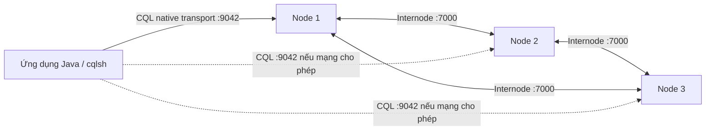

# Thiết kế cụm thử nhiều nút, tên cluster và địa chỉ liên lạc

## 1. Mục tiêu và phạm vi

Apache Cassandra là hệ quản trị cơ sở dữ liệu **wide-column phân tán**: dữ liệu được chia theo token của **partition key**, nhân bản theo **replication strategy**, và được đọc/ghi từ các node qua giao thức CQL. Để thực hành replication, consistency level, compaction, repair, xử lý lỗi node và kết nối từ ứng dụng Java, cần tạo một **cluster nhiều node có thể liên lạc với nhau**, chứ không chỉ chạy ba tiến trình Cassandra riêng lẻ.

Sau bài này, bạn sẽ:

1. Thiết kế cụm lab **ba node, một datacenter**, phân biệt cluster, datacenter, rack, node, seed và replica.
2. Biết ý nghĩa và yêu cầu đối với `cluster_name`, `listen_address`, `broadcast_address`, `rpc_address`, `broadcast_rpc_address`, `seed_provider`, các cổng internode và CQL.
3. Dựng ba node Cassandra 5.0.9 bằng Docker với network và volume độc lập, khởi động theo thứ tự có thể kiểm tra được.
4. Xác nhận cả ba node cùng hiện `UN` trong ring và `system.peers_v2` có thông tin các node còn lại.
5. Tạo keyspace với `NetworkTopologyStrategy`, RF=3; thực hiện truy vấn theo partition key và giải thích quorum của ba replica.
6. Thử dừng một node trong **lab cô lập**, quan sát trạng thái các node và khôi phục lại; biết vì sao bài thử chưa mô phỏng sự cố của ba máy vật lý độc lập.

> **Phạm vi:** lab học tập, không chứa dữ liệu thật. Không kết nối các node trong bài này vào cluster production. Các giá trị IP, tên, RAM và cổng là ví dụ; phải kiểm tra tài nguyên và mạng thực tế trước khi áp dụng.

## 2. Sơ đồ cụm và các khái niệm bắt buộc

### 2.1. Cụm thử 3 node trong cùng Docker network

```text
                   Ứng dụng Java / cqlsh
                      CQL :9042
                           │
              Docker network: cassandra-lab3-net
             ┌─────────────┼─────────────┐
             │             │             │
       cassandra-n1   cassandra-n2   cassandra-n3
          rack1          rack2          rack3
          :7000          :7000          :7000
          :9042          :9042          :9042
             │             │             │
          volume1       volume2       volume3
             └─────────────┴─────────────┘
            cluster_name = cassandra-lab3
                   datacenter = dc1
```

Ba container chia sẻ **một host vật lý** và một Docker Engine. Việc đặt `rack1`, `rack2`, `rack3` chỉ giúp quan sát **topology logic**; nó **không** tạo ba rack hoặc failure domain vật lý. Khi laptop mất nguồn, cả ba node cùng ngừng hoạt động.

| Thành phần | Ý nghĩa | Thiết lập trong lab |
|---|---|---|
| Cluster | Tập các node Cassandra phối hợp trong một ring | `cassandra-lab3` |
| Node | Một Cassandra server có host ID, token và dữ liệu riêng | `cassandra-n1`, `cassandra-n2`, `cassandra-n3` |
| Datacenter | Nhóm node cho quy tắc chọn replica và mức nhất quán local | `dc1` |
| Rack | Vị trí/failure domain logic được snitch cung cấp | `rack1`, `rack2`, `rack3` (giả lập) |
| Seed | Địa chỉ node giúp node mới tìm thành viên cluster qua gossip | Ban đầu `cassandra-n1` |
| Gossip | Trao đổi thông tin membership, trạng thái, topology | Các node liên lạc nội bộ qua mạng Cassandra |
| Replica | Bản sao dữ liệu được chọn theo keyspace replication strategy và token range | Ví dụ `RF=3` trong `dc1` |
| Coordinator | Node nhận request đọc/ghi và điều phối replica cho request đó | Có thể là bất kỳ node Cassandra nào được client kết nối |

**Seed không phải primary, master hoặc leader.** Sau khi tham gia ring, các node có thể biết nhau qua gossip; các request CQL không bắt buộc phải đi qua seed. **Replication factor** được khai báo **trong keyspace**, không được tạo ra chỉ vì có ba node trong cluster. Với ba node nhưng RF=1, mỗi partition vẫn chỉ có một replica.

### 2.2. Tại sao phải cùng cluster name và cùng mạng?

Các node muốn tham gia cùng một cluster cần cấu hình tương thích về **cluster identity**, partitioner, snitch/topology, phiên bản Cassandra và khả năng kết nối internode. `cluster_name` phải thống nhất, nhưng **trùng tên cluster chưa đủ**: node còn phải tìm được seed và các peer, tham gia ring đúng cách và không trùng host ID/data directory.

Nếu bạn khởi động ba node một cách độc lập, mỗi node tự khởi tạo ring một node rồi sau đó đổi `cluster_name` giống nhau, đó **không phải** cách hợp nhất an toàn thành một cluster. Thiết kế seed, địa chỉ và mạng phải có **trước lần bootstrap đầu tiên**.

## 3. Các địa chỉ và cổng cần phân biệt

### 3.1. Hai đường liên lạc riêng: internode và client



| Cổng mặc định | Phục vụ | Kết nối cần cho lab |
|---|---|---|
| `7000/TCP` | Giao tiếp **internode**, gossip/streaming và traffic giữa Cassandra node | Node 1 ↔ 2 ↔ 3 phải liên lạc được hai chiều |
| `7001/TCP` | Cổng internode SSL **legacy**, không cần khi cấu hình Cassandra 5.0 dùng một port theo thiết lập TLS hiện hành | Chỉ nếu cấu hình cụ thể thực sự sử dụng |
| `9042/TCP` | **CQL native protocol** cho `cqlsh` và Java Driver | Ứng dụng cần truy cập node được chọn |
| `7199/TCP` | JMX để `nodetool` quản trị node | Gọi trong cùng container/VM; **không công khai** JMX ra internet |

Ở Cassandra 4.0 trở lên, việc dùng `7001` như cổng SSL riêng đã bị giảm vai trò; khi bật mã hóa internode cần đọc tài liệu **của đúng phiên bản** và xác nhận cấu hình port thực tế. Không được phép suy ra “cứ mở 7000 và 7001 là bảo mật”.

### 3.2. Cấu hình địa chỉ trong cassandra.yaml

| Thuộc tính | Ý nghĩa | Quy tắc quan trọng |
|---|---|---|
| `listen_address` | Interface/IP mà Cassandra **bind** cho lưu lượng giữa các node | Phải gắn với interface thực và **không đặt `0.0.0.0`** |
| `broadcast_address` | IP node **quảng bá cho các node khác** để liên lạc internode | Mọi peer cần **route được** IP đó; mặc định có thể dùng `listen_address` |
| `rpc_address` | Địa chỉ **bind** cho CQL native transport | Có thể là `0.0.0.0`, nhưng khi đó phải đặt `broadcast_rpc_address` hợp lệ |
| `broadcast_rpc_address` | Địa chỉ node **công bố cho driver/client** qua topology metadata | Không được là `0.0.0.0`; ứng dụng phải truy cập được |
| `seed_provider` / `seeds` | Danh sách địa chỉ node ban đầu để node mới phát hiện cluster | Một hoặc nhiều seed đang chạy, reachable qua mạng internode |
| `native_transport_port` | Cổng CQL client | Thường `9042`, có thể bị ảnh hưởng bởi NAT/port mapping |
| `storage_port` | Cổng internode | Thường `7000`; cần thông nhau giữa mọi node |

**Phân biệt bind và advertise:** bind là nơi process lắng nghe; broadcast là **địa chỉ các peer/client sẽ thử kết nối**. Một process có thể bind trên mọi interface nhưng công bố nhầm IP không thể truy cập, gây lỗi dù `docker ps` và `cqlsh` cục bộ vẫn thành công.

Ví dụ trên **ba VM Linux có IP riêng, định tuyến được** (địa chỉ chỉ minh họa):

```yaml
# Cấu hình khái niệm dành cho VM node có IP thật 10.80.10.11:
cluster_name: cassandra-lab3
listen_address: 10.80.10.11
broadcast_address: 10.80.10.11
rpc_address: 0.0.0.0
broadcast_rpc_address: 10.80.10.11
storage_port: 7000
native_transport_port: 9042
```

Các node khác thay bằng `10.80.10.12` và `10.80.10.13`. Đây **không phải cassandra.yaml hoàn chỉnh**, chỉ trích phần cần thiết để minh họa địa chỉ. Dùng IP của **guest thật**, không dán nguyên IP giả định. Cả ba VM phải cho phép traffic 7000 với nhau, ứng dụng được phép kết nối 9042 và hệ thống có DNS/NTP hoạt động.

### 3.3. Docker network, DNS và NAT

Trong **một user-defined Docker bridge network**, container có thể liên hệ nhau bằng tên như `cassandra-n1`. Cassandra image chính thức mặc định tự xác định `listen_address` từ IP container; `CASSANDRA_BROADCAST_ADDRESS` mặc định đi theo địa chỉ đó. Nếu cả ba node **cùng network**, IP được quảng bá thường truy cập được từ các container trong network.

Tuy nhiên, từ **host** trên Windows/macOS, IP nội bộ container thường không route trực tiếp được. Publish `9042` trên host chỉ giúp tạo **contact point** ban đầu; Java Driver còn đọc metadata và có thể thử kết nối tới **IP nội bộ của các node khác**. Vì vậy, lab này cho `cqlsh` và Java **chạy trong Docker network**. Muốn Java từ host kết nối đầy đủ tới cả cluster, cần thiết kế endpoint/port và cơ chế address translation phù hợp, hoặc dùng ba VM có IP host có thể truy cập trực tiếp.

## 4. Seed, gossip và vòng đời cluster

### 4.1. Seed được dùng để khám phá, không giữ vai trò leader

Khi một node mới khởi động, nó cần biết ít nhất một seed đang chạy để học trạng thái ring. Sau khi join thành công, gossip giữa các node duy trì thông tin membership. Node seed **không mặc nhiên chứa nhiều dữ liệu hơn**, không phải node ghi chính, và không phải nơi duy nhất có thể phục vụ request.

**Thiết kế lab:** start `cassandra-n1` trước, đợi `UN`; sau đó start `cassandra-n2` và `cassandra-n3`, cả hai trỏ seed về `cassandra-n1`. Đây là bài bootstrap **cluster mới, chưa có dữ liệu**. Với production, tài liệu Apache khuyến nghị có **nhiều seed đáng tin cậy** ở mỗi datacenter và trải seed trên failure domain phù hợp; tránh lệ thuộc một seed để thêm node sau này.

Lưu ý riêng với **Docker Official Image**: biến `CASSANDRA_SEEDS` được entrypoint dùng sửa `seed_provider`, đồng thời image có thể thêm `broadcast_address` của chính container vào danh sách seed. Vì vậy, **kiểm tra cấu hình đang chạy** khi nghiên cứu khác biệt seed và non-seed; ví dụ lab này chỉ thể hiện cơ chế discovery/bootstrap, không phải mẫu cấu hình seed production. Nếu cần kiểm soát seed list chính xác, sử dụng một `cassandra.yaml` riêng được duy trì và kiểm thử cho từng node.

### 4.2. Trình tự khởi động và mở rộng

```text
1. Tạo network, volume, cùng cluster_name, cùng datacenter.
2. Khởi động n1 (seed ban đầu).
3. Kiểm tra n1: nodetool status = UN; CQL hoạt động.
4. Khởi động n2, dùng seed n1; đợi ring có 2 UN.
5. Khởi động n3, dùng seed n1; đợi ring có 3 UN.
6. Chỉ khi cả 3 UN mới tạo keyspace RF=3 và nạp dữ liệu thử.
7. Kiểm tra metadata, các node và ứng dụng cùng network.
```

Không khởi động ba node đồng thời rồi kết luận lỗi chỉ vì `nodetool status` trong vài giây đầu chưa đủ ba hàng. Bootstrap, token ownership và gossip là hoạt động bất đồng bộ; **readiness phải được đo**, không suy từ việc Docker báo container `Up`.

## 5. Chuẩn bị trước khi chạy lab 3 node

### 5.1. Tài nguyên và tên đối tượng

- Docker Engine hoặc Docker Desktop chạy Linux containers, đủ CPU và SSD. Để ba JVM không tranh bộ nhớ quá mức, laptop/VM host khoảng **24 GiB RAM trở lên** là lựa chọn thuận tiện khi mỗi node bị giới hạn 4 GiB; đây là mốc thực hành, không phải yêu cầu chính thức hoặc sizing production.
- Có thể dùng host 16 GiB cho thử nghiệm nhỏ nếu tài nguyên thực tế cho phép, nhưng không hạ heap/giới hạn một cách tùy tiện rồi suy kết quả benchmark production.
- Không có container trùng tên `cassandra-n1/n2/n3`, volume trùng tên chứa dữ liệu quan trọng hay network `cassandra-lab3-net` đang dùng cho dự án khác.
- Không cần publish cổng host cho lab, vì kiểm tra bằng `docker exec` hoặc client trong cùng Docker network. Nhờ đó tránh xung đột với Cassandra đơn node đang dùng `localhost:9042`.
- Đồng bộ UTC/NTP của host/VM; lệch đồng hồ có thể làm mutation timestamp dẫn đến thứ tự ghi không như thời gian thực.

Chạy trên host (shell có Docker CLI):

```bash
docker version
docker ps -a
docker network ls
docker volume ls
```

Các lệnh tiếp theo chủ yếu được viết **một dòng** để chạy được từ cả Bash và Windows PowerShell. Nếu dùng VM Linux, lệnh Docker phải chạy trên host/VM đã cài Docker Engine. Mọi lệnh `docker exec` thực thi trong **container được chỉ định**.

### 5.2. Tạo một network và ba volume riêng

```bash
docker pull cassandra:5.0.9
docker network create cassandra-lab3-net
docker volume create cassandra_lab3_n1
docker volume create cassandra_lab3_n2
docker volume create cassandra_lab3_n3
```

Docker tự chọn subnet chưa trùng các subnet đang được Engine quản lý. Trong lab này không yêu cầu IP tĩnh, nên sau khi **xóa và tạo lại container**, IP mới có thể khác IP cũ. Dữ liệu volume vẫn tồn tại nhưng địa chỉ peer đã ghi trong metadata có thể phải được xử lý; đừng coi thao tác recreate tùy ý là an toàn cho cluster có dữ liệu. Với lab cần chạy qua nhiều lần recreate, dùng **IP ổn định** hoặc thiết kế mạng/định danh node và quy trình thay node phù hợp.

## 6. Khởi tạo node đầu tiên và hai node tham gia

### 6.1. Node 1: seed ban đầu

```bash
docker run -d --name cassandra-n1 --network cassandra-lab3-net --memory=4g --memory-swap=4g -e MAX_HEAP_SIZE=2G -e CASSANDRA_CLUSTER_NAME=cassandra-lab3 -e CASSANDRA_ENDPOINT_SNITCH=GossipingPropertyFileSnitch -e CASSANDRA_DC=dc1 -e CASSANDRA_RACK=rack1 -v cassandra_lab3_n1:/var/lib/cassandra cassandra:5.0.9
```

Ở container đầu tiên, image tự chọn IP nội bộ cho `listen_address` và dùng chính node này làm seed ban đầu nếu không cấu hình seed khác. Dữ liệu được ghi vào **volume riêng n1**; không gắn cùng volume cho n2/n3.

Theo dõi:

```bash
docker ps --filter name=cassandra-n1
docker logs --tail 100 cassandra-n1
docker exec cassandra-n1 nodetool status
docker exec cassandra-n1 nodetool statusbinary
docker exec cassandra-n1 cqlsh -e "SELECT cluster_name, data_center, rack, release_version FROM system.local;"
```

Đợi tới khi `nodetool status` hiển thị **một hàng `UN`** và `statusbinary` là `running`; lệnh `cqlsh` trả về cluster `cassandra-lab3`, DC `dc1`, rack `rack1`. Nếu `nodetool` báo lỗi JMX ngay sau start, Cassandra có thể đang khởi tạo; xem log và kiểm tra RAM trước khi thử lại.

### 6.2. Node 2: join qua seed n1

Khi n1 đã sẵn sàng:

```bash
docker run -d --name cassandra-n2 --network cassandra-lab3-net --memory=4g --memory-swap=4g -e MAX_HEAP_SIZE=2G -e CASSANDRA_CLUSTER_NAME=cassandra-lab3 -e CASSANDRA_SEEDS=cassandra-n1 -e CASSANDRA_ENDPOINT_SNITCH=GossipingPropertyFileSnitch -e CASSANDRA_DC=dc1 -e CASSANDRA_RACK=rack2 -v cassandra_lab3_n2:/var/lib/cassandra cassandra:5.0.9
```

Kiểm tra từ **cả hai node**:

```bash
docker exec cassandra-n1 nodetool status
docker exec cassandra-n2 nodetool status
docker exec cassandra-n2 cqlsh -e "SELECT cluster_name, data_center, rack FROM system.local;"
```

Kỳ vọng khi bootstrap hoàn tất: cả hai góc nhìn ring có **hai hàng `UN`**. Nếu còn `UJ`, node đang join; đọc log `docker logs cassandra-n2` và `docker exec cassandra-n2 nodetool netstats` để biết công việc streaming/bootstrap, không xóa volume để “ép” node vào ring.

### 6.3. Node 3: join cùng cluster

Khi đã có hai node `UN`:

```bash
docker run -d --name cassandra-n3 --network cassandra-lab3-net --memory=4g --memory-swap=4g -e MAX_HEAP_SIZE=2G -e CASSANDRA_CLUSTER_NAME=cassandra-lab3 -e CASSANDRA_SEEDS=cassandra-n1 -e CASSANDRA_ENDPOINT_SNITCH=GossipingPropertyFileSnitch -e CASSANDRA_DC=dc1 -e CASSANDRA_RACK=rack3 -v cassandra_lab3_n3:/var/lib/cassandra cassandra:5.0.9
```

Kiểm tra:

```bash
docker exec cassandra-n1 nodetool status
docker exec cassandra-n2 nodetool status
docker exec cassandra-n3 nodetool status
docker exec cassandra-n1 nodetool describecluster
```

Khi ba node hoàn tất bootstrap, mỗi node nên thấy **ba hàng `UN`**, cùng datacenter `dc1` và rack tương ứng. Địa chỉ trong output sẽ là IP của các container trên bridge network, không nhất thiết trùng tên `cassandra-n1/n2/n3`; có thể xác định mỗi IP bằng:

```bash
docker inspect --format "{{range .NetworkSettings.Networks}}{{.IPAddress}}{{end}}" cassandra-n1
docker inspect --format "{{range .NetworkSettings.Networks}}{{.IPAddress}}{{end}}" cassandra-n2
docker inspect --format "{{range .NetworkSettings.Networks}}{{.IPAddress}}{{end}}" cassandra-n3
```

**Chỉ tiêu thành công:** cả ba node đồng thuận về một cluster name/datacenter, đã vào `UN`, CQL trả metadata và mỗi node có **host ID riêng**. Nếu một node hiện `UN` khi hai node còn lại không biết nó, cần chẩn đoán topology/gossip; không kết luận cluster đã hình thành.

## 7. Đọc metadata và kiểm tra địa chỉ liên lạc

### 7.1. Nhìn từ chính mỗi node

```bash
docker exec cassandra-n1 cqlsh -e "SELECT cluster_name, data_center, rack, host_id, release_version FROM system.local;"
docker exec cassandra-n2 cqlsh -e "SELECT cluster_name, data_center, rack, host_id, release_version FROM system.local;"
docker exec cassandra-n3 cqlsh -e "SELECT cluster_name, data_center, rack, host_id, release_version FROM system.local;"
```

`system.local` chứa thông tin node đang được hỏi. Mỗi dòng phải có **host_id khác nhau**, trong khi `cluster_name` đều là `cassandra-lab3` và `data_center` là `dc1`.

### 7.2. Xem peer mà node đã biết

```bash
docker exec cassandra-n1 cqlsh -e "SELECT peer, peer_port, data_center, rack, host_id, native_address, native_port FROM system.peers_v2;"
docker exec cassandra-n2 cqlsh -e "SELECT peer, peer_port, data_center, rack, host_id, native_address, native_port FROM system.peers_v2;"
```

Sau khi gossip/schema ổn định, một node bình thường thường thấy **hai peer còn lại** trong `system.peers_v2`. Trên Cassandra 4.x/5.x, bảng này thể hiện các endpoint và native address/port của peer. `system.peers_v2` **không thay thế** xác minh khả năng kết nối TCP thực; phải đối chiếu các địa chỉ với network mà Java client sử dụng.

### 7.3. Kiểm tra gossip và native transport

```bash
docker exec cassandra-n1 nodetool statusgossip
docker exec cassandra-n1 nodetool statusbinary
docker exec cassandra-n2 nodetool statusgossip
docker exec cassandra-n3 nodetool statusbinary
```

Kỳ vọng gossip/native transport đang chạy. `nodetool status` sử dụng JMX để hỏi ring, còn `cqlsh` sử dụng giao thức **CQL trên 9042**. JMX khỏe chưa đủ bảo đảm Java driver kết nối được; ngược lại, một client cục bộ kết nối thành công chưa chứng minh đường liên lạc giữa tất cả các node khỏe.

## 8. Tạo keyspace RF=3 để nhìn thấy tác dụng của ba node

### 8.1. Tạo schema sau khi đủ ba node

Trong terminal host, mở cqlsh ở n1:

```bash
docker exec -it cassandra-n1 cqlsh
```

Chạy:

```sql
CREATE KEYSPACE IF NOT EXISTS lab3
WITH replication = {
  'class': 'NetworkTopologyStrategy',
  'dc1': 3
}
AND durable_writes = true;

CREATE TABLE IF NOT EXISTS lab3.events_by_device (
    device_id text,
    event_time timestamp,
    event_type text,
    PRIMARY KEY ((device_id), event_time)
) WITH CLUSTERING ORDER BY (event_time DESC);

CONSISTENCY LOCAL_QUORUM;

INSERT INTO lab3.events_by_device (device_id, event_time, event_type)
VALUES ('device-001', '2026-11-21T09:00:00Z', 'cluster-started');

SELECT device_id, event_time, event_type
FROM lab3.events_by_device
WHERE device_id = 'device-001';
```

Kỳ vọng trả một bản ghi `cluster-started`. Trong thiết kế này:

- `device_id` là **partition key**: hash của khóa quyết định token và nơi dữ liệu được lưu.
- `event_time` là **clustering column** sắp xếp sự kiện của cùng thiết bị.
- `NetworkTopologyStrategy` với `'dc1': 3` yêu cầu **ba replica** cho mỗi partition trong `dc1`.
- `LOCAL_QUORUM` cần phản hồi đủ **2 trong 3 replica** tại datacenter local (công thức `floor(RF/2) + 1`). Nó khác với `ONE`, cần phản hồi từ một replica.

Vì chỉ có **ba node** và `RF=3`, trong lab này mỗi partition có ba bản sao, một ở mỗi node đang sở hữu replica. Tại production, số replica phân bổ theo token/rack/replication strategy, không kết luận chỉ từ số node đang chạy. **Ba node với RF=3 trên một laptop** vẫn không bảo vệ dữ liệu khỏi sự cố mất toàn bộ laptop.

### 8.2. Đọc từ node khác

Ở host, chạy một CQL query qua n2:

```bash
docker exec cassandra-n2 cqlsh -e "SELECT device_id, event_type FROM lab3.events_by_device WHERE device_id = 'device-001';"
```

Nếu bạn muốn kiểm tra **consistency level cụ thể**, vào cqlsh tương tác và đặt `CONSISTENCY LOCAL_QUORUM;` trước khi SELECT; lệnh `cqlsh -e` ngắn ở trên sử dụng consistency mặc định của client. Việc query trả dữ liệu ở n2 **không chứng minh** node n2 là nơi duy nhất lưu dữ liệu: n2 là coordinator và có thể liên hệ các replica.

Có thể xem replica endpoints cho một partition key:

```bash
docker exec cassandra-n1 nodetool getendpoints lab3 events_by_device device-001
```

Lệnh `getendpoints` trả danh sách endpoint chịu trách nhiệm cho partition key đã cho. Với cluster ba node, `RF=3` sau khi ring ổn định thường liệt kê cả ba node. Dùng kết quả đó để liên hệ **partition key → token range → replica selection**, thay vì tưởng Cassandra có cơ chế tự động “chẻ đều số dòng” theo thứ tự INSERT.

## 9. Thử một lỗi node và mức nhất quán — chỉ lab cô lập

Chỉ thực hiện sau khi đã tạo bảng, ghi bản ghi thử và cả ba node hiện `UN`. Đây là bài quan sát ảnh hưởng của **một process Cassandra bị tắt**, không phải diễn tập disaster recovery.

### 9.1. Dừng node thứ ba

Trên host:

```bash
docker stop cassandra-n3
docker exec cassandra-n1 nodetool status
docker exec cassandra-n2 nodetool status
```

Sau khi failure detector/gossip cập nhật, node thứ ba có thể xuất hiện là `DN` (*Down/Normal*) từ góc nhìn n1/n2. **Không yêu cầu nó chuyển DN ngay lập tức**: trạng thái chịu ảnh hưởng của thời gian phát hiện lỗi và môi trường lab.

Trong cqlsh của n1:

```sql
CONSISTENCY LOCAL_QUORUM;

SELECT event_type FROM lab3.events_by_device
WHERE device_id = 'device-001';

INSERT INTO lab3.events_by_device (device_id, event_time, event_type)
VALUES ('device-001', '2026-11-21T09:05:00Z', 'node3-down');
```

Với **RF=3** và hai replica còn khỏe/có thể liên lạc, `LOCAL_QUORUM` (**2/3**) vẫn có thể phục vụ read/write. Nếu hai node còn lại không khỏe, disk đầy, network lỗi hoặc timeout, truy vấn vẫn có thể thất bại; replication và consistency không thay thế kiểm tra vận hành thực tế.

Thử nghiệm mở rộng (tùy chọn): nếu dừng thêm n2 chỉ còn một replica, `LOCAL_QUORUM` thường không đủ replica sống và có thể báo `UnavailableException`. Sau đó **khôi phục cả hai node** trước khi tiếp tục, tránh để lab trong trạng thái mất quorum.

### 9.2. Khôi phục node và xác minh

```bash
docker start cassandra-n3
docker exec cassandra-n3 nodetool status
docker exec cassandra-n1 nodetool status
docker exec cassandra-n1 nodetool netstats
```

Đợi lại cho cả ba `UN` và `statusbinary = running`; kiểm tra truy vấn CQL. **Không mặc định một restart hoàn thành mọi sửa chữa dữ liệu**: hints có thể hỗ trợ một số write bị bỏ lỡ trong điều kiện phù hợp, nhưng **repair** là cơ chế anti-entropy riêng và cần học/kiểm tra có kế hoạch. Đừng xóa volume của n3 hay chạy `nodetool repair` bừa bãi để xử lý mọi trạng thái `DN`.

Nếu đã thử dừng n2 theo bài mở rộng, khởi động lại bằng `docker start cassandra-n2` và đợi đủ ba `UN`. Khôi phục cluster trước khi dọn lab.

## 10. Java Driver: contact point và địa chỉ node được khám phá

Đối với ứng dụng Java, một địa chỉ kết nối ban đầu gọi là **contact point**. Sau khi bắt tay, driver đọc metadata để tìm các node; nó cần truy cập được **địa chỉ native transport mà mỗi node công bố**.

Ví dụ phần mã Java 17 với Apache Cassandra Java Driver 4.x, khi **chương trình Java chạy trong container thuộc cùng `cassandra-lab3-net`**:

```java
import java.net.InetSocketAddress;
import com.datastax.oss.driver.api.core.CqlSession;
import com.datastax.oss.driver.api.core.cql.Row;

public class ClusterContactPoints {
    public static void main(String[] args) {
        try (CqlSession session = CqlSession.builder()
                .addContactPoint(new InetSocketAddress("cassandra-n1", 9042))
                .addContactPoint(new InetSocketAddress("cassandra-n2", 9042))
                .withLocalDatacenter("dc1")
                .build()) {
            Row row = session.execute(
                "SELECT event_type FROM lab3.events_by_device " +
                "WHERE device_id='device-001' LIMIT 1").one();
            System.out.println(row == null ? "Khong co du lieu" :
                row.getString("event_type"));
        }
    }
}
```

Ví dụ dependency Maven: `org.apache.cassandra:java-driver-core:4.19.4`. Driver có thể thử các contact point, khám phá topology và dùng các node khác để xử lý request. **Hai contact point không phải hai seed Cassandra**; seed phục vụ **gossip bootstrap**, còn contact point phục vụ **client discovery**. Chọn ít nhất một vài contact point có thể truy cập và giữ `withLocalDatacenter("dc1")` khớp topology thật.

| Nơi Java chạy | Contact point | Điều kiện cần |
|---|---|---|
| Một container app trong `cassandra-lab3-net` | `cassandra-n1:9042`, `cassandra-n2:9042` | Container DNS và tất cả broadcast RPC endpoints của Cassandra truy cập được |
| Host Linux với VM Cassandra có IP riêng | `10.80.10.11:9042`, `10.80.10.12:9042` (IP minh họa) | Host định tuyến được IP VM và Cassandra công bố IP phù hợp |
| Host Windows/macOS và ba Cassandra container chỉ ở bridge network | Không có contact point trực tiếp từ mẫu Docker của bài | Cần thiết kế network/NAT/address translation riêng hoặc chạy app trong cùng network |

Để kiểm tra truy cập **CQL từ một container client mới nhưng vẫn cùng network**:

```bash
docker run --rm --network cassandra-lab3-net cassandra:5.0.9 cqlsh cassandra-n2 -e "SELECT cluster_name, data_center FROM system.local;"
```

Nếu lệnh này thành công, ít nhất đường client-to-node qua Docker network đang hoạt động. Tuy nhiên vẫn phải chạy một chương trình Java thực tế để kiểm chứng driver metadata/routing; `cqlsh` không thay thế kiểm tra đường Java driver.

## 11. Thiết kế nhiều VM hoặc nhiều host thật

Khi chuyển từ ba container cùng một host sang ba VM/máy khác nhau, giữ nguyên logic nhưng cập nhật **địa chỉ có thể định tuyến**:

| Node | Hostname (ví dụ) | IP private (ví dụ) | DC/Rack | Seed ban đầu |
|---|---|---|---|---|
| n1 | `cass-lab-1` | `10.80.10.11` | `dc1/rack1` | `10.80.10.11` |
| n2 | `cass-lab-2` | `10.80.10.12` | `dc1/rack2` | `10.80.10.11` |
| n3 | `cass-lab-3` | `10.80.10.13` | `dc1/rack3` | `10.80.10.11` |

Các IP trên là **địa chỉ ví dụ**, không được coi là IP tồn tại trên máy. Các điểm quyết định:

1. **Đặt IP hoặc DNS có tính ổn định.** Mỗi node cần `listen_address`/`broadcast_address` mà **node còn lại** truy cập được.
2. **Đồng bộ cluster name, version, partitioner và snitch.** Với `GossipingPropertyFileSnitch`, cấu hình `dc/rack` phản ánh topology định dùng; nhất quán về cách đặt tên.
3. **Seed configuration:** bootstrap node đầu tiên rồi mới join các node sau; production nên có ít nhất hai seed thích hợp trong datacenter thay vì chỉ n1.
4. **Firewall:** cho phép lưu lượng internode cần thiết (thường `7000/TCP`) giữa các node; cho phép CQL `9042/TCP` từ client tin cậy; không xuất bản JMX 7199.
5. **Client reachability:** `broadcast_rpc_address` phải có thể truy cập từ app; nếu `rpc_address=0.0.0.0` thì broadcast RPC **phải** là địa chỉ cụ thể.
6. **Storage identity:** mỗi node có disk/data directory và host ID riêng; **không clone thư mục dữ liệu Cassandra của node này** thành node khác đang chạy.
7. **Thời gian:** đồng bộ UTC/NTP trên các host và các client có thể cấp timestamp cho CQL, vì last-write-wins dựa trên mutation timestamp.

Ở production, rack và datacenter nên phản ánh failure domain thật, có backup/restore, monitoring, repair schedule và quy trình thay node/nâng cấp. Nếu ba VM đều ở cùng laptop, việc tách VM vẫn **không** bảo đảm sống sót khi host vật lý hỏng.

## 12. Bảng lỗi phổ biến khi ghép cluster

| Hiện tượng | Nguyên nhân có thể | Kiểm tra / hướng xử lý |
|---|---|---|
| n1 `UN` nhưng n2 chỉ thấy một node hoặc join mãi | Seed không resolve, cổng `7000` bị chặn, n2 ở network khác | `docker network inspect cassandra-lab3-net`, DNS trong container, `docker logs cassandra-n2`, IP broadcast, `nodetool status` từ cả hai |
| Log báo cluster name không khớp | `CASSANDRA_CLUSTER_NAME` sai ở một node hoặc dữ liệu cũ lưu metadata khác | So giá trị config trên từng node, `system.local.cluster_name`, tránh tái sử dụng data volume không đúng cluster |
| `nodetool status` có node `UJ` lâu | Bootstrap/streaming chưa hoàn tất, IO chậm hoặc cấu hình topology/network lỗi | `nodetool netstats`, `docker logs`, CPU/RAM/disk và seed reachability |
| Node nhìn thấy peer nhưng Java không kết nối đủ node | `broadcast_rpc_address` quảng bá container IP không route từ host, NAT mapping không đủ | Xem `system.peers_v2.native_address/native_port`; đặt app cùng Docker network hoặc thiết kế địa chỉ có thể route |
| CQL từ container cùng network lỗi DNS | Sai service/container name, network không chung, client dùng `127.0.0.1` của chính container | Kiểm tra `docker network inspect`; dùng `cassandra-n1:9042` thay vì localhost của client |
| Cùng cluster name nhưng ring không hợp nhất | Node trước đó bootstrap thành cluster riêng, dữ liệu/token/system tables khác | Kiểm tra log, seeds và data ownership; không ghép dữ liệu cũ bằng cách chỉ đổi tên cluster |
| Các node báo datacenter khác nhau bất ngờ | `CASSANDRA_DC` chưa áp dụng vì snitch không đúng, đặt tên khác chữ hoa/thường | `SELECT data_center,rack FROM system.local;`, `nodetool describecluster`, snitch config |
| Bảng RF=3 nhưng INSERT tại `LOCAL_QUORUM` lỗi | Chưa đủ node/ring chưa ổn định, mất hơn một replica hoặc timeout | `nodetool status` từ nhiều node, `system.peers_v2`, `CONSISTENCY`, kiểm tra thời gian/IO |
| Ba container dùng chung thư mục dữ liệu | Mount nhầm cùng một volume, host ID trùng hoặc truy cập SSTable không an toàn | Dừng tiến trình liên quan; đảm bảo **ba volume độc lập**, không khôi phục từ bản clone online không đúng quy trình |
| Sau recreate, node có IP mới và cluster nhận sai peer | Docker cấp lại IP, địa chỉ cũ còn trong metadata, volume giữ danh tính node | Dùng network/address ổn định, theo quy trình thay node/đổi IP của Cassandra; không tự sửa system tables |
| Một node `DN` nhưng CQL vẫn chạy | Với RF=3 và CL đủ thấp/quorum còn khả dụng, các replica còn lại có thể phục vụ | So RF và consistency level; đây không chứng minh mọi node đã khỏe |
| CQL thành công nhưng repair/compaction bị nghẽn | Tài nguyên disk/CPU hoặc tác vụ nền gặp lỗi | `nodetool compactionstats`, `tpstats`, log, disk usage; kiểm tra riêng trạng thái maintenance |

**Thứ tự chẩn đoán:** process/resource → IP/DNS/network giữa node → seed/cluster name/version → gossip/ring → native CQL → replication keyspace/consistency → driver từ đúng vị trí client. Bắt đầu từ log và cấu hình thực tế; không xóa volume hoặc sửa các system table bằng tay chỉ để ép node hiện `UN`.

## 13. Biên bản kiểm chứng và dọn lab

### 13.1. Ghi nhận trước khi hoàn thành

| Mục | Bằng chứng cần có |
|---|---|
| Version | `cassandra:5.0.9` và `nodetool version` ở từng node |
| Cluster/topology | `cluster_name=cassandra-lab3`, `dc1`, ba rack logic |
| Ring | `nodetool status` từ cả ba node, mỗi lần hiển thị ba `UN` |
| Identity | Ba `system.local.host_id` riêng biệt |
| Discovery | `system.peers_v2` từ mỗi node biết hai peer còn lại |
| Mạng internode | Các địa chỉ peer/broadcast có thể liên lạc với nhau trên 7000 |
| Client | `cqlsh` từ trong Docker network truy vấn được node khác |
| Schema | `NetworkTopologyStrategy` có `dc1:3`, bảng theo partition key |
| Quorum | `LOCAL_QUORUM` đọc/ghi được khi 3 node khỏe và khi tạm dừng một node trong bài thử |
| Dữ liệu và vận hành | Ba volume độc lập, log/node status theo dõi được |

**Tiêu chí đạt:** cả ba node cùng thấy đúng ring, có địa chỉ internode và CQL nhất quán, CQL đọc/ghi thành công qua n1/n2, giải thích được seed và broadcast address, và liên hệ chính xác RF=3 với `LOCAL_QUORUM=2`. Học viên hiểu rõ giới hạn của việc chạy ba node trên một host.

### 13.2. Dừng container nhưng giữ volume

Trước khi dọn, bảo đảm đã khôi phục n2/n3 nếu vừa thử lỗi node:

```bash
docker stop cassandra-n3
docker stop cassandra-n2
docker stop cassandra-n1
docker rm cassandra-n3
docker rm cassandra-n2
docker rm cassandra-n1
docker network rm cassandra-lab3-net
docker volume ls
```

Các lệnh trên **không xóa volume** `cassandra_lab3_n1`, `cassandra_lab3_n2`, `cassandra_lab3_n3`. Không xóa named volume khi muốn giữ dữ liệu. Khi muốn tạo lại **cluster cũ với dữ liệu cũ**, chú ý IP/identity ổn định và quy tắc Cassandra cho việc thay đổi endpoint; nếu chỉ muốn dựng **cluster mới hoàn toàn**, tạo một nhóm volume mới, không vô tình trộn system data của cluster cũ.

## 14. Câu hỏi tự kiểm tra

1. Vì sao ba node có cùng `cluster_name` chưa chắc thuộc cùng một cluster? Seed và giao tiếp 7000 đóng vai trò gì?
2. `listen_address` và `broadcast_address` khác nhau thế nào? Vì sao `0.0.0.0` không hợp lệ cho `listen_address`?
3. Java app từ host truy cập contact point được publish qua Docker nhưng vẫn báo `NoNodeAvailableException`. Metadata địa chỉ peer và `broadcast_rpc_address` có thể liên quan thế nào?
4. Nếu `cassandra-n1` là seed ban đầu rồi bị dừng **sau khi** n2/n3 đã vào ring, n2 và n3 có nhất thiết ngừng phục vụ CQL không? Nếu muốn **thêm node mới** lúc seed duy nhất không còn hoạt động thì sao?
5. Cụm ba node với `RF=1` và cụm ba node với `RF=3` khác nhau như thế nào về replica, dung lượng và yêu cầu `LOCAL_QUORUM`?
6. Tại sao ba rack logic nằm trên một Docker host không tương đương với ba rack vật lý?
7. Nếu bạn tái sử dụng cùng một volume cho hai container Cassandra, rủi ro với host ID, SSTable/commitlog và ring là gì?
8. Tại sao trạng thái `UN` trên một node chưa đủ để khẳng định driver ở máy khác và toàn bộ các peer đều kết nối tốt?

## 15. Nguồn tham khảo

- [Apache Cassandra — Configuration reference](https://cassandra.apache.org/doc/latest/cassandra/managing/configuration/cass_yaml_file.html): `cluster_name`, `seed_provider`, `listen_address`, `broadcast_address`, `rpc_address`, `broadcast_rpc_address` và các port.
- [Apache Cassandra — Dynamo architecture](https://cassandra.apache.org/doc/latest/cassandra/architecture/dynamo.html): gossip, seed, ring và replication.
- [Apache Cassandra — FAQ: seeds](https://cassandra.apache.org/doc/stable/cassandra/overview/faq/index.html): mục đích seed, lựa chọn nhiều seed theo datacenter và bootstrap.
- [Apache Cassandra — nodetool status](https://cassandra.apache.org/doc/latest/cassandra/managing/tools/nodetool/status.html): mã `UN`/`DN`/`UJ`.
- [Apache Cassandra — nodetool getendpoints](https://cassandra.apache.org/doc/latest/cassandra/managing/tools/nodetool/getendpoints.html): xem replica endpoint của partition key.
- [Docker Official Image — cassandra](https://hub.docker.com/_/cassandra): multi-node example, `CASSANDRA_SEEDS`, `CASSANDRA_BROADCAST_ADDRESS`, `CASSANDRA_DC/RACK`.
- [Docker Docs — Bridge networking](https://docs.docker.com/engine/network/drivers/bridge/): DNS nội bộ, container network và reachability.
- [Apache Cassandra Java Driver](https://github.com/apache/cassandra-java-driver): contact points, discovery, metadata và local datacenter.
