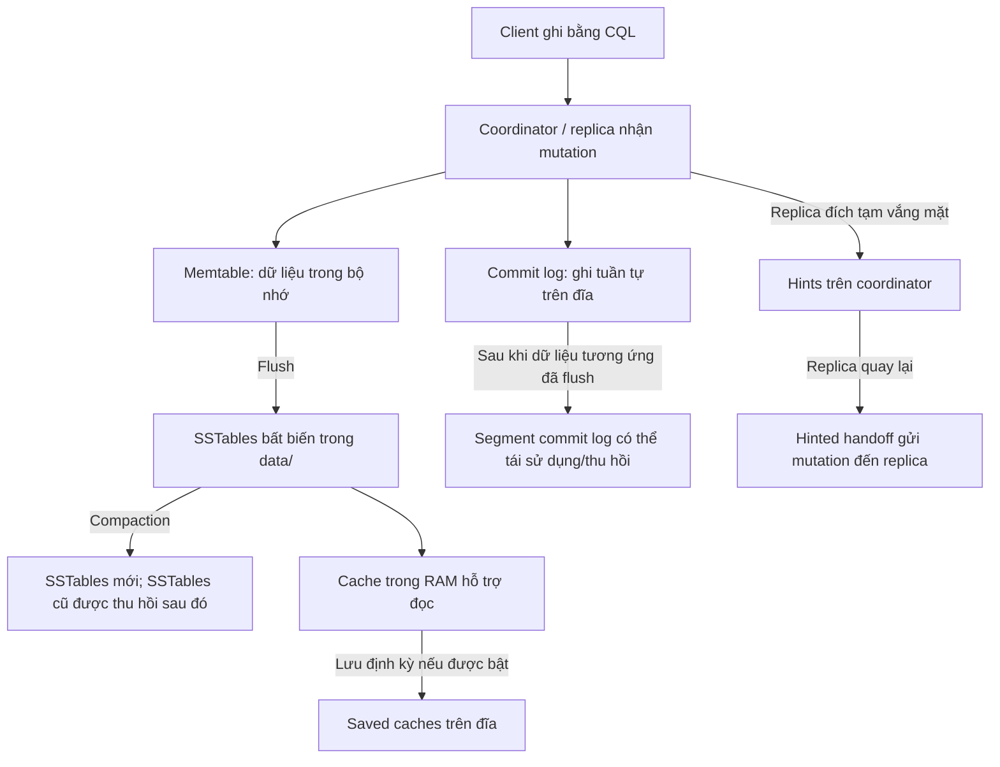

# Volume bền vững, thư mục dữ liệu, commit log, hints và saved caches

## 1. Vì sao phải hiểu các thư mục lưu trữ?

Apache Cassandra là cơ sở dữ liệu **wide-column phân tán**, tối ưu cho ghi dữ liệu qua **commit log + memtable + SSTable**. Khi một node khởi động lại, Cassandra cần tìm đúng dữ liệu đã lưu và metadata định danh node. Khi một replica vắng mặt, các node còn lại có thể giữ **hints** để gửi lại mutation về sau. Khi process khởi động, Cassandra có thể đọc **saved caches** để tránh phải làm nóng cache từ đầu.

Đó là những chức năng **khác nhau**, dù các thư mục của chúng thường nằm dưới cùng một đường dẫn. Trong bài thực hành Docker, việc gắn volume sai có thể làm dữ liệu biến mất sau khi tạo lại container; việc gắn chung data directory cho hai node còn có nguy cơ phá hỏng dữ liệu và danh tính cluster.

Sau bài học, bạn có thể:

1. Phân biệt **dữ liệu SSTable**, **commit log**, **hints** và **saved caches** theo mục đích, vòng đời và hậu quả khi mất từng loại.
2. Đọc các khóa `data_file_directories`, `commitlog_directory`, `hints_directory`, `saved_caches_directory` trong `cassandra.yaml`.
3. Tạo **Docker named volume** cho Cassandra 5.0, ghi CQL, quan sát SSTable sau `flush`, xóa/tạo lại container mà vẫn đọc được dữ liệu.
4. Giải thích khi nào commit log được replay hoặc giải phóng, vì sao hints **không thay thế repair**, và khi nào saved caches có thể trống.
5. Thử quan sát hinted handoff trên **cụm ba node** nếu máy đủ tài nguyên.
6. Phân biệt **persistent volume, replica, snapshot và backup**, xác định dấu hiệu đầy đĩa/quyền truy cập sai và cách xử lý an toàn.

> **Phạm vi:** môi trường học tập không chứa dữ liệu quan trọng. Ví dụ chính sử dụng một node Cassandra trong Docker; phần hints có bài thử nhiều node riêng. Không áp dụng thao tác dọn dữ liệu, khôi phục volume hoặc thử lỗi vào hệ thống đang phục vụ người dùng.

## 2. Mối liên hệ giữa đường ghi dữ liệu và các thư mục



Tất cả các ô trên đều liên quan đến lưu trữ, nhưng chỉ **SSTable cùng các thành phần/metadata Cassandra cần thiết** là hình thức lưu dữ liệu đã flush. Commit log bảo vệ những mutation chưa được flush. Hints được tạo vì **replica khác** không nhận được mutation. Saved caches là **dữ liệu hỗ trợ tăng tốc**, có thể xây dựng lại từ dữ liệu gốc.

| Thư mục thường dùng trong image Cassandra | Cấu hình trong `cassandra.yaml` | Đối tượng lưu giữ | Ý nghĩa khi khởi động hoặc xảy ra lỗi |
|---|---|---|---|
| `/var/lib/cassandra/data` | `data_file_directories` | SSTable, dữ liệu keyspace/table, các thành phần SSTable; có thể có `snapshots/` và `backups/` trong thư mục bảng | Dữ liệu đã flush và metadata cần cho node; **phải giữ** |
| `/var/lib/cassandra/commitlog` | `commitlog_directory` | Các segment commit log dùng cho mutation trên **node hiện tại** | Có thể replay khi process phục hồi sau crash; **không xóa thủ công** |
| `/var/lib/cassandra/hints` | `hints_directory` | Mutation tạm chờ gửi cho một **replica khác** đã vắng mặt | Hỗ trợ hinted handoff khi replica quay lại; chỉ mang tính **best effort** |
| `/var/lib/cassandra/saved_caches` | `saved_caches_directory` | Bản lưu cache có thể nạp lại lúc startup | Hỗ trợ warm startup; **không phải nguồn dữ liệu có thẩm quyền** |

**Đường dẫn trên là bố cục phổ biến trong Cassandra Official Docker Image.** Khi cài bằng tarball hoặc gói Linux, đường dẫn thực tế có thể khác. Tài liệu cấu hình cũng có các mặc định dựa trên `$CASSANDRA_HOME/data/...`; ở image/package, `/var/lib/cassandra/...` là bố cục điển hình. Luôn đọc **cấu hình đang chạy và filesystem thật**, không suy từ tên thư mục trong bài.

Ngoài bốn thư mục chính, một node có thể có `cdc_raw` khi bật Change Data Capture, snapshot/backup ở thư mục bảng, file log hệ thống và file cấu hình. Chúng có vòng đời riêng; volume bao phủ `/var/lib/cassandra` **không có nghĩa** đã giữ mọi log hoặc cấu hình nằm ngoài thư mục đó.

## 3. Tại sao Cassandra cần volume bền vững?

### 3.1. Lớp ghi của container và named volume

Container có một lớp filesystem ghi được. Khi xóa container, lớp ghi đó không còn là nơi tin cậy để giữ trạng thái ứng dụng. Docker **named volume** là vùng lưu trữ do Docker quản lý và được gắn vào một đường dẫn trong container; vòng đời của nó **độc lập với container**.

```text
Host Linux / Linux VM của Docker Desktop
  └── Docker named volume: cassandra_pe006_data
       └── Được mount vào container tại /var/lib/cassandra
             ├── data/
             ├── commitlog/
             ├── hints/
             └── saved_caches/

docker rm CONTAINER  → container bị xóa; named volume vẫn còn
docker volume rm VOLUME → xóa volume và dữ liệu bên trong (nếu có thể xóa)
```

| Cách lưu | Sống qua restart container? | Sống qua `docker rm`? | Lưu ý |
|---|---|---|---|
| Lớp ghi riêng của container | Có, nếu vẫn là cùng container | **Không** | Không nên dựa vào lớp này để giữ dữ liệu Cassandra |
| **Docker named volume** gắn `/var/lib/cassandra` | Có | **Có**, trừ khi chính volume bị xóa | Phù hợp cho lab cần dựng lại container |
| Bind mount tới thư mục host | Có | Có, miễn dữ liệu host vẫn còn | Phải xét quyền truy cập và filesystem, nhất là Windows/macOS |
| Volume nằm trên chính máy chạy Docker | Có trong điều kiện máy/đĩa còn nguyên | Có | **Không bảo vệ** trước hỏng đĩa vật lý, mất cả host hoặc xóa volume |

Nếu gắn riêng chỉ `/var/lib/cassandra/data`, các thư mục `commitlog`, `hints`, `saved_caches` mặc định nằm **ngoài mount**; khi tạo lại container, chúng có thể mất. Đây không phải cách bố trí đầy đủ của một node muốn giữ trạng thái. Với lab, **mount toàn bộ `/var/lib/cassandra`** là cách đơn giản nhất để bao phủ bốn vùng.

Đối với cluster nhiều node, **mỗi node phải có volume riêng**. Hai container Cassandra cùng ghi vào một volume là sai: chúng có thể đụng cùng system tables, commitlog, SSTables và danh tính node. Replication được thực hiện qua **Cassandra và mạng**, không phải bằng cách cho nhiều node đọc/ghi chung một thư mục.

### 3.2. Named volume không đồng nghĩa backup

Một volume chỉ giữ dữ liệu trên nơi lưu trữ hiện tại. Nếu bạn xóa volume, host mất đĩa hoặc dữ liệu đã bị xóa ở cấp CQL, volume có thể không giúp phục hồi. **Replica** tăng khả năng chịu lỗi node nhưng cũng có thể nhân bản xóa/sửa sai. **Snapshot** Cassandra dựa trên SSTable và thường nằm ngay trong data directory; snapshot trên cùng đĩa vẫn có thể mất cùng đĩa.

Khi dữ liệu quan trọng, cần **backup nhất quán, độc lập với nguồn dữ liệu, được kiểm tra phục hồi** và quy trình restore theo phiên bản/topology thực. Không copy thô một data directory đang được Cassandra ghi liên tục rồi coi đó là backup nhất quán.

## 4. Đọc và quản lý các đường dẫn trong cassandra.yaml

Một ví dụ **minh họa các khóa cấu hình**, không phải file `cassandra.yaml` hoàn chỉnh:

```yaml
data_file_directories:
  - /var/lib/cassandra/data

commitlog_directory: /var/lib/cassandra/commitlog
hints_directory: /var/lib/cassandra/hints
saved_caches_directory: /var/lib/cassandra/saved_caches
```

Giải thích:

- `data_file_directories` nhận **danh sách** đường dẫn. Cassandra đặt các SSTable tương ứng theo bố trí token range và quản lý dữ liệu/tombstone trong các thư mục đó. Không tự chia SSTable của **một table** bằng cách di chuyển file sang thư mục khác.
- `commitlog_directory` là **một đường dẫn** lưu commit log, cần thông lượng ghi tuần tự và độ trễ ổn định. Ở các hệ có nhiều đĩa vật lý, cân nhắc tách commit log với SSTable để giảm tranh I/O.
- `hints_directory` chứa hint do **node này giữ cho node khác**. Khi không có replica nào vắng mặt, thư mục có thể rỗng.
- `saved_caches_directory` dùng cho bản lưu cache nếu việc lưu cache đang được cấu hình và đã xảy ra. Không thấy file trong thư mục **không tự động có nghĩa** Cassandra hỏng.

**Cẩn trọng khi sửa cấu hình:** phải phân biệt đường dẫn mặc định, đường dẫn hiệu lực và tùy chọn bị comment. Nếu thay `data_file_directories` hoặc chuyển commit log sang ổ khác trên node đã có dữ liệu, cần quy trình di chuyển dữ liệu, quyền filesystem, snapshot/backup và restart được kiểm soát. Chỉ sửa YAML để trỏ đến một thư mục rỗng có thể khiến Cassandra không tìm thấy dữ liệu gốc.

Với Linux cài package, file thường ở `/etc/cassandra/cassandra.yaml`; với tarball thường ở `conf/cassandra.yaml` trong thư mục cài. Bài sẽ dùng Docker Official Image và thao tác với thư mục cấu hình của image. Khi đưa vào production, kiểm tra đúng đường dẫn và option của **phiên bản Cassandra cụ thể** trước khi chỉnh.

## 5. Thực hành chính: một node Docker và volume bền vững

### 5.1. Chuẩn bị

Ví dụ ghim `cassandra:5.0.9` để mọi lệnh có cùng mốc phiên bản. Cần Docker Engine/Desktop chạy Linux containers, cổng host `9246` còn trống, host đủ CPU/SSD và đủ RAM; với lab nên có **khoảng 8 GiB RAM tổng trở lên** và cấp khoảng 4 GiB cho container. Đây chỉ là cấu hình tham khảo, không phải mức tối thiểu sản xuất.

Chạy **trên host có Docker CLI**; các lệnh được viết một dòng để chạy được từ Bash và PowerShell:

```bash
docker version
docker pull cassandra:5.0.9
docker volume create cassandra_pe006_data
docker volume inspect cassandra_pe006_data
```

Nếu Docker báo volume đã tồn tại, **xác minh nguồn gốc và dữ liệu của volume** trước khi dùng. Bài giả định đây là volume lab hoàn toàn mới, không chứa dữ liệu từ một cluster khác.

### 5.2. Khởi động node bằng một mount bao phủ toàn bộ dữ liệu

```bash
docker run -d --name cassandra-pe006 --memory=4g --memory-swap=4g -e MAX_HEAP_SIZE=2G -e CASSANDRA_CLUSTER_NAME=pe006-lab -e CASSANDRA_ENDPOINT_SNITCH=GossipingPropertyFileSnitch -e CASSANDRA_DC=dc1 -e CASSANDRA_RACK=rack1 -p 127.0.0.1:9246:9042 -v cassandra_pe006_data:/var/lib/cassandra cassandra:5.0.9
```

Trong ví dụ:

| Tùy chọn | Tác dụng |
|---|---|
| `--name cassandra-pe006` | Tên container dùng trong các lệnh tiếp theo |
| `--memory=4g`, `MAX_HEAP_SIZE=2G` | Giới hạn RAM và heap để thử trên máy cá nhân; vẫn cần RAM cho off-heap/page cache |
| `--memory-swap=4g` | Không cho container dùng thêm swap ngoài giới hạn bộ nhớ đã đặt |
| `CASSANDRA_CLUSTER_NAME=pe006-lab` | Tên cluster lab một node |
| `CASSANDRA_DC=dc1`, `CASSANDRA_RACK=rack1` | Topology dùng với snitch tương ứng |
| `-p 127.0.0.1:9246:9042` | CQL của container ở 9042, client **trên host** truy cập 9246 |
| `-v cassandra_pe006_data:/var/lib/cassandra` | Mount named volume bền vững cho **data, commitlog, hints, saved caches** |

Không cần publish cổng 7199/JMX hoặc cổng gossip ra host trong bài một node. Nếu Java app chạy từ host, contact point là `127.0.0.1:9246` và local datacenter là `dc1`. Nếu Java app chạy **trong container khác**, localhost của container app không phải Cassandra; phải thiết kế Docker network và endpoint quảng bá phù hợp.

### 5.3. Chờ Cassandra sẵn sàng

```bash
docker ps -a --filter name=cassandra-pe006
docker logs --tail 100 cassandra-pe006
docker exec cassandra-pe006 nodetool status
docker exec cassandra-pe006 nodetool statusbinary
docker exec cassandra-pe006 cqlsh -e "SELECT release_version, cluster_name, data_center FROM system.local;"
```

Đợi cho tới khi `nodetool status` có một dòng **`UN`** (*Up/Normal*), `statusbinary` là `running` và `cqlsh` thực thi truy vấn thành công. `docker run -d` hoặc `docker ps` hiển thị `Up` **chưa chứng minh** Cassandra đã mở native transport.

Nếu `nodetool` báo JMX chưa kết nối, hoặc `cqlsh` báo connection refused ngay sau start, xem log, trạng thái tiến trình và tài nguyên rồi thử lại khi service đã sẵn sàng.

### 5.4. Kiểm tra mount và bốn thư mục thực tế

```bash
docker inspect --format "{{range .Mounts}}{{.Name}}:{{.Destination}}{{end}}" cassandra-pe006
docker volume inspect cassandra_pe006_data

docker exec cassandra-pe006 ls -la /var/lib/cassandra
docker exec cassandra-pe006 sh -c "df -h /var/lib/cassandra"
docker exec cassandra-pe006 sh -c "du -sh /var/lib/cassandra/data /var/lib/cassandra/commitlog"
```

Kỳ vọng kết quả mount có đoạn `cassandra_pe006_data:/var/lib/cassandra`. `ls -la` cho thấy các thư mục thực sự đã được Cassandra tạo. Tùy phiên bản và workload, `hints` hoặc `saved_caches` có thể chưa có file; không nên tạo file thủ công để “lấp đầy” các thư mục.

Thư mục host được `docker volume inspect` báo thường nằm dưới vùng quản lý của Docker Engine. Trên Windows/macOS, Docker Desktop có thể lưu volume **trong Linux VM**, không phải một đường dẫn Windows/macOS có thể truy cập trực tiếp. Không tìm rồi sửa tay file SSTable trong thư mục Docker.

### 5.5. Ghi CQL và ép flush để nhìn thấy SSTable

Chạy các lệnh sau từ terminal host:

```bash
docker exec cassandra-pe006 cqlsh -e "CREATE KEYSPACE IF NOT EXISTS pe006_lab WITH replication = {'class':'NetworkTopologyStrategy','dc1':1};"
docker exec cassandra-pe006 cqlsh -e "CREATE TABLE IF NOT EXISTS pe006_lab.events_by_device (device_id text, event_time timestamp, event_type text, PRIMARY KEY ((device_id), event_time)) WITH CLUSTERING ORDER BY (event_time DESC);"
docker exec cassandra-pe006 cqlsh -e "INSERT INTO pe006_lab.events_by_device (device_id, event_time, event_type) VALUES ('d-001', '2026-11-21T10:00:00Z', 'volume-created');"
docker exec cassandra-pe006 cqlsh -e "SELECT device_id, event_time, event_type FROM pe006_lab.events_by_device WHERE device_id='d-001';"
```

Ở bảng này, `device_id` là **partition key**, `event_time` là **clustering key**. Truy vấn có `WHERE device_id=...` là kiểu truy cập được thiết kế theo Cassandra. RF=1 trong `dc1` phù hợp kiểm tra **một node**; nó không có dự phòng replica hay cơ sở để diễn giải hành vi `LOCAL_QUORUM` khi mất node.

Trước khi flush, một phần mutation có thể còn trong memtable và được commit log bảo vệ. Gọi:

```bash
docker exec cassandra-pe006 nodetool flush pe006_lab events_by_device
docker exec cassandra-pe006 nodetool tablestats pe006_lab
docker exec cassandra-pe006 ls -la /var/lib/cassandra/data/pe006_lab
docker exec cassandra-pe006 sh -c "du -sh /var/lib/cassandra/data /var/lib/cassandra/commitlog"
```

Trong `data/pe006_lab` sẽ có thư mục bảng, thường mang dạng `events_by_device-<table-id>`, chứa các **thành phần SSTable** như `*-Data.db` và metadata/format-specific components. Cassandra 5.0 có thể dùng các dạng SSTable index mới, vì vậy **không yêu cầu** mọi file index đều có cùng tên ở tất cả phiên bản.

**Flush không tương đương backup.** Nó chuyển dữ liệu đang nằm ở memtable sang SSTable của node này. Segment commit log có thể được tái sử dụng hoặc xóa **khi không còn chứa dữ liệu chưa flush của bất kỳ table nào**; vì vậy chạy `nodetool flush` một bảng không bảo đảm thư mục commitlog rỗng hoặc kích thước đĩa giảm ngay.

### 5.6. Xóa và tạo lại container nhưng giữ volume

Đây là phép thử trọng tâm cho **persistent volume**. Chỉ chạy sau khi đã xác minh câu SELECT ở bước trước thành công:

```bash
docker stop cassandra-pe006
docker rm cassandra-pe006
docker volume inspect cassandra_pe006_data
```

Volume vẫn còn. Tạo lại container bằng **cùng image, cluster identity và mount**:

```bash
docker run -d --name cassandra-pe006 --memory=4g --memory-swap=4g -e MAX_HEAP_SIZE=2G -e CASSANDRA_CLUSTER_NAME=pe006-lab -e CASSANDRA_ENDPOINT_SNITCH=GossipingPropertyFileSnitch -e CASSANDRA_DC=dc1 -e CASSANDRA_RACK=rack1 -p 127.0.0.1:9246:9042 -v cassandra_pe006_data:/var/lib/cassandra cassandra:5.0.9
```

Đợi node `UN` và CQL hoạt động, sau đó kiểm tra:

```bash
docker exec cassandra-pe006 nodetool status
docker exec cassandra-pe006 cqlsh -e "SELECT cluster_name, host_id FROM system.local;"
docker exec cassandra-pe006 cqlsh -e "SELECT device_id, event_type FROM pe006_lab.events_by_device WHERE device_id='d-001';"
```

Kỳ vọng bản ghi `volume-created` vẫn còn. Vì volume chứa cả system keyspaces, danh tính node như `host_id` thường được giữ khi khởi động lại đúng dữ liệu node đó. Container ID/IP Docker có thể đổi; **không lấy container ID làm Cassandra host ID**. Không được gắn cùng volume vào container Cassandra thứ hai đang chạy.

Thí nghiệm trên dùng **shutdown bình thường**; nó chủ yếu chứng minh **volume sống qua `docker rm`**, không chứng minh khả năng chịu mất điện hoặc tính bền vững tuyệt đối của từng mutation. Mô phỏng crash và đánh giá commit log cần bài thử riêng với chính sách fsync phù hợp.

## 6. Commit log: bảo vệ write trước khi có SSTable

### 6.1. Vai trò của commit log

Khi replica chấp nhận một mutation, Cassandra ghi nó vào commit log và cập nhật memtable theo đường ghi của storage engine. Commit log là **write-ahead log theo node**, lưu dưới dạng các segment ghi tuần tự, phục vụ khôi phục những thay đổi **chưa được flush** nếu process dừng đột ngột.

```text
Write đến replica
    ├── Commit log (WAL): mutation chưa có trong SSTable được ghi vào log
    └── Memtable (RAM): bản dữ liệu đang cập nhật
           ↓ Khi flush
        SSTable (đĩa)
           ↓ Khi mọi mutation liên quan đã flush
        Commit log segment có thể được recycle/xóa

Crash trước flush → lúc khởi động, Cassandra replay commit log phù hợp
```

**Không nhầm commit log với:**

- **Application log/system.log**: ghi thông tin vận hành, stack trace, warning; không phải log mutation để khôi phục dữ liệu.
- **Hints**: mutation coordinator giữ **cho replica khác** tạm vắng mặt; commit log bảo vệ write **của chính node**.
- **CDC**: Change Data Capture phục vụ xuất thay đổi theo thiết kế CDC và có thư mục/giới hạn riêng khi bật; mặc định không nên giả định commit log là hàng đợi sự kiện ứng dụng có thể đọc tùy ý.
- **Backup**: commit log hiện hành là công cụ phục hồi nội bộ theo cơ chế Cassandra; không thay thế snapshot, backup/restore và lưu trữ độc lập.

### 6.2. Durability và chính sách fsync

Một số cấu hình liên quan trong Cassandra 5.0:

| Tùy chọn | Tác động |
|---|---|
| `commitlog_directory` | Đĩa/thư mục lưu segment commit log |
| `commitlog_sync` | Chính sách đồng bộ log xuống thiết bị lưu trữ, ví dụ `periodic` hoặc `batch` |
| `commitlog_sync_period` | Chu kỳ sync khi dùng `periodic`; phải đọc giá trị thực của cấu hình phiên bản đang chạy |
| `commitlog_segment_size` | Giới hạn kích thước một segment và các ràng buộc với mutation size |
| `commitlog_total_space` | Giới hạn/áp lực dung lượng khiến Cassandra cần flush memtable để thu hồi segment |

Với `commitlog_sync: periodic`, Cassandra có thể acknowledge write trước khi segment được fsync; mất điện đột ngột có thể làm mất các write còn trong khoảng chưa sync, phụ thuộc cấu hình và thiết bị. Với `batch`, việc acknowledge đợi sync của commit log theo chính sách tương ứng, đổi lại có thể ảnh hưởng độ trễ. **Không suy rằng write trả thành công = đã fsync ngay** khi chưa kiểm tra chính sách durability. Trong cluster nhiều replica, consistency level còn quyết định **bao nhiêu replica phản hồi**, đây là trục khác với thời điểm mỗi replica fsync.

Commit log có thể còn nhiều segment do table khác chưa flush, workload cao hoặc compaction/IO chậm. Chỉ nhìn `du -sh /var/lib/cassandra/commitlog` **không đủ** kết luận có lỗi. Khi cần chẩn đoán, kết hợp log, dung lượng filesystem, `nodetool tpstats`, `nodetool tablestats` và tốc độ flush.

### 6.3. Restart có kiểm soát và crash recovery

- **Restart bình thường**: Cassandra có cơ hội flush/đóng tài nguyên theo trình tự quản lý. Volume vẫn phải được mount để dữ liệu và system metadata còn đó.
- **Dừng đột ngột**: khi khởi động, Cassandra có thể replay commit log chưa flush, theo dữ liệu thực sự đã được ghi/sync và còn nguyên trên thiết bị.
- **Mất commitlog trong khi còn mutation chưa flush**: có nguy cơ mất write của node. Không tự xóa commitlog để giải phóng chỗ.
- **Mất cả data directory**: commitlog đơn lẻ không phải bản backup đầy đủ của SSTable, schema/metadata và lịch sử dữ liệu.

Nếu cần dừng node bảo trì có kiểm soát, tài liệu Cassandra mô tả lệnh `nodetool drain` để flush memtable và ngừng nhận write trước khi tắt process, nhưng `drain` **không phải thao tác thường xuyên để làm sạch dung lượng** và không nên chạy trên hệ đang hoạt động mà chưa có kế hoạch.

## 7. Hints: dữ liệu tạm gửi lại cho replica vắng mặt

### 7.1. Ví dụ RF=3 với LOCAL_QUORUM

Giả sử ba replica A, B, C thuộc một datacenter, keyspace có **RF=3**, request ghi dùng **LOCAL_QUORUM**. Replica C đang tạm down, A và B vẫn trả ack. Quorum của ba replica là **2/3**, nên write có thể thành công. Coordinator có thể lưu **hint dành cho C** để gửi lại khi C quay về.

```text
Client -- LOCAL_QUORUM write --> Coordinator A
                                   ├── Replica A: nhận write
                                   ├── Replica B: nhận write → đủ 2 ack
                                   └── Replica C: tạm down
                                           ↓
                             A lưu hint dành cho C vào hints/
                                           ↓ C quay lại
                             Hinted handoff gửi mutation đến C
```

Điểm quan trọng:

- Hint **nằm trên coordinator giữ hint**, **không nhất thiết trên node bị down**. Muốn tìm hint đang chờ, kiểm tra các node có thể đã làm coordinator.
- Hint lưu mutation cùng timestamp gốc để tránh ghi đè một mutation mới hơn chỉ vì handoff diễn ra sau.
- Hints thường được bật mặc định, nhưng **có giới hạn cửa sổ** và điều kiện tạo/phát lại; tài liệu Cassandra 5.0 mô tả `max_hint_window` mặc định khoảng **3 giờ**. Đừng coi đây là lời hứa giữ mọi write trong mọi tình huống.
- Hints là cơ chế **best effort**, có thể giảm thời gian replica bất đồng bộ nhưng **không bảo đảm** mọi replica cuối cùng đồng bộ khi node down quá lâu, hints mất hoặc handoff thất bại. **Anti-entropy repair** vẫn cần thiết.
- Trong **lab một node, RF=1**, khi chính node duy nhất down, không còn coordinator/replica khác để nhận write và giữ hint. Vì thế thư mục `hints/` rỗng là bình thường.

### 7.2. Quan sát hint trong cụm nhiều node — bài mở rộng

Phần này **tùy chọn** và chỉ dành cho lab có đủ tài nguyên. Cần **ba node cùng cluster**, ví dụ cùng datacenter `dc1`, có node nhận request CQL và các node riêng volume. Để người học có thể tự dựng, dưới đây là cấu hình Docker rút gọn, dùng **tên/volume độc lập với node một máy** ở mục 5.

Trên host cần đủ RAM/CPU/đĩa cho ba JVM và Docker VM (máy khoảng **24 GiB RAM** thường thuận tiện hơn):

```bash
docker network create pe006-hints-net
docker volume create pe006_hint_n1
docker volume create pe006_hint_n2
docker volume create pe006_hint_n3

# Chạy node n1 trước; chờ n1 đạt UN và cqlsh hoạt động.
docker run -d --name pe006-n1 --network pe006-hints-net --memory=4g --memory-swap=4g -e MAX_HEAP_SIZE=2G -e CASSANDRA_CLUSTER_NAME=pe006-hints -e CASSANDRA_ENDPOINT_SNITCH=GossipingPropertyFileSnitch -e CASSANDRA_DC=dc1 -e CASSANDRA_RACK=rack1 -v pe006_hint_n1:/var/lib/cassandra cassandra:5.0.9
docker exec pe006-n1 nodetool status

# Khi n1 đã UN, chạy n2; đợi cả n1 và n2 UN.
docker run -d --name pe006-n2 --network pe006-hints-net --memory=4g --memory-swap=4g -e MAX_HEAP_SIZE=2G -e CASSANDRA_CLUSTER_NAME=pe006-hints -e CASSANDRA_SEEDS=pe006-n1 -e CASSANDRA_ENDPOINT_SNITCH=GossipingPropertyFileSnitch -e CASSANDRA_DC=dc1 -e CASSANDRA_RACK=rack2 -v pe006_hint_n2:/var/lib/cassandra cassandra:5.0.9
docker exec pe006-n1 nodetool status

# Khi n1, n2 đã UN, chạy n3; đợi cả ba UN.
docker run -d --name pe006-n3 --network pe006-hints-net --memory=4g --memory-swap=4g -e MAX_HEAP_SIZE=2G -e CASSANDRA_CLUSTER_NAME=pe006-hints -e CASSANDRA_SEEDS=pe006-n1 -e CASSANDRA_ENDPOINT_SNITCH=GossipingPropertyFileSnitch -e CASSANDRA_DC=dc1 -e CASSANDRA_RACK=rack3 -v pe006_hint_n3:/var/lib/cassandra cassandra:5.0.9
docker exec pe006-n1 nodetool status
```

**Không chạy cả ba lệnh `docker run` liền nhau nếu n1/n2 chưa hoàn thành bootstrap.** Các comment trên yêu cầu dừng lại và kiểm tra readiness giữa các bước. Khi cả ba đều `UN`, tạo keyspace và bảng từ n1:

```bash
docker exec pe006-n1 cqlsh -e "CREATE KEYSPACE IF NOT EXISTS pe006_hints WITH replication = {'class':'NetworkTopologyStrategy','dc1':3};"
docker exec pe006-n1 cqlsh -e "CREATE TABLE IF NOT EXISTS pe006_hints.device_state (device_id text PRIMARY KEY, state text);"
```

Giờ dừng **n3 trong lab cô lập**:

```bash
docker stop pe006-n3
docker exec pe006-n1 nodetool status
```

Đợi failure detector trên n1 nhận ra n3 là `DN` (*Down/Normal*). Mở cqlsh tương tác ở n1:

```bash
docker exec -it pe006-n1 cqlsh
```

Trong cqlsh:

```sql
CONSISTENCY LOCAL_QUORUM;

INSERT INTO pe006_hints.device_state (device_id, state)
VALUES ('d-002', 'updated-while-n3-down');

SELECT device_id, state
FROM pe006_hints.device_state
WHERE device_id = 'd-002';
```

Với A/B còn sống và RF=3, quorum **2/3** có thể đạt được. Thoát cqlsh rồi kiểm tra trên n1:

```bash
docker exec pe006-n1 nodetool listpendinghints
docker exec pe006-n1 nodetool statushandoff
docker exec pe006-n1 ls -la /var/lib/cassandra/hints
```

Chú ý: một vài write rất nhỏ **có thể chưa tạo file hint nhìn thấy ngay** do hint được buffer/flush theo chu kỳ; hints có thể được lưu trên coordinator khác nếu request đã đi qua node khác. Dùng `listpendinghints` và metrics/log ở đúng node làm bằng chứng, **không lấy thư mục tạm trống** để kết luận hinted handoff vô hiệu.

Khởi động lại n3 và đợi cluster hồi phục:

```bash
docker start pe006-n3
docker exec pe006-n1 nodetool status
docker exec pe006-n1 nodetool listpendinghints
docker exec pe006-n3 cqlsh -e "SELECT device_id, state FROM pe006_hints.device_state WHERE device_id='d-002';"
```

Hint delivery diễn ra **bất đồng bộ**, nên kết quả `listpendinghints` và dữ liệu trên n3 có thể chưa cập nhật ngay sau khi `docker start`. Ngoài ra, SELECT gửi đến n3 có thể do n3 làm **coordinator đọc từ replica khác**, vì vậy nó **không chứng minh riêng rằng SSTable cục bộ n3 đã nhận hint**. Muốn xác nhận chính xác, kết hợp metrics/hint delivery logs và các công cụ chẩn đoán ở node theo đúng bài repair/hinted handoff chuyên sâu.

Kết thúc lab này bằng cách dừng ba container rồi xóa **chỉ container/network**, giữ volume:

```bash
docker stop pe006-n3
docker stop pe006-n2
docker stop pe006-n1
docker rm pe006-n3 pe006-n2 pe006-n1
docker network rm pe006-hints-net
```

Không gọi `nodetool truncatehints` để “làm sạch” trong lúc cần khôi phục replica: lệnh đó có thể bỏ những mutation đang chờ gửi. Ở production, thời gian node down vượt cửa sổ hints và các trường hợp mất dữ liệu cần **repair** theo quy trình.

## 8. Saved caches: dữ liệu tăng tốc, không phải dữ liệu nguồn

### 8.1. Cache được lưu để làm gì?

Đọc một SSTable có thể cần kiểm tra metadata/index/cache. Cassandra dùng các cơ chế cache (ví dụ **key cache**, **row cache** nếu được bật, và **counter cache** trong trường hợp phù hợp) để hạn chế truy cập đĩa và tăng tốc read. Một số cache có thể được lưu ra `saved_caches_directory` theo cấu hình rồi được nạp lại khi startup.

Điểm dễ nhầm: saved cache **không phải bộ dữ liệu nghiệp vụ hoàn chỉnh**. Hệ thống phải có thể truy vấn dữ liệu gốc từ SSTable/memtable theo đường chuẩn ngay cả khi cache chưa ấm. Xóa riêng saved cache trong một quy trình quản trị phù hợp có thể làm startup/read chậm hơn lúc đầu, nhưng không phải cách xóa row trong CQL.

| Khái niệm | Vai trò | Nơi quan sát |
|---|---|---|
| In-memory caches | Hỗ trợ Cassandra đọc dữ liệu hiệu quả trong thời gian chạy | `nodetool info`, metrics/cache stats |
| Saved caches | Bản ghi cache được lưu định kỳ để nạp lại khi khởi động | `saved_caches_directory` |
| SSTable | Nguồn dữ liệu đã flush, có format và metadata riêng | `data_file_directories` |
| Commit log | Bảo vệ mutation chưa flush ở node | `commitlog_directory` |

### 8.2. Quan sát trong lab một node

Sau khi đọc dữ liệu ở mục 5, chạy:

```bash
docker exec cassandra-pe006 nodetool info
docker exec cassandra-pe006 ls -la /var/lib/cassandra/saved_caches
```

Kết quả `saved_caches` có thể trống vì chưa đến chu kỳ save, cache ít được sử dụng hoặc loại cache tương ứng chưa bật. **Không tạo file cache giả** và không dựa vào sự tồn tại của cache để kết luận có thể khôi phục dữ liệu. Nếu cần đo tác dụng cache, hãy chạy workload đọc lặp lại với metrics và điều kiện benchmark nhất quán; không kết luận chỉ từ một SELECT.

## 9. Snapshot, backup và dung lượng đĩa

### 9.1. Snapshot khác persistent volume thế nào?

Cassandra hỗ trợ `nodetool snapshot` để tạo snapshot SSTable, thường dựa trên **hard link** trong thư mục `snapshots/` bên dưới thư mục bảng. Điều này giúp giữ tham chiếu tới một tập SSTable nhất định, nhưng snapshot **ban đầu vẫn nằm trong hệ thống lưu trữ của node** và không tự chuyển dữ liệu ra thiết bị độc lập.

Trong lab một node ở mục 5:

```bash
docker exec cassandra-pe006 nodetool snapshot -t pe006-baseline pe006_lab
docker exec cassandra-pe006 nodetool listsnapshots
docker exec cassandra-pe006 ls -la /var/lib/cassandra/data/pe006_lab
```

Khi snapshot xuất hiện, bảng có thể chứa thư mục `snapshots/pe006-baseline` trong thư mục dữ liệu của chính bảng. **Không xóa hay sửa tay các hard link trong snapshot** để thử tiết kiệm chỗ. Vì nhiều file có thể dùng chung inode, kích thước báo bởi `du` và tổng kích thước snapshot không luôn bằng dung lượng đĩa thực tăng thêm; dùng `df` để quan sát dung lượng còn lại và tài liệu backup để hiểu semantics.

| Cơ chế | Giữ được sau xóa container? | Chống mất toàn bộ ổ đĩa? | Dùng để làm gì? |
|---|---|---|---|
| Named volume local | Có, nếu volume không bị xóa | **Không** | Giữ trạng thái node qua vòng đời container |
| SSTable snapshot **trong cùng volume** | Có nếu volume còn | **Không** | Tạo một điểm tham chiếu dữ liệu SSTable phục vụ backup/restore |
| Backup sao chép ra nơi độc lập và đã kiểm thử restore | Có | **Có thể**, tùy vị trí, chính sách và độ toàn vẹn bản backup | Phục hồi khi mất dữ liệu hoặc host |
| Replication giữa node trên các host/failure domain độc lập | Có thể tiếp tục phục vụ khi một node mất | Có thể chịu một số lỗi node theo RF/CL | Khả dụng, chịu lỗi và phân phối dữ liệu; **không thay backup** |
| Commit log hiện hành | Có, nếu volume còn | Không nếu cùng đĩa bị mất | Khôi phục mutation chưa flush ở node |
| Hints | Có nếu volume của coordinator còn | Không bảo đảm | Gửi lại một số mutation tạm chưa đến replica |

### 9.2. Vì sao phải chừa đĩa trống?

- **Flush** tạo SSTable mới từ memtable.
- **Compaction** tạo SSTable mới rồi mới thu hồi SSTable cũ; trong lúc rewrite, dung lượng tạm có thể cao hơn dữ liệu “đang sống”.
- **Repair/streaming** có thể tạo/nhận dữ liệu và cần I/O/đĩa bổ sung.
- **Snapshots/backups** có thể giữ SSTable cũ không được thu hồi ngay; dữ liệu mới tiếp tục tăng.
- **Commit log/hints** là các vùng riêng, có thể tăng khi write rate cao, replica down hoặc flush bị chậm.

Để quan sát:

```bash
docker exec cassandra-pe006 sh -c "df -h /var/lib/cassandra"
docker exec cassandra-pe006 sh -c "du -sh /var/lib/cassandra/data /var/lib/cassandra/commitlog"
docker exec cassandra-pe006 nodetool compactionstats
docker exec cassandra-pe006 nodetool tablestats pe006_lab
docker system df
```

`df` trong container cho biết filesystem chứa mount; `du` là tổng dung lượng thư mục; `docker system df` cho biết các nhóm dùng đĩa của Docker Engine. Trên Docker Desktop, Docker VM/disk image còn có giới hạn riêng; nếu host còn GB trống nhưng Cassandra gặp `No space left on device`, kiểm tra **filesystem thật của volume**, không chỉ ổ hiện hành của host.

Không đề xuất xóa ngẫu nhiên các file `*.db`, commitlog segment, hints hoặc snapshots khi đầy đĩa. Cần xác định cơ chế giữ file (compaction, snapshot, hint backlog...), thu log/metrics rồi tăng dung lượng hoặc dọn bằng **công cụ/quy trình Cassandra phù hợp**.

## 10. Thiết kế lưu trữ nhiều node hoặc production

| Nguyên tắc | Lý do |
|---|---|
| Mỗi node có **data directory và commitlog riêng** | Không trùng host ID, không có hai process cùng thao tác một tập SSTable/commitlog |
| Data/SSTable và commitlog có thể dùng thiết bị lưu trữ riêng khi điều kiện cho phép | Giảm tranh I/O; chỉ chia thư mục trong cùng một volume **không** tạo ra hai thiết bị vật lý |
| Thiết kế dung lượng theo RF và mức tăng trưởng | RF=3 nhân chi phí dữ liệu logic lên nhiều bản sao trên các node, còn compaction/snapshot/repair cần dự phòng |
| Giám sát disk usage, latency và pending compaction | Đĩa đầy hoặc I/O cao có thể khiến flush/compaction thất bại, kéo theo timeout hoặc lỗi ghi |
| Giám sát hints trên coordinator và lịch repair | Hints là best effort; node down lâu có thể bỏ lỡ mutation nếu không repair |
| Tách nhật ký và backup khỏi đường dữ liệu khi cần | Container log, cấu hình, snapshot và named volume có vòng đời khác nhau |
| Đồng bộ thời gian giữa node và các client tự cấp timestamp | Mutation timestamp tác động last-write-wins, không tự được sửa bởi volume bền vững |
| Ghi nhận bản Cassandra/JDK, cấu hình và network khi restore/recreate | Data format, system metadata, cluster identity và địa chỉ node quyết định khả năng phục hồi |

**Cassandra không dùng một shared filesystem làm nơi các node đồng thời đọc/ghi dữ liệu.** Khi muốn thêm node, thay node, di chuyển đĩa hoặc đổi IP, cần tuân theo quy trình replication/streaming/replace node của Cassandra. Không giải quyết bài toán replication bằng cách mount cùng một NFS hoặc cùng Docker volume cho nhiều Cassandra process.

Nếu cần cấu hình các đường dẫn khác mặc định, hãy kiểm tra filesystem và quyền user chạy Cassandra. Trong container, bind mount từ host có thể gặp UID/GID/permission khác với owner của thư mục; volume có dung lượng nhưng **không ghi được** vẫn khiến node startup/flush thất bại. Trên Linux, `ls -ld` và log có thể chỉ ra `Permission denied`; không dùng `chmod -R 777` như giải pháp mặc định cho dữ liệu production.

## 11. Các lỗi thường gặp và hướng xử lý

| Hiện tượng | Nguyên nhân có thể | Kiểm tra và hướng xử lý |
|---|---|---|
| Xóa container rồi dữ liệu biến mất | Không mount volume, mount sai đường dẫn, tạo lại bằng volume khác | `docker inspect ... .Mounts`, `docker volume inspect`; dùng đúng `/var/lib/cassandra` và volume cũ |
| `cqlsh` không kết nối được khi tạo lại | Node còn startup, sai cổng host, JVM lỗi hoặc data volume có vấn đề | `docker ps -a`, `docker logs`, `nodetool status`, `statusbinary`; chờ readiness |
| Node từ chối khởi động sau khi gắn volume cũ | Data dir thuộc node/cluster khác, version không tương thích, permission hoặc config khác | Kiểm tra `cluster_name`, version, log, cấu hình và owner; không tự xóa `system` tables |
| Hai node đọc/ghi chung volume | Thiết kế storage sai, cùng metadata/commitlog/SSTables | Dừng lab liên quan và tách mỗi node thành **volume riêng**, khôi phục từ dữ liệu hợp lệ |
| `Permission denied` hoặc `Read-only file system` | Bind mount owner/permission không phù hợp, mount read-only | `ls -ld`, quyền của user container, cấu hình mount/host FS; sửa theo nguyên tắc quyền tối thiểu |
| Sau `nodetool flush` commitlog vẫn còn nhiều file | Segment còn mutation của table khác, chưa đến vòng recycle hoặc flush chưa hoàn tất | Kiểm tra `nodetool tablestats`, flush queue/log; không xóa log bằng tay |
| `hints/` trống trong lab RF=1 | Không có replica khác bị down để node này giữ hint | Đây có thể là kết quả **đúng**; cần cluster nhiều node để học hinted handoff |
| Hints tồn tại lâu hoặc tăng mạnh | Replica vắng mặt, handoff bị chậm/throttle, lỗi network/IO | `nodetool listpendinghints`, `statushandoff`, log, tình trạng target; lên kế hoạch repair khi cần |
| Replica quay lại nhưng dữ liệu chưa khớp | Hint thiếu/hết cửa sổ, delivery chưa xong, các lỗi replication khác | Kiểm tra RF/CL, logs/metrics, lịch repair; không xem hints là bảo đảm đồng bộ |
| `saved_caches/` trống | Chưa đến kỳ save, cache bị tắt/ít dữ liệu | Kiểm tra cấu hình cache và metrics; không nhầm là mất SSTable |
| Đĩa đầy dù dữ liệu bảng không quá lớn | Snapshot/backups, SSTable cũ chờ compaction, commitlog, hints hoặc VM disk đầy | `df`/`du`, `listsnapshots`, `compactionstats`, Docker storage; xử lý đúng nguồn chiếm chỗ |
| Java Driver thấy cluster nhưng write/read sai kỳ vọng | RF/CL, partition key, địa chỉ peer hoặc timestamp/client khác dự kiến | Kiểm tra schema/CQL và topology; volume bền vững **không tự sửa** logic truy vấn |
| Dùng volume dữ liệu 5.0 rồi chạy image cũ hơn | Downgrade hoặc on-disk format không tương thích | Tuân theo upgrade/rollback guide và backup đã kiểm thử; không đổi tag tùy tiện |

**Thứ tự chẩn đoán:** xác định đúng node/volume → container và log → permission/disk → `nodetool status` và CQL → kiểm tra data/commitlog/hints/cache tương ứng → kiểm tra RF/CL/repair nếu là cluster. Trạng thái `UN` không đủ chứng minh volume, write path, hint delivery và compaction đều khỏe.

## 12. Biên bản kiểm chứng và câu hỏi ôn tập

### 12.1. Bảng ghi kết quả thực hành

| Điều cần ghi lại | Bằng chứng |
|---|---|
| Docker image | `cassandra:5.0.9` và output `nodetool version` |
| Container | `cassandra-pe006`, thời điểm khởi động, trạng thái `UN` |
| Volume / mount | `cassandra_pe006_data` gắn tại `/var/lib/cassandra` |
| Các thư mục | `data`, `commitlog`, `hints`, `saved_caches` có/không có file |
| CQL | Row `device_id='d-001'` và event `volume-created` |
| Flush | `nodetool flush` thành công, thư mục bảng/SSTable xuất hiện |
| Recreate | Xóa container, giữ volume, tạo lại đúng cấu hình và đọc được row |
| Hints (nếu làm bài mở rộng) | Trạng thái RF/CL, node DN/UN, `listpendinghints`, log handoff |
| Backup | Có/không có snapshot và chính sách lưu ra nơi độc lập |
| Dung lượng | `df -h /var/lib/cassandra` và chỉ số compaction |

### 12.2. Tự kiểm tra

1. Vì sao chỉ mount `/var/lib/cassandra/data` chưa đủ để giữ commit log và hints khi tạo lại container?
2. Một mutation đã ở memtable nhưng chưa flush, process bị crash. Cassandra dựa vào cấu trúc nào để phục hồi? Chính sách `commitlog_sync` có ảnh hưởng gì đến xác suất mất write khi mất điện?
3. Sau `nodetool flush pe006_lab events_by_device`, tại sao thư mục `commitlog` không nhất thiết rỗng?
4. Một node có RF=1 bị dừng. Có node nào khác lưu hint để trả dữ liệu cho nó không? Vì sao?
5. Với RF=3 và `LOCAL_QUORUM`, một replica down còn hai replica khỏe. Tại sao write có thể thành công? Hint khác repair ở chỗ nào?
6. Dữ liệu từ `saved_caches/` bị mất sau khi tạo lại container, nhưng SSTable vẫn còn. Điều đó có tự động đồng nghĩa mất row không?
7. Tại sao `docker volume inspect` xác nhận volume tồn tại vẫn chưa chứng minh có bản backup chịu được hỏng host?
8. Bảng bị xóa bằng CQL rồi thao tác xóa lan sang replica. Replication và persistent volume có thể thay thế backup độc lập để phục hồi bảng hay không?
9. Cụm ba node mount chung một volume có thể gây ra hậu quả nào cho host ID và commit log? Phải thiết kế lại như thế nào?
10. Node gần đầy đĩa nhưng còn đủ chỗ cho một lần INSERT. Vì sao compaction hoặc repair vẫn có thể thất bại về sau?

### 12.3. Kết thúc lab một node và giữ dữ liệu

Khi đã chụp bằng chứng, dừng và xóa **container**:

```bash
docker stop cassandra-pe006
docker rm cassandra-pe006
docker volume inspect cassandra_pe006_data
```

Các lệnh này giữ volume `cassandra_pe006_data`. Nếu muốn tiếp tục học, chạy lại lệnh `docker run` ở mục 5.6 với **cùng volume, phiên bản và cấu hình**. Chỉ xóa volume khi bạn quyết định bỏ toàn bộ dữ liệu thực hành và đã xác định chắc chắn nó không chứa dữ liệu cần giữ. Không chạy `docker volume prune` tùy tiện nếu còn volume lab chưa gắn container mà bạn muốn giữ.

**Tiêu chí hoàn thành:** người học giải thích đúng công dụng của bốn thư mục, mount volume bao phủ `/var/lib/cassandra`, thực thi CQL/flush, đọc được bản ghi sau khi xóa và tạo lại container, đồng thời phân biệt được commit log, hints, saved caches với snapshot/backup. Đây là nền tảng để học compaction, replication, consistency, repair và xử lý lỗi lưu trữ trong Apache Cassandra.

## 13. Nguồn tham khảo chính thức

- [Apache Cassandra — Configuring Cassandra](https://cassandra.apache.org/doc/stable/cassandra/getting-started/configuring.html): các tùy chọn `data_file_directories`, `commitlog_directory`, `hints_directory`, `saved_caches_directory`.
- [Apache Cassandra — cassandra.yaml reference](https://cassandra.apache.org/doc/stable/cassandra/managing/configuration/cass_yaml_file.html): ý nghĩa, mặc định và các tùy chọn lưu trữ/cache/commit log.
- [Apache Cassandra — Storage Engine](https://cassandra.apache.org/doc/stable/cassandra/architecture/storage-engine.html): commit log, memtable, SSTable, flush và replay.
- [Apache Cassandra — Hints](https://cassandra.apache.org/doc/stable/cassandra/managing/operating/hints.html): hinted handoff, giới hạn thời gian, cấu hình và metrics.
- [Apache Cassandra — nodetool listpendinghints](https://cassandra.apache.org/doc/stable/cassandra/managing/tools/nodetool/listpendinghints.html): xem hints đang chờ trên node.
- [Apache Cassandra — Compaction overview](https://cassandra.apache.org/doc/stable/cassandra/managing/operating/compaction/overview.html): SSTable bất biến và nhu cầu I/O/dung lượng.
- [Apache Cassandra — Backups](https://cassandra.apache.org/doc/stable/cassandra/managing/operating/backups.html): snapshot, incremental backup và cấu trúc thư mục bảng.
- [Docker Docs — Volumes](https://docs.docker.com/engine/storage/volumes/): vòng đời named volume và mount.
- [Docker Hub — Official Cassandra image](https://hub.docker.com/_/cassandra): image, cấu hình môi trường và volume cho Cassandra.
