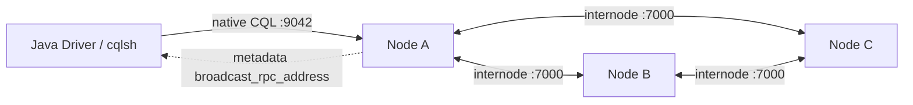

# Cấu hình cơ bản trong cassandra.yaml và các file liên quan

## 1. Mục tiêu và bối cảnh

Apache Cassandra là cơ sở dữ liệu **wide-column phân tán**. Mỗi node cần biết mình thuộc **cluster** nào, cách tìm các node khác, địa chỉ dùng để trao đổi nội bộ và nhận truy vấn CQL, cách xác định datacenter/rack, nơi lưu SSTable/commit log, cũng như cách chạy JVM và ghi log. Phần lớn thiết lập của **server** nằm trong `cassandra.yaml`; một số thiết lập quan trọng khác lại nằm ở file `.properties`, file JVM options hoặc `logback.xml`.

Chuẩn bị đúng các file này là nền tảng để học tiếp **partition key, thiết kế bảng theo truy vấn, replication, consistency level, compaction, repair, xử lý lỗi và kết nối Java**. Nếu cấu hình sai, một node có thể vẫn chạy nhưng không liên lạc được với peer hoặc client; nếu sửa các thuộc tính định danh sau khi đã lưu dữ liệu, hậu quả có thể nghiêm trọng hơn lỗi không khởi động.

Sau bài học, bạn có thể:

1. Xác định vị trí và trách nhiệm của `cassandra.yaml`, `cassandra-rackdc.properties`, `cassandra-env.sh`, các file `jvm-*.options`, `logback.xml` và các file hỗ trợ khác.
2. Giải thích các nhóm khóa: định danh cluster/seed/token; địa chỉ và cổng; topology; storage/durability; security; performance.
3. Nhận biết **cấu hình server** khác với thiết kế keyspace/table và **consistency level của request CQL**.
4. Dựng một node Cassandra 5.0 bằng Docker Official Image, kiểm tra cấu hình đã được entrypoint áp dụng, xác minh bằng `nodetool` và `cqlsh`.
5. Có quy trình chỉnh cấu hình ở máy Linux/VM: lưu bản gốc, sửa đúng file, restart có kiểm soát, kiểm tra readiness và khôi phục khi cần.
6. Xử lý các lỗi phổ biến về YAML, seed, network, datacenter, JDK, quyền thư mục và cấu hình chưa có hiệu lực.

> **Phạm vi thực hành:** một node Cassandra mới, không chứa dữ liệu thật. Bản server tham chiếu là `cassandra:5.0.9` để ghim một bản cụ thể trong lab. Những ví dụ nhiều node bên dưới chỉ giải thích cách thiết kế cấu hình; không tự động biến node một máy thành cluster production.

## 2. Bản đồ các file cấu hình

### 2.1. File nằm ở đâu?

| Cách cài | Thư mục cấu hình thường gặp | Vị trí dữ liệu/log thường gặp |
|---|---|---|
| **Docker Official Image** | `/etc/cassandra` trong container | `/var/lib/cassandra` cho dữ liệu; log còn có thể xuất ra `docker logs` |
| **DEB/RPM trên Linux** | `/etc/cassandra` | `/var/lib/cassandra` và thường `/var/log/cassandra` |
| **Tarball** | `conf/` bên trong thư mục giải nén Cassandra | `data/`, `logs/` hoặc đường dẫn đã cấu hình |
| **Máy ảo Linux** | Theo cách cài **bên trong guest** (package/tarball) | Trên filesystem **guest**, không mặc định là thư mục host |

Đường dẫn có thể khác nếu image/package đã được tùy chỉnh hoặc biến môi trường khởi động đã đổi vị trí. Vì vậy, đường dẫn trong bảng là **vị trí thường gặp**, cần đối chiếu với bản cài thực tế.

### 2.2. Mỗi file chịu trách nhiệm gì?

| File | Chức năng | Tránh nhầm với |
|---|---|---|
| **`cassandra.yaml`** | Cấu hình chính của node: cluster, seed, token, network, storage, bảo mật, giới hạn và điều chỉnh hoạt động | CQL tạo keyspace/table hay tham số driver Java |
| **`cassandra-rackdc.properties`** | Datacenter và rack của **node hiện tại** khi dùng `GossipingPropertyFileSnitch` | Danh sách tất cả node trong cluster |
| **`cassandra-env.sh`** | Thiết lập môi trường/JVM được tính động và các tham số khởi động theo nhu cầu | Nơi định nghĩa replication factor |
| **`jvm-server.options` và file `jvm*-server.options` theo JDK** | JVM arguments tĩnh, heap/GC và các tham số Java của **server** | JDK hay JVM flags của ứng dụng Java client |
| **`jvm-clients.options` và file tương ứng theo JDK** | JVM options cho các công cụ client JVM như `nodetool` | JVM settings của server |
| **`logback.xml`** | Mức độ/đích/luân chuyển log Cassandra | Nội dung mutation của commit log |
| **`commitlog_archiving.properties`** | Tùy chọn lưu trữ/phát lại commit log cho quy trình archiving/restore nâng cao | Backup tự động hoàn chỉnh |
| **`cassandra-topology.properties`** | Ánh xạ topology khi chọn `PropertyFileSnitch` và một số trường hợp tương thích | Cấu hình mặc định cho mọi kiểu snitch |
| **`~/.cassandra/cqlshrc`** (phía người chạy cqlsh, nếu có) | Tùy chọn **cqlsh client** như kết nối và hiển thị | File cấu hình Cassandra server |

Không phải mọi bản cài đều có mọi biến thể `jvm*-server.options`, hoặc sử dụng tất cả các file trên. Cách đúng là **liệt kê file ở bản đang dùng rồi đọc tài liệu của cùng nhánh Cassandra/JDK**.

```text
                        Cassandra server
   cassandra.yaml ──── cluster, seed, token, network, storage, security
          │
          ├── endpoint_snitch ──► cassandra-rackdc.properties (dc/rack)
          │
          ├── Java process ─────► jvm-*.options, cassandra-env.sh
          │
          ├── logging ──────────► logback.xml
          │
          └── data directories ─► data/, commitlog/, hints/, saved_caches/

   CQL keyspace/table ──────────► schema lưu trong cluster (không ở YAML)
   Java Driver ────────────────► cấu hình ứng dụng (contact point, local DC, CL)
```

## 3. Đọc cassandra.yaml đúng cách

### 3.1. YAML không phải một tập lệnh shell

`cassandra.yaml` dùng cú pháp YAML: các key ở cấp đầu file, giá trị scalar, danh sách và cấu trúc lồng nhau. Ví dụ:

```yaml
cluster_name: 'training-cassandra'

data_file_directories:
  - /var/lib/cassandra/data

seed_provider:
  - class_name: org.apache.cassandra.locator.SimpleSeedProvider
    parameters:
      - seeds: "10.70.1.11:7000,10.70.1.12:7000"
```

Các lỗi thường gặp:

- **Sai thụt lề:** danh sách `- ...` phải nằm đúng cấp dưới key tương ứng; dùng dấu cách, tránh tab.
- **Trùng key:** YAML có thể được parser xử lý khác nhau; đừng tạo hai giá trị `cluster_name` rồi giả định giá trị cuối luôn thắng.
- **Bỏ dấu `#` không đúng:** dòng chú thích **không có hiệu lực cấu hình**. Một ví dụ trong comment không có nghĩa server đã dùng nó.
- **Giá trị và đơn vị:** Cassandra 5.0 có các tùy chọn thời gian/dung lượng yêu cầu đơn vị cụ thể như `ms`, `MiB` hoặc `h`; tra tài liệu của **chính option đó**, không tự suy từ file 4.x.
- **Sao chép nguyên file khác phiên bản:** file config của 4.1, 5.0 và bản mới hơn có thể đổi tên, đơn vị hoặc ý nghĩa option; không thay toàn bộ file của 5.0 bằng bản cũ chưa kiểm chứng.
- **Tham số bí mật:** đường dẫn keystore, khóa/mật khẩu và cài đặt auth cần được bảo vệ. Đừng commit plaintext secrets của môi trường thật vào repository.

Trong tài liệu Cassandra 5.0 có hai cấu hình mẫu **`cassandra.yaml`** (ưu tiên tương thích hành vi cũ) và **`cassandra_latest.yaml`** (thiết lập để tận dụng chức năng mới). Không hoán đổi mẫu khi đang nâng cấp production nếu chưa đánh giá tác động lên toàn cluster.

### 3.2. Server YAML không chứa toàn bộ chính sách dữ liệu

| Vấn đề | Nơi cấu hình chính xác | Vì sao? |
|---|---|---|
| Tên cluster, seed, listen/rpc address | `cassandra.yaml` | Thuộc về **node/cluster network** |
| Datacenter và rack với GossipingPropertyFileSnitch | `cassandra-rackdc.properties` | Topology của **node** để chọn replica |
| Số bản sao `RF` cho một keyspace | CQL `CREATE/ALTER KEYSPACE ... WITH replication` | Chính sách **schema của keyspace**, có thể khác nhau giữa keyspace |
| Partition key, clustering key, compaction strategy của bảng | CQL `CREATE/ALTER TABLE` | Mô hình dữ liệu và truy vấn theo từng bảng |
| Consistency level của từng request | `CONSISTENCY` trong cqlsh, option trong Java Driver hoặc statement | Điều kiện phản hồi của **request**, không phải cố định toàn server bằng YAML |
| Contact point, local datacenter, timeout của Java client | Cấu hình Java Driver | Thiết lập phía **ứng dụng** |
| JVM heap/GC | Các file `jvm-*.options`, `cassandra-env.sh` hoặc biến môi trường image hỗ trợ | Thuộc JVM server, khác quản lý dữ liệu CQL |

Ví dụ, cluster có ba node nhưng keyspace vẫn đặt `RF=1` thì mỗi partition của keyspace chỉ có một replica. Không có một key `replication_factor: 3` ở cấp server `cassandra.yaml` làm thay đổi được điều đó.

## 4. Nhóm cấu hình định danh cluster, token và seed

| Key | Vai trò | Quy tắc dùng trong lab/cluster |
|---|---|---|
| `cluster_name` | Tên nhận diện cluster; giúp ngăn node khác cluster join nhầm | Các node cùng cluster phải thống nhất; chọn trước khi bootstrap |
| `partitioner` | Chuyển partition key thành token, phục vụ phân phối dữ liệu | Cassandra 5.0 thường dùng `org.apache.cassandra.dht.Murmur3Partitioner`; **không đổi** trên cluster đã có dữ liệu |
| `num_tokens` | Số virtual token/vnode của node | Chọn theo thiết kế cluster ban đầu; không tự tăng/giảm giữa chừng để “cân bằng” |
| `seed_provider` | Cách cung cấp địa chỉ **seed** để khám phá peer qua gossip | Node join phải kết nối được seed phù hợp trên mạng internode |
| `endpoint_snitch` | Dạy Cassandra topology datacenter/rack và ưu tiên tuyến/replica | Phải phù hợp môi trường và dữ liệu đã tồn tại |

Ví dụ **trích đoạn** cho node thứ nhất trong một cluster VM mới (các IP chỉ minh họa):

```yaml
cluster_name: 'training-cassandra'
num_tokens: 16
partitioner: org.apache.cassandra.dht.Murmur3Partitioner
endpoint_snitch: GossipingPropertyFileSnitch

seed_provider:
  - class_name: org.apache.cassandra.locator.SimpleSeedProvider
    parameters:
      - seeds: "10.70.1.11:7000,10.70.1.12:7000"
```

Đây là **một phần cấu hình**, không được lưu nguyên như toàn bộ `cassandra.yaml` vì còn nhiều option khác có ý nghĩa. Các địa chỉ `10.70.1.x` chỉ dùng được nếu chúng thật sự thuộc các VM của bạn.

**Seed không phải leader/master:** seed chỉ giúp node mới tìm cluster qua gossip. Sau khi join, request CQL có thể vào nhiều node; coordinator sẽ định tuyến tới các replica theo token/replication strategy. Trong cluster nhiều datacenter, phân bố seed qua nhiều failure domain phù hợp. Dùng cùng một `cluster_name` nhưng không thể liên lạc với seed/peer sẽ không tự hợp nhất hai ring đã bootstrap độc lập.

**Token/partition key:** Murmur3Partitioner lấy token từ **partition key** để xác định node/replica. Tăng `num_tokens` không sửa được một bảng có partition key khiến tất cả traffic dồn vào một partition lớn; đó là bài toán **data modeling**, phải thiết kế lại partition key, clustering và pattern query.

## 5. Nhóm network: bind, broadcast, cổng và topology

### 5.1. Phân biệt địa chỉ server lắng nghe và địa chỉ quảng bá



| Key | Chức năng | Điều cần tránh |
|---|---|---|
| `listen_address` | IP/interface **bind** cho giao tiếp giữa node | **Không đặt `0.0.0.0`**; không dùng localhost khi các node ở máy khác |
| `broadcast_address` | IP **quảng bá cho peer** để liên lạc internode | Peer phải route được; nếu bỏ trống thường theo `listen_address` |
| `rpc_address` | IP/interface **bind cho CQL native transport** | Có thể bind `0.0.0.0`, nhưng phải kiểm soát firewall và `broadcast_rpc_address` |
| `broadcast_rpc_address` | Địa chỉ node quảng bá cho driver/client qua metadata | **Không được là `0.0.0.0`**; app phải kết nối được |
| `storage_port` | Cổng internode/gossip/streaming thông thường | Mặc định `7000/TCP`; phải cho các node liên lạc hai chiều |
| `ssl_storage_port` | Cổng internode TLS kiểu cũ | Mặc định `7001`, đã deprecated từ 4.0; không tự mở ra internet |
| `native_transport_port` | Cổng CQL native transport | Mặc định `9042/TCP`; cần mở **chỉ** từ ứng dụng tin cậy |

**Bind** là địa chỉ mà tiến trình Cassandra lắng nghe. **Broadcast** là địa chỉ peer hoặc driver nhận được và thử kết nối. Cấu hình `rpc_address: 0.0.0.0` làm CQL lắng nghe nhiều interface, nhưng bắt buộc công bố một `broadcast_rpc_address` cụ thể. Một app có thể kết nối contact point ban đầu mà vẫn không dùng được các node khác nếu metadata quảng bá IP nội bộ không route được.

Ví dụ **riêng cho VM mới** có IP thực là `10.70.1.11`:

```yaml
listen_address: 10.70.1.11
broadcast_address: 10.70.1.11
rpc_address: 0.0.0.0
broadcast_rpc_address: 10.70.1.11
storage_port: 7000
native_transport_port: 9042
```

Đặt `listen_address` và `rpc_address` hợp lệ theo interface/IP **của VM**, cấu hình firewall chỉ cho phép client tin cậy. Đừng chép IP ví dụ này vào VM chưa có interface tương ứng. Các thuộc tính giao tiếp phải được thiết kế trước bootstrap; thay đổi listen/broadcast trên node đã có dữ liệu cần theo quy trình đổi địa chỉ/topology.

### 5.2. Datacenter và rack nằm ở file liên quan

Trong `cassandra.yaml`:

```yaml
endpoint_snitch: GossipingPropertyFileSnitch
```

Trong **`cassandra-rackdc.properties` của node đang xét**:

```properties
dc=dc1
rack=rack1
prefer_local=true
```

Với `GossipingPropertyFileSnitch`, các giá trị `dc` và `rack` được node quảng bá qua gossip để hỗ trợ phân phối replica và định tuyến. Tên **phân biệt chữ hoa/thường**: `dc1` khác `DC1`. Trong lab một node, `dc1/rack1` là đủ; trong cluster thật, rack/DC cần phản ánh failure domain chứ không phải cách đặt tên tùy ý.

Một node thứ hai có thể đặt `dc=dc1` và `rack=rack2` trong **file riêng của chính node đó**. Không sao chép cùng dữ liệu/node ID và volume sang node mới. Nếu dùng `PropertyFileSnitch`, topology có cơ chế khác liên quan `cassandra-topology.properties`. Đổi snitch hoặc DC/rack sau khi cluster có dữ liệu có thể ảnh hưởng replica placement và độ an toàn; cần kế hoạch migration, không thay rồi restart hàng loạt.

### 5.3. Vì sao Docker có thể khiến network trông khác?

Trong user-defined Docker network, các container có thể liên hệ nhau bằng DNS nội bộ. Nhưng ở Windows/macOS dùng Docker Desktop, địa chỉ IP bên trong Linux VM/bridge thường không định tuyến được từ host. Publish `127.0.0.1:9247:9042` giúp app **trên host** kết nối contact point 9247, **chưa bảo đảm** driver kết nối được mọi IP nội bộ mà Cassandra công bố qua topology metadata.

Vì vậy, để học nhiều node, cho Java app vào **cùng Docker network** hoặc dùng VM có IP định tuyến được, rồi kiểm tra các địa chỉ `system.peers_v2`/broadcast từ đúng nơi app chạy. Không dùng `listen_address: 0.0.0.0` để cố “sửa” đường internode. Cổng **7199** là JMX của `nodetool`, không cần publish cho ứng dụng CQL.

## 6. Nhóm lưu trữ, durability và vận hành

| Key | Công dụng | Quan hệ với thực hành |
|---|---|---|
| `data_file_directories` | Danh sách thư mục SSTables/dữ liệu bảng | Partition data và file SSTable; cần volume/đĩa bền vững |
| `commitlog_directory` | Nơi chứa commit log của **node hiện tại** | Bảo vệ mutation chưa flush, hỗ trợ replay sau crash |
| `hints_directory` | Lưu hint để node này gửi lại mutation cho replica từng down | Hinted handoff, **không thay thế repair** |
| `saved_caches_directory` | Bản lưu cache có thể nạp lại khi khởi động | Không phải dữ liệu nghiệp vụ gốc |
| `commitlog_sync` | Chế độ đồng bộ commit log như `periodic`/`batch` | Ảnh hưởng latency và cửa sổ durability của write |
| `hinted_handoff_enabled`, `max_hint_window` | Cho phép/giới hạn việc giữ hint | Bài thử lỗi replica nhiều node; không phải đảm bảo mọi write sẽ được giao lại |
| `concurrent_reads`, `concurrent_writes` | Giới hạn song song một số luồng đọc/ghi | Chỉ điều chỉnh sau khi có tải đo đạc và hiểu CPU/IO |
| Một số timeout và cache options | Điều phối timeout, bộ nhớ, cache | Tránh thay mặc định chỉ để che lỗi data model hoặc quá tải |

Trích phần **đường dẫn thường dùng trong Docker/package**:

```yaml
data_file_directories:
  - /var/lib/cassandra/data
commitlog_directory: /var/lib/cassandra/commitlog
hints_directory: /var/lib/cassandra/hints
saved_caches_directory: /var/lib/cassandra/saved_caches
```

Đây chỉ là trích đoạn mô tả. Không coi các dòng này bắt buộc đang xuất hiện ở file của mọi image; một số option được **comment** và Cassandra dùng mặc định tương đương. Với Docker, mount một named volume vào `/var/lib/cassandra` giúp giữ cả data, commitlog, hints và saved caches sau khi container được tạo lại.

Đường ghi đơn giản:

```text
CQL write đến replica
    ├── commit log (write-ahead log) ──► replay khi cần khôi phục
    └── memtable trong RAM
             └── flush ──► SSTable ở data/
                               └── compaction tạo SSTable mới
```

**Cấu hình compaction của từng bảng** thường nằm trong CQL `CREATE/ALTER TABLE ... WITH compaction = {...}`, không phải key chung trong `cassandra.yaml`. YAML vẫn có các thiết lập tài nguyên/throttle ảnh hưởng hoạt động nền. Tương tự, **repair** là tác vụ vận hành chống phân kỳ replica, không tự xảy ra đầy đủ chỉ vì bật hinted handoff.

Không thay đường dẫn `data_file_directories` trên node có dữ liệu rồi kỳ vọng Cassandra tự di chuyển SSTable. Đổi data directory, commitlog, storage backend hoặc cách mount cần backup, di chuyển/kiểm tra quyền phù hợp và quy trình restart. **Không xóa thủ công** file SSTable hay commitlog để chữa lỗi đầy đĩa.

## 7. Bảo mật, JVM và logging

### 7.1. Các key bảo mật cơ bản trong cassandra.yaml

| Key/nhóm | Vai trò | Điều cần làm khi ra khỏi lab |
|---|---|---|
| `authenticator` | Cách xác thực client, ví dụ `PasswordAuthenticator` | Quản lý account/role/password và đường đăng nhập cho driver/cqlsh |
| `authorizer` | Cách kiểm tra quyền truy cập schema/data, ví dụ `CassandraAuthorizer` | Tạo quyền tối thiểu cho ứng dụng |
| `role_manager` | Quản lý role tùy cơ chế auth được cấu hình | Duy trì và khôi phục role an toàn |
| `client_encryption_options` | TLS cho kết nối app ↔ Cassandra | Cấp certificate/truststore, xác minh endpoint, cấu hình Java Driver TLS |
| `server_encryption_options` | TLS cho node ↔ node | Triển khai chứng chỉ và thay đổi có kế hoạch cho mọi node |
| Firewall/bind address | Giới hạn đường mạng | Chỉ cho phép cổng 9042 từ client tin cậy, 7000 giữa node và JMX nội bộ |

Ví dụ CQL và Java phía dưới chỉ dành cho **lab một node trên loopback**. Mặc định lab có thể chưa bật auth/TLS; điều đó **không phù hợp khi công khai cổng lên mạng rộng**. Đừng tắt auth, bỏ TLS hay chèn mật khẩu production vào `cassandra.yaml` chỉ để một kết nối thử thành công.

Nếu muốn bật auth/TLS trong cluster đã có dữ liệu, cần quy trình chuyển đổi với quyền admin, driver config và rollback, bởi đổi sai có thể khiến mọi client bị khóa truy cập. Đây là nội dung quản trị bảo mật riêng, không phải bước bắt buộc của lab đọc YAML.

### 7.2. JVM: dùng đúng file cho server

Các file `jvm-server.options` và biến thể theo phiên bản Java lưu JVM flags **tĩnh**. `cassandra-env.sh` hỗ trợ tính và truyền một số JVM option **động**, cùng biến môi trường khởi động. Cassandra 5.0 có thể chạy với các JDK được nhánh 5.0 hỗ trợ; cần kiểm tra runtime thật của node, không suy từ `java -version` trên laptop khi Cassandra chạy bên trong container.

Ví dụ trên **host chạy ứng dụng Java**:

```bash
java -version
```

Còn trên **Docker node Cassandra**:

```bash
docker exec cassandra-cfg007 java -version
```

Đó là **hai môi trường Java khác nhau**. Tham số `MAX_HEAP_SIZE=2G` trong lab Docker là cơ chế image hỗ trợ cấu hình heap lúc khởi động; nó **không phải** một property YAML có tên `MAX_HEAP_SIZE`. Tăng `-Xmx` không làm tăng giới hạn RAM của container và có thể làm cạn off-heap/page cache.

### 7.3. logback.xml và log runtime

`logback.xml` quy định log level/appenders, ví dụ file `system.log`, `debug.log`, stdout và rotation. Docker Official Image thường giúp xem output Cassandra qua `docker logs`; bản package trên Linux thường có `/var/log/cassandra/system.log`.

Có thể dùng `nodetool getlogginglevels` để xem log level đang dùng, `nodetool setlogginglevel` cho một component/class để tạm tăng verbosity trong lúc điều tra. Thay đổi runtime dạng này **không đồng nghĩa sửa vĩnh viễn `logback.xml`**; thường được reset khi restart.

Đừng bật `TRACE` toàn cluster trong thời gian dài: log có thể tăng mạnh, tiêu tốn đĩa/CPU và làm khó quan sát lỗi gốc. Commit log là mutation WAL **khác hẳn** với `system.log`.

## 8. Thực hành: tạo node và kiểm tra file cấu hình thật

### 8.1. Chuẩn bị và khởi chạy

Thực hiện trên host có Docker Engine hoặc Docker Desktop dùng Linux containers. Máy nên có tài nguyên phù hợp; lab thuận tiện khi host có khoảng **8 GiB RAM trở lên**, Docker được cấp đủ RAM và SSD có dung lượng trống. Cổng host **9247** phải chưa bị dùng.

Tải image và tạo named volume (lệnh dùng được từ Bash và PowerShell):

```bash
docker version
docker pull cassandra:5.0.9
docker volume create cassandra_cfg007_data
```

Chạy Cassandra:

```bash
docker run -d --name cassandra-cfg007 --memory=4g --memory-swap=4g -e MAX_HEAP_SIZE=2G -e CASSANDRA_CLUSTER_NAME=cfg007-lab -e CASSANDRA_ENDPOINT_SNITCH=GossipingPropertyFileSnitch -e CASSANDRA_DC=dc1 -e CASSANDRA_RACK=rack1 -p 127.0.0.1:9247:9042 -v cassandra_cfg007_data:/var/lib/cassandra cassandra:5.0.9
```

Các biến `CASSANDRA_...` ở đây là **giao diện cấu hình của Docker Official Image**, không phải cơ chế Cassandra tự động nhận mọi biến môi trường có tên giống YAML key. Entrypoint của image xử lý những biến mà nó hỗ trợ rồi tạo/điều chỉnh file cấu hình tương ứng.

| Biến/option trong lệnh | Tác dụng |
|---|---|
| `CASSANDRA_CLUSTER_NAME=cfg007-lab` | Đặt `cluster_name` |
| `CASSANDRA_ENDPOINT_SNITCH=GossipingPropertyFileSnitch` | Chọn cách xác định topology |
| `CASSANDRA_DC=dc1`, `CASSANDRA_RACK=rack1` | Đặt datacenter/rack trong cấu hình node phù hợp với snitch |
| `--memory=4g`, `MAX_HEAP_SIZE=2G` | Giới hạn memory container và heap JVM; vẫn cần chừa off-heap/page cache |
| `-p 127.0.0.1:9247:9042` | Client trên host dùng 9247; bên trong container vẫn là 9042 |
| `-v cassandra_cfg007_data:/var/lib/cassandra` | Lưu dữ liệu Cassandra trong named volume bền vững |

Trong lab này không cần publish cổng `7000`, `7199`; node chỉ phục vụ CQL qua loopback host. Không đổi `CASSANDRA_CLUSTER_NAME` khi tạo lại container có **cùng data volume** đã khởi tạo dưới tên cluster khác.

### 8.2. Chờ đến khi node sẵn sàng

```bash
docker ps -a --filter name=cassandra-cfg007
docker logs --tail 100 cassandra-cfg007
docker exec cassandra-cfg007 nodetool status
docker exec cassandra-cfg007 nodetool statusbinary
docker exec cassandra-cfg007 cqlsh -e "SELECT cluster_name, data_center, rack, release_version FROM system.local;"
```

Điều kiện đạt:

- `nodetool status` có một node `UN` (*Up/Normal*).
- `nodetool statusbinary` trả `running`.
- `system.local.cluster_name` là `cfg007-lab`; `data_center=dc1`, `rack=rack1`.
- `release_version` phản ánh nhánh 5.0.9 của image đã ghim.

**Container `Up` chưa đủ để kết luận CQL đã sẵn sàng.** Nếu lệnh chạy quá sớm báo lỗi JMX/CQL, xem log rồi thử lại khi Cassandra hoàn tất khởi động.

### 8.3. Đọc cấu hình sau khi entrypoint áp dụng

Chạy:

```bash
docker exec cassandra-cfg007 ls -la /etc/cassandra
docker exec cassandra-cfg007 cat /etc/cassandra/cassandra-rackdc.properties
docker exec cassandra-cfg007 sh -c "grep -E '^(cluster_name|endpoint_snitch|listen_address|broadcast_address|rpc_address|broadcast_rpc_address|native_transport_port|storage_port|commitlog_sync|commitlog_directory|hints_directory|saved_caches_directory):' /etc/cassandra/cassandra.yaml"
docker exec cassandra-cfg007 sh -c "grep -A 5 '^seed_provider:' /etc/cassandra/cassandra.yaml"
```

So sánh đầu ra với bảng:

| Mục | Dự kiến cho lab | Cách xác nhận |
|---|---|---|
| Cluster name | `cfg007-lab` | Dòng `cluster_name` và `system.local.cluster_name` |
| Datacenter/rack | `dc1/rack1` | `cassandra-rackdc.properties` và `system.local` |
| Snitch | `GossipingPropertyFileSnitch` | `endpoint_snitch`, `nodetool describecluster` |
| Địa chỉ internode | IP của container | `listen_address`/`broadcast_address` và `nodetool status` |
| CQL | `9042` trong container, `9247` trên host | `native_transport_port`, `docker ps`, thử từ host |
| Data | `/var/lib/cassandra` mounted | `docker volume inspect`, `docker exec ... df -h` |

**Lưu ý:** câu `grep` trên chỉ hiển thị **key được khai báo không comment ở đầu dòng**. Nếu một tùy chọn không xuất hiện, điều đó có thể nghĩa là Cassandra dùng **mặc định của bản đang chạy**, không phải tùy chọn không tồn tại. Với các key lồng nhau như `seed_provider`, cần xem đúng vùng cấu trúc YAML, không chỉ grep một key rồi bỏ qua indentation.

Đọc thêm thông tin hiệu lực từ công cụ Cassandra:

```bash
docker exec cassandra-cfg007 nodetool describecluster
docker exec cassandra-cfg007 nodetool info
docker exec cassandra-cfg007 nodetool getlogginglevels
docker exec cassandra-cfg007 sh -c "df -h /var/lib/cassandra"
```

Điểm quan trọng: đọc file là **kiểm tra khai báo**, còn `system.local`/`nodetool` là **quan sát hoạt động**. Cần cả hai để tránh tưởng cấu hình đã có hiệu lực chỉ vì file đã được sửa.

### 8.4. CQL thử nghiệm: phân biệt YAML với schema

Chạy trong shell của host:

```bash
docker exec -it cassandra-cfg007 cqlsh
```

Trong `cqlsh`:

```sql
SELECT cluster_name, data_center, rack FROM system.local;

CREATE KEYSPACE IF NOT EXISTS cfg007_lab
WITH replication = {'class': 'NetworkTopologyStrategy', 'dc1': 1};

CREATE TABLE IF NOT EXISTS cfg007_lab.events_by_device (
    device_id text,
    event_time timestamp,
    event_type text,
    PRIMARY KEY ((device_id), event_time)
) WITH CLUSTERING ORDER BY (event_time DESC);

CONSISTENCY LOCAL_ONE;

INSERT INTO cfg007_lab.events_by_device
    (device_id, event_time, event_type)
VALUES ('device-007', '2026-11-21T12:00:00Z', 'configured');

SELECT device_id, event_time, event_type
FROM cfg007_lab.events_by_device
WHERE device_id = 'device-007';
```

Ở đây:

- `NetworkTopologyStrategy` và `'dc1': 1` là cấu hình **replication của keyspace**, không nằm trong `cassandra.yaml`.
- `PRIMARY KEY ((device_id), event_time)` định nghĩa **partition key** và clustering key của bảng, phục vụ query theo thiết bị.
- `CONSISTENCY LOCAL_ONE` là lệnh **cqlsh client** đặt consistency level cho request tiếp theo; Java Driver có API cấu hình CL riêng.
- Lab chỉ có một node, RF=1, nên **không có khả năng chịu lỗi node** và chưa thích hợp để kiểm chứng `LOCAL_QUORUM` khi mất replica.

Đọc row `configured` thành công cho thấy đường CQL cơ bản hoạt động. Nó không chứng minh compaction, repair, replication nhiều node hoặc tính sẵn sàng ở production đạt yêu cầu.

### 8.5. Xem log và dọn lab

```bash
docker logs --tail 100 cassandra-cfg007
docker exec cassandra-cfg007 nodetool getlogginglevels
docker exec cassandra-cfg007 sh -c "ls -la /var/lib/cassandra"
```

Kết thúc mà **giữ volume**:

```bash
docker stop cassandra-cfg007
docker rm cassandra-cfg007
docker volume inspect cassandra_cfg007_data
```

`docker rm` xóa container nhưng named volume vẫn còn. Khi muốn tạo lại **cùng node và dữ liệu**, dùng **cùng image, cluster name, topology và volume**; không gắn một volume đang dùng vào hai Cassandra process. Không chạy `docker volume rm cassandra_cfg007_data` hoặc `docker volume prune` khi còn cần dữ liệu lab.

## 9. Quy trình sửa cấu hình ở Linux/VM

Trong môi trường cài package, bạn thường sửa `/etc/cassandra/cassandra.yaml` và các file liên quan ngay trên hệ điều hành Linux. Quy trình an toàn cho một **node lab mới**:

1. **Xác định mục tiêu:** ví dụ đổi địa chỉ listener trước khi bootstrap, hoặc đổi log level. Tránh sửa nhiều nhóm option cùng lúc.
2. **Đọc cấu hình thực tế:** đúng đường dẫn/package/version, kiểm tra tên cluster, DC/rack, port, Java runtime, dung lượng và quyền thư mục.
3. **Lưu bản cấu hình hiện tại** để có thể so sánh và khôi phục; không ghi đè hay xóa dữ liệu.
4. **Chỉnh một nhóm giá trị**, giữ nguyên cấu trúc YAML/indentation; sửa `cassandra-rackdc.properties` nếu đang thay DC/rack theo snitch tương ứng.
5. **Lập kế hoạch restart:** nhiều option chỉ có hiệu lực khi Cassandra khởi động lại. Trong cluster production, thay đổi cần rolling plan và kiểm tra RF/CL, không restart toàn cluster cùng lúc.
6. **Kiểm tra log/readiness:** service chạy, node `UN`, native transport `running`, CQL metadata và truy vấn ứng dụng thành công.
7. **Khôi phục cấu hình có kiểm soát** nếu sai. Với thuộc tính định danh hoặc data layout, restore một file YAML **chưa chắc** đủ để đảo ngược những thay đổi đã ảnh hưởng dữ liệu/topology.

Ví dụ lệnh trên Debian/Ubuntu cài package (chạy **trong Linux/VM**, không phải PowerShell trên Windows):

```bash
# Chỉ áp dụng nếu đây là file đang được package sử dụng.
sudo cp /etc/cassandra/cassandra.yaml /etc/cassandra/cassandra.yaml.before-lab
sudo cp /etc/cassandra/cassandra-rackdc.properties /etc/cassandra/cassandra-rackdc.properties.before-lab

# Chỉnh bằng editor của hệ điều hành; ví dụ trong lab mới:
sudoedit /etc/cassandra/cassandra.yaml
sudoedit /etc/cassandra/cassandra-rackdc.properties

# Restart trong cửa sổ bảo trì phù hợp:
sudo systemctl restart cassandra
sudo systemctl status cassandra --no-pager
sudo journalctl -u cassandra -n 100 --no-pager

nodetool status
nodetool statusbinary
cqlsh -e "SELECT cluster_name, data_center, rack FROM system.local;"
```

Nếu node không khởi động, xem **lỗi parser/validation đầu tiên trong log**, đối chiếu file và phiên bản, sửa rồi thử lại. Không xóa system keyspace hoặc data directory để làm cho một cấu hình sai “đỡ báo lỗi”. Khi cần quay lại một bản file, cân nhắc cả trạng thái cluster/dữ liệu đã thay đổi từ lúc chỉnh; với node đã hoạt động, không đổi ngược `cluster_name`, `partitioner`, token hoặc DC/rack một cách tùy tiện.

**Docker Official Image:** sửa trực tiếp `/etc/cassandra/cassandra.yaml` trong container đang chạy không tạo ra cấu hình lâu dài sau khi container bị xóa. Ưu tiên giữ cấu hình versioned qua Compose/env được image hỗ trợ hoặc image/config đã kiểm soát; nếu mount một cấu hình tùy chỉnh, phải có **toàn bộ file hợp lệ đúng phiên bản**, quyền ghi cần thiết cho entrypoint và quy trình restart phù hợp.

## 10. Kiểm tra kết nối từ Java

Khi Java Driver 4.x kết nối Cassandra, ứng dụng phải khai báo **contact point** và **local datacenter** phù hợp. Với lab Docker mục 8, contact point host là `127.0.0.1:9247`; datacenter là `dc1`.

Ví dụ Java 17, thư viện `org.apache.cassandra:java-driver-core:4.19.4`:

```java
import java.net.InetSocketAddress;

import com.datastax.oss.driver.api.core.CqlSession;
import com.datastax.oss.driver.api.core.cql.Row;
import com.datastax.oss.driver.api.core.DefaultConsistencyLevel;
import com.datastax.oss.driver.api.core.cql.SimpleStatement;

public class CassandraConfigCheck {
    public static void main(String[] args) {
        try (CqlSession session = CqlSession.builder()
                .addContactPoint(new InetSocketAddress("127.0.0.1", 9247))
                .withLocalDatacenter("dc1")
                .build()) {

            Row local = session.execute(
                    "SELECT cluster_name, data_center FROM system.local").one();
            if (local == null) {
                throw new IllegalStateException("Khong doc duoc system.local");
            }
            System.out.println(local.getString("cluster_name")
                    + " / " + local.getString("data_center"));

            SimpleStatement query = SimpleStatement.builder(
                    "SELECT event_type FROM cfg007_lab.events_by_device " +
                    "WHERE device_id = 'device-007'")
                    .setConsistencyLevel(DefaultConsistencyLevel.LOCAL_ONE)
                    .build();
            for (Row row : session.execute(query)) {
                System.out.println(row.getString("event_type"));
            }
        }
    }
}
```

Chương trình trên minh họa **phía client**. CQL và consistency level của statement không được thay bằng một khóa trong `cassandra.yaml`. Khi Java chạy **trong container khác**, `127.0.0.1` là chính container Java và có thể không thấy Cassandra. Khi Java đọc được một contact point nhưng khám phá thêm peer có IP nội bộ không định tuyến được, cần xử lý network/broadcast RPC metadata và topology của cluster, thay vì tăng timeout vô hạn.

## 11. Chẩn đoán cấu hình sai

| Hiện tượng | Nguyên nhân có thể | Cách xác minh và xử lý |
|---|---|---|
| Cassandra không khởi động sau khi sửa YAML | Sai indentation, key trùng, option không hợp lệ, đơn vị sai | Đọc `system.log`/`docker logs`, kiểm tra file đúng phiên bản, rollback thay đổi vừa thực hiện |
| Đổi file mà server vẫn dùng cấu hình cũ | Sửa nhầm path, giá trị đang comment, chưa restart, Docker entrypoint ghi đè | Xác định file **hiệu lực**, `docker exec cat/grep`, kiểm tra log và trạng thái qua CQL |
| Node khác cluster name không join | `cluster_name` không khớp, seed hoặc dữ liệu từ ring khác | So cấu hình, `system.local.cluster_name`, log gossip; không đổi tên node có dữ liệu để ghép ring |
| `nodetool status` chỉ có một node trong lab nhiều node | Seed sai, 7000 bị chặn, IP broadcast không route, node bootstrap lỗi | Kiểm tra seed list, DNS/IP/port, `nodetool netstats`, `docker logs` từng node |
| `cqlsh` ở node chạy nhưng client bên ngoài lỗi | `rpc_address` chỉ bind loopback, NAT/firewall, port mapping sai | Kiểm tra listener, đường mạng từ **nơi chạy client**, `broadcast_rpc_address` |
| Java Driver báo local DC không khớp | `cassandra-rackdc.properties` khác `withLocalDatacenter` | `SELECT data_center FROM system.local;` rồi sửa app hoặc topology đúng cách |
| DC/rack không đúng ý muốn | Dùng sai snitch, sai file, typo phân biệt chữ hoa/thường | Xem `endpoint_snitch`, `cassandra-rackdc.properties` và `system.local` |
| `Permission denied` ở data/commitlog | Volume/bind mount không cho user Cassandra ghi | Kiểm tra owner/permission, mounts, filesystem; không `chmod -R 777` mặc định |
| Heap/JVM không như mong đợi | Chỉnh JVM ở host nhưng server chạy trong Docker, sai option/JDK, limit container | Kiểm tra `docker exec java -version`, `nodetool info`, JVM flags và memory limit |
| Bật auth/TLS xong client không kết nối | Cqlsh/Java thiếu credentials/truststore, port/TLS settings không đồng nhất | Đọc security log, cấu hình cả hai phía, dùng quy trình rollout bảo mật có kế hoạch |
| `nodetool status=UN` nhưng CQL lỗi | Native transport chưa chạy, auth/TLS hoặc client route lỗi | `nodetool statusbinary`, `cqlsh` tại node, sau đó từ app host |
| Query không trả dữ liệu hoặc `ALLOW FILTERING` | Bảng/partition key không phù hợp truy vấn | Kiểm tra schema CQL; đừng chỉnh seed hoặc token để chữa data model sai |
| Write/repair/compaction chậm | CPU, I/O, đĩa, pending compaction, RF/CL, workload | `nodetool tpstats`, `compactionstats`, `df -h` và metrics, chỉ tune sau khi đo |
| Log quá nhiều làm đầy đĩa | `logback.xml`/runtime DEBUG TRACE quá rộng, rotation chưa phù hợp | Kiểm tra logging level và retention, giảm verbosity, giữ lại bằng chứng lỗi cần thiết |

Một cấu hình được coi là **đủ kiểm chứng cho bài lab** khi cả ba lớp cùng đúng: **file khai báo → tiến trình nhận cấu hình → CQL chạy theo kỳ vọng**. Trạng thái `UN` riêng lẻ không chứng minh mọi thiết lập bảo mật, replication, durability hay repair hoạt động.

## 12. Checklist và bài tập tự kiểm tra

### 12.1. Biên bản cấu hình

| Hạng mục | Kết quả cần ghi |
|---|---|
| Phiên bản Cassandra/JVM | Image/package version, `nodetool version`, `java -version` trên server |
| Nguồn cấu hình | Đường dẫn `cassandra.yaml` thực, cách quản lý env/config của Docker/package |
| Cluster | `cluster_name`, `partitioner`, `num_tokens`, seed list |
| Mạng | `listen_address`, `broadcast_address`, `rpc_address`, `broadcast_rpc_address`, 7000/9042 |
| Topology | `endpoint_snitch`, `dc`, `rack`; `system.local.data_center` |
| Storage | `data_file_directories`, `commitlog_directory`, `hints_directory`, `saved_caches_directory` |
| JVM/log | Các file JVM options, `cassandra-env.sh`, log path và log level |
| Bảo mật | Auth, authorization, TLS state của lab; các thay đổi có ghi lại |
| Readiness | `nodetool status=UN`, `statusbinary=running` và truy vấn `system.local` |
| CQL/Java | Keyspace RF=1 trong lab, query có partition key, Java driver đọc được cluster/DC |
| Lưu trữ | Named volume đúng mount, CQL data còn sau restart bình thường |

### 12.2. Câu hỏi thực hành

1. Vì sao sửa `cluster_name` cho bằng tên cluster khác chưa làm hai ring riêng biệt hợp nhất?
2. Một máy ảo có IP `10.70.1.11`. Vì sao `listen_address: 0.0.0.0` sai, còn `rpc_address: 0.0.0.0` có thể dùng với điều kiện gì?
3. `cqlsh` trong container đọc được `system.local` nhưng Java trên host không thấy peer sau khi kết nối contact point. Thuộc tính nào giúp giải thích địa chỉ driver nhận qua metadata?
4. Với `GossipingPropertyFileSnitch`, phải đặt `dc`/`rack` ở file nào? Điều gì xảy ra nếu app Java đặt local datacenter sai chữ hoa/thường?
5. Vì sao RF của keyspace và CL của từng truy vấn **không** được điều chỉnh chỉ bằng `cassandra.yaml`? Cho ví dụ CQL/cqlsh đúng chỗ.
6. Một developer tăng `MAX_HEAP_SIZE` thành 6 GiB nhưng Docker container bị giới hạn 4 GiB. Có thể xảy ra điều gì và nên kiểm tra tài nguyên nào?
7. Vì sao sửa `data_file_directories` để trỏ sang thư mục rỗng không phải là quy trình di chuyển dữ liệu Cassandra?
8. Khi thay đổi log level bằng `nodetool`, cần làm gì nếu muốn thiết lập được giữ lại sau restart? File nào có liên quan?
9. Một cấu hình YAML không có dòng `commitlog_directory` không comment. Có thể kết luận Cassandra không dùng commit log không? Hãy chỉ cách đọc giá trị mặc định đúng phiên bản.
10. Trong lab một node, `status=UN` và `LOCAL_ONE` thành công. Điều đó có kiểm chứng được repair và chịu lỗi hai node hay không?

**Tiêu chí hoàn thành:** người học phân biệt được từng file cấu hình, tạo một node Cassandra mới với cluster name/DC/rack chủ động, đọc được metadata và cấu hình thật, chạy CQL và kết nối Java, đồng thời có quy trình sửa cấu hình có thể kiểm tra/khôi phục. Đây là nền tảng để đi sâu vào replication, consistency level, compaction, repair và vận hành cluster.

## 13. Tài liệu chính thức

- [Apache Cassandra — Configuring Cassandra](https://cassandra.apache.org/doc/stable/cassandra/getting-started/configuring.html): vị trí các file theo cách cài, logging, directories.
- [Apache Cassandra 5.0 — cassandra.yaml reference](https://cassandra.apache.org/doc/latest/cassandra/managing/configuration/cass_yaml_file.html): các key cluster, seed, token, network, storage và security.
- [Apache Cassandra — cassandra-rackdc.properties](https://cassandra.apache.org/doc/latest/cassandra/managing/configuration/cass_rackdc_file.html): `dc`, `rack`, `prefer_local` và snitch.
- [Apache Cassandra — cassandra-env.sh](https://cassandra.apache.org/doc/latest/cassandra/managing/configuration/cass_env_sh_file.html): JVM flags động và system properties.
- [Apache Cassandra — jvm-* files](https://cassandra.apache.org/doc/latest/cassandra/managing/configuration/cass_jvm_options_file.html): JVM options tĩnh của server/client.
- [Apache Cassandra — logback.xml](https://cassandra.apache.org/doc/latest/cassandra/managing/configuration/cass_logback_xml_file.html): log levels và appenders.
- [Apache Cassandra — setlogginglevel](https://cassandra.apache.org/doc/latest/cassandra/managing/tools/nodetool/setlogginglevel.html): điều chỉnh logging khi điều tra lỗi.
- [Apache Cassandra — Security](https://cassandra.apache.org/doc/stable/cassandra/managing/operating/security.html): authentication, authorization và TLS.
- [Docker Hub — Cassandra Official Image](https://hub.docker.com/_/cassandra): các biến môi trường hỗ trợ cấu hình image.
- [Apache Cassandra Java Driver](https://github.com/apache/cassandra-java-driver): contact points, local datacenter và consistency level phía client.
