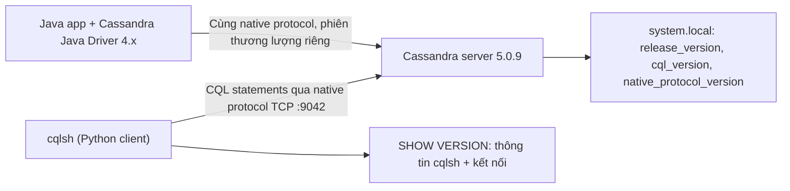

# Kết nối bằng cqlsh và xác định phiên bản server/CQL/protocol

## 1. Mục tiêu và vai trò của cqlsh

Apache Cassandra là hệ quản trị cơ sở dữ liệu **wide-column phân tán**. Để thực hành **partition key, thiết kế bảng theo truy vấn, replication, consistency level, compaction, repair, xử lý lỗi và kết nối từ Java**, trước hết cần một cách giao tiếp có thể kiểm tra trực tiếp với Cassandra server. Công cụ **`cqlsh`** (*CQL shell*) là giao diện dòng lệnh dành cho việc đó.

`cqlsh` được phát hành cùng Cassandra; nó sử dụng **Python driver và native CQL protocol** để kết nối tới một node cụ thể. Trong shell, người học có thể chạy câu lệnh CQL, truy vấn metadata, thay đổi consistency level của phiên làm việc và quan sát kết quả. Nó cũng có các lệnh **riêng của shell** như `SHOW VERSION`, `SHOW HOST` và `DESCRIBE`, không phải câu lệnh CQL mà mọi driver đều hiểu.

Sau bài học, bạn có thể:

1. Kết nối `cqlsh` tới Cassandra đang chạy trong Docker, trên Linux/VM hoặc qua endpoint mạng đã cho phép.
2. Phân biệt bốn giá trị **cqlsh version**, **Cassandra server version**, **CQL spec version** và **native protocol version**.
3. Dùng `SHOW VERSION`, `SHOW HOST`, `system.local` và `nodetool` để kiểm chứng bản server và thông tin kết nối.
4. Chạy smoke test tạo keyspace/table, ghi và đọc theo **partition key**, đồng thời biết khi nào lỗi do môi trường hay do CQL.
5. Sử dụng các cờ kết nối, timeout, auth/TLS và chế độ chạy lệnh một lần hoặc từ file theo cách kiểm soát được.
6. Giải thích sự khác nhau giữa `cqlsh` và **Apache Cassandra Java Driver**, nhất là khi ứng dụng cần khám phá nhiều node.

> **Môi trường:** ví dụ chính sử dụng `cassandra:5.0.9` với một node cho mục đích học tập. Đây là phiên bản được chọn để lệnh nhất quán, không có nghĩa nó là phiên bản mới nhất mọi thời điểm. Một node RF=1 **không** kiểm thử được chịu lỗi replica, quorum thực tế của cluster nhiều node hay repair giữa các node.

## 2. Phân biệt bốn loại phiên bản

Khi mở `cqlsh`, bạn có thể gặp một dòng gồm bốn giá trị. **Chúng là bốn trục phiên bản khác nhau**.

| Trường được hiển thị | Đối tượng | Cách xác minh | Dễ nhầm với điều gì? |
|---|---|---|---|
| **`cqlsh x.y`** | Bản chương trình shell/CLI chạy ở phía client | `cqlsh --version`; `SHOW VERSION` khi đã kết nối | Bản Cassandra server; có thể khác nếu cqlsh cài độc lập |
| **`Cassandra a.b.c`** | Bản server của **node đang được hỏi** | `SHOW VERSION`; `SELECT release_version FROM system.local`; `nodetool version` | Bản driver hoặc bản của toàn cluster |
| **`CQL spec x.y.z`** | Phiên bản đặc tả/ngôn ngữ CQL mà công cụ báo trong ngữ cảnh kết nối | `SHOW VERSION`; đối chiếu `system.local.cql_version` | Số bản vá Cassandra hoặc số native protocol |
| **`Native protocol vN`** | Phiên bản giao thức nhị phân mà client/server dùng để trao đổi request/response hoặc server công bố | `SHOW VERSION`; `system.local.native_protocol_version`; khi cần xem thêm negotiation phía driver | Bản thư viện Java Driver 4.x hoặc cổng TCP 9042 |

Ví dụ **minh họa định dạng** (`x.y.z` và `N` là ký hiệu, hãy lấy số thật từ máy):

```text
Connected to cfg008-lab at 127.0.0.1:9042.
[cqlsh x.y | Cassandra 5.0.9 | CQL spec x.y.z | Native protocol vN]
Use HELP for help.
cqlsh>
```

**Lưu ý về protocol:** một trường `native_protocol_version` trong `system.local` phản ánh giá trị version server công bố. Trong tình huống kết nối giữa client và server khác thế hệ, phiên bản giao thức **thực sự được thỏa thuận** có thể chịu ảnh hưởng của khả năng hỗ trợ/negotiation của client. Không suy từ một trường metadata rằng **mọi Java Driver** đều đang dùng cùng phiên bản protocol; khi chẩn đoán sâu hãy kiểm tra tài liệu, log/metrics phía driver và handshake.

### 2.1. Sơ đồ bốn lớp



- **CQL** là ngôn ngữ truy vấn được Cassandra hiểu; cách chia partition và clustering key ảnh hưởng trực tiếp việc SELECT có hợp lệ/hiệu quả hay không.
- **Native protocol** quy định cách truyền request, response, error, metadata và các khung dữ liệu trên kết nối TCP. Nó không phải SQL/JDBC.
- **Java Driver 4.x** là **phiên bản thư viện API Java**, không phải “native protocol v4”. Một thư viện có thể hỗ trợ nhiều phiên bản protocol theo khả năng công bố của chính driver.
- **9042** là **số cổng mặc định** cho native transport, không phải “protocol version 9042”. Cổng **7000** thường phục vụ internode; **7199** thường phục vụ JMX/`nodetool`.

### 2.2. Giới hạn tương thích của cqlsh

Tài liệu Apache nêu rõ: bản `cqlsh` **được bảo đảm tương thích với bản Cassandra cùng đợt phát hành**; trong vài trường hợp dùng lệch phiên bản vẫn hoạt động nhưng không được bảo đảm. Vì vậy, để điều tra một cluster đang gặp lỗi:

1. Ưu tiên dùng `cqlsh` **đi kèm đúng bản server** hoặc bản đã được kiểm chứng với server đích.
2. So `cqlsh --version` với `SHOW VERSION` và `system.local.release_version`.
3. Nếu kết nối thất bại sau khi nâng cấp server, xem compatibility/release notes trước khi ép `--protocol-version`.
4. Việc một câu SELECT cơ bản chạy được chưa chứng minh mọi kiểu dữ liệu mới, tính năng CQL hoặc API driver tương thích.

## 3. Chuẩn bị một node Cassandra làm đích kết nối

### 3.1. Điều kiện ban đầu

Bạn cần Docker Engine hoặc Docker Desktop chạy **Linux containers**, máy có đủ CPU/RAM/đĩa để khởi động Cassandra và một cổng host chưa được sử dụng. Với lab nhỏ, máy khoảng **8 GiB RAM tổng trở lên** và cấp khoảng **4 GiB** cho container là mức khởi đầu thuận tiện, không phải cấu hình tối thiểu production.

Ví dụ dùng **host port 9258** chuyển vào **container port 9042** để dễ phân biệt địa chỉ bên trong và bên ngoài Docker. Chọn host port khác nếu `9258` đã được dùng. Chỉ publish trên `127.0.0.1` vì lab không bật authentication/TLS mặc định.

Chạy trên host có Docker CLI (lệnh một dòng dùng được trong Bash/PowerShell):

```bash
docker version
docker pull cassandra:5.0.9
docker volume create cassandra_cql008_data

docker run -d --name cassandra-cql008 --memory=4g --memory-swap=4g -e MAX_HEAP_SIZE=2G -e CASSANDRA_CLUSTER_NAME=cfg008-lab -e CASSANDRA_ENDPOINT_SNITCH=GossipingPropertyFileSnitch -e CASSANDRA_DC=dc1 -e CASSANDRA_RACK=rack1 -p 127.0.0.1:9258:9042 -v cassandra_cql008_data:/var/lib/cassandra cassandra:5.0.9
```

Tác dụng các tham số:

| Tham số | Ý nghĩa |
|---|---|
| `--name cassandra-cql008` | Tên container riêng để dùng trong các lệnh `docker exec` |
| `cassandra:5.0.9` | Cố định bản server trong bài thực hành |
| `CASSANDRA_CLUSTER_NAME=cfg008-lab` | Đặt tên cluster lab |
| `CASSANDRA_DC=dc1`, `CASSANDRA_RACK=rack1` và snitch | Đặt topology logic cho node |
| `-p 127.0.0.1:9258:9042` | Client trên **host** dùng 9258; bên **trong container** vẫn là 9042 |
| `--memory=4g`, `MAX_HEAP_SIZE=2G` | Giới hạn RAM container và heap JVM; phần còn lại phục vụ off-heap/page cache |
| `-v cassandra_cql008_data:/var/lib/cassandra` | Giữ dữ liệu và metadata node qua các lần xóa/tạo lại container |

Đây là một node hoàn toàn mới. Nếu volume tên trên đã tồn tại và có dữ liệu, cần **xác định nguồn gốc volume** trước khi khởi chạy; không tái sử dụng dữ liệu của một node/cluster khác. Không gắn một volume cho hai Cassandra process cùng chạy.

### 3.2. Chờ readiness thay vì dựa vào `docker run -d`

```bash
docker ps -a --filter name=cassandra-cql008
docker logs --tail 100 cassandra-cql008
docker exec cassandra-cql008 nodetool status
docker exec cassandra-cql008 nodetool statusbinary
```

Kỳ vọng:

- Container vẫn ở trạng thái `Up`.
- `nodetool status` có **một dòng `UN`** (*Up/Normal*) dưới datacenter `dc1`.
- `nodetool statusbinary` trả `running`, nghĩa là native transport đã mở.

Container chạy không đồng nghĩa Cassandra đã sẵn sàng cho CQL. Nếu lệnh `nodetool` hoặc `cqlsh` thất bại ngay sau khi start, đọc log và theo dõi trạng thái rồi thử lại khi node khởi tạo xong. Đừng xóa volume chỉ vì process đang khởi động chậm.

## 4. Kết nối cqlsh theo ba cách

### 4.1. Cách dễ nhất: cqlsh ngay trong Cassandra container

Lệnh này chạy **trên host** để mở shell **bên trong container**:

```bash
docker exec -it cassandra-cql008 cqlsh 127.0.0.1 9042
```

Ở đây `127.0.0.1` là loopback **bên trong container Cassandra**, và `9042` là native port của server. Nếu bỏ host/port khi gọi cqlsh trong container, mặc định nó cũng sẽ thử localhost và 9042.

Tại prompt `cqlsh>`, thử:

```sql
SHOW VERSION
SHOW HOST
HELP
```

Khi hoàn thành, dùng `EXIT` hoặc Ctrl+D để thoát khỏi shell. Thoát `cqlsh` **không dừng** Cassandra server.

### 4.2. Chạy lệnh một lần với -e / --execute

Để script, kiểm tra readiness hoặc lấy output:

```bash
docker exec cassandra-cql008 cqlsh 127.0.0.1 9042 -e "SELECT release_version, cluster_name, data_center FROM system.local;"
```

`-e` thực thi statement rồi thoát. Ưu điểm là lệnh ngắn, dễ tái lập và có exit code. Có thể dùng cùng `--request-timeout` khi điều tra request chậm:

```bash
docker exec cassandra-cql008 cqlsh 127.0.0.1 9042 --connect-timeout=10 --request-timeout=20 -e "SELECT release_version FROM system.local;"
```

**Hai timeout khác nhau:** `--connect-timeout` giới hạn thời gian tạo kết nối ban đầu; `--request-timeout` giới hạn thời gian chờ phản hồi CQL sau khi kết nối. Tăng timeout không sửa được lỗi host/port, xác thực, thiếu replica hoặc network không định tuyến được.

### 4.3. cqlsh cài trên host hoặc trên máy ảo

Nếu `cqlsh` được cài độc lập trên **host**, kết nối qua host port được publish:

```bash
cqlsh 127.0.0.1 9258
```

Tuy nhiên **cqlsh trên host phải sẵn có và tương thích** với bản Cassandra; nó còn phụ thuộc vào môi trường Python của bộ cài. Nếu trên Windows/macOS bạn chỉ có Docker Desktop mà không cài cqlsh riêng, **dùng cách 4.1** thay vì giả định máy đã có lệnh `cqlsh`.

Nếu Cassandra cài bằng **APT/RPM trên Linux** và server đang lắng nghe localhost:9042, chạy trên chính máy đó:

```bash
cqlsh 127.0.0.1 9042
```

Nếu cài bằng **tarball**, đứng ở thư mục giải nén Cassandra và chạy:

```bash
bin/cqlsh 127.0.0.1 9042
```

Nếu Cassandra ở **Linux VM** và bạn đứng trong guest, dùng localhost của **guest**. Nếu ứng dụng/cqlsh ở **host ngoài VM**, phải cấu hình NAT/bridged/host-only, listener, firewall và địa chỉ có thể định tuyến; host `127.0.0.1` không tự trỏ đến guest. Với môi trường nhiều node, driver Java còn cần truy cập được địa chỉ peer được Cassandra công bố qua metadata.

### 4.4. Bảng xác định đúng địa chỉ

| Cqlsh chạy ở đâu? | Cassandra ở đâu? | Đích kết nối mẫu |
|---|---|---|
| `docker exec` **trong container Cassandra** | Cùng container | `127.0.0.1:9042` |
| Host có cqlsh tương thích | Container với mapping `9258:9042` | `127.0.0.1:9258` |
| Linux host cài package | Cùng Linux host, native transport bind localhost | `127.0.0.1:9042` |
| Linux guest VM | Cassandra chạy trong cùng guest | `127.0.0.1:9042` |
| Container client ở **cùng Docker network** | Cassandra chạy trong container khác | Tên dịch vụ/container và `:9042` nếu network/DNS phù hợp |
| Host ngoài VM hoặc ngoài máy khác | Cassandra ở VM/máy khác | IP/DNS thật và cổng do mạng/firewall cho phép; cần kiểm tra auth/TLS |

Với Docker trên Windows/macOS, host và container **không** cùng network namespace. Do đó một kết nối localhost thành công bên trong container không bảo đảm cùng endpoint sẽ hoạt động từ ứng dụng Java bên ngoài.

## 5. Quy trình xác định server/CQL/native protocol chính xác

### 5.1. Bước 1 — Ghi phiên bản chương trình cqlsh

Chạy trên **nơi cqlsh thực sự được cài**:

```bash
docker exec cassandra-cql008 cqlsh --version
```

Lệnh `--version` chỉ in **phiên bản của chương trình cqlsh** và thoát; nó không phải bằng chứng phiên bản của server. Đừng lấy `cqlsh 6.x` làm căn cứ kết luận bạn đã khởi động Cassandra server 6.x.

### 5.2. Bước 2 — SHOW VERSION và SHOW HOST trong phiên đã kết nối

Vào shell:

```bash
docker exec -it cassandra-cql008 cqlsh 127.0.0.1 9042
```

Trong `cqlsh`, chạy:

```sql
SHOW VERSION
SHOW HOST
```

Lệnh `SHOW VERSION` hiển thị **cqlsh version, Cassandra server version, CQL spec version và native protocol version** trong định dạng một dòng. Lệnh `SHOW HOST` hiển thị tên cluster và endpoint mà phiên cqlsh đang kết nối. Cả hai là **lệnh của cqlsh**, **không** phải CQL chuẩn để gửi từ mọi Java Driver.

**Đọc đầu ra:** ở mục này, nếu shell chạy **trong container**, `SHOW HOST` có thể hiển thị `127.0.0.1:9042`. Khi kết nối bằng cqlsh từ host qua mapping, nó có thể hiển thị `127.0.0.1:9258`; đây là **địa chỉ contact point từ góc nhìn client**, không chứng minh Cassandra đang chạy trên host port 9258 trong container.

### 5.3. Bước 3 — Đối chiếu với metadata system.local

Trong cqlsh:

```sql
SELECT key, release_version, cql_version, native_protocol_version,
       cluster_name, data_center, rack, host_id
FROM system.local
WHERE key = 'local';
```

Hoặc chạy một lần ngay trên host:

```bash
docker exec cassandra-cql008 cqlsh -e "SELECT release_version, cql_version, native_protocol_version, cluster_name, data_center, host_id FROM system.local WHERE key='local';"
```

Ý nghĩa các cột:

| Cột trong `system.local` | Điều cần ghi nhận |
|---|---|
| `release_version` | **Server version** của node đang truy vấn (ví dụ 5.0.9) |
| `cql_version` | Phiên bản CQL server công bố; dùng đối chiếu với CQL spec mà shell hiển thị |
| `native_protocol_version` | Version native protocol **server ghi trong metadata**; chưa thay thế bằng chứng negotiation phía mọi client |
| `cluster_name` | Tên cluster; ví dụ `cfg008-lab` |
| `data_center`, `rack` | Topology của node, ví dụ `dc1/rack1` |
| `host_id` | UUID định danh **Cassandra node**, không phải Docker container ID |
| `key` | Giá trị `local` chỉ bản ghi node đang được hỏi |

Một node có thể thuộc cluster có các node đang ở **nhiều phiên bản server** trong giai đoạn rolling upgrade hợp lệ. Truy vấn `system.local` từ một node **không đại diện** cho toàn bộ peer. Khi cần inventory các node khác, dùng `nodetool status` và truy vấn metadata peer trên mỗi node hoặc hệ thống quan sát chuyên dụng; không suy toàn cluster đang đồng phiên bản từ một dòng.

### 5.4. Bước 4 — Xác minh độc lập bằng nodetool

Tại terminal host:

```bash
docker exec cassandra-cql008 nodetool version
docker exec cassandra-cql008 nodetool status
docker exec cassandra-cql008 nodetool statusbinary
```

`nodetool version` cho biết server version. `status` xác minh node ở trạng thái `UN` (*Up/Normal*) trong ring. `statusbinary` cho biết native transport đang `running` hay chưa. **JMX của nodetool** là cơ chế khác với **CQL native protocol của cqlsh**; có thể gặp tình huống JMX hoạt động nhưng cổng CQL không mở.

### 5.5. Đọc kết quả như một biên bản thay vì đoán

| Bằng chứng | Nguồn | Kỳ vọng của ví dụ |
|---|---|---|
| Cqlsh executable version | `cqlsh --version` | Ghi đúng đầu ra thực tế, không điền số theo image |
| Server version | `nodetool version`, `system.local.release_version` | `5.0.9` |
| CQL spec | `SHOW VERSION` và `system.local.cql_version` | Ghi chính xác version hiển thị |
| Native protocol | `SHOW VERSION` và `system.local.native_protocol_version` | Ghi chính xác version hiển thị; đọc như thông tin do công cụ/server báo |
| Contact point | `SHOW HOST` | `127.0.0.1:9042` khi gọi trong container |
| Cluster/datacenter | `system.local` | `cfg008-lab` / `dc1` |
| Readiness | `status=UN`, `statusbinary=running`, CQL SELECT thành công | Cả ba phép kiểm đều đạt |

Việc thu đầy đủ các giá trị này giúp phân biệt lỗi môi trường với sai khác giữa client và server khi bắt đầu sử dụng API Java.

## 6. Thực hành CQL tối thiểu từ cqlsh

Một kết nối CQL thành công mới xác minh đường client ↔ server cơ bản. Hãy kiểm tra thêm việc tạo schema, ghi và đọc theo partition key để biết node thực thi CQL bình thường.

### 6.1. Tạo keyspace và bảng theo truy vấn

Mở shell:

```bash
docker exec -it cassandra-cql008 cqlsh
```

Tại prompt `cqlsh>`, chạy:

```sql
CREATE KEYSPACE IF NOT EXISTS cql008_lab
WITH replication = {'class': 'NetworkTopologyStrategy', 'dc1': 1};

CREATE TABLE IF NOT EXISTS cql008_lab.events_by_device (
    device_id text,
    event_time timestamp,
    event_type text,
    PRIMARY KEY ((device_id), event_time)
) WITH CLUSTERING ORDER BY (event_time DESC);

CONSISTENCY LOCAL_ONE;

INSERT INTO cql008_lab.events_by_device
    (device_id, event_time, event_type)
VALUES ('device-008', '2026-11-21T08:00:00Z', 'cqlsh-connected');

SELECT device_id, event_time, event_type
FROM cql008_lab.events_by_device
WHERE device_id = 'device-008';
```

Kết quả mong đợi là một bản ghi `device-008` có `event_type = 'cqlsh-connected'`. Nếu chạy lại INSERT với đúng primary key và timestamp, Cassandra cập nhật cùng row/cell; câu SELECT vẫn chỉ thấy row tương ứng với khóa đó.

Giải thích:

- `device_id` là **partition key**: token từ khóa này quyết định nơi lưu dữ liệu trong cluster.
- `event_time` là **clustering column**: sắp xếp bản ghi trong partition theo thời gian giảm dần.
- Câu SELECT có điều kiện `WHERE device_id = ...`, phù hợp thiết kế bảng **theo truy vấn** của Cassandra.
- `NetworkTopologyStrategy` với `'dc1': 1` nghĩa là **RF=1** trong datacenter `dc1`, phù hợp lab một node, nhưng không tạo dự phòng replica.
- `CONSISTENCY LOCAL_ONE` là **lệnh đặt mức nhất quán phía cqlsh client**; nó không nằm trong `cassandra.yaml`. Khi dùng Java Driver, consistency được đặt ở cấu hình/statement của driver.

### 6.2. Xem cấu trúc schema

Trong cqlsh:

```sql
DESCRIBE KEYSPACES
DESCRIBE KEYSPACE cql008_lab
DESCRIBE TABLE cql008_lab.events_by_device
```

`DESCRIBE` là lệnh **riêng của cqlsh** để in định nghĩa schema, không phải CQL statement gửi nguyên văn từ API Java. Dùng nó để đối chiếu keyspace replication và primary key thực tế trước khi debug truy vấn.

### 6.3. Đọc metadata và điều chỉnh cách hiển thị

```sql
CONSISTENCY
PAGING 20
EXPAND ON
SELECT release_version, cql_version, native_protocol_version
FROM system.local WHERE key = 'local';
EXPAND OFF
```

- `CONSISTENCY` không tham số hiển thị mức nhất quán đang dùng.
- `PAGING 20` điều khiển số row trên một trang kết quả trong cqlsh; nó không thay đổi partition key hoặc tự giới hạn tổng số row server trả về.
- `EXPAND ON` in các cột theo chiều dọc để dễ đọc row có nhiều cột.
- `TRACING ON/OFF` có thể giúp xem đường đi của một truy vấn, nhưng cần dùng có chọn lọc vì tạo dữ liệu tracing và tăng chi phí.

Ví dụ trên vẫn chỉ kiểm tra CQL cơ bản. Không dùng `SELECT *` trên một bảng production lớn để “thử connection”: Cassandra có thể đọc lượng dữ liệu lớn, gây tốn tài nguyên. Truy vấn metadata hoặc partition key nhỏ là lựa chọn phù hợp hơn.

## 7. Các cờ cqlsh thường dùng và giới hạn của chúng

| Cú pháp | Công dụng | Khi nào dùng? |
|---|---|---|
| `cqlsh [host [port]]` | Kết nối tới một node; mặc định localhost/9042 | Lab, kết nối thủ công |
| `cqlsh --version` | Chỉ hiển thị version của executable cqlsh, **không cần kết nối server** | Kiểm tra cqlsh đang cài |
| `cqlsh -e "SELECT ...;"` | Thực thi một statement và thoát | Readiness/smoke test |
| `cqlsh -f commands.cql` | Chạy các lệnh từ file ở **filesystem nơi cqlsh chạy** | Kịch bản CQL có thể tái lập |
| `cqlsh -k keyspace` | Mở shell với keyspace mặc định đã có | Làm việc với nhiều bảng cùng keyspace |
| `cqlsh --connect-timeout=10` | Giới hạn chờ tạo kết nối (giây) | Điều tra mạng/startup chậm |
| `cqlsh --request-timeout=20` | Giới hạn thời gian chờ CQL request (giây) | Phân biệt timeout request sau khi connect |
| `cqlsh --protocol-version=N` | Chỉ định protocol version cụ thể | **Chẩn đoán tương thích có kiểm soát**, không phải mặc định |
| `cqlsh --cqlversion=X.Y.Z` | Yêu cầu phiên bản CQL cụ thể | Chỉ dùng khi biết server/client cùng hỗ trợ |
| `cqlsh -u username` | Kết nối với user, sẽ yêu cầu password nếu cần | Server đã bật authentication |
| `cqlsh --ssl` | Bật TLS cho kết nối client nếu server đã cấu hình | Mạng có mã hóa CQL |

Tránh đưa mật khẩu qua `-p plaintext` trong lệnh: giá trị có thể lộ trong lịch sử shell hoặc danh sách process. Dùng cơ chế credentials được bảo vệ, hoặc cho cqlsh nhắc nhập password. Khi đã bật TLS, cqlsh còn cần cấu hình CA/certificate phù hợp; `--ssl` đơn lẻ không chứng minh đã kiểm tra đúng danh tính máy chủ.

### 7.1. Chạy một file CQL

Giả sử trong một thư mục lab **do người học tự tạo** có file `commands.cql`:

```sql
SELECT release_version, cluster_name FROM system.local WHERE key = 'local';
SELECT device_id, event_type
FROM cql008_lab.events_by_device
WHERE device_id = 'device-008';
```

Nếu cqlsh đã cài trực tiếp trên host và kết nối đến cổng host 9258:

```bash
cqlsh 127.0.0.1 9258 -f commands.cql
```

Nếu chỉ có `cqlsh` **trong container**, file `commands.cql` phải tồn tại/được mount **bên trong container** ở đường dẫn mà lệnh `docker exec ... cqlsh -f ...` có thể đọc. Lệnh `-f` không tự lấy file từ filesystem Windows/macOS host. Không nhất thiết tạo file để hoàn thành bài này; các ví dụ `-e` và shell tương tác đã đủ.

### 7.2. Truy xuất lịch sử lệnh và dữ liệu bí mật

Theo mặc định, cqlsh có thể ghi lịch sử vào `~/.cassandra/cql_history` của **môi trường chạy cqlsh**. Tránh chèn password, token hoặc secret vào CQL/lệnh có thể được log hoặc lưu history. Tùy phiên bản, bạn có thể dùng cấu hình `cqlshrc` hoặc `--disable-history` để hạn chế lưu lịch sử; không nhầm cqlsh history với **commit log của Cassandra server**.

## 8. Kết nối một node và nhìn toàn cluster: cần phân biệt

`cqlsh` được thiết kế để kết nối tới **một node được chỉ định**. Nó không có vai trò cân bằng tải và khám phá toàn bộ topology như một Java Driver được cấu hình đầy đủ. Khi query được gửi tới node đó, node có thể đóng vai trò **coordinator** để liên hệ các replica phù hợp theo partition key, replication factor và consistency level.

Vì vậy:

- `SHOW HOST` trả **node hiện được cqlsh kết nối**, không phải một “master” của cluster.
- `SELECT release_version FROM system.local` chỉ cho phiên bản **node được kết nối**.
- Trong cluster nhiều node, `nodetool status` cho góc nhìn ring; `system.peers_v2` ở một node có thể liệt kê các peer đã biết nhưng không tự chứng minh đường mạng của từng client tới tất cả peer.
- Một câu SELECT chạy được với `LOCAL_ONE` chưa chứng minh `LOCAL_QUORUM` vẫn thành công khi node hỏng; để học nội dung đó cần cluster nhiều node với replication factor thích hợp.

Ví dụ **tùy chọn chỉ khi đã có cluster nhiều node**:

```sql
SELECT peer, peer_port, data_center, rack, host_id, release_version,
       native_address, native_port
FROM system.peers_v2;
```

Ở lab **một node** bài này, `system.peers_v2` có thể rỗng là bình thường. Mỗi node có `system.local` riêng; khi inventory nhiều node, phải hỏi từng node hoặc dùng hệ thống giám sát/automation tương ứng.

## 9. Protocol negotiation, lỗi sai phiên bản và Java Driver

### 9.1. Khi nào mới cần --protocol-version?

Trong trạng thái thông thường, cqlsh/driver sẽ kết nối theo giao thức được phiên bản của chúng hỗ trợ, có thể thương lượng hoặc giảm xuống phiên bản tương thích. Ép phiên bản bằng `--protocol-version` là **công cụ chẩn đoán**, không phải cách khắc phục lâu dài cho một client không tương thích:

```bash
# Chỉ là mẫu cách gọi; thay N khi đã xác nhận giao thức server/client đều hỗ trợ.
cqlsh 127.0.0.1 9258 --protocol-version=N
```

**Không thực thi nguyên mẫu `N`** vì nó không phải số version. Khi ép sai, kết nối có thể bị server từ chối do phiên bản protocol không hỗ trợ. Nếu gặp lỗi dạng `UnsupportedProtocolVersion` hoặc handshake thất bại, ghi nhận server version, cqlsh version, native protocol server công bố, log client/server và đối chiếu compatibility guide; tránh đổi ngẫu nhiên nhiều version cùng lúc.

Version native protocol liên quan đến cách biểu diễn các request/response qua network. Nó **không đồng nhất** với CQL spec version hay số major của Java driver. Một cluster đang rolling upgrade hợp lệ cũng có thể yêu cầu chú ý dải protocol/chức năng chung giữa các node.

### 9.2. Java Driver kiểm tra metadata theo cách riêng

Với Java 17 và Apache Cassandra Java Driver 4.x (ví dụ `org.apache.cassandra:java-driver-core:4.19.4`), chương trình tối thiểu đọc server version:

```java
import java.net.InetSocketAddress;

import com.datastax.oss.driver.api.core.CqlSession;
import com.datastax.oss.driver.api.core.cql.Row;

public class CassandraVersionCheck {
    public static void main(String[] args) {
        try (CqlSession session = CqlSession.builder()
                .addContactPoint(new InetSocketAddress("127.0.0.1", 9258))
                .withLocalDatacenter("dc1")
                .build()) {

            Row row = session.execute(
                    "SELECT release_version, cql_version, native_protocol_version " +
                    "FROM system.local WHERE key = 'local'").one();
            if (row == null) {
                throw new IllegalStateException("Khong co metadata system.local");
            }
            System.out.println("Server: " + row.getString("release_version"));
            System.out.println("CQL: " + row.getString("cql_version"));
            System.out.println("Server native protocol: " +
                    row.getString("native_protocol_version"));
        }
    }
}
```

Đoạn Java này chạy **trên host** có cổng 9258 đã được publish. Khi ứng dụng Java chạy trong một Docker container khác, `127.0.0.1` là chính container Java; nó cần đúng Docker network/contact point, và driver phải truy cập được các peer address Cassandra **quảng bá**. `withLocalDatacenter("dc1")` phải khớp `system.local.data_center`, phân biệt chữ hoa/thường.

Đọc `native_protocol_version` từ `system.local` là đọc **metadata server**; muốn xác nhận chính xác protocol của **Java Driver session**, cần xem khả năng/negotiation của thư viện, logs hoặc metrics của driver theo tài liệu của nó. Java Driver 4.x không mặc nhiên dùng native protocol v4 chỉ vì có số 4.

### 9.3. Khi phát hiện lệch phiên bản

| Hiện tượng | Ý nghĩa | Hướng xử lý |
|---|---|---|
| `cqlsh --version` khác Cassandra `release_version` | Shell và server là các bản phát hành riêng | Ưu tiên cqlsh tương ứng server hoặc cặp đã được xác nhận tương thích |
| Native protocol của server khác con số tưởng tượng từ version driver | Hai sản phẩm có scheme phiên bản riêng | Đọc bảng tương thích, driver negotiation; không ép N theo major driver |
| Client có thể kết nối nhưng thao tác kiểu dữ liệu mới lỗi | Một phần tính năng CQL/API không tương thích | Thử đúng query/codec cần dùng và đọc tài liệu version của cả server/driver |
| Một node báo server version khác peer khác | Cluster có thể đang rolling upgrade hoặc cài sai patch | Inventory tất cả node và xác minh kế hoạch upgrade được hỗ trợ |
| `SHOW VERSION` khác kết quả mong đợi từ image tag | Có thể đã kết nối nhầm node/port hoặc image không như giả định | `SHOW HOST`, `system.local`, `nodetool version`, `docker ps`; ghi dữ liệu thực tế |

## 10. Xử lý lỗi kết nối cqlsh theo từng lớp

| Triệu chứng | Nguyên nhân có thể | Kiểm tra và cách xử lý |
|---|---|---|
| `cqlsh: command not found` trên host | Chưa cài cqlsh trên host; có Cassandra Docker không đồng nghĩa host có executable | Dùng `docker exec ... cqlsh` hoặc cài đúng bộ cqlsh tương thích |
| `docker exec` báo container không chạy | Cassandra container đã thoát, OOM, lỗi filesystem/JVM | `docker ps -a`, `docker logs`, `docker inspect`, RAM/disk |
| `Connection refused` ngay sau `docker run -d` | Cassandra chưa mở native transport, port sai, service không chạy | `nodetool status`, `statusbinary`, log; kiểm tra cổng 9042 trong container |
| `cqlsh` trong container OK nhưng từ host không OK | Nhầm `9042` với host port `9258`, mapping/firewall/NAT | `docker ps`, `docker port cassandra-cql008`; trên host dùng `127.0.0.1:9258` |
| Host/VM không route được đến node | Sai IP, firewall, Cassandra chỉ bind loopback, NAT không forwarding | Kiểm tra nơi chạy cqlsh, `rpc_address`, host/VM network, port 9042 |
| `AuthenticationFailed` hoặc không đăng nhập được | Server bật authentication và thiếu/sai credential | Dùng account hợp lệ, cơ chế prompt/credential an toàn, đối chiếu auth server |
| SSL/TLS handshake lỗi | Client dùng plaintext vào TLS port hoặc trust/certificate sai | So cấu hình TLS hai phía, CA/cert và `--ssl`; không tắt TLS của production để qua test |
| Báo không hỗ trợ protocol | Cqlsh/driver không tương thích server hoặc ép `--protocol-version` sai | Ghi đủ version, bỏ cờ ép nếu không cần, dùng bộ client được hỗ trợ |
| `Timeout` sau khi đã kết nối | Node chậm, quá tải CPU/đĩa, query không phù hợp hoặc mất replica | Kiểm tra request timeout, schema/partition key, `nodetool tpstats`, `compactionstats`, server log |
| `Unconfigured table/keyspace` | Chưa tạo schema, dùng nhầm cluster, thiếu keyspace hoặc tên phân biệt hoa/thường | `SHOW HOST`, `DESCRIBE KEYSPACES`, schema CQL; chạy đúng script chuẩn bị |
| `InvalidRequest` vì truy vấn SELECT | Thiếu partition key, query không khớp bảng theo truy vấn | Xem `DESCRIBE TABLE`, điều kiện `WHERE`, thiết kế lại data model nếu cần |
| `system.peers_v2` rỗng trong lab đơn node | Không có peer khác | Đây là kết quả bình thường, không phải kết nối lỗi |
| `nodetool status=UN` nhưng CQL lỗi | Node đã ở ring, native transport/auth/network vẫn có thể lỗi | `nodetool statusbinary`, `cqlsh` bên trong node, sau đó từ host/client |

**Thứ tự khoanh vùng nên theo quan sát:** (1) xác nhận đúng nơi chạy `cqlsh`; (2) process/container; (3) ring `UN`; (4) native transport `running`; (5) host/port thực tế; (6) auth/TLS/protocol; (7) CQL và schema; (8) trạng thái replica/consistency nếu nhiều node. Không sửa partition key hay tăng timeout để chữa một lỗi contact point sai.

### 10.1. Phân biệt các bước khi startup chậm

```bash
docker ps -a --filter name=cassandra-cql008
docker logs --tail 100 cassandra-cql008
docker exec cassandra-cql008 nodetool status
docker exec cassandra-cql008 nodetool statusbinary
docker exec cassandra-cql008 cqlsh -e "SELECT release_version FROM system.local WHERE key='local';"
```

Khi điều tra lỗi, kiểm tra exit code **của từng lệnh** và đầu ra lỗi. Với lệnh cqlsh có `-e`, lỗi kết nối hoặc query thường khiến lệnh trả code khác 0; một script tự động phải kiểm tra return code, không chỉ tìm chuỗi chữ trong output. Không lặp request liên tục không giới hạn khi node còn đang khởi động; nên chờ có giới hạn và lưu lại log cuối.

## 11. Biên bản thực hành, bài tập và dọn lab

### 11.1. Ghi lại kết quả thực tế

| Trường thông tin | Giá trị hoặc bằng chứng cần điền |
|---|---|
| Nơi chạy cqlsh | Host Linux/Windows/macOS, guest VM, hay trong container |
| Lệnh kết nối | `docker exec -it cassandra-cql008 cqlsh 127.0.0.1 9042` hoặc endpoint thật |
| cqlsh version | Đầu ra `cqlsh --version` |
| Server version | `SHOW VERSION`, `release_version`, `nodetool version` |
| CQL spec version | `SHOW VERSION`, `system.local.cql_version` |
| Native protocol | `SHOW VERSION` và `system.local.native_protocol_version`; nếu cần điều tra negotiation thì ghi thêm log client |
| Cluster/node identity | `cluster_name`, `host_id`, `data_center`, `rack` |
| Contact point/port | `SHOW HOST` từ đúng nơi chạy client |
| Readiness | `status=UN`, `statusbinary=running`, truy vấn metadata thành công |
| Dữ liệu CQL | SELECT trả row `device-008 / cqlsh-connected` |
| Thử Java | JDK/driver version, contact point, local DC, query thành công nếu có |

### 11.2. Câu hỏi ôn tập và tình huống

1. Tại sao `cqlsh --version` **không đủ** để xác định phiên bản Cassandra server? Cần thêm ít nhất hai lệnh nào?
2. Một banner ghi `Cassandra 5.x`, `CQL spec 3.x` và `Native protocol v5`. Ba số phiên bản này khác nhau ở những lớp nào?
3. Cassandra Java Driver 4.x có bắt buộc chỉ dùng native protocol v4 không? Làm sao xác định protocol thực tế của một phiên Java?
4. Bạn chạy `cqlsh` trong container thành công ở `127.0.0.1:9042`, còn từ host phải dùng `127.0.0.1:9258`. Giải thích hai network namespace và port mapping.
5. Vì sao `SHOW HOST` là lệnh cqlsh, còn `SELECT ... FROM system.local` là CQL hợp lệ để gửi bằng Java Driver?
6. Một node hiện `UN` nhưng `cqlsh` báo connection refused. Lệnh nào giúp phân biệt trạng thái ring với trạng thái CQL native transport?
7. `system.local.release_version` ở một node có chứng minh mọi node trong cluster cùng patch version không? Cần kiểm tra gì khi rolling upgrade?
8. Truy vấn `SELECT * FROM cql008_lab.events_by_device;` thất bại hoặc không hiệu quả. Vì sao mô hình Cassandra thường cần `WHERE device_id = ...`?
9. Khi server bật auth/TLS, nên sử dụng cờ nào và vì sao không nên đưa password plaintext vào dòng lệnh?
10. CQL query của Java chạy được từ một contact point nhưng query khác thất bại sau khi driver khám phá peer. Những địa chỉ metadata và điều kiện network nào cần xem xét?

**Tiêu chí hoàn thành:** người học kết nối thành công bằng cqlsh, ghi đúng **bốn trục phiên bản**, biết đối chiếu `SHOW HOST` với endpoint mạng, xác minh `system.local` và `nodetool`, tạo schema/INSERT/SELECT theo partition key, đồng thời giải thích được khác biệt giữa cqlsh và Java Driver. Những phép kiểm này là nền tảng để thực hành sâu hơn về replication, consistency, compaction, repair và xử lý lỗi cluster.

### 11.3. Dừng và giữ dữ liệu

Sau khi ghi kết quả vào nhật ký riêng:

```bash
docker stop cassandra-cql008
docker rm cassandra-cql008
docker volume inspect cassandra_cql008_data
```

Những lệnh này chỉ dừng/xóa **container**, **không xóa named volume**. Nếu muốn tiếp tục, tạo lại bằng **cùng phiên bản, tên cluster, datacenter và volume**; không dùng một volume cho nhiều node. Chỉ xóa volume khi chắc chắn có thể bỏ toàn bộ dữ liệu thực hành.

## 12. Nguồn tham khảo chính thức

- [Apache Cassandra — cqlsh: the CQL shell](https://cassandra.apache.org/doc/latest/cassandra/managing/tools/cqlsh.html): cú pháp kết nối, các cờ, `SHOW VERSION`, `SHOW HOST`, `DESCRIBE`, `CONSISTENCY` và khả năng tương thích.
- [Apache Cassandra — Inserting and querying](https://cassandra.apache.org/doc/latest/cassandra/getting-started/querying.html): kết nối qua cqlsh/driver và CQL cơ bản.
- [Apache Cassandra — Native protocol](https://cassandra.apache.org/doc/latest/cassandra/reference/native-protocol.html): cấu trúc giao thức nhị phân và quy tắc version, phân biệt CQL version với protocol.
- [Apache Cassandra — nodetool version](https://cassandra.apache.org/doc/latest/cassandra/managing/tools/nodetool/version.html): xác minh phiên bản server.
- [Apache Cassandra — nodetool statusbinary](https://cassandra.apache.org/doc/latest/cassandra/managing/tools/nodetool/statusbinary.html): kiểm tra native transport hoạt động.
- [Apache Cassandra — CQL reference](https://cassandra.apache.org/doc/latest/cassandra/developing/cql/index.html): ngôn ngữ CQL, schema và truy vấn.
- [Apache Cassandra Java Driver](https://github.com/apache/cassandra-java-driver): API Java, contact points, local datacenter và tương thích protocol.
- [Docker Hub — Cassandra Official Image](https://hub.docker.com/_/cassandra): image và cách chạy Cassandra/cqlsh trong container.
