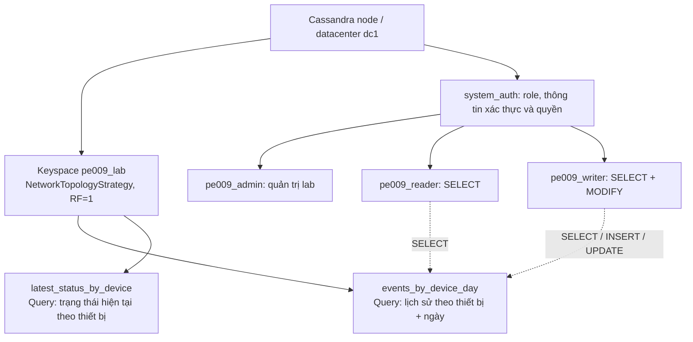

# Tạo keyspace, tài khoản và dữ liệu mẫu cho thực nghiệm

## 1. Mục tiêu và những điều phải phân biệt

Apache Cassandra là cơ sở dữ liệu **wide-column phân tán**. Để học **partition key, thiết kế bảng theo truy vấn, replication, mức nhất quán đọc/ghi, compaction, repair, xử lý lỗi và kết nối từ Java**, cần một bộ dữ liệu thực hành có thể dựng lại và một cách kiểm soát tài khoản truy cập.

Sau bài học, bạn có thể:

1. Tạo **keyspace** với `NetworkTopologyStrategy` và replication factor phù hợp với số node/datacenter.
2. Tạo hai bảng theo hai kiểu truy vấn, hiểu ý nghĩa **partition key** và **clustering key**.
3. Nạp dữ liệu mẫu có khóa xác định để chạy lại script mà không vô tình tạo vô số bản ghi.
4. Truy vấn dữ liệu theo partition, kiểm tra schema, ghi nhận kết quả trước/sau restart.
5. Phân biệt **role**, **login**, **authentication** và **authorization**; tạo tài khoản chỉ đọc và tài khoản đọc/ghi sau khi bật cơ chế bảo mật.
6. Dùng `GRANT`/`REVOKE`, kiểm thử một thao tác được phép và một thao tác bị từ chối; kết nối thử bằng `cqlsh` và Java Driver.
7. Biết vì sao tài khoản không làm dữ liệu “an toàn” nếu cổng internode, JMX, TLS hoặc replication của `system_auth` chưa được thiết kế đúng.

**Phạm vi:** một node Cassandra 5.0.9 trong Docker, cổng CQL chỉ publish trên loopback của host. Bài có **hai giai đoạn**: (A) dữ liệu/schema khi server vẫn dùng mặc định **không xác thực**; (B) bật xác thực/phân quyền **trên lab cô lập** để tạo và thử tài khoản thật. Không sao chép nguyên thiết lập RF=1, mật khẩu mẫu hoặc thao tác sửa cấu hình tạm trong container sang production.

## 2. Bản đồ các đối tượng sẽ tạo



| Khái niệm | Thuộc về | Tác dụng |
|---|---|---|
| **Keyspace** | Schema Cassandra | Chứa bảng, khai báo replication strategy/RF và tùy chọn durable writes |
| **Table** | Bên trong keyspace | Xác định primary key, cột và lựa chọn lưu trữ theo kiểu truy vấn |
| **Partition key** | Primary key của bảng | Hash thành token để định tuyến partition/replica |
| **Clustering key** | Phần còn lại của primary key | Xác định thứ tự bản ghi **bên trong cùng partition** |
| **Role/tài khoản** | Bảo mật Cassandra, thường lưu trong `system_auth` | Có thể được phép login, được cấp quyền, hoặc được dùng làm nhóm quyền |
| **Authenticator** | Cấu hình server `cassandra.yaml` | Xác minh danh tính client |
| **Authorizer** | Cấu hình server `cassandra.yaml` | Kiểm tra client được phép thực hiện thao tác nào |
| **Consistency level (CL)** | Từng request/client | Quy định mức phản hồi từ replica, **không** tạo thêm replica |

Đây là các lớp khác nhau. Chẳng hạn, `CREATE ROLE` không thay `CREATE KEYSPACE`; `GRANT SELECT` không quyết định replication factor; `LOCAL_QUORUM` không sửa được partition key thiết kế sai.

## 3. Chuẩn bị một node Cassandra để nạp dữ liệu

### 3.1. Yêu cầu môi trường

Ví dụ sử dụng Docker Official Image `cassandra:5.0.9`, giữ dữ liệu trong một **named volume**. Host nên có đủ CPU, SSD và khoảng **8 GiB RAM tổng trở lên** cho lab thuận tiện; cấp khoảng 4 GiB cho container và 2 GiB Java heap là cấu hình thử nghiệm, không phải mức tối thiểu production.

Trước khi chạy, kiểm tra tên `cassandra-pe009` và port host `9269` chưa bị chương trình/container khác chiếm. **Không dùng volume có dữ liệu cần giữ hoặc thuộc cluster khác.**

Chạy từ terminal host có Docker CLI (lệnh một dòng chạy được trong Bash/PowerShell):

```bash
docker version
docker pull cassandra:5.0.9
docker network create pe009-net
docker volume create pe009_node_data

docker run -d --name cassandra-pe009 --network pe009-net --memory=4g --memory-swap=4g -e MAX_HEAP_SIZE=2G -e CASSANDRA_CLUSTER_NAME=pe009-training -e CASSANDRA_ENDPOINT_SNITCH=GossipingPropertyFileSnitch -e CASSANDRA_DC=dc1 -e CASSANDRA_RACK=rack1 -p 127.0.0.1:9269:9042 -v pe009_node_data:/var/lib/cassandra cassandra:5.0.9
```

Giải thích một số tham số:

- `CASSANDRA_CLUSTER_NAME=pe009-training`: tên cluster lab.
- `CASSANDRA_DC=dc1` cùng `GossipingPropertyFileSnitch`: đặt datacenter thật mà CQL sẽ dùng trong replication map.
- `-p 127.0.0.1:9269:9042`: client **trên host** dùng 9269; `cqlsh` **trong container** dùng 9042.
- `--network pe009-net`: tạo môi trường mà client container khác (nếu có) có thể tìm Cassandra bằng tên.
- `-v pe009_node_data:/var/lib/cassandra`: giữ dữ liệu/schema/`system_auth` qua **restart và xóa container**, miễn là volume không bị xóa. **File cấu hình nằm ở `/etc/cassandra` không nằm trong volume này**.

### 3.2. Chờ server sẵn sàng

```bash
docker ps -a --filter name=cassandra-pe009
docker logs --tail 100 cassandra-pe009
docker exec cassandra-pe009 nodetool status
docker exec cassandra-pe009 nodetool statusbinary
docker exec cassandra-pe009 cqlsh -e "SELECT release_version, cluster_name, data_center FROM system.local;"
```

Đợi tới khi:

1. `nodetool status` có một node **`UN`** (*Up/Normal*).
2. `nodetool statusbinary` trả `running`.
3. CQL trả `cluster_name=pe009-training`, `data_center=dc1` và bản server dự kiến.

Container hiển thị `Up` chỉ nghĩa là process đang chạy, không chứng minh node đã sẵn sàng cho CQL. Nếu `cqlsh` từ chối kết nối trong lúc startup, đọc log rồi thử lại. Không tăng timeout vô hạn hoặc xóa volume để “sửa” lỗi khởi động chậm.

Mở phiên `cqlsh` tương tác cho **giai đoạn A**:

```bash
docker exec -it cassandra-pe009 cqlsh
```

## 4. Tạo keyspace đúng topology

### 4.1. Tại sao chọn NetworkTopologyStrategy?

Replication strategy quyết định **những node nào** giữ bản sao của mỗi partition. `NetworkTopologyStrategy` cho phép chỉ định **RF theo từng datacenter**, phù hợp với cluster production và lab muốn mở rộng nhiều node. `SimpleStrategy` đơn giản hơn nhưng không hiểu failure domain/datacenter, vì vậy không nên dùng cho thiết kế production.

| Trường hợp | Replication map | Điều gì xảy ra |
|---|---|---|
| **Lab 1 node** trong `dc1` | `{'class':'NetworkTopologyStrategy','dc1':1}` | Mỗi partition có một replica; node duy nhất down là không còn replica sẵn sàng |
| **Lab 3 node** trong `dc1` | `{'class':'NetworkTopologyStrategy','dc1':3}` | Mỗi partition có ba replica; quorum là 2/3 |
| Cluster nhiều DC, ví dụ 3 node/DC | `{'class':'NetworkTopologyStrategy','dc1':3,'dc2':3}` | Mỗi DC có RF riêng; cần **các DC có thật** và topology đúng |

Chọn RF=3 trên **cluster chỉ có một node** không tự tạo ba bản sao vật lý; Cassandra không thể nhân dữ liệu lên những node không tồn tại. RF lớn hơn số node còn có thể gây lỗi availability/consistency. Không dùng kết quả `LOCAL_QUORUM` ở lab RF=1 làm bằng chứng cho khả năng chịu lỗi khi RF=3.

### 4.2. Tạo keyspace và kiểm tra

Trong `cqlsh`:

```sql
SELECT cluster_name, data_center, rack FROM system.local WHERE key = 'local';

CREATE KEYSPACE IF NOT EXISTS pe009_lab
WITH replication = {
    'class': 'NetworkTopologyStrategy',
    'dc1': 1
}
AND durable_writes = true;

DESCRIBE KEYSPACE pe009_lab;

SELECT keyspace_name, replication, durable_writes
FROM system_schema.keyspaces
WHERE keyspace_name = 'pe009_lab';
```

**Lưu ý:**

- Tên DC trong replication map **phải khớp** `system.local.data_center` thực tế, phân biệt chữ hoa/thường. Nếu bạn dùng bản cài đặt khác và tên DC khác `dc1`, hãy đổi map theo thực tế.
- `durable_writes=true` dùng commit log bình thường; **không tắt để tối ưu tốc độ** trong bài kiểm tra độ bền dữ liệu.
- `CREATE KEYSPACE IF NOT EXISTS` khi keyspace đã tồn tại là **no-op**, không tự sửa RF, DC hay durable writes đã khai báo. Luôn `DESCRIBE` hoặc xem `system_schema.keyspaces`.
- Đổi RF cho keyspace có dữ liệu là thao tác vận hành **không tự đồng bộ các replica mới**; cần hiểu sửa chữa/streaming/repair theo quy trình thích hợp.

### 4.3. Keyspace system_auth là đối tượng khác

`system_auth` lưu thông tin nội bộ cho roles/credentials/permissions trong cơ chế bảo mật mặc định của Cassandra. Nó **khác** với keyspace dữ liệu ứng dụng `pe009_lab`.

Trong lab một node, trước khi bật xác thực, ta sẽ kiểm tra và có thể đổi replication của `system_auth` thành `NetworkTopologyStrategy` với `dc1:1`. Trong production, tài liệu Apache khuyến nghị **RF 3–5 theo datacenter** khi có đủ node để login vẫn khả dụng khi node hỏng. Nếu auth keyspace thiếu replica, việc đăng nhập có thể thất bại ngay cả khi dữ liệu nghiệp vụ được nhân bản tốt.

## 5. Thiết kế bảng theo những truy vấn cần chạy

### 5.1. Hai câu hỏi nghiệp vụ mẫu

Giả sử dữ liệu từ cảm biến thiết bị. Người dùng cần:

1. **Lịch sử sự kiện của một thiết bị trong một ngày**, mới nhất trước.
2. **Trạng thái gần nhất của một thiết bị** khi mở trang tổng quan.

Nếu chỉ có một bảng “dữ liệu thô”, truy vấn (2) có thể phải tìm kiếm/lọc từ nhiều partition. Cassandra thường khuyến khích **thiết kế bảng theo truy vấn** và chấp nhận nhân bản một số thông tin ở cấp ứng dụng.

### 5.2. Bảng lịch sử theo thiết bị và ngày

```sql
CREATE TABLE IF NOT EXISTS pe009_lab.events_by_device_day (
    device_id text,
    event_day date,
    event_time timestamp,
    event_id uuid,
    event_type text,
    temperature_c double,
    note text,
    PRIMARY KEY ((device_id, event_day), event_time, event_id)
) WITH CLUSTERING ORDER BY (event_time DESC, event_id ASC);

DESCRIBE TABLE pe009_lab.events_by_device_day;
```

Phân tích khóa:

| Thành phần | Vai trò |
|---|---|
| `(device_id, event_day)` | **Composite partition key**: tất cả event của một thiết bị trong một ngày nằm trong cùng partition |
| `event_time` | Clustering key chính, sắp xếp **giảm dần** trong partition |
| `event_id` | Clustering key phụ, giúp tách các event có cùng timestamp |
| `event_type`, `temperature_c`, `note` | Các cột dữ liệu thường, không tham gia phân phối partition |

**Bucketing theo ngày** giúp tránh dồn lịch sử vô hạn của một thiết bị vào một partition, nhưng chưa bảo đảm partition đủ nhỏ nếu một thiết bị gửi hàng triệu sự kiện/ngày. Cần đo kích thước partition/tốc độ ghi rồi chọn bucket phù hợp với workload thật. Không dùng `ALLOW FILTERING` như giải pháp thay thế cho partition key sai.

### 5.3. Bảng trạng thái hiện tại

```sql
CREATE TABLE IF NOT EXISTS pe009_lab.latest_status_by_device (
    device_id text PRIMARY KEY,
    last_seen_at timestamp,
    status text,
    temperature_c double
);
```

Bảng thứ hai có `device_id` làm partition key duy nhất, hỗ trợ `SELECT ... WHERE device_id=?` trực tiếp. Cùng một event có thể cập nhật cả bảng lịch sử lẫn bảng trạng thái. Tuy nhiên **hai write độc lập không mặc nhiên là một transaction đa bảng**; nếu một write thất bại phải có cách retry/idempotency phù hợp. Thêm nữa, Cassandra giải quyết xung đột theo **mutation timestamp**, không tự so giá trị `last_seen_at` để giữ event có timestamp nghiệp vụ lớn nhất. Khi nhiều producer ghi không theo thứ tự, cần thiết kế xử lý trạng thái cuối cùng cẩn thận.

## 6. Nạp bộ dữ liệu mẫu có thể chạy lại

### 6.1. Lệnh INSERT cho bảng lịch sử

Trong `cqlsh` đã kết nối:

```sql
CONSISTENCY LOCAL_ONE;

INSERT INTO pe009_lab.events_by_device_day
    (device_id, event_day, event_time, event_id, event_type, temperature_c, note)
VALUES
    ('device-001', '2026-11-21', '2026-11-21T08:00:00Z',
     00000000-0000-4000-8000-000000000001, 'boot', 26.1, 'Khoi dong');

INSERT INTO pe009_lab.events_by_device_day
    (device_id, event_day, event_time, event_id, event_type, temperature_c, note)
VALUES
    ('device-001', '2026-11-21', '2026-11-21T08:05:00Z',
     00000000-0000-4000-8000-000000000002, 'measurement', 26.5, 'On dinh');

INSERT INTO pe009_lab.events_by_device_day
    (device_id, event_day, event_time, event_id, event_type, temperature_c, note)
VALUES
    ('device-001', '2026-11-21', '2026-11-21T09:15:00Z',
     00000000-0000-4000-8000-000000000003, 'alert', 31.2, 'Nhiet do cao');

INSERT INTO pe009_lab.events_by_device_day
    (device_id, event_day, event_time, event_id, event_type, temperature_c, note)
VALUES
    ('device-001', '2026-11-22', '2026-11-22T07:00:00Z',
     00000000-0000-4000-8000-000000000004, 'measurement', 25.7, 'Ngay tiep theo');

INSERT INTO pe009_lab.events_by_device_day
    (device_id, event_day, event_time, event_id, event_type, temperature_c, note)
VALUES
    ('device-002', '2026-11-21', '2026-11-21T08:03:00Z',
     00000000-0000-4000-8000-000000000005, 'boot', 23.4, 'Khoi dong');

INSERT INTO pe009_lab.events_by_device_day
    (device_id, event_day, event_time, event_id, event_type, temperature_c, note)
VALUES
    ('device-002', '2026-11-21', '2026-11-21T09:10:00Z',
     00000000-0000-4000-8000-000000000006, 'measurement', 24.0, 'On dinh');
```

Các `event_id` được viết cố định **chỉ để học và chạy lại script dễ kiểm chứng**. Khi áp dụng thực tế, UUID phải là giá trị duy nhất theo thiết kế sinh ID của ứng dụng. Vì primary key của các INSERT trên luôn giống nhau giữa các lần chạy, script lặp lại **không tạo thêm row mới**. Tuy nhiên Cassandra sẽ tạo mutation mới với timestamp mới, nên `WRITETIME` có thể thay đổi; việc chạy lại không phải “không có tác động” đến storage/compaction.

### 6.2. Nạp bảng trạng thái

```sql
INSERT INTO pe009_lab.latest_status_by_device
    (device_id, last_seen_at, status, temperature_c)
VALUES ('device-001', '2026-11-21T09:15:00Z', 'alert', 31.2);

INSERT INTO pe009_lab.latest_status_by_device
    (device_id, last_seen_at, status, temperature_c)
VALUES ('device-002', '2026-11-21T09:10:00Z', 'normal', 24.0);
```

Tại thời điểm nạp bộ mẫu, `latest_status_by_device` mô phỏng trạng thái đã biết từ một tập sự kiện. Đây không phải materialized view được Cassandra tự đồng bộ. Ứng dụng cần chủ động cập nhật hai bảng và xử lý lỗi một phần. Nếu dùng `LOGGED BATCH`, không được nhầm batch với giao dịch SQL đa row có isolation đầy đủ hoặc dùng batch để tăng tốc các partition không liên quan.

## 7. Truy vấn kiểm chứng và quan sát lưu trữ

### 7.1. Hai kiểu truy vấn đã thiết kế

```sql
-- Lịch sử một thiết bị trong một ngày; đúng một partition.
SELECT event_time, event_type, temperature_c
FROM pe009_lab.events_by_device_day
WHERE device_id = 'device-001'
  AND event_day = '2026-11-21'
LIMIT 10;

-- Một ngày khác là partition khác.
SELECT event_time, event_type
FROM pe009_lab.events_by_device_day
WHERE device_id = 'device-001'
  AND event_day = '2026-11-22';

-- Trạng thái hiện tại tra trực tiếp theo partition key.
SELECT device_id, last_seen_at, status, temperature_c
FROM pe009_lab.latest_status_by_device
WHERE device_id = 'device-002';
```

Với bộ mẫu, truy vấn đầu trả **3 row**, theo `event_time DESC`: 09:15, 08:05, 08:00. Truy vấn ngày 22/11 trả **1 row**. Trạng thái thiết bị 002 là `normal` và `24.0`.

### 7.2. Kiểm tra toàn bộ schema và thời điểm ghi

```sql
DESCRIBE KEYSPACE pe009_lab;
DESCRIBE TABLE pe009_lab.events_by_device_day;

SELECT event_time, event_type, WRITETIME(temperature_c)
FROM pe009_lab.events_by_device_day
WHERE device_id = 'device-001'
  AND event_day = '2026-11-21';
```

`WRITETIME(temperature_c)` trả mutation timestamp (microsecond kể từ Unix epoch) của cell đó, **khác với cột nghiệp vụ `event_time`**. Cassandra dùng timestamp để giải quyết xung đột theo cơ chế last-write-wins; giờ hệ thống các node và các client có thể tự cấp timestamp phải được đồng bộ.

Các truy vấn như `SELECT * FROM pe009_lab.events_by_device_day;` không nên là cách mặc định để kiểm chứng trong production: nó có thể quét nhiều partition và trả lượng dữ liệu rất lớn. Khi học, hãy dựa vào **keyspace/table schema + WHERE partition key** và đọc log/metrics nếu query thất bại.

### 7.3. Flush và kiểm tra đường ghi của node

Thoát `cqlsh` rồi chạy:

```bash
docker exec cassandra-pe009 nodetool tablestats pe009_lab
docker exec cassandra-pe009 nodetool flush pe009_lab
docker exec cassandra-pe009 sh -c "du -sh /var/lib/cassandra/data /var/lib/cassandra/commitlog"
docker exec cassandra-pe009 sh -c "df -h /var/lib/cassandra"
```

`flush` đưa memtable thành SSTable; nó **không phải backup**. Commit log có thể còn segment vì dữ liệu của bảng khác chưa flush hoặc vì cơ chế vòng đời segment. Khi thực hành compaction/repair, cần có đĩa trống và theo dõi `nodetool compactionstats`/`tpstats` thay vì đoán từ một SELECT.

### 7.4. Khác biệt với bài nhiều node

Sau khi có cluster **3 node cùng datacenter**, có thể tạo **keyspace lab mới** với `RF=3` (không thay keyspace đang phục vụ dữ liệu một cách tùy tiện), rồi dùng `CONSISTENCY LOCAL_QUORUM`:

```sql
-- Minh họa dành cho cluster đã thực sự có đủ 3 node trong dc1:
CREATE KEYSPACE lab_rf3
WITH replication = {'class':'NetworkTopologyStrategy', 'dc1':3};

-- Sau khi tạo bảng và dữ liệu trong lab_rf3:
CONSISTENCY LOCAL_QUORUM;
```

Quorum của RF=3 là **2 replica phản hồi**; với RF=1, quorum chỉ là **1**. Việc tạo keyspace RF=3 trên một node không tạo ra hai node còn thiếu. Thực hành mất node, hinted handoff và repair cần môi trường cluster phù hợp và cách đo riêng.

## 8. Tài khoản Cassandra: role, authentication và authorization

### 8.1. Mặc định không có bảo vệ quyền như nhiều người nghĩ

Theo cấu hình mặc định:

- `authenticator: AllowAllAuthenticator`: Cassandra **không yêu cầu xác thực danh tính**.
- `authorizer: AllowAllAuthorizer`: Cassandra **không thực thi kiểm soát quyền truy cập**.
- `role_manager: CassandraRoleManager`: quản lý role trong các bảng hệ thống (khi dùng cơ chế role mặc định).

Nghĩa là việc ghi:

```sql
-- Chỉ cho biết cú pháp role; KHÔNG dùng làm kiểm thử quyền trên server mặc định.
CREATE ROLE demo_user WITH LOGIN = true;
```

**không có nghĩa** kết nối không đăng nhập đã bị chặn hoặc role được hạn chế bằng `GRANT`. Để học quyền thực sự cần bật **PasswordAuthenticator + CassandraAuthorizer** theo kế hoạch. Tài liệu chính thức phân biệt rõ việc bật authentication và authorization; hai bước phải được thực hiện có kiểm tra để tránh khóa nhầm ứng dụng/admin.

### 8.2. Kế hoạch chuyển đổi an toàn trong lab

| Bước | Trạng thái | Kiểm tra bắt buộc |
|---|---|---|
| A | Server mặc định, chưa có auth | CQL kết nối không password, schema và dữ liệu mẫu đã có |
| B | Chuẩn bị `system_auth` có RF phù hợp | Xác nhận datacenter/RF; cluster production phải nhân bản auth data |
| C | Bật `PasswordAuthenticator` và restart | CQL không credential bị từ chối; admin mặc định đăng nhập được |
| D | Tạo admin mới, xác nhận login | Không vô hiệu hóa role admin cũ trước khi admin mới hoạt động |
| E | Bật `CassandraAuthorizer` và restart | Admin login, lệnh DDL/schema có quyền phù hợp |
| F | Tạo `reader`/`writer` và cấp quyền tối thiểu | Reader SELECT được nhưng INSERT/UPDATE bị từ chối; writer ghi/đọc được |
| G | Duy trì cấu hình auth/TLS và mật khẩu an toàn | Không làm mất auth khi tạo lại container bằng image mặc định |

**Bảo mật trong lab:** cổng được publish chỉ ở `127.0.0.1:9269` và vẫn chưa bật TLS. Đừng mở cổng ra mạng công cộng; password qua kết nối CQL plaintext có thể bị lộ nếu chạy từ máy khác. Với hệ thống thật cần TLS client-to-node, internode, firewall/JMX được giới hạn, vault/secret management và rollout từng node có kế hoạch.

## 9. Thực hành bật xác thực trên chính container lab

### 9.1. Chuẩn bị system_auth

Tại giai đoạn này `cassandra-pe009` vẫn đang chạy **không auth**. Mở `cqlsh` như mục 3:

```bash
docker exec -it cassandra-pe009 cqlsh
```

Trong `cqlsh`:

```sql
SELECT keyspace_name, replication
FROM system_schema.keyspaces WHERE keyspace_name = 'system_auth';

ALTER KEYSPACE system_auth
WITH replication = {'class':'NetworkTopologyStrategy','dc1':1};

DESCRIBE KEYSPACE system_auth;
```

Lệnh này chỉ dành cho **lab một node ở `dc1`**. Trên cluster nhiều node production, không dùng `dc1:1`; tài liệu Apache khuyến nghị **RF 3–5 mỗi DC** cho `system_auth`, cấu hình trước khi bật auth và kiểm tra việc phân phối dữ liệu theo quy trình vận hành. Thay RF của một keyspace có dữ liệu không tự di chuyển/sửa chữa tất cả replica; cần kế hoạch repair/streaming thích hợp.

### 9.2. Bật PasswordAuthenticator

Với **Docker Official Image**, danh sách env `CASSANDRA_...` chỉ hỗ trợ **một số khóa nhất định**; **không được giả định `-e CASSANDRA_AUTHENTICATOR=PasswordAuthenticator` tự cấu hình server**. Bài này chỉnh file cấu hình **bên trong container lab đang chạy** để học cơ chế. Đây là thay đổi trong **container filesystem**, **sống qua `docker restart`** nhưng **mất nếu `docker rm` và tạo lại**, vì mount của bài chỉ bao phủ `/var/lib/cassandra`. Trong production, phải quản lý `cassandra.yaml` dưới dạng cấu hình versioned/bind mount/image theo quy trình.

Trên terminal host, mở shell với quyền sửa cấu hình:

```bash
docker exec -it --user 0 cassandra-pe009 bash
```

Trong shell **bên trong container**:

```bash
grep -E '^(authenticator|authorizer|role_manager):' /etc/cassandra/cassandra.yaml

# Chỉ áp dụng nếu file thật có đúng dòng "authenticator: AllowAllAuthenticator".
sed -i 's/^authenticator: AllowAllAuthenticator$/authenticator: PasswordAuthenticator/' /etc/cassandra/cassandra.yaml

grep -E '^(authenticator|authorizer|role_manager):' /etc/cassandra/cassandra.yaml
exit
```

Kỳ vọng `authenticator: PasswordAuthenticator`. Nếu `grep` cho kết quả khác, dòng đã comment, hoặc tên class đã được viết đầy đủ, **đừng giả định sed đã sửa thành công**; kiểm tra file thực tế, sửa đúng option theo tài liệu cho bản đang chạy. Ở bước này giữ `authorizer: AllowAllAuthorizer` để chuyển từng lớp.

Khởi động lại process:

```bash
docker restart cassandra-pe009
docker logs --tail 100 cassandra-pe009
docker exec cassandra-pe009 nodetool status
docker exec cassandra-pe009 nodetool statusbinary
```

Đợi node `UN` và binary transport `running`. Sau đó chạy phép thử:

```bash
docker exec cassandra-pe009 cqlsh -e "SELECT release_version FROM system.local;"
```

Khi authentication có hiệu lực, kết nối **không credential** phải bị từ chối. Nếu nó vẫn thành công, dừng bước tạo tài khoản, kiểm tra file hiệu lực, log và restart; **không kết luận hệ thống đã được bảo vệ**.

### 9.3. Đăng nhập admin mặc định và tạo admin mới

Theo cơ chế `PasswordAuthenticator` mặc định của Cassandra, tài khoản superuser bootstrap là `cassandra` với mật khẩu ban đầu `cassandra`. Chỉ sử dụng bootstrap này trên **lab cô lập** và thay thế nó ngay; đây là thông tin mặc định công khai, **không phải secret an toàn**.

Mở phiên tương tác, để cqlsh hỏi mật khẩu thay vì ghi mật khẩu trên command line:

```bash
docker exec -it cassandra-pe009 cqlsh -u cassandra
```

Trong shell, nhập mật khẩu mặc định khi được hỏi; khi đăng nhập thành công:

```sql
CREATE ROLE IF NOT EXISTS pe009_admin
WITH LOGIN = true
AND SUPERUSER = true
AND PASSWORD = 'REPLACE_WITH_PRIVATE_LAB_ADMIN_SECRET';

LIST ROLES;
```

**Thay chuỗi `REPLACE_WITH_PRIVATE_LAB_ADMIN_SECRET` bằng mật khẩu riêng của bạn trước khi chạy.** Giá trị `PASSWORD` trong câu CQL vẫn có thể xuất hiện trong lịch sử cqlsh hoặc log/audit theo cấu hình; không dùng mật khẩu công việc và không lưu lại script chứa plaintext secret trong repository. Với hệ thống thật nên dùng kênh quản lý secret/quy trình tạo mật khẩu phù hợp.

Thoát cqlsh và **đăng nhập lại bằng `pe009_admin`**:

```bash
docker exec -it cassandra-pe009 cqlsh -u pe009_admin
```

Khi đã chứng minh role mới đăng nhập và thực thi được câu lệnh quản trị, mới cân nhắc vô hiệu hóa admin mặc định (thực hiện từ phiên `pe009_admin`):

```sql
ALTER ROLE cassandra WITH LOGIN = false AND SUPERUSER = false;
```

Đây là khuyến nghị bảo mật chính thức, nhưng **không làm trước khi có admin mới đã thử đăng nhập**. Nếu mất quyền/mật khẩu admin, rất khó tự phục hồi. Trong production còn phải kiểm tra role/permission propagation và kế hoạch rollback.

### 9.4. Bật CassandraAuthorizer

Từ terminal host, mở shell root trong container:

```bash
docker exec -it --user 0 cassandra-pe009 bash
```

Trong container:

```bash
grep -E '^(authenticator|authorizer|role_manager):' /etc/cassandra/cassandra.yaml

# Chỉ áp dụng khi đang có "authorizer: AllowAllAuthorizer".
sed -i 's/^authorizer: AllowAllAuthorizer$/authorizer: CassandraAuthorizer/' /etc/cassandra/cassandra.yaml

grep -E '^(authenticator|authorizer|role_manager):' /etc/cassandra/cassandra.yaml
exit
```

Kỳ vọng cấu hình hiệu lực:

```yaml
authenticator: PasswordAuthenticator
authorizer: CassandraAuthorizer
role_manager: CassandraRoleManager
```

Nếu file dùng tên class đầy đủ hoặc comment khác, đối chiếu dòng thật và tài liệu trước khi restart. `CassandraRoleManager` là role manager được dùng cùng `PasswordAuthenticator`; đừng đổi sang plugin role manager khác chưa được kiểm chứng.

Khởi động lại, đợi readiness, đăng nhập `pe009_admin`:

```bash
docker restart cassandra-pe009
docker logs --tail 100 cassandra-pe009
docker exec cassandra-pe009 nodetool status
docker exec -it cassandra-pe009 cqlsh -u pe009_admin
```

Trong `cqlsh` đã đăng nhập, `LIST ROLES;` kiểm tra admin đang được nhận diện. Cấu hình `authorizer` kiểm soát quyền của các request, **khác** với việc server chỉ yêu cầu password. Nếu bước nào không đạt, quay lại log và trạng thái auth trước khi cấp quyền.

## 10. Tạo tài khoản ứng dụng và phân quyền tối thiểu

### 10.1. Tạo role đăng nhập

Trong phiên `cqlsh` đang đăng nhập bằng `pe009_admin`:

```sql
CREATE ROLE IF NOT EXISTS pe009_reader
WITH LOGIN = true
AND SUPERUSER = false
AND PASSWORD = 'REPLACE_WITH_PRIVATE_READER_SECRET';

CREATE ROLE IF NOT EXISTS pe009_writer
WITH LOGIN = true
AND SUPERUSER = false
AND PASSWORD = 'REPLACE_WITH_PRIVATE_WRITER_SECRET';

LIST ROLES;
```

Thay các giá trị `REPLACE_...` trước khi chạy. Nếu role đã tồn tại, `IF NOT EXISTS` là no-op, **không tự đổi mật khẩu hoặc quyền hiện có**. Nếu muốn thay mật khẩu role đã tồn tại dùng `ALTER ROLE ... WITH PASSWORD = ...` từ tài khoản đủ quyền, theo quy trình bảo mật.

**Phân biệt:**

- `LOGIN=true` nghĩa role có thể dùng làm danh tính kết nối, không tự có quyền SELECT/INSERT.
- `SUPERUSER=false` nghĩa ứng dụng không có quyền quản trị toàn cluster.
- Role có thể không được phép login nhưng được dùng làm **nhóm quyền**, rồi `GRANT role_group TO role_user`. Bài này dùng role đăng nhập trực tiếp để dễ kiểm chứng.

### 10.2. Cấp quyền theo bảng

```sql
GRANT SELECT ON TABLE pe009_lab.events_by_device_day TO pe009_reader;
GRANT SELECT ON TABLE pe009_lab.latest_status_by_device TO pe009_reader;

GRANT SELECT ON TABLE pe009_lab.events_by_device_day TO pe009_writer;
GRANT MODIFY ON TABLE pe009_lab.events_by_device_day TO pe009_writer;

GRANT SELECT ON TABLE pe009_lab.latest_status_by_device TO pe009_writer;
GRANT MODIFY ON TABLE pe009_lab.latest_status_by_device TO pe009_writer;

LIST ALL PERMISSIONS OF pe009_reader;
LIST ALL PERMISSIONS OF pe009_writer;
```

| Role | Quyền trong lab | Điều không được cấp |
|---|---|---|
| `pe009_reader` | `SELECT` trên đúng hai bảng mẫu | Không `MODIFY`, `CREATE`, `ALTER`, `DROP`, `SUPERUSER` |
| `pe009_writer` | `SELECT` và `MODIFY` trên đúng hai bảng mẫu | Không `CREATE`, `ALTER`, `DROP` schema, `SUPERUSER` |
| `pe009_admin` | Superuser quản trị **chỉ trong lab** | Không đưa credential này vào Java app bình thường |

**Chú ý về `MODIFY`:** quyền này bao phủ `INSERT`, `UPDATE`, `DELETE` và **`TRUNCATE`** trên phạm vi bảng/keyspace được cấp. Cassandra không có một permission `INSERT_ONLY` riêng để đơn giản tách quyền insert khỏi delete bằng cùng cơ chế này. Nếu ứng dụng cần chặn xóa dữ liệu tuyệt đối, thiết kế một lớp truy cập trung gian hoặc cơ chế kiểm soát ứng dụng bổ sung; `MODIFY` không phải quyền “chỉ ghi thêm”.

Trong CQL, `GRANT` là lệnh **cấp quyền** từ admin, không phải tạo một bảng mới hoặc thay policy replication. Quyền cấp ở cấp **KEYSPACE** sẽ lan xuống tất cả bảng trong keyspace, vì vậy bảng mẫu dùng **TABLE** để quyền có phạm vi hẹp hơn. Nếu sau này thêm một bảng mới, các role không tự có quyền trên bảng mới khi chỉ được cấp SELECT/MODIFY theo các bảng trên.

### 10.3. Đăng nhập role chỉ đọc và kiểm thử phép bị chặn

Thoát phiên admin, trên host:

```bash
docker exec -it cassandra-pe009 cqlsh -u pe009_reader
```

Đăng nhập bằng mật khẩu riêng của `pe009_reader` rồi thử:

```sql
-- Phải thành công.
SELECT event_time, event_type, temperature_c
FROM pe009_lab.events_by_device_day
WHERE device_id = 'device-001'
  AND event_day = '2026-11-21';

-- Phải bị từ chối nếu CassandraAuthorizer đang hoạt động:
INSERT INTO pe009_lab.latest_status_by_device
    (device_id, last_seen_at, status, temperature_c)
VALUES ('permission-probe', '2026-11-21T12:00:00Z', 'should-be-denied', 0.0);
```

**Tiêu chí bảo mật:** SELECT thành công, INSERT báo lỗi **Unauthorized/permission denied**. Nếu INSERT thành công, **dừng kiểm thử và điều tra cấu hình `authorizer`**; không công bố lab là đã có phân quyền. Bản ghi `permission-probe` nếu lỡ được tạo chỉ tồn tại ở keyspace lab và phải được dọn bằng một role có quyền phù hợp sau khi tìm ra nguyên nhân.

### 10.4. Đăng nhập role writer

```bash
docker exec -it cassandra-pe009 cqlsh -u pe009_writer
```

Trong cqlsh:

```sql
INSERT INTO pe009_lab.latest_status_by_device
    (device_id, last_seen_at, status, temperature_c)
VALUES ('device-003', '2026-11-21T12:30:00Z', 'normal', 22.8);

SELECT device_id, status, temperature_c
FROM pe009_lab.latest_status_by_device
WHERE device_id = 'device-003';
```

Kỳ vọng writer đọc lại được row vừa ghi. Writer **không nên** được phép `DROP TABLE` hay `CREATE TABLE`. Nếu bạn thử lệnh DDL bị từ chối, chỉ thực hiện trên **keyspace lab** và không đổi quyền admin để “cho qua” bài test. Permission cache có thể khiến thay đổi quyền chưa phản ánh tức thì; khi điều tra hãy xem cấu hình cache auth, log và trạng thái phiên.

### 10.5. REVOKE và cập nhật quyền

Từ phiên `pe009_admin`:

```sql
-- Ví dụ thu hồi quyền SELECT trên một bảng của reader:
REVOKE SELECT ON TABLE pe009_lab.latest_status_by_device FROM pe009_reader;

LIST ALL PERMISSIONS OF pe009_reader;

-- Khôi phục quyền đọc để giữ lại trạng thái lab ban đầu:
GRANT SELECT ON TABLE pe009_lab.latest_status_by_device TO pe009_reader;
```

Thay đổi quyền thường có hiệu lực qua hệ thống auth/permission cache; nếu phiên client còn tồn tại, quyền của request được kiểm tra theo trạng thái/cache hiện hành của server. Đừng suy rằng đóng/mở phiên là thao tác thay đổi permissions; cần chẩn đoán cache/reload theo đúng công cụ và tài liệu.

## 11. Kết nối từ Java với tài khoản không phải superuser

Ứng dụng Java nên dùng account **chỉ có quyền cần thiết**, không dùng role `cassandra` hoặc `pe009_admin`. Với Java 17 + Apache Cassandra Java Driver 4.x (ví dụ dependency Maven `org.apache.cassandra:java-driver-core:4.19.4`), một ví dụ đọc bảng:

```java
import java.net.InetSocketAddress;

import com.datastax.oss.driver.api.core.CqlSession;
import com.datastax.oss.driver.api.core.cql.Row;

public class ReadCassandraLabData {
    public static void main(String[] args) {
        String password = System.getenv("PE009_READER_PASSWORD");
        if (password == null || password.isBlank()) {
            throw new IllegalStateException("Chua cung cap PE009_READER_PASSWORD");
        }

        try (CqlSession session = CqlSession.builder()
                .addContactPoint(new InetSocketAddress("cassandra-pe009", 9042))
                .withLocalDatacenter("dc1")
                .withAuthCredentials("pe009_reader", password)
                .build()) {

            for (Row row : session.execute(
                    "SELECT event_time, event_type, temperature_c " +
                    "FROM pe009_lab.events_by_device_day " +
                    "WHERE device_id = 'device-001' AND event_day = '2026-11-21'")) {
                System.out.println(
                    row.getInstant("event_time") + " / " +
                    row.getString("event_type") + " / " +
                    row.getDouble("temperature_c"));
            }
        }
    }
}
```

Ví dụ giả định **ứng dụng Java chạy trong một container thuộc Docker network `pe009-net`**, nên contact point là `cassandra-pe009:9042` và các địa chỉ node quảng bá cũng phải truy cập được. Nếu Java chạy trên **host**, contact point ban đầu là `127.0.0.1:9269`; với Docker Desktop/NAT, driver có thể khám phá IP nội bộ container không route được, nên phải kiểm tra thực tế hoặc đặt Java ở cùng network. Đừng thay tất cả bằng `127.0.0.1` một cách máy móc: trong container app, đó là chính container app.

**Password từ environment chỉ là minh họa lab.** Đối với production, dùng secret manager và tránh đưa password vào source code, log, crash report hoặc lệnh shell ghi lịch sử. Bản lab trên cổng localhost không có TLS; khi triển khai giữa các máy cần TLS/mTLS hoặc cơ chế bảo vệ truyền thông tương thích với driver. Credentials qua mạng plaintext là rủi ro bảo mật.

**Liên hệ module:** vai trò account ảnh hưởng **ai được phép SELECT/MODIFY**, không quyết định **partition nào có dữ liệu** hay **bao nhiêu replica phản hồi**. Hai khái niệm đó được quyết định bởi partition key, replication strategy và consistency level.

## 12. Biên bản thực nghiệm và cách lặp lại có kiểm soát

### 12.1. Checklist kiểm chứng

| Hạng mục | Bằng chứng |
|---|---|
| Server | `nodetool status=UN`, `statusbinary=running`, `system.local.data_center=dc1` |
| Schema | `DESCRIBE KEYSPACE pe009_lab`, replication `NetworkTopologyStrategy/dc1:1` |
| Table 1 | Composite partition key `(device_id,event_day)`, clustering theo `event_time DESC` |
| Table 2 | Primary key `device_id`, đọc trạng thái hiện tại |
| Data | Device 001 ngày 21/11 có **3 event**, ngày 22/11 có **1 event**, device 002 ngày 21/11 có **2 event** |
| Volume | `pe009_node_data` gắn tại `/var/lib/cassandra` |
| Auth | Không credential bị chặn sau khi bật `PasswordAuthenticator` |
| Admin | `pe009_admin` đăng nhập được trước khi vô hiệu hóa admin mặc định |
| Authorization | `CassandraAuthorizer` thực sự bật, `LIST ALL PERMISSIONS` đúng |
| Reader | SELECT thành công, INSERT được kiểm tra là **Unauthorized** |
| Writer | INSERT/SELECT thành công trong các bảng được cấp quyền |
| Java | Kết nối bằng reader và đọc được row bằng đúng network/DC |

**Kết quả đạt không chỉ là chạy được CQL:** phải phân biệt ba tầng **khai báo role**, **xác thực phiên** và **thực thi quyền trên resource**. Một role có password nhưng server còn dùng `AllowAllAuthenticator/AllowAllAuthorizer` chưa chứng minh quyền truy cập được bảo vệ.

### 12.2. Tính lặp lại và idempotency

- `CREATE KEYSPACE/TABLE IF NOT EXISTS` cho phép chạy lại nhưng **không cập nhật schema đã khác**. Sau khi chạy phải `DESCRIBE` và so sánh.
- Các INSERT mẫu dùng primary key cố định: chạy lại thường cập nhật cell cũ chứ không thêm row mới, nhưng làm mới mutation timestamp.
- `CREATE ROLE IF NOT EXISTS` không đổi password/permission của role tồn tại; phải kiểm tra `LIST ROLES`/`LIST PERMISSIONS` và dùng `ALTER ROLE`/`GRANT` khi muốn thay đổi có chủ đích.
- Docker **named volume** giữ schema và `system_auth`; nó không tự giữ cấu hình `/etc/cassandra/cassandra.yaml` nằm ngoài volume. **Nếu xóa container có auth rồi tạo lại bằng image mặc định, auth có thể bị tắt dù role/password vẫn còn trong dữ liệu.** Không thực hiện recreate kiểu đó trong môi trường có dữ liệu quan trọng.
- Không dùng `TRUNCATE` hoặc `DROP KEYSPACE` trên dữ liệu không chắc chắn chỉ thuộc lab. Không sao chép tài khoản admin/bí mật sang hướng dẫn công khai hoặc repository.

### 12.3. Dừng lab và giữ dữ liệu

Khi kết thúc, nếu muốn giữ trạng thái/auth cấu hình **của chính container hiện tại** để học tiếp, hãy **dừng mà chưa xóa container**:

```bash
docker stop cassandra-pe009
docker start cassandra-pe009
```

Sau `docker start`, phải đợi lại node `UN` rồi mới kết nối. Nếu bạn chắc chắn không cần giữ **cấu hình auth đã chỉnh trong lớp filesystem container**, có thể dừng và xóa container, vẫn giữ named volume:

```bash
docker stop cassandra-pe009
docker rm cassandra-pe009
docker volume inspect pe009_node_data
```

**Quan trọng:** không tạo lại container bằng cấu hình không auth rồi dùng dữ liệu lab có role thật để phục vụ client bên ngoài. Nếu cần tạo lại lâu dài, hãy lưu và mount một **cassandra.yaml hợp lệ, kiểm soát phiên bản, có bật PasswordAuthenticator và CassandraAuthorizer**, thiết lập TLS và chuẩn hóa secret management. Dọn network chỉ khi không còn container nào dùng nó: `docker network rm pe009-net`.

## 13. Những lỗi thường gặp

| Hiện tượng | Nguyên nhân có thể | Hướng kiểm tra |
|---|---|---|
| `CREATE KEYSPACE` lỗi replication | Tên DC sai, RF không phù hợp topology, cú pháp map sai | `SELECT data_center FROM system.local;`, `DESCRIBE KEYSPACE`, đọc error CQL |
| Tạo keyspace thành công nhưng CL quorum lỗi | Lab chỉ có một node hoặc replica không sẵn sàng | Kiểm tra RF, số node, `nodetool status`; phân biệt CL với RF |
| Truy vấn lịch sử không có dữ liệu | Sai device/ngày, dữ liệu insert chưa thành công hoặc event_day khác event_time | Đối chiếu khóa và các INSERT, dùng WHERE **đúng cả composite partition key** |
| Query lọc theo event_type bị từ chối | Truy vấn không phù hợp primary key/data model | Thiết kế bảng khác theo truy vấn; không vội thêm `ALLOW FILTERING` |
| `CREATE ROLE` không chứng minh đã bảo mật | Server mặc định AllowAllAuthenticator/AllowAllAuthorizer | Kiểm tra `cassandra.yaml` và thử kết nối không credential, thử thao tác bị từ chối |
| Bật auth rồi mọi client không login được | Chưa đợi auth subsystem, cấu hình sai, không có admin hợp lệ, `system_auth` thiếu replica | Log server, role bootstrap, RF `system_auth`, readiness; không vội bỏ auth trên production |
| Reader INSERT thành công | `CassandraAuthorizer` chưa bật/cấu hình chưa hiệu lực hoặc quyền rộng ngoài dự kiến | `grep authorizer`, restart, `LIST ALL PERMISSIONS`, thử đúng role/session |
| Reader SELECT bị từ chối | Chưa GRANT SELECT đúng table, role/permission cache, login sai account | `LIST ALL PERMISSIONS OF pe009_reader`, tên keyspace/table, log auth |
| Writer `CREATE TABLE` bị Unauthorized | Không được cấp quyền schema CREATE | Đây là điều mong đợi khi app chỉ có SELECT/MODIFY |
| `cqlsh -u ...` thất bại | Password sai, `LOGIN=false`, authentication chưa/không đúng | So role bằng admin, log server; dùng password prompt |
| Java Driver không kết nối được | Sai credentials/local DC, app không cùng Docker network, metadata IP không route được, TLS không khớp | Contact points, `system.local.data_center`, Docker network, driver logs |
| Chạy lại mẫu tạo row bất ngờ | Sinh ID/timestamp primary key mới, đã thay giá trị key | Dùng PK cố định để thử idempotency; xem `DESCRIBE TABLE` |
| Xóa rồi tạo lại container thì không còn yêu cầu password | `/etc/cassandra/cassandra.yaml` chỉnh trong container đã mất, volume chỉ chứa data | Cấu hình auth phải được quản lý bền vững ngoài container layer |
| `system_auth` RF=1 trong cluster nhiều node | Chưa nhân bản roles/credentials đủ tốt | Thiết kế lại replication `system_auth` theo DC và dùng repair/validation phù hợp |

**Thứ tự chẩn đoán:** container/service → ring/native transport → DC/RF/schema → role/login/authenticator → permission/authorizer → network/TLS/Java → truy vấn theo partition key → log/metrics và tác vụ compaction/repair. Chỉnh sai một tầng không được khắc phục bằng cách tăng quyền superuser cho mọi ứng dụng.

## 14. Câu hỏi tự kiểm tra

1. Keyspace và table khác nhau thế nào? `NetworkTopologyStrategy` được khai báo ở đâu và vì sao tên `dc1` phải khớp datacenter thực?
2. Với `PRIMARY KEY ((device_id,event_day), event_time,event_id)`, đâu là partition key, đâu là clustering key? Vì sao truy vấn lịch sử cần cả `device_id` và `event_day`?
3. Nếu nạp sáu INSERT cùng primary key như bài hai lần, số row có tăng gấp đôi không? Mutation timestamp có thể thay đổi không?
4. Vì sao `latest_status_by_device` không tự động được Cassandra đồng bộ từ `events_by_device_day`? Nếu hai producer ghi out-of-order thì có nguy cơ gì?
5. RF=1, CL=LOCAL_ONE trong lab có chịu được mất node duy nhất không? Nếu tạo RF=3 khi chỉ có một node thì hệ thống có tự sinh thêm replica không?
6. `CREATE ROLE pe009_reader WITH LOGIN=true` trên Cassandra mặc định đã đủ chặn một kết nối cqlsh không credential chưa? Thiếu những lớp bảo mật nào?
7. `PasswordAuthenticator` và `CassandraAuthorizer` khác nhau ở chỗ nào? Tại sao cần kiểm thử cả login và lệnh INSERT bị từ chối?
8. Vì sao `GRANT MODIFY ON TABLE ...` không hoàn toàn tương đương “chỉ cho phép INSERT”? Tác động lên `DELETE` và `TRUNCATE` là gì?
9. Nếu ứng dụng Java chạy trong container khác, vì sao `127.0.0.1:9269` không phải luôn là contact point đúng? Cần thiết kế network thế nào?
10. Vì sao không nên vô hiệu hóa role superuser mặc định khi chưa thử login role superuser mới? Cần bảo vệ `system_auth` ra sao trong cluster có nhiều node?
11. Một named volume giữ lại roles và schema, nhưng tạo lại container thì không còn auth. Lớp cấu hình nào đã bị mất?
12. Khi debug ghi/đọc phân tán, quyền SELECT/MODIFY có giúp giải thích quorum, tombstone và repair không? Những nhóm công cụ nào cần dùng riêng?

**Tiêu chí hoàn thành:** hai bảng và dữ liệu mẫu có thể truy vấn đúng theo partition key; người học đối chiếu được keyspace/RF, phân biệt user/role/authenticator/authorizer, tạo được admin/reader/writer trong lab có auth, xác minh thao tác được phép và bị từ chối, và biết kết nối từ Java bằng account không phải superuser. Đây là nền tảng để học replication/consistency, compaction, repair và vận hành cluster thực tế.

## 15. Nguồn tham khảo chính thức

- [Apache Cassandra — CQL Data Definition](https://cassandra.apache.org/doc/latest/cassandra/developing/cql/ddl.html): `CREATE KEYSPACE`, `NetworkTopologyStrategy`, bảng và schema.
- [Apache Cassandra — CQL Data Manipulation](https://cassandra.apache.org/doc/latest/cassandra/developing/cql/dml.html): `INSERT`, `UPDATE`, `SELECT`, khóa và timestamp.
- [Apache Cassandra — Database Roles](https://cassandra.apache.org/doc/latest/cassandra/developing/cql/security.html): `CREATE ROLE`, `ALTER ROLE`, `GRANT`, `REVOKE`, quyền theo tài nguyên.
- [Apache Cassandra — Security](https://cassandra.apache.org/doc/latest/cassandra/managing/operating/security.html): `PasswordAuthenticator`, `CassandraAuthorizer`, `system_auth` replication và TLS.
- [Apache Cassandra — Production recommendations](https://cassandra.apache.org/doc/stable/cassandra/getting-started/production.html): topology, `NetworkTopologyStrategy` và security.
- [Docker Hub — Official Cassandra image](https://hub.docker.com/_/cassandra): Docker environment variables, volume, cấu hình file và vòng đời container.
- [Apache Cassandra Java Driver](https://github.com/apache/cassandra-java-driver): `CqlSession`, credentials, local datacenter và truy vấn Java.
