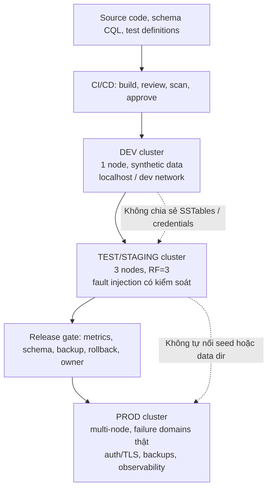

# Tách môi trường phát triển, kiểm thử và vận hành

## 1. Tại sao Cassandra cần môi trường độc lập?

Apache Cassandra là cơ sở dữ liệu **wide-column phân tán**. Dữ liệu được đặt lên những node sở hữu token của **partition key** và nhân bản theo chính sách của **keyspace**. Một thay đổi nhỏ như sửa replication factor, seed, snitch, địa chỉ broadcast, chiến lược compaction hay cách chạy repair có thể ảnh hưởng nhiều node và nhiều ứng dụng. Do đó, **môi trường phát triển (development), kiểm thử (test/staging) và vận hành thực tế (production)** phải có ranh giới rõ ràng.

Bài này không chỉ đặt tiền tố `dev_` và `prod_` cho tên bảng. Mục tiêu là thiết kế **các Cassandra cluster độc lập**, có network, volume, dữ liệu, tài khoản và vòng đời triển khai riêng. Người học sẽ sử dụng CQL để xác nhận cluster thực sự được truy cập, mô hình hóa bảng theo truy vấn, cấu hình local datacenter cho Java Driver và kiểm tra trước khi chạy tác vụ có rủi ro.

Sau bài học, bạn có thể:

1. Giải thích vì sao **ba keyspace trong một cluster** không tương đương với **ba môi trường độc lập**.
2. Thiết kế ma trận dev/test/prod về cluster identity, RF/CL, mạng, datacenter, bảo mật, tài nguyên, dữ liệu, backup và quyền thao tác.
3. Dựng **dev một node** và **test ba node** bằng Docker với tên, network và volume tách biệt, không để node test join nhầm dev.
4. Viết một schema CQL dùng chung nhưng chọn replication theo **datacenter thực** của từng môi trường; tạo dữ liệu mẫu tổng hợp thay vì dùng dữ liệu khách hàng.
5. Kết nối từ ứng dụng Java bằng contact point, local datacenter và credentials **của đúng môi trường**.
6. Xây dựng quy trình promote schema/app từ dev → test → production với các điểm kiểm soát, đặc biệt khi thay đổi partition key, replication và compaction.
7. Phân biệt kiểm thử lỗi node, repair/backup trong lab với vận hành production có approval, giám sát và kế hoạch khôi phục.

> **Nguyên tắc an toàn:** ví dụ có thể thực thi trong bài chỉ tạo/dừng **cluster lab mới**, không thực hiện hành động nào trên production. Tên cluster khác nhau chưa đủ tạo cô lập; mọi endpoint, volume, secret và khả năng thao tác của công cụ cũng phải độc lập.

## 2. Ba môi trường không nên dùng chung Cassandra cluster

### 2.1. Sơ đồ đề xuất



Luồng **source code/schema** có thể được promote từ dev sang test rồi prod sau khi đạt kiểm tra; **dữ liệu node, commitlog, system keyspaces, credentials và Docker volume không được promote bằng cách copy/mount vào node khác**.

### 2.2. Vì sao “một cluster, ba keyspace” không đủ?

Giả sử một cluster chứa `app_dev`, `app_test` và `app_prod`. Các keyspace có thể có RF khác nhau, nhưng vẫn dùng chung:

- **Node/JVM, heap, CPU, đĩa, commitlog, cache, compaction queue** và băng thông internode.
- **Gossip ring, seed, listen/broadcast address**, token ownership và lịch thay node.
- Các hành động vận hành cấp node như restart, nâng cấp, disk full, cấu hình TLS và một số lệnh `nodetool`.
- Một số bề mặt quyền: người có đủ quyền quản trị cluster có thể tác động lên nhiều keyspace.
- Rủi ro do một bài test tải nặng, dữ liệu tombstone lớn, compaction/repair hoặc cấu hình sai ảnh hưởng tới ứng dụng khác.

Do đó, **phân keyspace chỉ tách schema/quyền ở cấp tài nguyên**, không tách failure domain hay tài nguyên server. Nếu yêu cầu test an toàn mà vẫn bảo vệ production, lựa chọn đúng là **cluster riêng** và **quyền truy cập riêng**.

| Tình huống | Dùng một cluster chung | Dùng cluster dev/test/prod riêng |
|---|---|---|
| Developer chạy `TRUNCATE` nhầm bảng | Có thể xóa dữ liệu của keyspace bị trỏ nhầm | Khả năng tiếp cận prod cần bị chặn từ dev; tác động chủ yếu ở lab |
| Test tạo tombstone/partition rất lớn | Cạnh tranh cùng CPU/disk/compaction production | Test có tài nguyên, lịch dọn và cảnh báo riêng |
| Thử mất một node hoặc `nodetool repair` | Có thể ảnh hưởng SLA của prod trên cùng node/ring | Thực hiện trên node/volume độc lập |
| Nâng cấp thử Cassandra/driver | Khó thử với cluster chung mà không ảnh hưởng client thật | Thử compatibility trước khi promote |
| Lỗi cấu hình seed/broadcast | Có nguy cơ làm gián đoạn cluster đang phục vụ | Bị giới hạn vào môi trường có network/secret riêng |

## 3. Ma trận thiết kế dev, test/staging và production

| Tiêu chí | Development (DEV) | Integration/Test/Staging (TEST) | Production (PROD) |
|---|---|---|---|
| Mục tiêu | CQL và mô hình wide-column, chạy unit/integration nhanh | Tích hợp Java, RF/CL, phục hồi node, tải và regression | SLO, tính liên tục và dữ liệu thật |
| Node | 1 node trong Docker/VM thường đủ cho CQL | Ít nhất 3 node cho bài RF=3/LOCAL_QUORUM | Nhiều node trải **failure domain thật**, theo tải và yêu cầu HA |
| Cluster name ví dụ | `pe011-dev` | `pe011-test` | `company-prod-cassandra` (tên minh họa, không cấu hình thực) |
| Datacenter ví dụ | `dc_dev` | `dc_test` | `dc_prod_a`, có thể nhiều DC |
| Keyspace demo | `telemetry_lab`, RF=1 | `telemetry_lab`, RF=3 | Keyspace nghiệp vụ với RF theo topology thật |
| Network | Host loopback/dev network riêng | Private test network, port không publish tùy tiện | Private segment, firewall, VPN/bastion theo kiểm soát |
| Volume | Named volume riêng, có thể reset có chủ đích | Một volume/node, giữ qua thử restart | Storage phù hợp I/O, backup, capacity và DR |
| Dữ liệu | Tổng hợp, không chứa thông tin cá nhân | Synthetic/anonymized được chấp thuận, có độ lớn/phân phối đại diện | Dữ liệu thật, chính sách bảo vệ và giữ/xóa |
| Auth/TLS | Lab cô lập tối giản; không đưa ra mạng chung | Nên phản ánh auth/TLS prod cho test integration/security | Bắt buộc thiết kế auth, authorization, TLS, phân quyền tối thiểu |
| Tài khoản | Role dev riêng | Role test riêng | Role app, vận hành, backup, break-glass riêng và audit |
| CL | `LOCAL_ONE` ở RF=1 | Thử `LOCAL_ONE`, `LOCAL_QUORUM`, `ALL` theo case | Theo SLA/semantics từng request, đã đo trade-off |
| Dừng node/repair | Có thể thử nếu lab của mình | Chaos/failover theo kịch bản, có rollback | Chỉ theo change/incident runbook đã phê duyệt |
| Reset dữ liệu | Có thể xóa **volume lab xác định rõ** | Có quy trình reset fixture, không phá dữ liệu của nhóm khác | Không có thao tác “reset toàn bộ” tùy tiện |

**Staging** có thể là môi trường thứ tư tách khỏi integration test nếu cần dữ liệu/quy mô/kiểm soát gần production. Khi đó staging cũng là **cluster riêng**, không phải “cấp quyền dev vào cluster prod để test”. Quy mô test nhỏ vẫn mô phỏng được **failure semantics**, nhưng không đo được hiệu năng production chỉ vì dùng RF giống nhau.

## 4. Những ranh giới bắt buộc phải tách

### 4.1. Cluster identity, seed và topology

Các môi trường cần tên cluster và seed list riêng. `cluster_name` chỉ là một lớp kiểm soát; cần kết hợp **network segregation**, peer connectivity và bootstrap đúng thứ tự.

| Mục | DEV | TEST | PROD |
|---|---|---|---|
| `cluster_name` | `pe011-dev` | `pe011-test` | Giá trị production do đội vận hành quản lý |
| `seed_provider/seeds` | Node dev của chính cluster đó | Chỉ seed thuộc test | Chỉ seed thuộc production |
| `listen_address`/`broadcast_address` | Địa chỉ node dev trên dev network | IP node test, route giữa các test node | IP/node DNS riêng của production, ổn định |
| `rpc_address`/`broadcast_rpc_address` | Bind/advertise phù hợp client dev | App test truy cập được node test | App production truy cập đúng các node được công bố |
| `data_file_directories` | Volume riêng của dev | Ba volume riêng, một/node | Storage riêng trên host/node prod |

**Seed không phải master/leader.** Một node mới có thể tìm cluster qua seed, nhưng không được lấy seed của môi trường khác làm “điểm kết nối chung”. Hai cluster có tên khác nhau không nên có đường internode tới nhau. Đặc biệt, **không dùng chung data directory/commitlog** để “sao chép nhanh môi trường”: Cassandra lưu định danh node, system metadata và SSTables theo quy tắc cluster.

### 4.2. Cổng và mạng

- **`7000/TCP`**: internode/gossip/streaming cần giữa các node **cùng cluster**.
- **`9042/TCP`**: CQL native protocol cho `cqlsh` và Java Driver của **đúng môi trường**.
- **`7199/TCP`**: JMX cho `nodetool`; giữ nội bộ, không công khai ra internet.
- `rpc_address` là **địa chỉ bind CQL**, còn `broadcast_rpc_address` là **địa chỉ được công bố** cho client/driver. Contact point ban đầu có thể kết nối được nhưng Java Driver vẫn lỗi nếu các peer được quảng bá bằng IP không định tuyến được.

Docker **user-defined bridge network** hỗ trợ DNS nội bộ và tách các nhóm container không dùng chung bridge, nhưng **không phải một security boundary tuyệt đối** trước người có quyền quản trị Docker host. Container trên cùng network có thể liên hệ các cổng nội bộ của nhau; port publish có thể mở thêm đường vào từ host. Production cần kiểm soát network/host/identity ở cấp hạ tầng phù hợp.

### 4.3. Secrets, IAM và dữ liệu

- Mỗi môi trường dùng **credentials, certificate, keystore/truststore và quyền RBAC riêng**. Developer không có lý do đăng nhập production bằng superuser.
- Không dùng mật khẩu `cassandra/cassandra` mặc định làm tài khoản vận hành. Production cần bật `PasswordAuthenticator`/cơ chế phù hợp, `CassandraAuthorizer`, TLS client và internode, firewall và bảo vệ JMX.
- `system_auth` chứa role/permission, cần replication theo datacenter đủ để hỗ trợ login khi node hỏng; hướng dẫn Apache thường khuyến nghị RF **3–5** ở cluster đủ node.
- **Không sao chép nguyên bảng production sang dev/test**: dữ liệu có thể chứa thông tin cá nhân hoặc bí mật. Nếu bắt buộc dùng mẫu thống kê từ production, phải qua quy trình phê duyệt, tối thiểu hóa và **khử định danh được kiểm chứng**, bao gồm free text, partition keys và metadata.
- Một node/volume lab không thể đóng vai trò backup/replica của production. **Backup/restore và retention** phải được thiết kế độc lập.

## 5. Phiên bản, cấu hình và nguyên tắc tái lập

### 5.1. Dùng một baseline có thể kiểm chứng

Trong các lệnh dưới đây, bản demo ghim **`cassandra:5.0.9`**. Đây là **mốc lab**, không phải tuyên bố phiên bản mới nhất mọi thời điểm. Ghi rõ:

- Cassandra server patch version và image digest/package checksum.
- JDK của server, JDK 17 của ứng dụng Java và Apache Cassandra Java Driver 4.x được lựa chọn/kiểm thử.
- Schema revision, migration ID, cấu hình `cassandra.yaml`/`cassandra-rackdc.properties`, JVM options, logging, TLS/auth.
- Cluster/datacenter, seed/listen/broadcast, volume và retention của từng môi trường.

**Không khẳng định tương thích chỉ vì tất cả đều có số “4” hoặc “5”.** CQL spec version, native protocol version, Cassandra server version và Java Driver library version là bốn khái niệm khác nhau. Khi nâng cấp, kiểm tra release notes và khả năng hỗ trợ rolling upgrade của **nhánh server thực tế**.

### 5.2. Chia cấu hình làm hai phần

| Phần nên giữ giống nhau (logic/hợp đồng) | Phần phải cấu hình riêng theo môi trường |
|---|---|
| Tên bảng, primary key, kiểu dữ liệu, query patterns đã được review | Cluster name, host/seed/broadcast IP, port và client contact points |
| Quy tắc data validation và migration có thể chạy lặp | Datacenter/rack thực, replication RF theo topology |
| Tên quyền cần cho app: SELECT/MODIFY theo bảng | Role/password/certificate/secret store và cấp quyền thật |
| Cơ chế dùng Java `CqlSession`, metrics, retry có giới hạn | Timeout/CL, connection pool, hạ tầng và SLO |
| Bộ test fixture tổng hợp và các assertion | Dung lượng đĩa, backup retention, lịch repair, compaction tuning |

Không đưa lệnh `CREATE KEYSPACE ... 'dc_dev':1` từ dev sang production rồi thay tên cluster. **Schema bảng** có thể giống nhau; **replication map của keyspace phải phù hợp DC/RF thật** của từng nơi.

Một ví dụ kiến trúc lưu cấu hình trong repository **do người học tự quản lý** (bài này không tạo thêm file):

```text
config/
  common/       # schema CQL và query contract
  dev/          # endpoint, dc, RF1; secret reference cho dev
  test/         # endpoint, dc, RF3; test gates
  production/   # reference đến secret manager; không chứa secret plaintext
migrations/
  001_create_tables.cql
  002_add_new_column.cql
tests/
  synthetic-fixtures.cql
  cassandra-integration-tests/
```

## 6. Thực hành DEV: một cluster riêng, một node

### 6.1. Chuẩn bị

Lệnh thực hành chạy **trên host có Docker Engine/Desktop chạy Linux containers**. Bắt đầu với host có RAM/CPU/SSD phù hợp; một node lab thuận tiện khi host tổng khoảng **8 GiB RAM trở lên**, container được cấp khoảng 4 GiB (heap JVM 2 GiB). Đây là mốc học tập, không phải sizing production.

Ví dụ chọn host port **9271** để tránh đụng lab khác. Lệnh được viết một dòng để dùng được từ Bash hoặc Windows PowerShell:

```bash
docker version
docker pull cassandra:5.0.9
docker network create pe011-dev-net
docker volume create pe011_dev_data
```

Nếu network, container hoặc volume trùng tên **đã tồn tại**, hãy kiểm tra trước. Bài giả định đây là các đối tượng **mới, không chứa dữ liệu**. Không xóa volume hiện hữu nếu chưa biết chủ sở hữu.

### 6.2. Khởi động node DEV

```bash
docker run -d --name pe011-dev-n1 --network pe011-dev-net --memory=4g --memory-swap=4g -e MAX_HEAP_SIZE=2G -e CASSANDRA_CLUSTER_NAME=pe011-dev -e CASSANDRA_ENDPOINT_SNITCH=GossipingPropertyFileSnitch -e CASSANDRA_DC=dc_dev -e CASSANDRA_RACK=rack1 -p 127.0.0.1:9271:9042 -v pe011_dev_data:/var/lib/cassandra cassandra:5.0.9
```

DEV dùng tên cluster `pe011-dev`, DC `dc_dev`, named volume `pe011_dev_data`, bridge `pe011-dev-net`. Cổng CQL host được publish **chỉ trên loopback** cho mục tiêu lab; không đưa cấu hình không auth/TLS này ra LAN hoặc internet.

Kiểm tra readiness:

```bash
docker ps -a --filter name=pe011-dev-n1
docker logs --tail 100 pe011-dev-n1
docker exec pe011-dev-n1 nodetool status
docker exec pe011-dev-n1 nodetool statusbinary
docker exec pe011-dev-n1 cqlsh -e "SELECT cluster_name, data_center, rack, host_id, release_version FROM system.local;"
```

Đợi node hiện **`UN`**, native transport là **`running`** và câu CQL trả `cluster_name=pe011-dev`, `data_center=dc_dev`. `docker run -d` trả về container ID **không có nghĩa** CQL đã sẵn sàng.

### 6.3. Keyspace riêng trong cluster DEV

Mở cqlsh:

```bash
docker exec -it pe011-dev-n1 cqlsh
```

Chạy:

```sql
CREATE KEYSPACE IF NOT EXISTS telemetry_lab
WITH replication = {
  'class': 'NetworkTopologyStrategy',
  'dc_dev': 1
};

CREATE TABLE IF NOT EXISTS telemetry_lab.events_by_device_day (
  device_id text,
  event_day date,
  event_time timestamp,
  event_id uuid,
  event_type text,
  PRIMARY KEY ((device_id, event_day), event_time, event_id)
) WITH CLUSTERING ORDER BY (event_time DESC, event_id ASC);

INSERT INTO telemetry_lab.events_by_device_day
  (device_id, event_day, event_time, event_id, event_type)
VALUES (
  'synthetic-dev-001', '2026-11-21', '2026-11-21T08:00:00Z',
  10000000-0000-4000-8000-000000000001, 'dev-created'
);

SELECT event_time, event_id, event_type
FROM telemetry_lab.events_by_device_day
WHERE device_id = 'synthetic-dev-001'
  AND event_day = '2026-11-21';
```

Ở bảng này, **`(device_id,event_day)` là composite partition key**, `event_time` và `event_id` là clustering keys. Truy vấn lọc đúng partition giúp Cassandra định tuyến dữ liệu hiệu quả. Dữ liệu có nhãn `synthetic-` để người học không nhầm với thông tin từ production.

**RF=1** của `dc_dev` chỉ dùng cho học CQL. Không dùng để đánh giá replica failover hoặc điều kiện `LOCAL_QUORUM` khi một node mất: khi node duy nhất chết, cluster không còn replica sẵn sàng.

## 7. Thực hành TEST: cluster ba node hoàn toàn khác DEV

### 7.1. Vì sao TEST cần ba node?

Để kiểm tra replication và consistency ở mức có ý nghĩa, cần ba node riêng trong một datacenter và keyspace RF=3. Khi đó `LOCAL_QUORUM` cần **2 phản hồi**, `ALL` cần **3 phản hồi**. Mất một node nhưng hai node còn khỏe có thể vẫn phục vụ `LOCAL_QUORUM`; `ALL` không đáp ứng đủ replica.

Tài nguyên: khoảng **24 GiB RAM host** sẽ thuận tiện cho ba container giới hạn 4 GiB cùng hoạt động, cộng Docker/OS/ứng dụng. Đây là số tham khảo; người học chỉ dựng TEST khi host có đủ nguồn lực. **Ba container trên một host không là ba failure domain vật lý**, và dữ liệu lab không có yêu cầu bảo mật/durability của production.

### 7.2. Network và ba volume của TEST

Chạy trên host (để DEV tồn tại cũng được nếu đủ tài nguyên, nhưng cần tính tổng RAM/CPU):

```bash
docker network create pe011-test-net
docker volume create pe011_test_n1
docker volume create pe011_test_n2
docker volume create pe011_test_n3
```

**Không dùng `pe011-dev-net` hoặc `pe011_dev_data` trong các lệnh TEST**. Mỗi node test cần volume riêng để lưu system metadata/host ID/token/SSTable và commitlog riêng.

### 7.3. Khởi động từng node và chờ bootstrap

Chạy **n1 trước**:

```bash
docker run -d --name pe011-test-n1 --network pe011-test-net --memory=4g --memory-swap=4g -e MAX_HEAP_SIZE=2G -e CASSANDRA_CLUSTER_NAME=pe011-test -e CASSANDRA_ENDPOINT_SNITCH=GossipingPropertyFileSnitch -e CASSANDRA_DC=dc_test -e CASSANDRA_RACK=rack1 -v pe011_test_n1:/var/lib/cassandra cassandra:5.0.9
```

Đợi n1 hiện `UN` và nhận CQL:

```bash
docker exec pe011-test-n1 nodetool status
docker exec pe011-test-n1 nodetool statusbinary
docker exec pe011-test-n1 cqlsh -e "SELECT cluster_name, data_center FROM system.local;"
```

Sau đó mới khởi động **n2** với seed thuộc **TEST**:

```bash
docker run -d --name pe011-test-n2 --network pe011-test-net --memory=4g --memory-swap=4g -e MAX_HEAP_SIZE=2G -e CASSANDRA_CLUSTER_NAME=pe011-test -e CASSANDRA_SEEDS=pe011-test-n1 -e CASSANDRA_ENDPOINT_SNITCH=GossipingPropertyFileSnitch -e CASSANDRA_DC=dc_test -e CASSANDRA_RACK=rack2 -v pe011_test_n2:/var/lib/cassandra cassandra:5.0.9
docker exec pe011-test-n1 nodetool status
docker exec pe011-test-n2 nodetool status
```

Đợi n1/n2 cùng nhìn thấy **hai dòng `UN`**. Khi hoàn tất, thêm **n3**:

```bash
docker run -d --name pe011-test-n3 --network pe011-test-net --memory=4g --memory-swap=4g -e MAX_HEAP_SIZE=2G -e CASSANDRA_CLUSTER_NAME=pe011-test -e CASSANDRA_SEEDS=pe011-test-n1 -e CASSANDRA_ENDPOINT_SNITCH=GossipingPropertyFileSnitch -e CASSANDRA_DC=dc_test -e CASSANDRA_RACK=rack3 -v pe011_test_n3:/var/lib/cassandra cassandra:5.0.9

docker exec pe011-test-n1 nodetool status
docker exec pe011-test-n2 nodetool status
docker exec pe011-test-n3 nodetool status
```

Trước khi tiến hành CQL, tất cả ba node phải thấy **ba dòng `UN`** dưới datacenter `dc_test`. Khi một node còn `UJ` (*Joining*) hoặc `DN` (*Down*), kiểm tra log và mạng internode; không sửa dữ liệu/cấu hình tùy tiện để ép vào ring.

**Lưu ý seed:** `CASSANDRA_SEEDS` chỉ là cơ chế discovery, không biến n1 thành leader/master. Một số phiên bản Docker Official Image có thể thêm địa chỉ node hiện tại vào seed list khi khởi động; trong thực hành, đọc lại cấu hình hiệu lực khi cần so sánh vai trò seed chính xác. Với production dùng cấu hình seed đã kiểm soát và nhiều seed thích hợp.

### 7.4. Xác nhận TEST không phải DEV

```bash
docker exec pe011-test-n1 cqlsh -e "SELECT cluster_name, data_center, host_id FROM system.local;"
docker exec pe011-test-n2 cqlsh -e "SELECT cluster_name, data_center, host_id FROM system.local;"
docker exec pe011-test-n3 cqlsh -e "SELECT cluster_name, data_center, host_id FROM system.local;"
docker exec pe011-test-n1 cqlsh -e "SELECT peer, data_center, host_id FROM system.peers_v2;"
docker network inspect pe011-test-net
docker network inspect pe011-dev-net
```

Kỳ vọng TEST có `cluster_name=pe011-test`, DC `dc_test`, **ba host ID riêng**, và mỗi node biết hai peer cùng cluster. DEV vẫn có `cluster_name=pe011-dev`, DC `dc_dev`, không phải thành viên của ring test.

`docker network inspect` cho thấy các container gắn vào network. Kiểm tra các tên dev **không xuất hiện trong pe011-test-net** và ngược lại. Tuy nhiên, quyền admin trên Docker host vẫn có thể thêm container vào network khác; nên network chỉ là **một lớp** cô lập.

### 7.5. Keyspace TEST có cùng schema nhưng RF khác

Mở cqlsh trên n1 của TEST:

```bash
docker exec -it pe011-test-n1 cqlsh
```

Chạy **trên TEST**:

```sql
CREATE KEYSPACE IF NOT EXISTS telemetry_lab
WITH replication = {
  'class': 'NetworkTopologyStrategy',
  'dc_test': 3
};

CREATE TABLE IF NOT EXISTS telemetry_lab.events_by_device_day (
  device_id text,
  event_day date,
  event_time timestamp,
  event_id uuid,
  event_type text,
  PRIMARY KEY ((device_id, event_day), event_time, event_id)
) WITH CLUSTERING ORDER BY (event_time DESC, event_id ASC);

CONSISTENCY LOCAL_QUORUM;

INSERT INTO telemetry_lab.events_by_device_day
  (device_id, event_day, event_time, event_id, event_type)
VALUES (
  'synthetic-test-001', '2026-11-21', '2026-11-21T09:00:00Z',
  20000000-0000-4000-8000-000000000001, 'test-created'
);

SELECT event_time, event_type
FROM telemetry_lab.events_by_device_day
WHERE device_id = 'synthetic-test-001'
  AND event_day = '2026-11-21';
```

Lưu ý:

- **Tên keyspace/table cố ý giống DEV** để minh họa hợp đồng schema có thể dùng lại; việc chúng tồn tại **trên hai cluster khác nhau** mới làm dữ liệu độc lập.
- `dc_test:3` khác `dc_dev:1`. Hai replication map này không thể hoán đổi tùy tiện.
- `CREATE KEYSPACE IF NOT EXISTS` không thay replication khi keyspace tồn tại; sau khi tạo phải `DESCRIBE KEYSPACE telemetry_lab` hoặc đọc `system_schema.keyspaces`.
- `LOCAL_QUORUM` trong TEST cần 2/3 replica phản hồi; ở DEV RF=1, nó không kiểm chứng được mô hình failover hai replica còn sống.
- Khi chạy lại INSERT với cùng primary key, row không tăng vô hạn, nhưng **mutation timestamp vẫn có thể đổi**. Tránh nhầm idempotent theo key với một thao tác không có tác động lưu trữ.

### 7.6. Thử một tình huống mất node có giới hạn

Chỉ thực hiện trên **TEST** sau khi cả ba đã `UN` và dữ liệu baseline đã ghi:

```bash
docker stop --time 120 pe011-test-n3
docker exec pe011-test-n1 nodetool status
docker exec pe011-test-n2 nodetool status
```

Sau khi gossip/failure detector cập nhật, n3 có thể xuất hiện `DN`. Trên n1:

```bash
docker exec -it pe011-test-n1 cqlsh
```

Trong cqlsh:

```sql
CONSISTENCY LOCAL_QUORUM;

SELECT event_type
FROM telemetry_lab.events_by_device_day
WHERE device_id = 'synthetic-test-001'
  AND event_day = '2026-11-21';

CONSISTENCY ALL;

SELECT event_type
FROM telemetry_lab.events_by_device_day
WHERE device_id = 'synthetic-test-001'
  AND event_day = '2026-11-21';
```

Khi n1/n2 đều khỏe, SELECT ở `LOCAL_QUORUM` **có thể** thành công; `ALL` khi n3 down **không đủ ba replica** và thường trả lỗi unavailable/timeout. Không kết luận mọi lỗi CQL đều do CL: cần kiểm tra topology, RF, network, disk và log.

Khôi phục n3:

```bash
docker start pe011-test-n3
docker exec pe011-test-n3 nodetool status
docker exec pe011-test-n1 nodetool status
```

Đợi mọi node `UN` rồi thử lại. Trong bài này **không** chạy repair hoặc chaos trên production. Nếu cần tìm hiểu hints/repair sâu, dùng riêng runbook lab và xác định rõ phạm vi/tác động CPU/disk/network.

## 8. Bảo vệ việc cấp quyền giữa các môi trường

### 8.1. Không dùng chung account quản trị

| Vai trò | DEV | TEST | PROD |
|---|---|---|---|
| App reader | Role dev chỉ SELECT dữ liệu dev | Role test chỉ SELECT fixture test | Role production chỉ SELECT các bảng được phép |
| App writer | Role dev có `MODIFY` trên bảng dev | Role test có `MODIFY` trên bảng test | Role production giới hạn theo resource/app |
| Schema migrator | Có thể tự thử DDL | CI role được phép DDL trên test | Role triển khai riêng, cần approval và audit |
| Operator | Có thể dừng node lab được sở hữu | Có quyền fault injection theo test plan | Quyền vận hành qua on-call/change control |
| Backup/restore | Dùng dữ liệu lab để kiểm tra quy trình | Restore thử ở cluster riêng | Quyền và keys backup production tách khỏi dev/test |

Với Cassandra mặc định, `AllowAllAuthenticator` và `AllowAllAuthorizer` **không yêu cầu login và không kiểm tra quyền**. Do đó, chỉ đặt một tên role là `dev_app` hoặc `prod_app` **không đủ** tạo ranh giới. Muốn kiểm thử least privilege, phải bật authentication/authorization đúng cách và xác minh những thao tác **bị từ chối**. Mọi lời khuyên bảo mật production cần kiểm tra TLS, network internode và JMX, không chỉ mật khẩu cqlsh.

### 8.2. Ví dụ quyền tối thiểu sau khi auth/authorizer đã bật

Đây là đoạn CQL **minh họa** mà **một superuser của môi trường TEST được phép** thực thi sau khi CassandraAuthorizer và PasswordAuthenticator đã được cấu hình và đã có credentials riêng cho TEST:

```sql
-- Không chạy trực tiếp nếu server vẫn dùng AllowAllAuthenticator/AllowAllAuthorizer.
CREATE ROLE IF NOT EXISTS test_telemetry_reader
WITH LOGIN = true AND SUPERUSER = false
AND PASSWORD = 'REPLACE_WITH_PRIVATE_TEST_SECRET';

GRANT SELECT ON TABLE telemetry_lab.events_by_device_day
TO test_telemetry_reader;

LIST ALL PERMISSIONS OF test_telemetry_reader;
```

Phải **thay** chuỗi secret demo trước khi thực thi; trong thực tế, đưa plaintext password vào CQL/cqlsh history/audit cũng có rủi ro. Ví dụ này để giải thích cấu trúc role/quyền, **không** phải kịch bản hoàn chỉnh để tự bật auth/TLS. Không lưu mật khẩu production trong source/config được chia sẻ.

Khi bật `CassandraAuthorizer`, có thể thử:

1. Role reader SELECT đúng bảng **thành công**.
2. Role reader INSERT hoặc DROP bảng **bị từ chối**.
3. App TEST đăng nhập vào TEST bằng secret TEST; không chấp nhận secret production hoặc account admin mặc định.

`GRANT MODIFY` bao gồm những thao tác thay đổi dữ liệu như INSERT/UPDATE/DELETE trên resource, không phải một permission “chỉ cho INSERT”. Nếu ứng dụng cần quyền append-only, cần cơ chế kiểm soát ở lớp ứng dụng/kiến trúc phù hợp ngoài Cassandra table permission.

## 9. Ứng dụng Java: endpoint/DC phải được chọn theo môi trường

### 9.1. Tại sao không hard-code cluster sản xuất?

Java Driver 4.x sử dụng **contact points** ban đầu, đọc topology metadata, sau đó có thể kết nối các node khác trong cluster. Một đoạn mã chứa cứng IP production có thể khiến **test viết nhầm dữ liệu thật**, đặc biệt nếu credentials được tái sử dụng.

| Biến cấu hình ứng dụng (ví dụ) | DEV | TEST | PROD |
|---|---|---|---|
| `CASSANDRA_CONTACT_POINT` | `127.0.0.1` từ host dùng port 9271 | `pe011-test-n1` từ container cùng test network, port 9042 | Hostname private production do hạ tầng quản lý |
| `CASSANDRA_PORT` | `9271` trên host, `9042` bên trong dev container | `9042` | Native transport port thật của production |
| `CASSANDRA_LOCAL_DC` | `dc_dev` | `dc_test` | Datacenter local nơi ứng dụng chạy |
| `CASSANDRA_USERNAME/PASSWORD` | Role dev nếu bật auth | Role test có quyền tối thiểu | Lấy từ secret manager production |
| CL | Theo testcase dev RF=1 | `LOCAL_QUORUM` cho các case RF3 | Theo chính sách nghiệp vụ và SLO |

Địa chỉ **từ góc nhìn chương trình Java** mới quan trọng. Với Docker Desktop, host port mapping giúp app ở host truy cập một contact point, nhưng các địa chỉ node **broadcast RPC** của cluster Docker nhiều node có thể không route từ host. Với TEST, nên chạy Java app **trong `pe011-test-net`** hoặc thiết kế mạng cho phép driver truy cập mọi peer cần thiết. `localhost` trong container Java **không** phải container Cassandra.

### 9.2. Ví dụ Java Driver 4.x kiểm tra cluster mong đợi

Ví dụ Java 17 (dependency minh họa `org.apache.cassandra:java-driver-core:4.19.4`); chương trình lấy cấu hình **từ môi trường chạy ứng dụng**, không được mặc định hướng tới production:

```java
import java.net.InetSocketAddress;
import java.util.Objects;

import com.datastax.oss.driver.api.core.CqlSession;
import com.datastax.oss.driver.api.core.cql.Row;

public class CheckCassandraEnvironment {
    private static String required(String name) {
        String value = System.getenv(name);
        if (value == null || value.isBlank()) {
            throw new IllegalArgumentException("Missing environment variable: " + name);
        }
        return value;
    }

    public static void main(String[] args) {
        String host = required("CASSANDRA_CONTACT_POINT");
        int port = Integer.parseInt(required("CASSANDRA_PORT"));
        String dc = required("CASSANDRA_LOCAL_DC");
        String expectedCluster = required("EXPECTED_CASSANDRA_CLUSTER");

        try (CqlSession session = CqlSession.builder()
                .addContactPoint(new InetSocketAddress(host, port))
                .withLocalDatacenter(dc)
                .build()) {

            Row row = session.execute(
                "SELECT cluster_name, data_center, release_version " +
                "FROM system.local WHERE key='local'").one();
            if (row == null) {
                throw new IllegalStateException("No system.local metadata");
            }
            String actualCluster = row.getString("cluster_name");
            String actualDc = row.getString("data_center");
            if (!Objects.equals(expectedCluster, actualCluster)
                    || !Objects.equals(dc, actualDc)) {
                throw new IllegalStateException(
                    "Wrong Cassandra environment: " + actualCluster +
                    " / " + actualDc);
            }
            System.out.println("Validated cluster " + actualCluster +
                    ", DC " + actualDc + ", server " +
                    row.getString("release_version"));
        }
    }
}
```

Đây là **kiểm tra phòng vệ cơ bản**, không phải security boundary độc lập. Một cluster giả có cùng tên/DC hoặc credentials bị lộ vẫn có thể vượt kiểm tra; production cần TLS xác thực endpoint, ACL mạng và quyền tối thiểu. Ngoài ra, truy vấn `system.local` xác nhận **node đang được hỏi**, chưa chứng minh toàn bộ peer đều có đúng version/routing.

Ví dụ biến cấu hình theo môi trường **không chứa password**:

```text
DEV application running on host:
  CASSANDRA_CONTACT_POINT=127.0.0.1
  CASSANDRA_PORT=9271
  CASSANDRA_LOCAL_DC=dc_dev
  EXPECTED_CASSANDRA_CLUSTER=pe011-dev

TEST application container attached to pe011-test-net:
  CASSANDRA_CONTACT_POINT=pe011-test-n1
  CASSANDRA_PORT=9042
  CASSANDRA_LOCAL_DC=dc_test
  EXPECTED_CASSANDRA_CLUSTER=pe011-test
```

Nếu đã bật authentication, ví dụ Java trên cần bổ sung `withAuthCredentials(...)` hoặc cơ chế auth provider phù hợp và lấy secret **đúng môi trường**, tránh ghi plaintext trong code. Java Driver nên **tái sử dụng `CqlSession`**, không tạo session mới cho mỗi CQL/HTTP request.

## 10. Schema và dữ liệu phải được promote khác nhau

### 10.1. Quy trình thay đổi bảng theo truy vấn

Giả sử ứng dụng cần thêm trường `source` vào sự kiện. Cách an toàn hơn so với thay primary key:

```sql
-- Schema change minh họa; thử trên DEV rồi TEST trước.
ALTER TABLE telemetry_lab.events_by_device_day
ADD source text;
```

Một quy trình hợp lý:

1. **Thiết kế:** review kiểu query, kích thước partition, event volume, tác động lên token distribution. Đổi primary key thường cần **bảng mới và migration**, không thể sửa tùy ý như RDBMS.
2. **DEV:** áp migration trên cluster `pe011-dev`, chạy unit/integration cơ bản với dữ liệu synthetic.
3. **TEST:** chạy cùng migration code trên `pe011-test`, kiểm tra schema agreement, driver compatibility, rollback application và test RF3/CL.
4. **Review:** xác nhận hiệu năng, read/write path, auth/TLS, backward/forward compatibility giữa ứng dụng cũ và mới, nguy cơ repair/compaction.
5. **PROD:** chỉ account migrator/đội vận hành được cấp quyền áp dụng sau approval, backup và kế hoạch triển khai/quan sát.
6. **Sau triển khai:** kiểm tra CQL read/write, lỗi client, schema agreement, resource/latency/compaction; cập nhật tài liệu sự cố và audit.

**Schema migration nên idempotent nhưng không dựa vào `IF NOT EXISTS` để che schema drift.** Nếu bảng đã tồn tại khác primary key/compaction/column type mong đợi, câu lệnh `CREATE TABLE IF NOT EXISTS` có thể không làm gì. Hệ thống deploy phải **so sánh schema thực tế** và version migration chứ không chỉ kiểm tra exit code.

### 10.2. Dữ liệu synthetic và việc đối chiếu

| Dữ liệu | Được dùng ở DEV/TEST? | Lý do |
|---|---|---|
| Fixture tự sinh với ID cố định | **Có** | Dễ tái lập, so row count/timestamp/key |
| Dữ liệu mô phỏng có phân phối hot key, partition lớn, tombstone | **Có, trong TEST có giới hạn tài nguyên** | Thử hành vi thật của data model và compaction |
| Dữ liệu production copy nguyên bản | **Không** | Rủi ro quyền riêng tư, bí mật và pháp lý |
| Trích dữ liệu đã được phê duyệt, tối thiểu hóa/khử định danh | Chỉ theo quy trình kiểm soát | Cần đánh giá lại khả năng tái nhận diện và secret trong free text |
| SSTable/commitlog/system_auth của node production | **Không copy để tạo node test tùy ý** | Identity, schema, credentials, token và data format phụ thuộc cluster |

Nếu cần thử restore, tạo **cluster restore riêng biệt**, dùng bản backup đã phê duyệt và quy trình restore đúng Cassandra/version/topology; không gắn backup lên một node đang hoạt động rồi kết luận môi trường đã “tách”.

## 11. Release gates từ DEV → TEST → PROD

### 11.1. Bảng kiểm trước khi promote

| Gate | Bằng chứng tối thiểu | Quyết định |
|---|---|---|
| **Source/version** | Image/package server patch, Java Driver version, migration revision, image digest được ghi lại | Không deploy nếu không xác định artifact |
| **Target identity** | `system.local.cluster_name` và `data_center` đúng; hostnames/secret refs thuộc đúng môi trường | Chặn nhầm môi trường |
| **Schema** | CQL DDL, replication map của DC thật, primary/clustering key và query tests | Chặn schema drift và data model sai |
| **Security** | Auth/TLS, account non-superuser, SELECT được phép và thao tác trái quyền bị từ chối | Chặn exposure hoặc privilege escalation |
| **Functional** | Read/write/delete/TTL theo thiết kế, timeout/CL test có kết quả | Chặn lỗi hợp đồng dữ liệu |
| **Availability** | TEST RF3, n1/n2/n3 khỏe; mất một replica vẫn thử LOCAL_QUORUM thành công | Chặn cấu hình chỉ đúng khi tất cả node sống |
| **Load** | Latency/throughput, GC, CPU, disk, compaction, hot partitions với dữ liệu đại diện | Chặn quá tải được dự đoán |
| **Recovery** | Backup có kiểm chứng restore ở cluster riêng, lịch repair, runbook node failure | Chặn sản xuất không thể khôi phục |
| **Approval** | Reviewer, change window, rollback ứng dụng, post-deploy monitoring | Chặn tự động đẩy tác vụ nguy hiểm |

Đối với schema change có thể đọc được cả ứng dụng cũ/mới, áp dụng kiểu **expand → migrate/backfill có kế hoạch → chuyển traffic → contract**. Thay partition key hay drop column/table ngay trong lúc rolling deployment thường có nguy cơ làm code cũ thất bại; cần kiểm tra cả client đọc/ghi trong giai đoạn chuyển tiếp.

### 11.2. Tránh các lệnh nguy hiểm trong automation chung

Không dùng chung một script có quyền admin và **tự chọn** dev/test/prod dựa trên một biến mặc định mơ hồ. Các hành động có rủi ro cao phải có target/approval riêng:

- `TRUNCATE`/`DROP KEYSPACE`/`DROP TABLE` trên production.
- `nodetool repair`, `cleanup`, `decommission`, `removenode`, `drain` trên cluster thực.
- Chỉnh `num_tokens`, snitch, `listen_address`/`broadcast_address`, seed hay replication của keyspace có dữ liệu.
- Nâng cấp/hạ cấp Cassandra, đụng file SSTable/commitlog hoặc di chuyển data directory.

Trong CI, chạy CQL **với tài khoản/endpoint của TEST** thay vì dùng một token admin production ở mọi job. Không tự động “đồng bộ dữ liệu” bằng cách chép nguyên volume giữa môi trường.

## 12. Vận hành production: các yêu cầu không thể bỏ qua

Phần này là **checklist thiết kế**, không phải các lệnh thực thi trên production.

### 12.1. Topology, RF và CL thật

- Trải node trên **failure domains** như máy chủ/availability zone/rack thật; rack label phải phản ánh topology. Ba node trên cùng host không chịu được hỏng host.
- Dùng `NetworkTopologyStrategy` với RF theo datacenter, thường bắt đầu đánh giá RF=3 ở DC có đủ node; không có “RF tối ưu” bất biến cho mọi yêu cầu.
- Đặt seed đáng tin cậy ở các failure domains thích hợp; giữ `cluster_name`/partitioner/snitch nhất quán và địa chỉ peer route được.
- Ghi rõ CL theo từng operation: `LOCAL_ONE`, `LOCAL_QUORUM`, `ALL` có trade-off về latency/availability. Với RF3, quorum cần 2; đây không phải cam kết transaction tuyến tính cho mọi workflow.
- Lập kế hoạch partition key tránh hot/large partitions, tránh query cần `ALLOW FILTERING` trên dữ liệu lớn, và đánh giá TTL/tombstone/compaction.

### 12.2. Bảo mật, bảo vệ dữ liệu và quyền thao tác

Production không nên để cấu hình mặc định `AllowAllAuthenticator`/`AllowAllAuthorizer` hoặc CQL/JMX/internode public. Thiết kế từ đầu:

- Authentication và authorization; role app riêng với `SELECT`/`MODIFY` đúng tài nguyên, migrator riêng, account quản trị riêng; bảo vệ `system_auth`.
- Client/server TLS và internode encryption, quản lý certificate/truststore/secret rotation; kiểm thử driver trước rollout.
- Firewall/VPC/security group hạn chế 7000 giữa peer, 9042 từ app, JMX chỉ quản trị tin cậy.
- Audit logging, quản lý khóa, chính sách dữ liệu và retention phù hợp yêu cầu tổ chức.
- Không lưu plaintext secret trong source, Docker command history, log hoặc tài liệu có quyền đọc rộng.

**Authentication không bảo vệ được một cluster khi internode và JMX bị công khai**. Vì vậy cần xem toàn bộ bề mặt mạng và vận hành, không chỉ role CQL.

### 12.3. Dung lượng, compaction, repair và backup

| Vấn đề | DEV/TEST có thể đơn giản hóa | PROD cần kế hoạch |
|---|---|---|
| Storage | Docker named volumes nhỏ | SSD/I/O, OS, capacity headroom, disk alerts, layout data/commitlog |
| Compaction | Chạy test với dữ liệu tổng hợp | Chọn chiến lược theo workload, đo pending tasks, disk amplification và tombstones |
| Repair | Thử lệnh trong cluster test | Lịch anti-entropy repair có giám sát, phù hợp RF/GC grace và số node |
| Hints | Quan sát `listpendinghints` khi node down | Theo dõi pending hints, hiểu cửa sổ và best effort; không thay repair |
| Backup | Snapshot lab, không cần giữ lâu | Backup độc lập, versioned, encrypted, retention và **restore drill** |
| Time sync | Kiểm tra UTC/clock host | NTP/chrony toàn hệ, hiểu ảnh hưởng last-write-wins của mutation timestamp |
| Monitoring | Docker logs và `nodetool status` | Metrics time series, SLO, alert latency/error/heap/GC/disk/repair/hints |

**Snapshot ngay trên cùng volume chưa phải offsite backup**. Cassandra snapshot thường dựa trên SSTable hard links; muốn bảo vệ khi host/volume mất cần sao chép/duy trì backup ở nơi độc lập và tập phục hồi đã được kiểm chứng. Replica không thay thế backup khi dữ liệu bị xóa nhầm hoặc lỗi logic lan rộng.

### 12.4. Kế hoạch thay đổi và rollback

Trước thay đổi production, ghi **owner, phạm vi, tập lệnh, điều kiện bắt đầu, ngưỡng dừng, rollback, dashboard theo dõi và cách liên hệ on-call**. Với Cassandra, một số thay đổi dữ liệu/topology **không có rollback đơn giản chỉ bằng sửa YAML**: schema drop, thay partition key, token/rack/DC, đổi RF hoặc nâng cấp format có thể cần migration hoặc restore.

Đừng xem việc test `docker stop` trên một container là chứng minh rolling upgrade production an toàn. Điều kiện mạng, kích thước dữ liệu, compaction/repair backlog, quãng downtime và tải thực có thể khiến kết quả khác.

## 13. Kiểm chứng khả năng độc lập bằng các câu hỏi đơn giản

### 13.1. Kiểm tra từ hai cluster

Từ terminal host, nếu vẫn có cả DEV/TEST:

```bash
docker exec pe011-dev-n1 cqlsh -e "SELECT cluster_name, data_center FROM system.local WHERE key='local';"
docker exec pe011-test-n1 cqlsh -e "SELECT cluster_name, data_center FROM system.local WHERE key='local';"

docker exec pe011-dev-n1 cqlsh -e "SELECT keyspace_name, replication FROM system_schema.keyspaces WHERE keyspace_name='telemetry_lab';"
docker exec pe011-test-n1 cqlsh -e "SELECT keyspace_name, replication FROM system_schema.keyspaces WHERE keyspace_name='telemetry_lab';"

docker exec pe011-test-n1 nodetool status
docker inspect --format "{{range .Mounts}}{{.Name}} -> {{.Destination}}{{end}}" pe011-dev-n1
docker inspect --format "{{range .Mounts}}{{.Name}} -> {{.Destination}}{{end}}" pe011-test-n1
```

Kỳ vọng:

| Điều kiểm tra | DEV | TEST |
|---|---|---|
| `cluster_name` | `pe011-dev` | `pe011-test` |
| `data_center` | `dc_dev` | `dc_test` |
| `telemetry_lab` replication | `dc_dev:1` | `dc_test:3` |
| Ring | 1 node `UN` | 3 node `UN` |
| Volume n1 | `pe011_dev_data` | `pe011_test_n1` |
| Dữ liệu mẫu | `synthetic-dev-001` | `synthetic-test-001` |

Tên keyspace giống nhau nhưng nằm trong **hai cluster khác nhau**. Để kiểm tra đúng dữ liệu, phải query từ đúng nơi:

```bash
docker exec pe011-dev-n1 cqlsh -e "SELECT event_type FROM telemetry_lab.events_by_device_day WHERE device_id='synthetic-dev-001' AND event_day='2026-11-21';"
docker exec pe011-test-n1 cqlsh -e "SELECT event_type FROM telemetry_lab.events_by_device_day WHERE device_id='synthetic-test-001' AND event_day='2026-11-21';"
```

Một ứng dụng vô tình trỏ sai môi trường vẫn có thể thấy schema giống nhau và không báo lỗi ngay. Vì vậy ngoài việc đối chiếu câu SELECT, cần kiểm tra **identity + endpoint + secret + quyền** ở thời điểm deploy.

### 13.2. Kiểm tra cấu hình ứng dụng từ góc nhìn Java

Mục tiêu không chỉ “cqlsh trong container chạy được”, mà là **Java Driver từ vị trí chạy app** kết nối được đúng node. Với TEST, Java app trong `pe011-test-net` có thể dùng DNS `pe011-test-n1:9042` và các peer cùng network. Nếu app chạy trên host Windows/macOS, IP container do Cassandra quảng bá có thể không route được; không đánh dấu kết nối production đã ổn chỉ dựa vào một contact point ở localhost được NAT.

Giá trị `EXPECTED_CASSANDRA_CLUSTER` giúp fail-fast khi sai môi trường nhưng không thay thế firewall/TLS/RBAC và quy trình duyệt deploy.

## 14. Những lỗi thường gặp và cách nhận biết

| Dấu hiệu | Nguyên nhân có thể | Cách xử lý |
|---|---|---|
| App dev đọc dữ liệu production | Contact point/secret/default config sai; hai môi trường dùng chung credentials | Ngừng ghi, xác nhận target từ config/`system.local`, khóa quyền sai, điều tra dữ liệu đã tác động |
| Hai keyspace dev/prod trên cùng cluster | Nhầm **logical namespace** với **môi trường độc lập** | Tách cluster/network/credential/volume thật; lên kế hoạch migration dữ liệu được phép |
| TEST node join nhầm DEV hoặc không vào ring | Seeds/network/cluster identity cấu hình sai | Kiểm tra `CASSANDRA_SEEDS`, `cluster_name`, `docker network inspect`, logs; không ghép system data bằng cách đổi tên |
| DEV `UN` nhưng TEST `LOCAL_QUORUM` thất bại | TEST chưa đủ 3 node `UN`, RF/DC sai hoặc hai replica không khỏe | `nodetool status` từ test node, `DESCRIBE KEYSPACE`, logs |
| Java đọc được contact point nhưng lỗi khi truy cập peer | `broadcast_rpc_address`/DNS không route được từ nơi chạy app | Chạy app đúng network, kiểm tra metadata endpoints, firewall, driver logs |
| `CREATE KEYSPACE IF NOT EXISTS` không đổi RF | Keyspace đã có replication cũ | Kiểm tra `system_schema.keyspaces` và dùng migration được review, không đoán |
| Dùng cùng volume cho dev/test | Trùng data directory/host ID/system tables | Không cho hai node Cassandra dùng một volume; mỗi node độc lập từ lúc bootstrap |
| Chỉ bật auth trong prod, TEST vẫn allow-all | Integration tests không phát hiện lỗi credential/permission/TLS | Có test/staging bảo mật tương ứng prod và kiểm tra denial cases |
| Dùng dữ liệu production cho load test | Không khử định danh/thiếu phê duyệt, có secret trong payload | Dùng synthetic generator, bảo vệ data governance, tránh copy raw SSTables |
| Script tự động chạy `TRUNCATE` nhầm cluster | Không kiểm tra target/identity trước tác vụ | Tách credentials, fail closed khi không rõ target, approval cho thao tác nguy hiểm |
| TEST đạt latency nhưng PROD chậm | Test khác kích thước dữ liệu, hot key, rack, RF, disk hoặc compaction | Dùng workload đại diện, đo metrics và hiệu chỉnh capacity |
| Backup có nhưng restore thất bại | Chỉ chụp snapshot cùng volume, thiếu schema/topology/keys hoặc chưa tập phục hồi | Restore drill ở cluster riêng, kiểm tra thời gian/phạm vi và tính toàn vẹn |
| Production `UN` nhưng lỗi query | Native transport, auth/TLS, CL, hot partitions, disk/GC, repair backlog | Quan sát từ phía app và server: `statusbinary`, query errors, metrics, logs, schema |

**Thứ tự chẩn đoán:** xác minh **đúng cluster** → network/contact point → topology/RF/CL → auth/TLS/permissions → query/partition key → tài nguyên/compaction/repair → dữ liệu/backup. Không “sửa” lỗi nhầm môi trường bằng việc tăng timeout hoặc cấp mọi quyền cho ứng dụng.

## 15. Dọn lab mà không động tới production

**Chỉ thực thi khi các container `pe011-*` đúng là lab do bạn vừa tạo**, không có ứng dụng khác sử dụng, đã ghi nhận dữ liệu và đã khôi phục node test n3 nếu vừa thử failover.

Nếu muốn **giữ dữ liệu**, chỉ dừng container:

```bash
docker stop pe011-test-n3
docker stop pe011-test-n2
docker stop pe011-test-n1
docker stop pe011-dev-n1

docker volume ls
```

Nếu đã xác minh không cần giữ **container** nhưng vẫn muốn giữ **volume**:

```bash
docker rm pe011-test-n3 pe011-test-n2 pe011-test-n1 pe011-dev-n1
docker network rm pe011-test-net
docker network rm pe011-dev-net
docker volume ls
```

Các lệnh trên không xóa named volumes. **Không** chạy `docker volume prune` hoặc `docker volume rm` khi còn cần dữ liệu của lab. Nếu tạo lại cluster TEST nhiều node có dữ liệu cũ, không được giả định Docker sẽ cấp lại **cùng IP/broadcast address**; cần quản lý định danh mạng ổn định và quy trình thay node phù hợp với Cassandra. Nếu chỉ muốn cluster mới hoàn toàn, dùng **volume mới** thay vì trộn metadata cluster cũ.

### 15.1. Tiêu chí hoàn thành bài

Người học có thể trình bày và chứng minh:

1. DEV và TEST có **cluster name, datacenter, network, volume và host ID độc lập**.
2. Cùng schema CQL nhưng RF thực tế khác nhau: **DEV=1**, **TEST=3**.
3. Dữ liệu `synthetic-dev-001` không phải dữ liệu được tải từ TEST, và ngược lại.
4. Trong TEST, khi một replica tạm down, `LOCAL_QUORUM` có thể tiếp tục phục vụ nếu hai replica khỏe; `ALL` không đáp ứng đủ.
5. Java Driver được cấu hình bằng endpoint/DC/secret của **đúng môi trường**, fail-fast khi cluster identity không đúng.
6. Không promote data volume, system metadata, credentials hoặc hành động vận hành từ test sang production; production cần bảo mật, backup/restore, monitoring và change approval riêng.

## 16. Câu hỏi tự kiểm tra

1. Vì sao ba keyspace `dev`, `test`, `prod` trong cùng Cassandra cluster **không** tạo ra ba failure domain độc lập?
2. Khi tất cả môi trường có bảng tên `telemetry_lab.events_by_device_day`, điều gì đảm bảo ứng dụng không đọc/ghi nhầm dữ liệu?
3. Các thuộc tính `cluster_name`, seed list, `listen_address` và `broadcast_rpc_address` phục vụ mục tiêu cô lập nào? Chúng **có đủ** để thay firewall/auth/TLS không?
4. Một lab dev có RF=1 và CL=LOCAL_ONE. Có thể dùng kết quả đó để cam kết production chịu lỗi một node tại RF=3 không? Vì sao?
5. Một bài TEST chạy 3 node trên cùng laptop có mô phỏng được mất **một container** và **mất cả host** như hai failure domain độc lập không?
6. Vì sao schema migration phải xét primary key, partition size, schema agreement và khả năng tương thích ứng dụng cũ/mới, thay vì chỉ chạy `CREATE TABLE IF NOT EXISTS`?
7. Nếu Java Driver được cấu hình contact point TEST nhưng metadata peer quảng bá IP container không route được từ host Windows/macOS, biểu hiện gì có thể xảy ra?
8. Tại sao copy nguyên SSTable/commitlog/system_auth từ production sang test không phải cách hợp lệ để “tách môi trường”?
9. Nếu test auth/TLS không giống production, nhóm sẽ bỏ lỡ loại lỗi integration nào?
10. Trong pipeline có lệnh `TRUNCATE`, vì sao cần quyền/endpoint/approval khác biệt cho production?
11. Sau một sự cố xóa nhầm dữ liệu, replica/volume/snapshot trên cùng host đã đủ để khôi phục chưa? Điều kiện nào của backup/restore phải kiểm tra?
12. Production có toàn bộ node `UN` nhưng tail latency tăng. Cần quan sát thêm tài nguyên, compaction, repair, hints và phân phối partition key như thế nào?

## 17. Tài liệu tham khảo chính thức

- [Apache Cassandra — Production recommendations](https://cassandra.apache.org/doc/stable/cassandra/getting-started/production.html): topology, vnodes, encryption, `NetworkTopologyStrategy`, rack và capacity.
- [Apache Cassandra — Configuring Cassandra](https://cassandra.apache.org/doc/stable/cassandra/getting-started/configuring.html): `cassandra.yaml`, cấu hình node và file liên quan.
- [Apache Cassandra — Security](https://cassandra.apache.org/doc/stable/cassandra/managing/operating/security.html): authentication, authorization, TLS và RF của `system_auth`.
- [Apache Cassandra — CQL DDL](https://cassandra.apache.org/doc/stable/cassandra/developing/cql/ddl.html): keyspace, bảng, replication strategy, primary/clustering keys.
- [Apache Cassandra — Hints](https://cassandra.apache.org/doc/stable/cassandra/managing/operating/hints.html): hinted handoff và giới hạn best effort.
- [Apache Cassandra — Repair](https://cassandra.apache.org/doc/stable/cassandra/managing/operating/repair.html): anti-entropy repair và giới hạn của read repair.
- [Apache Cassandra — Backups](https://cassandra.apache.org/doc/stable/cassandra/managing/operating/backups.html): snapshot, incremental backup và restore planning.
- [Apache Cassandra — nodetool status](https://cassandra.apache.org/doc/stable/cassandra/managing/tools/nodetool/status.html): trạng thái `UN`, `DN` và ring.
- [Docker Docs — Bridge networking](https://docs.docker.com/engine/network/drivers/bridge/): phạm vi user-defined bridge, container DNS và port publishing.
- [Docker Docs — Volumes](https://docs.docker.com/engine/storage/volumes/): named volumes, lưu bền vững qua vòng đời container.
- [Docker Hub — Official Cassandra image](https://hub.docker.com/_/cassandra): biến môi trường cấu hình cluster/seed và cách chạy node.
- [Apache Cassandra Java Driver](https://github.com/apache/cassandra-java-driver): `CqlSession`, contact points, local datacenter và CQL protocol.
