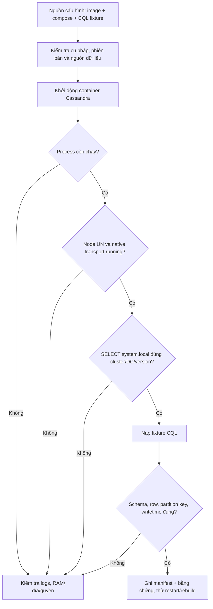

# Tái tạo môi trường và quản lý cấu hình thực hành có thể kiểm chứng

## 1. Mục tiêu: từ “máy tôi chạy được” đến môi trường có thể tái lập

Apache Cassandra là hệ quản trị cơ sở dữ liệu **wide-column phân tán**. Kết quả một bài thực hành không chỉ phụ thuộc vào câu lệnh CQL mà còn vào **phiên bản server/JDK, cấu hình node, datacenter, replication, network, trạng thái dữ liệu, consistency level và chương trình client**. Nếu các đầu vào này không được ghi nhận, hai người cùng chạy một đoạn `INSERT` có thể thấy kết quả khác nhau dù đều báo “Cassandra đã chạy”.

Trong chương **Môi trường thực hành** của module `DATABASE_ENGINE_WIDE_COLUMN_CASSANDRA`, bài học này xây dựng quy trình **tái tạo và xác minh** môi trường để có nền tảng đáng tin cậy cho các chủ đề tiếp theo: **partition key, thiết kế bảng theo truy vấn, replication, consistency đọc/ghi, compaction, repair, xử lý lỗi và kết nối Java**.

Sau bài học, bạn sẽ có thể:

1. Phân biệt **tái tạo cấu hình**, **khởi động lại cùng dữ liệu**, **tạo mới sạch** và **khôi phục dữ liệu**; không gọi cả bốn là “recreate” một cách mơ hồ.
2. Xác định **nguồn cấu hình có thẩm quyền** cho image/version, `cassandra.yaml`, DC/rack, Docker Compose, keyspace/table, Java Driver và secrets.
3. Tự viết ví dụ `compose.yaml` và `fixture.cql` trong **thư mục lab riêng**, dựng lại một node Cassandra 5.0.9 và kiểm tra bằng các lệnh có thể lặp lại.
4. Ghi **manifest/fingerprint** có giá trị chẩn đoán: server version, image digest/ID, cluster/DC, schema, trạng thái node và kết quả CQL.
5. Tạo **dữ liệu CQL xác định** bằng khóa và mutation timestamp cố định; giải thích vì sao `host_id`, container IP và thời gian khởi động **không cần giống** giữa hai lần dựng sạch.
6. Phát hiện **configuration drift**, phân biệt lỗi cấu hình với lỗi dữ liệu hoặc lỗi mạng, và đặt các bước kiểm soát trước khi chạy tác vụ nguy hiểm.
7. Sử dụng một đoạn mã Java để **kiểm tra đúng môi trường** thay vì kết nối nhầm một cluster khác có schema giống nhau.

> **Phạm vi và an toàn:** thực hành chính là **một node Docker cô lập, không dùng dữ liệu thật, không bật xác thực/TLS mặc định và chỉ publish cổng CQL trên loopback của host**. Một node phù hợp học CQL và lưu trữ, **không chứng minh HA hoặc consistency của cụm nhiều replica**. Những lệnh xóa volume trong bài chỉ dành cho lab được xác nhận rõ ràng.

## 2. “Tái lập” phải được định nghĩa chính xác

### 2.1. Bốn tình huống khác nhau

| Tình huống | Đầu vào | Đầu ra mong đợi | Điều không nên kỳ vọng |
|---|---|---|---|
| **Restart cùng node** | Cùng container, cùng volume và cấu hình | Server hoạt động lại; dữ liệu và thông tin nhận dạng node được giữ | Không có nghĩa mọi request đã được gửi lúc node tắt đều thành công |
| **Recreate container, giữ volume** | Container mới, data volume cũ và cấu hình tương thích | Nỗ lực chạy lại **chính node có dữ liệu đó**, sau khi kiểm tra address/identity | IP/container ID có thể đổi; ở cluster nhiều node không được tùy ý recreate endpoint |
| **Clean rebuild** | Image/config đã chốt, **volume mới rỗng** và script dữ liệu mẫu | Schema, dữ liệu mẫu và các kết quả kiểm tra logic **tái lập được** | `host_id`, token/IP, container ID và timestamp khởi động không cần giống |
| **Backup restore** | Bản backup hợp lệ, schema/metadata/keys/topology và runbook restore | Dữ liệu được phục hồi theo mục tiêu RPO/RTO được kiểm chứng | Không thể chỉ gắn một volume/SSTable bất kỳ vào node khác rồi gọi là restore thành công |

**Bài này tập trung vào restart cùng node và clean rebuild.** Không tự động nâng cấp hay thay node production, không thử sửa trực tiếp system tables. Quá trình restore thực tế cần bài học/runbook riêng.

### 2.2. Kiểm chứng tính tái lập theo nhiều lớp



Một **readiness check** chỉ cho biết node có thể phục vụ một loại request ở thời điểm đó; nó không tự chứng minh compaction, repair, backup hay hiệu năng. Một **reproducibility check** còn phải ghi rõ **đã chạy với đầu vào nào và so sánh kết quả nào**.

## 3. Những đầu vào cần được khóa hoặc ghi nhận

### 3.1. Ma trận nguồn cấu hình

| Lớp | Nguồn cấu hình | Phần cần cố định/ghi nhận | Cách xác minh khi chạy |
|---|---|---|---|
| Host | OS, CPU architecture, Docker Engine/Desktop, Docker Compose | OS/arch, phiên bản Docker và giới hạn RAM/disk | `docker version`, `docker info`, `docker compose version` |
| Cassandra binary | Docker image hoặc package | Server version **và image digest/ID**, không chỉ tên tag | `docker image inspect`, `nodetool version`, `system.local.release_version` |
| JVM server | JDK và JVM options trong image/container | Java runtime, heap/GC và giới hạn bộ nhớ | `docker compose exec ... java -version`, `nodetool info` |
| Docker service | `compose.yaml`, project name, mount/network/port | Port mapping, volume, env của image, healthcheck | `docker compose config`, `docker compose ps`, `docker inspect` |
| Cassandra node | `cassandra.yaml`, `cassandra-rackdc.properties` | Cluster name, endpoint snitch, listen/rpc, DC/rack, data dirs | Đọc file hiệu lực trong container và `system.local` |
| CQL schema | Script tạo keyspace/table | RF/DC, partition key, clustering order, compaction/TTL nếu dùng | `DESCRIBE KEYSPACE/TABLE`, `system_schema` |
| Dữ liệu mẫu | Fixture CQL được version hóa | Primary keys, dữ liệu và khi cần mutation timestamp cố định | SELECT theo partition key, `COUNT(*)` phạm vi nhỏ, `WRITETIME` |
| Client | Phiên bản cqlsh hoặc Java Driver | Contact point, local DC, CL, timeout, auth/TLS | `SHOW VERSION`, kiểm tra `CqlSession` và query |
| Secrets | Secret manager hoặc cấu hình riêng được bảo vệ | **Không** commit password/keystore; chỉ ghi tên secret reference | Kiểm tra kết nối/quyền mà không công khai giá trị |

**Image tag không phải bằng chứng bất biến tuyệt đối.** Tag như `cassandra:5.0.9` thuận tiện khi học, nhưng một registry có thể cập nhật manifest/tag; nền tảng `amd64/arm64` cũng có thể dẫn đến image ID khác nhau. Muốn tái lập **chính xác hơn**, ghi **digest** sau khi pull, review nguồn image rồi dùng cú pháp `image@sha256:...` phù hợp nền tảng. **Không điền một digest giả định** vào bài; luôn lấy digest thực tế đã kiểm chứng.

### 3.2. “Source of truth” cho từng nhóm thiết lập

- **Compose** là nguồn cho image, network, volume, port host, giới hạn container và các biến môi trường mà image chính thức **có hỗ trợ**.
- **`cassandra.yaml`** là nguồn server configuration cuối cùng. Một số biến `CASSANDRA_...` được **entrypoint Docker Official Image** chuyển thành cấu hình; **không giả định mọi key trong `cassandra.yaml` đều có biến env tương ứng**.
- **`cassandra-rackdc.properties`** là nguồn DC/rack khi dùng `GossipingPropertyFileSnitch`.
- **CQL** mới là nơi khai báo `CREATE KEYSPACE ... WITH replication`, `CREATE TABLE ... PRIMARY KEY` và các tùy chọn theo bảng. Không đặt RF hoặc primary key bằng một giá trị YAML của node.
- **Java Driver** có contact points, local datacenter, consistency level và bảo mật **ở phía client**, không suy từ việc Cassandra đang mở cổng 9042.
- **Data volume** là trạng thái dữ liệu, **không phải bản sao của file cấu hình** ở `/etc/cassandra`. Chỉ giữ volume không bảo đảm giữ mọi thay đổi cấu hình đã sửa trực tiếp trong container.

Với cluster nhiều node, lưu ý thêm **seed không phải master/leader**; mỗi node có volume và host ID riêng. Không sao chép nguyên data directory hoặc volume từ một node đang hoạt động sang node thứ hai để “nhân bản môi trường”.

## 4. Hợp đồng tái lập: cái gì phải giống, cái gì được khác?

### 4.1. Invariants (điều kiện bắt buộc)

Đối với bài lab này, các giá trị sau phải khớp sau **mỗi lần clean rebuild**:

| Thành phần | Giá trị/điều kiện được thiết kế | Cách chứng minh |
|---|---|---|
| Cassandra version | Server là 5.0.9 từ image đã chốt | `nodetool version`, `system.local.release_version` |
| Cluster name | `pe012-repro` | `system.local.cluster_name` |
| Datacenter/rack | `dc1` / `rack1` | `system.local.data_center/rack` |
| Topology | **Một node** ở `UN`, native CQL `running` | `nodetool status`, `statusbinary` |
| Keyspace | `pe012_lab`, `NetworkTopologyStrategy`, `dc1:1` | `system_schema.keyspaces`, `DESCRIBE KEYSPACE` |
| Query shape | Composite partition key `(device_id,event_day)` | `DESCRIBE TABLE` và SELECT có đầy đủ key |
| Fixture | **Hai row** dưới thiết bị/ngày được chọn | SELECT theo partition key; có thể COUNT trong đúng partition nhỏ |
| Payload | `created` và `verified` | So nội dung theo `event_id` |
| Mutation timestamp | `1700000000000000` microsecond trên cell `payload` | `WRITETIME(payload)` |
| Đường dữ liệu | Named volume mount vào `/var/lib/cassandra` | `docker inspect` hoặc `docker compose config` |

### 4.2. Giá trị có thể khác mà không làm bài thử thất bại

| Giá trị | Vì sao thay đổi hợp lệ? | Nên ghi lại không? |
|---|---|---|
| `host_id` | Khởi tạo node **mới từ volume mới** tạo định danh Cassandra mới | Có, để đối chiếu từng lần dựng |
| Container ID, container IP | Docker có thể cấp ID/IP khác khi tạo mới | Có, khi debug network |
| Thời gian startup, uptime | Tải CPU/đĩa và thời điểm tạo khác nhau | Có, nhưng không ép bằng nhau |
| Token/vnode | Mỗi node mới có thể nhận tập token khác | Có, nếu bài học sau cần phân tích token |
| Output order của các dòng SQL không có `ORDER BY` phù hợp | Cassandra không hứa sắp xếp toàn bộ partition không có thiết kế clustering/order | Chỉ so thứ tự trong partition khi schema bảo đảm |
| Docker image ID ở hai architecture khác nhau | Multi-architecture image có bản build riêng | Phải ghi platform/digest khi cần binary parity |

**Phân biệt hai khái niệm:** “kết quả nghiệp vụ giống nhau” và “byte-for-byte giống nhau” không tương đương. Cassandra có commit log, SSTable, compaction, cache và metadata nội bộ thay đổi theo thời gian; **không so hash trực tiếp hai thư mục `/var/lib/cassandra`** để kết luận fixture có tái lập hay không.

## 5. Chuẩn bị thư mục lab và hai file mẫu

### 5.1. Các điều kiện trước khi chạy

Ví dụ dùng Docker Engine hoặc Docker Desktop ở chế độ **Linux containers**, có plugin `docker compose`, image `cassandra:5.0.9`. Với một node, môi trường thực hành thuận tiện khi host tổng có khoảng **8 GiB RAM trở lên**, Docker có thể cấp **4 GiB** cho node và SSD đủ trống; đây là gợi ý lab, **không phải sizing production**.

Chọn cổng host `9282` còn trống. Cổng này chỉ được publish tại `127.0.0.1` vì Cassandra mặc định trong ví dụ không yêu cầu username/password hoặc TLS. Không chạy lab kiểu này bằng `0.0.0.0:9282:9042` trên máy công cộng/LAN.

Trong **thư mục lab riêng của người học**, hãy tự tạo hai file cạnh nhau:

```text
pe012-lab/
  compose.yaml
  fixture.cql
```

Các khối mã bên dưới là **nội dung mẫu để người học lưu vào chính thư mục lab của họ**; bài viết không yêu cầu chỉnh những file cấu hình đang phục vụ production. Không dùng tên thư mục/volume đang có dữ liệu của dự án khác.

### 5.2. Nội dung compose.yaml

Lưu toàn bộ nội dung sau thành `compose.yaml` trong thư mục lab:

```yaml
services:
  cassandra:
    image: cassandra:5.0.9
    restart: "no"
    mem_limit: 4g
    cpus: 2.0
    environment:
      MAX_HEAP_SIZE: 2G
      CASSANDRA_CLUSTER_NAME: pe012-repro
      CASSANDRA_ENDPOINT_SNITCH: GossipingPropertyFileSnitch
      CASSANDRA_DC: dc1
      CASSANDRA_RACK: rack1
    ports:
      - "127.0.0.1:9282:9042"
    volumes:
      - pe012_data:/var/lib/cassandra
      - ./fixture.cql:/lab/fixture.cql:ro
    healthcheck:
      test:
        - CMD
        - cqlsh
        - 127.0.0.1
        - "9042"
        - -e
        - "SELECT release_version FROM system.local;"
      interval: 30s
      timeout: 15s
      retries: 10
      start_period: 120s

volumes:
  pe012_data:
```

**Giải thích thiết kế:**

- `image: cassandra:5.0.9` ghim phiên bản theo tag; ghi image ID/digest thực tế ở bước manifest. Nếu cần khóa artifact chặt hơn, dùng digest đã xác minh trong pipeline.
- `mem_limit` và `cpus` đặt giới hạn cho container; `MAX_HEAP_SIZE` đặt JVM heap qua cơ chế được **Official Image** hỗ trợ. Cassandra vẫn cần RAM cho off-heap và filesystem cache.
- `CASSANDRA_CLUSTER_NAME` và `CASSANDRA_DC/RACK` đặt identity/topology. `GossipingPropertyFileSnitch` giúp dùng cấu hình DC/rack.
- `ports` chỉ mở native CQL cho **host local** tại 9282; **bên trong container** cqlsh dùng 9042.
- `pe012_data:/var/lib/cassandra` giữ data, commitlog, hints và saved caches qua vòng đời container.
- `./fixture.cql:/lab/fixture.cql:ro` gắn **file CQL chỉ đọc** vào container để có thể thực thi cùng nội dung nhiều lần. File host phải tồn tại trước khi `up`.
- `healthcheck` thực thi truy vấn thật qua native protocol, mạnh hơn kiểm tra container `Up`. Nó **không** khẳng định `UN`, đúng schema, quyền truy cập hay tính nhất quán của mọi replica. Mỗi lần healthcheck khởi tạo một process cqlsh: tần suất 30 giây chỉ hợp lab, không phải probe production tối ưu.
- `restart: "no"` giúp người học chủ động kiểm soát việc dừng/khởi động. Trong production, restart policy thuộc quy trình vận hành, không sao chép nguyên cấu hình này.

**Compose project name** sẽ được chỉ định qua `-p pe012lab` trong tất cả câu lệnh. Do đó tên volume thực tế do Compose quản lý thường là `pe012lab_pe012_data`. Không mặc định tên volume chỉ là `pe012_data` khi kiểm tra Docker Engine.

### 5.3. Nội dung fixture.cql

Lưu đoạn sau vào `fixture.cql` với UTF-8 (không cần mã bí mật):

```sql
CREATE KEYSPACE IF NOT EXISTS pe012_lab
WITH replication = {
    'class': 'NetworkTopologyStrategy',
    'dc1': 1
}
AND durable_writes = true;

CREATE TABLE IF NOT EXISTS pe012_lab.events_by_device_day (
    device_id text,
    event_day date,
    event_time timestamp,
    event_id uuid,
    event_type text,
    payload text,
    PRIMARY KEY ((device_id, event_day), event_time, event_id)
) WITH CLUSTERING ORDER BY (event_time DESC, event_id ASC);

INSERT INTO pe012_lab.events_by_device_day
  (device_id, event_day, event_time, event_id, event_type, payload)
VALUES (
  'repro-device-012', '2026-11-21', '2026-11-21T08:00:00Z',
  12000000-0000-4000-8000-000000000001, 'boot', 'created'
)
USING TIMESTAMP 1700000000000000;

INSERT INTO pe012_lab.events_by_device_day
  (device_id, event_day, event_time, event_id, event_type, payload)
VALUES (
  'repro-device-012', '2026-11-21', '2026-11-21T08:05:00Z',
  12000000-0000-4000-8000-000000000002, 'measurement', 'verified'
)
USING TIMESTAMP 1700000000000000;

SELECT event_id, event_time, event_type, payload,
       WRITETIME(payload)
FROM pe012_lab.events_by_device_day
WHERE device_id = 'repro-device-012'
  AND event_day = '2026-11-21';
```

**Vì sao fixture có thể tái lập?**

1. Cả hai row có **primary key cố định**. Chạy lại script với cùng dữ liệu/khóa không tạo thêm những row có ID ngẫu nhiên.
2. `USING TIMESTAMP 1700000000000000` đặt **Cassandra mutation timestamp** ở đơn vị microsecond. Nó **không phải** `event_time` nghiệp vụ của năm 2026. Giá trị này giúp việc so `WRITETIME(payload)` không thay đổi giữa hai lần dựng sạch.
3. Hai row có cùng `device_id,event_day` nhưng khác `event_time,event_id`. `event_time DESC` cho kết quả thời điểm 08:05 trước 08:00 trong **cùng partition**.
4. `NetworkTopologyStrategy{'dc1':1}` tương ứng **một node** của bài; không thử quorum ba replica với keyspace này.
5. `CREATE ... IF NOT EXISTS` chỉ giúp tránh lỗi tồn tại schema. Nó **không xác nhận** schema cũ giống schema kỳ vọng; phần kiểm tra phía dưới bắt buộc đối chiếu lại cấu trúc và replication.

**Không sao chép `USING TIMESTAMP` cố định vào ứng dụng thật mà không có thiết kế timestamp.** Nếu ghi cùng cell với timestamp nhỏ hơn một mutation đã tồn tại, Cassandra có thể không cho giá trị mới “thắng” theo cơ chế last-write-wins. Dùng fixture này trên **volume lab mới/rỗng** là điều kiện quan trọng của phép thử.

## 6. Preflight: kiểm tra đầu vào trước khi khởi chạy

Từ terminal **đứng tại thư mục có hai file `compose.yaml` và `fixture.cql`**, chạy:

```bash
docker version
docker compose version
docker compose -p pe012lab config --quiet
docker pull cassandra:5.0.9
docker image inspect cassandra:5.0.9 --format "{{.Id}}"
docker image inspect cassandra:5.0.9 --format "{{json .RepoDigests}}"
```

Ở ví dụ này, không dùng cú pháp nối dòng Bash nên các lệnh chạy được từ **Bash** hoặc **Windows PowerShell** khi Docker CLI hoạt động.

**Điều kiện PASS:**

- Docker daemon hoạt động và Compose CLI hiểu `compose.yaml`; `config --quiet` không báo lỗi.
- Image được pull thành công; ghi **image ID** và **RepoDigests** nếu có, cũng như OS/CPU architecture. `RepoDigests` có thể trống ở một số image được build/load cục bộ; đừng bịa digest.
- Không có container/project/volume `pe012lab` thuộc công việc khác; nếu đã tồn tại, kiểm tra chủ sở hữu trước khi tiếp tục.
- Cổng host 9282 chưa bị chiếm, Docker có đủ RAM/disk, đồng hồ host/VM được đồng bộ.
- `fixture.cql` tồn tại **cạnh `compose.yaml`**. Khi mount file bằng relative path, Compose dùng ngữ cảnh project/file phù hợp; đừng chạy với một file khác trùng tên ngoài ý muốn.

Nếu muốn xem cấu hình Compose **đã nội suy**:

```bash
docker compose -p pe012lab config
```

Trong lab hiện tại **không có secrets**, nên có thể kiểm tra đầu ra để đối chiếu. **Trong hệ thống thật, `docker compose config` có thể in ra biến chứa mật khẩu/token**; không đẩy output thẳng vào log CI/ticket công khai. Dùng `config --quiet` cho bước kiểm tra cú pháp mà không in cấu hình đầy đủ.

### 6.1. Ghi checksum của các đầu vào

Sau khi file lab ổn định, ghi SHA-256 để phát hiện thay đổi ngoài ý muốn:

**Bash/Linux/macOS:**

```bash
sha256sum compose.yaml fixture.cql
```

**Windows PowerShell:**

```powershell
Get-FileHash -LiteralPath .\compose.yaml -Algorithm SHA256
Get-FileHash -LiteralPath .\fixture.cql -Algorithm SHA256
```

Hash chỉ chứng minh **nội dung hai file giống bản đã ghi**, không chứng minh server chạy đúng, không xác minh chủ thể đã tạo file hay tính an toàn của image. Kết hợp hash với review source, image digest, phiên bản Docker và **runtime readback**.

## 7. Khởi chạy và kiểm tra node Cassandra

### 7.1. Up đúng project lab

```bash
docker compose -p pe012lab up -d
docker compose -p pe012lab ps -a
docker compose -p pe012lab logs --tail 100 cassandra
```

`up -d` chỉ yêu cầu Compose tạo/chạy container. Cassandra có thể cần thời gian để mở commitlog, system keyspace, gossip và native transport. Một healthcheck có `start_period` không làm quá trình bootstrap lập tức hoàn tất.

Kiểm tra lần lượt **không bỏ bước**:

```bash
docker compose -p pe012lab exec -T cassandra nodetool status
docker compose -p pe012lab exec -T cassandra nodetool statusbinary
docker compose -p pe012lab exec -T cassandra cqlsh -e "SELECT release_version, cluster_name, data_center, rack, host_id FROM system.local WHERE key='local';"
```

Kỳ vọng:

- `nodetool status` có đúng **một node `UN`** (*Up/Normal*) thuộc datacenter `dc1`.
- `nodetool statusbinary` trả `running`.
- `system.local.cluster_name=pe012-repro`, `data_center=dc1`, `rack=rack1` và `release_version=5.0.9`.

Nếu một lệnh thất bại ngay sau `up`, xem lại `docker compose ps -a` và `logs`, đợi node sẵn sàng rồi mới thử lại. **Không** kết luận node hỏng chỉ vì lần đầu JMX hoặc CQL chưa mở; cũng không coi container `healthy` là bằng chứng đã qua toàn bộ CQL/schema checks.

### 7.2. Kiểm tra filesystem và cấu hình đã áp dụng

```bash
docker compose -p pe012lab exec -T cassandra cat /etc/cassandra/cassandra-rackdc.properties
docker compose -p pe012lab exec -T cassandra sh -c "grep -E '^(cluster_name|endpoint_snitch|listen_address|rpc_address|native_transport_port):' /etc/cassandra/cassandra.yaml"
docker compose -p pe012lab exec -T cassandra sh -c "df -h /var/lib/cassandra"
docker compose -p pe012lab exec -T cassandra java -version
```

Một số cấu hình có thể đang được dùng từ **giá trị mặc định hoặc dòng comment** nên `grep` không liệt kê hết option. Đối chiếu file, log lúc startup và thông tin quan sát được qua CQL/`nodetool`. **Chỉnh một file trong container** không làm file `compose.yaml` của bạn tự đổi và **không bền vững sau khi xóa container** nếu file nằm ngoài data volume.

Ví dụ, `MAX_HEAP_SIZE` là biến mà Official Image xử lý khi khởi động JVM, **không** phải một key `MAX_HEAP_SIZE` trong `cassandra.yaml`. `java -version` trên host và trong container cũng có thể khác nhau.

## 8. Nạp dữ liệu mẫu và xác minh đầu ra

### 8.1. Thực thi fixture đã mount

Sau khi node đạt readiness:

```bash
docker compose -p pe012lab exec -T cassandra cqlsh -f /lab/fixture.cql
```

Lệnh `-f` đọc file **bên trong container** tại `/lab/fixture.cql`. Mount `:ro` bảo đảm Cassandra container không ghi ngược vào file fixture trên host. Nếu lỗi “No such file”, kiểm tra đường dẫn tương đối của Compose, mount đã hiệu lực và file thật trên host; không tự tạo một file fixture khác trong container rồi bỏ qua source of truth.

**Không chỉ nhìn exit code.** Nếu có câu lệnh CQL lỗi, đọc cả output/stderr, xác nhận schema đã được tạo và chạy những assertion SELECT riêng phía dưới. Khả năng dừng khi gặp lỗi và return code của chế độ `-f` phụ thuộc cách cqlsh xử lý script; vì thế **runtime readback** là gate bắt buộc.

### 8.2. Đối chiếu keyspace/table

```bash
docker compose -p pe012lab exec -T cassandra cqlsh -e "SELECT keyspace_name, replication, durable_writes FROM system_schema.keyspaces WHERE keyspace_name='pe012_lab';"
docker compose -p pe012lab exec -T cassandra cqlsh -e "DESCRIBE TABLE pe012_lab.events_by_device_day"
```

Trong `cqlsh` tương tác cũng có thể chạy `DESCRIBE KEYSPACE pe012_lab`. Xác minh:

- `replication` là `NetworkTopologyStrategy` và chứa `dc1:1`.
- `durable_writes=true`.
- Bảng có primary key `((device_id,event_day),event_time,event_id)` và clustering order `event_time DESC, event_id ASC`.

`DESCRIBE` là lệnh của **cqlsh**, không phải CQL statement gửi nguyên văn từ Java Driver. Kiểm chứng schema ở đây là đối chiếu **hợp đồng dữ liệu** với config thực, không chỉ ghi lại lệnh `CREATE ... IF NOT EXISTS` đã chạy.

### 8.3. Truy vấn hai row và WRITETIME

```bash
docker compose -p pe012lab exec -T cassandra cqlsh -e "SELECT event_id, event_time, event_type, payload, WRITETIME(payload) FROM pe012_lab.events_by_device_day WHERE device_id='repro-device-012' AND event_day='2026-11-21';"
docker compose -p pe012lab exec -T cassandra cqlsh -e "SELECT COUNT(*) FROM pe012_lab.events_by_device_day WHERE device_id='repro-device-012' AND event_day='2026-11-21';"
```

**Kỳ vọng trên volume mới:**

| Khóa `event_id` (đuôi) | `event_time` UTC | `event_type` | `payload` | `WRITETIME(payload)` |
|---|---|---|---|---:|
| `...0002` | 2026-11-21 08:05 | `measurement` | `verified` | 1700000000000000 |
| `...0001` | 2026-11-21 08:00 | `boot` | `created` | 1700000000000000 |

`COUNT(*)` theo **một partition fixture rất nhỏ** phải bằng **2**. **Không** biến `SELECT COUNT(*)` thành smoke test mặc định trên keyspace/bảng production lớn: Cassandra có thể phải quét nhiều row/partition, gây chi phí cao.

Nếu thứ tự ngược, kiểm tra clustering order và `WHERE`, không tự thêm `ORDER BY` ngoài quy tắc của Cassandra. Nếu kết quả có thêm row, khả năng bạn đang dùng **volume cũ** hoặc một fixture khác; xác minh nguồn và không xóa dữ liệu khi chưa chắc chắn.

### 8.4. Kiểm tra lưu trữ sau khi ghi

```bash
docker compose -p pe012lab exec -T cassandra nodetool tablestats pe012_lab
docker compose -p pe012lab exec -T cassandra nodetool flush pe012_lab events_by_device_day
docker compose -p pe012lab exec -T cassandra sh -c "ls -la /var/lib/cassandra/data/pe012_lab"
docker compose -p pe012lab exec -T cassandra sh -c "df -h /var/lib/cassandra"
```

Sau `flush`, có thể quan sát thư mục bảng chứa SSTables. **Flush không phải backup** và không buộc `commitlog/` rỗng ngay: segment có thể còn mutation của các bảng khác. Các file SSTable có tên/format phụ thuộc version và thời điểm compaction, nên **không hash chúng để làm assertion về dữ liệu mẫu**.

## 9. Ghi manifest kết quả thực tế

### 9.1. Ví dụ mẫu manifest người học tự điền

Một manifest là **biên bản bằng chứng**, không phải file Cassandra tự hiểu. Có thể ghi vào tài liệu lab nội bộ hoặc một artifact của pipeline:

```yaml
lesson: practice-environment-012
purpose: clean-rebuild-verification

inputs:
  compose_sha256: "ghi_sha256_thuc_te"
  fixture_sha256: "ghi_sha256_thuc_te"
  image_tag: "cassandra:5.0.9"
  image_digest_or_id: "ghi_gia_tri_docker_image_inspect"
  docker_engine_version: "ghi_docker_version"
  compose_version: "ghi_docker_compose_version"
  host_os_arch: "ghi_os_arch"

expected:
  cluster_name: pe012-repro
  datacenter: dc1
  rack: rack1
  server_version: "5.0.9"
  keyspace_replication: "NetworkTopologyStrategy / dc1:1"
  fixture_device: repro-device-012
  fixture_day: "2026-11-21"
  row_count: 2
  payload_writetime_us: 1700000000000000

observed:
  startup_status: "dien_UN_hoac_loi"
  native_transport: "dien_running_hoac_loi"
  actual_cluster_name: "dien_tu_system_local"
  actual_host_id: "dien_uuid_thuc_te"
  row_count: "dien_gia_tri_thuc_te"
  test_result: "PASS_hoac_FAIL"
```

Các chuỗi `ghi_...`/`dien_...` là **ô để người học điền**, **không phải kết quả đã được kiểm thử**. Không đưa credentials, password, private key, dữ liệu thật hoặc nội dung log chứa secret vào manifest chia sẻ.

### 9.2. Bộ lệnh thu bằng chứng

```bash
docker compose version
docker image inspect cassandra:5.0.9 --format "{{.Id}}"
docker compose -p pe012lab ps -a
docker compose -p pe012lab images
docker compose -p pe012lab exec -T cassandra nodetool version
docker compose -p pe012lab exec -T cassandra nodetool status
docker compose -p pe012lab exec -T cassandra nodetool statusbinary
docker compose -p pe012lab exec -T cassandra cqlsh -e "SELECT cluster_name, data_center, rack, host_id, release_version FROM system.local WHERE key='local';"
```

Trong trường hợp cần thu thêm thông tin image/host, dùng `docker info` và `docker image inspect`; với cấu hình đã nội suy, chỉ lưu output `docker compose config` nếu đã kiểm tra **không chứa secret**.

**Không đưa mọi giá trị vào phép so sánh bằng nhau.** Khi dựng sạch lần thứ hai, `host_id` và uptime khác lần một là bình thường. Khi **restart cùng volume**, `host_id` của node phải được giữ nếu thực sự dùng đúng dữ liệu và config tương thích; nếu thay đổi ngoài ý muốn, đây là dấu hiệu cần kiểm tra volume/identity.

## 10. Phép thử A: restart cùng node và giữ dữ liệu

Mục tiêu là kiểm tra **bền vững của named volume**, không tạo node mới. Trước khi dừng, ghi lại `host_id` và nội dung hai row. Từ thư mục lab trên host:

```bash
docker compose -p pe012lab stop cassandra
docker compose -p pe012lab ps -a
docker compose -p pe012lab start cassandra
docker compose -p pe012lab ps -a
```

Sau `start`, **đợi lại readiness**:

```bash
docker compose -p pe012lab exec -T cassandra nodetool status
docker compose -p pe012lab exec -T cassandra nodetool statusbinary
docker compose -p pe012lab exec -T cassandra cqlsh -e "SELECT host_id, cluster_name FROM system.local WHERE key='local';"
docker compose -p pe012lab exec -T cassandra cqlsh -e "SELECT event_id, payload, WRITETIME(payload) FROM pe012_lab.events_by_device_day WHERE device_id='repro-device-012' AND event_day='2026-11-21';"
```

Kỳ vọng:

- Cùng container/volume nên node khôi phục dữ liệu đã có, giữ cùng `host_id`.
- Hai row, payload và mutation timestamp đã ghi vẫn tồn tại.
- CQL sẵn sàng sau restart, không chỉ process `Up`.

Đây là **restart bình thường**, không mô phỏng mất điện hoặc hỏng đĩa. Để học commitlog recovery khi crash cần bài thử `kill` cô lập với chính sách fsync/consistency được đánh giá riêng. Một kết quả restart pass không có nghĩa mọi write trong một sự cố mạng thực đều bền vững tuyệt đối.

## 11. Phép thử B: dựng sạch và chạy lại fixture

### 11.1. Đóng băng bằng chứng trước khi reset

Trước phép thử clean rebuild, hãy lưu **manifest đầu vào/đầu ra, log và dữ liệu CQL cần đối chiếu** ở vị trí ngoài volume lab. Xác nhận:

1. Project thật sự mang tên `pe012lab`, không phải project của người khác.
2. Named volume `pe012lab_pe012_data` chỉ chứa **dữ liệu thực hành có thể bỏ**.
3. File `compose.yaml` và `fixture.cql` đã được lưu/đánh hash ở thư mục riêng.
4. Không có client Java hay container khác phụ thuộc vào Cassandra đang chạy.

Có thể kiểm tra:

```bash
docker compose -p pe012lab ps -a
docker compose -p pe012lab config --quiet
docker volume ls
```

### 11.2. Reset có chủ đích — thao tác phá hủy dữ liệu lab

**Cảnh báo:** lệnh sau **xóa các volume do Compose quản lý trong project đó**, bao gồm dữ liệu Cassandra. Chỉ chạy với **project lab mới tạo và đã xác minh**. Không dán vào production hoặc thư mục Compose có dữ liệu cần giữ.

```bash
docker compose -p pe012lab down -v
```

Ở đây `-v` yêu cầu dỡ **named volumes được khai báo** (và các anonymous volumes liên quan) của project khi đủ điều kiện xóa. Nếu Docker báo volume đang được sử dụng, không tự ý `docker volume prune`, tìm và xử lý đúng consumer trước.

Tái tạo môi trường:

```bash
docker compose -p pe012lab config --quiet
docker compose -p pe012lab up -d
docker compose -p pe012lab ps -a
docker compose -p pe012lab exec -T cassandra nodetool status
docker compose -p pe012lab exec -T cassandra nodetool statusbinary
```

Đợi Cassandra thành `UN` và CQL trả lời. Sau đó nạp lại **đúng file đã hash**:

```bash
docker compose -p pe012lab exec -T cassandra cqlsh -f /lab/fixture.cql
docker compose -p pe012lab exec -T cassandra cqlsh -e "SELECT COUNT(*) FROM pe012_lab.events_by_device_day WHERE device_id='repro-device-012' AND event_day='2026-11-21';"
docker compose -p pe012lab exec -T cassandra cqlsh -e "SELECT event_id, payload, WRITETIME(payload) FROM pe012_lab.events_by_device_day WHERE device_id='repro-device-012' AND event_day='2026-11-21';"
```

**PASS khi:** server version/cluster/DC/schema khớp; hai row có đúng khóa/payload và `WRITETIME`; volume mới được tạo đúng project; các lệnh không có lỗi. **`host_id` có thể khác** và **không phải** điều kiện FAIL của clean rebuild.

### 11.3. Khi nào không dùng down -v?

- Khi cần tiếp tục bài hôm trước với dữ liệu/host ID cũ.
- Khi đang học **restart, failover, repair** của một cluster nhiều node có dữ liệu.
- Khi đã có snapshot/backup **chỉ nằm trong cùng volume** cần giữ.
- Khi chưa xác định chính xác Docker project/volume hoặc có dịch vụ khác dùng chung.
- Trong **production**: reset volume có thể phá hủy dữ liệu và không tương đương decommission/replace node.

Nếu chỉ muốn dừng container và **giữ volume**:

```bash
docker compose -p pe012lab down
```

Nhưng `down` tạo lại container/network khi `up` sau đó; với **cluster nhiều node đã lưu metadata**, IP có thể thay đổi và gây lỗi broadcast/peer. Muốn làm restart có kiểm soát trên một node đang có dữ liệu, ưu tiên `stop/start` **cùng container**, không tùy tiện dỡ cả cluster. Bài một node này vẫn phải xác minh identity và CQL sau khi `up`.

## 12. Kiểm tra drift: file đúng nhưng môi trường có thể sai

### 12.1. Những loại drift thường gặp

| Dạng drift | Ví dụ | Cách phát hiện |
|---|---|---|
| **Source drift** | Ai đó sửa `compose.yaml` hoặc `fixture.cql` không review | Diff Git, SHA-256 thay đổi |
| **Artifact drift** | Cùng tag `cassandra:5.0.9` nhưng image ID/digest khác | Ghi digest/platform, so `docker image inspect` |
| **Runtime drift** | Sửa `/etc/cassandra/cassandra.yaml` bên trong container nhưng không cập nhật Compose/source | Đọc cấu hình thật trong container, đối chiếu declarative config |
| **State drift** | Reuse volume cũ chứa bảng/row/role từ lần trước | `system_schema`, SELECT fixture, host ID, volume inspect |
| **Network drift** | Đổi host port, bridge network hoặc `broadcast_rpc_address` khiến Java không route tới peer | `docker compose config`, `SHOW HOST`, metadata peer, network test từ app |
| **Topology drift** | Thay DC/rack hoặc RF trong một nơi nhưng app vẫn dùng local DC cũ | `system.local`, `DESCRIBE KEYSPACE`, Java config |
| **Security drift** | Dev dùng auth/TLS tắt nhưng test/prod bật, cùng role/secret bị dùng sai | Kết nối không credential **phải bị từ chối** ở môi trường có auth; kiểm tra RBAC/TLS |
| **Clock drift** | Host/VM/ứng dụng tự cấp mutation timestamp lệch | NTP/UTC, `WRITETIME`, thông tin log/tracing |
| **Resource drift** | Docker Desktop giảm RAM hoặc SSD còn ít dung lượng | `docker info`, `docker stats`, `df -h` và latency |

**Không lấy việc `docker compose config --quiet` thành công làm bằng chứng Cassandra đã nhận cấu hình.** Lệnh này chỉ xác nhận Compose hiểu file; nó không biết Cassandra đã đọc file YAML của server hay node đã vào ring.

### 12.2. Một bài tập “drift giả” không gây gián đoạn

Bạn có thể **sao chép nội dung file vào một bản nháp ngoài project** rồi thay thử `CASSANDRA_DC: dc1` thành `dc_test`. Chạy kiểm tra cấu hình trên **bản nháp** để quan sát diff/hash thay đổi, **không áp `up` với cấu hình drift lên volume đang có dữ liệu**.

Vì sao phải tránh áp dụng trực tiếp? Datacenter là yếu tố quyết định placement của `NetworkTopologyStrategy` và local DC của Java Driver. Chỉ đổi một biến môi trường có thể khiến CQL keyspace cũ với `dc1:1` không còn phản ánh topology mới, làm query/auth/replication lỗi. Với node đã có dữ liệu, thay DC/rack/cluster identity là thao tác topology có rủi ro, không phải thay tên hiển thị vô hại.

Một thay đổi ít rủi ro hơn để review **mà chưa apply** là đổi host port publish trong bản nháp từ `9282` thành một port trống khác, rồi kiểm tra diff. Vẫn phải cập nhật contact point của Java host nếu thực sự triển khai. Tránh dùng cùng một bản `compose.yaml` chứa cấu hình môi trường thật và thử thay qua lại khi đang chạy dữ liệu quan trọng.

## 13. Dùng Java Driver để kiểm tra đúng cluster và schema

### 13.1. Cấu hình Java phải rõ nguồn

Với **Java 17 + Apache Cassandra Java Driver 4.x**, ví dụ dependency Maven `org.apache.cassandra:java-driver-core:4.19.4`, không hard-code host production hoặc mặc định kết nối khi thiếu biến môi trường. Một cấu hình lab có thể gồm:

```text
CASSANDRA_HOST=127.0.0.1
CASSANDRA_PORT=9282
CASSANDRA_LOCAL_DC=dc1
EXPECTED_CASSANDRA_CLUSTER=pe012-repro
```

Đây là cấu hình cho ứng dụng chạy **trên host có truy cập port publish**. Nếu Java chạy trong **container khác**, `127.0.0.1` là chính container Java; cần attach cùng Docker network hoặc dùng endpoint khác được Cassandra quảng bá và ứng dụng truy cập được. Trên Docker Desktop/Windows/macOS, NAT có thể khiến Java Driver kết nối contact point thành công nhưng không route được các IP nội bộ mà metadata Cassandra công bố; **kiểm thử từ đúng nơi chương trình Java thực chạy**.

### 13.2. Ví dụ mã fail-fast khi sai môi trường

```java
import java.net.InetSocketAddress;
import java.util.Objects;

import com.datastax.oss.driver.api.core.CqlSession;
import com.datastax.oss.driver.api.core.cql.Row;

public class CassandraReproCheck {
    private static String required(String name) {
        String value = System.getenv(name);
        if (value == null || value.isBlank()) {
            throw new IllegalArgumentException("Missing environment variable: " + name);
        }
        return value;
    }

    public static void main(String[] args) {
        String host = required("CASSANDRA_HOST");
        int port = Integer.parseInt(required("CASSANDRA_PORT"));
        String localDc = required("CASSANDRA_LOCAL_DC");
        String expectedCluster = required("EXPECTED_CASSANDRA_CLUSTER");

        try (CqlSession session = CqlSession.builder()
                .addContactPoint(new InetSocketAddress(host, port))
                .withLocalDatacenter(localDc)
                .build()) {

            Row local = session.execute(
                    "SELECT cluster_name, data_center, release_version " +
                    "FROM system.local WHERE key = 'local'").one();
            if (local == null) {
                throw new IllegalStateException("No system.local row");
            }

            String actualCluster = local.getString("cluster_name");
            String actualDc = local.getString("data_center");
            if (!Objects.equals(actualCluster, expectedCluster)
                    || !Objects.equals(actualDc, localDc)) {
                throw new IllegalStateException(
                    "Unexpected Cassandra target: " + actualCluster +
                    " / " + actualDc);
            }

            Row result = session.execute(
                "SELECT COUNT(*) AS n FROM pe012_lab.events_by_device_day " +
                "WHERE device_id='repro-device-012' " +
                "AND event_day='2026-11-21'").one();
            if (result == null || result.getLong("n") != 2L) {
                throw new IllegalStateException("Fixture mismatch");
            }

            System.out.println("PASS: cluster=" + actualCluster +
                    ", dc=" + actualDc +
                    ", version=" + local.getString("release_version") +
                    ", rows=2");
        }
    }
}
```

Mã kiểm tra **cluster name, local DC và fixture count** là lớp phòng vệ hữu ích, **không phải ranh giới bảo mật**: một cluster khác có cùng tên/DC có thể vượt qua; production cần TLS xác thực endpoint, firewall và RBAC. Truy vấn `COUNT(*)` chỉ phù hợp vì bảng fixture có **một partition rất nhỏ**; trong ứng dụng thật nên kiểm tra các key xác định thay vì đếm dữ liệu production.

Nếu Cassandra lab đang dùng cấu hình mặc định `AllowAllAuthenticator/AllowAllAuthorizer`, mã trên **không thêm authentication**. Trong test/prod phải tích hợp provider/credentials/TLS theo secret store và phiên bản driver tương ứng. Đừng đặt password trực tiếp trong mã hoặc trong bài tập có quyền đọc rộng.

## 14. Từ lab tái lập đến kiểm thử nhiều node và repair

### 14.1. Điều gì chuyển sang cluster ba node?

Khi chuẩn bị thực hành replication, consistency, compaction, repair hoặc failover, mở rộng quy trình tái lập bằng **một cấu hình/test fixture riêng**, không ghép ba node vào volume của bài một node.

| Thành phần | Lab một node | Lab ba node |
|---|---|---|
| Cluster | `pe012-repro` | Một **cluster name mới**, ví dụ `pe012-repro3` |
| Node identity | 1 node, 1 volume | **3 node, 3 volume** độc lập |
| Seed | Node đầu tiên bootstrap riêng | Node 2/3 tìm seed cùng cluster; seed không phải leader |
| DC/rack | `dc1/rack1` | `dc1` với rack logic phân biệt (không tạo failure domain vật lý) |
| Replication | `NetworkTopologyStrategy, dc1:1` | `NetworkTopologyStrategy, dc1:3` sau khi đủ ba `UN` |
| CL có ý nghĩa | `LOCAL_ONE`, không thử chịu lỗi | `LOCAL_QUORUM` cần 2/3; `ALL` cần 3/3 |
| Test sẵn sàng | Node `UN`, binary running, CQL fixture | Ring/peer/host IDs từ nhiều góc nhìn, read/write từ nhiều coordinator |
| Phục hồi | Stop/start và clean rebuild của một node | Hints, repair, log, bootstrap/replace node theo runbook chuyên biệt |

Ở cụm nhiều node, cần thêm **đường internode 7000**, endpoint được broadcast có thể route, `system.peers_v2` và healthcheck từng node. Đồng thời phải kiểm tra **Java Driver khám phá được mọi peer** từ đúng network. Ba container trên cùng laptop có thể mô phỏng mất **một process**, nhưng không chứng minh chịu lỗi hỏng **host/rack/datacenter**.

### 14.2. Vì sao không chỉ so số row?

Trong cluster RF=3, một câu SELECT từ coordinator khỏe có thể đọc dữ liệu từ **replica khác**. Việc SELECT trả row **không chứng minh** mọi replica cục bộ có cùng SSTable. `LOCAL_ONE` có thể thấy bản sao chưa cập nhật; `LOCAL_QUORUM` yêu cầu đủ hai replica phản hồi theo semantics của Cassandra. Khi một replica down, hints có thể hỗ trợ phát lại mutation, nhưng **hints là best effort**, không thay thế **anti-entropy repair**.

Một test plan đủ chiều sâu cần thêm: `nodetool getendpoints` cho partition key; xác minh RF/CL thực; đo timeout/latency; hints/repair/backlog; kiểm tra timestamp và tombstones; sao lưu/khôi phục đúng quy trình. Không đưa `nodetool repair` hay `TRUNCATE` vào healthcheck thường xuyên.

## 15. Gợi ý kiểm soát tự động trong CI/CD

Đối với môi trường kiểm thử cô lập, có thể chia pipeline thành các **gate** có đầu ra rõ ràng:

| Gate | Input | Kết quả PASS | Khi FAIL |
|---|---|---|---|
| 1. Source review | `compose.yaml`, `fixture.cql`, phiên bản driver | Diff được review, không chứa secret | Chặn pipeline |
| 2. Parse/config | `docker compose config --quiet` | Compose syntax hợp lệ | Sửa cấu hình trước khi chạy |
| 3. Artifact lock | Image digest/ID, platform, version | Khớp baseline đã chốt | Kiểm tra registry/build, không tự dùng tag khác |
| 4. Resource/network | Docker daemon, RAM/SSD, port/network | Tài nguyên và endpoint lab sẵn sàng | Chặn test hoặc chọn runner phù hợp |
| 5. Startup | Compose logs, process | Container running, không OOM | Lưu log để debug |
| 6. Cassandra readiness | `nodetool status`, `statusbinary`, `system.local` | Đúng node `UN`, native running, cluster/DC/version | Không áp fixture khi chưa sẵn sàng |
| 7. CQL schema/data | DDL + deterministic fixture | RF/DC/PK đúng, hai row đúng, writetime đúng | Fail sớm, không bỏ qua lỗi |
| 8. Restart | Stop/start node lab | Dữ liệu/host ID được giữ | Thu log/volume mapping |
| 9. Clean rebuild | Xóa **đúng volume test tạm thời**, dựng lại | Các invariants logic khớp | Ghi diff và artifact |
| 10. Teardown | Docker project test riêng | Không ảnh hưởng volume/cluster khác | Báo operator, không prune toàn host |

**Không chạy thật** các bước reset trên một Docker runner dùng chung production. Dùng project ID/runner cô lập, giới hạn quyền Docker, đặt timeout và lưu artifact không chứa secrets. Một pipeline chỉ dùng `docker compose up -d` và kiểm tra exit code **chưa đủ** vì Cassandra chưa chắc đã sẵn sàng khi container mới chạy.

### 15.1. Ví dụ tiêu chí đánh giá trong bài thực hành

Một bài được coi là “có thể tái lập” khi người khác nhận được **cùng phiên bản file nguồn**, image/platform được chỉ rõ và hướng dẫn khởi động, rồi:

1. Tạo được node mới, CQL truy vấn `system.local` trả đúng cluster/DC/version.
2. Xem được schema keyspace/table và partition key theo hợp đồng.
3. Nạp file fixture và đối chiếu hai row/payload/`WRITETIME`.
4. Restart cùng container/volume và thấy dữ liệu, host ID được giữ.
5. Sau reset **đúng volume lab**, clean rebuild lại được schema và hai row như cũ.
6. Có manifest/hash/log đủ để giải thích vì sao lần khác cho kết quả khác, thay vì kết luận “Cassandra không ổn định”.

## 16. Lỗi thường gặp và cách khoanh vùng

| Triệu chứng | Nguyên nhân có thể | Kiểm tra và hướng xử lý |
|---|---|---|
| `docker compose` không nhận lệnh | Thiếu plugin Compose hoặc Docker daemon chưa chạy | `docker compose version`, `docker version`; khởi động/thiết lập đúng Docker |
| `config --quiet` lỗi | YAML thụt lề sai, field không hợp lệ hoặc file bị thiếu | Xem lỗi parser/đường dẫn, sửa source trước khi `up` |
| Volume mount nhầm thư mục | Project name khác, path Compose khác, bind mount không tồn tại | `docker compose -p pe012lab config`, `docker inspect`, `docker volume ls` |
| Port 9282 bị chiếm | Một Cassandra lab/service khác đã publish cùng host port | `docker ps` và config hiện tại; không xóa service của người khác |
| Container `Up` nhưng unhealthy | Cassandra đang startup, JMX/CQL chưa mở, healthcheck quá gắt hoặc resource thiếu | `docker compose logs`, `nodetool status`, `statusbinary`, CPU/RAM/đĩa |
| `status=UN` nhưng client báo connection refused | Native transport chưa hoạt động, bind/port mapping sai | `statusbinary`, `docker compose ps`, kết nối từ trong container trước |
| `system.local.cluster_name` sai | Dùng lại volume của cluster khác hoặc Compose/env không hiệu lực | Kiểm tra đúng project/volume, entrypoint file và dữ liệu; không đổi cluster name trên node có dữ liệu tùy tiện |
| DC/rack khác `dc1/rack1` | Snitch không phù hợp, biến môi trường không áp dụng hoặc dùng config cũ | `cassandra-rackdc.properties`, `system.local`, `CASSANDRA_ENDPOINT_SNITCH` |
| `cqlsh -f` không tìm thấy fixture | File chưa tạo, không ở cùng thư mục, bind mount path sai | `docker compose config`, `ls /lab/fixture.cql` trong container, sửa source/mount |
| Fixture chạy nhưng SELECT không đúng hai row | Reuse volume cũ, primary key/timestamp khác, query sai partition | `DESCRIBE TABLE`, `system_schema`, SELECT theo đúng `device_id,event_day` |
| `WRITETIME` không như fixture | Có mutation mới hơn trên cùng cell, script khác hoặc không dùng volume sạch | Kiểm tra `USING TIMESTAMP`, row key, lịch sử fixture; không sửa dữ liệu chưa xác minh |
| Restart dữ liệu biến mất | Thực tế đã xóa volume, mount sai hoặc tạo container khác với volume mới | `docker volume ls`, mount mapping, host ID, manifest trước/sau |
| Clean rebuild có host ID khác | **Hành vi bình thường**: node mới trên volume mới | Ghi UUID làm metadata quan sát, **không coi là FAIL** |
| Kết quả khác trên Linux và ARM/macOS | Architecture/image digest, JVM, giới hạn VM/disk hoặc default khác | Ghi platform/image ID/JDK và compare invariants, không so raw SSTable byte |
| Java trong container không dùng được localhost:9282 | `127.0.0.1` là chính container Java | Dùng Docker network/DNS và endpoint native port phù hợp |
| Java Driver kết nối contact point rồi lỗi peer | Metadata broadcast RPC là IP không route từ client | Kiểm tra network từ nơi app chạy, peer addresses, logs/driver config |
| Compose config chứa password bị log | Đã in biến môi trường/secret đã nội suy | Không lưu output công khai; thay credential bị lộ, dùng secret manager |
| Test thành công nhưng production vẫn lỗi | Một node RF1 khác RF3, tải/tombstone/repair/security không mô phỏng | Thiết kế TEST cluster nhiều node, fixture/load đại diện và release gates |

**Thứ tự gỡ lỗi:** xác minh **project/file nguồn** → image/Compose version → container/volume/port → Cassandra ring/native CQL → `system.local` và schema → dữ liệu theo partition key → Java/network → tài nguyên/GC/compaction/hints/repair. Không tự xóa system keyspace, đổi token, seed, `cluster_name` hoặc xoá volume để che một lỗi chưa xác định.

## 17. Dọn lab và giữ khả năng tái tạo

### 17.1. Dừng mà vẫn giữ dữ liệu

Khi muốn quay lại buổi học sau với **cùng dữ liệu/host ID**, giữ container và volume:

```bash
docker compose -p pe012lab stop cassandra
docker compose -p pe012lab ps -a
```

Lần sau dùng `docker compose -p pe012lab start cassandra`, rồi **đợi `UN`/native transport/CQL** trước khi tiếp tục.

### 17.2. Xóa container nhưng giữ volume

Khi không cần giữ container cũ:

```bash
docker compose -p pe012lab down
docker volume ls
```

`down` thông thường giữ **named volume**. Khi tạo lại container với data cũ, phải chú ý tới sự tương thích của config/version, địa chỉ node và metadata đã lưu; với cluster nhiều node, thao tác này có thể cần runbook thay node/đổi IP.

### 17.3. Xóa dữ liệu chỉ khi đã có quyết định rõ ràng

Nếu muốn làm lại từ đầu và **chắc chắn được phép xóa toàn bộ fixture lab**:

```bash
# Chi thuc hien trong thu muc pe012-lab va project pe012lab da xac minh:
docker compose -p pe012lab down -v
```

**Không chạy** trên project có dữ liệu cần giữ. Sau khi xóa volume, cách “khôi phục bài thực hành” là `up` một **volume mới** và thực thi lại `fixture.cql`. Đây là **tái tạo dữ liệu mẫu**, không phải backup restore của dữ liệu sản xuất.

Giữ các đầu vào **không chứa secrets** để có thể học tiếp:

- `compose.yaml` và `fixture.cql` (hoặc phiên bản của chúng trong repository lab).
- Manifest/hashes/image digest và biên bản PASS/FAIL.
- Ghi chú về platform, Java Driver version, lựa chọn CL và mọi bước khác mặc định.

Không giữ file chứa plaintext secret, private key hoặc bản sao dữ liệu nhạy cảm ở nơi không được kiểm soát.

## 18. Câu hỏi tự kiểm tra

1. Vì sao một tag Docker cố định chưa đủ chứng minh hai máy chạy **cùng binary**, và cần thêm image digest/architecture như thế nào?
2. Những giá trị nào phải giống giữa hai lần **clean rebuild**, và vì sao `host_id` hoặc container IP có thể khác?
3. `docker compose config --quiet` thành công có đủ chứng minh Cassandra đã khởi động, CQL đang mở và dữ liệu mẫu tồn tại không?
4. Dùng `CREATE KEYSPACE IF NOT EXISTS` trên một volume cũ có bảo đảm replication map đã được cập nhật về `dc1:1` không? Phải đọc bảng hệ thống/DDL nào?
5. Vì sao cần `WHERE device_id=... AND event_day=...` trong bài và không dùng `SELECT COUNT(*)` toàn bảng như một healthcheck production?
6. `event_time` năm 2026 và `WRITETIME(payload)=1700000000000000` có mâu thuẫn không? Hai timestamp đại diện cho điều gì?
7. Nếu chạy lại fixture trên volume cũ có row cùng primary key nhưng mutation timestamp **lớn hơn**, vì sao dữ liệu CQL có thể không đúng kỳ vọng dù script không báo lỗi?
8. `docker compose stop/start` khác `down -v/up` như thế nào về data volume và danh tính node?
9. Một chương trình Java trên host Windows/macOS dùng contact point `127.0.0.1:9282` nhưng không route được metadata peer. Vì sao thử `cqlsh` bên trong container không phát hiện chắc chắn lỗi này?
10. Tại sao quản lý `compose.yaml` mà không quản lý schema CQL, driver config, TLS/secret và dữ liệu fixture vẫn chưa đủ để tái lập một bài học?
11. Khi chuyển bài này sang cluster RF=3, phải thay những gì về số node, volume, seed, DC/RF, CL và cách đối chiếu replica?
12. Phân biệt **snapshot, backup restore, clean rebuild** và việc giữ named volume trên cùng một Docker host.

**Tiêu chí hoàn thành:** người học có thể đưa cho đồng nghiệp hai file lab, thông tin image/platform, một quy trình lệnh và **bảng invariants có thể kiểm chứng**; người nhận dựng Cassandra 5.0.9 mới, nạp đúng hai row, giải thích được kết quả khác nhau hợp lệ (host ID/IP), phát hiện drift, restart và clean rebuild an toàn. Đó là cơ sở đáng tin cậy cho các bài chuyên sâu về replication, consistency, compaction, repair, xử lý lỗi và Java Driver.

## 19. Nguồn tham khảo chính thức

- [Apache Cassandra — Documentation 5.0](https://cassandra.apache.org/doc/stable/): tài liệu chính thức cho kiến trúc, CQL, quản trị, cấu hình và công cụ.
- [Apache Cassandra — Configuring Cassandra](https://cassandra.apache.org/doc/stable/cassandra/getting-started/configuring.html): vị trí `cassandra.yaml`, `cassandra-rackdc.properties`, JVM và logging.
- [Apache Cassandra — cassandra.yaml reference](https://cassandra.apache.org/doc/stable/cassandra/managing/configuration/cass_yaml_file.html): cluster name, seeds, storage, network và các option server.
- [Apache Cassandra — cqlsh](https://cassandra.apache.org/doc/stable/cassandra/managing/tools/cqlsh.html): `-f`, `-e`, `SHOW VERSION`, `DESCRIBE` và tính tương thích.
- [Apache Cassandra — CQL schema/data types](https://cassandra.apache.org/doc/stable/cassandra/developing/cql/index.html): `CREATE KEYSPACE`, `PRIMARY KEY`, `USING TIMESTAMP` và thiết kế dữ liệu.
- [Apache Cassandra — nodetool status](https://cassandra.apache.org/doc/stable/cassandra/managing/tools/nodetool/status.html): `UN`, `UJ`, `DN` và token ring.
- [Apache Cassandra — Use Nodetool](https://cassandra.apache.org/doc/stable/cassandra/troubleshooting/use_nodetool.html): kiểm tra tình trạng node và diễn giải log/metrics.
- [Docker Official Image — Cassandra](https://hub.docker.com/_/cassandra): env của image, `CASSANDRA_CLUSTER_NAME`, `CASSANDRA_DC/RACK` và volume.
- [Docker Compose — Quickstart](https://docs.docker.com/compose/gettingstarted/): cấu hình, khởi động dịch vụ và healthcheck.
- [Docker Compose CLI — config](https://docs.docker.com/reference/cli/docker/compose/config/): xác minh/nội suy cấu hình và tùy chọn `--quiet`.
- [Docker Docs — Volumes](https://docs.docker.com/engine/storage/volumes/): named volume, vòng đời dữ liệu và giới hạn so với backup.
- [Docker Docs — Bridge networking](https://docs.docker.com/engine/network/drivers/bridge/): giao tiếp container, DNS nội bộ và publish cổng.
- [Apache Cassandra Java Driver](https://github.com/apache/cassandra-java-driver): `CqlSession`, contact points, local datacenter và kết nối ứng dụng.
