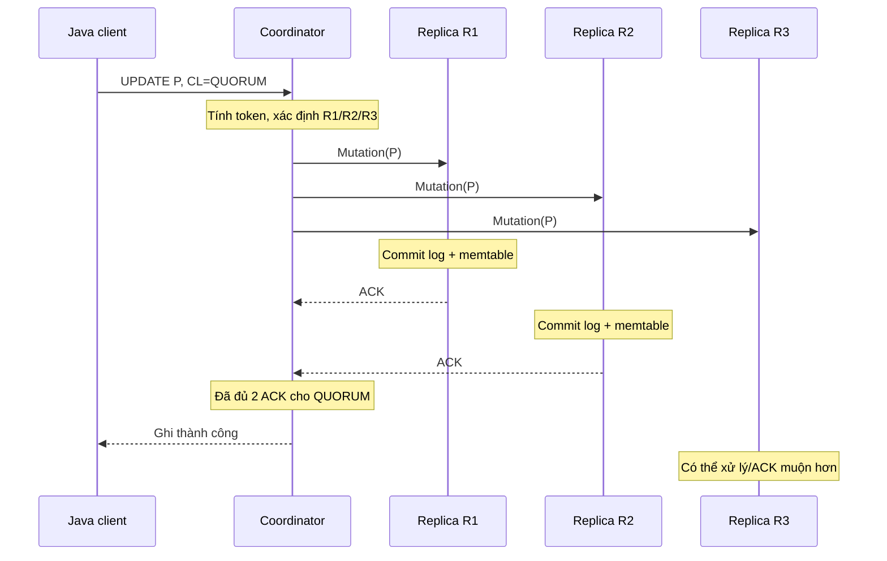
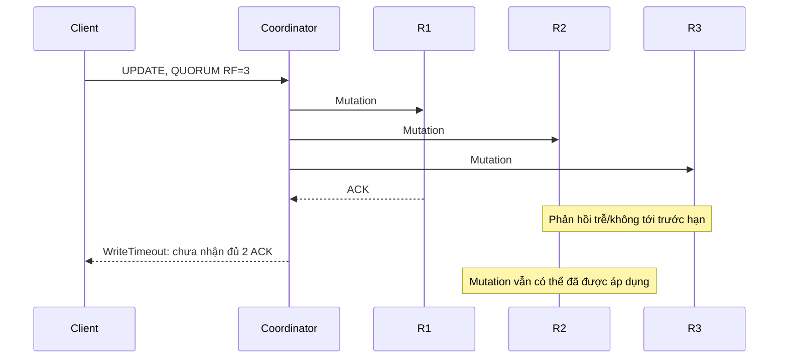

# Mutation từ coordinator đến các bản sao chịu trách nhiệm

Trong Apache Cassandra, một câu `INSERT` hoặc `UPDATE` không đơn giản được gửi đến “một database server” để lưu rồi kết thúc. Client gửi **mutation** tới một node làm **coordinator**; coordinator xác định **những replica nào chịu trách nhiệm lưu partition**, chuyển mutation qua mạng đến chúng, nhận phản hồi theo **consistency level (CL)** và trả kết quả cho client. Tại từng replica, write path liên quan đến **commit log**, **memtable** và quá trình tạo **SSTable** sau đó.

Điểm dễ nhầm nhất là ba khái niệm: **replica đã áp dụng mutation**, **coordinator đã nhận đủ ACK theo CL** và **mọi bản sao đã bền vững, đồng bộ hoàn toàn**. Chúng không phải một sự kiện duy nhất. Một lần ghi `LOCAL_QUORUM` thành công có thể vẫn còn replica ở DC khác chưa nhận dữ liệu. Ngược lại, một lần `WriteTimeout` có thể đã được một số replica áp dụng, chỉ thiếu phản hồi kịp thời.

Bài học thuộc chương **Đường ghi và độ bền** (`menuLevel1`) của mô-đun `DATABASE_ENGINE_WIDE_COLUMN_CASSANDRA`. Toàn mô-đun hướng đến hiểu kiến trúc phân tán và wide-column của Cassandra: partition key, thiết kế bảng theo truy vấn, CQL, replication, compaction, repair, xử lý lỗi và tích hợp ứng dụng Java. Nội dung này chỉ tập trung vào **đường đi của mutation từ coordinator đến tập replica đích và ý nghĩa của việc xác nhận ghi**, làm nền cho các bài về commit log, memtable, SSTable và độ bền ở mức chi tiết hơn.

## 1. Mục tiêu học tập

Sau bài này, bạn có thể:

1. Phân biệt **CQL statement**, **mutation**, **partition**, **replica** và **coordinator**.
2. Giải thích vì sao coordinator có thể không phải replica sở hữu dữ liệu và cách xác định **tập replica đích** dựa trên partition key, token và replication strategy.
3. Vẽ đường đi của một ghi thông thường: client → coordinator → replica → ACK → client.
4. Mô tả vai trò của **commit log**, **memtable** và **SSTable**, cũng như ranh giới giữa ACK theo CL và fsync xuống đĩa.
5. Tính số ACK ở `ONE`, `QUORUM`, `LOCAL_QUORUM`, `EACH_QUORUM` và `ALL` trong topology một/nhiều DC.
6. Lý giải cơ chế gửi mutation khi replica chậm/down, hinted handoff và kết quả ghi chưa rõ sau timeout.
7. Thực hành CQL, tracing, quan sát replica placement và viết Java Driver 4.x đặt CL trên từng statement.
8. Nhận diện các vấn đề về timestamp, retry idempotent, ghi có điều kiện và giới hạn của việc chỉ nhìn vào một response thành công.

## 2. Từ câu CQL đến mutation

Trong CQL, người học nhìn thấy các lệnh:

```sql
INSERT INTO shop.order_by_id (order_id, state)
VALUES (11111111-1111-4111-8111-111111111111, 'CREATED');

UPDATE shop.order_by_id
SET state = 'PAID'
WHERE order_id = 11111111-1111-4111-8111-111111111111;

DELETE state FROM shop.order_by_id
WHERE order_id = 11111111-1111-4111-8111-111111111111;
```

Ở tầng lưu trữ phân tán, các thao tác đó được chuyển thành **mutation**: thông tin về thay đổi cần áp dụng cho một hoặc nhiều cell/row trong một **partition**. Mutation không nhất thiết là “toàn bộ hàng mới”; nó có thể chỉ chứa giá trị của một cell đã cập nhật, một tombstone cho dữ liệu bị xóa, hoặc dữ liệu liên quan TTL.

### 2.1. Những thuật ngữ cần tách bạch

| Thuật ngữ | Vai trò trên đường ghi |
| --- | --- |
| **CQL statement** | Câu lệnh mà client gửi, ví dụ `UPDATE ... WHERE order_id = ?`. |
| **Mutation** | Biểu diễn nội bộ về thay đổi dữ liệu cần được chuyển tới replica. |
| **Partition key** | Thành phần khóa dùng tính token để xác định vị trí logic của partition. |
| **Token** | Giá trị được partitioner suy ra từ partition key; giúp định tuyến trong ring. |
| **Coordinator** | Node nhận request, xác định replica đích, điều phối và tổng hợp phản hồi. |
| **Replica** | Node được replication strategy xác định là nơi lưu bản sao của partition. |
| **Replication factor (RF)** | Số bản sao của một partition trong phạm vi được cấu hình, thường riêng từng DC. |
| **Consistency level (CL)** | Ngưỡng/phạm vi phản hồi mà coordinator cần chờ để báo thao tác thành công. |
| **ACK** | Phản hồi từ replica về xử lý mutation; không phải bằng chứng mọi node khác đã cập nhật. |
| **Hint** | Thông tin mutation được lưu tạm để gửi lại cho replica bỏ lỡ, theo cơ chế hinted handoff. |

**Thực hành tư duy:** Khi nhìn thấy `UPDATE` có `WHERE order_id = ?`, trước tiên xác định **partition key**, chứ không suy từ tên node mà client đang kết nối. Vị trí dữ liệu nằm ở **replica được chọn từ metadata token/ring**, không cố định ở coordinator.

### 2.2. Mutation là thay đổi logic, không phải bản snapshot hàng

Ví dụ bảng:

```sql
CREATE TABLE shop.order_by_id (
  order_id uuid PRIMARY KEY,
  state text,
  updated_by text,
  updated_at timestamp
);
```

Ghi `UPDATE ... SET state='PAID'` không có nghĩa coordinator bắt buộc gửi **toàn bộ ba cột còn lại** đến từng replica. Cassandra hỗ trợ thao tác ghi theo cell/row với timestamp ở mức phù hợp, và từng replica hòa giải phiên bản cũ/mới trong các bước đọc/compaction tương ứng.

**Wide-column lưu theo partition:** Một partition có thể có nhiều clustering rows; cách nhóm dữ liệu theo partition key tác động trực tiếp tới **tập replica phải chịu tải**. Chọn partition key kém làm một tập replica quá nóng, dù cluster có rất nhiều node.

## 3. Ai được làm coordinator?

Client dùng Cassandra native protocol kết nối đến một node có thể xử lý request. Node nhận request là **coordinator cho lần thao tác đó**. Nó không nhất thiết thuộc tập replica đích của partition.

```text
       Java application / cqlsh
                 |
                 |  CQL UPDATE, CL=QUORUM
                 v
          +---------------+
          | Coordinator C |    (có thể không chứa partition P)
          +---------------+
             /    |     \
            v     v      v
           R1     R2     R3
            \     |     /
        Các replica của partition P
```

### 3.1. Trách nhiệm của coordinator

Với ghi thông thường, coordinator chịu các việc khái niệm:

1. Nhận request và phối hợp với tầng truy vấn để kiểm tra/chuẩn bị statement phù hợp.
2. Xác định **partition key** của mutation và **tập replica tự nhiên** (*natural replicas*) chịu trách nhiệm cho partition.
3. Gửi mutation đến các replica thích hợp thông qua internode messaging, có thể có tối ưu/forwarding giữa DC tùy phiên bản và topology.
4. Theo dõi trạng thái các replica, ACK, lỗi và hạn thời gian theo **CL của request**.
5. Khi đủ phản hồi hợp lệ, gửi kết quả thành công cho client; nếu không, trả lỗi như `Unavailable`, `WriteTimeout` hoặc `WriteFailure` tùy trường hợp.
6. Trong điều kiện cho phép, hỗ trợ lưu hint để replica tạm thời bỏ lỡ mutation có cơ hội nhận lại sau này.

**Điều coordinator không tự làm chỉ vì nhận request:** trở thành bản sao bổ sung cho mọi partition, khóa tất cả ghi cạnh tranh trên cluster, hoặc buộc mọi DC có cùng phiên bản ngay trước khi trả ACK local.

### 3.2. Connection không quyết định nơi lưu dữ liệu

Giả sử Java Driver liên hệ `node-7` cho một `UPDATE`. `node-7` có thể làm coordinator, nhưng ba replica thực sự sở hữu partition lại là `node-2`, `node-4` và `node-9`. Khi chuyển request sang `node-8`, partition key và replication strategy ổn định vẫn xác định **cùng tập replica đích**, không tự chuyển dữ liệu sang node-8.

Driver thường cố gắng định tuyến hiệu quả, ưu tiên local DC theo cấu hình; tuy nhiên, **driver routing và replica placement là hai khái niệm khác nhau**. Khi điều tra latency, cần biết cả coordinator và replica đích.

## 4. Coordinator xác định replica đích bằng cách nào?

### 4.1. Từ partition key đến token

Giả sử bảng:

```sql
CREATE TABLE shop.order_by_customer (
  customer_id uuid,
  order_id uuid,
  state text,
  PRIMARY KEY ((customer_id), order_id)
);
```

Ở đây:

- `customer_id` là **partition key**.
- `order_id` là **clustering key**; nó chọn row trong partition, **không đổi tập replica** của partition.
- Mọi order của cùng `customer_id` có cùng partition token và thường được lưu bởi cùng tập replica đích.

Trong cấu hình phổ biến dùng `Murmur3Partitioner`, Cassandra tính token từ biểu diễn nhị phân của partition key. Nếu partition key gồm nhiều cột, các giá trị được mã hóa như một **composite partition key**; không được tự hash một chuỗi tùy ý rồi coi đó là token Cassandra.

```text
customer_id
    |
    v
Partition key encoding
    |
    v
Partitioner -> token T
    |
    v
Token ring / cluster metadata
    |
    v
Replication strategy + RF từng DC
    |
    v
Natural replicas cho partition P
```

### 4.2. Replication strategy và phạm vi DC

Hai chiến lược thường gặp:

- **`SimpleStrategy`:** phân bố replica đơn giản theo ring; chủ yếu phù hợp môi trường thử nghiệm một DC.
- **`NetworkTopologyStrategy`:** đặt RF riêng từng datacenter, phù hợp khi cần phân tán dữ liệu và quy tắc chịu lỗi theo DC/rack.

Ví dụ:

```sql
CREATE KEYSPACE shop
WITH replication = {
  'class': 'NetworkTopologyStrategy',
  'dc1': 3,
  'dc2': 2
};
```

Với cấu hình giả định có đủ node, một partition có **3 replica ở dc1 và 2 replica ở dc2**. Tổng RF là 5. Tập đích được chọn từ **token placement trong mỗi DC** và chính sách replication, không phải “năm node bất kỳ đang rảnh”.

### 4.3. Danh sách replica không phải danh sách ACK bắt buộc

RF là số **bản sao phải được duy trì** theo topology. CL là ngưỡng **phản hồi cần chờ**. Với RF=3 và ghi `ONE`, Cassandra vẫn có mục tiêu gửi mutation đến **toàn bộ tập replica sở hữu partition**, nhưng có thể trả response khi chỉ **một** replica ACK. Đây là khác biệt nền tảng:

| Câu hỏi | Cấu hình/cơ chế quyết định |
| --- | --- |
| Mutation dành cho những node nào? | Partition key, token, replication strategy và RF. |
| Coordinator phải chờ những phản hồi nào trước khi báo thành công? | CL và trạng thái request. |
| Replica đã bỏ lỡ ghi sẽ bắt kịp bằng gì? | Gửi mutation, hinted handoff, repair và các cơ chế hội tụ. |

**Không hiểu `CL=ONE` thành “Cassandra chỉ gửi mutation cho một replica”.** CL điều chỉnh **xác nhận**, không sửa RF.

## 5. Đường ghi chuẩn: chuỗi thông điệp từ client đến ACK

Hãy xét một DC RF=3, partition `P` có replica `R1`, `R2`, `R3`. Client yêu cầu ghi `QUORUM`, ngưỡng là `floor(3/2)+1=2`.



Đây là **mô hình logic**. Trên mạng thực, Cassandra có thể áp dụng tối ưu message forwarding, batching, speculative behavior và đường truyền liên DC tùy phiên bản. Không nên suy từ sơ đồ rằng coordinator luôn tạo đúng một gói TCP trực tiếp cho mỗi replica hay các bước của ba node xảy ra theo cùng thứ tự.

### 5.1. Những bước độc lập cần quan sát

| Thời điểm | Sự kiện | Có đủ để client tuyên bố ghi đã thành công ở QUORUM? |
| --- | --- | --- |
| `t0` | Client gửi CQL cho coordinator. | **Chưa**. |
| `t1` | Coordinator xác định tập replica. | **Chưa**. |
| `t2` | Mutation được gửi/được lên lịch gửi. | **Chưa**. |
| `t3` | `R1` áp dụng mutation và gửi ACK. | **Chưa**, mới một phản hồi. |
| `t4` | `R2` áp dụng mutation và gửi ACK. | **Có thể**, đủ hai ACK nếu không có lỗi khác. |
| `t5` | Client nhận response thành công. | **Có bằng chứng request đã được xác nhận ở CL**. |
| `t6` | `R3` nhận/áp dụng mutation hoặc bắt kịp sau đó. | Là sự hội tụ bổ sung, **không phải điều kiện bắt buộc của response QUORUM**. |

Điểm tách biệt quan trọng: **coordinator nhận đủ ACK** và **client nhận được phản hồi** cũng là hai sự kiện khác nhau. Nếu `t4` đã xảy ra nhưng response bị mất trên đường về client, driver vẫn có thể timeout; ứng dụng không được suy rằng dữ liệu chắc chắn chưa được ghi.

### 5.2. Nếu coordinator đồng thời là một replica?

Khi coordinator cũng nằm trong tập replica đích, nó có thể áp dụng mutation **cục bộ** theo cùng cơ chế lưu trữ của replica, đồng thời điều phối các replica khác. ACK local góp vào ngưỡng như ACK của một replica; **không được tính coordinator thành hai replica**.

Ngược lại, nếu coordinator **không** là replica đích, nó không tự trở thành một bản sao dữ liệu của partition chỉ vì đã nhận request.

## 6. Điều gì diễn ra tại từng replica?

Khi mutation đến một replica có thể xử lý request, Cassandra thực hiện một đường ghi tại node. Với ghi thông thường, các thành phần quan trọng:

```text
                 Mutation đi từ coordinator
                             |
                             v
                      Replica node
                             |
                +------------+------------+
                |                         |
                v                         v
             Commit log                 Memtable
          (ghi tuần tự/log)        (cấu trúc trong RAM)
                |                         |
       Phục hồi sau restart        Flush theo ngưỡng/tình trạng
                                          |
                                          v
                                       SSTable
                                   (immutable, trên đĩa)
                                          |
                                          v
                                 Compaction nền về sau
```

### 6.1. Commit log — chỗ ghi phục hồi

Commit log lưu thông tin mutation theo dạng append, hỗ trợ **replay** nếu node restart/crash trước khi dữ liệu ở memtable được flush thành SSTable. Nó không phải một file lịch sử nghiệp vụ có thể truy vấn bằng CQL.

Commit log thường được tổ chức thành các segment. Khi dữ liệu trong các memtable tương ứng đã được flush và checkpoint đủ điều kiện, các segment cũ mới có thể được tái sử dụng/xóa theo quy trình quản lý commit log.

**Lưu ý về độ bền:** thời điểm một mutation được ACK và thời điểm các byte commit log được **fsync xuống thiết bị lưu trữ** phụ thuộc cấu hình `commitlog_sync` và phiên bản Cassandra. Chẳng hạn, cách đồng bộ **periodic** có thể cho phép ACK trước đợt fsync định kỳ; cấu hình đồng bộ chặt hơn như **batch** có đặc điểm chờ sync khác. Vì thế, ACK từ replica không luôn đồng nghĩa “byte đã vật lý ổn định trên đĩa trong mọi chế độ”.

### 6.2. Memtable — cấu trúc ghi trong bộ nhớ

Memtable nhận dữ liệu cho việc đọc và quản lý nội bộ. Mutation được ghi vào cấu trúc dữ liệu trong RAM để truy cập nhanh; **không phải đợi flush SSTable mới có thể trả ACK cho mỗi ghi thông thường**.

Khi memtable đạt ngưỡng hoặc vì điều kiện vận hành, Cassandra **flush** dữ liệu xuống các SSTable bất biến. Đó là bước lưu trữ nền khác với việc chờ replica ACK ở CL.

### 6.3. SSTable và compaction

SSTable là định dạng lưu dữ liệu trên đĩa; những phiên bản dữ liệu/tombstone có thể nằm trong nhiều SSTable. **Compaction** hợp nhất chúng để tối ưu lưu trữ và đọc theo các chiến lược được cấu hình. Nó **không** là điều kiện ghi `QUORUM` thành công và **không** tự đối chiếu nội dung giữa các replica.

**Anti-entropy repair** là cơ chế khác dùng để so sánh/sửa dữ liệu giữa các replica. Cần phân biệt compaction cục bộ với repair liên node.

### 6.4. Tóm tắt: ba tầng “đã ghi”

| Trạng thái | Điều đã xảy ra | Điều chưa thể suy ra |
| --- | --- | --- |
| **Replica đã xử lý và ACK mutation** | Replica hoàn tất phần xử lý cần thiết để phản hồi. | Mọi replica khác đã ACK; mọi chế độ đều fsync trước ACK. |
| **Coordinator đủ ACK theo CL** | Ngưỡng/phạm vi xác nhận của request được đáp ứng. | Mọi replica đích đã bắt kịp; đã có transaction nhiều partition. |
| **Dữ liệu đã flush/compaction/repair** | Các cơ chế lưu trữ và hội tụ có tiến triển tương ứng. | Đây là sự kiện phải hoàn tất trước mỗi response ghi thông thường. |

Trong thiết kế độ bền, phải xét cả **RF**, **CL**, **commit log sync**, chất lượng đĩa, lỗi tương quan giữa các replica và vận hành backup/repair. Không tồn tại một “nút bật durability tuyệt đối” chỉ bằng chọn `ALL`.

## 7. ACK theo CL: ngưỡng trên cùng tập replica

### 7.1. Một DC với RF=3

Giả sử ba replica của partition đều nằm trong `dc1`:

| Consistency level | Phản hồi tối thiểu để báo ghi thành công | Nếu một replica down |
| --- | ---: | --- |
| `ONE` | 1 | Có thể thành công. |
| `TWO` | 2 | Có thể thành công nếu hai replica còn lại ACK. |
| `THREE` | 3 | Không đủ replica sống để đạt ngưỡng. |
| `QUORUM` | `floor(3/2)+1=2` | Có thể thành công. |
| `ALL` | 3 | Không đủ replica sống. |
| `LOCAL_ONE` | 1 local | Tương tự `ONE` trong lab một DC. |
| `LOCAL_QUORUM` | 2 local | Tương tự `QUORUM` trong lab một DC. |
| `ANY` (chỉ ghi) | Một replica ACK **hoặc** hint có thể thỏa theo ngữ nghĩa hỗ trợ | Có thể thành công dù một số replica down; không bảo đảm đã có replica đích ACK nếu chỉ nhờ hint. |

“Có thể thành công” nghĩa là **đủ replica theo ngưỡng** khi chúng trả lời đúng hạn; node UP nhưng quá tải/mạng chậm vẫn có thể làm request timeout.

### 7.2. RF=5 và ý nghĩa của QUORUM

Với RF=5, `QUORUM=floor(5/2)+1=3`. Coordinator cần ba ACK cho một ghi `QUORUM`, không phải hai như RF=3.

Quorum chỉ có ý nghĩa về **tập replica của đúng partition và đúng phạm vi**. Nếu mọi node trong cluster có vài chục node nhưng partition chỉ có RF=3, không được lấy số node toàn cluster làm `N` trong công thức.

### 7.3. Phân biệt RF và CL khi lên kế hoạch chịu lỗi

Để một ghi thành công:

\[
\text{số replica phản hồi hợp lệ trong phạm vi CL} \geq \text{ngưỡng CL}
\]

Nhưng để bảo vệ một **ghi đã xác nhận** qua sự cố tiếp theo, còn phải xem **nó đã đến những fault domain nào**, các replica có độ bền cục bộ ra sao và lỗi có xảy ra đồng thời hay không. Hai ACK ở cùng rack không đem lại cùng mức cô lập lỗi vật lý với hai ACK ở rack khác, dù về số lượng đều là hai.

## 8. Nhiều datacenter: coordinator gửi đi đâu và chờ ở đâu?

Giả sử một partition có `NetworkTopologyStrategy`:

```text
                     Coordinator C ở dc1
                            |
             +--------------+--------------+
             |                             |
      dc1: RF=3                       dc2: RF=3
    A1    A2    A3                  B1    B2    B3

             Tổng RF = 3 + 3 = 6 replica.
```

Khi nhận mutation, Cassandra có mục tiêu đưa dữ liệu đến **cả hai tập replica của partition** theo topology. Tuy nhiên, coordinator **chỉ chờ các ACK đáp ứng CL đã chọn** trước khi báo thành công.

| Ghi ở CL | Phản hồi bắt buộc | Điều chưa được bảo đảm sau response |
| --- | --- | --- |
| `LOCAL_ONE` từ dc1 | 1 ACK từ dc1 | Hai replica dc1 khác và mọi replica dc2 đã áp dụng. |
| `LOCAL_QUORUM` từ dc1 | 2 ACK trong dc1 | Quorum dc2 đã áp dụng. |
| `QUORUM` toàn cụm | 4 ACK bất kỳ trên tổng 6 replica | Cả hai DC **đều** có local quorum ACK. |
| `EACH_QUORUM` (ghi) | 2 ACK dc1 **và** 2 ACK dc2 | Mọi replica đều ACK. |
| `ALL` | 6 ACK | Có thể hoạt động khi một replica đích down; `ALL` đòi tất cả. |

**Điểm then chốt:** với topology cân bằng `3+3`, `QUORUM` cần bốn ACK nên phải có ACK từ hơn một DC, nhưng không buộc **hai từ mỗi DC**. Ví dụ `A1+A2+A3+B1` đủ cho `QUORUM`; ghi `EACH_QUORUM` vẫn cần **thêm một ACK ở dc2**.

### 8.1. Ghi LOCAL_QUORUM không phải “chỉ nhân bản trong local DC”

Nếu coordinator ở `dc1` và yêu cầu `LOCAL_QUORUM`, hai ACK `dc1` đủ để trả response. Điều này **không có nghĩa Cassandra bỏ qua replica dc2**: remote replication vẫn thuộc đường ghi/phân phối mutation của cluster. Nhưng **ACK dc2 không là điều kiện bắt buộc của response local**, nên client dc2 đọc ngay sau đó có thể thấy phiên bản cũ nếu mutation chưa đến.

Phải phân biệt:

1. **Tập replica cần được cập nhật về lâu dài**: do replication strategy/RF.
2. **Tập phản hồi phải đợi để trả thành công**: do CL.
3. **Tập replica thực tế đã nhận dữ liệu trước thời điểm client đọc**: do latency, liveness và tình trạng hệ thống.

### 8.2. Khi RF hai DC không bằng nhau

Giả sử `dc1 RF=3` và `dc2 RF=2`:

| CL | Ngưỡng cho một ghi |
| --- | --- |
| `QUORUM` | `floor(5/2)+1=3` ACK toàn cụm. |
| `LOCAL_QUORUM` từ dc1 | `floor(3/2)+1=2` ACK dc1. |
| `LOCAL_QUORUM` từ dc2 | `floor(2/2)+1=2` ACK dc2, tức cả hai replica dc2. |
| `EACH_QUORUM` | 2 ACK dc1 và 2 ACK dc2. |
| `ALL` | 5 ACK. |

Ghi `QUORUM` từ dc1 **có thể đạt đủ ba ACK chỉ ở dc1** khi cả ba local replica khỏe. Không được tuyên bố “quorum toàn cục luôn phải chờ remote DC” nếu RF lệch.

### 8.3. Phạm vi LOCAL phụ thuộc coordinator

`LOCAL_QUORUM` nghĩa là quorum trong **DC của coordinator**, không phải “DC mà doanh nghiệp đặt tên là primary” hay vị trí vật lý của client. Với ứng dụng Java, cấu hình `local datacenter` và routing phải phù hợp; nếu các yêu cầu ghi/đọc điều phối qua những DC khác nhau, tập ACK local có thể không giao nhau.

### 8.4. Rủi ro WAN trong đường ghi

WAN bị chậm hoặc chia cắt có thể:

- Không ngăn được ghi `LOCAL_QUORUM` tại DC còn khỏe nếu đủ ACK local.
- Làm ghi `QUORUM` ở topology `3+3` không đạt bốn ACK.
- Làm `EACH_QUORUM` không đạt do thiếu quorum ở một DC.
- Làm `ALL` không đạt vì thiếu một hoặc nhiều replica đích.

Trạng thái liveness tại coordinator quyết định lỗi có thể được báo ngay là `Unavailable` hay request vẫn được gửi nhưng timeout. **Không có ACK remote** là một sự thật về response, không tự chứng minh mutation đã bị mất vĩnh viễn ở remote DC.

## 9. Replica chậm, down và hinted handoff

### 9.1. Replica down khi coordinator đang gửi mutation

Giả sử RF=3, ghi `QUORUM`:

```text
R1: UP, áp dụng mutation và ACK.
R2: UP, áp dụng mutation và ACK.
R3: DOWN, chưa nhận mutation.

W = 2; hai ACK R1/R2 -> có thể báo thành công.
```

Nếu cấu hình và điều kiện phù hợp, Cassandra có thể lưu **hint** cho `R3`. Sau khi R3 phục hồi, cơ chế **hinted handoff** cố gắng phát lại mutation đã bỏ lỡ.

**Hinted handoff là best effort:** hint có giới hạn thời gian lưu, dung lượng và cấu hình; không thay thế **anti-entropy repair** cho những replica down lâu hoặc đã bỏ lỡ nhiều mutation.

### 9.2. Ghi ONE so với ANY

Đây là khác biệt cần nhớ:

- Ghi `ONE` yêu cầu ít nhất **một replica đích** phản hồi hợp lệ.
- Ghi `ANY` có thể được xác nhận khi **một replica ACK hoặc một hint được lưu** theo cơ chế hỗ trợ, kể cả khi chưa replica đích nào ACK.
- `ANY` **không hợp lệ cho `SELECT` thông thường**.

Nếu `ANY` thành công chỉ do hint, **không được suy ra đọc `ONE` ngay sau đó sẽ thấy mutation**. Hint được giữ để **giao lại**; nó không phải một replica đã sẵn sàng phục vụ câu `SELECT`.

### 9.3. Khi node UP nhưng mạng chậm

Một replica được failure detector xem là sống vẫn có thể bị nghẽn CPU, disk, GC, queue hoặc mất gói. Nếu coordinator chờ hai ACK ở `QUORUM` nhưng chỉ nhận một trước deadline, client có thể thấy `WriteTimeout` dù replica chậm cuối cùng đã xử lý mutation.

Vì vậy **“replica UP” không đồng nghĩa “replica sẽ ACK kịp”**. Muốn điều tra, cần xét số replica UP, thời gian phản hồi và tải của những node sở hữu partition.

### 9.4. Vì sao read repair và compaction không thay thế hint?

| Cơ chế | Mục tiêu |
| --- | --- |
| **Hinted handoff** | Giữ/phát lại mutation cho replica tạm thời không nhận được ghi. |
| **Read reconciliation** | Hòa giải những phiên bản replica trả về trên đường đọc. |
| **Read repair** | Có thể sửa sai khác được phát hiện bởi đường đọc, tùy phiên bản/cấu hình. |
| **Anti-entropy repair** | Đối chiếu dữ liệu replica chủ động/định kỳ, không cần một request đọc ứng dụng. |
| **Compaction** | Hợp nhất và dọn SSTable/tombstone **trên từng node** theo quy tắc lưu trữ. |

Chúng liên quan đến hội tụ dữ liệu ở các thời điểm khác nhau. Không có cơ chế nào đồng nghĩa “mọi mutation đã được đồng bộ vĩnh viễn ngay khi coordinator báo `ONE` thành công”.

## 10. Lỗi từ coordinator nhìn từ phía client

### 10.1. `UnavailableException`

Coordinator đánh giá rằng số replica **được coi là đang sống** không đủ để đáp ứng CL. Ví dụ RF=3, `QUORUM` cần hai, nhưng chỉ một replica của partition được coi là UP. Request có thể bị từ chối vì không có đường xác nhận đạt quorum.

### 10.2. `WriteTimeoutException`

Coordinator không nhận đủ phản hồi hoặc không hoàn tất đường ghi trong thời hạn yêu cầu. Ví dụ:



**Điểm quan trọng:** Số ACK coordinator **đã nhận** khác số replica **có thể đã áp dụng** mutation. Một ACK có thể đến muộn hoặc bị mất trên đường mạng.

### 10.3. `WriteFailureException`

Replica có thể báo lỗi khi xử lý mutation; coordinator không còn đáp ứng được ngưỡng yêu cầu. Một số replica khác vẫn có thể đã ghi. Chỉ tăng timeout thường không khắc phục nguyên nhân thực như lỗi disk hoặc tài nguyên.

### 10.4. Driver timeout và mất phản hồi từ coordinator

Coordinator có thể đã nhận đủ quorum và gửi success, nhưng đường client/coordinator bị ngắt. Java Driver báo timeout hoặc lỗi kết nối. **Server có thể đã hoàn tất thao tác**, dù client chưa nhận ACK. Vì vậy mọi lỗi mất kết quả ghi phải được thiết kế với khả năng **unknown outcome**.

| Kết quả client thấy | Suy luận hợp lệ | Không được suy ra |
| --- | --- | --- |
| Ghi thành công ở `ONE` | Ít nhất điều kiện `ONE` đã được xác nhận. | Mọi replica đã đồng bộ hoặc đã fsync ở mọi chế độ. |
| Ghi thành công ở `QUORUM` | Đủ ACK quorum trong phạm vi tương ứng. | Mọi DC đều đạt local quorum. |
| `Unavailable` | Request không được xác nhận theo CL do không đủ replica được coi là sống. | Dữ liệu cũ đã mất; mọi request trước đó chưa áp dụng. |
| `WriteTimeout` | Không được xác nhận đủ CL đúng hạn. | Không replica nào đã ghi mutation. |
| `WriteFailure` | Có replica báo lỗi; CL không được xác nhận. | Mọi replica đều từ chối mutation. |
| Driver timeout/mất kết nối | Client không nhận được kết quả trong deadline. | Server chắc chắn chưa thực hiện ghi. |

### Retry và idempotency

Một `UPDATE ... SET state='PAID'` gửi lại với cùng primary key, payload và timestamp có thể được thiết kế gần idempotent; một **counter increment** hoặc một `INSERT` sinh UUID mới mỗi lần retry thì không. Nếu retry dùng timestamp mới hơn, mutation cũ về nghiệp vụ còn có thể ghi đè một cập nhật khác theo last-write-wins.

**Không hạ ngầm CL khi retry**: ghi `QUORUM` timeout rồi retry `ONE` thành công chỉ chứng minh lần retry đạt `ONE`, không được tuyên bố request đã được ACK ở quorum.

## 11. Ví dụ tổng hợp: hai phiên client, một partition, ba replica

Giả sử `R1,R2,R3` đều lưu partition có `order_id=O`; A kết nối coordinator `C1`, B kết nối coordinator `C2`. Trong một DC RF=3:

```text
                Client A                       Client B
                   |                              |
                C1 coordinator                 C2 coordinator
                   \                             /
                    +------------+--------------+
                                 |
                       Replicas: R1,R2,R3

Ghi của A: W=2 (QUORUM)
Đọc của B: R=2 (QUORUM)
```

Nếu A ghi thành công tại `R1,R2`, B đọc sau đó từ `R2,R3`:

\[
W + R = 2+2=4>3=N
\]

Tập phản hồi giao nhau ở `R2`. Đường đọc Cassandra có thể dùng data response và digest để phát hiện phiên bản khác nhau, lấy thêm dữ liệu và **reconcile**. Khi không có mutation cạnh tranh hoặc timestamp bất thường, đây là cơ sở để B quan sát mutation vừa ghi.

Ngược lại, nếu B đọc ở `ONE` từ `R3` chưa bắt kịp, giá trị có thể cũ. Chỉ khi xác định được cả **CL ghi** và **CL đọc**, ta mới bàn về read-after-write; đường write path không tự buộc mọi phép đọc sau đó truy cập replica đã ACK.

**Một phân biệt cuối:** Ghi `QUORUM` thường không phải giao thức đồng thuận có điều kiện. Nếu A và B cùng cập nhật một cell, cả hai request có thể thành công; Cassandra chọn giá trị logic bằng timestamp. Muốn `IF NOT EXISTS`/`IF version=?` bảo vệ bất biến cập nhật, cần LWT/Paxos với serial consistency.

## 12. Thực hành CQL: quan sát write path trong cluster lab

Chỉ chạy trên **cluster kiểm thử**. Ví dụ giả định datacenter tên `dc1` có **ít nhất ba node phù hợp** và RF=3; điều chỉnh tên DC theo kết quả `nodetool status` của môi trường.

### 12.1. Tạo keyspace và bảng

```sql
CREATE KEYSPACE IF NOT EXISTS write_path_lab
WITH replication = {
  'class': 'NetworkTopologyStrategy',
  'dc1': 3
};

CREATE TABLE IF NOT EXISTS write_path_lab.order_by_id (
  order_id uuid PRIMARY KEY,
  state text,
  operation_id uuid,
  updated_at timestamp
);
```

Chỉ truy vấn theo `order_id` để minh họa đúng tập replica của một partition. Không dùng quét toàn bảng hoặc `ALLOW FILTERING` rồi suy rằng mọi kết quả thuộc cùng một tập replica.

### 12.2. Ghi và đọc ở QUORUM

Trong `cqlsh`:

```sql
CONSISTENCY QUORUM;

INSERT INTO write_path_lab.order_by_id (
  order_id, state, operation_id, updated_at
) VALUES (
  11111111-1111-4111-8111-111111111111,
  'CREATED',
  22222222-2222-4222-8222-222222222222,
  '2026-11-21 10:00:00+0000'
);

UPDATE write_path_lab.order_by_id
SET state = 'PAID',
    operation_id = 33333333-3333-4333-8333-333333333333,
    updated_at = '2026-11-21 10:05:00+0000'
WHERE order_id = 11111111-1111-4111-8111-111111111111;

SELECT state, operation_id, WRITETIME(state)
FROM write_path_lab.order_by_id
WHERE order_id = 11111111-1111-4111-8111-111111111111;
```

`CONSISTENCY` là lệnh của **cqlsh** điều khiển CL cho các statement **sau đó trong cùng phiên shell**. `WRITETIME(state)` là timestamp ghi của cell logic đang thắng, không phải thời điểm mọi replica nhận ACK hoặc thời điểm commit log fsync.

### 12.3. Quan sát coordinator/tracing

```sql
TRACING ON;

CONSISTENCY QUORUM;

UPDATE write_path_lab.order_by_id
SET state = 'PACKED'
WHERE order_id = 11111111-1111-4111-8111-111111111111;

TRACING OFF;
```

Trace có thể cho thấy coordinator, một số replica nhận mutation, các sự kiện message và độ trễ. **Không giả định** trace chứa đúng một thông điệp cho mỗi replica hoặc mô tả đầy đủ mọi chi tiết ACK sau khi CL đã thỏa; thông tin phụ thuộc phiên bản, tối ưu internode và thời điểm thu thập.

**Không bật tracing diện rộng trên production**: nó có chi phí và sinh dữ liệu theo dõi.

### 12.4. Xác định topology và replica placement

Từ shell có quyền quản trị một node Cassandra:

```bash
# Xem các node và DC ở mức cluster.
nodetool status

# Minh họa cú pháp: xem endpoint giữ partition key của hàng.
# Chạy lệnh trên bản nodetool hỗ trợ getendpoints.
nodetool getendpoints write_path_lab order_by_id 11111111-1111-4111-8111-111111111111
```

Trong lab **ba node với RF=3 cùng một DC**, về lý thuyết cả ba đều là replica của partition. Trong cluster có số node **lớn hơn RF**, lệnh xem replica placement giúp tránh kết luận sai kiểu “một node bất kỳ vừa down thì partition của tôi mất một replica”.

Nếu lệnh `getendpoints`, parser khóa UUID hoặc quyền trên bản phân phối của bạn khác ví dụ, xem help của `nodetool` tương ứng. **Không coi riêng `nodetool status` là bằng chứng một mutation cụ thể đã được áp dụng**.

### 12.5. Ma trận thử một node down

Trong **cluster lab được phép dừng node**, RF=3 một DC, một replica của partition không phản hồi:

| Ghi thử | ACK yêu cầu | Dự đoán nếu hai replica còn lại khỏe |
| --- | ---: | --- |
| `CONSISTENCY ONE` + `UPDATE` | 1 | Có thể thành công. |
| `CONSISTENCY QUORUM` + `UPDATE` | 2 | Có thể thành công. |
| `CONSISTENCY ALL` + `UPDATE` | 3 | Không đủ, có thể `Unavailable` hoặc timeout tùy liveness. |

Khi thử `ALL` không dùng cùng partition/hàng làm mốc rồi coi lỗi là rollback. Một số mutation có thể đã tới replica dù response thất bại. Chỉ dùng **key thử nghiệm riêng** và giữ operation ID để đối soát.

## 13. Java Driver 4.x: gửi mutation với CL rõ ràng

Đoạn dưới đây dùng `CqlSession` đã tạo với contact points, local datacenter, xác thực và TLS phù hợp. `PreparedStatement` được chuẩn bị một lần; mỗi request đặt CL riêng.

```java
import com.datastax.oss.driver.api.core.CqlSession;
import com.datastax.oss.driver.api.core.DefaultConsistencyLevel;
import com.datastax.oss.driver.api.core.DriverTimeoutException;
import com.datastax.oss.driver.api.core.cql.BoundStatement;
import com.datastax.oss.driver.api.core.cql.PreparedStatement;
import com.datastax.oss.driver.api.core.servererrors.UnavailableException;
import com.datastax.oss.driver.api.core.servererrors.WriteFailureException;
import com.datastax.oss.driver.api.core.servererrors.WriteTimeoutException;

import java.time.Instant;
import java.util.UUID;

public final class OrderMutationRepository {
    private final CqlSession session;
    private final PreparedStatement update;

    public OrderMutationRepository(CqlSession session) {
        this.session = session;
        this.update = session.prepare(
            "UPDATE write_path_lab.order_by_id " +
            "SET state = ?, operation_id = ?, updated_at = ? " +
            "WHERE order_id = ?");
    }

    public void updateState(
            UUID orderId, String state, UUID operationId, Instant at) {
        BoundStatement request = update
            .bind(state, operationId, at, orderId)
            .setConsistencyLevel(DefaultConsistencyLevel.LOCAL_QUORUM);

        try {
            session.execute(request);
            // Đã nhận phản hồi thành công theo LOCAL_QUORUM của request.
        } catch (UnavailableException e) {
            // Coordinator thấy không đủ replica local được coi là UP.
            throw e;
        } catch (WriteTimeoutException
                 | WriteFailureException
                 | DriverTimeoutException e) {
            // Mutation có thể đã được một số replica áp dụng.
            // Tầng nghiệp vụ cần xử lý trạng thái chưa xác định.
            throw e;
        }
    }
}
```

### 13.1. Điều cần nhớ khi triển khai

- **`DefaultConsistencyLevel.LOCAL_QUORUM`** chọn ngưỡng ACK ở DC coordinator; không thay đổi RF của keyspace.
- Việc `session.execute(...)` thành công chứng minh request được xác nhận theo CL đã chọn, **không** chứng minh mọi replica hoặc DC đã cập nhật.
- Một lần `WriteTimeout` có thể đã áp dụng mutation trên replica; **không sinh operation ID mới tùy tiện để retry**.
- Không đánh dấu `setIdempotent(true)` cho mọi statement chỉ để driver tự retry: idempotency phải được thiết kế ở mức primary key, payload, timestamp và side effect.
- Cấu hình `local datacenter` trong driver là một phần của việc định tuyến request và xác định phạm vi các mức `LOCAL_*`.
- Nếu ứng dụng chạy ngoài network container, phải đảm bảo địa chỉ node Cassandra quảng bá có thể được driver truy cập; contact point không tự sửa mọi vấn đề routing.

### 13.2. Cấp timestamp và retry

Nếu một mutation bị timeout rồi retry với **timestamp mới hơn**, nó có thể ghi đè một thay đổi từ client khác theo **last-write-wins**. Với thao tác có thể lặp lại, cân nhắc giữ một `operationId`, một payload và timestamp CQL ổn định, khi phù hợp với quy tắc nghiệp vụ. Timestamp cố định không thay thế **LWT** nếu cần chuyển trạng thái có điều kiện.

Ví dụ hai request ghi thường `UPDATE` cùng `state` có thể cùng được ACK ở `QUORUM`; kết quả cuối được Cassandra hòa giải theo timestamp. Muốn “chỉ cập nhật nếu `state='CREATED'`”, hãy dùng `UPDATE ... IF state='CREATED'` và kiểm tra `[applied]`.

## 14. Tình huống thực tế: sai kỳ vọng do nhầm ACK với độ bền

### Tình huống A — Ghi ONE và node còn lại chưa cập nhật

RF=3, client gửi `UPDATE state='PAID'` ở `ONE`, `R1` ACK, `R2/R3` chưa nhận mutation. Coordinator có thể trả thành công. Một client đọc `ONE` từ `R3` có thể thấy `CREATED`.

**Bài học:** response `ONE` chứng minh có ít nhất một replica đích ACK, không bảo đảm read-after-write qua mọi replica.

### Tình huống B — Ghi QUORUM thành công khi một node down

RF=3, `R3` down; `R1,R2` ACK. Ghi `QUORUM` vẫn có thể thành công. Khi R3 phục hồi, hinted handoff hoặc repair có thể giúp bắt kịp; việc chưa có R3 không làm response quorum trước đó sai.

**Bài học:** RF xác định ba bản sao; CL `QUORUM` chỉ yêu cầu hai ACK, nhưng quản trị dữ liệu bị bỏ lỡ vẫn quan trọng.

### Tình huống C — Ghi LOCAL_QUORUM ở DC1, đọc ở DC2

RF=3+3, ghi `LOCAL_QUORUM` ở dc1 được hai ACK local; DC2 đang trễ. Client đọc `LOCAL_QUORUM` ở dc2 có thể thấy trạng thái cũ.

**Bài học:** hai quorum nằm ở **hai tập replica khác DC**, không tự giao nhau. Nếu nghiệp vụ đòi đọc chéo DC ngay, phải thiết kế CL/định tuyến phù hợp.

### Tình huống D — Commit log periodic và sự cố nguồn điện

Replica có thể đã ACK theo write path, trong khi cấu hình commit log periodic chưa chạy fsync mới nhất. Nếu mất điện đột ngột trước đợt sync, khả năng phục hồi của mutation trên **node đó** khác với trường hợp commit log đã được fsync. Các replica khác có thể vẫn bảo vệ bản sao.

**Bài học:** “ACK đủ CL” và “mọi byte đã an toàn trên đĩa trong mọi chế độ và mọi loại sự cố” là hai phát biểu khác nhau. Cần xét chế độ đồng bộ commit log, replication, hạ tầng lưu trữ và giả định lỗi.

### Tình huống E — Timeout nhưng một số replica đã ghi

Ghi `QUORUM` chỉ nhận một ACK kịp hạn, coordinator trả `WriteTimeout`. Một replica khác có thể đã áp dụng mutation nhưng ACK tới muộn.

**Bài học:** kết quả của client **chưa xác định**, không phải rollback. Retry phải phù hợp với idempotency và trạng thái nghiệp vụ.

## 15. Checklist quan sát write path trong production

Khi một API Cassandra ghi chậm hoặc timeout, cần thu thập:

| Nhóm thông tin | Câu hỏi cần trả lời |
| --- | --- |
| **Dữ liệu** | Statement nào? Partition key nào? Có hot partition hay mutation quá lớn không? |
| **Replica placement** | RF, DC/rack, token và những node nào thực sự là replica đích? |
| **Coordinator** | Request đi qua node/DC nào? Driver có ưu tiên local DC đúng không? |
| **CL** | Cần bao nhiêu ACK, từ phạm vi nào? Có thay CL khi retry không? |
| **Mạng** | RTT, packet loss, mất kết nối liên DC hay internode congestion? |
| **Liveness** | Replica down hay chỉ UP nhưng quá tải? |
| **Storage** | Disk latency, commit log, memtable/flush, compaction và GC có bất thường? |
| **Retry** | Có tạo retry storm, counter increment lặp hoặc sinh operation ID mới không? |
| **Hội tụ** | Hints backlog, repair status, node vừa phục hồi? |
| **Ứng dụng** | Có gắn correlation ID/operation ID để đối soát timeout chưa biết kết quả? |

Không nên chỉ tăng timeout khi chưa biết nút nghẽn nằm ở coordinator, inter-node network, commit log hay replica hotspot. Tracing/metrics có thể giúp khoanh vùng, nhưng cần sử dụng theo giới hạn vận hành và không ghi dữ liệu nhạy cảm vào log.

## 16. Bài tập và lời giải

### Bài 1 — Coordinator có phải replica không?

Ứng dụng gửi `UPDATE` tới node `C`; token của partition xác định `R1,R2,R3` là replica. Nếu C không nằm trong tập đó, C có tự trở thành bản sao thứ tư không?

**Đáp án:** Không. C chỉ điều phối request; tập replica đích vẫn theo partition key và replication strategy.

### Bài 2 — ONE có làm Cassandra gửi tới một replica?

RF=3, client ghi `ONE`. Một học viên nói “Cassandra chỉ gửi mutation cho đúng một node; hai node kia sẽ không bao giờ nhận”. Đúng không?

**Đáp án:** Sai. RF quy định mục tiêu có ba replica; `ONE` chỉ xác định ngưỡng cần chờ để báo thành công. Mutation vẫn được phân phối tới các replica đích theo write path.

### Bài 3 — RF=3, QUORUM

Một replica down, hai replica còn lại xử lý và ACK đúng hạn. Ghi `QUORUM` có thể thành công không?

**Đáp án:** Có. `QUORUM=floor(3/2)+1=2`, nên hai ACK đủ ngưỡng.

### Bài 4 — RF=5, QUORUM

Với một partition RF=5, ghi `QUORUM` cần bao nhiêu ACK?

**Đáp án:** `floor(5/2)+1=3` ACK.

### Bài 5 — RF=3+2, LOCAL_QUORUM

Coordinator ở dc2 có RF=2. Ghi `LOCAL_QUORUM` cần bao nhiêu ACK và từ đâu?

**Đáp án:** `floor(2/2)+1=2` ACK, **đều từ dc2**. Cả hai replica local phải phản hồi.

### Bài 6 — RF=3+3, QUORUM so với EACH_QUORUM

Coordinator nhận ba ACK từ dc1 và một ACK từ dc2. `QUORUM` và ghi `EACH_QUORUM` có đủ chưa?

**Đáp án:** `QUORUM` cần 4/6 nên **đủ**. `EACH_QUORUM` cần ít nhất hai ACK **ở mỗi DC**, nên **chưa đủ** tại dc2.

### Bài 7 — Ghi LOCAL_QUORUM, đọc chéo DC

Ghi local quorum ở dc1 trả thành công. Client khác đọc local quorum ở dc2 ngay lập tức. Có chắc thấy mutation không?

**Đáp án:** Không. Hai tập phản hồi ở hai DC khác nhau không bắt buộc giao nhau; remote replica có thể chưa nhận mutation.

### Bài 8 — ACK của replica và SSTable

Replica ACK mutation ghi thường. Có chắc mutation vừa được flush thành SSTable trước khi ACK không?

**Đáp án:** Không. Write path thường ghi commit log và cập nhật memtable; flush SSTable là bước nền. Thời điểm fsync commit log còn tùy cấu hình `commitlog_sync`.

### Bài 9 — Hint có tính như một replica?

Không replica đích nào ACK, coordinator lưu hint cho một mutation và ghi ở `ANY` được báo thành công. Có thể đọc `ONE` ngay từ replica không?

**Đáp án:** Không bảo đảm. Hint chưa phải ACK của replica đích; trước khi phát lại, dữ liệu có thể chưa sẵn để đọc.

### Bài 10 — Timeout

RF=3, ghi `QUORUM` bị `WriteTimeout` sau một ACK. Có thể kết luận R2/R3 chắc chắn chưa áp dụng mutation không?

**Đáp án:** Không. Phản hồi có thể đến muộn hoặc mất; client chỉ biết request chưa được xác nhận đủ quorum đúng hạn.

### Bài 11 — Partition key và clustering key

Bảng có `PRIMARY KEY ((customer_id), order_id)`. Hai order khác nhau của cùng `customer_id` có tự động nằm ở hai tập replica khác nhau không?

**Đáp án:** Không. Cùng `customer_id` nghĩa là cùng partition key, do đó cùng token và tập replica đích (khi topology ổn định); `order_id` chỉ là clustering key.

### Bài 12 — Đồng thuận khi hai client cập nhật

Hai client cùng `UPDATE` một `state` ở `QUORUM` và cùng nhận thành công. Có thể suy rằng coordinator chỉ cho một client thắng như `IF NOT EXISTS` không?

**Đáp án:** Không. Ghi thường không dùng Paxos cho điều kiện. Cassandra có thể hòa giải cell theo timestamp; muốn compare-and-set cần LWT với `IF` và kiểm tra `[applied]`.

### Bài 13 — Node vừa khôi phục

R3 vừa UP sau thời gian down. `nodetool status` hiển thị `UN`. Điều đó có chứng minh R3 đã nhận mọi mutation bỏ lỡ và không cần repair không?

**Đáp án:** Không. Node UP chỉ mô tả trạng thái ring/liveness; hinted handoff và repair có thể chưa hoàn tất.

### Bài 14 — Mô hình hotspot

Một partition key được ghi hàng nghìn lần/giây và luôn nằm trên cùng ba replica. Thêm ba node mới vào cluster có tự chia write load của partition đó lên tất cả sáu node không?

**Đáp án:** Không tự động. Mỗi partition vẫn có tập replica đích do RF/placement xác định. Cần xem thiết kế partition key, phân bố dữ liệu và cách chia tải theo truy vấn.

## 17. Tổng kết

**Mutation từ coordinator đến các bản sao chịu trách nhiệm** là đường đi cốt lõi của ghi phân tán trong Cassandra. Client gửi CQL đến coordinator; partition key được biến thành token; replication strategy xác định tập replica đích; coordinator gửi mutation, theo dõi ACK và trả thành công khi đạt **consistency level**. Tại mỗi replica, commit log và memtable xử lý ghi, còn flush SSTable/compaction diễn ra theo những chu trình riêng.

Ba kết luận cần ghi nhớ:

1. **RF quyết định replica nào phải lưu partition; CL quyết định coordinator phải chờ bao nhiêu ACK từ phạm vi nào.** `ONE` không biến RF=3 thành RF=1.
2. **ACK theo CL không tự chứng minh mọi replica đã đồng bộ hoặc mọi byte đã fsync trước ACK.** Phải xét cấu hình commit log, cơ chế hội tụ, fault domain và durability requirements.
3. **Timeout không đồng nghĩa mutation bị rollback.** Có replica có thể đã ghi, còn ứng dụng không nhận đủ xác nhận; retry phải có khóa/operation ID và ngữ nghĩa idempotent phù hợp.

Hiểu rõ ba điểm này là nền tảng để tiếp tục đi sâu vào durability của commit log, memtable/SSTable, hinted handoff, repair, đọc sau ghi và cách kết nối ứng dụng Java với Cassandra một cách có kiểm soát.

### Tài liệu tham khảo

- [Apache Cassandra — Dynamo / Architecture](https://cassandra.apache.org/doc/stable/cassandra/architecture/dynamo.html): coordinator, replica placement, tunable consistency và cơ chế phân tán.
- [Apache Cassandra — Storage Engine](https://cassandra.apache.org/doc/stable/cassandra/architecture/storage-engine.html): đường ghi nội bộ, memtable, commit log, SSTable và compaction.
- [Apache Cassandra — CQL Data Manipulation](https://cassandra.apache.org/doc/stable/cassandra/developing/cql/dml.html): `INSERT`, `UPDATE`, `DELETE`, timestamp và mutation.
- [Apache Cassandra — Hints](https://cassandra.apache.org/doc/stable/cassandra/managing/operating/hints.html): cơ chế hinted handoff và giới hạn khi replica bỏ lỡ mutation.
- [Apache Cassandra — Repair](https://cassandra.apache.org/doc/stable/cassandra/managing/operating/repair.html): anti-entropy repair giữa các replica.
- [Apache Cassandra — cqlsh](https://cassandra.apache.org/doc/stable/cassandra/managing/tools/cqlsh.html): `CONSISTENCY` và `TRACING` trong lab.
