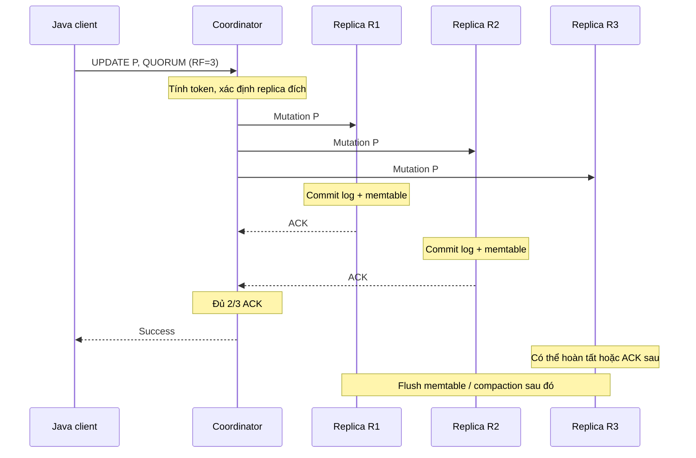

# Commit log, memtable và thời điểm phản hồi ghi

Khi một ứng dụng Java thực hiện `UPDATE` vào Apache Cassandra và nhận được phản hồi thành công, **dữ liệu đã được lưu ở đâu?** Đã nằm trong RAM, đã được ghi vào commit log, đã `fsync` xuống thiết bị lưu trữ, hay đã trở thành một SSTable? Câu trả lời không thể rút ra chỉ từ việc client thấy “success”, vì Cassandra phân biệt **đường ghi trên từng replica**, **chính sách đồng bộ commit log** và **ngưỡng ACK của consistency level (CL)**.

Trong một đường ghi thông thường, coordinator chuyển mutation đến các replica chịu trách nhiệm. Từng replica xử lý mutation thông qua **commit log** và **memtable**. Sau khi nhận đủ phản hồi theo CL, coordinator có thể báo thành công cho client **mà không chờ memtable flush thành SSTable**. Thời điểm commit log được đồng bộ xuống đĩa phụ thuộc chế độ `commitlog_sync`, nên ngay cả cụm từ “đã ghi vào commit log” cũng cần được hiểu chính xác.

Bài này thuộc chương **Đường ghi và độ bền** của mô-đun `DATABASE_ENGINE_WIDE_COLUMN_CASSANDRA`. Mô-đun tập trung vào kiến trúc phân tán và wide-column của Cassandra, khóa phân vùng, thiết kế bảng theo truy vấn, consistency level, replication, compaction, repair, xử lý lỗi và kết nối ứng dụng Java. Trọng tâm của bài là **commit log, memtable và mốc trả phản hồi ghi**, làm nền cho việc phân tích sự cố node và durability.

> **Thông điệp chính:** Một response ghi thành công có nghĩa request đã **đạt điều kiện xác nhận theo CL**. Nó không đồng nghĩa mọi replica đã ACK, mọi memtable đã flush, mọi SSTable đã compaction, hoặc mọi replica đã `fsync` commit log trong mọi cấu hình.

## 1. Mục tiêu học tập

Sau bài học, bạn có thể:

1. Vẽ đường đi của mutation từ Java client tới coordinator, replica, commit log, memtable và phản hồi ACK.
2. Phân biệt **append vào commit log**, **đồng bộ commit log (`fsync`)**, **cập nhật memtable**, **flush thành SSTable** và **compaction**.
3. Giải thích commit log hỗ trợ **replay** khi node khởi động lại và điều kiện tái sử dụng commit log segment.
4. Phân tích ảnh hưởng của `commitlog_sync: periodic` so với `batch` tới độ trễ ghi và cửa sổ mất dữ liệu khi node lỗi.
5. Tách biệt durability tại **một replica** với ngưỡng xác nhận **ONE/QUORUM/LOCAL_QUORUM/ALL** của cả request.
6. Nhận diện khác biệt giữa `Unavailable`, `WriteTimeout`, `WriteFailure` và timeout phía Java Driver.
7. Thực hành CQL, `TRACING`, `WRITETIME`, quan sát memtable/SSTable và mô tả những gì các công cụ **không thể chứng minh**.
8. Thiết kế retry theo idempotency, partition key, timestamp, operation ID và yêu cầu độ bền nghiệp vụ.

## 2. Bốn mốc không được gộp làm một

Giả sử keyspace có ba replica của partition `P`: `R1`, `R2`, `R3`. Client gửi ghi `QUORUM`, cần hai ACK:

```text
 Java client
     |
     | UPDATE ... WHERE partition_key=P;   CL=QUORUM
     v
 Coordinator
     |
     +--------------+--------------+
     |              |              |
     v              v              v
 Replica R1     Replica R2     Replica R3
     |              |              |
 Commit log      Commit log      Commit log
     +              +              +
 Memtable        Memtable        Memtable
     |              |              |
    ACK            ACK         (chưa ACK)
     \              /
      \            /
        Coordinator
             |
       2 ACK >= QUORUM
             |
             v
       Client: success

   SSTable flush/compaction: một tiến trình về sau,
   không phải điều kiện để mỗi ghi QUORUM trả success.
```

Có **bốn sự kiện khác nhau**:

| Mốc | Sự kiện | Điều có thể suy ra |
| --- | --- | --- |
| **A** | Replica append mutation vào commit log và cập nhật memtable theo write path. | Replica đã xử lý phần ghi cục bộ cần thiết; chi tiết sync phụ thuộc cấu hình. |
| **B** | Replica gửi ACK và coordinator **nhận đủ số ACK theo CL**. | Request đủ ngưỡng xác nhận của CL tại coordinator. |
| **C** | Client nhận response thành công. | Ứng dụng biết request được xác nhận theo CL; phản hồi này vẫn có thể bị mất trên mạng. |
| **D** | Memtable flush thành SSTable; commit log segment đủ điều kiện tái sử dụng; compaction về sau. | Đây là các mốc vòng đời lưu trữ, **không phải điều kiện mặc định để gửi response ở C**. |

Ngoài bốn mốc trên còn có **`fsync` commit log**. Với chế độ sync khác nhau, mốc `fsync` có thể nằm **trước hoặc sau ACK**. Không được giả định một thứ tự duy nhất áp dụng cho mọi cluster Cassandra.

## 3. Từ CQL đến ghi trên replica

Ví dụ một bảng truy vấn theo khóa đơn hàng (DDL này mang tính minh họa; hãy tạo keyspace `durability_lab` theo **Mục 12** trước khi chạy):

```sql
CREATE TABLE IF NOT EXISTS durability_lab.order_by_id (
  order_id uuid PRIMARY KEY,
  state text,
  operation_id uuid,
  updated_at timestamp
);

UPDATE durability_lab.order_by_id
SET state = 'PAID'
WHERE order_id = 11111111-1111-4111-8111-111111111111;
```

Đường đi khái niệm:

1. **Client** gửi CQL hoặc prepared/bound statement tới một node Cassandra.
2. Node nhận request đóng vai trò **coordinator** và xác định **partition key**, token và những **natural replicas** theo replication strategy/RF.
3. Coordinator phân phối **mutation** đến các replica liên quan; khi nhiều DC, Cassandra có thể tối ưu trao đổi liên node theo phiên bản/topology.
4. Từng replica thực hiện write path **cục bộ**: mutation được ghi vào commit log khi bật durability và đưa vào memtable của table tương ứng.
5. Replica trả phản hồi cho coordinator sau khi hoàn tất những việc mà đường ghi/cấu hình yêu cầu.
6. Coordinator theo dõi ACK/lỗi, kiểm tra ngưỡng CL, rồi trả kết quả cho client khi có đủ ACK hoặc trả lỗi khi không đạt.
7. Theo lịch nội bộ, memtable được flush xuống SSTable, commit log segment được thu hồi khi có thể, và compaction diễn ra sau đó.



Đây là **sơ đồ logic**, không cam kết thứ tự thực tế của từng packet, luồng CPU, scheduling hoặc việc coordinator gửi trực tiếp chính xác một message tới từng replica. Internode forwarding và các tối ưu phụ thuộc phiên bản Cassandra.

### 3.1. Coordinator không mặc nhiên là replica

Coordinator có thể không nằm trong tập replica của partition. Nếu coordinator cũng là một replica, nó xử lý ghi **cục bộ** như replica và ACK của nó có thể được tính **một lần** vào ngưỡng. Không được tính coordinator thành một bản sao thứ tư chỉ vì nó nhận request từ client.

### 3.2. CL không thay RF

RF quyết định **những bản sao phải lưu partition**; CL quyết định coordinator **chờ bao nhiêu phản hồi**. Với RF=3, ghi `ONE` không có nghĩa Cassandra chỉ gửi mutation đến duy nhất một replica hoặc keyspace trở thành RF=1.

### 3.3. Partition key ảnh hưởng đường ghi

Với `PRIMARY KEY ((customer_id), order_id)`, các `order_id` thuộc cùng `customer_id` nằm trong **cùng partition**, do đó cùng tập replica. Partition quá lớn hoặc quá nóng có thể tạo nút nghẽn trên chính những replica ấy, ngay cả khi cluster còn nhiều node khác. Thiết kế bảng theo truy vấn và chọn partition key phù hợp là phần quan trọng của durability/latency.

## 4. Commit log là gì và bảo vệ dữ liệu thế nào?

**Commit log** là nhật ký ghi tuần tự ở **mỗi replica**, lưu thông tin mutation để có thể **replay** sau khi node khởi động lại vì crash/restart chưa kịp flush tất cả memtable. Commit log không phải một bảng truy vấn được bằng CQL; cũng không phải transaction log toàn cụm dùng để commit đồng thời mọi partition.

### 4.1. Vì sao cần commit log khi đã có memtable?

Memtable là cấu trúc dữ liệu trong bộ nhớ phục vụ ghi và đọc nhanh. Nếu chỉ ghi vào memtable mà node đột ngột mất điện **trước khi flush**, trạng thái RAM biến mất. Commit log cung cấp nguồn thông tin để node có thể dựng lại những mutation chưa có trong SSTable.

```text
                 Mutation đến replica
                         |
                         v
               +-------------------+
               | Ghi commit log    |  (khi durable_writes bật)
               +-------------------+
                         |
                         v
               +-------------------+
               | Cập nhật memtable |
               +-------------------+
                         |
                         v
               Replica gửi ACK

          Đường nền:
             memtable --flush--> SSTable
             commit log --replay khi cần--> khôi phục memtable
```

Trình tự này thể hiện **phụ thuộc logic phục hồi**, không nhất thiết từng phép ghi ở cấp thread/IO phải hoàn tất theo một lịch tuần tự đơn giản. Ở chế độ đồng bộ periodic, append commit log và `fsync` là hai sự kiện **khác nhau**.

### 4.2. Append khác với fsync

Trong hệ điều hành và JVM, ghi bytes vào file/OS page cache không tự đồng nghĩa những bytes ấy đã được bảo đảm trên thiết bị lưu trữ chống mất điện. **`fsync`** yêu cầu hệ điều hành đồng bộ dữ liệu/metadata liên quan xuống storage theo ngữ nghĩa của filesystem và thiết bị.

Có ít nhất ba mức cần phân biệt:

- **Mutation được append** vào cơ chế ghi commit log.
- **Mutation được xác nhận ở đường ghi replica**; điều kiện có phải đợi đồng bộ đĩa không phụ thuộc chế độ commit log.
- **Commit log được đồng bộ xuống đĩa** đến một vị trí nhất định, cung cấp mức bảo vệ cục bộ khác khi node crash/mất điện.

**Độ bền không tuyệt đối:** ngay cả sau `fsync`, nguy cơ lỗi phần cứng, cấu hình storage không bảo đảm flush thật, mất cả fault domain, xóa nhầm hoặc hỏng dữ liệu vẫn cần backup, replication, repair và chính sách vận hành phù hợp.

### 4.3. Commit log được chia thành segment

Thay vì một file vô hạn, Cassandra quản lý commit log dưới dạng **các segment**. Nhiều mutation từ những table/keyspace có thể cùng được ghi trong một segment; từng table có các memtable và vị trí replay liên quan.

```text
Commit log:

  segment 001       segment 002        segment 003 (đang ghi)
  +-----------+     +-----------+      +-----------+
  | T1 m1     |     | T2 m4     |      | T1 m7     |
  | T2 m2     |     | T1 m5     |      | T2 m8     |
  | T1 m3     |     | T2 m6     |      | ...       |
  +-----------+     +-----------+      +-----------+
       |                  |                  |
  Chỉ có thể        Cần theo dõi        Đang chứa
  tái sử dụng       trạng thái          mutation mới
  khi dữ liệu       flush của các
  liên quan         table liên quan
  đã an toàn
  trong SSTable
```

**Lưu ý:** Ví dụ này là sơ đồ minh họa việc nhiều table dùng chung log; thuật toán quản lý segment/replay position của Cassandra có những chi tiết theo phiên bản. Không dựa vào chỉ số segment trong hình để suy ra thứ tự toàn cục của tất cả request.

### 4.4. Khi nào có thể tái sử dụng commit log segment?

Khi những memtable chứa mutation liên quan đã được **flush** thành SSTable đủ điều kiện, node không cần giữ những bản ghi commit log đó để replay memtable nữa. Commit log segment trở nên có thể thu hồi/tái sử dụng khi **không còn dữ liệu chưa flush cần phụ thuộc vào nó**, theo tracking replay position của Cassandra.

Nếu một segment có mutation của hai table nhưng chỉ table A đã flush, node **không được bỏ qua** mutation chưa flush của table B. Đây là lý do các chỉ số **commit log space**, flush và pending tasks có quan hệ với nhau.

### 4.5. Replay khi node khởi động lại

Sau một lần shutdown không sạch hoặc sự cố process, Cassandra có thể:

1. Khởi tạo lại storage engine và đọc metadata/SSTable hiện có.
2. Xác định những commit log segment/đoạn mutation cần **replay**.
3. Áp dụng lại các mutation chưa được ghi đủ vào SSTable để khôi phục trạng thái memtable.
4. Tiếp tục phục vụ request khi node đã đạt trạng thái sẵn sàng theo quy trình khởi động.

Replay không có nghĩa “mọi request client từng gửi đều được phục hồi”: chỉ những mutation còn có **thông tin commit log khả dụng** mới có thể được khôi phục theo cơ chế cục bộ. Nếu cấu hình không đảm bảo sync trước ACK và xảy ra mất điện, một đoạn log chưa được đồng bộ có thể không tồn tại sau sự cố.

## 5. Thời điểm fsync: periodic và batch

Một khác biệt quan trọng trong cấu hình Cassandra là **cách đồng bộ commit log xuống đĩa**. Hai chế độ cần biết:

### 5.1. `commitlog_sync: periodic`

Ở chế độ **periodic**, Cassandra thực hiện `fsync` commit log theo chu kỳ cấu hình. Đường ghi có thể trả ACK **trước lần đồng bộ định kỳ tiếp theo**.

```text
Thời gian ------------------------------->

append mutation M
  |   cập nhật memtable
  |        |
  |        +-- replica ACK
  |                    |
  |                    +-- client có thể nhận success
  |                                |
  +--------------------------------+-- fsync định kỳ

Nếu node/máy mất điện trước lần fsync và byte chưa bền vững,
replica đó có thể không replay được mutation M.
```

Chế độ này thường hướng tới **thông lượng và độ trễ tốt** vì không bắt mỗi write phải đợi một lần sync storage riêng. Đánh đổi là **cửa sổ dữ liệu chưa được fsync tại từng replica**. Cửa sổ thực tế phụ thuộc chu kỳ sync, scheduling, thiết bị và kiểu lỗi, không nên suy một con số mất dữ liệu tuyệt đối chỉ từ cấu hình.

### 5.2. `commitlog_sync: batch`

Ở chế độ **batch**, các write được nhóm/batch trong khoảng được cấu hình; đường xử lý ghi phải chờ commit log được **sync theo chính sách batch** trước khi hoàn tất ACK của replica.

```text
Thời gian ------------------------------------->

M1 append --+
M2 append --+-- nhóm mutation -- fsync -- ACK M1/M2
M3 append --+

Client chưa có ACK của replica trước mốc sync
(theo ngữ nghĩa batch sync).
```

**Đánh đổi:** bảo vệ tốt hơn với kiểu sự cố làm mất phần commit log chưa sync trên **một node**, nhưng có thể tăng write latency hoặc hạn chế throughput tùy batch window, storage và mức tải.

### 5.3. Hai ví dụ cấu hình minh họa

Những thiết lập này thuộc **cấu hình node Cassandra** như `cassandra.yaml`, **không phải câu CQL**; không thay đổi chúng trên production chỉ để hoàn thành bài:

**Ví dụ hướng periodic:**

```yaml
commitlog_sync: periodic
commitlog_sync_period_in_ms: 10000
```

**Ví dụ hướng batch (đây là lựa chọn thay thế, không dùng đồng thời với periodic):**

```yaml
commitlog_sync: batch
commitlog_sync_batch_window_in_ms: 2
```

Các con số chỉ minh họa cú pháp của những phiên bản hỗ trợ; **không phải khuyến nghị cấu hình tối ưu** hoặc cam kết mặc định của Cassandra. Tên tham số/chế độ bổ sung có thể khác theo phiên bản; hãy kiểm tra tài liệu của bản phân phối thật trước khi sửa. Việc thay cấu hình phải tuân thủ quy trình vận hành và đánh giá latency/durability.

### 5.4. Bảng so sánh trọng tâm

| Tiêu chí | Periodic | Batch |
| --- | --- | --- |
| Động cơ chính | Giảm chi phí chờ sync trên từng write, tăng throughput. | Kiểm soát chặt hơn việc đồng bộ log trước ACK. |
| Khi nào fsync? | Theo chu kỳ cấu hình. | Theo nhóm write/batch window. |
| ACK của replica có thể đến trước fsync mutation vừa ghi? | **Có thể.** | Với ngữ nghĩa batch sync, replica **chờ sync** cho mutation trước ACK. |
| Nếu mất điện trước khi đoạn log được sync | Có rủi ro mất mutation trên node đó. | Đường ghi đã ACK có khả năng được bảo vệ tốt hơn trước kiểu sự cố này. |
| Độ trễ | Thường thuận lợi hơn cho write latency/throughput. | Có thể phải chờ IO sync và batch window. |
| Điều không thay đổi | RF, CL, partition placement và tính cần thiết của repair/backups. | RF, CL, partition placement và tính cần thiết của repair/backups. |

**Không suy rằng periodic = “không có commit log”**. Commit log vẫn được append; khác biệt nằm ở **thời điểm đồng bộ xuống storage so với ACK**.

## 6. Memtable: ghi trong bộ nhớ và vòng đời flush

**Memtable** là cấu trúc dữ liệu **có thể cập nhật** trong memory của một replica, lưu mutation chưa được flush thành SSTable. Cassandra có thể dùng heap/off-heap tùy phiên bản/cấu hình và quản lý nhiều memtable theo table/trạng thái flush.

### 6.1. Vì sao ghi vào memtable?

Ghi trực tiếp và đồng bộ sửa một SSTable trên đĩa cho mỗi mutation sẽ đi ngược thiết kế **LSM-tree**: nhiều lần cập nhật ngẫu nhiên có thể tạo IO nhỏ, tốn seek và giảm throughput. Cassandra dùng đường ghi append log + memtable, rồi **flush tuần tự** thành SSTable bất biến.

```text
Ghi liên tiếp:

  UPDATE state='CREATED'
  UPDATE state='PAID'
  DELETE operation_id
           |
           v
    Memtable (cấu trúc trong RAM)
           |
           | đạt ngưỡng / flush trigger
           v
    SSTable mới trên disk
           |
           +----> compaction nền hợp nhất SSTable về sau
```

Một partition có thể có giá trị/tombstone với timestamp khác nhau; memtable không đơn giản là một object Java luôn chỉ giữ “hàng cuối cùng” theo thứ tự request.

### 6.2. Đọc dữ liệu chưa flush

Khi một mutation đã được áp dụng vào memtable, Cassandra có thể phục vụ nó qua **đường đọc dữ liệu trong memory**, kết hợp với SSTable nếu cần. **Không cần chờ SSTable mới thì dữ liệu mới có thể đọc được**.

Tuy nhiên, **một lần ghi ở `ONE` đã ACK trên replica R1** không bảo đảm một lần đọc `ONE` từ R3 thấy mutation ấy. Cần xét replica nào nhận mutation, CL đọc, reconciliation và timestamp.

### 6.3. Khi nào memtable flush?

Flush có thể xảy ra do:

- Memtable đạt ngưỡng dung lượng/sử dụng memory.
- Áp lực commit log hoặc nhu cầu tái sử dụng segment.
- Những cơ chế quản trị như lệnh `nodetool flush` trong lab.
- Chu trình khởi động lại/shutdown theo hành vi hỗ trợ của phiên bản.
- Các điều kiện nội bộ khác liên quan flush scheduling.

Khi flush, memtable hiện tại được đưa qua quá trình ghi SSTable, còn mutation mới có thể được tiếp nhận bởi memtable khác. Đường flush và commit log tracking phải bảo đảm mutation cần phục hồi không bị bỏ khỏi log quá sớm.

### 6.4. Flush không đồng nghĩa compaction

| Hoạt động | Đầu vào | Kết quả | Có cần trước mỗi ACK ghi? |
| --- | --- | --- | --- |
| **Append commit log** | Mutation | Thông tin có thể replay. | Thuộc đường ghi khi durability bật; sync phụ thuộc chế độ. |
| **Memtable apply** | Mutation | Dữ liệu ở cấu trúc trong memory. | Thuộc đường ghi thông thường. |
| **Memtable flush** | Memtable | SSTable mới bất biến. | **Không.** |
| **Compaction** | Các SSTable/tombstone | SSTable được hợp nhất/viết lại. | **Không.** |
| **Anti-entropy repair** | Dữ liệu của nhiều replica | Sửa/đồng bộ chênh lệch replica. | **Không.** |

Flush là một phần bảo vệ **trạng thái lưu trữ cục bộ**, còn repair xử lý **sự đồng nhất giữa các bản sao**. Không dùng lệnh compaction để thay cho repair hoặc đòi compaction xong mới cho phép API xác nhận thành công.

## 7. Quan hệ commit log – memtable – SSTable qua một vòng đời

Xét table `order_by_id`. Ban đầu chưa có SSTable chứa order `O`. Client ghi hai mutation theo thời gian:

```text
t0  M1: state='CREATED'
t1  commit log append M1
t2  memtable nhận M1
t3  replica ACK M1 (theo commitlog_sync)

t4  M2: state='PAID'
t5  commit log append M2
t6  memtable nhận M2
t7  replica ACK M2

t8  memtable flush thành SSTable-001
t9  commit log segment liên quan đủ điều kiện recycle nếu
    không còn dữ liệu chưa flush từ table nào khác

t10 compaction có thể tạo SSTable-002 sau này
```

### 7.1. Crash ở các thời điểm khác nhau

| Thời điểm node crash | Dữ liệu có thể khôi phục nhờ | Rủi ro còn lại |
| --- | --- | --- |
| Sau mutation đã vào memtable nhưng trước flush | Commit log replay **nếu thông tin log còn tồn tại/bền vững**. | Mất phần log chưa fsync khi mất điện ở periodic; lỗi storage. |
| Sau memtable flush thành SSTable hợp lệ | SSTable đã ghi thành công và các metadata liên quan. | Hỏng/mất thiết bị, replication/backups còn cần. |
| Sau ACK ở periodic nhưng trước fsync của log | Phụ thuộc dữ liệu trong OS cache/storage và các replica khác. | Nếu mất điện/OS crash làm mất cache, replica có thể không replay được mutation này. |
| Sau ACK ở batch và sync log hoàn tất | Commit log đã đồng bộ theo chế độ batch. | Không loại trừ mọi loại hỏng storage hoặc lỗi tương quan. |

**Không nhầm các loại crash:** Một **process crash** nhưng OS và page cache vẫn hoạt động không giống **mất điện toàn máy** làm mất bộ nhớ/cache chưa flush. Khi nói “có thể mất dữ liệu”, cần nêu rõ kiểu failure đang xét.

### 7.2. Vì sao không cần giữ commit log mãi mãi?

Sau flush, các mutation liên quan đã được thể hiện trong SSTable. Cassandra theo dõi replay position để tái sử dụng segment không còn cần thiết cho phục hồi các memtable chưa flush. Nếu commit log tăng không giảm, cần kiểm tra **memtable flush, disk IO, commit log space, pending tasks**, thay vì xóa thủ công các segment đang được Cassandra quản lý.

**Không xóa commit log file thủ công để chữa đầy đĩa** trên node production: có thể mất khả năng replay những mutation chưa flush.

## 8. Replica ACK, coordinator ACK và consistency level

### 8.1. Một datacenter, RF=3

Giả sử các replica của partition là `R1,R2,R3`:

| CL ghi | Ngưỡng ACK | Khi chỉ R1,R2 phản hồi đúng hạn |
| --- | ---: | --- |
| `ONE` | 1 | Có thể thành công. |
| `TWO` | 2 | Có thể thành công. |
| `THREE` | 3 | Không đủ. |
| `QUORUM` | `floor(3/2)+1=2` | Có thể thành công. |
| `ALL` | 3 | Không đủ. |
| `LOCAL_ONE` | 1 local | Có thể thành công trong lab một DC. |
| `LOCAL_QUORUM` | 2 local | Có thể thành công trong lab một DC. |

Một lần `QUORUM` thành công chứng minh coordinator nhận đủ **hai replica ACK**, nhưng **không chỉ ra chính xác trạng thái fsync của cả ba replica** nếu không biết `commitlog_sync` và failure model.

### 8.2. Quorum giúp read-after-write khi cùng tập replica

Với RF=3, nếu ghi `QUORUM` **đã thành công** với `W=2` ACK và đọc `QUORUM` sau đó thành công với `R=2` phản hồi trên **cùng tập replica `N=3`**, thì:

\[
R + W = 2 + 2 = 4 > 3
\]

Tập ACK ghi và tập phản hồi đọc **phải giao nhau**. Khi không có mutation cạnh tranh thắng theo timestamp và reconciliation hoàn tất, đây là cơ sở cho kỳ vọng đọc thấy dữ liệu mới.

Giao nhau quorum **không nói điều gì về việc memtable đã flush**; replica có thể phục vụ dữ liệu từ memtable trước flush. Đó là hai lớp bảo đảm khác nhau.

### 8.3. Thành công theo CL không phải thành công ở mọi fault domain

Ngay cả ghi `ALL` cũng không có nghĩa “không thể mất dữ liệu”: nếu các replica ở cùng miền lỗi vật lý, storage hỏng tương quan hoặc cấu hình log sync không đáp ứng yêu cầu, CL không tự giải quyết mọi rủi ro. Độ bền thực tế đòi đánh giá **RF, CL, rack/DC placement, commitlog_sync, backup và vận hành**.

## 9. Nhiều datacenter: ACK từ đâu?

Với `NetworkTopologyStrategy` gồm hai DC:

```text
              Partition P

dc1, RF=3               dc2, RF=3
 A1  A2  A3              B1  B2  B3

N toàn cluster = 6
Coordinator có thể ở dc1 hoặc dc2.
```

| CL | Số ACK cần | Phạm vi ACK |
| --- | ---: | --- |
| `ONE` | 1 | Một replica phù hợp từ tập toàn cục. |
| `LOCAL_ONE` | 1 | Một replica tại **DC coordinator**. |
| `QUORUM` | 4 | Đa số trong tổng sáu replica. |
| `LOCAL_QUORUM` | 2 | Đa số ba replica tại DC coordinator. |
| `EACH_QUORUM` (ghi thường) | 2 dc1 **và** 2 dc2 | Quorum riêng ở **mỗi DC**. |
| `ALL` | 6 | Tất cả replica của partition. |

### 9.1. LOCAL_QUORUM không có nghĩa chỉ ghi trong local DC

Ghi `LOCAL_QUORUM` tại dc1 có thể được trả thành công khi `A1,A2` đã ACK. Nhưng replica dc2 vẫn thuộc **tập bản sao phải nhận mutation** theo RF, qua đường truyền replication phù hợp. Chỉ là **ACK của dc2 không bắt buộc để response thành công**.

Nếu client ở dc2 đọc `LOCAL_QUORUM` ngay sau khi dc1 báo ghi thành công, các replica dc2 có thể chưa bắt kịp. Hai local quorum ở hai DC không buộc giao nhau.

### 9.2. QUORUM và EACH_QUORUM khác nhau

RF=3+3, nhận 3 ACK dc1 và 1 ACK dc2:

- `QUORUM` toàn cluster cần 4 ACK nên **có thể đạt**.
- Ghi `EACH_QUORUM` cần 2 ACK ở **từng DC**, nên **chưa đạt** vì dc2 mới một ACK.

`EACH_QUORUM` là CL cho **ghi thông thường**, không dùng cho `SELECT` thông thường trong Cassandra OSS. Nó cũng **không phải** serial consistency của LWT.

### 9.3. RF bất đối xứng

Giả sử `dc1 RF=3` và `dc2 RF=2`:

| CL | Ngưỡng |
| --- | --- |
| `QUORUM` | `floor((3+2)/2)+1=3` ACK toàn cluster. |
| `LOCAL_QUORUM` coordinator dc1 | `floor(3/2)+1=2` ACK dc1. |
| `LOCAL_QUORUM` coordinator dc2 | `floor(2/2)+1=2` ACK dc2. |
| `EACH_QUORUM` ghi | 2 ACK dc1 và 2 ACK dc2. |

Ghi global `QUORUM` có thể đạt **ba ACK chỉ tại dc1**, nên không được nói global quorum **luôn** phải chờ WAN với mọi phân bố RF. Phạm vi ACK còn liên quan việc coordinator có nhận đủ replica hợp lệ và xử lý đúng hạn.

### 9.4. `ANY`: có thể xác nhận nhờ hint

`ANY` là mức **chỉ dành cho ghi**. Trong trường hợp được hỗ trợ, coordinator có thể trả thành công `ANY` chỉ vì đã **giữ được hint** cho mutation, **chưa replica đích nào ACK**. Điều này khác `ONE`. Hinted handoff không biến hint thành dữ liệu đang sẵn sàng phục vụ `SELECT`.

**Không cộng một hint vào số ACK của `QUORUM`/`ALL`** như một replica bình thường đã áp dụng mutation.

## 10. Khi ghi lỗi: phần nào đã có dữ liệu?

### 10.1. `UnavailableException`

Coordinator đánh giá **không đủ replica đang sống** để thỏa CL, ví dụ RF=3 nhưng `QUORUM` cần hai và chỉ một replica được coi là UP. Đây là kết quả kiểm tra khả dụng theo ngưỡng; không nói rằng các mutation **trước đó** hay từ client khác chưa tồn tại.

### 10.2. `WriteTimeoutException`

Coordinator gửi mutation và chờ nhưng **không nhận đủ phản hồi đúng hạn**. Ví dụ:

```text
RF = 3, ghi QUORUM cần 2 ACK

R1: append commit log + apply memtable -> ACK
R2: có thể đã ghi, ACK đến muộn
R3: chậm hoặc không phản hồi

Coordinator nhận 1 ACK trước deadline -> WriteTimeout
```

**Số ACK coordinator nhận được không bằng chắc chắn số replica đã áp dụng mutation**. Client phải coi kết quả là **chưa xác định**, không tự giả định mutation đã rollback.

### 10.3. `WriteFailureException`

Một hoặc nhiều replica báo lỗi xử lý mutation, khiến coordinator không thể đáp ứng CL. Nguyên nhân có thể liên quan IO, disk, queue, cơ chế storage hoặc lỗi thực thi. Replica khác **vẫn có thể đã áp dụng mutation**.

### 10.4. Driver timeout hoặc mất kết nối

Coordinator có thể đã nhận đủ ACK và gửi success, nhưng phản hồi về Java client bị mất. Driver timeout **không hủy tất cả mutation đã gửi đến replica**. Đây là trường hợp quan trọng của **unknown outcome**.

| Tín hiệu phía client | Kết luận an toàn |
| --- | --- |
| Success `QUORUM` | Coordinator đã xác nhận đủ ACK quorum. |
| `Unavailable` | Không được xác nhận CL do coordinator thấy thiếu replica sống. |
| `WriteTimeout` | Chưa được xác nhận đủ CL đúng hạn; mutation có thể tồn tại trên một số replica. |
| `WriteFailure` | Có lỗi replica; các replica khác vẫn có thể đã ghi. |
| Driver timeout/mất kết nối | Client không biết server đã xử lý đến đâu. |

**Quy tắc retry:** giữ **primary key, operation ID, payload và timestamp** ổn định khi ngữ nghĩa thao tác cho phép; không retry mù counter increment, list append hoặc side effect ngoài database. Không tự hạ từ `QUORUM` xuống `ONE` rồi mô tả response như một ghi đã đạt quorum.

## 11. Cấu hình `durable_writes` và giới hạn của “độ bền”

Keyspace Cassandra có thuộc tính **`durable_writes`**. Khi bật (`true`), write path của dữ liệu thuộc keyspace sử dụng commit log theo cơ chế thông thường. Vô hiệu hóa nó cho một keyspace là lựa chọn có tác động durability lớn: mutation có thể chỉ hiện diện trong memtable trước khi flush và **không có bản ghi commit log tương ứng để replay** khi node crash.

Ví dụ khai báo rõ trong lab:

```sql
CREATE KEYSPACE IF NOT EXISTS durability_lab
WITH replication = {
  'class': 'NetworkTopologyStrategy',
  'dc1': 3
}
AND durable_writes = true;
```

Không nên đặt `durable_writes = false` cho dữ liệu nghiệp vụ quan trọng chỉ để tăng benchmark throughput. Nếu dùng trong workload đặc biệt, phải đánh giá loại dữ liệu có thể tái tạo, rủi ro mất RAM và quy trình phục hồi.

### 11.1. Hai câu hỏi cần trả lời độc lập

1. **Có ghi commit log không?** Phụ thuộc `durable_writes` và cơ chế/keyspace liên quan.
2. **Commit log đã được đồng bộ trước ACK chưa?** Phụ thuộc `commitlog_sync` và đường sync của node.

`durable_writes=true` **không tự đồng nghĩa** mọi mutation đã được fsync trước ACK nếu node chạy periodic.

### 11.2. Replication không thay thế hiểu biết về durability cục bộ

Nếu RF=3 và ghi `QUORUM` thành công, hai replica đã phản hồi. Tuy nhiên, trong chế độ periodic, có thể cả hai vẫn có phần log chưa fsync tại thời điểm ACK. Một lỗi process đơn lẻ, mất điện một máy, hoặc mất điện đồng thời một fault domain có **rủi ro khác nhau**.

Do đó, khi nghiệp vụ đặt yêu cầu độ bền cao, cần cân nhắc **fault-domain placement**, commit log sync, backups, monitoring và loại sự cố chấp nhận, không chỉ tăng CL.

## 12. Thực hành CQL: quan sát những gì có thể thấy được

Giả sử cluster **lab biệt lập** có DC thực tên `dc1` và đủ node cho RF=3. Hãy thay tên DC đúng với topology nếu khác, không áp dụng lệnh quản trị rủi ro trên production.

### 12.1. Tạo keyspace và bảng

```sql
CREATE KEYSPACE IF NOT EXISTS durability_lab
WITH replication = {
  'class': 'NetworkTopologyStrategy',
  'dc1': 3
}
AND durable_writes = true;

CREATE TABLE IF NOT EXISTS durability_lab.order_by_id (
  order_id uuid PRIMARY KEY,
  state text,
  operation_id uuid,
  updated_at timestamp
);
```

`order_id` là partition key. Các câu đọc/ghi trong lab dùng cùng `order_id` để xác định cùng tập replica; không quét toàn bảng rồi suy từ kết quả như thể chỉ một partition.

### 12.2. Ghi, ACK và đọc lại

Trong `cqlsh`:

```sql
-- Lệnh của cqlsh, không phải mệnh đề SQL trong UPDATE.
CONSISTENCY QUORUM;

INSERT INTO durability_lab.order_by_id
  (order_id, state, operation_id, updated_at)
VALUES (
  11111111-1111-4111-8111-111111111111,
  'CREATED',
  22222222-2222-4222-8222-222222222222,
  '2026-11-21 09:00:00+0000'
);

UPDATE durability_lab.order_by_id
SET state = 'PAID',
    operation_id = 33333333-3333-4333-8333-333333333333,
    updated_at = '2026-11-21 09:05:00+0000'
WHERE order_id = 11111111-1111-4111-8111-111111111111;

SELECT state, operation_id, updated_at, WRITETIME(state)
FROM durability_lab.order_by_id
WHERE order_id = 11111111-1111-4111-8111-111111111111;
```

**Điều có thể quan sát:** request ghi và đọc đã thành công ở CL đã chọn, giá trị của cell logic, timestamp ghi `WRITETIME(state)`.

**Điều không thể quan sát chỉ bằng lệnh trên:** mutation đã được fsync tại replica nào, memtable đã flush chưa, tất cả commit log segment của table đã được tái sử dụng chưa. `WRITETIME` là **timestamp của cell**, không phải timestamp của `fsync`, ACK hay thời điểm tạo SSTable.

### 12.3. Sử dụng tracing

```sql
TRACING ON;

CONSISTENCY QUORUM;

UPDATE durability_lab.order_by_id
SET state = 'PACKED'
WHERE order_id = 11111111-1111-4111-8111-111111111111;

TRACING OFF;
```

Trace có thể cho thấy coordinator, replica được liên hệ và một số event internode. Tuy nhiên:

- Không suy tracing luôn chứa mọi event nội bộ tới cấp syscall/`fsync`.
- Không suy một request `QUORUM` chỉ gửi tới hai replica.
- Không dùng một trace làm bằng chứng tất cả replica đã đồng bộ.
- Không bật tracing tràn lan trên cluster production.

### 12.4. Quan sát memtable và chủ động flush trong lab

Chạy từ shell quản trị node Cassandra đang phục vụ lab (cú pháp `nodetool` phụ thuộc phiên bản):

```bash
# Thông tin dung lượng/flush memtable và SSTable của keyspace.
nodetool tablestats durability_lab

# Xem trạng thái/tác vụ compaction đang diễn ra.
nodetool compactionstats

# CHỈ TRONG LAB: yêu cầu flush một table thành SSTable.
nodetool flush durability_lab order_by_id

# Quan sát lại các chỉ số (có thể khác nhau theo bản phân phối).
nodetool tablestats durability_lab
```

**Cách diễn giải:** Sau `nodetool flush`, memtable được đẩy qua đường flush thành SSTable theo cơ chế của node, còn commit log tracking có thể giải phóng segment khi **mọi dữ liệu liên quan** đã đủ điều kiện. Nhưng sự khác nhau giữa hai lần xem `tablestats` không phải bằng chứng “trước flush dữ liệu chưa durable”, vì commit log đã có vai trò riêng.

Không xóa file commit log hoặc SSTable thủ công để “kiểm tra replay”. Nếu muốn thử crash/recovery chuyên sâu, chỉ dùng lab cô lập, có snapshot/backup và quy trình có thể hủy thử nghiệm.

### 12.5. Phiếu thực nghiệm

| Thử nghiệm | Giả thuyết | Quan sát cần ghi |
| --- | --- | --- |
| Ghi `QUORUM` RF=3 khi cluster khỏe | Coordinator nhận ít nhất hai ACK. | Response, latency, CL và trace. |
| Đọc ngay sau ghi, trước flush chủ động | Memtable có thể phục vụ dữ liệu. | `SELECT`, `WRITETIME`; **không** suy ra fsync. |
| Chạy `nodetool flush` trong lab | Memtable chuyển trạng thái sang SSTable. | Metrics `tablestats` trước/sau; thời điểm flush. |
| Một replica down, ghi `QUORUM` | Hai replica còn lại đủ nếu ACK kịp. | Success hoặc lỗi do timeout/liveness thực tế. |
| Một replica down, ghi `ALL` | Không đủ ba ACK. | `Unavailable` hoặc timeout, giữ ID riêng để đối soát. |
| Khôi phục replica | Nó có thể bắt kịp qua hint/repair. | Liveness, backlog hint/repair và kết quả đọc có kiểm soát. |

Không cần phá dữ liệu thật hoặc gây mất điện để minh họa nguyên lý commit log. Các phần về crash/failure nên được kiểm chứng bằng **lab được quản lý** nếu có yêu cầu riêng.

## 13. Java Driver 4.x: ACK theo CL và timeout chưa rõ kết quả

Ví dụ Java giả định một `CqlSession` đã cấu hình contact points, local datacenter `dc1` và bảo mật phù hợp. Statement được prepare một lần, đặt CL trên từng request; ứng dụng quản lý operation ID để tránh sinh thêm nghiệp vụ khi retry.

```java
import com.datastax.oss.driver.api.core.CqlSession;
import com.datastax.oss.driver.api.core.DefaultConsistencyLevel;
import com.datastax.oss.driver.api.core.DriverTimeoutException;
import com.datastax.oss.driver.api.core.cql.BoundStatement;
import com.datastax.oss.driver.api.core.cql.PreparedStatement;
import com.datastax.oss.driver.api.core.servererrors.UnavailableException;
import com.datastax.oss.driver.api.core.servererrors.WriteFailureException;
import com.datastax.oss.driver.api.core.servererrors.WriteTimeoutException;

import java.time.Instant;
import java.util.UUID;

public final class OrderWriter {
    public enum Outcome {
        ACKNOWLEDGED, UNAVAILABLE, UNKNOWN
    }

    private final CqlSession session;
    private final PreparedStatement update;

    public OrderWriter(CqlSession session) {
        this.session = session;
        this.update = session.prepare(
            "UPDATE durability_lab.order_by_id USING TIMESTAMP ? " +
            "SET state = ?, operation_id = ?, updated_at = ? " +
            "WHERE order_id = ?");
    }

    public Outcome writeState(
            UUID orderId, String state, UUID operationId,
            Instant at, long timestampMicros) {
        // Giữ khóa, operationId, payload và timestamp ổn định giữa
        // các retry nếu ngữ nghĩa nghiệp vụ cho phép.
        BoundStatement statement = update.bind(
                timestampMicros, state, operationId, at, orderId)
            .setConsistencyLevel(DefaultConsistencyLevel.LOCAL_QUORUM)
            .setIdempotent(true);
        // setIdempotent(true) chỉ hợp lệ nếu mutation thực sự an toàn
        // khi chạy lặp lại, kể cả khi có client khác cùng cập nhật.

        try {
            session.execute(statement);
            return Outcome.ACKNOWLEDGED;
        } catch (UnavailableException e) {
            // Coordinator cho biết không đủ replica sống theo CL.
            return Outcome.UNAVAILABLE;
        } catch (WriteTimeoutException
                 | WriteFailureException
                 | DriverTimeoutException e) {
            // Một số replica đã áp dụng mutation hoặc response bị mất.
            // Không kết luận chưa ghi, cũng không tự hạ CL.
            return Outcome.UNKNOWN;
        }
    }
}
```

### 13.1. Ý nghĩa `ACKNOWLEDGED`

`ACKNOWLEDGED` ở đây nghĩa là ứng dụng **đã nhận phản hồi ghi thành công theo `LOCAL_QUORUM`**, không phải chắc chắn mọi replica đã flush SSTable hoặc fsync trước ACK. Muốn kết luận về sync, cần biết `commitlog_sync` và tình trạng từng replica.

### 13.2. Ý nghĩa `UNAVAILABLE` và `UNKNOWN`

- `UNAVAILABLE`: coordinator không thấy đủ replica sống cho CL trong lần thử đó. Cần kiểm tra RF, DC, replica placement và hạ tầng. Nó **không** chứng minh mọi mutation khác chưa tồn tại.
- `UNKNOWN`: client không biết chắc kết quả cuối; không tạo `orderId` hoặc `operationId` mới chỉ để retry một thao tác cũ.

Ví dụ cố tình không bắt mọi exception: lỗi schema, xác thực, cấu hình và host khác cần xử lý ở tầng riêng. Không biến lỗi CQL sai thành retry mù.

### 13.3. Timestamp và last-write-wins

Khi retry một mutation nhưng tạo **timestamp mới**, request cũ về nghiệp vụ có thể thắng mutation hợp lệ gần hơn theo last-write-wins.

```text
Client A: state='IN_TRANSIT', timestamp=100 -> timeout
Client B: state='DELIVERED',  timestamp=200 -> success
Client A: retry IN_TRANSIT,   timestamp=300 -> success

Giá trị IN_TRANSIT@300 có thể thắng DELIVERED@200.
```

Vì vậy, primary key ổn định **chưa đủ**; cần xét timestamp, TTL, counter, list mutation và tác dụng phụ. Nếu nghiệp vụ yêu cầu “chỉ chuyển trạng thái khi vẫn là CREATED”, dùng LWT (`IF`) với serial consistency thích hợp thay vì chỉ tăng normal CL.

## 14. Những tình huống chẩn đoán thực tế

### Tình huống A — ACK rất nhanh dù chưa có SSTable mới

Ứng dụng ghi `LOCAL_QUORUM` và đọc ngay thấy giá trị mới. Metrics cho thấy table chưa tạo SSTable mới kể từ lần ghi. Đây **không phải mâu thuẫn**: replica có thể đã cập nhật **memtable**; commit log cung cấp đường replay, còn flush sẽ diễn ra sau.

### Tình huống B — RF=3, QUORUM success, một replica tắt nguồn

Hai replica còn khỏe đã ACK, replica thứ ba down. Coordinator vẫn có thể trả `QUORUM` thành công. Nếu replica thứ ba phục hồi, hinted handoff hoặc repair có thể giúp cập nhật dữ liệu bỏ lỡ; response quorum **không chờ nó**.

### Tình huống C — Power loss trước periodic fsync

Replica dùng `commitlog_sync: periodic` ACK mutation, nhưng mất điện trước đợt đồng bộ log và trước flush SSTable. Khi node khởi động lại, mutation có thể không được replay trên **node đó** nếu bytes chưa bền vững. Những replica khác và bản sao ở fault domain khác có thể vẫn lưu dữ liệu, nhưng cần đánh giá failure đồng thời và CL.

### Tình huống D — Batch sync làm p99 latency tăng

Node dùng `commitlog_sync: batch` phải đợi batch sync trước replica ACK. Nếu thiết bị commit log có độ trễ `fsync` cao, write latency tăng dù memtable còn đủ RAM. Để điều tra, cần xem disk latency và commit log metrics, không chỉ chỉnh memtable size.

### Tình huống E — Commit log đầy/áp lực flush

Nếu memtable flush chậm do disk hoặc pending tasks, những segment còn chứa mutation chưa flush có thể khó được thu hồi, khiến commit log space chịu áp lực và làm ghi bị chậm/backpressure. Không xóa commit log thủ công; điều tra flush/IO, compaction, capacity và các chỉ số storage.

### Tình huống F — Ghi timeout nhưng đọc lại thấy dữ liệu

Coordinator không nhận đủ ACK trước deadline nên trả `WriteTimeout`. Một replica vẫn có mutation; sau đó replication hoặc reconciliation giúp client đọc thấy nó. Điều này **không chứng minh request đã trả success ở CL ban đầu**. Với retry, cần idempotency và đối soát operation ID.

## 15. Theo dõi và vận hành đường ghi

Một write latency cao có thể đến từ nhiều tầng:

| Tầng | Dấu hiệu cần xem | Sai lầm cần tránh |
| --- | --- | --- |
| **Driver/client** | Request deadline, connection pool, coordinator đang chọn, retry count. | Coi driver timeout là chắc chắn server chưa ghi. |
| **Coordinator** | CL, replica placement, số ACK, pending requests, lỗi host. | Tính quorum theo số node toàn cluster thay vì RF của partition. |
| **Internode/WAN** | RTT, packet loss, traffic liên DC, message backlog. | Đòi `EACH_QUORUM` nhưng thiết kế như thể chỉ cần local ACK. |
| **Commit log** | Disk latency, sync time, log space, segment pressure. | Xóa segment thủ công hoặc khẳng định append luôn bằng fsync. |
| **Memtable** | Memory occupancy, flush pending, flush latency. | Nghĩ memtable là bản sao bền vững sau mất điện. |
| **SSTable/compaction** | SSTable count, compaction backlog, IO saturation. | Nghĩ compaction phải hoàn tất trước mỗi write success. |
| **Replication/recovery** | Hint backlog, repair status, node liveness. | Nghĩ node UP tức mọi mutation đã đồng bộ. |
| **Ứng dụng** | Operation ID, timestamp, duplicate request, side effect. | Retry counter/list append hoặc tạo khóa mới sau timeout. |

### Checklist trước khi khẳng định một write “bền vững”

1. **Keyspace dùng `durable_writes` nào?** Commit log có được ghi cho workload này không?
2. **`commitlog_sync` là periodic hay batch?** Mốc fsync so với ACK là gì?
3. **RF và natural replicas của partition?** Node nào là replica, ở DC/rack nào?
4. **CL của request?** Có bao nhiêu replica ACK và từ phạm vi nào?
5. **Loại sự cố cần chịu?** Process crash, mất điện node, mất cả rack/DC hay lỗi storage tương quan?
6. **Memtable đã flush chưa?** Nếu chưa, commit log còn là nguồn replay cục bộ.
7. **Có repair/backups không?** Replication/CL không tự đáp ứng mọi yêu cầu phục hồi thảm họa.
8. **Có mutation cạnh tranh hay TTL không?** Tính mới của dữ liệu còn phụ thuộc timestamp.
9. **Ghi timeout có đường đối soát không?** Unknown outcome cần được quản lý.
10. **SLO/RPO/RTO được kiểm nghiệm chưa?** Không suy từ một tên CL thành cam kết mất dữ liệu bằng 0.

## 16. Bài tập và lời giải

### Bài 1 — Commit log hay memtable?

Một học viên nói: “Memtable lưu trong RAM nên Cassandra không thể báo ghi thành công trước khi flush SSTable.” Đúng không?

**Đáp án:** Sai. Mutation được xử lý qua commit log và memtable; replica có thể ACK trước khi memtable flush. Commit log hỗ trợ replay khi node crash, trong giới hạn thông tin log còn bền vững.

### Bài 2 — Append có bằng fsync?

Chế độ `commitlog_sync: periodic`, mutation đã được append và replica ACK. Có chắc bytes log tương ứng đã `fsync` trước ACK không?

**Đáp án:** Không. Sync diễn ra định kỳ và ACK có thể đến trước lần sync tiếp theo.

### Bài 3 — Batch sync có tác động gì?

Vì sao chế độ `batch` có thể tăng write latency khi disk sync chậm?

**Đáp án:** Replica phải chờ commit log được sync theo batch trước khi hoàn tất ACK. Nếu `fsync` mất nhiều thời gian, thời gian chờ ghi tăng.

### Bài 4 — Commit log segment còn dữ liệu của table khác

Một segment chứa mutation của table A và B; A đã flush nhưng B còn mutation chưa flush. Có thể xóa segment ngay không?

**Đáp án:** Không. Segment vẫn có dữ liệu cần để replay cho B; chỉ có thể thu hồi khi không còn mutation chưa flush phụ thuộc vào nó theo tracking của Cassandra.

### Bài 5 — RF=3, ghi QUORUM

Replica R1,R2 đã ACK; R3 chưa ACK. Coordinator có thể trả thành công ở `QUORUM` không?

**Đáp án:** Có. Với RF=3, `QUORUM=floor(3/2)+1=2`, hai ACK đủ ngưỡng.

### Bài 6 — QUORUM và fsync

Cả R1 và R2 ACK `QUORUM` dưới `commitlog_sync: periodic`, nhưng không có bằng chứng đã fsync. Có thể tuyên bố dữ liệu không bao giờ mất trước mọi sự cố không?

**Đáp án:** Không. CL xác định ACK, còn durability trên từng replica phụ thuộc sync và failure model. Mất điện tương quan trên nhiều replica có thể tạo rủi ro khác với một process crash.

### Bài 7 — Ghi LOCAL_QUORUM, đọc remote

RF=3+3. Coordinator tại dc1 nhận hai ACK local rồi trả success. Client tại dc2 đọc `LOCAL_QUORUM` ngay sau đó chắc chắn thấy mutation không?

**Đáp án:** Không. Ghi không yêu cầu ACK remote, hai tập local quorum khác DC không buộc giao nhau.

### Bài 8 — EACH_QUORUM so với QUORUM

RF=3+3, coordinator nhận ba ACK dc1 và một ACK dc2. Đã đủ cho `QUORUM`? Cho ghi `EACH_QUORUM`?

**Đáp án:** Đủ cho `QUORUM=4/6`; chưa đủ `EACH_QUORUM` vì dc2 cần ít nhất hai ACK.

### Bài 9 — RF lệch 3+2

Coordinator tại dc2 (RF=2), ghi `LOCAL_QUORUM` phải đợi bao nhiêu ACK?

**Đáp án:** `floor(2/2)+1=2` ACK, đều từ dc2; tức cả hai replica local.

### Bài 10 — Chỉ có hint

Ghi `ANY` thành công nhờ hint, chưa replica đích nào ACK. Có thể nói mutation đã nằm trong một memtable đích để `SELECT ONE` thấy ngay không?

**Đáp án:** Không. Hint không phải replica đích có dữ liệu đang phục vụ đọc.

### Bài 11 — WriteTimeout

RF=3, ghi `QUORUM` nhận một ACK đúng hạn; R2 có thể đã áp dụng mutation nhưng phản hồi trễ. Có được mặc định tạo `operation_id` mới và retry không?

**Đáp án:** Không. Kết quả ghi chưa xác định; tạo operation ID mới có thể sinh tác dụng nghiệp vụ trùng. Cần giữ định danh ổn định và đối soát.

### Bài 12 — WRITETIME cho biết gì?

`SELECT WRITETIME(state)` trả một số microsecond. Đó là thời điểm commit log fsync hay thời điểm replica ACK?

**Đáp án:** Không. Đó là timestamp của **cell logic** đang thắng theo ngữ nghĩa ghi Cassandra; không cung cấp thông tin fsync/ACK thực tế.

### Bài 13 — durable_writes=false

Một keyspace tắt `durable_writes`, ghi vào memtable chưa flush rồi node mất điện. Những mutation chưa có SSTable và không có commit log replay có thể gặp rủi ro gì?

**Đáp án:** Có thể **mất** trên node đó vì dữ liệu RAM không còn và không có log tương ứng để replay. RF và những bản sao khác có thể giảm rủi ro tổng thể, nhưng không thay thế cơ chế durability cục bộ.

### Bài 14 — Ghi thường không phải CAS

Hai client cùng `UPDATE state=...` ở `QUORUM` và cả hai nhận success. Điều đó có vi phạm giao thức commit log không?

**Đáp án:** Không. Ghi thường không có điều kiện nguyên tử; Cassandra hòa giải phiên bản cell theo timestamp. Nếu cần “chỉ cập nhật khi state=CREATED”, phải dùng LWT với `IF` và kiểm tra `[applied]`.

### Bài 15 — Flush xong có được bỏ repair?

Ba replica đều tạo SSTable và không còn memtable lớn. Điều đó có chứng minh dữ liệu giữa chúng giống hệt nhau và không cần repair không?

**Đáp án:** Không. Flush/compaction là hoạt động **cục bộ**; anti-entropy repair đối chiếu dữ liệu **giữa các replica**.

## 17. Tổng kết

Đường ghi Cassandra kết hợp ba thành phần có nhiệm vụ khác nhau:

1. **Commit log** lưu thông tin mutation để phục hồi những ghi chưa flush khi node khởi động lại; độ bền trước mất điện phụ thuộc **thời điểm sync**.
2. **Memtable** giữ dữ liệu có thể cập nhật trong bộ nhớ để write path nhanh, sau đó **flush** thành SSTable bất biến; không cần chờ flush để mỗi write thông thường được ACK.
3. **Coordinator** tổng hợp ACK theo **consistency level**, rồi phản hồi client khi đủ số replica trong đúng phạm vi xác nhận.

Điểm mấu chốt của bài là **không gộp ACK, append, fsync và flush**. Ghi `QUORUM` thành công không có nghĩa tất cả replica đã nhận hoặc đã fsync trong mọi cấu hình. `WriteTimeout` không có nghĩa mutation chưa xảy ra. Việc thiết kế độ bền phải kết hợp RF/CL, commit log sync, fault domain, idempotency, repair, backup và yêu cầu nghiệp vụ, chứ không dựa vào một câu CQL thành công duy nhất.

### Tài liệu tham khảo

- [Apache Cassandra — Storage Engine](https://cassandra.apache.org/doc/stable/cassandra/architecture/storage-engine.html): commit log, memtable, SSTable và write path.
- [Apache Cassandra — Dynamo / Tunable Consistency](https://cassandra.apache.org/doc/stable/cassandra/architecture/dynamo.html): coordinator, replica, replication và ngưỡng ACK.
- [Apache Cassandra — CQL DDL](https://cassandra.apache.org/doc/stable/cassandra/developing/cql/ddl.html): keyspace, replication và `durable_writes`.
- [Apache Cassandra — CQL DML](https://cassandra.apache.org/doc/stable/cassandra/developing/cql/dml.html): mutation, `UPDATE`, timestamp và read/write CQL.
- [Apache Cassandra — cqlsh](https://cassandra.apache.org/doc/stable/cassandra/managing/tools/cqlsh.html): `CONSISTENCY`, `TRACING` để thực hành.
- [Apache Cassandra — Hints](https://cassandra.apache.org/doc/stable/cassandra/managing/operating/hints.html): hinted handoff cho replica bỏ lỡ mutation.
- [Apache Cassandra — Repair](https://cassandra.apache.org/doc/stable/cassandra/managing/operating/repair.html): anti-entropy repair, khác biệt với flush và compaction.
