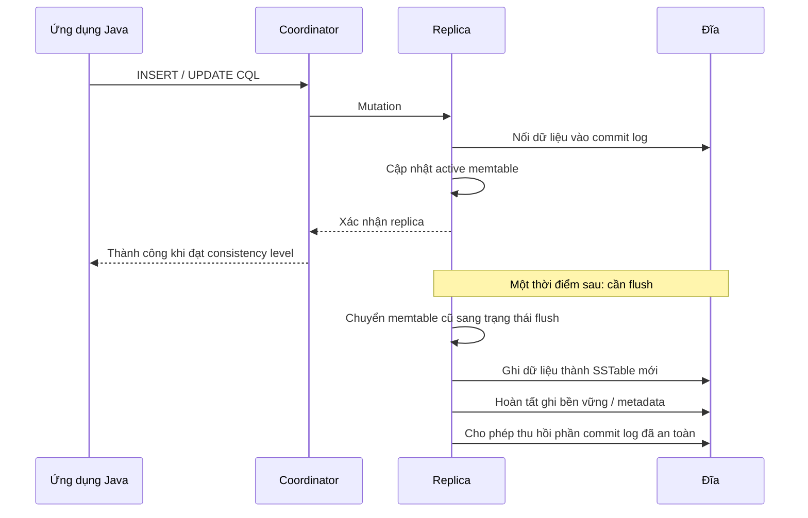

# Flush từ memtable sang SSTable trong Apache Cassandra

## 1. Flush nằm ở đâu trên đường ghi?

Apache Cassandra là cơ sở dữ liệu **wide-column phân tán**. Mỗi hàng được định vị bằng **partition key**, sắp xếp theo **clustering columns** trong phân vùng và được sao chép sang các replica theo cấu hình replication. Khi ứng dụng Java ghi một hàng bằng CQL, dữ liệu không nhất thiết được chép ngay vào một tệp bảng hoàn chỉnh trên đĩa.

Trên từng replica, đường ghi thông thường gồm hai thành phần quan trọng:

- **Commit log:** nhật ký ghi tuần tự trên đĩa (*write-ahead log*), dùng để phục hồi những thay đổi chưa có trong SSTable nếu tiến trình gặp sự cố. Hành vi bảo đảm bền vững phụ thuộc cấu hình đồng bộ commit log.
- **Memtable:** cấu trúc dữ liệu trong bộ nhớ dùng để chứa các thay đổi mới nhất, tổ chức để ghi nhanh và phục vụ đọc trước khi dữ liệu được đưa xuống SSTable.

**Flush** là quá trình chuyển dữ liệu của một memtable thành **một hoặc nhiều SSTable bất biến** (*immutable Sorted String Tables*) trên đĩa. Flush xảy ra **bất đồng bộ** so với phần lớn câu lệnh ghi của ứng dụng.

Một cách ghi nhớ:

```text
                 Từng replica của Cassandra

  CQL INSERT/UPDATE/DELETE
              |
              v
       +--------------+          +--------------------+
       |  Commit log  |          |  Active memtable   |
       | (nhật ký ghi)|          |    (bộ nhớ)        |
       +--------------+          +--------------------+
              |                          |
              | dùng để khôi phục        | khi memtable cần flush
              | khi chưa flush          v
              |                   +--------------------+
              |                   | Flushing memtable  |
              |                   | (đã chuyển trạng thái)
              |                   +--------------------+
              |                          |
              |                          v
              |                   +--------------------+
              +---- sau khi đủ ----| Immutable SSTable  |
                   dữ liệu bền vững|      (đĩa)         |
                                   +--------------------+
                                            |
                                            v
                                     Compaction về sau
```

Sơ đồ thể hiện vòng đời trên **một replica**. Mỗi replica có memtable, commit log và SSTable riêng; các replica **không phải đồng loạt flush** cùng một thời điểm.

## 2. Vì sao Cassandra ghi vào memtable trước?

Việc cập nhật trực tiếp một tệp bảng đã được sắp thứ tự sẽ cần nhiều lần ghi ngẫu nhiên trên đĩa. Cassandra dùng kiến trúc gần với **Log-Structured Merge Tree (LSM-tree)**:

1. Ghi thay đổi vào commit log theo kiểu nối tiếp để hỗ trợ phục hồi.
2. Cập nhật memtable đang hoạt động.
3. Trả xác nhận từ replica theo quy trình ghi và cấu hình đồng bộ thích hợp.
4. Sau đó, khi đạt điều kiện flush, ghi một phiên bản dữ liệu đã được tổ chức thành SSTable.
5. Theo thời gian, **compaction** hợp nhất các SSTable, giảm số cấu trúc phải duyệt khi đọc và xử lý phiên bản cũ/tombstone theo các điều kiện an toàn.

Ưu điểm là đường ghi ban đầu có độ trễ thấp và ít đòi hỏi cập nhật ngẫu nhiên. Đổi lại, hệ thống phải quản lý bộ nhớ, commit log, flush, nhiều SSTable và compaction ở nền.

### Hai dòng thời gian độc lập



Sơ đồ được đơn giản hóa. Thứ tự xác nhận đối với tính bền vững của commit log còn phụ thuộc chế độ `commitlog_sync`, và coordinator còn phải nhận phản hồi từ **đủ replica theo consistency level (CL)**. Điều quan trọng là **ứng dụng có thể nhận thành công trước khi flush xảy ra**.

## 3. Vòng đời của memtable khi flush

### Giai đoạn A: active memtable

Memtable hiện tại nhận các mutation mới của bảng. Nó có thể chứa:

- Giá trị mới của một hàng hoặc một cột.
- Nhiều cập nhật đến cùng partition, được hòa giải theo timestamp và quy tắc của Cassandra.
- Thông tin TTL và **tombstone** do xóa hoặc hết hạn dữ liệu.

Memtable không phải bản sao đơn giản của toàn bộ bảng: nó lưu **những thay đổi gần đây** chưa được đưa vào các SSTable tương ứng.

### Giai đoạn B: chuyển đổi memtable (*switch*)

Khi memtable cần flush, Cassandra ngừng thêm mutation mới vào **memtable cũ** và tạo/chuyển sang một memtable đang hoạt động khác. Trong khi bản cũ được xử lý bởi luồng flush, các ghi mới vẫn có thể tiếp tục vào memtable mới (trong giới hạn tài nguyên và tình trạng node).

```text
Trước switch:           Sau switch:

[Memtable A: active]    [Memtable A: flushing] -> SSTable
                       [Memtable B: active  ] <- ghi mới
```

Điều này giải thích vì sao không thể hiểu flush là “khóa toàn bộ bảng cho đến khi mọi ghi xong”. Dù vậy, nếu bộ nhớ hoặc đĩa quá tải và các hàng đợi flush không theo kịp, Cassandra có thể tạo **backpressure** hoặc làm tăng độ trễ ghi.

### Giai đoạn C: ghi SSTable bất biến

Tác vụ flush duyệt dữ liệu memtable, tuần tự hóa các partition đã được tổ chức theo thứ tự lưu trữ và ghi ra bộ tệp SSTable. Bên trong mỗi partition, các hàng được lưu theo thứ tự clustering tương ứng với mô hình bảng.

SSTable được tạo có thể gồm nhiều tệp thành phần, tùy phiên bản và định dạng:

| Thành phần thường gặp | Vai trò |
| --- | --- |
| `Data.db` | Dữ liệu đã tuần tự hóa: partition, hàng, cell và thông tin xóa |
| `Index.db` | Chỉ mục để tìm vị trí partition trong SSTable |
| `Summary.db` | Tóm tắt chỉ mục phục vụ tìm kiếm nhanh hơn |
| `Filter.db` | Bloom filter giúp loại trừ nhiều SSTable chắc chắn không có partition cần tìm |
| `Statistics.db` | Metadata và thống kê của SSTable |
| `CompressionInfo.db` | Thông tin hỗ trợ truy cập dữ liệu khi bật nén |

Tên tệp và sự hiện diện của từng thành phần phụ thuộc phiên bản/định dạng SSTable; không nên dựa vào danh sách trên để viết trình phân tích đường dẫn SSTable cho mọi bản Cassandra.

Sau khi các tệp và metadata liên quan được ghi hoàn tất theo cơ chế của Cassandra, SSTable mới được đưa vào tập SSTable sẵn sàng phục vụ truy vấn. Cassandra không thực hiện `UPDATE` trực tiếp vào nội dung của SSTable bất biến này. Mutation tiếp theo sẽ đi vào memtable và về sau tạo SSTable khác.

### Giai đoạn D: giải phóng bộ nhớ và tiến tới thu hồi commit log

Khi flush hoàn tất an toàn, memtable cũ có thể được giải phóng. Cassandra đồng thời theo dõi phần dữ liệu trong commit log đã được thể hiện bền vững ở SSTable.

**Không được hiểu “flush xong một bảng” là lập tức có thể xóa mọi commit-log segment.** Một segment có thể còn chứa thay đổi của **nhiều memtable/bảng**; nó chỉ có thể được thu hồi hoặc tái sử dụng khi tất cả các phần dữ liệu cần thiết mà segment đó bảo vệ đã an toàn. Việc thu hồi do Cassandra quản lý.

## 4. Những điều kiện nào kích hoạt flush?

Flush xảy ra khi Cassandra cần giới hạn sử dụng tài nguyên hoặc khi có thao tác quản trị. Điều kiện cụ thể có thể khác theo phiên bản và cấu hình.

| Tác nhân | Vì sao flush? | Lưu ý |
| --- | --- | --- |
| Memtable dùng nhiều bộ nhớ | Giải phóng dung lượng cho ghi mới | Giới hạn/chính sách có thể áp dụng ở phạm vi toàn node hoặc memtable |
| Áp lực commit log | Cần flush dữ liệu còn “bẩn” để giải phóng/recycle các segment cũ | Commit log có thể chứa mutation của nhiều bảng |
| Chính sách flush định kỳ (nếu cấu hình/hỗ trợ) | Đưa dữ liệu memtable xuống SSTable theo chu kỳ | Không nên mặc định mọi bảng đều có flush theo thời gian |
| Lệnh `nodetool flush` | Quản trị viên chủ động yêu cầu flush một keyspace/bảng | Chạy trên node được kết nối, không flush toàn bộ cluster |
| Thao tác bảo trì như `drain` | Đưa dữ liệu đang ở memtable xuống đĩa trước một số quy trình dừng node | Không dùng `drain` như một lệnh flush thường kỳ |

Không có quy tắc “mỗi `INSERT` tạo một SSTable”. Một SSTable thường chứa dữ liệu tích lũy từ nhiều mutation. Số lượng SSTable sinh ra sau một flush phụ thuộc cách tổ chức memtable và định dạng/phiên bản Cassandra; mục tiêu là tạo các tệp dữ liệu bất biến phục vụ đọc, chứ không phải ánh xạ 1:1 theo mỗi câu CQL.

## 5. Flush có thay đổi ý nghĩa của xác nhận ghi không?

**Không.** Flush là bước duy trì lưu trữ của replica ở nền; số replica cần xác nhận ghi là quyết định của **consistency level**.

Giả sử keyspace có **RF = 3** trong một datacenter:

- Ghi với `ONE` có thể hoàn tất ở coordinator khi nhận đủ xác nhận từ **một** replica.
- Ghi với `LOCAL_QUORUM` cần xác nhận từ **hai** replica trong datacenter đó.
- Không có yêu cầu các replica này phải **flush xong** trước khi phản hồi ghi CQL thông thường.

Độ bền của dữ liệu chưa flush được bảo vệ chủ yếu qua **commit log**, miễn tính năng ghi commit log được bật và cấu hình đồng bộ đáp ứng yêu cầu.

### Commit log và `fsync`

Cần tách ba khái niệm:

1. **Append commit log:** ghi bản ghi mutation vào log.
2. **Đồng bộ commit log xuống thiết bị lưu trữ:** tùy chế độ và cơ chế `fsync`, việc xác nhận không phải lúc nào cũng chờ mỗi bản ghi được đồng bộ riêng.
3. **Flush memtable:** tạo SSTable; đây là một hoạt động khác, thường diễn ra sau nhiều lần ghi.

Ví dụ, các chính sách `commitlog_sync` thông dụng:

| Chế độ | Cách hiểu ở mức vận hành | Hệ quả |
| --- | --- | --- |
| `periodic` | Commit log được đồng bộ theo chu kỳ cấu hình; ghi có thể được xác nhận trước lần đồng bộ kế tiếp | Có cửa sổ rủi ro mất một phần ghi đã xác nhận khi mất nguồn/hệ điều hành sự cố nghiêm trọng, tùy môi trường |
| `batch` | Ghi chờ cơ chế đồng bộ commit log trước khi xác nhận theo chính sách batch | Giảm cửa sổ mất dữ liệu đã xác nhận nhưng tăng chi phí/độ trễ |

Các cấu hình này thuộc **độ bền cục bộ tại replica**. Dù chọn chế độ nào, kết quả ghi còn phụ thuộc khả năng đáp ứng của đĩa, hệ thống tệp, phần cứng và replica khác. `durable_writes = false` của keyspace (nếu được cấu hình) bỏ qua bảo vệ commit log thông thường và làm tăng rủi ro mất mutation chưa flush khi node gặp sự cố; không dùng cho dữ liệu nghiệp vụ cần tính bền vững nếu chưa đánh giá hậu quả.

### Ma trận tình huống crash

| Thời điểm lỗi | Dữ liệu ở đâu? | Khả năng khôi phục |
| --- | --- | --- |
| Sau khi cập nhật memtable, trước flush, commit log đã bền vững | Memtable (RAM) + commit log (đĩa) | Khởi động lại có thể **replay commit log** để tái tạo thay đổi |
| Sau khi cập nhật memtable, trước khi commit log được đồng bộ bền vững | Memtable + log có thể chỉ ở bộ đệm I/O | Mất nguồn có thể làm mất phần ghi chưa được đồng bộ |
| Flush đã hoàn tất an toàn | SSTable bất biến trên đĩa | Có thể đọc lại SSTable khi khởi động; log tương ứng có thể được thu hồi theo quy tắc |
| Lỗi khi đang tạo SSTable | Có thể tồn tại SSTable chưa hoàn chỉnh và log chưa thu hồi | Cassandra xử lý tệp chưa hoàn tất và replay log còn cần thiết; kiểm tra log node để biết diễn biến |

**Sự cố một replica khác sự cố cả cụm.** Replication và CL quyết định liệu replica khác còn giữ bản ghi hay không. Flush riêng trên một node không thay thế replication, repair hoặc chính sách sao lưu.

## 6. Flush không phải compaction, repair hay backup

Những khái niệm này thường bị nhầm:

| Hoạt động | Đầu vào → đầu ra | Mục đích chính |
| --- | --- | --- |
| **Flush** | Memtable → SSTable mới | Đưa dữ liệu gần đây từ RAM xuống SSTable; giải phóng memtable |
| **Compaction** | Một nhóm SSTable → SSTable mới | Hợp nhất dữ liệu phiên bản khác nhau, giảm phân mảnh/chi phí đọc, xử lý tombstone theo điều kiện |
| **Repair** | Dữ liệu giữa các replica | Phát hiện và sửa khác biệt giữa những bản sao của dữ liệu |
| **Backup/snapshot** | Sao lưu tệp dữ liệu/metadata theo cơ chế phù hợp | Khôi phục theo thời điểm hoặc sau sự cố vượt khả năng phục hồi thông thường |

Một chuỗi minh họa:

```text
Ghi lần 1, 2, 3
      |
  Memtable A --flush--> SSTable 1

Ghi lần 4, 5
      |
  Memtable B --flush--> SSTable 2

SSTable 1 + SSTable 2 --compaction--> SSTable 3
```

SSTable cũ không bị sửa tại chỗ. Trong compaction, Cassandra có thể hợp nhất các giá trị theo timestamp và loại bỏ dữ liệu đã hết hiệu lực **khi thỏa điều kiện an toàn**. Tombstone hoặc cell hết TTL **không bắt buộc biến mất ngay tại lúc flush**; các cơ chế xóa và thu gom có quy tắc riêng, trong đó cần cân nhắc `gc_grace_seconds` và tính nhất quán giữa replica.

Tương tự, nếu hai replica giữ dữ liệu khác nhau, việc ép cả hai flush **không làm chúng tự đồng bộ**: mỗi node chỉ ghi xuống đĩa dữ liệu mà nó hiện đang có. Vấn đề này thuộc phạm vi repair và thiết kế replication.

## 7. Thực hành CQL và quan sát flush bằng `nodetool`

Ví dụ sau mô phỏng hệ thống Java ghi dữ liệu cảm biến. Khóa phân vùng là `device_id` để truy vấn một thiết bị; các hàng trong phân vùng được sắp theo `measured_at` giảm dần, phù hợp truy vấn dữ liệu mới nhất.

### Bước 1 — Tạo keyspace và bảng

```sql
-- Ví dụ cluster có datacenter tên dc1, đủ node cho RF = 3.
CREATE KEYSPACE IF NOT EXISTS telemetry_lab
WITH replication = {
    'class': 'NetworkTopologyStrategy',
    'dc1': 3
};

CREATE TABLE IF NOT EXISTS telemetry_lab.readings_by_device (
    device_id text,
    measured_at timestamp,
    reading_id uuid,
    temperature_c double,
    PRIMARY KEY ((device_id), measured_at, reading_id)
) WITH CLUSTERING ORDER BY (measured_at DESC, reading_id ASC);
```

Thay `dc1` và RF bằng topology thật. Với cụm phát triển chỉ có một node, RF = 3 và CL quorum cao có thể làm truy vấn không đạt đủ replica; chọn topology/CL thực hành nhất quán, không sao chép cấu hình production mà không kiểm tra.

### Bước 2 — Ghi dữ liệu

```sql
INSERT INTO telemetry_lab.readings_by_device
    (device_id, measured_at, reading_id, temperature_c)
VALUES ('sensor-a', '2026-11-20 10:00:00+0000',
        11111111-1111-4111-8111-111111111111, 23.7);

INSERT INTO telemetry_lab.readings_by_device
    (device_id, measured_at, reading_id, temperature_c)
VALUES ('sensor-a', '2026-11-20 10:01:00+0000',
        22222222-2222-4222-8222-222222222222, 23.9);

-- TTL cũng được lưu cùng dữ liệu; hết hạn không đồng nghĩa
-- xóa tức thời khỏi mọi SSTable.
INSERT INTO telemetry_lab.readings_by_device
    (device_id, measured_at, reading_id, temperature_c)
VALUES ('sensor-b', '2026-11-20 10:02:00+0000',
        33333333-3333-4333-8333-333333333333, 25.1)
USING TTL 3600;
```

Kiểm tra bằng truy vấn bám theo partition key:

```sql
SELECT device_id, measured_at, reading_id, temperature_c
FROM telemetry_lab.readings_by_device
WHERE device_id = 'sensor-a'
LIMIT 10;
```

**Chưa cần flush** vẫn có thể đọc các ghi đã hiển thị theo CL phù hợp, vì đường đọc Cassandra kết hợp dữ liệu từ memtable và SSTable (cùng các cấu trúc hỗ trợ khác).

### Bước 3 — Xem thống kê trên một node

Thực hiện từ môi trường có `nodetool` và quyền kết nối node Cassandra:

```powershell
nodetool tablestats telemetry_lab.readings_by_device
```

Tùy phiên bản, đầu ra có các chỉ số như kích thước memtable, số lần chuyển memtable, số SSTable đang hoạt động, dung lượng SSTable và độ trễ ghi. Ghi lại các chỉ số **trước flush** để so sánh.

### Bước 4 — Chủ động flush trên node đó

```powershell
nodetool flush telemetry_lab readings_by_device
nodetool tablestats telemetry_lab.readings_by_device
```

Kỳ vọng về mặt khái niệm: dữ liệu memtable liên quan được ghi thành SSTable mới, có thể thấy thay đổi ở số SSTable và mức sử dụng memtable. Giá trị thực tế có thể khác nếu bảng vốn đã có SSTable, memtable nhỏ, flush tự động/compaction đồng thời hoặc phiên bản hiển thị thống kê khác.

**Phạm vi quan sát:** lệnh `nodetool` trên node này chỉ yêu cầu flush các memtable ở **node đó**, không đồng bộ flush trên các replica khác. Đừng dùng lệnh này sau mỗi lần `INSERT` trong ứng dụng; Cassandra tự điều phối flush.

### Bước 5 — Đọc lại sau flush

Chạy lại `SELECT` của bước 2. Kết quả logic phải tuân theo timestamp, TTL và dữ liệu hiện tại; thao tác flush **không được biến giá trị truy vấn thành một kết quả nghiệp vụ khác**. Về mặt lưu trữ, nguồn dữ liệu có thể đã chuyển từ memtable sang SSTable.

## 8. Kết nối Java: ứng dụng ghi bình thường, Cassandra quản lý flush

Ví dụ Java Driver 4.x; `CqlSession` đã được tạo theo cấu hình contact points, local datacenter và xác thực của môi trường:

```java
import java.time.Instant;
import java.util.UUID;

import com.datastax.oss.driver.api.core.CqlSession;
import com.datastax.oss.driver.api.core.DefaultConsistencyLevel;
import com.datastax.oss.driver.api.core.cql.BoundStatement;
import com.datastax.oss.driver.api.core.cql.PreparedStatement;

public final class SensorReadingRepository {
    private final CqlSession session;
    private final PreparedStatement insertReading;

    public SensorReadingRepository(CqlSession session) {
        this.session = session;
        this.insertReading = session.prepare(
            "INSERT INTO telemetry_lab.readings_by_device " +
            "(device_id, measured_at, reading_id, temperature_c) " +
            "VALUES (?, ?, ?, ?)"
        );
    }

    public void save(
            String deviceId, Instant measuredAt,
            UUID readingId, double temperatureC) {
        BoundStatement statement = insertReading.bind(
                deviceId, measuredAt, readingId, temperatureC)
            .setConsistencyLevel(DefaultConsistencyLevel.LOCAL_QUORUM);
        session.execute(statement);
    }
}
```

Trong ví dụ này, `LOCAL_QUORUM` quy định số replica cần xác nhận trong datacenter địa phương. Lệnh Java **không gọi flush**, không chờ sinh SSTable, và cũng không tự chứng minh dữ liệu đã được `fsync` trên mọi replica. Yêu cầu về tính bền vững phải được thiết kế phối hợp giữa **CL, replication, commit-log sync và hạ tầng lưu trữ**.

Nếu ứng dụng cần xác nhận ghi chặt chẽ hơn, phải phân tích cấu hình bền vững và khả năng mất dữ liệu, không dùng một chuỗi `nodetool flush` sau mỗi transaction làm giải pháp thay thế.

## 9. Tác động đến hiệu năng và các tình huống lỗi

Flush là hoạt động I/O nền, nhưng vẫn dùng CPU, bộ nhớ, đĩa và băng thông lưu trữ của node. Khi tốc độ ghi liên tục cao hơn khả năng flush/compaction, backlog có thể tăng.

| Dấu hiệu | Cách diễn giải khả dĩ | Hướng kiểm tra/xử lý |
| --- | --- | --- |
| Memtable chiếm nhiều bộ nhớ | Ghi mạnh hoặc flush không kịp | Kiểm tra thống kê memtable, tốc độ ghi, bộ nhớ và đĩa |
| Commit log tăng gần giới hạn | Các segment cũ chưa đủ điều kiện thu hồi | Xem dữ liệu memtable chưa flush, trạng thái flush và log node |
| Rất nhiều SSTable nhỏ | Flush xảy ra quá thường xuyên hoặc compaction không theo kịp | Điều tra kích thước SSTable, chiến lược compaction, tải ghi |
| Độ trễ ghi tăng khi flush | Đĩa quá tải, tranh chấp I/O, pressure lên memtable | Theo dõi IOPS, disk latency, CPU/GC và backlog |
| Flush lỗi vì đầy đĩa hoặc I/O error | Không thể ghi hoàn chỉnh SSTable mới | Giải quyết dung lượng/sức khỏe đĩa, giữ commit log để phục hồi |
| Đọc chậm dù flush thành công | Nhiều SSTable, tombstone, partition lớn hoặc truy vấn chưa phù hợp | Kiểm tra mô hình partition key, compaction và read path |

Các thao tác quan sát hữu ích gồm `nodetool tablestats`, log Cassandra, metrics/JMX theo phiên bản và `nodetool compactionstats` để xem tình trạng tác vụ compaction liên quan. Không coi `compactionstats` là phép đo đầy đủ riêng cho hoạt động flush.

**Không xóa thủ công commit log hoặc các file SSTable** chỉ vì nghĩ rằng flush đã hoàn tất. Làm vậy có thể phá hủy khả năng phục hồi hoặc làm dữ liệu không nhất quán. Khi có lỗi I/O hoặc hết đĩa, ưu tiên bảo vệ dữ liệu, kiểm tra node logs, dung lượng và quy trình khôi phục được vận hành chấp thuận.

### Flush quá thường xuyên có tốt không?

Không nhất thiết. Flush liên tục có thể tạo nhiều SSTable nhỏ, tăng chi phí mở/tìm kiếm SSTable, tiêu thụ băng thông đĩa và làm compaction phải làm thêm việc. Mặt khác, cho memtable phình quá lớn cũng gây áp lực RAM và tăng tải flush đột ngột. Cassandra có cơ chế tự động chọn thời điểm flush; việc điều chỉnh chỉ nên dựa trên workload, metric và phiên bản triển khai.

## 10. Ba tình huống tự kiểm tra

**Tình huống 1 — Ghi đã thành công nhưng chưa có SSTable mới.** Một câu `INSERT` với `LOCAL_QUORUM` trả thành công. Ngay sau đó số SSTable không tăng. Có phải Cassandra làm mất dữ liệu?

**Gợi ý:** Không thể kết luận như vậy. Ghi có thể đang nằm trong memtable và commit log của các replica đã xác nhận. Cần phân biệt ACK theo CL, chính sách đồng bộ commit log và thời điểm flush.

**Tình huống 2 — Node gặp sự cố trước flush.** Node đã nhận mutation và commit log đã đồng bộ bền vững, nhưng memtable chưa flush. Sau khi khởi động lại, node làm cách nào tái tạo dữ liệu?

**Gợi ý:** Cassandra replay những thay đổi cần thiết từ commit log để phục hồi nội dung chưa tồn tại trong SSTable. Nếu log chưa thực sự bền vững trước khi mất nguồn, mức bảo đảm có thể khác.

**Tình huống 3 — Hai replica đã flush mà dữ liệu vẫn khác nhau.** Một replica bỏ lỡ mutation trong lúc mạng bị phân vùng. Cả hai node sau đó flush. Liệu kết quả có tự trở nên giống nhau?

**Gợi ý:** Không. Flush chỉ đưa dữ liệu hiện có **trên từng replica** xuống SSTable. Cần cơ chế đồng bộ bản sao, đọc có điều chỉnh nhất quán và repair phù hợp; flush không thay thế repair.

## 11. Ghi nhớ và checklist vận hành

- [ ] Phân biệt **commit log**, **memtable**, **SSTable** và **compaction**.
- [ ] Hiểu rằng flush diễn ra **theo node**, không cần đồng thời giữa các replica.
- [ ] Biết vì sao **ACK ghi** có thể xuất hiện **trước khi flush**.
- [ ] Đánh giá `commitlog_sync`, `durable_writes`, replication và CL khi nói về độ bền.
- [ ] Dùng `nodetool flush` có chủ đích trong bảo trì/thực hành; dùng `tablestats` và metrics để quan sát.
- [ ] Theo dõi số SSTable, sức khỏe đĩa, áp lực bộ nhớ và hoạt động compaction khi điều tra hiệu năng.
- [ ] Không nhầm **flush** với **repair**, **backup** hoặc thao tác xóa tombstone ngay lập tức.

**Kết luận:** Flush từ memtable sang SSTable là bước nối giữa đường ghi nhanh dựa trên bộ nhớ và lưu trữ SSTable bất biến của Cassandra. Commit log bảo vệ những mutation chưa được flush theo cấu hình độ bền, còn replication và consistency level kiểm soát xác nhận giữa các replica. Hiểu rõ ranh giới này giúp thiết kế bảng theo truy vấn, vận hành CQL và xây dựng ứng dụng Java có hành vi ghi đáng tin cậy.
