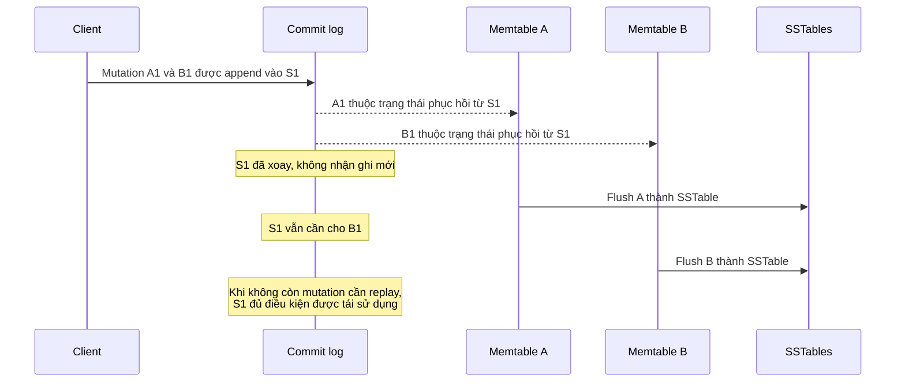

# Commit log segment, tái sử dụng và quan hệ với memtable chưa flush

> **Chương:** Đường ghi và độ bền  
> **Phạm vi:** Apache Cassandra, hệ quản trị phân tán theo mô hình *wide-column*. Bài tập trung vào vòng đời commit log ở **mỗi node**, điều kiện có thể giải phóng segment và tác động của memtable chưa được flush.  
> **Kết quả học tập:** Phân biệt ghi commit log, đồng bộ xuống đĩa và flush memtable; giải thích vì sao một segment vẫn được giữ dù có bảng đã flush; nhận diện nguyên nhân commit log chiếm chỗ và cách chẩn đoán an toàn.

## 1. Đặt vấn đề: vì sao đã ghi vào đĩa mà vẫn cần flush?

Trong Cassandra, một mutation (thêm, sửa hoặc xóa dữ liệu) được ghi vào **commit log** và cập nhật **memtable** trên replica nhận ghi. Memtable là cấu trúc dữ liệu đang được cập nhật trong bộ nhớ; khi flush, dữ liệu của memtable được ghi thành tệp **SSTable** bất biến trên đĩa.

Sơ đồ khái niệm:

```text
          WRITE từ client
                 |
                 v
       Coordinator phân phối tới
       các replica theo partition key
                 |
                 v (trên từng replica)
         +--------------------+
         |     MUTATION       |
         +--------------------+
           |                |
           v                v
    Commit log (disk)   Memtable (RAM)
    ghi nối tiếp        cập nhật theo bảng
           |                |
           |                | flush
           |                v
           |          SSTable (disk)
           |                |
           +-- không cần    |
               replay phần --+
               đã flush
```

Hai đường ghi phục vụ hai mục đích khác nhau:

- **Commit log** là nhật ký khôi phục sau lỗi. Khi node ngừng đột ngột trước lúc memtable flush, Cassandra có thể phát lại (*replay*) các mutation cần thiết từ commit log khi khởi động.
- **Memtable + SSTable** phục vụ lưu trữ và truy vấn lâu dài. Khi nội dung một memtable được flush thành SSTable thành công, các mutation tương ứng không còn phải phụ thuộc vào commit log để khôi phục.

Sự khác biệt quan trọng là **“đã ghi vào commit log” không có nghĩa “đã trở thành SSTable”**, và **“một memtable đã flush” không có nghĩa “mọi segment commit log cũ được xóa ngay”**.

## 2. Commit log segment là gì?

Commit log trên mỗi node được chia thành các **segment**: những tệp log có dung lượng mục tiêu hữu hạn, nhận thêm các record mutation theo kiểu *append-only*. Khi segment hiện tại hết chỗ hoặc phải quay vòng, Cassandra chuyển sang segment mới để tiếp tục ghi.

Cần ghi nhớ năm thuộc tính:

1. **Commit log là tài nguyên cấp node.** Một segment có thể chứa mutation của **nhiều bảng, nhiều keyspace và nhiều partition** cùng đi qua node đó. Nó không phải “một file log cho một bảng”.
2. **Segment có vị trí ghi.** Cassandra theo dõi ranh giới/vị trí các mutation để biết phần log nào vẫn còn cần cho quá trình khôi phục.
3. **Segment có trạng thái vòng đời.** Một segment có thể đang nhận ghi, đã đóng để ghi mới nhưng vẫn còn cần cho replay, hoặc đủ điều kiện được tái sử dụng/loại bỏ.
4. **Segment không phải một bản sao SSTable.** Log lưu mutation để khôi phục; SSTable là dữ liệu bất biến được tổ chức cho đọc, nén và compaction.
5. **Replication không dùng chung commit log.** Mỗi replica duy trì commit log riêng trên chính node của mình. Không có một commit log toàn cluster.

Các tên cấu hình như `commitlog_segment_size_in_mb` và `commitlog_total_space_in_mb` thường liên quan đến kích thước segment và ngân sách dung lượng commit log. Giá trị mặc định, cơ chế sử dụng dung lượng và các lựa chọn sync tùy phiên bản Cassandra/bản phân phối; phải đối chiếu với cấu hình đang chạy thay vì áp dụng tùy tiện con số của một ví dụ.

### “Tái sử dụng segment” có nghĩa gì?

Khi một segment cũ không còn cần cho recovery, Cassandra có thể **recycle** tệp/tài nguyên để ghi log mới hoặc loại bỏ nó theo cơ chế quản lý dung lượng. Tái sử dụng **không** có nghĩa ghi đè trực tiếp lên một segment còn chứa mutation chưa được flush. Hệ thống chỉ được giải phóng phần dữ liệu log đã có nơi lưu bền vững thay thế.

Về mặt tư duy, hãy xem mỗi segment như một “hộp chứa bằng chứng khôi phục”. Không được bỏ hộp khi vẫn còn bất kỳ mutation nào trong hộp là phiên bản cần thiết để dựng lại dữ liệu sau crash.

## 3. Quan hệ cốt lõi: segment dùng chung, memtable theo bảng

Mỗi bảng có memtable riêng (và có thể có thế hệ memtable cũ đang flush, cùng memtable mới tiếp tục nhận ghi). Trong khi đó, commit log ghi mutation của các bảng vào cùng dòng thời gian cấp node.

Ví dụ node N1 ghi vào hai bảng:

- `app.orders_by_id` — nhận đơn hàng liên tục.
- `app.customer_preferences` — chỉ thay đổi đôi lần mỗi giờ.

Hai segment giả định đã nhận record:

```text
Commit log cấp node N1
────────────────────────────────────────────────────────
Segment S101 (đã đóng):
  vị trí 01: orders_by_id         / order-01
  vị trí 02: customer_preferences / customer-7
  vị trí 03: orders_by_id         / order-02

Segment S102 (đang ghi):
  vị trí 01: orders_by_id         / order-03
  vị trí 02: orders_by_id         / order-04
────────────────────────────────────────────────────────

Memtable:
  orders_by_id          -> có thể đã đủ lớn để flush
  customer_preferences  -> vẫn rất nhỏ, chưa flush
```

Giả sử `orders_by_id` flush thành công và SSTable chứa mọi mutation của bảng này trong S101, nhưng `customer_preferences` **chưa flush** mutation ở vị trí 02.

**Kết quả:** S101 vẫn phải được giữ, vì nếu node crash, bản ghi `customer-7` trong memtable sẽ mất khỏi RAM và cần được replay từ S101.

Khi `customer_preferences` cũng flush thành công, S101 **có thể đủ điều kiện** được giải phóng, với điều kiện segment đã ngừng nhận ghi và không còn record chưa được bảo vệ bởi SSTable (hoặc điều kiện giữ lại khác của cơ chế liên quan).

| Sự kiện | `orders_by_id` trong S101 | `customer_preferences` trong S101 | S101 có được giải phóng? |
| --- | --- | --- | --- |
| Vừa ghi cả hai bảng | Chưa flush | Chưa flush | **Chưa** |
| Flush riêng `orders_by_id` | Đã có trong SSTable | Chưa flush | **Chưa** |
| Flush thành công cả hai bảng | Đã có trong SSTable | Đã có trong SSTable | **Có thể**, nếu không còn lý do giữ khác |
| Flush `customer_preferences` bị lỗi | Đã có trong SSTable | Vẫn cần log để replay | **Chưa** |

Đây là lý do một bảng nhỏ, ít thay đổi vẫn có thể **giữ một segment cũ sống lâu**, ngay cả khi bảng ghi nhiều đã thường xuyên flush.

Ngược lại, một memtable chưa flush **không chặn mọi segment trên node**: nó chỉ ngăn giải phóng những segment chứa mutation vẫn cần khôi phục cho memtable đó.

## 4. Cassandra xác định khi nào có thể loại bỏ segment như thế nào?

Ở mức khái niệm, Cassandra phối hợp **vị trí commit log** và tiến độ flush của từng bảng. Một memtable gắn với khoảng mutation cần khôi phục; khi một thế hệ memtable được flush thành SSTable thành công, khoảng mutation đã bền vững có thể được đánh dấu không còn cần replay từ commit log.

Điều kiện để segment cũ được giải phóng có thể phát biểu an toàn như sau:

> **Mọi mutation cần thiết cho recovery trong segment đã được bảo vệ bởi dữ liệu flush thành công, và segment không còn đang được dùng/giữ bởi cơ chế liên quan.**

Điều này khác với việc hỏi “tên memtable nào đang rỗng?”. Hãy phân biệt:

- **Đã xoay memtable (*switch*):** memtable cũ đóng nhận ghi và đang chờ/đang flush; dữ liệu **chưa chắc** đã thành SSTable.
- **Flush hoàn tất thành công:** SSTable đã được ghi và chấp nhận theo cơ chế lưu trữ; Cassandra có thể cập nhật mốc log không cần replay cho thế hệ memtable đó.
- **Segment hết chỗ/đã chuyển sang segment mới:** chỉ là sự kiện luân chuyển tệp; **không** chứng minh mọi mutation trong segment cũ đã flush.
- **Segment được recycle/xóa:** chỉ xảy ra khi điều kiện giải phóng được thỏa.

### Một segment có nhiều thế hệ memtable

Ngay cả **cùng một bảng** cũng có thể có mutation nằm ở nhiều segment hoặc nhiều thế hệ memtable. Trong lúc memtable A đang flush, Cassandra vẫn có thể tạo memtable B để nhận ghi mới. Muốn xác định segment S nào có thể giải phóng, hệ thống cần xem **những mutation trong S** đã được bảo vệ tới đâu, chứ không thể chỉ kiểm tra tên bảng hoặc số lượng memtable hiện tại.

### Commit log không đợi compaction mới được giải phóng

Flush tạo SSTable mới. **Compaction** sau đó kết hợp/ghi lại các SSTable nhằm tối ưu lưu trữ và đọc. Vòng đời commit log gắn với việc **dữ liệu memtable đã được flush an toàn**, không yêu cầu chờ compaction hoàn tất.

Tương tự, **repair** giúp đối soát dữ liệu giữa các replica; repair không phải điều kiện thông thường để recycle commit log trên một node.

## 5. Dòng thời gian đầy đủ từ ghi đến giải phóng

Ví dụ hai bảng A và B chia sẻ segment S1:



Sơ đồ mô tả phụ thuộc **logic**. Nó không nhằm khẳng định thứ tự thread hoặc thứ tự các lời gọi nội bộ chính xác của mọi phiên bản Cassandra; cập nhật commit log và memtable là một phần của cùng đường xử lý mutation trên replica.

### Trường hợp node crash

Giả sử:

1. A1 và B1 đã được ghi vào commit log theo chính sách sync của node.
2. Memtable A được flush thành công thành SSTable; memtable B chưa flush.
3. Node ngừng đột ngột.
4. Khi khởi động, Cassandra đọc SSTable và phát lại phần mutation commit log còn cần thiết, trong đó có B1, rồi tiếp tục vận hành.

Hệ thống không cần giữ vĩnh viễn những record đã trở nên thừa sau flush. Nhưng **chừng nào B1 vẫn chưa có bản SSTable bền vững, S1 vẫn là vật liệu khôi phục quan trọng**.

Lưu ý: có record trong log không đồng nghĩa nó đã được **fsync xuống thiết bị lưu trữ** tại thời điểm client nhận phản hồi; mức bền vững trước sự cố điện/máy phụ thuộc cấu hình đồng bộ commit log, giải thích ở phần tiếp theo.

## 6. Ba mốc dễ nhầm: append, sync và flush

Đây là ba hoạt động có ý nghĩa khác nhau:

| Hoạt động | Diễn ra ở đâu? | Bảo vệ trước rủi ro nào? | Có tự giải phóng commit log segment không? |
| --- | --- | --- | --- |
| **Append mutation** | Tệp commit log trên replica, qua cơ chế ghi của hệ điều hành/ổ đĩa | Chuẩn bị bằng chứng cho replay; trạng thái sync quyết định độ bền trước mất điện | Không |
| **Sync/fsync commit log** | Buộc dữ liệu log đã ghi được đồng bộ xuống lớp lưu trữ bền vững theo cơ chế hệ thống | Giảm cửa sổ mất log trước sự cố làm mất cache/buffer | Không; memtable có thể vẫn chưa flush |
| **Flush memtable thành SSTable** | Từ memtable sang file dữ liệu bất biến | Dữ liệu của thế hệ memtable đã có trên SSTable | Có thể giúp giải phóng **segment liên quan** khi tất cả record cần thiết được bảo vệ |

Cassandra thường có các chính sách đồng bộ commit log như:

- **`periodic`:** sync theo chu kỳ. Tùy phiên bản/cấu hình, phản hồi ghi có thể xảy ra trước khi record log tương ứng được sync; sự cố nghiêm trọng có thể gây mất một cửa sổ mutation trên replica.
- **`batch` / `group` (khi phiên bản hỗ trợ):** điều phối nhiều mutation và chờ sync theo chính sách tương ứng; đánh đổi thêm latency để thu hẹp cửa sổ dữ liệu chưa được sync.

Không tự suy ra “`CONSISTENCY QUORUM` thì commit log đã fsync trên mọi replica”. **Consistency level** quy định số phản hồi replica cần thiết cho yêu cầu; **commit log sync mode** quy định hành vi đồng bộ ở từng replica. Hai thông số giải quyết hai tầng bài toán khác nhau.

### Tình huống ghi được xác nhận nhưng chưa flush

Khi một mutation đã được xác nhận theo giao thức ghi và chính sách sync đang áp dụng, client **không cần đợi SSTable được tạo**. Nếu cứ phải flush memtable cho từng request, Cassandra sẽ mất lợi thế ghi nối tiếp vào log và gom dữ liệu trong memtable trước khi ghi SSTable.

Đó cũng là câu trả lời cho “tại sao commit log còn giữ mutation đã trả thành công cho client?” — vì **ACK không đồng nghĩa flush**.

## 7. Vì sao segment cũ có thể tồn tại lâu và gây áp lực dung lượng?

Các tình huống phổ biến:

| Hiện tượng | Nguyên nhân có thể | Hệ quả |
| --- | --- | --- |
| Một số segment cũ vẫn hiện diện dù bảng nóng thường flush | Segment chứa mutation của bảng khác chưa flush | Không được recycle segment cũ |
| Commit log tăng dần trong khi memtable flush chậm | Đĩa chậm, compaction cạnh tranh I/O, lỗi flush, tải ghi cao | Log giữ nhiều mutation chờ được bảo vệ bởi SSTable |
| Node có nhiều bảng cập nhật không đều | Các mutation từ bảng nhỏ xen kẽ với bảng nóng trong cùng segment | Segment sống lâu hơn chu kỳ flush của bảng nóng |
| Commit log chạm ngưỡng ngân sách dung lượng | Nhiều segment chưa đủ điều kiện giải phóng | Cassandra có thể kích hoạt flush để thu hồi log; nếu không theo kịp, ghi bị ảnh hưởng |
| Segment active chưa hết vòng đời | Hệ thống còn tiếp tục append | Chưa thể recycle như segment đã đóng |
| Có CDC/archive hoặc chính sách liên quan | Luồng thay đổi/archiving có quy tắc giữ hoặc sao chép riêng | Cần phân biệt dữ liệu commit log đang hoạt động với bản sao lưu trữ bổ sung |

**Điểm quan trọng:** khi áp lực dung lượng commit log tăng, Cassandra có thể **đẩy flush memtable** liên quan để tiến tới giải phóng segment. Đây là cơ chế tạo bản lưu trữ bền vững rồi thu hồi log, không phải tự xóa một segment vẫn cần cho recovery.

Nếu thấy dung lượng log bị giữ lâu, đừng mặc định tăng kích thước segment hoặc ngân sách log là giải pháp. Các thay đổi đó chỉ làm đổi hình dạng/tốc độ xuất hiện áp lực; nguyên nhân có thể là flush bị nghẽn hoặc bảng nhỏ giữ mốc log cũ.

### Segment size và total space không phải cùng một giới hạn

- `commitlog_segment_size_in_mb`: kích thước mục tiêu của một segment; ảnh hưởng số lượng segment, chu kỳ xoay và mức độ đóng gói mutation.
- `commitlog_total_space_in_mb`: ngân sách dung lượng commit log (tùy phiên bản/cấu hình); khi đạt ngưỡng hệ thống cần thúc đẩy giải phóng các segment đủ điều kiện, thường thông qua flush.

Ví dụ **minh họa, không phải số liệu mặc định**: segment đặt mục tiêu 32 MiB và ngân sách 4 GiB. Khi có nhiều bảng chưa flush, bạn có thể có nhiều segment đã đóng nhưng chưa được thu hồi; việc đặt segment nhỏ hơn không khiến những mutation ấy tự trở thành SSTable.

## 8. Thực hành CQL và công cụ quan sát

Phần này sử dụng một keyspace thử nghiệm `lab_cassandra` **đã tồn tại**. Không chạy trực tiếp trên production khi chưa kiểm soát tài nguyên và kế hoạch vận hành.

### Bước 1 — Tạo hai bảng có nhịp ghi khác nhau

```cql
CREATE TABLE IF NOT EXISTS lab_cassandra.events_by_device (
    device_id text,
    event_time timestamp,
    event_id uuid,
    value double,
    PRIMARY KEY ((device_id), event_time, event_id)
) WITH CLUSTERING ORDER BY (event_time DESC, event_id ASC);

CREATE TABLE IF NOT EXISTS lab_cassandra.device_settings (
    device_id text PRIMARY KEY,
    sample_interval_seconds int,
    updated_at timestamp
);
```

Bảng `events_by_device` sẽ nhận ghi thường xuyên; `device_settings` chỉ có một vài thay đổi.

```cql
INSERT INTO lab_cassandra.device_settings
    (device_id, sample_interval_seconds, updated_at)
VALUES ('sensor-01', 30, '2026-11-21T03:00:00Z');

INSERT INTO lab_cassandra.events_by_device
    (device_id, event_time, event_id, value)
VALUES ('sensor-01', '2026-11-21T03:00:01Z', uuid(), 31.5);

INSERT INTO lab_cassandra.events_by_device
    (device_id, event_time, event_id, value)
VALUES ('sensor-01', '2026-11-21T03:00:02Z', uuid(), 31.7);
```

Ở mức cơ chế, cả hai bảng có thể có mutation trong cùng commit log segment **nếu chúng được ghi vào cùng node và cùng cửa sổ segment**. Do replication và thời điểm phân phối, đừng khẳng định chỉ dựa trên các lệnh CQL rằng mọi node đều có đúng cùng cách nhóm segment.

### Bước 2 — Quan sát flush và log

Tại node thử nghiệm, dùng công cụ đi kèm phiên bản Cassandra, ví dụ:

```bash
nodetool tablestats lab_cassandra.events_by_device
nodetool tablestats lab_cassandra.device_settings
nodetool tpstats
```

Tìm các chỉ số về memtable, số SSTable, lượt flush, hàng đợi/hoạt động flush và thông tin I/O. Có thể kết hợp metrics/JMX và log của node để quan sát tổng dung lượng commit log, tình trạng cấp phát segment và sự kiện recycle, tùy bộ metrics ở bản Cassandra đang dùng.

**Quan sát hữu ích là xu hướng trước–sau, không phải chỉ một lần chụp thư mục commit log.** Việc có nhiều file log tại một thời điểm không tự chứng minh rò rỉ dung lượng hoặc lỗi flush.

### Bước 3 — Flush có kiểm soát

Trong môi trường lab, có thể yêu cầu flush riêng bảng ghi thường xuyên:

```bash
nodetool flush lab_cassandra events_by_device
```

Sau flush, kiểm tra SSTable/memtable và dung lượng commit log. **Đừng kỳ vọng mọi segment cũ biến mất**, vì `device_settings` có thể vẫn giữ mutation chưa flush trong các segment đó, hoặc segment còn active/chịu điều kiện giữ khác.

Khi đã ghi nhận kết quả, có thể thử tiếp:

```bash
nodetool flush lab_cassandra device_settings
```

Nếu các mutation cần replay của hai bảng trong một segment đã được flush thành công, segment cũ có thể đủ điều kiện để hệ thống thu hồi. Tuy nhiên, nhiều bảng khác trên cùng node cũng có thể đã ghi vào segment đó, nên không thể kết luận chỉ từ hai lệnh flush rằng một file cụ thể chắc chắn phải biến mất.

**Không dùng `nodetool flush` liên tục như “cách sửa” cho production.** Flush quá thường xuyên có thể tạo nhiều SSTable nhỏ, tăng chi phí compaction và I/O. Hãy tìm nguyên nhân giữ segment hoặc nghẽn flush trước khi vận hành can thiệp.

### Bước 4 — Kiểm chứng khả năng khôi phục (chỉ trên cluster cô lập)

Nếu có môi trường lab và quy trình restart an toàn, bạn có thể mô phỏng node dừng trước khi memtable được flush rồi kiểm tra dữ liệu sau khi khởi động. Mục tiêu là quan sát cơ chế replay trong log node và xác minh các dòng đã ghi. Không tạo crash/dừng node trên cluster sản xuất chỉ để chứng minh một cơ chế đã được Cassandra quản lý sẵn.

## 9. Góc nhìn Java Driver và điều kiện ACK

Ứng dụng Java thường không cần thao tác trực tiếp với commit log segment: driver gửi CQL, Cassandra chọn replica theo partition key và thực hiện write path tại mỗi replica. Tuy nhiên, ứng dụng cần hiểu **khi nào lời gọi ghi trả về** và **không được suy luận gì từ ACK**.

Ví dụ Java Driver 4.x:

```java
import java.util.UUID;
import java.time.Instant;
import com.datastax.oss.driver.api.core.CqlSession;
import com.datastax.oss.driver.api.core.DefaultConsistencyLevel;
import com.datastax.oss.driver.api.core.cql.BoundStatement;
import com.datastax.oss.driver.api.core.cql.PreparedStatement;

public final class DeviceWriter {
    private final CqlSession session;
    private final PreparedStatement insert;

    public DeviceWriter(CqlSession session) {
        this.session = session;
        this.insert = session.prepare(
            "INSERT INTO lab_cassandra.events_by_device " +
            "(device_id, event_time, event_id, value) VALUES (?, ?, ?, ?)"
        );
    }

    public void record(String deviceId, double value) {
        BoundStatement statement = insert.bind(
                deviceId, Instant.now(), UUID.randomUUID(), value)
            .setConsistencyLevel(DefaultConsistencyLevel.LOCAL_QUORUM);

        session.execute(statement);
        // Thành công theo LOCAL_QUORUM không có nghĩa các
        // memtable của replica đã flush thành SSTable.
    }
}
```

Ví dụ yêu cầu replica phản hồi theo `LOCAL_QUORUM`. Mức nhất quán thực tế phải chọn theo RF, topology, yêu cầu sẵn sàng và mức chấp nhận rủi ro của hệ thống.

Hai câu hỏi nên được phân biệt trong thiết kế ứng dụng:

- **“Bao nhiêu replica đã xác nhận yêu cầu?”** Do consistency level và đường ghi phân tán quyết định.
- **“Record log trên từng replica đã được sync bền vững chưa?”** Do chính sách commit log sync và trạng thái hệ thống quyết định.

Một yêu cầu bị timeout **không chứng minh mutation đã thất bại hoàn toàn**: một số replica có thể đã ghi log và cập nhật memtable. Ứng dụng cần idempotency, khóa phù hợp và cách đối soát khi retry; tránh tự kết luận chỉ vì client không nhận ACK.

## 10. Sự cố và cách chẩn đoán theo nguyên nhân

### Tình huống A — Node restart trong khi memtable chưa flush

**Hiện tượng:** Vừa có ghi thành công, không thấy SSTable mới, node phải restart.

**Giải thích:** Đây là tình huống commit log được thiết kế để xử lý. Các mutation cần thiết còn trong log đã được lưu bền vững theo chính sách sync sẽ được replay trong giai đoạn recovery. Không được xóa log bằng tay để “khởi động nhanh”.

**Điểm cần kiểm tra:** thông điệp replay trong log node, tình trạng commit log, lỗi I/O và độ nhất quán của dữ liệu sau recovery.

### Tình huống B — Dung lượng commit log tăng, nhiều file không được recycle

**Hiện tượng:** Bảng nóng đã flush nhiều lần nhưng commit log cũ vẫn còn.

**Giả thuyết cần kiểm tra:** có mutation của bảng khác trong segment cũ chưa flush; có flush lỗi/chậm; hệ thống chịu I/O pressure; segment còn active; hoặc có cơ chế lưu giữ liên quan.

**Hướng kiểm tra:** đối chiếu thời điểm tăng log với hoạt động flush, số liệu memtable từng bảng, thông báo lỗi và metrics commit log. Đừng xóa segment bằng tay hoặc tăng ngưỡng ngay trước khi hiểu lý do.

### Tình huống C — Commit log partition đầy đĩa

**Hiện tượng:** Node báo lỗi cấp phát/ghi commit log hoặc hoạt động ghi suy giảm.

**Hệ quả:** Đây là rủi ro trực tiếp tới khả năng nhận mutation và khôi phục. Cần xử lý khả năng lưu trữ và lỗi flush trên node theo quy trình sự cố; không tự dọn file commit log đang được Cassandra quản lý.

**Phòng ngừa:** giữ disk headroom, giám sát tốc độ tăng log và flush, đặt cảnh báo theo xu hướng/thời gian cạn dung lượng thay vì chờ đạt 100%.

### Tình huống D — Flush lỗi nhưng commit log cũ vẫn còn

**Hiện tượng:** Có lỗi ghi SSTable, disk đầy hoặc vấn đề permission; log không thu hồi.

**Giải thích:** Flush chưa bảo đảm dữ liệu đã tồn tại trong SSTable. Việc giữ log là **đúng yêu cầu an toàn**, vì xóa log lúc này có thể làm mất đường recovery.

**Hành động:** sửa lỗi nền tảng, khôi phục flush theo quy trình vận hành; không “sửa” bằng xóa log.

## 11. Các quyết định thiết kế và vận hành cần nhớ

| Quyết định | Tác động đến commit log và memtable |
| --- | --- |
| Tạo bảng theo truy vấn khác (denormalization) | Tăng số mutation/bảng có thể xuất hiện trong commit log của node; nhiều read model có thể làm quản lý flush và dung lượng phức tạp hơn. |
| Thiết kế partition key | Ảnh hưởng nơi mutation đến, phân bố tải giữa replica và kích thước partition; không biến commit log thành log riêng theo partition. |
| Thay consistency level | Ảnh hưởng số replica cần xác nhận; không trực tiếp thay điều kiện giải phóng segment trên từng node. |
| Chỉnh commit log sync | Đánh đổi độ trễ ACK và cửa sổ rủi ro chưa sync; không thay thế flush memtable. |
| Thay segment size/space budget | Thay quy mô và áp lực quản lý log; không xóa được nghĩa vụ giữ mutation chưa flush. |
| Điều chỉnh memtable/flush | Tác động tốc độ đưa mutation thành SSTable, từ đó quyết định log cũ có được giải phóng. |
| Chạy compaction/repair | Có vai trò riêng trong SSTable và tính nhất quán replica; không phải dấu mốc trực tiếp để recycle commit log. |
| Snapshot/backup | Cần chiến lược riêng; commit log được recycle sau flush nên không phải kho lịch sử giữ vô hạn. |

### Commit log có phải bản sao lưu không?

**Không.** Commit log phục vụ **recovery cục bộ của node** giữa những lần flush. Khi segment không còn cần thiết, Cassandra có quyền recycle nó. Muốn lưu dài hạn, khôi phục dữ liệu sau thao tác xóa nhầm hoặc dựng lại một cụm khác, cần cơ chế snapshot/backup, lưu SSTable và/hoặc archiving theo mục tiêu RPO/RTO.

## 12. Câu hỏi kiểm tra và bài tập phân tích

1. Một segment S chứa mutation của bảng A và B. A đã flush nhưng B chưa flush. Vì sao Cassandra vẫn phải giữ S, dù A là bảng ghi nhiều nhất?
2. Nếu bảng B vẫn có memtable chưa flush nhưng mutation đó nằm **chỉ trong segment mới**, liệu segment S cũ không chứa mutation B có bị giữ lại vì B không? Giải thích theo phạm vi vị trí log.
3. Phân biệt “append vào log”, “sync log xuống thiết bị lưu trữ” và “flush memtable thành SSTable”. Hoạt động nào trực tiếp giúp bỏ phụ thuộc recovery vào segment cũ?
4. Vì sao một lệnh `INSERT` trả về thành công ở consistency `LOCAL_QUORUM` không bảo đảm mọi memtable đã flush?
5. Một node tăng dung lượng log nhanh dù vẫn đủ RAM. Hãy nêu ba nhóm số liệu/log cần xem trước khi kết luận phải tăng `commitlog_total_space_in_mb`.
6. Vì sao ép flush liên tục có thể khiến compaction tốn chi phí hơn, dù một số segment được thu hồi sớm?
7. Nếu node mất điện ngay sau ACK trong chế độ đồng bộ commit log theo chu kỳ, yếu tố nào quyết định cửa sổ rủi ro mất mutation chưa sync?
8. Sau một lỗi flush, người vận hành định xóa các file commit log cũ cho trống đĩa. Hãy giải thích rủi ro và đề xuất bước kiểm tra phù hợp hơn.

## 13. Tóm lược bằng quy tắc một dòng

- **Ghi:** mutation vào commit log và memtable ở mỗi replica tham gia.
- **Sync:** bảo đảm mức độ bền vững của phần log trên thiết bị theo chính sách node.
- **Flush:** chuyển nội dung một thế hệ memtable sang SSTable.
- **Giữ segment:** còn ít nhất một mutation trong segment cần log để phục hồi, bất kể mutation thuộc bảng nào.
- **Tái sử dụng segment:** chỉ sau khi những mutation cần replay đã được bảo vệ bởi SSTable và các điều kiện giữ segment liên quan được giải quyết.
- **Vận hành:** quan sát flush + vị trí log + dung lượng + I/O và lỗi trước khi chỉnh ngưỡng.

**Thông điệp trọng tâm:** Commit log segment là đơn vị quản lý cấp **node**, trong khi memtable/flush có phạm vi **bảng và thế hệ memtable**. Một segment chỉ được giải phóng khi **tất cả** mutation cần thiết trong nó đã an toàn; chỉ một memtable chưa flush cũng có thể giữ segment cũ, ngay cả khi các bảng còn lại đã flush thành công.
