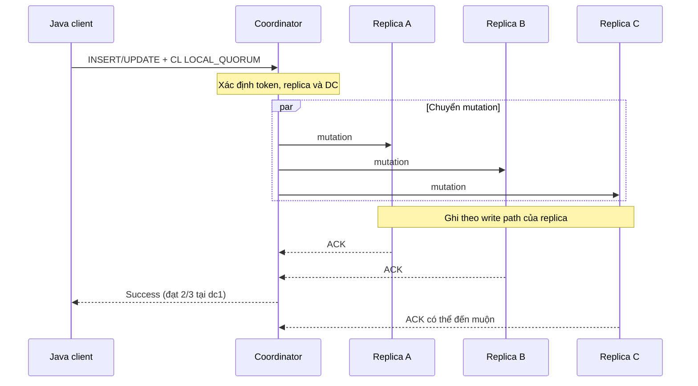

# Replication factor, consistency level và điều kiện xác nhận

## 1. Tại sao một lệnh ghi thành công chưa có nghĩa mọi replica đã nhận dữ liệu?

Apache Cassandra là cơ sở dữ liệu **wide-column phân tán**. Một partition được xác định từ partition key, ánh xạ thành token và phân phối tới nhiều **natural replicas** theo replication strategy của keyspace. Khi ứng dụng Java gọi `INSERT` hoặc `UPDATE`, một node đóng vai trò **coordinator** gửi yêu cầu ghi đến các replica. Ứng dụng nhận kết quả thành công khi coordinator thu đủ số phản hồi phù hợp với **consistency level (CL)** của thao tác, chứ không nhất thiết khi toàn bộ replica hoàn tất.

Chương **Đường ghi và độ bền** giải thích hai cấu hình tác động trực tiếp đến kết quả này:

- **Replication factor (RF):** số bản sao logic được phân công cho mỗi partition, có thể cấu hình riêng theo data center (DC).
- **Write consistency level:** điều kiện xác nhận tối thiểu coordinator phải đạt trước khi trả lời thành công.

Bài thuộc mô-đun `DATABASE_ENGINE_WIDE_COLUMN_CASSANDRA`, gắn với các kỹ năng thiết kế bảng theo truy vấn, partition key, CQL, replication, compaction, repair, xử lý lỗi và kết nối Java Driver. Không có `SPECIAL_NOTE` bổ sung cho bài này.

Sau bài học, bạn có thể tính ngưỡng ACK theo RF/CL, giải thích điều xảy ra khi một replica chậm hoặc mất kết nối, phân biệt thành công logic với độ bền vật lý, và điều tra `Unavailable`/`WriteTimeout` mà không nhầm một yêu cầu lỗi với chắc chắn chưa ghi dữ liệu.

## 2. Ba khái niệm phải tách biệt

| Khái niệm | Câu hỏi nó trả lời | Không đồng nghĩa với |
| --- | --- | --- |
| **RF / natural replicas** | Partition này được phân công lưu trên **bao nhiêu node nào**? | Số replica đang sống, số replica đã nhận thao tác ghi. |
| **Write CL / ACK threshold** | Coordinator cần **bao nhiêu phản hồi** để tuyên bố thao tác thành công? | Mọi replica đã đồng bộ, dữ liệu đã tồn tại trên SSTable. |
| **Durability** | Dữ liệu đã được bảo vệ ở những lớp nào trước crash, mất điện, hỏng node? | Chỉ tiêu đếm ACK hoặc số bản sao danh nghĩa. |

Ví dụ keyspace RF = 3, CL = `QUORUM`:

- Cassandra **phân công ba replica** cho một partition.
- Coordinator cần **hai ACK hợp lệ** để trả thành công.
- Replica thứ ba có thể đang chậm hoặc tạm thời không phản hồi; việc đó không nhất thiết ngăn yêu cầu `QUORUM` thành công.
- Hai ACK cho biết thao tác đã được các replica xác nhận theo **cơ chế ghi của Cassandra**; độ bền trước mất điện còn phụ thuộc thiết lập đồng bộ commit log và thực trạng node.

Hình dung RF là **mức dự phòng dữ liệu dự kiến**, CL là **mức phản hồi phải chờ ở lần thao tác cụ thể**. Chúng có liên quan nhưng là hai quyết định khác nhau.

## 3. Đường đi của một lệnh ghi

Giả sử keyspace dùng `NetworkTopologyStrategy` với RF = 3 trong `dc1`, và ứng dụng gửi một lệnh ghi tại CL = `LOCAL_QUORUM`.



Đường đi điển hình:

1. **Client gửi mutation** đến một node có thể làm coordinator. Coordinator không buộc phải là natural replica của partition.
2. **Coordinator xác định các replica** theo partition key/token, topology và replication strategy của keyspace.
3. **Yêu cầu tới replica:** replica xử lý mutation bằng write path của nó, thường bao gồm thêm bản ghi vào **commit log** và cập nhật **memtable**, rồi gửi ACK khi các bước ghi theo cấu hình hoàn tất.
4. **Coordinator đếm ACK** theo CL. Khi đạt ngưỡng, nó có thể trả thành công ngay cả khi replica còn lại chưa phản hồi.
5. **Về sau:** memtable được flush thành SSTable; compaction hợp nhất SSTable theo chính sách. Quá trình flush/compaction **không phải điều kiện chờ mặc định** của mỗi câu lệnh `INSERT`.

Sơ đồ đơn giản hóa đường gửi và ACK; ở cluster thực tế còn có connection pool, timeout, hinted handoff, topology thay đổi và các tối ưu truyền tin. **ACK là phản hồi từ replica hoặc cơ chế đặc biệt được CL cho phép**, không phải một bản sao dữ liệu được gửi ngược cho ứng dụng.

### Commit log và memtable đóng vai trò gì?

- **Memtable** là cấu trúc ghi trong bộ nhớ, phục vụ việc đọc/flush tiếp theo.
- **Commit log** là nhật ký ghi nối tiếp trên đĩa, dùng để **khôi phục các mutation chưa được flush** khi node khởi động lại sau crash.
- **SSTable** là dữ liệu bất biến trên đĩa được tạo khi flush; compaction xử lý nhiều SSTable về sau.

Không thể kết luận `ACK = đã có SSTable`. Cũng không thể tự động kết luận `ACK = đã fsync toàn bộ commit log`, bởi chính sách đồng bộ commit log có thể khác nhau theo cấu hình (xem mục 7).

## 4. Ngưỡng ACK trong một data center

Trong **một DC** có RF = \(N\) và không xét các tình huống ngoại lệ, quorum được tính:

\[
W_{\text{quorum}} = \left\lfloor \frac{N}{2} \right\rfloor + 1
\]

Với RF = 3, quorum là `floor(3 / 2) + 1 = 2`. Với RF = 5, quorum là `3`.

| Write CL | Ngưỡng ACK trong ví dụ RF = 3, một DC | Ý nghĩa |
| --- | --- | --- |
| `ANY` | Một xác nhận đủ điều kiện; **có thể là hint**, ngay khi chưa replica nào nhận dữ liệu | Ưu tiên chấp nhận ghi, có caveat lớn về khả năng đọc và độ bền. |
| `ONE` | 1 replica | Chờ một bản sao phản hồi; không chờ quorum. |
| `TWO` | 2 replica | Chờ hai bản sao phản hồi. |
| `THREE` | 3 replica | Chờ ba bản sao phản hồi. |
| `QUORUM` | 2 replica | Chờ đa số replica theo tổng RF. |
| `LOCAL_ONE` | 1 replica **trong DC địa phương** | Buộc ACK đến từ DC địa phương của coordinator. |
| `LOCAL_QUORUM` | 2 replica **trong DC địa phương** | Quorum dựa trên RF của DC địa phương. |
| `ALL` | 3 replica | Chờ đủ mọi replica được phân công; nhạy với một node không sẵn sàng. |

**`ONE` khác `ANY`:** `ONE` yêu cầu ít nhất **một replica** xác nhận. Ở write `ANY`, **một hint được nhận/lưu** có thể thỏa ngưỡng khi tất cả natural replicas tạm thời không liên lạc được. Vì thế `ANY` có thể trả success trong khi dữ liệu chưa có trên replica tự nhiên và không thể đọc ngay theo cách thông thường.

**`THREE` không có nghĩa “RF = 3”:** đây là lựa chọn đòi ba phản hồi; nếu RF thực tế thấp hơn ba, yêu cầu không thể đáp ứng ngưỡng. **RF = 1, CL = `QUORUM`** chỉ cần một ACK, **không tạo dự phòng node**.

Ngoại lệ: `ANY` là mức nhất quán dành cho **ghi thông thường**, không được dùng như mức nhất quán đọc; các loại thao tác đặc biệt như counter, LWT hoặc batch có các hạn chế riêng theo phiên bản CQL.

## 5. Nhiều data center: `QUORUM`, `LOCAL_QUORUM` và `EACH_QUORUM`

Giả sử:

```sql
CREATE KEYSPACE shop_ks
WITH replication = {
    'class': 'NetworkTopologyStrategy',
    'dc1': 3,
    'dc2': 2
}
AND durable_writes = true;
```

Ví dụ có **năm natural replicas** cho mỗi partition trong một topology có đủ node: ba tại `dc1`, hai tại `dc2`.

| Write CL | Điều kiện xác nhận | Ví dụ ACK đạt ngưỡng |
| --- | --- | --- |
| `QUORUM` | Quorum trên **tổng RF = 5** → 3 ACK hợp lệ | 3 ở `dc1`, hoặc 2 ở `dc1` + 1 ở `dc2`, hoặc tổ hợp khác có tổng 3. |
| `LOCAL_QUORUM` (coordinator ở `dc1`) | Quorum của RF `dc1 = 3` → 2 ACK tại `dc1` | 2 ACK tại `dc1`; ACK ở `dc2` không thay cho ACK địa phương. |
| `LOCAL_QUORUM` (coordinator ở `dc2`) | Quorum của RF `dc2 = 2` → 2 ACK tại `dc2` | Phải có cả 2 replica `dc2` xác nhận. |
| `EACH_QUORUM` | Quorum **ở từng DC**: 2 ở `dc1` **và** 2 ở `dc2` | Cần ít nhất 4 ACK với phân bố đáp ứng cả hai DC. |
| `ALL` | Cả 5 replica | Cần 5 ACK; mọi replica đều phải phản hồi. |
| `LOCAL_ONE` (coordinator ở `dc1`) | 1 ACK tại `dc1` | Không thể tính một ACK chỉ ở `dc2` thay thế. |

`EACH_QUORUM` áp dụng cho **ghi**, không phải một lựa chọn CL đọc thông thường. `LOCAL_*` dựa vào **DC địa phương được coordinator/driver định tuyến tới**; cấu hình sai DC của ứng dụng có thể dẫn đến ngưỡng và chi phí mạng khác kỳ vọng.

**Hệ quả:** Với một DC khác đang mất kết nối, `LOCAL_QUORUM` tại `dc1` có thể tiếp tục nhận ghi nếu có đủ hai replica `dc1`, nhưng `EACH_QUORUM` và `ALL` sẽ không thể thành công khi thiếu ACK cần thiết từ `dc2`. Việc yêu cầu quorum xuyên DC là một lựa chọn về **tính sẵn sàng, độ trễ WAN và phạm vi bảo đảm**, không phải một mặc định tối ưu cho mọi hệ thống.

## 6. Khi coordinator quyết định thành công hay thất bại

Giả sử RF = 3 trong `dc1`, write CL = `LOCAL_QUORUM`. Đây là các trạng thái khác nhau:

| Trạng thái replica tại thời điểm ghi | ACK hợp lệ trước hạn | Phản hồi có thể xảy ra |
| --- | --- | --- |
| A, B, C sẵn sàng, đều ACK | 3/3 | Thành công sau khi đạt 2 ACK, không nhất thiết chờ ACK thứ ba. |
| A và B ACK, C chậm/đang down | 2/3 | **Có thể thành công** vì đạt quorum địa phương. |
| Chỉ A ACK, B và C không trả trước timeout | 1/3 | **Không đạt CL**; thường `WriteTimeout` hoặc lỗi liên quan. Không suy rằng mutation ở A đã bị rollback. |
| Chỉ một replica được coordinator xác định đang sống trước khi gửi | Không thể đạt 2 | Có thể nhận `Unavailable` ngay, tùy trạng thái/lỗi quan sát được. |
| 2 replica ACK, client mất mạng trước khi nhận phản hồi | Có thể đã đủ 2/3 | **Kết quả phía client không xác định**; dữ liệu có thể đã ghi dù client thấy lỗi. |

Cần phân biệt:

- **`Unavailable`:** coordinator xác định không đủ replica sẵn sàng để đạt ngưỡng trước khi thực hiện một phần thao tác (mô tả điển hình; cluster có race về trạng thái).
- **`WriteTimeout`:** coordinator không thu đủ xác nhận trong khoảng thời gian cho phép. Có thể một số replica đã ghi; không có rollback transaction tự động.
- **`WriteFailure` hoặc lỗi kết nối:** một số replica báo lỗi hoặc đường truyền gặp trục trặc; phải tra loại lỗi, log và trạng thái thao tác.
- **Thành công:** CL đã được thỏa tại thời điểm quyết định, **không** chứng minh tất cả replica đều cập nhật hoặc mọi lớp lưu trữ đã fsync.

Một node có trạng thái `UN` trong `nodetool status` không bảo đảm ACK sẽ đến kịp: nghẽn I/O, đợi flush, queue, mạng và GC có thể làm quá hạn. Ngược lại, replica `DN` vẫn nằm trong **tập natural replicas** của partition nhưng không đóng góp ACK cho đến khi có khả năng phục vụ.

## 7. Độ bền thực tế: ACK, commit log sync, SSTable và hint

RF và CL là điều kiện về **bản sao và phản hồi**. Muốn đánh giá khả năng chịu crash hoặc mất điện, cần biết dữ liệu đã đến lớp lưu trữ nào.

### 7.1. ACK không nhất thiết đồng nghĩa fsync

Tại một replica ghi bình thường, Cassandra ghi mutation vào commit log và memtable. Commit log giúp phục hồi dữ liệu chưa được flush thành SSTable. Tuy nhiên **điểm đồng bộ commit log xuống thiết bị lưu trữ** phụ thuộc cấu hình:

- Với chế độ **`commitlog_sync: batch`** (tên/tùy chọn cụ thể theo phiên bản), replica đồng bộ commit log theo chính sách batch trước khi ACK các mutation trong batch. Điều này có thể tăng độ trễ nhưng làm ngữ nghĩa ACK mạnh hơn trước một số loại sự cố.
- Với **`commitlog_sync: periodic`**, commit log được đồng bộ định kỳ. Replica có thể ACK trước khi bản ghi đó được fsync; một sự cố mất điện/OS crash trước lần sync tiếp theo có thể làm mất các ghi vừa được xác nhận ở replica đó.

Không được xem số replica ACK là phép bảo đảm tuyệt đối chống lại sự cố **đồng thời trên nhiều máy**, mất điện tập trung, lỗi thiết bị hoặc cấu hình `durable_writes` không thích hợp. Dù cấu hình ra sao, kiểm tra **phiên bản Cassandra và tên tùy chọn YAML thực tế** trước khi khẳng định thời điểm flush/fsync.

### 7.2. Hinted handoff giúp phục hồi bản sao thiếu, không thay cho repair

Khi replica tạm thời không liên lạc được, coordinator **có thể lưu hint** để chuyển mutation đến node đó sau khi phục hồi, tùy cấu hình, tình huống và giới hạn giữ hint. Hint là cơ chế **best effort** giúp hội tụ sau một số lỗi ngắn hạn, không phải bằng chứng mọi replica đã có dữ liệu.

Ở CL `ANY`, hint có thể là cơ sở trả thành công **ngay cả khi không natural replica nào ACK**. Nếu chỉ có hint và node lưu hint bị mất trước khi giao lại, dữ liệu đó có nguy cơ mất; đọc theo CL thông thường cũng có thể chưa thấy dữ liệu. Vì vậy `ANY` không tự động là mức **độ bền cao hơn `ONE`** dù có thể tăng tỷ lệ ghi được chấp nhận khi lỗi.

Hints có thời gian lưu/điều kiện gửi và có thể không bao phủ toàn bộ outage dài. **Repair/anti-entropy** vẫn cần thiết theo quy trình vận hành để xử lý lệch dữ liệu giữa các replica; hinted handoff không thay thế repair.

### 7.3. Không chờ compaction hoặc repair để xác nhận ghi

Flush memtable → SSTable, compaction và repair là các công việc **bất đồng bộ** với đường ACK của một ghi thông thường. Cassandra có thể trả success rất lâu trước compaction/repair. Không suy từ một câu `INSERT` thành công rằng các SSTable đã hợp nhất hoặc mọi replica đã đồng bộ.

## 8. RF/CL khi kết hợp đọc và ghi

Trong một DC có RF = \(N\), một quy tắc trực giác hữu ích để kỳ vọng **giao nhau giữa tập replica đọc và tập replica ghi** là:

\[
R + W > N
\]

Với RF = 3, ghi `QUORUM` cần `W = 2` và đọc `QUORUM` cần `R = 2`; tổng `4 > 3` nên hai tập replica có ít nhất một node giao nhau. Với `ONE`/`ONE` thì `1 + 1 = 2 ≤ 3`, không có bảo đảm giao nhau đó.

**Giới hạn của quy tắc này:**

- Chỉ áp dụng khi tập replica/ngưỡng tương thích trong cùng phạm vi replication; đối với `LOCAL_QUORUM` phải xét **cùng DC**. Không tự cộng các ngưỡng của hai DC khác nhau.
- Giao nhau của tập replica **không** tương đương một giao dịch tuyến tính hóa (*linearizable transaction*) cho mọi tình huống. Cassandra giải quyết xung đột theo timestamp/tombstone và các cơ chế đọc/ghi của nó; các ghi đồng thời vẫn phải được thiết kế cẩn thận.
- `ANY` có thể xác nhận **chỉ bằng hint**, nên không được áp công thức này như thể `ANY` đã ghi lên một natural replica.
- Dữ liệu hết TTL, tombstone được dọn quá sớm, outage kéo dài hoặc replica không được repair có thể tạo rủi ro nhất quán ngoài mô hình ACK đơn giản.

Nếu yêu cầu là **compare-and-set** (ví dụ trừ tồn kho chỉ khi phiên bản còn đúng), CL = `QUORUM` **không thay cho LWT `IF ...`**. LWT/Paxos có **serial consistency** riêng (`SERIAL`/`LOCAL_SERIAL`), không thể tính hoàn toàn bằng bảng ACK ghi thông thường ở mục 4.

## 9. Thực hành CQL: thay RF và CL, quan sát điều kiện xác nhận

> Thực hành trong cluster thử nghiệm có đủ node; thay `dc1`/`dc2` bằng đúng tên DC đang hiển thị trong cluster. Thay RF của keyspace đang phục vụ production có thể kích hoạt nhu cầu vận hành bổ sung và không nên làm chỉ để thử ví dụ.

### 9.1. Xem cấu hình replication

```sql
SELECT keyspace_name, replication, durable_writes
FROM system_schema.keyspaces
WHERE keyspace_name = 'shop_ks';
```

Nếu muốn làm lab một DC, có thể dùng keyspace riêng, ví dụ (cần **ba node** trong `dc1` để đạt RF thực):

```sql
CREATE KEYSPACE write_lab_ks
WITH replication = {'class': 'NetworkTopologyStrategy', 'dc1': '3'}
AND durable_writes = true;

CREATE TABLE write_lab_ks.orders_by_id (
    order_id uuid PRIMARY KEY,
    status text,
    amount decimal,
    updated_at timestamp
);
```

Chạy trong `cqlsh`:

```sql
CONSISTENCY LOCAL_QUORUM;

INSERT INTO write_lab_ks.orders_by_id
    (order_id, status, amount, updated_at)
VALUES
    (11111111-2222-3333-4444-555555555555,
     'CREATED', 125.50, toTimestamp(now()));

SELECT * FROM write_lab_ks.orders_by_id
WHERE order_id = 11111111-2222-3333-4444-555555555555;
```

Trong `cqlsh`, lệnh `CONSISTENCY` thay mức nhất quán các yêu cầu của phiên làm việc, còn `CREATE KEYSPACE ... replication` định nghĩa RF trong metadata của keyspace. **Chuyển CL không sửa RF và không tự tạo/xóa replica.**

### 9.2. Đối chiếu với công cụ vận hành

```bash
nodetool status
nodetool getendpoints write_lab_ks orders_by_id 11111111-2222-3333-4444-555555555555
```

`nodetool getendpoints` cho biết **natural replicas** theo metadata của node được hỏi. `nodetool status` cho biết trạng thái node; hai lệnh không hiển thị **số ACK của lần INSERT vừa chạy**. Dữ liệu trong log/metrics/trace (nếu được bật trong môi trường thử nghiệm) mới giúp điều tra đường thực thi.

### 9.3. Thử lỗi trong môi trường an toàn

Giả sử có RF = 3, chỉ hai replica ở `dc1` sẵn sàng:

1. Giữ `CONSISTENCY LOCAL_QUORUM`. Thao tác có thể thành công vì **2/3** replica đủ phản hồi.
2. Chuyển sang `CONSISTENCY ALL` rồi thử một thao tác ghi **khác khóa**. Nếu replica thứ ba thật sự không thể trả ACK trước thời hạn, yêu cầu sẽ không thành công theo `ALL`. Một số replica còn lại có thể vẫn đã lưu mutation.
3. Khi các replica phục hồi và có thể truy cập, kiểm tra dữ liệu, log và quy trình repair phù hợp; **không** kết luận thao tác đã rollback chỉ vì client nhận lỗi.

Không nên cố ý làm down node production để kiểm tra CL. Với bài lab, có thể suy ngưỡng ACK từ bảng RF/CL mà không cần tạo lỗi thực tế.

## 10. Java Driver: đặt CL cho từng thao tác và xử lý kết quả không chắc chắn

Trong Java Driver 4.x, nên dùng prepared statement và cấu hình consistency level rõ ràng tại statement hoặc execution profile:

```java
PreparedStatement ps = session.prepare(
    "INSERT INTO write_lab_ks.orders_by_id " +
    "(order_id, status, amount, updated_at) VALUES (?, ?, ?, ?)"
);

UUID orderId = UUID.fromString("11111111-2222-3333-4444-555555555555");

BoundStatement write = ps.bind(
    orderId, "CREATED", new BigDecimal("125.50"), Instant.now()
).setConsistencyLevel(DefaultConsistencyLevel.LOCAL_QUORUM);

try {
    session.execute(write);
    // Coordinator đã nhận đủ xác nhận theo LOCAL_QUORUM.
} catch (UnavailableException e) {
    // Không đủ replica sẵn sàng theo đánh giá của coordinator.
} catch (WriteTimeoutException e) {
    // Có thể đã ghi ở một số replica; chưa biết kết quả cuối cùng.
} catch (WriteFailureException e) {
    // Một hoặc nhiều replica gặp lỗi trong lúc thực thi.
}
```

Đoạn mã giả sử `session` đã tạo và các lớp `UUID`, `BigDecimal`, `Instant`, các exception của Java Driver 4.x đã được import. Cần cấu hình đúng **local data center** cho driver/session để các CL `LOCAL_*` tương ứng DC được mong đợi. Nếu request quá thời gian ở lớp client, bạn cũng phải xử lý các timeout của driver và mạng, không chỉ ba loại lỗi từ server.

**Retry an toàn:** Ghi `SET status = 'CREATED'` trên cùng khóa có thể có ngữ nghĩa idempotent nếu dữ liệu/timestamp và luồng nghiệp vụ được thiết kế phù hợp; nhưng `UPDATE counter`, sinh ID mới, gửi side effect bên ngoài hoặc xử lý thanh toán lặp có thể **không idempotent**. Sau timeout, hãy kiểm tra lại bằng khóa định danh ổn định và mức đọc phù hợp, dùng mã yêu cầu/idempotency key khi nghiệp vụ cần, rồi mới quyết định retry. Đừng coi exception là tín hiệu chắc chắn có thể phát lại mọi thao tác.

Số replica đáp ứng CL cũng không chứng minh cập nhật có thứ tự ứng dụng mong muốn. Nhiều client ghi đồng thời lên cùng cột cần kiểm soát timestamp, retry hoặc LWT nếu cần ràng buộc trạng thái. Đưa toàn bộ quyết định đồng thời vào một lớp service phù hợp sẽ giúp tránh writer ở nhiều tuyến code sử dụng CL/chính sách retry mâu thuẫn.

## 11. Các ngộ nhận thường gặp

| Khẳng định | Đánh giá đúng |
| --- | --- |
| “RF = 3 nghĩa là mỗi ghi chờ cả ba node.” | **Sai.** Chờ bao nhiêu ACK tùy write CL; `ONE` chờ một, `QUORUM` chờ hai, `ALL` chờ ba. |
| “CL = `QUORUM` làm dữ liệu có ba bản sao.” | **Sai.** RF/keyspace định nghĩa placement và số bản sao; CL không tăng RF. |
| “CL = `ANY` có ít nhất một replica giữ dữ liệu.” | **Sai.** Một hint có thể đủ để trả success, chưa replica tự nhiên nào ghi thành công. |
| “Client nhận timeout nên lần ghi chưa thực hiện.” | **Sai.** Một phần hoặc đủ replica có thể đã ghi trước khi timeout/mất phản hồi. |
| “ACK nghĩa là SSTable đã flush và fsync.” | **Sai.** Đường ACK thường xảy ra trước flush/compaction; fsync commit log tùy chế độ đồng bộ. |
| “`ALL` an toàn tuyệt đối.” | **Sai.** `ALL` giảm khả năng phản hồi khi lỗi và không bảo vệ trước mọi sự cố đồng thời hoặc lỗi vận hành. |
| “Ghi `LOCAL_QUORUM` tại DC A, đọc `LOCAL_QUORUM` ở DC B luôn thấy dữ liệu mới nhất.” | **Không được bảo đảm chỉ bằng phép đếm**: hai quorum thuộc các DC khác nhau, không có giao nhau bắt buộc. |
| “Quorum đủ để triển khai ràng buộc ‘chỉ trừ tồn kho nếu còn đủ’.” | **Sai.** Cần cập nhật có điều kiện/LWT hoặc cơ chế phối hợp nghiệp vụ thích hợp. |

## 12. Bài tập tính toán và xử lý sự cố

**Tình huống A — một DC:** RF = 5, write CL = `QUORUM`.

- Cần **3 ACK**. Nếu 2 replica down, 3 replica khác có thể đủ xác nhận; nếu chỉ 2 replica còn sẵn sàng thì không thể đạt quorum.
- Tăng CL từ `ONE` lên `QUORUM` có thể tăng yêu cầu chờ và giảm xác suất thành công khi lỗi; **không** làm tăng RF.

**Tình huống B — hai DC:** `NetworkTopologyStrategy {dc1: 3, dc2: 2}`, coordinator ở `dc1`.

- `QUORUM` cần **3 ACK** tổng cộng.
- `LOCAL_QUORUM` cần **2 ACK ở dc1**.
- `EACH_QUORUM` cần **2 ACK ở dc1 và 2 ACK ở dc2**.
- Nếu toàn bộ `dc2` mất kết nối nhưng `dc1` còn ba node khỏe mạnh, `LOCAL_QUORUM` vẫn có thể thành công; `EACH_QUORUM` thì không.

**Tình huống C — `ANY`:** Cả ba natural replicas của một partition tạm thời không nhận mutation, nhưng coordinator chấp nhận và lưu một hint đủ điều kiện. Ghi ở `ANY` **có thể trả success**; đọc ngay có thể không thấy hàng; nếu hint mất trước khi được giao, dữ liệu có thể mất.

**Tình huống D — client timeout:** Ứng dụng Java gửi `INSERT` ở `LOCAL_QUORUM`; coordinator đã nhận một ACK, replica thứ hai có thể trả sau khi client hết thời gian chờ. Không được phát sinh một đơn hàng thứ hai với UUID mới như thể lần ghi trước chắc chắn thất bại. Cần đối soát bằng `order_id` ổn định, log và kết quả đọc phù hợp.

**Câu hỏi tự kiểm tra:**

1. Tại sao `RF = 1, QUORUM` không cung cấp khả năng chịu mất một node?
2. Tại sao `CL = ANY` không thể làm đối số cho truy vấn `SELECT`?
3. Sau khi có hai ACK với RF = 3, liệu dữ liệu chắc chắn nằm trong SSTable trên hai máy không? Yếu tố nào quyết định commit log đã fsync?
4. Ở hai DC, điều gì khác nhau giữa `QUORUM` và `LOCAL_QUORUM` khi DC ở xa mất liên lạc?
5. Một `WriteTimeout` có thể để lại điều gì trên các replica? Làm thế nào thiết kế retry an toàn?

## 13. Tài liệu tham khảo

- [Apache Cassandra — Documentation](https://cassandra.apache.org/doc/stable/): kiến trúc phân tán, replication strategy, consistency và write path theo phiên bản.
- [Apache Cassandra — Storage Engine](https://cassandra.apache.org/doc/stable/cassandra/architecture/storage-engine.html): commit log, memtable, SSTable và compaction.
- [Apache Cassandra — CQL](https://cassandra.apache.org/doc/stable/cassandra/developing/cql/): câu lệnh CQL, consistency và cú pháp thao tác dữ liệu.
- [Apache Cassandra Java Driver](https://apache.github.io/cassandra-java-driver/): API để thiết lập CL, xử lý retry và các exception.

**Điểm cốt lõi:** **RF** cho biết Cassandra dự kiến đặt dữ liệu trên bao nhiêu replica; **CL** cho biết coordinator cần bao nhiêu **ACK đúng phạm vi** để trả thành công; **độ bền thực tế** còn phụ thuộc commit log, fsync, hint, tình trạng node và quy trình phục hồi. Khi một câu lệnh ghi lỗi hoặc timeout, hãy điều tra **điều kiện xác nhận chưa đạt ở đâu** trước khi quyết định retry hoặc kết luận dữ liệu đã mất.
