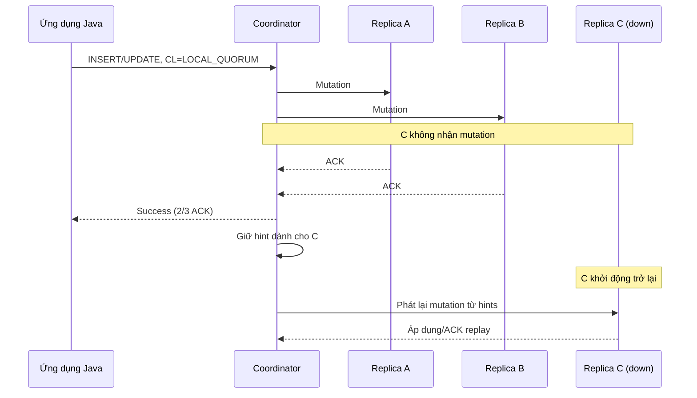

# Hint khi replica không nhận được ghi và các giới hạn trong Apache Cassandra

## 1. Bài toán: một replica bỏ lỡ mutation khi cụm vẫn đang ghi

Trong mô hình **wide-column phân tán** của Apache Cassandra, mỗi partition được ánh xạ đến một tập replica theo token, replication strategy và replication factor (RF). Khi ứng dụng ghi một hàng CQL, một node đóng vai trò **coordinator** nhận yêu cầu, tìm các replica phụ trách partition key rồi chuyển mutation đến chúng. Một replica có thể đang restart, mất kết nối hoặc phản hồi quá chậm dù các replica khác vẫn phục vụ bình thường.

**Hinted handoff** là cơ chế Cassandra tạm lưu **hint** tại một coordinator khi không chuyển được mutation đến replica đích, rồi cố gắng phát lại mutation khi replica đó quay lại. Hint giúp rút ngắn thời gian các bản sao bị lệch sau lỗi ngắn hạn. Đây là cơ chế **best effort**, không phải một bảo đảm rằng mọi ghi bị lỡ chắc chắn sẽ được áp dụng. Muốn phục hồi các sai khác còn sót giữa replica, hệ thống vẫn cần **anti-entropy repair** theo kế hoạch.

Bài học thuộc chương **Đường ghi và độ bền** của mô-đun `DATABASE_ENGINE_WIDE_COLUMN_CASSANDRA`, kết nối ba mảng kiến thức: đường ghi/độ bền, replication và consistency level, cùng quy trình phát hiện–xử lý lỗi bằng CQL, `nodetool` và ứng dụng Java.

Đến cuối bài, người học có thể:

1. Giải thích khi nào Cassandra tạo hint và phân biệt hint với ghi đã thành công trên replica.
2. Phân tích phản hồi tại `ONE`, `LOCAL_QUORUM`, `ALL` và `ANY` khi một hay nhiều replica không khả dụng.
3. Hiểu các giới hạn của hinted handoff: cửa sổ tạo hint, ổ đĩa, tốc độ replay, mất coordinator, TTL/tombstone và thay đổi topology.
4. Quan sát backlog, khôi phục replica, xác định lúc cần repair và xử lý timeout từ Java Driver.

## 2. Hint nằm ở đâu trong write path?

Giả sử keyspace có ba replica **A, B, C** trong cùng data center (`RF = 3`). Ứng dụng gửi mutation đến coordinator, dùng `LOCAL_QUORUM`. Node C đang khởi động lại, còn A và B đều nhận ghi và gửi ACK. Coordinator có thể trả thành công cho client **ngay khi có hai ACK** theo consistency level; nó giữ hint cho mutation mà C chưa nhận được.



**Thứ tự các sự kiện trong hình chỉ là minh họa.** Coordinator có thể tạo hint khi phát hiện replica down hoặc khi write timeout; việc ghi hint và phản hồi cho client không nhất thiết diễn ra đúng thứ tự trên mọi phiên bản/đường thực thi.

### 2.1. Phân biệt các bản ghi trên đĩa

| Thành phần | Nằm ở đâu? | Mục đích |
| --- | --- | --- |
| **Commit log** | Trên node **nhận mutation** | Nhật ký phục hồi các ghi chưa flush ra SSTable nếu node crash; hành vi đồng bộ đĩa phụ thuộc cấu hình commitlog |
| **Memtable** | Bộ nhớ của node nhận mutation | Chứa các cập nhật mới, sau đó flush thành SSTable |
| **SSTable** | Đĩa của node sở hữu replica | Dữ liệu bền theo mô hình LSM; được hợp nhất qua compaction |
| **Hint** | Thường trên node **coordinator** lưu hộ replica tạm thời không nhận được ghi | Ghi nhớ mutation cần chuyển lại cho **một replica đích** |
| **Repair** | Quy trình so sánh và đồng bộ replica theo token range | Khắc phục sai khác, kể cả những mutation mà hint không bao phủ |

Một hint thường mang định danh replica đích, mutation được serialize và **timestamp gốc** của mutation. Khi phát lại, Cassandra giữ ngữ nghĩa timestamp của mutation; một hint cũ không được tùy ý ghi đè một giá trị mới có timestamp cao hơn theo quy tắc hòa giải dữ liệu của Cassandra. Tuy vậy, timestamp do ứng dụng cấp sai lệch, TTL và tombstone vẫn có thể gây hậu quả; hint không giải quyết lỗi thiết kế quản lý thời gian.

Hint **không đồng nghĩa** replica C đã ghi commit log hay chứa hàng trong SSTable. Trước khi replay, dữ liệu có thể chỉ xuất hiện trên A/B và một hoặc nhiều coordinator đang giữ hint cho C. Dung lượng thư mục hints trên coordinator có thể tăng dù C không có mặt để nhận ghi.

### 2.2. Vì sao cơ chế này gắn với partition key?

```text
partition key -> token -> replica set {A, B, C} -> mutation gửi đến replica
                                       |
                                       +-- C bỏ lỡ -> hint(C, mutation)
```

Thay đổi clustering key **không** làm dữ liệu chuyển sang tập replica khác nếu partition key không đổi. Hint được ghi cho một **mutation bị bỏ lỡ ở replica cụ thể**, không phải cách “băm lại” dữ liệu, tạo bản sao thứ tư hay cân tải lâu dài. Hinted handoff và số vnode xử lý hai bài toán khác nhau.

## 3. Khi nào hint được tạo?

Với các ghi thông thường, các tình huống phổ biến gồm:

- Replica được coordinator xác định là **down/unreachable** trước hoặc trong quá trình gửi mutation.
- Replica không xác nhận mutation **trước ngưỡng write timeout**, dù tình trạng thực tế có thể chưa rõ ràng.
- Một đợt bảo trì ngắn khiến một node tạm thời ngắt khỏi ring, trong khi các replica khác vẫn có thể nhận ghi.

Để hint được giữ thành công còn phụ thuộc vào việc tính năng có bật, DC đích có được phép, cửa sổ tạo hint, khả năng ghi vào thư mục hints, quota/giới hạn cục bộ và trạng thái coordinator. **Không được suy ra “cứ replica xuống là chắc chắn có hint”.** Một request bị timeout cũng không khẳng định mutation chưa được áp dụng: có replica đã ghi thành công nhưng ACK về muộn hoặc không tới client.

Khi replica quay lại, Cassandra biết tình trạng node qua cơ chế membership/gossip và cố gắng **deliver/replay** các hint còn lưu cho node ấy. Replay được giới hạn thông lượng để tránh đẩy quá nhiều I/O và network vào replica vừa phục hồi. Quá trình replay mất thời gian, có thể kéo dài lâu hơn thời gian node vắng mặt.

### 3.1. Hinted handoff không phải read repair hoặc anti-entropy repair

| Cơ chế | Kích hoạt | Điều có thể sửa | Giới hạn quan trọng |
| --- | --- | --- | --- |
| **Hinted handoff** | Ghi xảy ra khi replica không nhận được; sau đó replica hồi phục | Mutation đã được coordinator **ghi hint** | Best effort; phụ thuộc thời gian/đĩa/đích; không biết được mọi sai khác |
| **Read repair** | Một số đường đọc phát hiện replica không đồng nhất theo cách bản Cassandra hỗ trợ | Sai khác gặp **trong các dữ liệu được đọc** | Không quét mọi partition, không thay thế repair định kỳ |
| **Anti-entropy repair** | Vận hành hoặc hệ thống quản lý chủ động chạy repair | So sánh dữ liệu thuộc các token range giữa replica và đồng bộ sai khác | Tốn mạng/đĩa/CPU; cần lịch và giám sát |

Các trường hợp **tombstone bị bỏ lỡ** đặc biệt quan trọng: replica có thể giữ bản ghi cũ, trong khi tombstone tại replica khác đã bị thu gom sau thời gian grace. Nếu bỏ qua repair quá lâu, dữ liệu đã xóa có thể “sống lại” (*zombie data*). Vì thế, không thể thay chính sách repair bằng kỳ vọng “Cassandra luôn có hint”.

## 4. Consistency level: phản hồi thành công có cần hint hay không?

Với `RF=3` trong **một DC**, xem các kịch bản sau. Quy tắc quorum là `floor(RF/2) + 1 = 2`. Coordinator vẫn có thể cố gửi mutation đến mọi replica; consistency level quyết định **số xác nhận cần chờ** để trả thành công. Riêng kịch bản cả A/B/C đều down, **giả sử còn coordinator Q hoạt động trên một node khác không thuộc tập replica**; nếu toàn bộ cụm cũng down, không có coordinator nào nhận request để lưu hint.

| Tình huống | CL | Điều kiện thành công cho client | Vai trò của hint |
| --- | --- | --- | --- |
| A, B up; C down | `ONE` | Một replica ACK là đủ | Có thể giữ mutation cho C; hint không phải ACK bắt buộc |
| A, B up; C down | `LOCAL_QUORUM` | A và B ACK → thành công | Có thể giữ hint cho C để đồng bộ sau |
| A, B up; C down | `ALL` | Thiếu ACK của C → không thể đáp ứng CL | Có hint **không biến** lệnh thành `ALL` thành công |
| A down; B và C down | `ANY` (write thường) | Có thể thành công khi coordinator **lưu hint** dù không replica nào xác nhận | Hint được tính là phương án thỏa `ANY`; dữ liệu chưa chắc đọc được trước replay |
| A down; B và C down | `QUORUM` | Không đủ ACK → thất bại/không khả dụng | Hint không thay thế các ACK quorum |

**Ngoại lệ quan trọng:** `ANY` là consistency level dành cho ghi (theo giới hạn loại thao tác và phiên bản); không dùng cho `SELECT`, và không suy rộng ví dụ này sang LWT hoặc các loại ghi có hạn chế riêng. Với `ANY`, một ACK có thể phản ánh **hint đã được lưu**, chưa có replica sở hữu dữ liệu thực sự. Đây là khác biệt lớn giữa “coordinator trả thành công” và “sẵn sàng đọc lại ngay”. Nếu coordinator/hint gặp sự cố trước khi replay, rủi ro mất dữ liệu tăng.

Trong cụm nhiều DC, `LOCAL_QUORUM` chỉ yêu cầu quorum ở **DC cục bộ**; `QUORUM` và `EACH_QUORUM` có phạm vi khác. Tập replica, RF mỗi DC và coordinator local DC phải được ghi rõ trước khi phân tích. Một hint dành cho replica ở DC xa không mặc nhiên làm tăng số ACK ở DC cục bộ.

### 4.1. Bài toán độ bền: hai lớp cần hiểu

**Lớp 1 – Độ bền của replica đã ACK.** Khi nhận mutation, replica ghi vào commit log và memtable theo write path; độ bền sau crash còn tùy chính sách đồng bộ commit log, tình trạng đĩa và số bản sao đã chấp nhận ghi. Không phải mọi ACK đều đồng nghĩa mọi byte đã được `fsync` ở mọi replica vào thời điểm client nhận phản hồi.

**Lớp 2 – Khả năng phục hồi replica đã bỏ lỡ.** Hint là cơ chế tạm lưu mutation dành cho một đích; nó có đường lưu trữ, flush/throttle và rủi ro mất riêng. Hint không thay thế commit log của replica đích, cũng không thay thế repair sau lỗi kéo dài.

Do đó, tuy Cassandra cho phép điều chỉnh consistency level để cân bằng độ trễ và khả năng hoạt động, **tăng hint window hoặc bật `ANY` không làm hệ thống đạt bảo đảm độ bền tuyệt đối**.

## 5. Giới hạn thực tế của hinted handoff

### 5.1. Cửa sổ tạo hint không phải thời gian đồng bộ chắc chắn

Tham số `max_hint_window` (Cassandra 4.1+/5.x) hoặc `max_hint_window_in_ms` (3.11/4.0) giới hạn khoảng thời gian một node bị coi là down mà coordinator tiếp tục tạo hint mới cho node đó. Mặc định được tài liệu nhiều phiên bản công bố là **3 giờ**. Ý nghĩa chính là **dừng tạo thêm hint mới khi đích đã down quá lâu theo quy tắc phiên bản**, nhằm tránh tích lũy không giới hạn; không nên hiểu như cam kết “mọi hint sẽ phát xong sau ba giờ”, hoặc “đúng giờ thứ ba mọi tệp hint bị xóa”.

Ở các bản mới còn có lựa chọn liên quan tới **persistent hint window**, có thể ảnh hưởng cách xác định một đích down liên tục qua nhiều lần node chập chờn. Cần kiểm tra `cassandra.yaml` của **phiên bản đang chạy** trước khi dựa vào giả định thời gian tuyệt đối.

Nếu node quay lại **sau khi cửa sổ tạo hint đóng**, nhiều mutation mới trong khoảng down dài **không có hint**. Ngay cả nếu còn các hint cũ, replay thành công chúng cũng không bảo đảm replica đã có đủ dữ liệu; cần tổ chức **repair** cho token ranges liên quan.

### 5.2. Ổ đĩa, khả năng ghi và quota hints

Hint thường nằm trong thư mục `hints_directory` của coordinator. Khi write rate lớn hoặc node đích down lâu, kích thước thư mục có thể tăng đáng kể, cạnh tranh dung lượng và I/O với các thành phần khác của Cassandra.

Các yếu tố ảnh hưởng:

- Thư mục hints đầy hoặc không thể ghi, coordinator crash/ổ đĩa hỏng, cấu hình hinted handoff bị tắt.
- Giới hạn dung lượng từng tệp hint; một số phiên bản có `max_hints_size_per_host`, giúp khống chế dung lượng hint cho mỗi đích. Khi đạt giới hạn, hệ thống có thể **ngừng tạo hint mới**.
- Tốc độ ghi vào hints cao hơn tốc độ chuyển lại cho node vừa khởi động. Kéo dài replay làm backlog và yêu cầu đĩa tăng.
- Các node đồng thời down dẫn đến nhiều replica đích cần hint; khi có nhiều coordinator, cần đo ở **tất cả node có thể giữ hint**, không chỉ node bị lỗi.

**Ước lượng dung lượng thô:** nếu một replica bị lỡ trung bình 6 MiB mutation/giây trong 30 phút, lượng mutation cần giữ là khoảng `6 × 1.800 = 10.800 MiB ≈ 10,5 GiB`, chưa tính metadata, nén, ghi trùng hay thực tế phân phối coordinator. Con số chỉ để lập capacity; không thể dự đoán chính xác kích thước hint từ tổng QPS của cụm.

### 5.3. Replay có thể rất chậm

`hinted_handoff_throttle`, `max_hints_delivery_threads`, mạng và khả năng đĩa/CPU của replica đích đều tác động tốc độ replay. Không nên bật throttle cực cao theo phản xạ: replica vừa quay lại còn phục vụ read/write bình thường, flush, compaction hoặc streaming. Ép replay có thể làm tăng p99, timeout và backlog của ứng dụng.

Ngược lại, throttle quá thấp có thể để hàng chục GiB hint chờ nhiều giờ. Điều chỉnh phải có giới hạn vận hành và theo dõi **thời gian backlog giảm**, throughput replay, độ trễ ứng dụng, I/O và log lỗi.

### 5.4. Hints không che được mọi dạng lỗi

- **Mất coordinator hoặc ổ hints:** bản ghi hint được giữ hộ có thể mất. Hints là best effort; không coi thư mục hint là backup.
- **Node mất dữ liệu lâu ngày:** hint không tái tạo trọn một replica sau mất ổ đĩa hoặc thay node. Dùng quy trình replace/bootstrap, streaming và repair phù hợp topology.
- **Thay đổi RF, token, host identity:** hint gắn với replica đích ban đầu; không suy ra hint cũ tự chuyển đúng sang node thay thế. Theo quy trình thay đổi topology, kiểm tra dữ liệu/repair.
- **Ghi không có cùng timestamp/logic nghiệp vụ:** Cassandra hòa giải phần lớn dữ liệu bằng timestamp, không bằng thứ tự request ở client. Hints không giải quyết lỗi đồng hồ, last-write-wins không mong muốn, cập nhật đồng thời hoặc yêu cầu exactly-once.
- **Hết TTL/tombstone grace:** replay đến muộn không gia hạn TTL của mutation gốc; mutation đã hết hạn hoặc tombstone đã được thu gom có thể không thể phục hồi như mong đợi.
- **LWT, counter, batch:** chúng có ngữ nghĩa/đường ghi riêng. Không tự áp dụng kết luận của ghi thường và `CL ANY` cho Paxos/LWT, counter hoặc logged batch; cần kiểm tra hỗ trợ và bảo đảm riêng.

## 6. Cấu hình Cassandra liên quan đến hints

Đừng sao chép tên khóa giữa các phiên bản. Cassandra 4.1 đổi nhiều tham số cấu hình để bỏ hậu tố đơn vị đo; cú pháp minh họa dưới đây tập trung vào phiên bản **4.1/5.0**, không thay đổi gì trên cụm thật:

```yaml
# cassandra.yaml (mẫu minh họa, không phải cấu hình khuyến nghị cho mọi hệ thống)
hinted_handoff_enabled: true
max_hint_window: 3h
hinted_handoff_throttle: 1024KiB
max_hints_delivery_threads: 2
hints_flush_period: 10000ms
max_hints_file_size: 128MiB

# Tùy chọn, chỉ đặt khi có phương án lưu trữ riêng:
# hints_directory: /var/lib/cassandra/hints

# Chỉ khi muốn hạn chế/loại trừ DC nhận hints:
# hinted_handoff_disabled_datacenters:
#   - dc_remote
```

| Mục tiêu cấu hình | Cassandra 3.11/4.0 | Cassandra 4.1/5.0 | Ý nghĩa |
| --- | --- | --- | --- |
| Bật/tắt hints | `hinted_handoff_enabled` | `hinted_handoff_enabled` | Mặc định `true` trong cấu hình chính thức |
| Giới hạn cửa sổ | `max_hint_window_in_ms` | `max_hint_window` | Thời gian down được xem xét để tạo hint mới |
| Giới hạn tốc độ delivery | `hinted_handoff_throttle_in_kb` | `hinted_handoff_throttle` | Lưu lượng mỗi luồng delivery, có điều chỉnh theo quy mô cụm |
| Luồng delivery | `max_hints_delivery_threads` | `max_hints_delivery_threads` | Số luồng vận chuyển hints |
| Kỳ flush buffer | `hints_flush_period_in_ms` | `hints_flush_period` | Chu kỳ đẩy hint từ buffer xuống file |
| Kích thước tệp | `max_hints_file_size_in_mb` | `max_hints_file_size` | Giới hạn từng file hint |
| Chọn vị trí lưu | `hints_directory` | `hints_directory` | Đường dẫn lưu hints |

Với Cassandra 4.0, ví dụ tương đương về **tên khóa**:

```yaml
hinted_handoff_enabled: true
max_hint_window_in_ms: 10800000
hinted_handoff_throttle_in_kb: 1024
max_hints_delivery_threads: 2
hints_flush_period_in_ms: 10000
max_hints_file_size_in_mb: 128
```

Lưu ý rằng `hints_flush_period` **không đồng nghĩa fsync bảo đảm độ bền từng hint**. Không thay tham số theo “mặc định ghi nhớ” mà phải đọc docs đúng release/JDK/vendor và kiểm thử sau rolling restart. Tắt hinted handoff có thể thay đổi đáng kể thời gian tồn tại sai khác replica trong những sự cố ngắn.

## 7. Quan sát và chẩn đoán backlog

### 7.1. Kiểm tra read-only đầu tiên

Chạy ở các coordinator có thể giữ hint, và node đích vừa quay lại:

```bash
# Nhìn topology, DC, trạng thái Up/Down và nhóm replica.
nodetool status

# Trạng thái hinted handoff trên node thực thi lệnh.
nodetool statushandoff

# Cửa sổ hint (Cassandra 4.0+ khi lệnh được hỗ trợ).
nodetool getmaxhintwindow

# Trạng thái công việc nền, hỗ trợ nhận diện cạnh tranh tài nguyên.
nodetool tpstats
```

Quan sát thêm thư mục hints đã cấu hình (tổng byte, số file, tốc độ tăng/giảm) và **metrics Cassandra liên quan đến hints generated, delivered, dropped, pending, delivery latency**. Tên JMX metric và cách xuất Prometheus thay đổi theo version/exporter, vì vậy xem metrics chính thức của release đang chạy. Đối chiếu thời điểm node down/up, tỷ lệ write timeout, ổ đĩa coordinator và ổ đĩa replica nhận hints.

Chỉ thấy node đích `UN` **không** đủ kết luận đã nhận hết hint. Chỉ thấy queue hints gần bằng 0 cũng không chứng minh replica đầy đủ dữ liệu nếu trước đó có khoảng thời gian không tạo hint hoặc hint bị mất/dropped.

### 7.2. Một số lệnh có thay đổi trạng thái

Những lệnh sau **chỉ** dành cho người vận hành đã xác nhận tác động, không chạy tự động như bước kiểm tra:

```bash
# Tạm dừng/chạy lại việc delivery hints trên node gọi lệnh.
nodetool pausehandoff
nodetool resumehandoff

# Điều chỉnh throttle đang chạy: giá trị 2048 chỉ là ví dụ
# và phải kiểm tra đơn vị, phạm vi theo phiên bản.
nodetool sethintedhandoffthrottlekb 2048

# Cho phép tạo lại hint nếu trước đó đã tắt trên node.
nodetool enablehandoff
```

`nodetool disablehandoff` làm dừng tạo và phát hints; `nodetool truncatehints` xóa hints (có thể theo endpoint ở bản hỗ trợ), dẫn tới việc **mất cơ hội replay những mutation chưa được repair**. Không dùng truncate hints để “giải phóng đĩa nhanh” nếu chưa có phương án bù dữ liệu và đánh giá rủi ro. Nếu cần tăng cửa sổ hint qua `nodetool setmaxhintwindow` (có trên Cassandra 4.0+), đánh giá áp lực đĩa và áp dụng đúng các node giữ hints; không xem đó là thay thế repair.

### 7.3. Bảng chẩn đoán nhanh

| Triệu chứng | Cách hiểu có thể | Việc cần làm trước |
| --- | --- | --- |
| C down, `LOCAL_QUORUM` ghi thành công, hints trên A/B tăng | Coordinator lưu mutation C đã bỏ lỡ | Xác nhận C down, RF/CL, dung lượng hints và write rate |
| C đã `UN` nhưng hints còn tăng/chưa giảm | Delivery chậm, lỗi network, throttling hoặc coordinator vẫn gặp timeout | Đối chiếu server log, delivery metrics, I/O, throttle, trạng thái C |
| Thư mục hints đầy nhanh | Replica down kéo dài, tốc độ ghi cao hoặc nhiều đích bị lỗi | Ước lượng capacity, giảm nguồn tải hợp lý, lên phương án phục hồi node |
| Request timeout dù có hints | Chưa đủ ACK theo CL, coordinator quá tải hoặc replica phản hồi chậm | Kiểm tra ACK theo CL và lỗi server; client timeout là kết quả chưa chắc chắn |
| Node đã quay lại, backlog hết nhưng thiếu hàng | Trước đó có hint bị mất/dropped, hết cửa sổ hoặc metadata/thay node | Chạy repair theo quy trình và kiểm chứng dữ liệu, không dựa riêng backlog |
| Node mất kết nối lâu hơn max window | Nhiều mutation mới không được ghi hint | Tổ chức repair khi node phục hồi, đánh giá tombstone grace |
| Sau khi replay, p99 tăng mạnh | Replay cạnh tranh mạng/đĩa/CPU với read/write và compaction | Điều chỉnh lịch/tốc độ delivery, theo dõi queue và SLA |

## 8. Thí nghiệm CQL trong cụm lab ba node

**Tiền đề:** có một cụm Cassandra **lab** gồm A/B/C ở DC có tên thực tế là `dc1`, RF = 3 và quản trị viên có quyền tạm dừng rồi phục hồi node C. Không chạy kịch bản cố ý tắt node trong production. Thay `dc1` nếu môi trường khác.

```sql
CREATE KEYSPACE IF NOT EXISTS hint_lab
WITH replication = {
  'class': 'NetworkTopologyStrategy',
  'dc1': 3
};

CREATE TABLE IF NOT EXISTS hint_lab.events_by_id (
  event_id uuid PRIMARY KEY,
  source text,
  payload text,
  created_at timestamp
);
```

**Kịch bản thử:**

1. Trên cụm đang khỏe, xác nhận `nodetool status` cho thấy A, B, C `UN` và cấu hình hints đang bật trên các coordinator. Ghi lại thư mục và số lượng hint hiện có.
2. Trong **lab**, cho C ngừng nhận yêu cầu theo cách quản trị viên có thể hoàn nguyên. Chờ coordinator xác nhận C không khả dụng. Không làm thao tác nguy hiểm trên node chứa dữ liệu thật.
3. Dùng `cqlsh` gửi ghi với consistency `LOCAL_QUORUM`. Ở cùng DC, A và B có thể ACK để client nhận thành công:

   ```sql
   CONSISTENCY LOCAL_QUORUM;

   INSERT INTO hint_lab.events_by_id (event_id, source, payload, created_at)
   VALUES (
     22222222-2222-2222-2222-222222222222,
     'demo',
     'replica-c-missed-this',
     '2026-11-21T00:00:00Z'
   );
   ```

4. Kiểm tra metrics/log/thư mục hints tại các node coordinator để tìm bằng chứng đã lưu hint dành cho C. **Không suy ra** từ việc `INSERT` thành công rằng hint chắc chắn tồn tại.
5. Phục hồi C, xác nhận `UN`. Theo dõi tốc độ backlog giảm và lỗi delivery. Cần đợi replay và/hoặc repair hoàn tất theo quy trình trước khi kết luận ba replica đã đồng bộ.
6. Sau cùng, đối chiếu read theo CL phù hợp và số liệu repair/verification. Một lần `SELECT` thành công **không** chứng minh mọi partition của C đã bắt kịp. Ghi rõ thời điểm dừng, phục hồi, lượng hint và độ trễ replay.

Trong bài tập tiếp theo, thử tăng write rate một cách giới hạn và quan sát lượng hint tăng trong 1–2 phút lab. Từ tốc độ tăng/giảm byte, ước lượng thời gian xả backlog bằng `pending_bytes / net_delivery_bytes_per_second`. Đây là phép ước lượng, phải kiểm tra các chi phí metadata, compression, replay và nguồn write mới đang tiếp tục.

## 9. Java Driver 4.x: không nhầm write timeout với “chưa ghi”

Ứng dụng Java chỉ biết **phản hồi của coordinator**, không nhìn trực tiếp mọi commit log, SSTable hoặc hint. Đặc biệt khi driver báo write timeout, có thể có các replica đã nhận mutation, còn số ACK không đủ; client **không được** kết luận dữ liệu chắc chắn chưa được ghi. Dưới đây là đoạn minh họa phần lõi của một service dùng Java Driver 4.x, giả sử đã tạo `CqlSession session` và đúng local DC:

```java
import com.datastax.oss.driver.api.core.DefaultConsistencyLevel;
import com.datastax.oss.driver.api.core.cql.BoundStatement;
import com.datastax.oss.driver.api.core.cql.PreparedStatement;
import com.datastax.oss.driver.api.core.servererrors.WriteTimeoutException;
import com.datastax.oss.driver.api.core.servererrors.UnavailableException;
import java.util.UUID;

PreparedStatement statement = session.prepare("""
    INSERT INTO hint_lab.events_by_id (event_id, source, payload, created_at)
    VALUES (?, ?, ?, ?)
    """);

UUID eventId = UUID.fromString("22222222-2222-2222-2222-222222222222");
BoundStatement bound = statement.boundStatementBuilder()
    .setUuid(0, eventId)
    .setString(1, "demo")
    .setString(2, "replica-c-missed-this")
    .setInstant(3, java.time.Instant.parse("2026-11-21T00:00:00Z"))
    .setConsistencyLevel(DefaultConsistencyLevel.LOCAL_QUORUM)
    .build();

try {
    session.execute(bound);
    // Đã nhận phản hồi thành công theo LOCAL_QUORUM.
} catch (WriteTimeoutException ex) {
    // Kết quả ghi KHÔNG XÁC ĐỊNH: một số replica có thể đã áp dụng.
    // Ghi trace/attempt ID và xử lý theo chính sách idempotency.
} catch (UnavailableException ex) {
    // Không đủ replica đang khả dụng để đáp ứng CL tại thời điểm kiểm tra.
    // Cần phân loại riêng với write timeout và các lỗi network khác.
}
```

Ví dụ dùng text block nên yêu cầu Java 15+; có thể viết chuỗi thường nếu dự án dùng Java cũ. Khi làm dịch vụ thực tế, cần thêm xử lý các lỗi driver/network khác (chẳng hạn không liên lạc được coordinator) và log `eventId`, consistency level, thời gian, exception, retry. Kết quả của một attempt bị mất phản hồi vẫn phải được gắn nhãn **unknown** nếu chưa có bằng chứng.

### 9.1. Quy tắc retry tránh ghi trùng hoặc ghi đè

- Với một sự kiện có `event_id` cố định, chọn khóa chính và payload bất biến theo nghiệp vụ để một yêu cầu gửi lại **không tạo thêm hàng mới**. Nếu ghi cùng khóa cùng giá trị nhưng mỗi lần dùng timestamp server mới, cần cân nhắc ảnh hưởng lên các cập nhật cạnh tranh; “cùng khóa” không tự bảo đảm mọi retry an toàn.
- Không retry bừa các thao tác **counter increment**, thay đổi dựa vào trạng thái hiện tại hoặc quy trình giao dịch phải “đúng một lần”. Hinted handoff không biến các thao tác đó thành exactly-once.
- Nếu nghiệp vụ đòi hỏi phân biệt lần gửi đã thành công hay chưa, thiết kế **idempotency key**, bước xác minh trạng thái với consistency level phù hợp hoặc cơ chế giao dịch/đối soát độc lập; timeout không có nghĩa `[applied]=false` hay rollback.
- Không đổi từ `LOCAL_QUORUM` sang `ANY` một cách tự động khi timeout chỉ để làm tỷ lệ ACK đẹp hơn. `ANY` có thể thành công khi **chỉ còn hint** mà read ngay sau đó không thấy bản ghi.

## 10. Khi nào cần repair sau hinted handoff?

Hint nên được xem như **cầu nối cho downtime ngắn**, còn repair là công cụ đồng bộ dữ liệu khi đã có khả năng replica bỏ lỡ mutation mà hint không giữ được. Các dấu hiệu cần lên kế hoạch repair:

- Replica down quá `max_hint_window` hoặc phải thay đĩa/thay node.
- Hints từng bị tắt, bị dropped, đầy ổ, giới hạn per-host, coordinator crash hay thao tác xóa hint.
- Backlog đã hết nhưng kiểm chứng cho thấy replica thiếu mutation hoặc dữ liệu không nhất quán.
- Khoảng cách từ lần repair trước có thể tiến sát `gc_grace_seconds` của bảng có tombstone, tăng rủi ro resurrected data.
- Thay đổi topology/replication factor cần tái đồng bộ theo hướng dẫn của bản Cassandra đang chạy.

Để theo dõi, có thể dùng `nodetool status`, metrics repair/streaming và lịch repair đã lập. **Chạy `nodetool repair` tiêu tốn tài nguyên đáng kể**; không thực hiện đồng loạt mọi node theo phản xạ khi vừa khởi động lại một replica. Chọn full/incremental và vùng dữ liệu theo lịch vận hành, phiên bản và điều kiện cụm; xác minh replica đã phục hồi ổn định trước khi làm.

Nếu quyết định lùi repair quá lâu, hãy nhớ: hint chỉ ghi các mutation **đã được phát hiện và lưu**. Những ghi vắng mặt mà không có hint sẽ không tự sinh lại khi replica xuất hiện.

## 11. Checklist xử lý một node mất kết nối

| Thời điểm | Việc kiểm tra | Tiêu chí quyết định |
| --- | --- | --- |
| **Khi bắt đầu down** | Xác định replica nào, DC/rack, RF và CL thực tế | Có đủ replica để tiếp tục workload không? |
| **Trong lúc down** | Ghi thời gian mất kết nối; theo dõi hint bytes/rate, disk và write timeout | Còn trong cửa sổ tạo hint? Dung lượng hints có an toàn? |
| **Trước khi phục hồi** | Kiểm tra sức khỏe node, đĩa, commitlog, mạng, khả năng chạy lại | Có thể đưa node cũ về ring, hay cần quy trình thay node? |
| **Sau khi trở lại `UN`** | Xem hint replay/backlog, CPU, disk I/O, p99, timeout | Replica có bắt kịp hay đang bị replay/compaction làm nghẽn? |
| **Sau khi backlog xả** | Kiểm chứng tính nhất quán, điều kiện repair và dữ liệu/tombstone | Có khoảng mất hint hoặc quá window cần repair? |
| **Kết thúc sự cố** | Lưu timeline, metrics, config, root cause và điều chỉnh cảnh báo | Đã chứng minh phục hồi ở mức phù hợp SLA/độ bền? |

## 12. Câu hỏi tự kiểm tra

1. Với RF = 3, C down và A/B đã ACK, vì sao `LOCAL_QUORUM` có thể trả thành công nhưng `ALL` không thể? Hint có được tính vào quorum không?
2. Khi toàn bộ replica đích down, vì sao `ANY` có thể thành công và tại sao `SELECT` ngay sau đó có thể chưa trả về dữ liệu?
3. Tại sao thay `max_hint_window` từ 3h lên 24h không tạo bảo đảm 100% cho đồng bộ replica?
4. Tại sao thư mục hints nằm trên coordinator, thay vì nhất thiết nằm trên replica đích?
5. Hints đã về 0 và node C đã `UN`. Có thể kết luận mọi partition đã giống nhau không? Bằng chứng bổ sung nên là gì?
6. Vì sao giữ nguyên mutation timestamp khi replay là quan trọng? TTL và tombstone ảnh hưởng thế nào?
7. Khi Java Driver báo `WriteTimeoutException`, vì sao client không thể suy ra “ghi thất bại chắc chắn”? Nên làm gì với retry?
8. Khi nào chọn lập lịch anti-entropy repair thay vì trông chờ hinted handoff?

## 13. Nguồn tra cứu chính thức

- [Apache Cassandra — Hints](https://cassandra.apache.org/doc/stable/cassandra/managing/operating/hints.html): vai trò, thời điểm lưu/replay, giới hạn, các lệnh `nodetool`.
- [Apache Cassandra — cassandra.yaml 5.0 (stable)](https://cassandra.apache.org/doc/stable/cassandra/managing/configuration/cass_yaml_file.html): tên và giá trị cấu hình hints ở bản 5.x.
- [Apache Cassandra — cassandra.yaml 4.0](https://cassandra.apache.org/doc/4.0/cassandra/configuration/cass_yaml_file.html): tên cấu hình cũ có hậu tố đơn vị đo.
- [Apache Cassandra — Dynamo Architecture](https://cassandra.apache.org/doc/stable/cassandra/architecture/dynamo): replica, coordinator và cách consistency level xác định phản hồi.
- [Apache Cassandra — Repair](https://cassandra.apache.org/doc/stable/cassandra/managing/operating/repair.html): lý do hints best effort, phương pháp repair và rủi ro khi bỏ sót tombstone.
- [Apache Cassandra — Đổi tên tham số cassandra.yaml](https://cassandra.apache.org/doc/stable/cassandra/managing/configuration/configuration.html): ánh xạ tên cấu hình cũ và mới.

**Kết luận học thuật:** Hinted handoff giữ mutation giúp replica bị gián đoạn ngắn bắt kịp, nhưng **không phải bản sao thứ tư, không thay ACK của quorum (ngoại trừ ngữ nghĩa `ANY`), không bảo đảm không mất dữ liệu và không thay repair**. Thiết kế Cassandra đáng tin cậy cần kết hợp partition key đúng, RF/topology, consistency level phù hợp, giám sát hints trên coordinator, vận hành repair và retry an toàn từ Java client.
