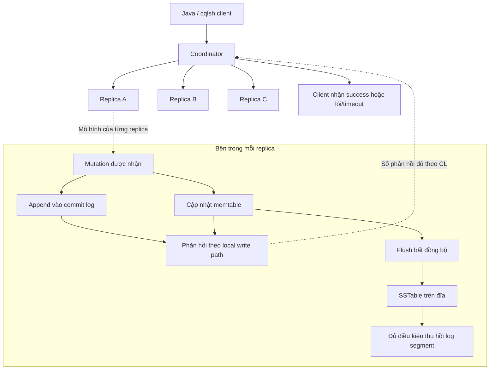
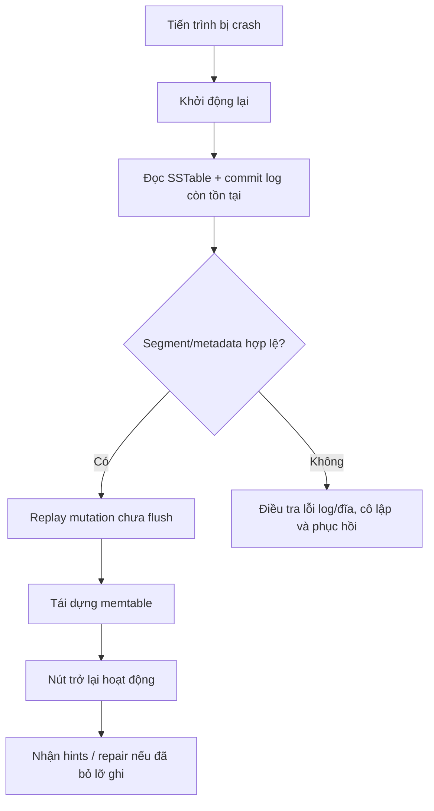

# Crash recovery và phát lại commit log

Apache Cassandra ghi dữ liệu rất nhanh vì không phải tạo SSTable trên đĩa cho từng câu lệnh ghi. Thay vào đó, trên mỗi replica nhận mutation, Cassandra ghi thông tin phục hồi vào **commit log** và cập nhật **memtable** trong bộ nhớ; memtable được flush thành **SSTable** theo đợt. Nếu tiến trình chết trước khi memtable được flush, dữ liệu chưa có trong SSTable có thể được khôi phục bằng cách **phát lại commit log (commit log replay)** khi nút khởi động lại.

Nhưng “đã nhận phản hồi ghi thành công” và “byte đã được fsync xuống thiết bị lưu trữ” **không phải lúc nào cũng đồng nghĩa**. Khả năng sống sót qua lỗi phụ thuộc cấu hình đồng bộ commit log, số replica, consistency level, loại sự cố và tình trạng đĩa. Bài thuộc chương **Đường ghi và độ bền** của mô-đun **DATABASE_ENGINE_WIDE_COLUMN_CASSANDRA**, liên hệ kiến trúc phân tán/wide-column, thiết kế khóa phân vùng, thực hành CQL, replication, compaction, repair, xử lý lỗi và kết nối Java.

## 1. Mục tiêu

Sau bài này, bạn có thể:

1. Diễn giải đường ghi từ **client → coordinator → replica → commit log + memtable → SSTable**.
2. Phân biệt **commit log append**, **sync/fsync**, **memtable flush**, **SSTable**, **acknowledgment** và **replay**.
3. Mô tả Cassandra khởi động lại sau crash và cách commit log giúp tái tạo dữ liệu chưa flush.
4. Giải thích điều gì *có thể* mất khi một tiến trình bị kill, cả máy mất điện, đĩa bị mất hoặc commit log hỏng.
5. Đánh giá ảnh hưởng của `durable_writes`, chính sách commit log sync, replication factor (RF) và mức nhất quán ghi.
6. Lập thí nghiệm có kiểm soát để quan sát recovery, kiểm tra dữ liệu và xử lý write timeout khi ứng dụng Java retry.
7. Xác định khi nào cần **hinted handoff/repair/rebuild**, thay vì nhầm các cơ chế đó với local commit log replay.

## 2. Bản đồ các thành phần trong đường ghi

| Thành phần | Ở đâu, có nhiệm vụ gì? | Ý nghĩa khi sự cố xảy ra |
| --- | --- | --- |
| **Coordinator** | Nút nhận yêu cầu từ client, định tuyến mutation đến các replica phù hợp token và replication strategy. | Coordinator không nhất thiết là replica; mất coordinator có thể làm mất phản hồi dù replica đã ghi. |
| **Replica** | Nút lưu bản sao của partition, thực hiện local write path. | Mỗi replica có commit log/memtable/SSTable **riêng**; recovery diễn ra trên chính nút đó. |
| **Commit log** | Nhật ký ghi tuần tự, thường gồm các segment trên đĩa, phục vụ phục hồi dữ liệu chưa được flush. | Replay được dữ liệu đã còn trong log **đọc được** và cần phát lại. |
| **Memtable** | Cấu trúc dữ liệu trong bộ nhớ chứa các mutation mới. | Mất khi tiến trình/máy dừng; được dựng lại từ commit log nếu các entry còn tồn tại. |
| **SSTable** | Tệp dữ liệu bất biến trên đĩa, được tạo khi flush memtable. | Là dữ liệu lưu lâu dài; không mất chỉ vì bộ nhớ tiến trình biến mất, nếu thiết bị lưu trữ còn và các tệp hợp lệ. |
| **Commit log segment** | Đơn vị chứa nhiều bản ghi của **nhiều bảng**. | Chỉ có thể thu hồi an toàn khi không còn mutation chưa flush nào phụ thuộc segment đó. |
| **Flush position / replay boundary** | Thông tin giúp xác định phần dữ liệu đã được lưu an toàn trong SSTable. | Cho phép startup tránh phát lại không cần thiết những mutation đã flush, theo cơ chế của phiên bản. |
| **Hints và repair** | Cơ chế cập nhật/đồng bộ giữa các replica. | Bù dữ liệu một replica **không nhận được**; không phải nội dung commit log của nút đó. |

### Đường ghi thường gặp



Sơ đồ mô tả **hai công việc logic** ở mỗi replica (ghi log, cập nhật memtable), không yêu cầu chúng phải diễn ra theo đúng hai nhánh song song hay thứ tự câu lệnh bất biến ở mọi phiên bản. Điều cốt lõi là replica nhận mutation và quản lý cả dữ liệu đang ở memtable lẫn khả năng khôi phục từ commit log.

Ví dụ keyspace có `NetworkTopologyStrategy` với RF = 3 trong `dc1` và client ghi ở `LOCAL_QUORUM`: coordinator cần **2 replica phản hồi** đúng hạn. Nó **không** đợi cả ba replica hoàn thành flush thành SSTable. Nếu một replica chưa được ghi vì đang down, khi trở lại nó cần cơ chế bắt kịp từ replica khác; local replay không thể phát lại mutation chưa từng đến nút.

## 3. Dòng thời gian: từ write acknowledgment đến dữ liệu bền vững

Giả sử một hàng `(tenant_id, event_id)` được ghi:

```text
t0  Client gửi INSERT đến coordinator.
t1  Coordinator gửi mutation đến các replica.
t2  Replica ghi vào commit log và áp dụng vào memtable.
t3  Replica gửi acknowledgment theo chính sách ghi/sync của nút.
t4  Coordinator nhận đủ acknowledgment cho consistency level và trả success.
t5  Sau đó, memtable được flush thành SSTable.
t6  Khi dữ liệu liên quan đã flush an toàn, segment commit log có thể được tái dùng.
```

Không nên hiểu các mốc trên như một đồng hồ đơn tuyến của toàn cluster: nhiều replica thực hiện song song, `t3` và `t5` xảy ra ở mỗi nút tại thời điểm khác nhau. Đặc biệt, thời điểm thực hiện **fsync commit log** phụ thuộc chế độ cấu hình.

### Vì sao phải có cả commit log và memtable?

- **Memtable** cung cấp cấu trúc dữ liệu phục vụ cập nhật/đọc trong bộ nhớ, giúp gom nhiều ghi trước khi tạo SSTable.
- **Commit log** cung cấp dữ liệu tuần tự để phục hồi sau khi memtable biến mất; nó không được dùng làm bảng chính để truy vấn tùy ý.
- **SSTable** lưu dữ liệu lâu dài theo cấu trúc bất biến, chịu trách nhiệm cho phần dữ liệu đã flush.

Nếu chỉ có memtable mà không có commit log, một crash có thể làm mất toàn bộ ghi mới chưa flush. Nếu đồng bộ SSTable cho từng ghi, chi phí tạo tệp/ghi ngẫu nhiên làm mất phần lớn ưu điểm của LSM write path.

## 4. Commit log segment được giữ và thu hồi như thế nào?

Commit log thường gồm nhiều **segment**. Mutation của các bảng khác nhau có thể cùng nằm trong một segment. Khi memtable flush thành SSTable, Cassandra ghi nhận tiến độ flush và có thể giải phóng segment cũ **chỉ khi các mutation chưa flush phụ thuộc vào segment đó không còn nữa**.

Ví dụ:

| Segment | Ghi của bảng A | Ghi của bảng B | Có thể thu hồi? |
| --- | --- | --- | --- |
| Segment-1 | Đã flush | Chưa flush | **Chưa**, vì B vẫn cần log. |
| Segment-2 | Đã flush | Đã flush | **Có thể**, nếu các điều kiện giữ log khác đều thỏa. |
| Segment-3 | Chưa flush | Chưa flush | **Chưa**. |

Điều này giải thích vì sao **flush một bảng không có nghĩa mọi commit log segment đều được xóa**. Nó cũng giải thích vì sao lượng commit log có thể tăng khi một memtable không được flush kịp, hoặc khi ổ đĩa/tài nguyên gây nghẽn.

Khi crash, hệ thống không thể đơn giản phát lại “tất cả entry trong mọi segment” một cách mù quáng. Nó sử dụng thông tin về tiến độ flush và tệp SSTable đã lưu để xác định dữ liệu cần replay; chi tiết metadata, xử lý đoạn log và thứ tự khôi phục khác nhau theo phiên bản Cassandra.

**Đừng xóa commit log segment bằng tay** để giải phóng đĩa khi chưa có quy trình phục hồi của đúng phiên bản. Xóa entry cần thiết có thể làm mất các mutation chưa được flush; sao lưu segment riêng lẻ cũng không tự tạo bản backup hoàn chỉnh.

## 5. Crash recovery diễn ra khi nút khởi động lại

Một tình huống điển hình: tiến trình Cassandra bị dừng đột ngột, bộ nhớ tiến trình mất, nhưng tệp commit log và SSTable trên đĩa vẫn còn.

1. **Nút khởi động, đọc cấu hình và metadata cần thiết**: xác định data directory, commit log directory, keyspace/table metadata và các tệp dữ liệu có thể mở.
2. **Xác định điểm dữ liệu đã flush**: phân biệt mutation đã được phản ánh bởi các SSTable hợp lệ với mutation còn cần replay.
3. **Đọc các commit log segment còn liên quan**: kiểm tra định dạng/độ nguyên vẹn và giải mã mutation theo thông tin bảng tương ứng.
4. **Phát lại mutation cần thiết vào memtable**: tái tạo phần trạng thái vừa ghi nhưng chưa có trong SSTable.
5. **Hoàn tất startup/recovery của nút**: khi đủ điều kiện trở lại phục vụ yêu cầu, nút có thể tiếp tục nhận đọc/ghi. Startup có thể lâu hơn khi lượng log lớn, đĩa chậm hoặc có lỗi.
6. **Bắt kịp các mutation nút bỏ lỡ trong lúc down**: dùng hinted handoff nếu còn hints phù hợp, và repair/đồng bộ theo quy trình vận hành. Đây là **bước giữa các replica**, tách biệt với local replay.



Hai đặc điểm quan trọng:

- **Commit log replay là cục bộ**: nút A chỉ replay mutation đã ghi được vào log của **A**. Nếu A down trước khi nhận mutation X, replay của A không thể tự tạo X; cần dữ liệu từ replica khác.
- **Có thể replay một mutation mà client tưởng là thất bại**: client timeout hoặc mất kết nối trước khi nhận response, nhưng replica đã ghi mutation. Vì vậy không thể suy ra “timeout = không ghi”; tầng ứng dụng cần retry idempotent.

### Khi nào không phải replay?

Một lần **shutdown sạch** có thể drain/flush memtable theo quy trình vận hành, giảm hoặc loại bỏ phần phải replay. Ngược lại, `kill -9` tiến trình làm mất bộ nhớ tiến trình nên thường cần dựa vào log cho mutation chưa flush. Mất điện hoặc hỏng hệ thống lưu trữ lại là bài toán khác: dữ liệu chưa được **sync xuống thiết bị lưu trữ** có thể không còn để replay.

## 6. Commit log sync quyết định ranh giới độ bền của một replica

Trong Cassandra, các chế độ **commitlog_sync** phổ biến là **periodic** và **batch**; một số phiên bản còn có cơ chế group sync hoặc tên cấu hình/tham số khác. Không áp dụng nguyên xi khóa cấu hình của phiên bản này sang phiên bản khác; trước khi sửa phải xem tài liệu và cấu hình đang chạy.

| Chính sách | Khi nào đồng bộ log xuống lưu trữ? | Đánh đổi chính |
| --- | --- | --- |
| **periodic** | Đồng bộ bất đồng bộ theo chu kỳ cấu hình; write có thể được xác nhận trước lần sync tiếp theo. | Độ trễ ghi thấp hơn; nếu **mất điện/OS crash** trước sync, có cửa sổ mất những mutation đã được ack cục bộ. |
| **batch** | Gom/đồng bộ log cho batch ghi và chờ đồng bộ trước khi xác nhận theo chính sách của mode. | Tăng bảo đảm độ bền cục bộ với chi phí độ trễ fsync và thông lượng tùy đĩa. |
| **group** (nếu phiên bản hỗ trợ) | Nhóm một số ghi để cùng đồng bộ. | Cân bằng số lần fsync và độ trễ; cần kiểm tra chính xác phiên bản. |

Khái niệm **append** là ghi dữ liệu vào đường đi I/O của commit log; **fsync** yêu cầu hệ điều hành đẩy dữ liệu và metadata liên quan tới thiết bị lưu trữ theo giao ước của nền tảng. Thiết bị, controller hoặc lớp ảo hóa không thực hiện đúng lời hứa về flush vẫn có thể gây mất dữ liệu. Khi Cassandra chạy ở mode periodic, tắt **tiến trình** khác với tắt **máy/nguồn điện**: sau `kill -9`, page cache của hệ điều hành có thể vẫn còn và tiếp tục ghi dữ liệu xuống đĩa, nên kết quả thử không chứng minh khả năng sống sót khi mất điện.

Chính sách sync là **thuộc tính ở từng replica**, trong khi consistency level là **số replica phản hồi** mà coordinator yêu cầu. Không nên gộp hai khái niệm:

```text
Giả sử RF = 3 ở dc1:
LOCAL_ONE    -> cần 1 replica phản hồi.
LOCAL_QUORUM -> cần floor(3 / 2) + 1 = 2 replica phản hồi.
ALL          -> cần 3 replica phản hồi.

Phản hồi của replica -> còn phụ thuộc local commitlog_sync,
                       nhưng không có nghĩa mọi ghi đã nằm trong SSTable.
```

Ví dụ LOCAL_QUORUM có thể sống sót khi **một** replica mất nếu hai replica còn lại vẫn phản hồi. Nó không phải bảo đảm tuyệt đối chống mất dữ liệu nếu **tất cả replica** cùng chịu một lỗi nguồn/lưu trữ làm mất dữ liệu chưa sync. Muốn đánh giá độ bền thực tế phải xét **miền lỗi** (rack/AZ/DC, nguồn điện), RF, vị trí bản sao, sync policy và consistency level.

### Vai trò của durable_writes

Keyspace có thuộc tính `durable_writes`. Với `durable_writes = true`, mutation của keyspace sử dụng commit log theo cơ chế thông thường; với `false`, đường ghi có thể bỏ qua commit log cho dữ liệu keyspace, khiến memtable chưa flush dễ mất sau crash và **không có log tương ứng để replay**. Không dùng `durable_writes = false` cho dữ liệu nghiệp vụ cần bảo đảm độ bền chỉ để tăng thông lượng.

```sql
-- Cấu hình minh họa cho lab với dc1 có đủ ba node.
CREATE KEYSPACE IF NOT EXISTS recovery_lab
WITH replication = {
  'class': 'NetworkTopologyStrategy',
  'dc1': 3
}
AND durable_writes = true;
```

Nếu lab chỉ có một nút, thay RF bằng cấu hình phù hợp **trên môi trường thử nghiệm**. Đừng thay đổi RF hoặc `durable_writes` của keyspace production để thử nghiệm.

## 7. Mô hình sự cố: điều gì có thể phục hồi?

| Sự cố | Còn SSTable? | Còn commit log hữu ích? | Kỳ vọng và hành động |
| --- | --- | --- | --- |
| **Tiến trình chết, đĩa/OS vẫn ổn** | Thường còn | Thường còn | Startup replay mutation chưa flush nếu log nguyên vẹn; kiểm tra dữ liệu sau khi nút trở lại. |
| **Graceful shutdown / drain** | Dữ liệu được flush theo quy trình | Thường không cần replay nhiều | Dùng làm đường chuẩn so sánh, không dùng thay crash test. |
| **Mất điện/OS crash trước periodic fsync** | SSTable đã flush còn nếu đã durable | Một số ghi log gần nhất có thể chưa bền | Có thể mất mutation chưa sync trên nút; kiểm tra những replica khác và chính sách ghi. |
| **Mất hẳn ổ chứa commit log, data disk còn** | Có thể còn | Không với phần log mất | Những ghi chưa flush có nguy cơ mất trên nút; cần đánh giá replica khác, recovery/repair. |
| **Mất cả data disk và commit log của nút** | Không | Không | Local replay không còn ý nghĩa; dùng quy trình thay/rebuild nút từ replica còn đủ dữ liệu hoặc backup. |
| **Commit log hỏng/cắt cụt** | Có thể còn | Chỉ phần đọc hợp lệ | Startup có thể báo lỗi, bỏ qua theo chính sách/phiên bản hoặc không lên; cần điều tra, không tự xóa. |
| **Nút down trước khi nhận các ghi mới** | Có dữ liệu cũ | Không chứa ghi đã bỏ lỡ | Hints hoặc repair/bắt kịp từ replica khác; local replay không thể tạo ghi chưa nhận. |
| **Coordinator chết sau khi replica ghi** | Replica có thể đã cập nhật | Có thể có | Client có thể timeout dù mutation đã tồn tại; retry cùng request ID/payload. |

Tính bền vững là phát biểu theo **một tập sự cố cụ thể**, không phải chỉ nhờ bật một tùy chọn. Đặc biệt, hai tình huống “mất tiến trình” và “mất đĩa” không thể có cùng kết luận dù cùng được gọi là “node crash”.

## 8. Bài thực hành: ghi, crash một replica, khởi động và xác minh

> Thực hiện **chỉ trong lab** có quyền thao tác nút và đã lên kế hoạch phục hồi. Không cố tình kill tiến trình Cassandra production. Nếu cụm chỉ có một node, đọc/ghi sẽ gián đoạn trong lúc dừng node; với RF = 3, LOCAL_QUORUM có thể tiếp tục qua một node down nhưng điều này vẫn phụ thuộc trạng thái của hai replica còn lại.

### Chuẩn bị bảng và dữ liệu có khóa ổn định

```sql
CREATE TABLE IF NOT EXISTS recovery_lab.events_by_tenant (
  tenant_id text,
  event_id uuid,
  payload text,
  PRIMARY KEY ((tenant_id), event_id)
);

CONSISTENCY LOCAL_QUORUM;

-- Ghi A làm mốc trước khi flush.
INSERT INTO recovery_lab.events_by_tenant (tenant_id, event_id, payload)
VALUES ('tenant-lab',
        11111111-1111-4111-8111-111111111111,
        'before-flush');

SELECT * FROM recovery_lab.events_by_tenant
WHERE tenant_id = 'tenant-lab';
```

Ở đây khóa phân vùng là `tenant_id`; các sự kiện là những hàng phân biệt theo `event_id`, còn cả partition được đặt lên các replica theo token và RF. UUID cố định để đọc lại chính xác sau restart; không dùng `now()` sinh thêm hàng mỗi lần retry.

### Kịch bản A — Tạo ranh giới SSTable, rồi ghi mới

**Bước 1.** Xác nhận tất cả node liên quan ở trạng thái **UN**:

```bash
nodetool status
```

**Bước 2.** Flush bảng để có mốc dữ liệu nằm trên SSTable (lệnh phải chạy ở những node mà bạn dùng làm mốc; `nodetool` mặc định chỉ tác động node được kết nối):

```bash
nodetool flush recovery_lab events_by_tenant
```

**Bước 3.** Ghi B sau flush. Quan sát SELECT trả về cả A và B:

```sql
INSERT INTO recovery_lab.events_by_tenant (tenant_id, event_id, payload)
VALUES ('tenant-lab',
        22222222-2222-4222-8222-222222222222,
        'after-flush-before-crash');

SELECT event_id, payload
FROM recovery_lab.events_by_tenant
WHERE tenant_id = 'tenant-lab';
```

**Bước 4.** Dừng đột ngột **một replica đang giữ partition** trong lab, theo công cụ vận hành của môi trường. Khác với stop dịch vụ theo đường graceful, mô phỏng crash có thể dùng SIGKILL cho đúng PID Cassandra, **chỉ sau khi đã xác minh PID thuộc node lab**:

```bash
# Ví dụ Linux lab; xác minh PID Cassandra trước khi chạy.
jps -l
kill -9 <PID_CASSANDRA_LAB>
```

Không chạy mẫu `kill -9` trên một node mà bạn chưa xác nhận quyền sở hữu và phạm vi thí nghiệm. Với container/Kubernetes, dùng cơ chế chấm dứt tiến trình của lab tương ứng. Việc `systemctl stop cassandra` có thể đi qua đường shutdown sạch, do đó không nhất thiết tạo ra cùng hành vi crash.

**Bước 5.** Khởi động lại replica theo cơ chế của lab, quan sát startup log và `nodetool status`. Chờ node về **UN** và hoàn tất công việc khởi động cần thiết trước khi đo đọc. Sau đó SELECT bằng `LOCAL_QUORUM`:

```sql
CONSISTENCY LOCAL_QUORUM;
SELECT event_id, payload
FROM recovery_lab.events_by_tenant
WHERE tenant_id = 'tenant-lab';
```

Kỳ vọng dữ liệu A vẫn có và dữ liệu B có thể được khôi phục từ commit log của node bị crash nếu nó đã nhận B nhưng chưa flush. **Nhìn thấy B qua LOCAL_QUORUM không đủ để chứng minh node vừa crash đã replay B**: query có thể được phục vụ bởi hai replica còn sống. Muốn kiểm chứng sâu, đối chiếu log replay **trên chính node** và trạng thái replica/data của node đó, sau đó dùng quy trình kiểm chứng phù hợp phiên bản hoặc tracing để xác định endpoint tham gia.

### Kịch bản B — Ghi trong lúc một replica down

1. Khi một replica down, ghi event C ở LOCAL_QUORUM qua coordinator còn sống. Với RF = 3, nếu **hai replica còn lại** phản hồi, ghi có thể thành công.
2. Khởi động replica đã down. Event C **không thể được phục hồi từ commit log của replica đó** nếu nó hoàn toàn chưa nhận mutation.
3. Kiểm tra việc nhận hints (nếu có, còn hiệu lực) và kế hoạch repair của cụm. Sự kiện vẫn có thể được thấy khi đọc quorum nhờ hai replica còn sống; cần kiểm chứng sự hội tụ của bản sao vừa khởi động.

```sql
INSERT INTO recovery_lab.events_by_tenant (tenant_id, event_id, payload)
VALUES ('tenant-lab',
        33333333-3333-4333-8333-333333333333,
        'written-while-one-replica-down');
```

### Kịch bản C — So sánh graceful và crash

Trên một lượt thử khác, dùng **drain rồi shutdown sạch** theo quy trình lab và quan sát startup:

```bash
nodetool drain
# Sau khi drain hoàn tất, dừng dịch vụ qua hệ thống quản lý của lab.
```

Drain thường kết thúc nhận ghi mới và flush memtable để giảm dữ liệu chưa flush. Nó **không** mô phỏng cùng tình huống như process kill. Đừng phát động thao tác ghi mới vào nút đang drain; thực hiện lại kịch bản này sau khi đã khôi phục cluster khỏe mạnh.

## 9. Quan sát đúng bằng log, nodetool và số liệu

Cần phân biệt **đã khởi động**, **đã replay**, **đã bắt kịp replica khác** và **đã bảo đảm dữ liệu đúng**. Chúng không phải một trạng thái duy nhất.

| Câu hỏi | Quan sát khả thi | Giới hạn của quan sát |
| --- | --- | --- |
| Node còn hoạt động? | `nodetool status`, trạng thái UN/DN | UN không bảo đảm mọi partition đã hội tụ. |
| Có replay commit log không? | Startup logs của **node bị crash**, thông báo đọc/phát lại segment và hoàn tất khôi phục | Tên log/thông điệp thay đổi theo phiên bản; một truy vấn thành công không chứng minh replay. |
| Commit log/flush có nghẽn? | Metrics commit log, memtable flush pending, disk latency/dung lượng; `nodetool tpstats` và công cụ monitoring | Cần kết hợp nhiều metric, không dùng một số snapshot để kết luận. |
| SSTable mới xuất hiện? | `nodetool tablestats`, thông tin SSTable/bảng, flush logs | SSTable count cũng thay đổi vì compaction, không chứng minh mutation riêng lẻ đã được replay. |
| Recovery có bị lỗi? | Lỗi đọc segment/checksum, thiếu đĩa, schema mismatch, startup exception | Cần xem nguyên nhân gốc và mức ảnh hưởng, không đoán “log hỏng hết”. |
| Replica đã hội tụ? | Kế hoạch/metrics hints và repair; xác minh nhiều partition/key đại diện | Đọc qua coordinator thường không kiểm tra độc lập tất cả replica. |

Ví dụ lệnh quan sát đọc-only:

```bash
nodetool status
nodetool info
nodetool tpstats
nodetool tablestats recovery_lab.events_by_tenant
nodetool compactionstats
```

Trên máy có systemd, có thể xem log dịch vụ bằng công cụ hệ điều hành; Cassandra cũng thường có log ứng dụng riêng. Đường dẫn log, quyền xem và từ khóa replay phải lấy từ môi trường triển khai cụ thể. Không đặt điều kiện PASS chỉ vì tìm thấy một chuỗi log cố định: format thay đổi giữa các phiên bản.

### Mẫu biên bản kiểm thử

| Trường | Ví dụ cần ghi |
| --- | --- |
| Topology | `dc1`, RF = 3, rack/AZ của từng replica thuộc `tenant-lab` |
| Cấu hình | `durable_writes`; `commitlog_sync` và chu kỳ/batch policy; LOCAL_QUORUM |
| Mốc dữ liệu | UUID A đã flush, UUID B ghi sau flush, UUID C ghi khi node down |
| Thời điểm lỗi | PID/node, dạng lỗi process kill/graceful/power/disk, thời điểm khôi phục |
| Quan sát node | DN → startup → UN, thông báo replay, lỗi startup, dung lượng commit log |
| Kết quả đọc/ghi | Success/timeout, từng UUID có mặt hay không, coordinator/replica được dùng |
| Hội tụ và recovery | Hints/repair áp dụng, đánh giá node trở lại và dữ liệu trên các replica |

## 10. Xử lý lỗi khi startup replay thất bại

Nếu Cassandra không lên sau crash, việc đầu tiên là **giữ chứng cứ**, xác định nguyên nhân, tránh thao tác có thể làm mất entry chưa flush:

1. Xác định **kiểu sự cố** (process crash, OS reboot, ổ đầy, mất data disk, mất commit log disk), phiên bản Cassandra, DC/rack và số replica khỏe mạnh.
2. Đọc startup logs của node và thống kê không gian đĩa/quyền truy cập. Xác định lỗi là **không mở được thư mục**, **đĩa đầy**, **corrupt segment**, **CRC/truncated record**, **schema/table metadata** hay lỗi khác.
3. Đánh giá **tình trạng quorum và mức chịu lỗi**: có còn đủ replica để phục vụ đọc/ghi? Tránh thực hiện nhiều thử nghiệm restart/hủy dữ liệu liên tiếp khi cụm đang sát giới hạn quorum.
4. Sao lưu trạng thái/segment và logs theo quy trình sự cố nếu cần điều tra. **Không tự ý xóa cả thư mục commitlog**, tắt xác thực log hay chuyển `durable_writes = false` để ép node chạy.
5. Dựa trên phiên bản và runbook chính thức, chọn khôi phục log/SSTable, bỏ qua phần hỏng có kiểm soát (nếu chính sách hỗ trợ và chấp nhận mất dữ liệu), hoặc **replace/rebuild node** từ replica khỏe mạnh. Cân nhắc snapshot/backup nếu các replica đều thiếu dữ liệu.
6. Khi node hoạt động lại, thực hiện kiểm chứng dữ liệu và repair theo lịch thích hợp; điều tra lý do gốc (disk lỗi, controller, filesystem, đĩa đầy, cấu hình flush/sync, tài nguyên).

**Compaction không phải giải pháp cho mất commit log chưa flush.** Compaction hợp nhất/loại bỏ dữ liệu trong các SSTable theo luật tombstone và phiên bản dữ liệu; nó không tạo lại một mutation mà node chưa từng lưu. **Repair** có thể bù từ các replica còn giữ bản ghi, nhưng không lấy lại dữ liệu đã mất trên *mọi replica* và không phải phép thay thế cho backup.

## 11. Ứng dụng Java: timeout không có nghĩa ghi thất bại

Giả sử Java driver gửi INSERT và nhận timeout. Có ba khả năng cần xem xét:

1. Mutation chưa được bất kỳ replica nào ghi.
2. Một số replica đã ghi, nhưng chưa đủ phản hồi trước deadline; coordinator trả timeout.
3. Đã đủ replica ghi, nhưng response bị mất hoặc coordinator/client ngắt kết nối.

Từ phía client, thường không thể phân biệt hoàn toàn bằng một exception. **Retry cần idempotent về nghiệp vụ**: cùng khóa chính và cùng payload cho một operation ID đã được cấp trước khi gọi, không dùng `now()` hoặc UUID mới cho mỗi lượt retry.

Ví dụ Java Driver 4.x, `CqlSession session` đã cấu hình contact points, local DC và auth:

```java
import com.datastax.oss.driver.api.core.ConsistencyLevel;
import com.datastax.oss.driver.api.core.cql.BoundStatement;
import com.datastax.oss.driver.api.core.cql.PreparedStatement;
import java.util.UUID;

UUID operationId = UUID.fromString(
    "44444444-4444-4444-8444-444444444444"); // Giữ nguyên qua retry.

PreparedStatement insert = session.prepare(
    "INSERT INTO recovery_lab.events_by_tenant " +
    "(tenant_id, event_id, payload) VALUES (?, ?, ?)");

BoundStatement write = insert.bind(
        "tenant-lab", operationId, "same-logical-operation")
    .setConsistencyLevel(ConsistencyLevel.LOCAL_QUORUM)
    .setIdempotent(true);

// Gửi bằng session.execute(write); nếu timeout, giữ nguyên operationId
// và giá trị payload khi quyết định retry theo chính sách ứng dụng.
```

Lưu ý quan trọng:

- `setIdempotent(true)` là **khai báo cho driver về tính an toàn của retry**, không tự biến một thao tác không idempotent thành an toàn. Ví dụ chỉ thích hợp khi cùng khóa/cùng nội dung và không có writer đồng thời tranh nhau sửa hàng hoặc cơ chế TTL/timestamp làm thay đổi ngữ nghĩa.
- Một INSERT thường vào cùng khóa là **upsert**: retry có thể tạo timestamp mới, ảnh hưởng thứ tự xung đột với writer khác. Khi cần exactly-once hoặc unique ownership, sử dụng **idempotency ledger/LWT** và workflow đối soát thích hợp, thay vì chỉ đánh dấu idempotent.
- Sau timeout, đọc thấy hàng **không chứng minh** mọi replica đã nhận; đọc không thấy hàng cũng **không chứng minh** chưa replica nào ghi. Retry cùng operation ID, giới hạn số lần, ghi log kết quả và theo dõi lỗi.
- Nếu dùng counter, thao tác tăng/giảm hoặc event có hiệu ứng phụ, **không giả định retry tự động là idempotent**.

Ứng dụng nên log `operationId`, consistency, loại exception, số lần thử, latency và kết quả cuối. Khi sự cố mất node, Java driver còn phải có cấu hình kết nối/routing để chuyển sang coordinator còn sống; tính sẵn sàng của driver và độ bền của commit log là hai tầng khác nhau.

## 12. RPO, RTO và sự đánh đổi trong thiết kế hệ thống

- **RPO (Recovery Point Objective)**: khoảng dữ liệu tối đa được chấp nhận mất khi xảy ra một kịch bản sự cố. Không thể suy RPO thực tế chỉ từ RF mà bỏ qua sync policy và lỗi đồng thời của nhiều replica.
- **RTO (Recovery Time Objective)**: thời gian cho phép để dịch vụ/replica trở lại trạng thái cung cấp dịch vụ. Lượng commit log cần replay, tốc độ đĩa, xác minh khởi động và khả năng catch-up có thể ảnh hưởng RTO.
- **Consistency level**: xác định số replica phải phản hồi **trước khi trả success**. Mức cao có thể nâng khả năng tồn tại nhiều bản sao ở thời điểm ack nhưng đổi lại độ trễ và tính sẵn sàng.
- **Replication + fault domain**: sao chép sang rack/AZ/DC độc lập hạn chế hỏng đồng thời; **không** thay thế yêu cầu local durability của từng replica hoặc bản backup.
- **Backup và khôi phục thảm họa**: snapshot/SSTable backup và chiến lược lưu trữ/archival commit log (nếu thiết lập) là các công cụ riêng; replay local không phải backup ngoại tuyến hoặc khôi phục theo thời điểm (PITR) tự động.

| Nhu cầu | Câu hỏi quyết định |
| --- | --- |
| Giảm latency ghi ở tải cao | Có chấp nhận cửa sổ rủi ro khi host mất điện dưới periodic sync? |
| Muốn dữ liệu vừa ack có khả năng sống qua crash | Ghi cần đồng bộ cục bộ ra sao, RF/CL thế nào, replica ở những miền lỗi nào? |
| Node khởi động nhanh | Có kiểm soát memtable/commit log, flush, disk I/O và diễn tập recovery không? |
| Phục hồi sau mất một data disk | Còn replica khỏe mạnh, repair/rebuild đúng quy trình và backup ngoài node không? |
| Không mất dữ liệu qua thảm họa nhiều DC | Chính sách ack liên DC, routing, sync, backup và runbook failover đã được kiểm thử chưa? |

## 13. Các ngộ nhận thường gặp

| Nhận định sai | Giải thích đúng |
| --- | --- |
| “Commit log là nơi query SELECT đọc dữ liệu.” | SELECT chủ yếu dùng memtable/SSTable và các cấu trúc chỉ mục/bloom filter phù hợp; log phục vụ durability/recovery. |
| “Ghi được ack là đã flush thành SSTable.” | Flush bất đồng bộ; ack phụ thuộc local write path và sync policy. |
| “Kill process giống hệt cúp điện.” | Hệ điều hành có thể còn page cache sau process kill; mất nguồn có thể mất cache chưa fsync. |
| “Replay sẽ lấy lại mọi ghi đã ack trong mọi kiểu mất đĩa.” | Nếu log và SSTable đều mất, local replay không có dữ liệu để làm việc. |
| “Một node quay lại UN nghĩa là đã bắt kịp mọi mutation.” | Replay chỉ khôi phục local log; dữ liệu bỏ lỡ khi node down cần hints/repair. |
| “RF = 3 luôn chịu được ba replica hỏng.” | Với LOCAL_QUORUM (RF 3) cần 2 phản hồi; không chịu được hai replica của partition cùng mất ở thời điểm ghi. |
| “Lỗi ghi timeout nghĩa là chưa có dữ liệu.” | Mutation có thể đã ghi trên một hoặc nhiều replica, thậm chí đủ CL mà response thất lạc. |
| “Xóa commitlog giúp node nhanh lên và không ảnh hưởng dữ liệu.” | Có thể xóa mutation chưa flush, gây mất dữ liệu. |
| “Compaction tạo lại dữ liệu mất vì crash.” | Compaction chỉ xử lý SSTable hiện có; nó không thay repair/backup. |
| “Đọc LOCAL_QUORUM thấy sự kiện B nên node crash đã replay B.” | Coordinator có thể trả từ replica khác; cần bằng chứng từ chính node được kiểm tra. |
| “Tắt durable_writes chỉ ảnh hưởng latency.” | Có thể bỏ mất cơ chế replay cho mutation chưa flush, ảnh hưởng trực tiếp độ bền. |

## 14. Bài tập và tiêu chí hoàn thành

**Bài A — Vẽ timeline.** Vẽ 8 mốc từ client gửi INSERT tới SSTable và thu hồi segment. Đánh dấu cụ thể sự khác biệt giữa **append** và **fsync** ở periodic/batch. Giải thích vì sao ack ở LOCAL_QUORUM không chờ tất cả replica flush.

**Bài B — Crash và replay.** Trên lab RF = 3, ghi A → flush bảng trên node đang thử → ghi B → kill đúng replica đã nhận B → restart. Thu startup logs và đối chiếu A, B. Chứng minh bằng log/trace/quan sát phù hợp rằng node được thử đã replay hoặc không cần replay B; không chỉ dựa vào SELECT qua coordinator.

**Bài C — Replica bỏ lỡ ghi.** Dừng một replica trước khi ghi C ở LOCAL_QUORUM. Tại sao C không thể xuất hiện trong commit log của node bị dừng? Thiết kế cách kiểm tra hints/repair sau khi nó trở lại.

**Bài D — Tình huống ứng dụng.** Client Java ghi INSERT có operation ID cố định rồi timeout. Liệt kê ít nhất ba trạng thái khả dĩ của replica và xây quy trình retry có giới hạn, không nhân đôi hành động nghiệp vụ.

**Bài E — Phân tích kịch bản.** So sánh process kill, host power loss, mất commit log disk và mất đồng thời cả commit log/data disk. Với mỗi trường hợp, phân biệt khả năng local replay và dữ liệu cần phục hồi từ replica khác/backup.

**Đạt yêu cầu khi biên bản trả lời được bốn câu:**

1. **Mutation đang nằm ở đâu**: memtable, commit log đã/ chưa fsync hay SSTable?
2. **Sự cố đã phá hủy thành phần nào**: tiến trình, page cache, commit log disk, data disk hay kết nối coordinator?
3. **Cơ chế nào khôi phục phần nào**: local replay, hinted handoff, repair/rebuild hay backup?
4. **Bằng chứng nào chứng minh kết quả**: startup log, trạng thái node, key dữ liệu và kết quả retry, chứ không chỉ một SELECT trả về thành công?

## 15. Câu hỏi tự kiểm tra

1. Tại sao một memtable chưa flush vẫn có thể được dựng lại sau khi Cassandra process bị crash?
2. Trong mode periodic, vì sao một write đã ack có thể bị mất trên replica sau cúp điện nhưng vẫn sống sót sau kill process?
3. Khi bảng A đã flush, vì sao commit log segment còn chứa mutation chưa flush của bảng B vẫn có thể bị giữ?
4. Tại sao replay trên node N không phục hồi được mutation mà N chưa từng nhận trong thời gian down?
5. Nếu client nhận timeout, tại sao retry dùng UUID mới là nguy hiểm với bảng lưu sự kiện?
6. Khi nào nên dùng hints/repair và khi nào bắt buộc dựa vào backup hoặc replace/rebuild node?
7. Vì sao RF = 3 và LOCAL_QUORUM giúp chịu một replica down nhưng chưa đủ kết luận khả năng chịu mất điện toàn DC?

## 16. Nguồn đọc tiếp

- [Apache Cassandra Documentation — Storage engine](https://cassandra.apache.org/doc/latest/cassandra/architecture/storage_engine.html): memtable, commit log, SSTable, flush và compaction.
- [Apache Cassandra Documentation — Configuration](https://cassandra.apache.org/doc/latest/cassandra/managing/configuration/): các lựa chọn commit log sync, dung lượng log và chính sách xử lý lỗi theo phiên bản.
- [Apache Cassandra Documentation — Repair](https://cassandra.apache.org/doc/latest/cassandra/managing/operating/repair.html): vai trò và vận hành anti-entropy repair sau sự cố.
- [Apache Cassandra Documentation — CQL](https://cassandra.apache.org/doc/latest/cassandra/developing/cql/): keyspace durable_writes, mô hình bảng và consistency.

**Ghi nhớ:** commit log replay giải quyết **mất memtable của chính replica khi thông tin log còn tồn tại và đọc được**. Nó không biến mọi acknowledgment thành fsync, không khôi phục log đã mất và không thay thế đồng bộ giữa các replica. Một thiết kế chịu lỗi đúng phải ghép **write path + sync policy + RF/consistency + miền lỗi + retry idempotent + quy trình repair/backup**, rồi kiểm chứng các giả định bằng thử nghiệm trong lab.
