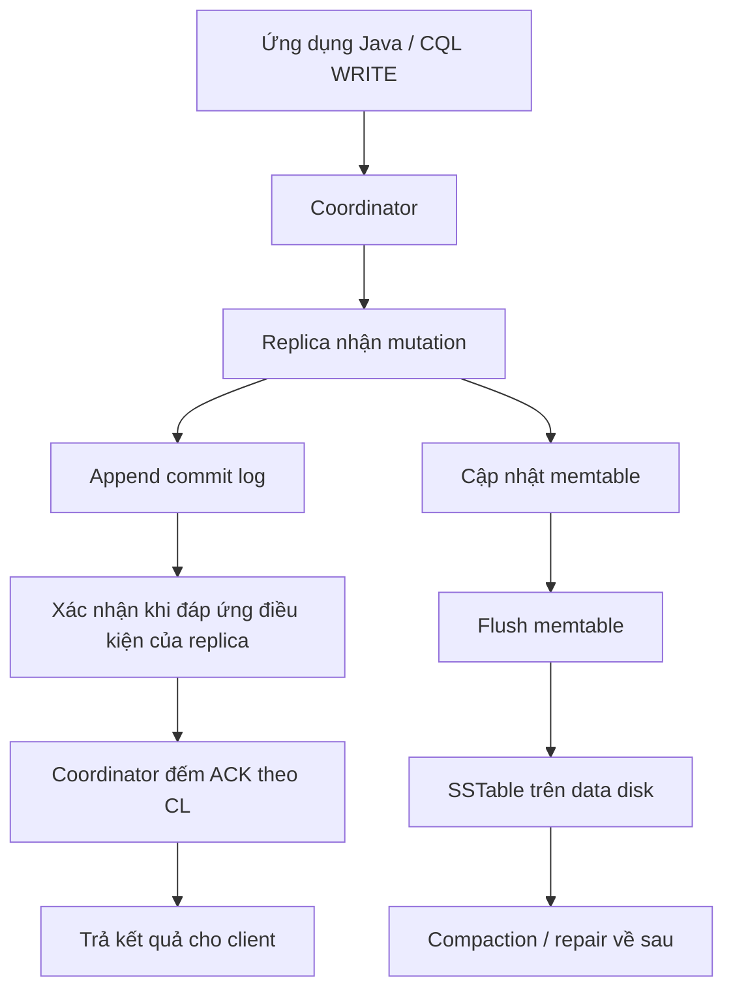
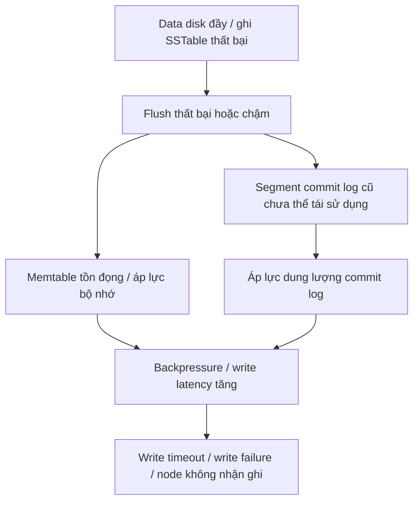

# Ảnh hưởng của đĩa chậm, đĩa đầy hoặc flush bị nghẽn

> **Chương:** Đường ghi và độ bền  
> **Học phần:** `DATABASE_ENGINE_WIDE_COLUMN_CASSANDRA` — Apache Cassandra

Apache Cassandra là cơ sở dữ liệu **wide-column phân tán**: dữ liệu được chia theo partition key và được sao chép đến các replica theo chiến lược replication của keyspace. Mỗi replica phải xử lý các ghi mà nó nhận được. Vì vậy, sự cố lưu trữ trên **một node** có thể gây tăng độ trễ trên nhiều truy vấn; khi đủ nhiều replica bị ảnh hưởng, ứng dụng có thể gặp write timeout hoặc không còn đáp ứng mức nhất quán yêu cầu.

Bài này tập trung vào ba hiện tượng liên quan chặt chẽ nhưng không đồng nhất:

1. **Đĩa chậm:** thao tác ghi commit log hoặc ghi SSTable tốn thời gian hơn, I/O queue tăng.
2. **Đĩa đầy:** không còn đủ không gian hoặc inode để tạo/mở rộng những tệp Cassandra cần.
3. **Flush bị nghẽn:** memtable không chuyển xuống SSTable đủ nhanh, khiến áp lực dồn ngược về bộ nhớ, commit log và cuối cùng là khả năng nhận ghi.

Mục tiêu là đọc được đường ghi, giải thích nguyên nhân lan truyền, nhận diện tín hiệu giám sát, chọn hướng phục hồi an toàn và ứng xử đúng từ ứng dụng Java khi kết quả ghi không rõ ràng.

## 1. Nhìn lại đường ghi và điều kiện xác nhận

Một câu `INSERT`, `UPDATE` hoặc `DELETE` thường được ứng dụng gửi tới **coordinator**. Coordinator xác định các replica từ token của partition key, chuyển mutation đến replica và trả lời client khi đạt **consistency level (CL)** của yêu cầu. Trên replica, đường ghi thông thường gồm:

- **Commit log:** ghi mutation theo dạng append để hỗ trợ phục hồi sau crash.
- **Memtable:** cập nhật cấu trúc dữ liệu trong bộ nhớ phục vụ đọc và ghi tiếp.
- **Flush:** khi đạt điều kiện kích hoạt, ghi dữ liệu memtable thành **SSTable** trên vùng dữ liệu.
- **Compaction:** chạy sau đó để hợp nhất SSTable, quản lý tombstone và giảm chi phí đọc; tạo thêm I/O và có nhu cầu không gian tạm thời.



**Điểm cần phân biệt:** ghi xong memtable **không phải** là đã có SSTable mới; dữ liệu vẫn có thể được bảo vệ bởi commit log, tùy trạng thái đồng bộ của log. SSTable ra đời trong flush, còn compaction không nằm trên đường ghi bắt buộc của từng mutation.

Cassandra có các chế độ đồng bộ commit log, thường gặp:

| Chế độ | Trước khi replica có thể xác nhận ghi | Tác động khi thiết bị chậm |
| --- | --- | --- |
| `periodic` | Mutation được đưa vào commit log và memtable; việc đồng bộ commit log xuống thiết bị diễn ra theo chu kỳ cấu hình. Xác nhận ghi có thể xảy ra **trước** một lần fsync. | Chậm ở thiết bị log có thể ảnh hưởng tiến trình đồng bộ, hàng chờ và độ bền khi crash, dù không phải mọi lần ghi đều chờ một fsync riêng. |
| `batch` | Ghi thường chờ đồng bộ commit log tới lưu trữ bền vững trước khi xác nhận. | Độ trễ ghi nhạy hơn với thời gian đồng bộ/fsync của thiết bị commit log. |

Tên và hành vi chính xác của tùy chọn cấu hình thay đổi theo **phiên bản Cassandra**. Không nên suy diễn “client nhận ACK” đồng nghĩa “đã fsync trên tất cả replica” khi chạy `periodic`. Replication và CL làm giảm rủi ro phụ thuộc một replica, nhưng không thay thế thiết kế nguồn điện, lưu trữ, sao lưu và cơ chế khôi phục.

### Hai đường đĩa cần phân biệt

- **Commit log volume:** vị trí `commitlog_directory`; ghi nối tiếp, nhạy với độ trễ append/sync, chịu áp lực khi các segment cũ chưa được phép tái sử dụng.
- **Data volume:** các vị trí `data_file_directories`; chứa SSTable, chịu I/O khi flush, đọc, compaction, streaming và repair.

Hai đường dẫn có thể ở **cùng một thiết bị vật lý** dù khác thư mục. Nếu chúng cùng pool I/O, compaction nặng có thể làm chậm commit log và flush; tách đường dẫn mà không tách năng lực lưu trữ không giải quyết được tranh chấp tài nguyên.

## 2. Đĩa chậm: từ tăng latency đến ghi timeout

“Đĩa chậm” cần được mô tả bằng **độ trễ I/O, throughput, queue depth và mức sử dụng thiết bị**, không chỉ bằng phần trăm dung lượng đã dùng.

Ví dụ một node đang có lưu lượng ghi ổn định. Khi compaction hoặc tác vụ lưu trữ khác chiếm băng thông I/O:

1. Thời gian ghi và đồng bộ commit log có thể tăng.
2. Ghi SSTable khi flush mất lâu hơn.
3. Các memtable mới xuất hiện trong khi memtable cũ còn chờ flush.
4. Hàng chờ flush tăng; nếu kéo dài, Cassandra gây backpressure, trì hoãn hoặc từ chối một phần ghi để tránh cạn tài nguyên.
5. Coordinator không nhận đủ phản hồi kịp hạn; client có thể thấy `WriteTimeout`, độ trễ cao hoặc lỗi khác.

Trên **cụm RF=3**, nếu chỉ một replica chậm, write `LOCAL_QUORUM` trong một data center vẫn có thể thành công khi hai replica khỏe trả lời kịp thời. Nếu hai replica cùng bị bão hòa hoặc coordinator bị ảnh hưởng, cùng yêu cầu có thể timeout. Sự cố trên node không nhất thiết khiến **mọi** lệnh ghi đều thất bại: hành vi còn tùy replica phụ trách partition, CL, topology và tải từng node.

| Dấu hiệu | Giả thuyết ưu tiên | Điều phải kiểm chứng |
| --- | --- | --- |
| Write latency tăng, commit log sync chậm | Thiết bị log bị bão hòa, độ trễ fsync cao | Metrics commit log và I/O thực tế của đúng volume |
| Flush pending tăng liên tục | Data disk nghẽn, hàng chờ flush tích tụ | Log flush, metrics memtable/flush, I/O data disk |
| Read latency cũng tăng | Tranh chấp I/O với SSTable reads/compaction; có thể kèm GC | `iostat`, `nodetool compactionstats`, GC log |
| Timeout chỉ xuất hiện ở vài partition | Tải lệch do partition key nóng hoặc replica cụ thể | Token/replica placement, latency từng node, kích thước partition |
| Đĩa còn trống nhưng ghi vẫn chậm | Thiết bị quá tải IOPS/throughput hoặc throttling phía lưu trữ | `await`, `aqu-sz`, giới hạn IOPS/throughput của volume |

Đĩa chậm là **một khả năng**; mạng chậm, GC dài, hot partition, lỗi driver và quá tải coordinator cũng có thể sinh triệu chứng tương tự. Cần đối chiếu thời điểm lỗi với telemetry trước khi kết luận.

## 3. Đĩa đầy: vì sao lỗi có thể lan qua nhiều thành phần?

Đĩa đầy có ít nhất ba dạng cần phân biệt:

- **Data disk hết dung lượng:** không thể ghi SSTable khi flush, khó tạo tệp đầu ra cho compaction hoặc dữ liệu nhận từ streaming/repair.
- **Commit log disk hết dung lượng:** không thể tiếp tục ghi/allocate segment log; replica có thể không nhận mutation mới.
- **Hết inode hoặc bị giới hạn quota:** còn dung lượng theo GB nhưng không tạo được tệp. Đây cũng là vấn đề tài nguyên hệ thống tệp.

Ví dụ data volume đạt 100% trong khi commit log nằm trên volume khác. Commit log có thể còn ghi được **tạm thời**, nhưng memtable không thể flush thành SSTable mới. Theo thời gian, các commit log segment chứa mutation chưa được flush **không đủ điều kiện thu hồi**; log tiếp tục phình ra và volume commit log cũng có thể bị lấp đầy. Nếu hai đường dẫn ở cùng volume, vòng lặp thường diễn ra nhanh hơn.



**Quan trọng:** flush thất bại **không tự động có nghĩa dữ liệu vừa ghi đã mất**. Mutation chưa được flush có thể vẫn nằm trong memtable và commit log; tuy nhiên nếu việc ghi log cũng thất bại, nếu fsync chưa hoàn tất trước sự cố điện hoặc nếu vận hành viên xóa sai tệp, rủi ro mất dữ liệu tăng. Không thể suy ra trạng thái bảo toàn dữ liệu chỉ từ một thông báo “flush failed”.

### Compaction và repair cũng cần dung lượng dự phòng

Compaction có thể phải tạo **SSTable đầu ra mới** trước khi xóa an toàn SSTable đầu vào. Vì vậy, một data disk “chưa đầy” vẫn có thể không đủ khoảng trống cho compaction lớn. Repair và streaming cũng có thể tạo tải I/O và dữ liệu tạm/được sao chép thêm. Snapshot giữ hard link đến SSTable, khiến dung lượng không được giải phóng như mong đợi cho đến khi snapshot được quản lý đúng cách.

Không tự ý giải phóng dung lượng bằng cách xóa file trong `data_file_directories` hoặc `commitlog_directory`. Xóa SSTable, commit log, snapshot hoặc dữ liệu hệ thống theo cảm tính có thể làm dữ liệu không phục hồi được. Cần hiểu nguồn chiếm chỗ, quy trình backup/retention và trạng thái node trước mọi thao tác xóa.

### Chính sách phản ứng với lỗi đĩa

Tùy cấu hình `disk_failure_policy`, `commit_failure_policy` và phiên bản Cassandra, lỗi ghi có thể khiến node ngừng phục vụ ghi, dừng dịch vụ hoặc thực hiện một hành vi bảo vệ khác. Vì thế, **không có quy tắc chung** “đầy đĩa thì Cassandra chỉ chậm hơn” hoặc “cứ restart là được”. Phải đọc log và chính sách thực tế của node bị ảnh hưởng.

## 4. Flush bị nghẽn: hiểu vòng phản hồi memtable ↔ commit log

Memtable được giữ trong bộ nhớ để cho phép ghi nhanh. Khi đạt một ngưỡng hoặc có yêu cầu nội bộ, Cassandra lên lịch flush memtable xuống SSTable.

Commit log được tổ chức thành các **segment**. Một segment cũ chỉ có thể được tái sử dụng/loại bỏ khi các mutation liên quan đã được lưu an toàn trong SSTable và không còn memtable “dirty” phụ thuộc segment đó. Khi flush không theo kịp tốc độ ghi:

- Số memtable đang hoặc chờ flush tăng.
- Cassandra phải hạn chế tốc độ ghi để bảo vệ bộ nhớ và tài nguyên nội bộ.
- Commit log không thu hồi segment cũ đủ nhanh; các cơ chế giới hạn dung lượng commit log có thể tiếp tục thúc ép flush.
- Các hàng chờ và độ trễ tăng; tình huống xấu làm ghi timeout hoặc lỗi trên replica.

Một chuỗi thời gian minh họa:

| Thời điểm | Diễn biến |
| --- | --- |
| `t0` | Đường ghi bình thường, flush hoàn thành đều đặn. |
| `t1` | Data volume tăng độ trễ hoặc gần cạn dung lượng. |
| `t2` | Flush pending tăng; memtable và commit log segment cũ chưa giải phóng kịp. |
| `t3` | Backpressure xuất hiện; coordinator thấy ít ACK đúng hạn hơn. |
| `t4` | Client nhận timeout/error; nếu tiếp tục gửi không kiểm soát, sự cố nặng thêm. |

Trì hoãn flush trong thời gian ngắn có thể không tạo lỗi rõ rệt vì Cassandra thiết kế cho phép ghi vào bộ nhớ và log trước. Chính **thời gian kéo dài** của nghẽn và việc không còn khả năng thu hồi tài nguyên là nguyên nhân khiến sự cố tăng cấp.

Không xem `nodetool flush` như “nút sửa lỗi” khi data disk đầy: lệnh này yêu cầu flush thêm, có thể làm tăng hoạt động I/O và lại thất bại. Trước tiên phải xử lý nguyên nhân nghẽn lưu trữ hoặc giảm áp lực ghi.

## 5. Quan sát sự cố: xem ở đâu và đối chiếu gì?

Một dashboard hữu ích nên theo dõi **từng node và từng volume**, không chỉ số trung bình của cụm. Bản ghi metric và tên bảng điều khiển có thể thay đổi theo phiên bản, nhưng các nhóm tín hiệu cốt lõi ổn định:

| Nhóm chỉ số | Khi nào đáng chú ý? | Cách diễn giải |
| --- | --- | --- |
| Dung lượng và inode của data/commit log volumes | Free space giảm nhanh hoặc sát ngưỡng dự phòng | Cho biết nguy cơ flush, commit log, compaction không còn chỗ ghi. |
| I/O latency, queue, utilization, throttling | Latency và hàng chờ tăng cùng thời điểm timeout | Cho biết nút cổ chai vật lý hoặc giới hạn dịch vụ lưu trữ. |
| Commit log size/segment count, sync latency | Phình lớn không giảm hoặc sync chậm kéo dài | Có thể là nghẽn log hoặc không thu hồi segment do flush. |
| Memtable size, flush count/pending, flush failures | Pending tăng liên tục, flush thất bại | Cho biết đường memtable → SSTable bị chặn hoặc quá chậm. |
| Pending/active compactions | Trùng thời điểm I/O tăng | Compaction có thể tranh chấp băng thông hoặc bị thiếu space. |
| Client write latency, timeout, unavailable | Tăng đồng thời trên nhiều ứng dụng hoặc replica | Đo tác động bên ngoài; cần ghép với CL và topology. |
| JVM GC, heap/off-heap, pending tasks | Tăng cùng memtable backlog | Đánh giá áp lực bộ nhớ và dịch vụ. |

Trên node Linux, các lệnh **chỉ đọc** có thể bắt đầu điều tra:

```bash
# Thay các đường dẫn bằng giá trị thực trong cassandra.yaml.
df -h /var/lib/cassandra/data /var/lib/cassandra/commitlog
df -i /var/lib/cassandra/data /var/lib/cassandra/commitlog

# Cần có tiện ích iostat (sysstat); quan sát vài khoảng thời gian.
iostat -xz 1 5

# Tùy phiên bản Cassandra, xem các chỉ số từ nodetool.
nodetool status
nodetool tpstats
nodetool compactionstats
nodetool tablestats analytics.events_by_day
```

- `df -h` trả lời “đĩa nào sắp đầy”; `df -i` trả lời “còn inode hay không”.
- `iostat -xz` giúp xem độ trễ/chờ I/O và áp lực thiết bị; hãy xác định đúng block device chứa từng đường dẫn. Trên đĩa mạng hoặc storage ảo hóa, còn cần metric phía nhà cung cấp.
- `nodetool tpstats` có thể cho thấy các hàng chờ xử lý, bao gồm công việc liên quan memtable/flush tùy phiên bản.
- `nodetool compactionstats` giúp nhận diện compaction đang chạy hoặc đang chờ.
- `nodetool tablestats` cung cấp chỉ số theo bảng; thay tên bảng bằng bảng thực tế, không giả định `analytics.events_by_day` tồn tại trong mọi môi trường.

Song song, lọc log Cassandra quanh thời điểm phát sinh lỗi cho các dấu hiệu như `No space left on device`, `FSWriteError`, thông báo flush, commit log sync/write failure, lỗi SSTable hoặc thay đổi trạng thái node. **Dấu hiệu trong log mới là dữ liệu để đối chiếu**, không được suy ra mọi phiên bản phát cùng một thông báo.

### Ví dụ nhận diện bằng tương quan thời gian

Giả sử lúc 14:05, ứng dụng báo write p99 tăng mạnh. Node A có `iostat` cho thấy thời gian chờ ghi tăng, memtable flush pending tăng từ mức ổn định lên liên tục lớn hơn; compaction đang chạy mạnh trên cùng thiết bị. Node B và C vẫn khỏe. Khả năng cao đây là **cạnh tranh I/O trên node A** hơn là lỗi phân vùng toàn cụm. Ta cần xác nhận có bao nhiêu replica của các partition đang ghi nằm trên A, và ứng dụng dùng CL nào.

Ngược lại, nếu `df` cho thấy data volume A chỉ còn vài MB và log có lỗi không tạo được SSTable, ưu tiên là **khôi phục không gian/khả năng ghi** thay vì chỉ tinh chỉnh retry phía Java.

## 6. Consistency level, replication và durability khi một replica gặp lỗi

Ví dụ keyspace sử dụng NetworkTopologyStrategy với **RF=3** trong một data center, câu lệnh ghi dùng `LOCAL_QUORUM`:

```sql
-- Ví dụ minh họa cú pháp, không chạy ALTER trên môi trường thật
-- trước khi xem topology, dữ liệu và quy trình thay đổi replication.
CREATE KEYSPACE IF NOT EXISTS telemetry
WITH replication = {
  'class': 'NetworkTopologyStrategy',
  'dc1': 3
};

CREATE TABLE IF NOT EXISTS telemetry.sensor_events_by_day (
    sensor_id text,
    event_day date,
    event_id uuid,
    reading double,
    PRIMARY KEY ((sensor_id, event_day), event_id)
);
```

Với ba replica tại `dc1`, `LOCAL_QUORUM` cần **hai** replica xác nhận. Điều đó có một số hệ quả:

- Khi một replica có commit log disk lỗi, hai replica còn lại vẫn **có thể** giúp ghi đạt CL nếu coordinator và đường mạng hoạt động bình thường.
- Khi hai replica không thể hoàn tất ghi, coordinator có thể không đáp ứng CL đúng thời hạn, gây timeout hoặc unavailable tùy nguyên nhân và trạng thái sẵn sàng.
- CL không đảm bảo các replica đã đồng bộ mọi thông tin tại thời điểm client nhìn thấy ACK, cũng không tự chữa lỗi đĩa. Đồng bộ replica về sau có thể dựa vào cơ chế phù hợp như hints/repair, theo điều kiện và giới hạn của chúng.
- `repair` hữu ích cho sự nhất quán replica sau sự cố, nhưng **không tăng dung lượng trống**, không làm nhanh một đĩa bị nghẽn và không thay được backup.
- Compaction và repair có thể làm I/O nặng thêm. Chỉ nên lên kế hoạch tác vụ tốn tài nguyên sau khi node và dung lượng đã ổn định.

Lưu ý: tên `dc1` chỉ là ví dụ; trong Java Driver cần cấu hình đúng local data center và policy phù hợp topology đang dùng.

## 7. Quy trình xử lý khi phát hiện sự cố

### Giai đoạn A: giảm tác động, giữ khả năng phục hồi

1. **Xác định phạm vi:** node, rack, data center, volume commit log hay data, các keyspace/partition bị ảnh hưởng và CL của ứng dụng.
2. **Giảm tốc độ nạp khi có thể:** throttle producer, giảm số request đồng thời, đặt backoff phù hợp; tránh đẩy retry vô hạn làm hàng chờ dày hơn.
3. **Ghi nhận bằng chứng trước khi sửa:** thời điểm bắt đầu, capacity, inode, I/O latency, logs, write latency và flush pending. Đảm bảo vẫn có số liệu sau khi node phục hồi.
4. **Không xóa thủ công SSTable hoặc commit log**; không dùng restart hàng loạt để “xóa backlog”.
5. **Giữ đủ replica phục vụ dữ liệu:** nếu nhiều node cùng nguy cấp, ưu tiên kế hoạch có kiểm soát thay vì tháo node đồng thời.

### Giai đoạn B: giải quyết nguyên nhân

| Nguyên nhân đã xác minh | Hành động ưu tiên | Tránh |
| --- | --- | --- |
| Data disk đầy | Tăng dung lượng khả dụng hoặc dọn **các file không thuộc dữ liệu Cassandra** đã được xác định an toàn theo retention; kiểm soát snapshot/backup qua quy trình phù hợp. | Xóa trực tiếp SSTable, snapshot đang cần, commit log. |
| Commit log volume đầy | Kiểm tra flush có đang nghẽn; khôi phục khả năng ghi data disk hoặc nới chỗ log theo hướng dẫn vận hành; để Cassandra thu hồi segment khi đủ điều kiện. | Tự xóa segment commit log chưa được flush. |
| I/O bị bão hòa do flush/compaction | Giảm tải producer, điều chỉnh lịch/giới hạn công việc nền **theo phiên bản và kế hoạch** sau khi xác nhận nút cổ chai; đánh giá tách thiết bị log/data. | Tăng đồng thời số worker hoặc chạy compaction nặng một cách mù quáng. |
| Thiết bị lỗi hoặc filesystem/quota bất thường | Chuyển theo quy trình thay volume/node an toàn, kiểm tra redundancy và khôi phục từ replica/backup khi cần. | Chỉ restart mà không xử lý lỗi phần cứng/hệ thống tệp. |

Khi đã có không gian và I/O ổn định, theo dõi flush hoàn thành, segment commit log được tái sử dụng, p99 ghi giảm và node trở lại trạng thái mong đợi. Chỉ sau đó mới cân nhắc các tác vụ vận hành tốn tài nguyên (như repair có phạm vi phù hợp) để đối soát replica.

### Giai đoạn C: phục hồi và kiểm tra từ ứng dụng

- Xác nhận các write mới đạt CL đúng hạn trên bảng/partition đại diện.
- Kiểm tra những request timeout trong cửa sổ sự cố. **Write timeout không chứng minh mutation đã thất bại**: có thể một số replica đã ghi dữ liệu.
- Nếu hệ thống có event ID bền vững, dùng nó để đối soát và tránh tính lại một sự kiện nhiều lần. Counter, phép cộng/trừ và nhiều thao tác có side effect **không idempotent**.
- Với thao tác có thể áp dụng lặp an toàn, retry có điều kiện và backoff có giới hạn; cân nhắc việc driver, HTTP client và queue có thể retry độc lập.
- Kiểm tra dữ liệu và đồng bộ replica theo RPO/RTO; khi thực sự cần, khôi phục dữ liệu từ backup/replica bằng quy trình đã được thử nghiệm.

## 8. Ứng dụng Java nên phản ứng ra sao?

Ví dụ sau dùng Java Driver 4.x và **bảng sự kiện bất biến** theo `event_id`. Đây là ví dụ về một bản ghi có thể được gửi lại **khi tất cả giá trị, khóa và timestamp giữ nguyên**, đồng thời nghiệp vụ không thay đổi hàng cùng khóa từ một luồng khác.

```java
import java.time.LocalDate;
import java.util.UUID;

import com.datastax.oss.driver.api.core.CqlSession;
import com.datastax.oss.driver.api.core.DefaultConsistencyLevel;
import com.datastax.oss.driver.api.core.DriverTimeoutException;
import com.datastax.oss.driver.api.core.cql.BoundStatement;
import com.datastax.oss.driver.api.core.cql.PreparedStatement;
import com.datastax.oss.driver.api.core.servererrors.WriteTimeoutException;

public final class SensorEventWriter {
    public enum Outcome { ACKNOWLEDGED, UNKNOWN }

    private final CqlSession session;
    private final PreparedStatement insert;

    public SensorEventWriter(CqlSession session) {
        this.session = session;
        this.insert = session.prepare(
            "INSERT INTO telemetry.sensor_events_by_day " +
            "(sensor_id, event_day, event_id, reading) " +
            "VALUES (?, ?, ?, ?) USING TIMESTAMP ?");
    }

    public Outcome write(String sensorId, LocalDate day,
                         UUID eventId, double reading,
                         long fixedTimestampMicros) {
        BoundStatement stmt = insert.bind(
                sensorId, day, eventId, reading, fixedTimestampMicros)
            .setConsistencyLevel(DefaultConsistencyLevel.LOCAL_QUORUM)
            .setIdempotent(true);

        try {
            session.execute(stmt);
            return Outcome.ACKNOWLEDGED;
        } catch (WriteTimeoutException | DriverTimeoutException e) {
            // Ghi log/metric và đưa event vào quy trình đối soát bền vững.
            // Không kết luận rằng Cassandra chưa nhận mutation.
            return Outcome.UNKNOWN;
        }
    }
}
```

- `setIdempotent(true)` ở đây chỉ phù hợp do **dữ liệu bất biến**, khóa sự kiện ổn định và `USING TIMESTAMP` cố định cho mỗi event. Với câu lệnh counter hoặc thay đổi trạng thái có side effect, đặt `false` và thiết kế phục hồi riêng.
- `ACKNOWLEDGED` nghĩa là coordinator trả thành công với CL đã chọn, **không** khẳng định đã có SSTable hay không thể mất dữ liệu trong mọi kiểu crash.
- `UNKNOWN` nghĩa là caller không đủ dữ kiện biết request đã được áp dụng hay chưa. Trong ứng dụng thật, việc lưu yêu cầu chưa xác định cần một cơ chế bền vững **ngoài thao tác Cassandra đang lỗi**, như outbox/queue đã được thiết kế cho mục tiêu này.
- Không nên bắt mọi ngoại lệ rồi retry như nhau. Lỗi schema, quyền hoặc cấu hình cần sửa cấu hình; lỗi unavailable và timeout cần xác định trạng thái cụm, khả năng lặp an toàn và chính sách retry trước khi gửi lại.
- Partition key trong ví dụ là `(sensor_id, event_day)`. Nếu một sensor phát quá nhiều event, phải cân nhắc thêm bucket vào partition key để tránh partition nóng/khổng lồ.

**Vì sao không đơn giản tăng timeout lên thật cao?** Tăng timeout không làm đĩa nhanh hơn; nó có thể giữ thêm request đang chờ, tăng áp lực tài nguyên và che đi sự cố. Chỉ điều chỉnh sau khi đã quan sát phân bố latency và xác định được ngưỡng hợp lý.

## 9. Phòng ngừa bằng thiết kế và vận hành

Một thiết kế đáng tin cậy kết hợp cấu hình cụm, mô hình dữ liệu và hành vi ứng dụng:

1. **Dung lượng dự phòng:** đặt ngưỡng cảnh báo riêng cho data disk và commit log disk, tính đến compaction, repair, snapshot, streaming và tăng trưởng dữ liệu.
2. **Năng lực I/O:** theo dõi latency và queue, cân nhắc tách commit log khỏi data disk bằng thiết bị/pool có năng lực thực sự độc lập.
3. **Partition key hợp lý:** phân phối ghi giữa replica; đừng để một partition đặc biệt nóng gây áp lực riêng cho nhóm node.
4. **Giới hạn tải:** producer có backpressure và retry theo cấp số nhân kèm jitter; chuẩn bị kế hoạch giảm tốc độ ingest khi flush backlog.
5. **Cấu hình dựa trên phiên bản:** xem các giới hạn commit log và memtable, concurrency/throughput của flush và compaction theo tài liệu của phiên bản đang chạy. Tăng limit một cách đơn giản có thể làm backlog lâu hơn hoặc đẩy nghẽn sang bộ nhớ.
6. **Phục hồi có kiểm chứng:** duy trì backup, bài diễn tập node/volume failure, checklist thay volume và repair sau sự cố.
7. **Quan sát đa tầng:** kết hợp metrics Cassandra, JVM, hệ điều hành/storage, driver latency, CL và tỷ lệ retry; đặt cảnh báo theo **tốc độ xấu đi** của tài nguyên, không chỉ một ngưỡng tuyệt đối.

### Một bộ cảnh báo mẫu cần hiệu chỉnh theo hệ thống

| Cảnh báo | Ý nghĩa | Phản ứng dự kiến |
| --- | --- | --- |
| Free space giảm liên tục; dự báo sắp cạn | Tốc độ ingest/compaction/backup vượt năng lực chứa | Kiểm tra tăng trưởng và mở rộng trước khi đầy. |
| Flush pending tăng liên tục qua nhiều chu kỳ | Flush không bắt kịp ghi vào memtable | Kiểm tra I/O, space, log và tải producer. |
| Commit log size không giảm sau flush | Có thể còn memtable dirty hoặc vấn đề reclaim | Xác minh flush trạng thái các bảng và nguồn lỗi. |
| Storage latency tăng đồng thời với write p99 | Có khả năng nút cổ chai I/O ảnh hưởng client | So sánh đúng node/volume, tác vụ compaction, CL. |
| Write timeouts + backpressure tăng | Nguy cơ vượt khả năng phục vụ hiện tại | Giảm tải và kích hoạt quy trình sự cố; kiểm tra nghiệp vụ pending. |

Không có con số phần trăm dung lượng hay mili giây dùng chung cho mọi cụm: SSD cục bộ, network volume, lưu lượng, RF, CL, mục tiêu SLO và kích thước partition đều làm ngưỡng phù hợp khác nhau.

## 10. Bài tập tự kiểm tra

**Câu 1.** Data disk đã đầy nhưng commit log nằm trên một volume riêng vẫn còn trống. Tại sao hệ thống có thể tiếp tục nhận ghi trong thời gian ngắn, rồi sau đó vẫn thất bại?

**Câu 2.** Cụm có ba replica trong một data center, ứng dụng ghi với `LOCAL_QUORUM`. Chỉ một replica có đĩa chậm. Có bắt buộc mọi ghi đều timeout không? Vì sao?

**Câu 3.** Một write timeout xảy ra trong khi flush bị nghẽn. Ứng dụng có thể kết luận request không được áp dụng và retry vô hạn không?

**Câu 4.** Quản trị viên thấy flush pending tăng cao trên data disk đầy và chuẩn bị chạy `nodetool flush`, sau đó xóa một vài file commit log. Hai hành động này có vấn đề gì?

**Câu 5.** Cụm còn 30% dung lượng trống nhưng write p99 vẫn tăng cùng lúc compaction chạy mạnh. Tại sao chỉ nhìn `df -h` là chưa đủ?

<details>
<summary>Gợi ý đáp án</summary>

1. Memtable và commit log tạm thời có thể tiếp nhận mutation, nhưng flush ra SSTable thất bại. Segment log cũ không được thu hồi, áp lực bộ nhớ và log tăng, cuối cùng ghi bị chặn/timeout.
2. Không. Với RF=3, `LOCAL_QUORUM` có thể đạt hai ACK từ hai replica khỏe. Tác động phụ thuộc replica, thời hạn, coordinator và phân phối tải.
3. Không. Timeout không chứng minh mutation chưa được ghi ở bất kỳ replica nào; cần mô hình idempotent/đối soát và retry có kiểm soát.
4. `nodetool flush` có thể làm thêm I/O rồi thất bại vì không còn chỗ; xóa commit log thủ công có thể làm mất mutation chưa flush. Cần khôi phục storage và tuân thủ quy trình trước.
5. Vì dung lượng không nói lên IOPS, throughput, queue, thời gian fsync hoặc tranh chấp I/O. Cần `iostat`, metrics Cassandra, metrics storage và đối chiếu với compaction.

</details>

## Ghi nhớ

- **Commit log + memtable** nhận mutation; **flush → SSTable** là bước lưu trữ tiếp theo, và compaction chạy nền sau đó.
- **Đĩa chậm** có thể làm tăng latency, flush pending và write timeout; **đĩa đầy** có thể khiến flush hoặc commit log không thể tiếp tục.
- Flush nghẽn làm **memtable tồn đọng và commit log không thu hồi segment kịp**, tạo vòng tăng áp lực đến khi backpressure hoặc lỗi ghi.
- Replication và consistency level quyết định yêu cầu xác nhận; chúng không chữa lỗi đĩa và không khiến một timeout đồng nghĩa ghi chắc chắn thất bại.
- Khi xử lý sự cố, **đo đúng node và volume, giảm tải, khôi phục tài nguyên, giữ nguyên các file dữ liệu quan trọng**, rồi mới đối soát và phục hồi replica.

### Tài liệu tham khảo

- [Apache Cassandra — tài liệu kiến trúc và vận hành](https://cassandra.apache.org/doc/stable/)
- [Apache Cassandra — Storage Engine](https://cassandra.apache.org/doc/stable/cassandra/architecture/storage-engine.html)
- [Apache Cassandra — Configuring Cassandra](https://cassandra.apache.org/doc/stable/cassandra/configuration/cass_yaml_file.html)

