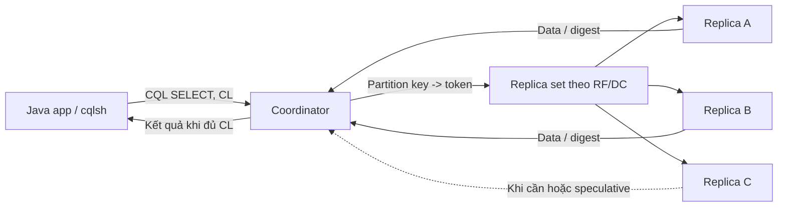
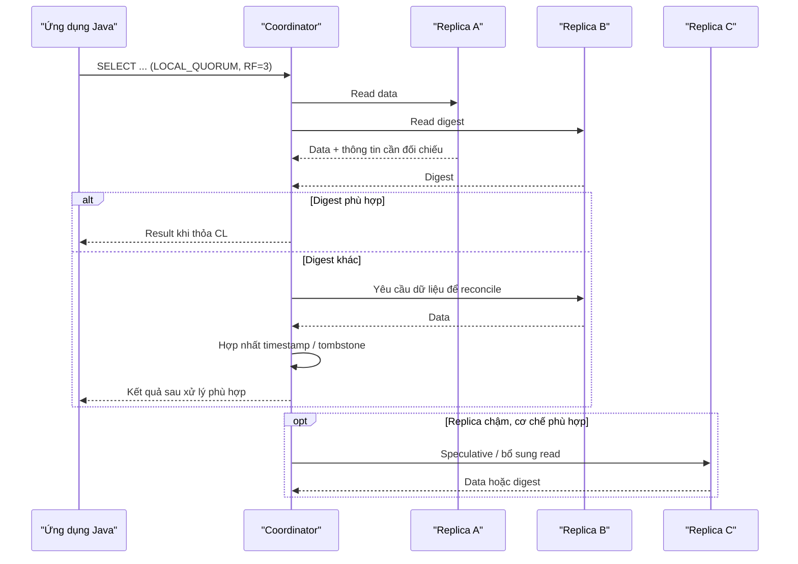
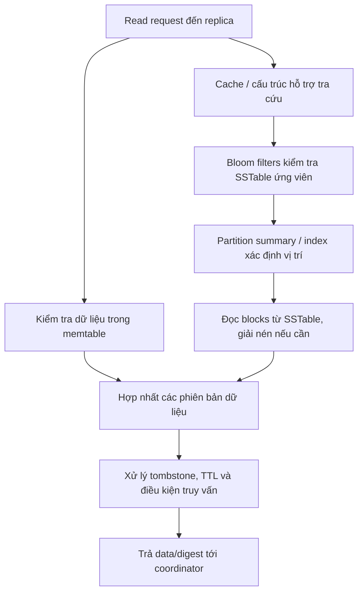

# Coordinator chọn replica phục vụ đọc theo mức nhất quán

## 1. Bài toán: một lệnh SELECT, nhiều replica có thể phục vụ

Trong Apache Cassandra, cùng một partition có thể được sao chép trên nhiều node. Khi ứng dụng Java gửi `SELECT`, câu hỏi quan trọng không chỉ là **dữ liệu đang nằm ở đâu**, mà còn là:

- Node nào nhận yêu cầu từ client và làm **coordinator**?
- Với partition key của truy vấn, các node nào là **replica hợp lệ** theo keyspace replication strategy?
- Coordinator cần nhận phản hồi từ bao nhiêu replica để đạt **consistency level (CL)**?
- Nếu một replica chậm, down hoặc trả về dữ liệu khác, hệ thống sẽ xử lý như thế nào?
- Sau khi một replica nhận read request, nó tìm dữ liệu qua memtable, cache và SSTable ra sao?

Đó là trọng tâm chương **Đường đọc và bộ đệm** trong module `DATABASE_ENGINE_WIDE_COLUMN_CASSANDRA`, nơi người học kết nối kiến trúc Cassandra phân tán, thiết kế partition key theo truy vấn, replication, mức nhất quán, compaction/repair và ứng dụng Java.

**Mục tiêu học tập:** sau bài này, bạn có thể mô tả đường đi của một truy vấn đọc từ client tới coordinator và replica; tính số phản hồi cần thiết ở `ONE`, `LOCAL_ONE`, `QUORUM`, `LOCAL_QUORUM` và `ALL`; hiểu vai trò data/digest, khả năng reconcile, speculative retry; đồng thời chẩn đoán đọc chậm hoặc lỗi bằng CQL, `nodetool`, tracing và Java Driver.

> **Phân biệt ngay từ đầu:** *Coordinator* là node xử lý yêu cầu client. *Replica* là node được chọn lưu dữ liệu của partition theo replication policy. Một node **có thể vừa là coordinator vừa là replica**, nhưng hai vai trò không đồng nghĩa.

## 2. Hai lớp chọn node: client chọn coordinator, coordinator chọn replica

Trình tự logic:

1. **Java Driver** dùng load-balancing policy, thông tin token/topology và local datacenter để chọn một node nhận request. Node đó là coordinator cho request đang xét.
2. Coordinator phân tích CQL và partition key, tính token, xác định **tập replica tự nhiên** của partition theo replication strategy của keyspace.
3. Coordinator dùng CL, trạng thái node, thông tin topology/snitch và độ trễ quan sát được để chọn replica nào được hỏi trước và phản hồi nào cần chờ.
4. Replica thực thi đọc trên dữ liệu local (memtable, cache, SSTables), gửi dữ liệu hoặc digest.
5. Coordinator đối chiếu kết quả cần thiết, có thể yêu cầu thêm dữ liệu/repair tùy tình huống và phiên bản, rồi trả kết quả cho client.



Sơ đồ minh họa cluster RF = 3; **không** có nghĩa Cassandra luôn liên lạc chính xác ba replica cho mọi yêu cầu. Số request, loại response và thời điểm gửi có thể phụ thuộc CL, độ trễ, speculative retry, loại query và phiên bản Cassandra.

### Driver có biết token thì coordinator còn làm gì?

Một driver có hỗ trợ token-aware routing có thể ưu tiên node đang giữ replica của partition để giảm một hop mạng. Tuy nhiên:

- Việc chọn coordinator vẫn là quyết định ở **client driver**.
- Việc xác định và liên lạc các replica phục vụ read request là trách nhiệm của **coordinator**.
- Coordinator không nhất thiết phải là node replica; nếu không có replica phù hợp/khả dụng, đường đi có thể thêm một hop.
- Driver có thể thiếu routing key nếu truy vấn không có đủ thông tin partition key, hoặc policy không còn ưu tiên node mong muốn.

Do đó, hai câu “driver chọn node” và “coordinator chọn replica” mô tả **hai giai đoạn khác nhau** của cùng đường đọc.

## 3. Từ partition key đến danh sách replica

Đối với một bảng CQL:

```sql
CREATE TABLE read_lab.orders_by_id (
    order_id uuid PRIMARY KEY,
    customer_id uuid,
    order_status text,
    total_amount decimal
);
```

`order_id` là partition key. Cassandra dùng partitioner để biến partition key thành **token**. Từ token và topology của cluster, replication strategy của keyspace quyết định node nào là replica của partition đó.

### RF thuộc keyspace, không thuộc từng query

Ví dụ keyspace dùng `NetworkTopologyStrategy` với RF = 3 tại datacenter `dc1`:

```sql
CREATE KEYSPACE read_lab
WITH replication = {
    'class': 'NetworkTopologyStrategy',
    'dc1': '3'
}
AND durable_writes = true;
```

Ở đây phải có topology phù hợp với RF đã cấu hình. Trong một lab chỉ có một node thì **không được dùng giả định RF = 3** để mô phỏng quorum có đủ replica. Cần ít nhất ba node phù hợp trong `dc1` để bài thử chịu lỗi RF = 3 có ý nghĩa.

Nếu `order_id` ánh xạ tới các replica A, B, C, thì mọi lần đọc partition đó phải xét tập replica hợp lệ này. **Không phải coordinator tùy tiện chọn bất kỳ ba node trong cluster**: nó phải dựa vào token, keyspace replication policy và topology thực.

### Không nhầm RF với số replica luôn được hỏi

RF = 3 định nghĩa số bản sao mong muốn cho partition trong DC. Với `LOCAL_ONE`, coordinator có thể chỉ cần một phản hồi phù hợp; với `LOCAL_QUORUM` thường cần hai phản hồi tại DC đó. Việc thiết kế RF không thay thế việc chọn CL cho từng request.

### Khi partition key có nhiều cột

Với bảng:

```sql
CREATE TABLE read_lab.events_by_device_day (
    device_id text,
    event_day date,
    event_time timestamp,
    event_id uuid,
    value double,
    PRIMARY KEY ((device_id, event_day), event_time, event_id)
);
```

Token được xác định từ **cặp `(device_id, event_day)`**, không chỉ `device_id`. Truy vấn phù hợp thường cung cấp cả hai thành phần partition key, ví dụ:

```sql
SELECT event_time, event_id, value
FROM read_lab.events_by_device_day
WHERE device_id = 'sensor-01'
  AND event_day = '2026-11-21';
```

Việc lấy dữ liệu qua nhiều partition hoặc thực hiện truy vấn cần scan có thể khiến coordinator xử lý nhiều tập replica và có đường đọc phức tạp hơn. Vì vậy, **thiết kế bảng theo truy vấn** là yếu tố nền tảng cho cả hiệu năng đọc lẫn cách quan sát CL.

## 4. Consistency level: cần bao nhiêu phản hồi replica?

CL của read request mô tả **số/phạm vi phản hồi replica cần thiết để coordinator có thể trả thành công**; nó không làm thay đổi partition key, không tăng RF và không tự sao chép dữ liệu.

Với **một DC có RF = 3**, bảng sau là cách hiểu cơ bản:

| Read CL | Phản hồi replica cần thiết | Ý nghĩa và đánh đổi |
| --- | ---: | --- |
| `ONE` | 1 | Độ trễ và khả năng phục vụ tốt hơn khi ít replica sẵn sàng; có thể thấy dữ liệu cũ nếu replica chưa đồng bộ |
| `LOCAL_ONE` | 1 trong DC cục bộ | Tránh yêu cầu phản hồi từ DC xa khi topology có nhiều DC |
| `TWO` | 2 | Đọc từ hai replica; yêu cầu nhiều node sẵn sàng hơn `ONE` |
| `QUORUM` | 2 khi tổng RF = 3 | Quorum theo tổng RF, cần đa số replica |
| `LOCAL_QUORUM` | 2 khi RF của DC cục bộ = 3 | Đa số replica trong DC cục bộ, phù hợp nhiều ứng dụng multi-DC |
| `ALL` | 3 | Cần mọi replica tương ứng; dễ thất bại khi một replica không sẵn sàng |

**Quorum cơ bản** được tính:

\[
Q = \left\lfloor \frac{RF}{2} \right\rfloor + 1
\]

Với RF = 3: `floor(3 / 2) + 1 = 2`. Với RF = 5: quorum là 3. Trong bảng ví dụ, `QUORUM` và `LOCAL_QUORUM` cùng cần hai phản hồi vì chỉ có một DC; ở **multi-DC**, chúng có thể khác phạm vi và số phản hồi.

### `QUORUM` và `LOCAL_QUORUM` khi có hai DC

Giả sử `NetworkTopologyStrategy` cấu hình `dc1:3` và `dc2:2`:

- `LOCAL_QUORUM` với coordinator/client gắn DC `dc1` cần **2 trong 3 replica của dc1**.
- `LOCAL_QUORUM` tại `dc2` cần **2 trong 2 replica của dc2**.
- `QUORUM` xét tổng RF = 5, cần **3 phản hồi** từ replica thuộc phạm vi phù hợp toàn cluster.
- `ONE` và `LOCAL_ONE` đều cần một phản hồi, nhưng `LOCAL_ONE` ràng buộc replica nằm trong DC cục bộ.

Mục tiêu thường gặp của `LOCAL_QUORUM` là tránh đặt latency đọc vào đường WAN liên DC. Tuy nhiên, nó chỉ phản ánh replica **ở DC cục bộ**, nên cần hiểu rõ yêu cầu đọc xuyên DC và chính sách ghi của ứng dụng.

**Lưu ý:** các CL như `ANY` phục vụ bài toán ghi, không phải mức đọc thông thường; `SERIAL`/`LOCAL_SERIAL` liên quan tới pha đồng thuận của lightweight transaction (LWT), không phải lựa chọn thay thế trực tiếp `LOCAL_QUORUM` cho mọi `SELECT`.

### Có phải CL càng cao thì dữ liệu luôn “đúng hơn”?

CL cao giúp tăng số replica tham gia xác nhận read và khả năng phát hiện dữ liệu khác biệt, nhưng **không tự bảo đảm linearizability cho toàn bộ thao tác Cassandra**. Đọc/ghi đồng thời, timestamp, tombstone, timeout, thao tác trên nhiều partition và semantics của LWT đều cần phân tích riêng.

Với cùng một RF, thiết kế read/write CL sao cho nhóm replica đọc và ghi có giao nhau (thường minh họa `R + W > RF`) hỗ trợ nhìn thấy bản ghi mới trong những điều kiện nhất định; không nên coi bất đẳng thức đó là bảo đảm tuyệt đối khi có ghi đồng thời hoặc sự cố không được xử lý.

## 5. Coordinator thực sự chọn replica như thế nào?

Một trình tự suy luận hữu ích:

1. **Chọn đúng tập:** tính token từ partition key và lấy các natural replicas theo replication strategy.
2. **Lọc theo phạm vi CL:** với `LOCAL_ONE`/`LOCAL_QUORUM`, ưu tiên/ràng buộc các replica thuộc local DC của coordinator; với `QUORUM` có thể cần phạm vi rộng hơn.
3. **Xem replica nào có thể liên lạc:** node down hoặc không đủ số replica có thể khiến yêu cầu không thỏa CL.
4. **Xếp hạng theo proximity/độ trễ:** snitch và dynamic snitch cung cấp thông tin topology và hành vi độ trễ để coordinator ưu tiên replica phù hợp.
5. **Gửi read requests và chờ đủ response:** coordinator có thể gửi full-data read, digest read, và yêu cầu bổ sung khi cần.
6. **Theo dõi timeout/lỗi/độ trễ:** có thể áp speculative retry nếu cấu hình/phạm vi cho phép.

### Snitch và dynamic snitch

Snitch giúp Cassandra hiểu quan hệ DC/rack và khoảng cách topology. **Dynamic snitch** dùng thông tin độ trễ quan sát được để điều chỉnh mức ưu tiên replica trong những trường hợp phù hợp.

Tuy nhiên, dynamic snitch **không**:

- Chuyển partition sang node không phải replica tự nhiên chỉ vì node đó nhanh.
- Bỏ qua yêu cầu `LOCAL_QUORUM` hoặc giảm từ hai phản hồi xuống một.
- Tự khắc phục replication chưa đủ hoặc một node đã mất dữ liệu.
- Đảm bảo chính xác replica được dùng luôn cố định cho cùng partition.

Thứ tự replica có thể thay đổi theo trạng thái, phiên bản Cassandra và cơ chế điều phối read request. Vì thế sơ đồ “replica gần nhất trả lời” chỉ là minh họa, không phải hợp đồng bắt buộc của mọi request.

## 6. Data request, digest request và đối soát kết quả

Với read CL cao hơn một, Cassandra có thể tối ưu bằng cách yêu cầu **dữ liệu đầy đủ** từ một replica và **digest** (giá trị tóm lược nội dung cần so sánh) từ các replica còn lại. Cơ chế cụ thể tùy phiên bản và loại truy vấn; không nên giả định mọi lần đọc đều gồm chính xác một data request cộng `CL - 1` digest request.



### Vì sao so sánh digest?

Gửi digest nhỏ hơn full data giúp tránh truyền dữ liệu không cần thiết khi các replica thống nhất. Nếu digest không khớp, coordinator biết **có sự khác biệt**; nó cần thêm dữ liệu để xác định bản ghi nào mới/hợp lệ theo cơ chế reconcile.

### Reconcile không phải “chọn node có timestamp lớn nhất cho cả hàng”

Trong Cassandra, dữ liệu có thể thay đổi **theo từng cell**, với timestamp và tombstone/TTL riêng. Khi các replica khác nhau, hệ thống phải xử lý phiên bản dữ liệu và dấu xóa phù hợp. Không thể chỉ chọn “row trên replica A có timestamp lớn nhất” rồi bỏ qua mọi cell ở replica B.

Tùy phiên bản và table option, khi phát hiện khác biệt trong read path, Cassandra có thể kích hoạt **read repair** và có thể phải chờ một số bước repair trước khi trả kết quả. Đó **không** phải cơ chế thay thế cho anti-entropy repair định kỳ hoặc giải pháp đảm bảo toàn bộ cluster không có lệch dữ liệu.

### Nếu dùng `ONE` thì sao?

Đọc `ONE` có thể hoàn tất dựa trên một replica phù hợp mà không cần kiểm chứng quorum như `QUORUM`. Nếu replica này thiếu lần ghi mới nhất, client có thể nhận dữ liệu cũ. Vì vậy không nên diễn giải một lần `SELECT` thành công ở `ONE` là đã kiểm tra dữ liệu ở **tất cả** replica.

## 7. Speculative retry và việc coordinator gửi request bổ sung

Một replica có thể chậm do GC pause, ổ đĩa, compaction hoặc quá tải. Để giảm tail latency, Cassandra có thể dùng **speculative retry**: nếu request đọc chưa tiến triển theo điều kiện cấu hình, coordinator gửi một yêu cầu bổ sung tới replica phù hợp khác.

Mục tiêu là tăng khả năng có phản hồi nhanh mà vẫn đáp ứng CL, **không** phải giảm consistency level hay tự ý đổi tập replica.

Ví dụ với RF = 3, `LOCAL_ONE`:

1. Coordinator ban đầu hỏi replica A.
2. A chậm vượt ngưỡng speculative retry.
3. Coordinator có thể hỏi B, nếu B là replica hợp lệ và cơ chế đang bật.
4. Phản hồi phù hợp tới trước có thể giúp hoàn tất read, dù A vẫn chậm.

Với `LOCAL_QUORUM`, hệ thống vẫn cần đủ **hai** phản hồi theo CL; gửi thêm request không biến `LOCAL_QUORUM` thành `LOCAL_ONE`.

### Đánh đổi của speculative retry

| Lợi ích | Chi phí/rủi ro |
| --- | --- |
| Cải thiện độ trễ ở đuôi phân phối khi một replica chậm | Tăng lưu lượng đọc và tài nguyên replica |
| Giảm tác động của một số node chậm bất thường | Có thể làm cluster đang quá tải càng quá tải |
| Tận dụng replica khác khi có dự phòng | Không giúp nếu cả replica set đều quá tải hoặc CL không thể đạt |

Không bật speculative retry “càng mạnh càng tốt” mà không đo số request bổ sung, latencies và workload. Table option `speculative_retry` có cú pháp và default thay đổi theo phiên bản Cassandra; kiểm tra `system_schema.tables` và tài liệu của cluster đang dùng trước khi chỉnh.

## 8. Độ trễ và lỗi: Unavailable, ReadTimeout, ReadFailure

Các lỗi read path phản ánh những tình huống khác nhau:

| Tình huống | Ý nghĩa thực tế | Hướng điều tra |
| --- | --- | --- |
| **Unavailable** | Coordinator biết không đủ replica sống/phù hợp để thỏa CL tại thời điểm xử lý | Kiểm tra RF/DC, `nodetool status`, node down, CL đã chọn |
| **ReadTimeout** | Read request không nhận đủ phản hồi đúng hạn | Kiểm tra latency node, I/O, compaction, tombstone, mạng và timeout |
| **ReadFailure** | Một hay nhiều replica báo thất bại xử lý read, khiến không thể hoàn tất theo CL | Đọc log lỗi replica, corruption/đọc SSTable, tài nguyên, đường mạng |
| **Overloaded/Busy** hoặc lỗi khác theo phiên bản | Coordinator/replica đang quá tải hoặc từ chối request | Theo dõi thread pools, pending requests, heap/GC, disk |

**Cần lưu ý:** “còn hai node sống, RF = 3, `LOCAL_QUORUM`” có thể đủ theo lý thuyết, nhưng request vẫn có thể timeout nếu một trong hai replica chậm hoặc gặp lỗi. Ngược lại, `LOCAL_ONE` có thể đáp ứng khi quorum không đáp ứng, nhưng không phải lựa chọn đúng nếu yêu cầu nghiệp vụ cần mức nhất quán cao hơn.

### Không xử lý timeout bằng cách hạ CL vô điều kiện

Hạ `LOCAL_QUORUM` xuống `ONE` có thể giảm số phản hồi cần chờ, nhưng cũng làm thay đổi độ đảm bảo đọc và khả năng nhận dữ liệu cũ. Trước hết xác định nguyên nhân (mất node, hot partition, SSTable nhiều, GC hoặc network); chỉ điều chỉnh CL khi đã thống nhất lại yêu cầu đúng đắn dữ liệu.

### Retry từ ứng dụng Java

Một `SELECT` thường là thao tác chỉ đọc, nhưng retry vẫn tăng tải. Driver có retry policy; không nên retry vô hạn hoặc đồng loạt khi cluster đang quá tải. Với paging, mỗi trang có thể phát request riêng; nếu có ghi đồng thời, không được coi nhiều trang là một snapshot nhất quán tuyệt đối.

## 9. Bên trong một replica: cache, memtable và SSTable

Sau khi coordinator chọn replica, node đó phải tìm dữ liệu của partition. Đường đọc local về nguyên tắc kết hợp dữ liệu có thể tồn tại ở **memtable** và các **SSTable**:



Sơ đồ thể hiện **các thành phần có thể tham gia**, không phải chuỗi gọi bắt buộc cho mọi read. Một cache hit thích hợp có thể tránh một phần I/O; tùy version, row cache, key cache và đường thực thi có khác biệt.

### Các thành phần cần hiểu

| Thành phần | Vai trò | Lưu ý |
| --- | --- | --- |
| **Memtable** | Dữ liệu ghi gần đây còn trong bộ nhớ | Đọc vẫn phải xét cùng SSTable khi cần |
| **SSTable** | Dữ liệu bất biến trên đĩa; có thể có nhiều bản ghi/cell phiên bản | Compaction giảm số cấu trúc cần hợp nhất theo thời gian |
| **Bloom filter** | Loại nhanh những SSTable chắc chắn không chứa partition key | Có thể false positive; không loại nhầm partition thật theo tính chất filter |
| **Partition summary/index** | Hỗ trợ xác định vị trí partition trong SSTable | Giảm lượng tra cứu I/O so với quét toàn bộ |
| **Key cache** | Giữ thông tin tra cứu index/vị trí partition hữu ích | Không phải cache bảo đảm giá trị hàng mới nhất |
| **Row cache** | Cache dữ liệu đọc phù hợp với cấu hình, thường cho partition/đối tượng được truy cập nhiều | Có chi phí bộ nhớ và hiệu lực tùy version/config |
| **Tombstone/TTL** | Biểu diễn xóa và hết hạn | Có thể khiến read phải duyệt nhiều dữ liệu không còn hiển thị |

**Cache của replica và việc chọn replica theo CL là hai tầng khác nhau.** Một replica trả lời nhanh nhờ key cache/row cache vẫn phải nằm trong tập replica hợp lệ, và coordinator vẫn phải thỏa số phản hồi của CL. CL không yêu cầu “đọc từ cache”; cache cũng không tự nâng mức nhất quán.

### Vì sao một read đúng CL vẫn chậm?

Khi một partition quá lớn, có nhiều SSTable hoặc tombstone, mỗi replica có thể mất nhiều thời gian hợp nhất dữ liệu. Nếu CL cần hai phản hồi, tail latency của replica chậm có thể chi phối request. Những nguyên nhân thường gặp:

- Partition key không phân tán đều hoặc partition rất lớn.
- Nhiều SSTable cần kiểm tra, compaction backlog, disk I/O cao.
- Tombstone quá nhiều do TTL/`DELETE` hoặc mô hình dữ liệu chưa phù hợp.
- Node đang GC pause, CPU/heap cao, network jitter.
- Query đọc lượng dữ liệu lớn, paging không thích hợp hoặc filtering không hiệu quả.

Vì vậy tối ưu đường đọc phải đánh giá **cả mô hình truy vấn/partition và hiệu năng local replica**, không chỉ giảm CL.

## 10. Lab RF = 3: quan sát LOCAL_ONE và LOCAL_QUORUM

**Điều kiện thực hành:** dùng cluster lab riêng có **ít nhất ba node hoạt động trong DC `dc1`** và quyền tạo schema. Nếu DC của bạn có tên khác, thay trong `CREATE KEYSPACE` và cấu hình client. Không chạy các câu tạo/xóa trên keyspace production.

### Bước 1 — Kiểm tra topology

```bash
nodetool status
```

Đảm bảo đủ ba node phù hợp, ở trạng thái Up/Normal, trước khi học về RF = 3. Nếu chỉ có một node, có thể thực hành phần đọc metadata với RF = 1, nhưng không thể rút ra kết luận thực nghiệm về `QUORUM` của RF = 3.

### Bước 2 — Tạo keyspace/bảng riêng

```sql
CREATE KEYSPACE IF NOT EXISTS read_lab
WITH replication = {
    'class': 'NetworkTopologyStrategy',
    'dc1': '3'
}
AND durable_writes = true;

CREATE TABLE IF NOT EXISTS read_lab.orders_by_id (
    order_id uuid PRIMARY KEY,
    customer_id uuid,
    order_status text,
    total_amount decimal
);
```

Nếu đối tượng cùng tên đã tồn tại, `IF NOT EXISTS` không kiểm tra lại RF hay PRIMARY KEY. Đọc metadata và dừng khi khác định nghĩa bài thực hành:

```sql
SELECT keyspace_name, replication
FROM system_schema.keyspaces
WHERE keyspace_name = 'read_lab';

SELECT column_name, kind, type
FROM system_schema.columns
WHERE keyspace_name = 'read_lab'
  AND table_name = 'orders_by_id';
```

### Bước 3 — Ghi dữ liệu thử

```sql
INSERT INTO read_lab.orders_by_id (
    order_id, customer_id, order_status, total_amount
) VALUES (
    11111111-1111-4111-8111-111111111111,
    22222222-2222-4222-8222-222222222222,
    'PAID',
    350000.00
);
```

Để so sánh đọc tại `ONE` và `QUORUM`, hãy bảo đảm dữ liệu thử đã được ghi thành công theo một CL phù hợp và cluster ở trạng thái khỏe; tránh cố tạo sai khác replica trên môi trường dùng chung.

### Bước 4 — Xem replica set của partition

Trong các phiên bản `nodetool` hỗ trợ:

```bash
nodetool getendpoints read_lab orders_by_id 11111111-1111-4111-8111-111111111111
```

Kết quả liệt kê **các endpoint có trách nhiệm lưu partition**, không phải nhật ký chứng minh lần `SELECT` tiếp theo đã nhận phản hồi từ tất cả những node đó. Cú pháp và hình thức output có thể khác theo phiên bản.

### Bước 5 — Thực hiện đọc với các CL

Trong `cqlsh`, dùng lệnh tiện ích `CONSISTENCY` để chọn mức nhất quán cho các câu CQL tiếp theo:

```sql
CONSISTENCY LOCAL_ONE;

SELECT order_id, order_status, total_amount
FROM read_lab.orders_by_id
WHERE order_id = 11111111-1111-4111-8111-111111111111;

CONSISTENCY LOCAL_QUORUM;

SELECT order_id, order_status, total_amount
FROM read_lab.orders_by_id
WHERE order_id = 11111111-1111-4111-8111-111111111111;
```

`CONSISTENCY` thuộc `cqlsh`; đây **không phải** CQL `SELECT` mà bạn copy trực tiếp vào prepared statement Java. Nếu chỉ có một DC RF = 3, `LOCAL_QUORUM` cần hai phản hồi replica, còn `LOCAL_ONE` cần một.

### Bước 6 — Bật tracing cho một câu SELECT ngắn

```sql
TRACING ON;

SELECT order_id, order_status
FROM read_lab.orders_by_id
WHERE order_id = 11111111-1111-4111-8111-111111111111;

TRACING OFF;
```

`TRACING` là tiện ích `cqlsh` cho phiên làm việc hiện tại. Tracing có thể hiển thị các hoạt động phối hợp request và thời gian, nhưng mức chi tiết phụ thuộc phiên bản; không mặc định mọi digest/data request đều được hiển thị rõ theo một định dạng cố định. Không bật tracing cho toàn bộ request production lâu dài vì có chi phí.

### Bước 7 — Dọn lab nếu không cần giữ dữ liệu

```sql
-- Chỉ chạy trên keyspace lab được phép xóa hoàn toàn.
DROP KEYSPACE IF EXISTS read_lab;
```

Lệnh này xóa toàn bộ bảng và dữ liệu trong `read_lab`. Không dùng trên môi trường có dữ liệu cần giữ hoặc nơi ứng dụng đang sử dụng.

## 11. Các kịch bản vận hành: đọc sẽ thành công hay thất bại?

Giả định một DC `dc1` có đúng ba replica A, B, C cho partition, RF = 3. Bảng sau nói về **khả năng thỏa số replica**, chưa tính lỗi mạng/timeout chi tiết:

| Tình trạng | `LOCAL_ONE` | `LOCAL_QUORUM` | `ALL` |
| --- | --- | --- | --- |
| A, B, C đều sẵn sàng | Có thể thành công | Có thể thành công | Có thể thành công |
| A down, B và C sẵn sàng | Có thể thành công | Có thể thành công | **Không đủ** |
| A và B down, chỉ C sẵn sàng | Có thể thành công | **Không đủ** | **Không đủ** |
| Không replica nào sẵn sàng | Không đủ | Không đủ | Không đủ |

“Có thể thành công” không bảo đảm response đúng hạn: replica có thể quá tải, gặp lỗi đọc SSTable hoặc chậm do tombstone. Ngược lại, khi một node down, không được hạ CL tự động nếu yêu cầu nghiệp vụ không cho phép.

### Ví dụ dữ liệu không đồng nhất

Giả sử A đã nhận ghi mới `order_status = 'SHIPPED'` nhưng B còn `'PAID'` trong một thời điểm mất đồng bộ. Đọc `LOCAL_ONE` từ B có thể trả `'PAID'`; đọc `LOCAL_QUORUM` có cơ hội nhìn thấy phiên bản hợp lệ thông qua đối chiếu dữ liệu từ quorum, tùy trạng thái replica và tính đúng đắn của các ghi trước đó.

Nếu lần ghi trước **chỉ thành công ở một replica** rồi client gặp lỗi, không được khẳng định mọi lần đọc quorum sau đó chắc chắn thấy dữ liệu mới. Cần xét CL của lần ghi, kết quả báo thành công/thất bại, timestamp và tình trạng replica.

### Các consistency level trong multi-DC

Với `NetworkTopologyStrategy` và local DC của client/coordinator:

- `LOCAL_ONE`/`LOCAL_QUORUM` có thể giảm phụ thuộc WAN cho read request.
- `QUORUM` theo tổng RF có thể cần phản hồi từ phạm vi nhiều DC tùy số replica/độ sẵn sàng.
- Việc chọn local DC sai trong cấu hình driver có thể ảnh hưởng lựa chọn coordinator và độ trễ.
- Ghi ở `LOCAL_QUORUM` tại DC này không tự đồng nghĩa mọi DC khác đã thấy dữ liệu mới ngay trong thời điểm có sự cố.

Thiết kế mức nhất quán phải dựa trên **độ tươi dữ liệu, số node/DC, latency SLO và khả năng chịu lỗi mong muốn**, không chỉ một benchmark đọc nhanh ở `ONE`.

## 12. Java Driver 4.x: đặt CL cho từng truy vấn SELECT

Ví dụ sau sử dụng **Cassandra Java Driver 4.x**. Giả sử `CqlSession session` đã được khởi tạo đúng cluster và local datacenter; table `read_lab.orders_by_id` đã tồn tại.

```java
import com.datastax.oss.driver.api.core.CqlSession;
import com.datastax.oss.driver.api.core.DefaultConsistencyLevel;
import com.datastax.oss.driver.api.core.cql.BoundStatement;
import com.datastax.oss.driver.api.core.cql.PreparedStatement;
import com.datastax.oss.driver.api.core.cql.Row;
import java.util.UUID;

// session được tạo và quản lý vòng đời bên ngoài ví dụ.
PreparedStatement select = session.prepare("""
    SELECT order_id, order_status, total_amount
    FROM read_lab.orders_by_id
    WHERE order_id = ?
    """);

UUID orderId =
    UUID.fromString("11111111-1111-4111-8111-111111111111");

BoundStatement request = select.bind(orderId)
    .setConsistencyLevel(DefaultConsistencyLevel.LOCAL_QUORUM);

Row row = session.execute(request).one();
if (row == null) {
    System.out.println("Không có đơn hàng theo khóa được yêu cầu");
} else {
    System.out.println(row.getString("order_status"));
}
```

Java text block yêu cầu Java 15+. `?` dùng để bind **giá trị partition key**; không dùng bind marker thay identifier của keyspace/table/cột. `setConsistencyLevel` áp dụng cho statement này; các statement khác có thể dùng CL khác tùy policy và yêu cầu nghiệp vụ.

### Local DC và token-aware routing

Driver cần được cấu hình local datacenter phù hợp với deployment, chẳng hạn qua session builder hoặc cấu hình driver. Policy load balancing/token aware có thể chọn coordinator gần hoặc là replica của partition; **coordinator vẫn là bên thực hiện điều phối đọc và xác minh CL**.

Một số lưu ý khi triển khai:

1. Dùng prepared statements với **partition key được bind đầy đủ** khi yêu cầu phù hợp mô hình bảng.
2. Chọn CL theo mục tiêu nghiệp vụ: `LOCAL_ONE` cho read chấp nhận độ tươi thấp hơn; `LOCAL_QUORUM` khi cần kiểm chứng đa số replica local theo RF/CL tương ứng.
3. Kiểm tra metadata keyspace và RF/DC trước khi đặt giả thiết về số phản hồi; trong lab một node không nên dùng `LOCAL_QUORUM` của RF = 3.
4. Ghi nhận exception loại Unavailable/ReadTimeout/ReadFailure, latency và node coordinator; không retry vô hạn.
5. Dùng paging và giới hạn dữ liệu đọc, tránh `SELECT *` từ partition lớn mà không có nhu cầu.

**Đừng đổi CL thành `ALL` chỉ để “chắc chắn” khi không có yêu cầu rõ ràng.** `ALL` có thể giảm mạnh khả năng phục vụ khi một replica chậm hoặc down; độ tin cậy nghiệp vụ cần được thiết kế với cả write CL, xử lý lỗi và repair.

## 13. Công cụ quan sát và chẩn đoán coordinator/replica

Tùy phiên bản Cassandra và quyền vận hành, những công cụ sau thường hữu ích:

| Công cụ/chỉ số | Dùng để quan sát | Không kết luận quá mức |
| --- | --- | --- |
| `nodetool status` | Node up/down, DC, rack/topology | Không xác nhận replica đã có mọi dữ liệu |
| `nodetool getendpoints ks tbl key` | Natural replicas của một partition key | Không chứng minh request SELECT thực tế hỏi node nào |
| `nodetool tablestats` | Một số chỉ số đọc, SSTable, dung lượng, cache ở bảng | Chỉ số tùy phiên bản, không thay tracing từng request |
| `nodetool tpstats` | Thread pools/pending/dropped messages tương ứng | Không chỉ riêng truy vấn SELECT |
| `TRACING ON` trong `cqlsh` | Hoạt động và timing của một truy vấn được trace | Tăng overhead, không phù hợp bật mọi request |
| `system_schema.keyspaces` | RF/strategy theo keyspace | Không phải tiến độ streaming/repair |
| Java Driver metrics/logs | Latency, timeout, retries, coordinator, pool và load balancing | Không phản ánh tất cả trạng thái node từ một góc nhìn |

### Một quy trình xử lý read latency cao

1. **Xác định request:** CQL, partition key, CL, local DC, số lượng hàng, page size, thời điểm và latency SLO.
2. **Xác định replica set:** xem replication policy và `nodetool getendpoints` cho partition mẫu.
3. **Kiểm tra topology:** `nodetool status` và kết nối mạng giữa coordinator/replica, đặc biệt nếu yêu cầu chạm DC xa.
4. **Quan sát read path:** tracing có chọn lọc và metrics latency của coordinator/replica.
5. **Kiểm tra local storage:** hot partition, tombstone, số SSTable, compaction backlog, cache hiệu lực, disk I/O/GC.
6. **Đánh giá CL/speculative retry:** xem có request chờ quá nhiều replica, speculative traffic tăng hoặc node chậm kéo dài.
7. **Khắc phục có căn cứ:** cải thiện thiết kế partition, xử lý node chậm/compaction, điều chỉnh retry/cache khi có đo đạc, xem lại CL **chỉ nếu yêu cầu nghiệp vụ cho phép**.

### Ví dụ kết luận sai

Nếu Java request `LOCAL_QUORUM` chậm còn `LOCAL_ONE` nhanh, không thể ngay lập tức kết luận Cassandra “không chịu được quorum”. Có thể một replica chậm do đọc quá nhiều SSTable, compaction hoặc tombstone; giảm CL chỉ che triệu chứng và đổi mức đảm bảo đọc. Cần xác định replica gây tail latency và nguyên nhân.

## 14. Bài tập tính CL và tư duy sự cố

### Bài tập A — Tính số phản hồi cần thiết

Một DC có RF = 5. Hãy tính số phản hồi tối thiểu cho `LOCAL_ONE`, `LOCAL_QUORUM` và `ALL`.

**Đáp án:** lần lượt 1, `floor(5/2)+1 = 3` và 5 replica trong DC tương ứng.

### Bài tập B — Đánh giá khi replica down

Một partition có RF = 3 ở một DC; A down, B và C up.

- `LOCAL_ONE`: có thể hoàn tất khi một replica phù hợp phản hồi.
- `LOCAL_QUORUM`: vẫn có thể hoàn tất nếu **cả B và C** phản hồi đúng hạn.
- `ALL`: không đủ replica để đạt yêu cầu.

Nếu B up nhưng bị GC pause và không phản hồi đúng hạn, `LOCAL_QUORUM` vẫn có thể gặp ReadTimeout; “up” không đồng nghĩa “phản hồi kịp thời”.

### Bài tập C — Hai DC có RF khác nhau

Keyspace `NetworkTopologyStrategy`: `dc1:3`, `dc2:2`. Một request ở `dc1` dùng `LOCAL_QUORUM`, một request khác ở `dc2` cũng dùng `LOCAL_QUORUM`. Cần bao nhiêu phản hồi local?

**Đáp án:** `dc1` cần 2/3; `dc2` cần 2/2. Điều này minh họa `LOCAL_QUORUM` được tính **theo RF của local DC**, không đơn giản là một hằng số cho toàn cluster.

### Bài tập D — Phân biệt coordinator và replica

Driver đã kết nối và gửi request tới node X. Partition key ánh xạ tới replica A, B, C; X không thuộc tập đó. X có thể làm coordinator không?

**Đáp án:** Có thể, nếu client chọn X làm coordinator; X sẽ điều phối đọc tới các replica hợp lệ. Tuy nhiên, đây có thể là đường đi tốn thêm hop mạng; token-aware routing thường cố tối ưu lựa chọn coordinator khi có thông tin partition key.

### Bài tập E — Vì sao kết quả `ONE` và `QUORUM` có thể khác?

Ghi mới chưa đến tất cả replica, A có trạng thái mới còn B đang giữ trạng thái cũ. Read `ONE` từ B có thể trả kết quả cũ; `QUORUM` liên hệ nhiều replica hơn, có thể phát hiện/giải quyết chênh lệch. Nhưng phải xét CL/result của lần ghi và ghi đồng thời trước khi tuyên bố một lần đọc bất kỳ luôn phản ánh cập nhật mới nhất.

## 15. Những hiểu lầm thường gặp

| Hiểu lầm | Cách hiểu đúng |
| --- | --- |
| “Ứng dụng chọn replica nào thì Cassandra đọc replica đó.” | Ứng dụng/driver chọn **coordinator**; coordinator điều phối các replica của partition theo RF/DC/CL. |
| “Coordinator luôn là replica chứa dữ liệu.” | Coordinator có thể là replica hoặc một node khác. |
| “RF = 3 nghĩa là mỗi read phải hỏi đủ ba node.” | Số phản hồi cần thiết phụ thuộc CL; hệ thống có thể gửi nhiều request hơn theo tối ưu/độ trễ. |
| “`LOCAL_QUORUM` là 2 replica ở mọi cluster.” | Quorum tính theo **RF tại DC cục bộ**; RF = 5 cần 3. |
| “`QUORUM` và `LOCAL_QUORUM` luôn như nhau.” | Chỉ có thể trùng trong topology nhất định; multi-DC cần phân biệt phạm vi. |
| “CL cao đảm bảo ứng dụng không bao giờ thấy dữ liệu cũ.” | Còn phụ thuộc write CL, ghi đồng thời, timestamp và trạng thái replica; không tự bảo đảm linearizability. |
| “Digest read trả nguyên dữ liệu cho client.” | Digest dùng để so sánh; data request và reconciliation tạo dữ liệu trả client. |
| “Speculative retry có nghĩa tự hạ CL.” | Nó gửi thêm request, vẫn phải thỏa CL. |
| “Bloom filter/cache quyết định replica được chọn.” | Bloom filter/cache hỗ trợ **đọc local** bên trong replica, không chọn natural replica. |
| “`ReadTimeout` tức là cluster không đủ replica sống.” | Timeout là không đủ phản hồi kịp thời; thiếu replica sống thường dẫn tới Unavailable. |
| “Schema agreement đồng nghĩa replica có dữ liệu mới.” | Agreement nói về **định nghĩa schema**; repair/streaming và CL xử lý các khía cạnh dữ liệu riêng. |
| “`nodetool getendpoints` là log của request vừa chạy.” | Nó mô tả tập natural replicas cho key, không phải danh sách response thực tế. |

## 16. Checklist trước khi tối ưu đường đọc và kết luận

| Câu hỏi | Cách kiểm chứng |
| --- | --- |
| Truy vấn có cung cấp đủ partition key không? | `PRIMARY KEY`, câu `WHERE` và truy vấn theo workload |
| Driver đang gửi request đến DC nào? | Local DC/load-balancing config và node coordinator |
| Replica set của partition là những node nào? | RF/strategy và `nodetool getendpoints` |
| CL đang dùng là gì, cần bao nhiêu phản hồi? | Statement-level CL, RF local/total và bảng tính quorum |
| Node/replica cần thiết có khả dụng không? | `nodetool status`, log, network |
| Latency đến từ coordinator, replica hay đường WAN? | Tracing, metrics và topology |
| Có read repair/digest mismatch hoặc speculative retry nhiều không? | Metrics/logs phù hợp phiên bản; đối chiếu bằng truy vết có chọn lọc |
| Bên trong replica có vấn đề SSTable/tombstone/compaction không? | `tablestats`, compaction metrics, disk I/O, GC |
| Các replica đã đồng bộ sau thay RF/topology chưa? | Streaming/repair và kiểm tra dữ liệu riêng |
| Có thể thay CL mà vẫn giữ yêu cầu nghiệp vụ không? | Đánh giá độ tươi, latency SLO, write CL và rủi ro consistency |
| Java có retry/paging hợp lý không? | Prepared statements, exception, metrics và kiểm thử tải |

**Ghi nhớ:** đường đọc Cassandra đi qua **hai quyết định chọn node**: driver chọn coordinator, rồi coordinator tính replica set từ partition key và replication strategy, chọn các replica để đáp ứng consistency level. Full-data/digest reads, reconciliation, speculative retry và đường đọc local qua cache/memtable/SSTable đều góp phần quyết định latency và độ tươi dữ liệu. Tối ưu đúng phải kết hợp **thiết kế bảng theo truy vấn, RF/DC, CL, tình trạng replica và đo đạc thực tế**, thay vì chỉ hạ consistency level khi thấy một request chậm.
