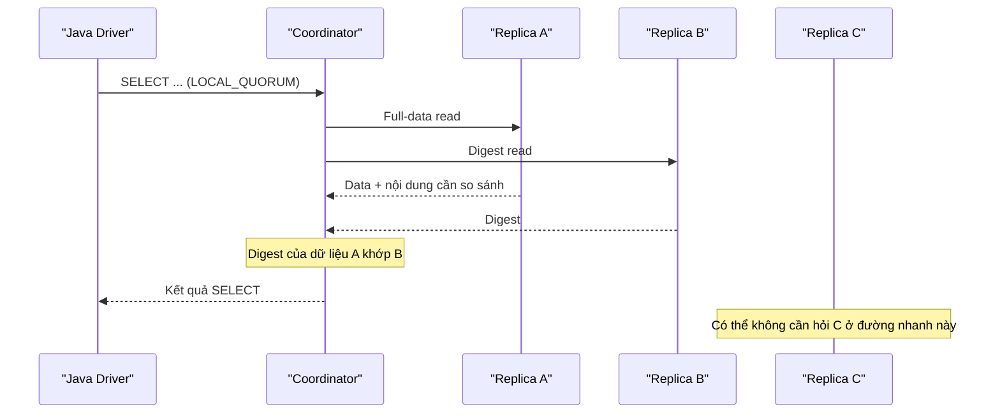
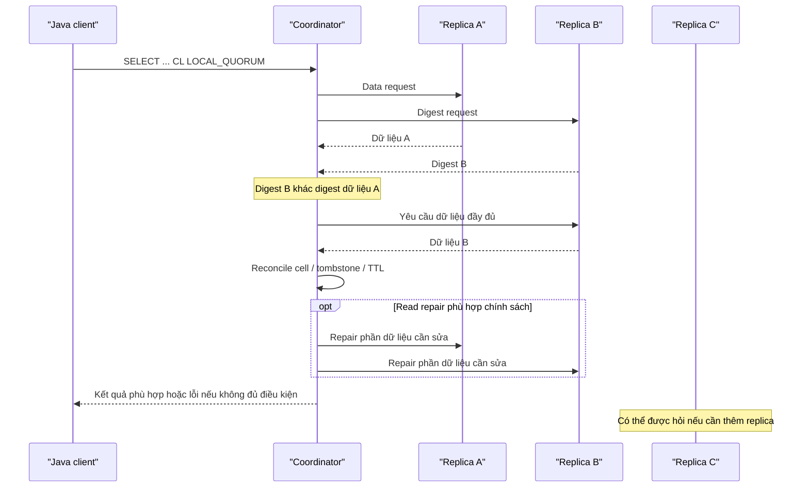
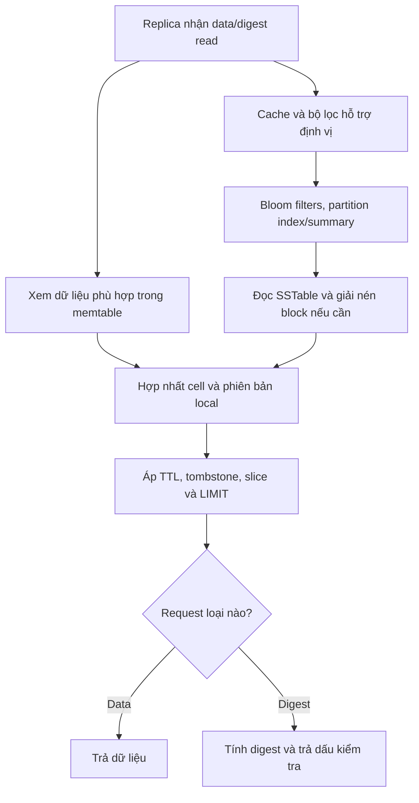

# Đọc dữ liệu, đọc digest và phát hiện khác biệt

## 1. Tại sao một câu SELECT có thể cần so sánh nhiều replica?

Apache Cassandra lưu các bản sao (*replica*) của một partition theo replication strategy của keyspace. Ví dụ, với `NetworkTopologyStrategy` và replication factor (RF) bằng 3 tại một data center, một partition có ba replica được chỉ định. Chúng **không nhất thiết có trạng thái giống nhau tại mọi thời điểm**: một lần ghi có thể mới đến một số replica, node có thể tạm mất kết nối, và các phiên bản cell có thể đang chờ đồng bộ.

Khi Java Driver gửi lệnh `SELECT`, một node nhận request sẽ đóng vai trò **coordinator**. Tùy consistency level (CL), coordinator cần đủ phản hồi từ các replica để trả kết quả. Để hạn chế truyền dữ liệu lớn giữa các node mà vẫn phát hiện nhiều trường hợp khác biệt, Cassandra sử dụng hai hình thức đọc quan trọng:

- **Đọc dữ liệu đầy đủ (full-data read/data request):** replica gửi nội dung đọc được, đủ để coordinator tạo kết quả CQL.
- **Đọc digest (digest request):** replica tính và trả một giá trị tóm lược đại diện cho nội dung đọc liên quan đến truy vấn, để coordinator so sánh với dữ liệu từ replica khác.

Đây là bài thuộc chương **Đường đọc và bộ đệm** trong module `DATABASE_ENGINE_WIDE_COLUMN_CASSANDRA`. Nó nối kiến trúc phân tán, partition key, thiết kế bảng theo truy vấn, replication/CL với đọc từ memtable–SSTable, xử lý tombstone, read repair và ứng dụng Java.

**Sau bài học, bạn cần có thể:**

1. Phân biệt data response với digest response, và vì sao digest không thay được dữ liệu.
2. Vẽ đường đọc khi các replica thống nhất và khi xuất hiện digest mismatch.
3. Giải thích reconciliation ở cấp cell, timestamp, TTL và tombstone.
4. Phân biệt read repair với anti-entropy repair; hiểu ảnh hưởng phiên bản/tùy chọn.
5. Tính phạm vi replica cần thiết theo CL, đo tác động tới latency và chẩn đoán bằng tracing/metrics.
6. Thực hành CQL an toàn và cấu hình read CL từ Cassandra Java Driver.

> **Nguyên tắc quan trọng:** cùng một schema, cùng RF và cùng partition key không bảo đảm từng replica đang chứa đúng cùng một tập phiên bản dữ liệu. *Schema agreement* là thống nhất định nghĩa; *digest comparison* là một bước kiểm tra nội dung của một **request đọc cụ thể**.

## 2. Các vai trò trong đường đọc

| Thành phần | Vai trò trong request `SELECT` |
| --- | --- |
| **Java Driver/client** | Chọn node nhận request theo load-balancing policy, gửi CQL và CL; có thể hỗ trợ token-aware routing |
| **Coordinator** | Xác định replica set của partition, điều phối data/digest requests, chờ phản hồi đủ CL, so khớp và trả kết quả |
| **Natural replica** | Node được replication strategy chỉ định giữ dữ liệu partition; đọc memtable, SSTable và cache local |
| **Full-data response** | Trả dữ liệu/phiên bản cần thiết để coordinator xử lý kết quả đọc |
| **Digest response** | Trả giá trị kiểm tra nội dung đọc được, không phải tập hàng có thể chuyển thẳng cho client |
| **Resolver/reconciliation** | Đối chiếu và hợp nhất những phiên bản cần thiết khi phát hiện khác biệt |
| **Read repair** | Có thể đẩy dữ liệu đã được hòa giải tới replica thiếu/cũ trong quá trình đọc, theo phiên bản và chính sách phù hợp |

Coordinator **có thể** đồng thời là replica của partition, nhưng không bắt buộc. Token-aware driver thường cố ưu tiên coordinator nằm gần hoặc giữ replica nhằm tiết kiệm một hop mạng; lựa chọn cuối cùng chịu ảnh hưởng policy và trạng thái node.

### Từ partition key tới replica set

Với bảng:

```sql
CREATE TABLE read_lab.sensor_events_by_day (
    sensor_id text,
    event_day date,
    event_time timestamp,
    event_id uuid,
    reading double,
    PRIMARY KEY ((sensor_id, event_day), event_time, event_id)
) WITH CLUSTERING ORDER BY (event_time DESC, event_id ASC);
```

Partition key là **cặp** `(sensor_id, event_day)`. Cassandra tính token từ partition key đã mã hóa và dùng replication strategy để xác định natural replicas. Một truy vấn sau hướng tới **một partition cụ thể**:

```sql
SELECT event_time, event_id, reading
FROM read_lab.sensor_events_by_day
WHERE sensor_id = 'sensor-01'
  AND event_day = '2026-11-21'
LIMIT 10;
```

Nếu query quét nhiều partition hoặc thiếu điều kiện khóa phù hợp, coordinator có thể phải xử lý nhiều nhánh đọc hơn. Vì vậy **thiết kế bảng theo truy vấn** thường quyết định chi phí của cả data read lẫn digest read.

## 3. Full-data read và digest read khác nhau thế nào?

| Thuộc tính | Full-data read | Digest read |
| --- | --- | --- |
| Mục tiêu | Cung cấp nội dung cho kết quả đọc | So sánh nội dung đọc giữa các replica |
| Nội dung trả về mạng | Dữ liệu/phiên bản đọc, có thể lớn | Giá trị digest nhỏ hơn dữ liệu tương ứng |
| Có thể trả trực tiếp thành hàng CQL? | Có, sau khi coordinator xử lý phù hợp | **Không** |
| Có phải luôn chỉ đọc từ RAM? | Không; có thể đụng cache, memtable, SSTable | **Không**; replica vẫn phải xác định nội dung liên quan để tính digest |
| Có thể bộc lộ khác biệt? | Dùng làm dữ liệu gốc để so với digest/replica khác | Digest khác nhau là tín hiệu phải đối chiếu thêm |
| Chi phí | I/O local + có thể truyền nhiều dữ liệu qua mạng | I/O/CPU local để đọc, tính digest + truyền ít byte hơn |

Digest là một dạng **dấu vân tay của nội dung đọc liên quan tới request**, không phải checksum của toàn bộ bảng, toàn bộ keyspace hay toàn bộ SSTable. Một digest khớp **không chứng minh tất cả partition của hai replica giống nhau**: chỉ cho biết nội dung được so sánh trong phạm vi request không thể hiện khác biệt bằng phép đối chiếu digest đó.

Ngoài ra, hash/digest không phải cơ chế chứng minh toán học tuyệt đối: về nguyên tắc có thể có va chạm, và điều quan trọng trong vận hành là Cassandra sử dụng nó như cơ chế phát hiện khác biệt hiệu quả, **không** phải bằng chứng kiểm toán bất biến cho toàn cơ sở dữ liệu.

### Replica vẫn có thể đọc đĩa cho digest

Một hiểu nhầm là “digest read luôn rất rẻ vì chỉ gửi hash”. Trên thực tế replica cần đọc và xử lý nội dung phù hợp với truy vấn để tạo digest. Nếu partition rất lớn, có nhiều SSTable hoặc tombstone, chi phí local của digest read vẫn đáng kể. **Digest tiết kiệm băng thông giữa các node**, nhưng không biến truy vấn khó thành truy vấn không tốn I/O.

## 4. Đường đọc bình thường khi các replica thống nhất

Giả sử một DC tên `dc1` có RF = 3, partition được sao chép trên A/B/C; request dùng `LOCAL_QUORUM` nên cần hai phản hồi ở `dc1`. Một cách thực hiện điển hình là hỏi A lấy dữ liệu, hỏi B lấy digest:



Sơ đồ minh họa **một luồng điển hình**, không phải hợp đồng rằng mỗi `LOCAL_QUORUM` luôn phát đúng một data request và một digest request. Cassandra có thể gửi request bổ sung, dùng speculative retry, các bước so sánh và xử lý khác nhau tùy phiên bản, tình trạng replica và loại truy vấn.

### Vì sao có thể hoàn tất trước khi mọi replica trả lời?

CL xác định điều kiện thành công của request, **không** nhất thiết yêu cầu đợi mọi replica. Với RF = 3 và `LOCAL_QUORUM`, khi có đủ hai phản hồi hợp lệ và xử lý cần thiết đã hoàn tất, coordinator có thể trả kết quả dù replica thứ ba không tham gia đường trả lời chính. Điều đó không bảo đảm replica C có dữ liệu giống A/B.

Với `LOCAL_ONE`, việc đọc có thể hoàn tất chỉ dựa trên một data response hợp lệ và không cần bước so sánh quorum như trên. Vì thế `LOCAL_ONE` có thể nhanh/khả dụng hơn, nhưng dễ thấy dữ liệu cũ khi replica được hỏi chưa nhận bản ghi mới nhất.

## 5. Digest mismatch: phát hiện khác biệt rồi làm gì?

**Digest mismatch** xảy ra khi coordinator nhận các kết quả kiểm tra nội dung không khớp giữa những replica được so sánh. Điều này có thể phản ánh dữ liệu khác nhau do ghi chưa tới tất cả replica, node vừa phục hồi, cập nhật/xóa cạnh tranh hoặc trạng thái đang chờ repair.

Coordinator **không thể lấy một digest khác rồi tự suy ra ngay giá trị cột chính xác**: digest chỉ chỉ ra *có khác biệt*, không chứa đủ dữ liệu để hòa giải.

Một trình tự khái niệm:

1. Coordinator nhận full-data response từ A và digest response từ B.
2. Digest được so sánh với nội dung từ A; phát hiện mismatch.
3. Coordinator phải lấy **dữ liệu đầy đủ bổ sung** từ replica liên quan để có các phiên bản cần reconcile.
4. Resolver hợp nhất phiên bản dữ liệu theo ngữ nghĩa Cassandra (timestamp, tombstone, TTL, loại cột).
5. Tùy phiên bản, table option, CL và loại mismatch, Cassandra có thể thực hiện **read repair** cho các replica bị lệch.
6. Coordinator trả kết quả cuối cùng khi điều kiện CL và các bước cần chờ đã đáp ứng, hoặc trả lỗi nếu không thể hoàn tất đúng hạn.



### Mismatch không đồng nghĩa một replica “hỏng”

Một digest khác không chứng minh node bị corruption hoặc toàn bộ SSTable lỗi. Đó là dấu hiệu cần kiểm tra **các phiên bản nội dung cho request cụ thể**. Từ đây có thể xảy ra read repair bình thường, nhưng nếu mismatch nhiều kèm lỗi đọc/timeout thì cần đánh giá tình trạng node, quá trình repair, topology hoặc workload.

### Mismatch có bắt buộc trả về lỗi cho ứng dụng?

**Không.** Trong nhiều trường hợp Cassandra có thể hòa giải thành công và trả kết quả bình thường; ứng dụng không nhìn thấy “digest mismatch” như một ngoại lệ. Tuy nhiên, việc lấy thêm dữ liệu hoặc chờ read repair có thể làm latency tăng. Khi không đủ phản hồi, có lỗi replica hoặc vượt timeout, client có thể nhận lỗi read tương ứng.

## 6. Reconciliation: hợp nhất theo cell, không “chọn nguyên hàng mới nhất”

Cassandra có thể có nhiều phiên bản của dữ liệu cùng partition trên memtable/SSTable và nhiều replica. Tính đúng đắn của kết quả đọc phụ thuộc **quy tắc reconcile dữ liệu**: timestamp của cell, tombstone, TTL, cấu trúc hàng và các quy tắc tie-breaker liên quan theo phiên bản.

Xét một ví dụ trực quan (timestamp là giá trị logic minh họa, không phải output thô của query):

| Cell | Replica A | Replica B | Kết quả mong đợi khi reconcile phù hợp |
| --- | --- | --- | --- |
| `order_status` | `'PAID'`, timestamp 100 | `'SHIPPED'`, timestamp 105 | `'SHIPPED'` được ưu tiên nếu không có phiên bản/tombstone chi phối khác |
| `delivery_note` | `'Gate 1'`, timestamp 108 | `'Gate 2'`, timestamp 102 | `'Gate 1'` có phiên bản mới hơn |
| `cancel_reason` | Tombstone timestamp 120 | `'Requested'`, timestamp 110 | Dấu xóa thắng cell cũ theo quy tắc tombstone |

Kết quả hàng có thể kết hợp `order_status` từ B, `delivery_note` từ A và trạng thái đã xóa của `cancel_reason`. Do đó câu “coordinator chọn replica có timestamp hàng lớn nhất” là **không chính xác**.

### Timestamps và xung đột

Các ghi thông thường trong Cassandra được hòa giải theo timestamp ở phạm vi thích hợp. Điều này **không** bảo đảm timestamp phía client luôn phản ánh đúng thứ tự nghiệp vụ nếu nhiều writer có đồng hồ lệch hoặc tự đặt timestamp. Khi hai phiên bản có timestamp bằng nhau, Cassandra có các quy tắc giải quyết xung đột tùy loại cell; không nên suy đoán giá trị cuối bằng cách nhìn thời gian ghi của application.

### Tombstone và TTL

- **Tombstone** biểu diễn việc dữ liệu bị xóa. Replica có tombstone mới hơn có thể cần ngăn giá trị cũ ở replica khác xuất hiện lại.
- **TTL** quyết định khi nào dữ liệu hết hạn; expired cells được xử lý theo ngữ nghĩa xóa/hết hạn khi đọc và compaction.
- Các replica có thể giữ tombstone/phiên bản cũ khác nhau trong một thời gian, đặc biệt nếu có node không nhận được ghi hoặc chưa repair.
- `gc_grace_seconds` và lịch anti-entropy repair ảnh hưởng an toàn khi tombstone có thể bị dọn khỏi SSTable. Không hạ tùy tiện chỉ vì truy vấn có nhiều tombstone.

**Không khẳng định đọc quorum sẽ sửa được mọi tình huống “zombie data”.** Nếu delete bị bỏ lỡ quá lâu và tombstone đã bị dọn không an toàn, một lần read repair không thay thế việc thiết kế quy trình repair đúng.

## 7. Đọc đủ CL và việc “mới nhất”: điều được bảo đảm, điều chưa

CL của request đọc quy định số/phạm vi phản hồi từ replica, không phải thuật toán “so sánh tất cả dữ liệu trong cluster”.

Với một DC, RF = 3:

| Read CL | Số phản hồi tối thiểu về mặt quorum | Khả năng phát hiện khác biệt trong request |
| --- | ---: | --- |
| `ONE` / `LOCAL_ONE` | 1 | Không yêu cầu so sánh quorum trước khi trả kết quả |
| `TWO` | 2 | Có thể đối chiếu nội dung giữa ít nhất hai replica |
| `QUORUM` / `LOCAL_QUORUM` | 2 | Hai replica trong phạm vi CL, có thể phát hiện mismatch |
| `ALL` | 3 | Cần tất cả replica tương ứng để thành công, nhạy cảm với một node down/chậm |

Quorum của RF = 3 là:

\[
Q = \lfloor RF/2 \rfloor + 1 = 2.
\]

Với quorum read và quorum write trong cùng DC, tập replica của các lần đọc/ghi thành công có giao nhau trong những giả thiết thông thường; có thể dùng bất đẳng thức `R + W > RF` để lý giải. **Nhưng không nên diễn giải nó là cam kết linearizable tuyệt đối** cho toàn hệ thống, đặc biệt khi có ghi đồng thời, timestamp tự đặt, client timeout không rõ kết quả, LWT hoặc truy vấn nhiều partition.

### Ví dụ dễ hiểu

Ghi `order_status = 'SHIPPED'` được xác nhận thành công ở hai replica A và B; C chưa nhận ghi đó. Một lần đọc `LOCAL_ONE` từ C có thể thấy `'PAID'`. Một lần đọc `LOCAL_QUORUM` trong cùng DC phải lấy đủ hai phản hồi; với những điều kiện liên quan được đáp ứng, tập đọc quorum sẽ giao với tập ghi quorum, cho phép coordinator xem xét phiên bản mới và hòa giải.

Nếu lần ghi **không được xác nhận thành công** ở CL dự kiến, hoặc đang có cập nhật đồng thời với timestamp khác, không được hứa mọi lần đọc quorum lập tức trả giá trị theo thứ tự nghiệp vụ.

### `QUORUM` khác `LOCAL_QUORUM` trong nhiều DC

Giả sử replication map là `dc1:3, dc2:2`:

- `LOCAL_QUORUM` trong `dc1` cần 2 trong 3 replica của `dc1`.
- `LOCAL_QUORUM` trong `dc2` cần 2 trong 2 replica của `dc2`.
- `QUORUM` theo tổng RF = 5 cần 3 phản hồi từ các replica trong phạm vi toàn cluster.

Điều này liên quan trực tiếp đến **độ trễ liên DC** và độ tươi dữ liệu. Không thể coi hai mức luôn tương đương.

## 8. Read repair: khi đọc giúp sửa replica lệch

*Read repair* là cơ chế sửa khác biệt được phát hiện trong đường đọc. Nó không nhất thiết diễn ra ở mọi request:

- Nếu digest/data của các replica tham gia khớp, không có mismatch cần sửa trong phạm vi đó.
- Nếu chỉ đọc ở CL cho phép hoàn tất từ một replica, request có thể không so sánh đủ replica để phát hiện lệch.
- Nếu mismatch được tìm thấy, coordinator có thể cần dữ liệu bổ sung và sửa replica theo chính sách/phiên bản.
- Các replica **không tham gia** request có thể vẫn lệch; read repair không đồng nghĩa toàn cluster đã sửa xong.

### Cassandra 4.x trở lên: cần hiểu `read_repair` table option

Trong Cassandra 4.x, table option `read_repair` có các chế độ đáng chú ý:

| Chế độ | Ý nghĩa thực hành | Đánh đổi |
| --- | --- | --- |
| `BLOCKING` | Khi read repair phù hợp được thực hiện, thao tác đọc có thể chờ sửa các replica cần thiết trước khi hoàn tất theo cơ chế của phiên bản | Hỗ trợ tính chất monotonic quorum reads nhưng làm tăng tail latency khi có khác biệt |
| `NONE` | Không yêu cầu hành vi blocking read repair tương tự | Có thể bảo toàn tính chất atomicity của một số partition-level write/batch tốt hơn, nhưng không có cùng đảm bảo monotonic quorum reads |

Cassandra 4.0 tài liệu hóa đánh đổi giữa **monotonic quorum reads** và **partition-level write atomicity** khi chọn chính sách read repair. Đây là một điểm tinh tế: việc read repair theo tập dữ liệu được truy vấn có thể khiến một phần của thay đổi ghi trên cùng partition được nhìn thấy trước phần khác nếu câu truy vấn chỉ đọc subset.

Ví dụ cú pháp **chỉ dành cho lab và phiên bản hỗ trợ**, không phải khuyến nghị đổi cấu hình production:

```sql
ALTER TABLE read_lab.sensor_events_by_day
WITH read_repair = 'BLOCKING';
```

Các phiên bản Cassandra cũ có option/hành vi read repair khác (chẳng hạn cấu hình xác suất trong các đời trước), còn các đời mới có thể thay đổi chi tiết triển khai. **Đối chiếu đúng tài liệu phiên bản của cluster** trước khi dùng option này hoặc diễn giải metrics; không áp dụng máy móc cú pháp/hành vi của Cassandra 3.x cho 4.x/5.x.

### Read repair so với anti-entropy repair

| Đặc điểm | Read repair | Anti-entropy repair (`nodetool repair` và cơ chế phù hợp) |
| --- | --- | --- |
| Thời điểm | Trong/sau một read phát hiện khác biệt, tùy policy | Theo quy trình vận hành hoặc công việc repair |
| Phạm vi | Nội dung được truy vấn và các replica liên quan | Có thể bao phủ dải token/dữ liệu và replica theo kế hoạch |
| Kích hoạt | Tình huống read + mismatch/chính sách | Chủ động theo lịch hoặc nhu cầu |
| Có thay thế cho nhau không? | **Không** | **Không** |
| Liên quan đến node ít được đọc? | Chưa chắc đụng tới partition ít được truy vấn | Được thiết kế để xử lý cả dữ liệu ít/không được đọc nếu repair bao phủ |

**Chốt lại:** Một hệ thống có read repair không có nghĩa không cần anti-entropy repair. Khi tăng RF, thêm DC hoặc phục hồi node, còn có streaming/repair dữ liệu riêng; schema agreement không xác nhận chúng đã hoàn tất.

## 9. Short-read protection: vì sao LIMIT làm đối soát khó hơn?

Khi đọc với `LIMIT`, Cassandra cần trả đủ số hàng **hợp lệ và hiển thị được** sau khi reconcile. Nhưng replica có thể chứa các tập hàng khác nhau hoặc tombstone khiến một số hàng đọc được ban đầu phải bị loại.

Giả sử yêu cầu **3 sự kiện mới nhất** của một partition:

```sql
SELECT event_time, event_id, reading
FROM read_lab.sensor_events_by_day
WHERE sensor_id = 'sensor-01'
  AND event_day = '2026-11-21'
LIMIT 3;
```

Minh họa:

| Replica A đọc ban đầu | Replica B đọc ban đầu | Điều có thể xảy ra sau reconcile |
| --- | --- | --- |
| E5, E4, E3 | Tombstone E5, E4, E3 | E5 bị loại; chỉ còn E4, E3 |

Nếu coordinator chỉ hợp nhất ba hàng đầu tiên của mỗi replica rồi dừng, kết quả có thể **thiếu một hàng hợp lệ** dù replica còn E2 phía sau. Cơ chế *short-read protection* có thể khiến Cassandra yêu cầu thêm dữ liệu khi nhận diện kết quả sau hợp nhất ngắn hơn giới hạn dự kiến.

Đây là minh họa một vấn đề thực tế của **LIMIT + tombstone/dữ liệu lệch**; chi tiết thực thi có thể thay đổi theo phiên bản và loại truy vấn. Không nhầm short-read protection với “đọc digest”: digest dùng phát hiện khác biệt, còn short-read protection giúp tránh trả thiếu hàng hợp lệ do kết quả bị rút ngắn sau reconciliation.

### LIMIT không biến toàn bộ đường đọc thành chi phí hằng số

Query `LIMIT 10` có thể phải quét hơn 10 phần tử trong SSTable nếu nhiều cell/hàng bị xóa, hết TTL hoặc cần hợp nhất giữa các replica. Với paging, mỗi trang có thể phát sinh các request riêng; các trang không cấu thành một transaction snapshot nhất quán tuyệt đối nếu dữ liệu đang thay đổi.

## 10. Đọc tại replica: cache, memtable, SSTable và chi phí digest

Mỗi data/digest request cuối cùng vẫn đi qua đường đọc local. Những thành phần có thể tham gia:



Sơ đồ biểu diễn **các thành phần logic**, không hàm ý Cassandra luôn truy cập chúng theo đúng thứ tự cố định trong mọi phiên bản.

| Thành phần | Ảnh hưởng tới read |
| --- | --- |
| **Memtable** | Chứa dữ liệu đã ghi và chưa flush; có thể tham gia tạo kết quả đọc |
| **SSTable** | Chứa dữ liệu bất biến trên đĩa; nhiều SSTable có thể cùng chứa phiên bản của partition |
| **Bloom filter** | Bỏ qua SSTable chắc chắn không chứa partition; false positive có thể dẫn tới kiểm tra thêm |
| **Partition index/summary** | Hỗ trợ tìm vị trí partition trên SSTable |
| **Key cache** | Giảm công việc tra cứu vị trí/index trong những trường hợp phù hợp |
| **Row cache** | Có thể giảm I/O cho dữ liệu được cache đúng policy; giới hạn/đặc điểm tùy phiên bản |
| **Compaction** | Hợp nhất SSTable theo chiến lược, ảnh hưởng số nguồn cần đọc |
| **Tombstone và TTL** | Làm read phải xử lý các dữ liệu không còn hiển thị, có thể tăng latency |

**Digest read vẫn có thể đi qua các bước đắt đỏ này.** Một replica chậm do quá nhiều SSTable hoặc tombstone có thể làm response digest chậm; coordinator chờ đủ CL nên request vẫn có thể bị kéo dài.

## 11. Speculative retry và mismatch: hai cơ chế khác nhau

Khi một replica phản hồi chậm, Cassandra có thể gửi **speculative read** tới replica khác nhằm giảm tail latency, theo cơ chế cấu hình. Đây **không đồng nghĩa** phát hiện digest mismatch.

| Tình huống | Dấu hiệu | Cơ chế chính |
| --- | --- | --- |
| Replica A chậm nhưng dữ liệu có thể giống B | Chưa đủ phản hồi đúng hạn | Speculative retry có thể hỏi thêm replica phù hợp |
| A và B đều phản hồi, digest khác | Nội dung được so sánh lệch | Yêu cầu thêm dữ liệu, reconcile, read repair khi phù hợp |
| Vừa chậm vừa khác dữ liệu | Có nhiều yếu tố | Có thể kết hợp request bổ sung, reconcile và repair |

Speculative retry không được giảm yêu cầu từ `LOCAL_QUORUM` xuống `LOCAL_ONE`. Nó tạo thêm tải đọc, nên nếu cluster vốn quá tải thì cấu hình speculative quá mạnh có thể khiến vấn đề xấu hơn.

### Chi phí mạng/CPU theo các trường hợp

| Trường hợp | Chi phí thường thấy |
| --- | --- |
| Digest khớp, đủ CL | Một hay vài data/digest requests, ít dữ liệu mạng hơn so với gửi full data từ mọi replica |
| Digest mismatch | Thêm full-data requests, CPU reconcile, có thể có read repair |
| Tombstone dày | Đọc/hợp nhất thêm dữ liệu local, có thể phát sinh short-read protection |
| Speculative retry | Request đọc bổ sung, có thể giảm độ trễ nhưng tăng tải |
| Replica I/O chậm | Data **và** digest response đều có thể chậm |

Do đó, theo dõi tỷ lệ mismatch/read repair song song với latency, SSTable count, tombstone, compaction và speculative retry sẽ cho bức tranh chính xác hơn việc chỉ nhìn giá trị CL.

## 12. Lỗi và chỉ số cần quan sát

Không phải mọi lỗi đọc có nghĩa các replica chứa dữ liệu khác nhau:

| Tình trạng | Ý nghĩa | Hướng chẩn đoán |
| --- | --- | --- |
| **Digest mismatch** | Có khác biệt trong nội dung được request so sánh | Đánh giá write CL, node down gần đây, trạng thái repair, read repair và latency |
| **ReadTimeout** | Không đủ phản hồi hợp lệ trước timeout | I/O, tombstone, mạng, GC, read repair/reconcile chậm |
| **ReadFailure** | Replica báo lỗi xử lý read, ảnh hưởng điều kiện CL | Log replica, disk/corruption, tài nguyên, lỗi query |
| **Unavailable** | Không đủ replica sẵn sàng để đáp ứng CL ngay khi điều phối | RF/DC, node up/down, CL và topology |
| **Kết quả có thể cũ ở ONE** | Không bắt buộc đối chiếu quorum | Kiểm tra write/read CL, tình trạng replica và yêu cầu độ tươi |
| **Truy vấn chậm nhưng không mismatch** | Có thể do dữ liệu/partition/storage hoặc network | Kiểm tra cache, SSTables, tombstone, partition size, latency |

### Những công cụ hữu ích

- `nodetool status`: trạng thái node, DC/rack và phân bố topology.
- `nodetool getendpoints ks table key`: natural replicas của một partition key; **không** phải log các request đã phục vụ.
- `nodetool tablestats`: chỉ số bảng, SSTable, cache và các thông tin có sẵn theo phiên bản.
- `nodetool tpstats`: thread pool/pending/dropped messages để điều tra tắc nghẽn.
- `TRACING ON` trong `cqlsh`: quan sát một truy vấn cụ thể; có chi phí, không bật mọi request.
- Metrics Cassandra: latency reads, read repair/digest mismatch/speculative retries, tombstones và compaction theo tập metric đúng phiên bản.
- Metrics/logs Java Driver: request timeout, retry, coordinator, kết nối local DC và phân phối độ trễ.

**Không suy ra chỉ từ một metric mismatch rằng dữ liệu toàn cluster hỏng.** Cần xem nó tăng ở keyspace/bảng/partition nào, gần đây có node down/repair hay workload thay đổi không, và có ảnh hưởng read latency hoặc business correctness không.

## 13. Lab an toàn: quan sát đường đọc, không cố gây lệch replica

Phần thực hành dùng **cluster lab riêng có ít nhất ba node Up/Normal tại DC tên `dc1`** để minh họa RF = 3 và `LOCAL_QUORUM`. Nếu tên DC khác, thay theo kết quả `nodetool status`. Nếu chỉ có một node, sử dụng RF = 1 và chỉ thực hành metadata/tracing, **không giả lập kết quả quorum ba replica**.

### Bước 1 — Kiểm tra topology

```bash
nodetool status
```

Ghi nhận DC, rack, số node `UN` và tình trạng cluster. Đừng tắt node, sửa SSTable hoặc dùng thao tác phá hủy chỉ để tạo mismatch cho bài học.

### Bước 2 — Tạo keyspace/bảng lab

```sql
CREATE KEYSPACE IF NOT EXISTS read_lab
WITH replication = {
    'class': 'NetworkTopologyStrategy',
    'dc1': '3'
}
AND durable_writes = true;

CREATE TABLE IF NOT EXISTS read_lab.sensor_events_by_day (
    sensor_id text,
    event_day date,
    event_time timestamp,
    event_id uuid,
    reading double,
    PRIMARY KEY ((sensor_id, event_day), event_time, event_id)
) WITH CLUSTERING ORDER BY (event_time DESC, event_id ASC);
```

**Lưu ý:** `IF NOT EXISTS` không bảo đảm keyspace/bảng đã tồn tại có đúng RF, khóa hoặc kiểu cột. Nếu đối tượng đã có từ một lần chạy khác, kiểm tra định nghĩa trước khi dùng tiếp; không ghi đè dữ liệu không thuộc lab của bạn.

### Bước 3 — Xác minh metadata và schema agreement

```sql
SELECT keyspace_name, replication
FROM system_schema.keyspaces
WHERE keyspace_name = 'read_lab';

SELECT column_name, kind, position, type
FROM system_schema.columns
WHERE keyspace_name = 'read_lab'
  AND table_name = 'sensor_events_by_day';
```

```bash
nodetool describecluster
```

Phải phân biệt **schema agreement** với **replica data agreement**. Cùng schema version chỉ có nghĩa các node quan sát đã thống nhất định nghĩa, không chứng minh từng cell/tombstone của một partition giống nhau.

### Bước 4 — Ghi dữ liệu thử với CL phù hợp

Trong `cqlsh`, `CONSISTENCY` là lệnh tiện ích chọn mức nhất quán của session:

```sql
CONSISTENCY LOCAL_QUORUM;

INSERT INTO read_lab.sensor_events_by_day (
    sensor_id, event_day, event_time, event_id, reading
) VALUES (
    'sensor-01', '2026-11-21',
    '2026-11-21T08:00:00Z',
    aaaaaaaa-aaaa-4aaa-8aaa-aaaaaaaaaaaa,
    28.5
);

INSERT INTO read_lab.sensor_events_by_day (
    sensor_id, event_day, event_time, event_id, reading
) VALUES (
    'sensor-01', '2026-11-21',
    '2026-11-21T08:01:00Z',
    bbbbbbbb-bbbb-4bbb-8bbb-bbbbbbbbbbbb,
    29.0
);
```

`CONSISTENCY` không phải câu CQL chuẩn để đưa nguyên vào Java prepared statement. Việc write thành công ở quorum không có nghĩa mọi replica đã chứa bản ghi ngay tại thời điểm đó.

### Bước 5 — So sánh đọc LOCAL_ONE và LOCAL_QUORUM

```sql
CONSISTENCY LOCAL_ONE;

SELECT event_time, event_id, reading
FROM read_lab.sensor_events_by_day
WHERE sensor_id = 'sensor-01'
  AND event_day = '2026-11-21'
LIMIT 10;

CONSISTENCY LOCAL_QUORUM;

SELECT event_time, event_id, reading
FROM read_lab.sensor_events_by_day
WHERE sensor_id = 'sensor-01'
  AND event_day = '2026-11-21'
LIMIT 10;
```

Nếu cả hai kết quả giống nhau, đó là kết quả bình thường. **Không** có nghĩa đã quan sát được digest mismatch hoặc read repair. Trong cluster khỏe, mismatch có thể không xảy ra, và request tracing có thể hiển thị mức chi tiết khác nhau theo phiên bản.

### Bước 6 — Tracing truy vấn đọc

```sql
TRACING ON;

SELECT event_time, event_id, reading
FROM read_lab.sensor_events_by_day
WHERE sensor_id = 'sensor-01'
  AND event_day = '2026-11-21'
LIMIT 10;

TRACING OFF;
```

Quan sát thời điểm request, coordinator, các hoạt động tới replica và latency được hệ thống ghi nhận. Nếu tracing không in rõ chữ `digest` hoặc `repair`, **không** kết luận tính năng đó bị vô hiệu hóa; ghi nhận giới hạn mức độ quan sát của bản Cassandra và lệnh được trace.

### Bước 7 — Dọn keyspace lab khi không cần dữ liệu

```sql
-- Cảnh báo: chỉ dùng trên keyspace read_lab do bạn tạo và có thể xóa hoàn toàn.
DROP KEYSPACE IF EXISTS read_lab;
```

`DROP KEYSPACE` xóa tất cả bảng/dữ liệu trong keyspace, không dùng trên môi trường production hoặc đối tượng người khác đang sử dụng.

## 14. Ví dụ Java Driver 4.x: chọn read CL và quan sát kết quả

Đoạn mã dùng Cassandra Java Driver 4.x và Java 15+ cho text block. Giả sử `CqlSession session` đã được kết nối tới cluster lab, được quản lý vòng đời ở chỗ khác và cột/schema đã sẵn sàng.

```java
import com.datastax.oss.driver.api.core.CqlSession;
import com.datastax.oss.driver.api.core.DefaultConsistencyLevel;
import com.datastax.oss.driver.api.core.cql.BoundStatement;
import com.datastax.oss.driver.api.core.cql.PreparedStatement;
import com.datastax.oss.driver.api.core.cql.ResultSet;
import com.datastax.oss.driver.api.core.cql.Row;
import java.time.LocalDate;

// session đã được khởi tạo bên ngoài.
PreparedStatement select = session.prepare("""
    SELECT event_time, event_id, reading
    FROM read_lab.sensor_events_by_day
    WHERE sensor_id = ? AND event_day = ?
    LIMIT 10
    """);

BoundStatement request = select.bind(
        "sensor-01",
        LocalDate.of(2026, 11, 21))
    .setConsistencyLevel(DefaultConsistencyLevel.LOCAL_QUORUM);

ResultSet result = session.execute(request);
for (Row row : result) {
    System.out.println(
        row.getInstant("event_time")
        + " -> " + row.getDouble("reading"));
}

// Có thể lấy coordinator từ execution metadata để điều tra latency.
System.out.println("Coordinator: "
    + result.getExecutionInfo().getCoordinator());
```

Lưu ý:

- Driver chọn coordinator dựa trên load-balancing policy, local DC và token routing nếu có; coordinator chọn replica theo RF/DC/CL.
- `LOCAL_QUORUM` là lựa chọn của **statement**. Không có API cho ứng dụng bảo coordinator “gửi digest từ node B”; đó là chi tiết read path do Cassandra điều phối.
- Kết quả `Row` đã được Cassandra xử lý; nó không cung cấp từng digest của từng replica để ứng dụng tự reconcile.
- `ResultSet` và execution metadata giúp quan sát coordinator của request, **không** tự chứng minh tất cả natural replicas đã phản hồi.
- Nếu cần truy vết, có thể bật tracing phù hợp với version/driver và quy định vận hành, nhưng tracing tăng tải. Chỉ bật trên một mẫu nhỏ để chẩn đoán.
- Nếu `LOCAL_QUORUM` timeout, không tự hạ về `ONE` hoặc retry vô hạn; cần xem tính đúng đắn dữ liệu và nguyên nhân hạ tầng.

### Retry và paging

Với read chỉ chọn một partition, có thể dùng prepared statement và page size phù hợp để giới hạn lượng dữ liệu trả về. Nhưng nếu một request/page bị retry khi cluster quá tải, lượng việc đọc tại replica có thể tăng, kể cả việc tính digest. Đừng coi paging nhiều trang là một snapshot nhất quán tuyệt đối khi writer đang cập nhật dữ liệu.

## 15. Kịch bản chẩn đoán: digest mismatch tăng và read latency cao

Giả sử dashboard ghi nhận tăng read latency cho `sensor_events_by_day`, cùng tín hiệu read repair/digest mismatch theo metrics của phiên bản Cassandra. Hướng điều tra nên có thứ tự:

1. **Phân loại read request:** query, partition key, CL, local DC, thời điểm, page size và số kết quả.
2. **Kiểm tra natural replicas:** đọc RF/strategy từ `system_schema.keyspaces` và xác định replica set của partition mẫu bằng công cụ phù hợp.
3. **Kiểm tra node:** `nodetool status`, log node down/restart, disk I/O, GC, network và tình trạng compaction/repair.
4. **Xem hoạt động ghi gần đây:** write CL, timeout không chắc thành công, burst ghi, TTL/`DELETE` và writer sử dụng timestamp tự đặt.
5. **Truy vết một số read:** so sánh request bình thường với request chậm; tìm bước fetch bổ sung, reconcile hoặc read repair nếu công cụ/version hiển thị.
6. **Đánh giá dữ liệu local:** nhiều SSTable, tombstone, partition lớn, short-read protection và speculative traffic có thể tạo latency.
7. **Khắc phục nguyên nhân:** cải thiện tình trạng node, khôi phục network, xử lý workload/hot partition và chạy anti-entropy repair theo runbook nếu cần.
8. **Đo lại sau thay đổi:** latency p95/p99, timeout, mismatch/read repair, tải replica và kết quả nghiệp vụ.

### Một số kết luận không nên đưa ra vội

| Quan sát | Kết luận sai | Diễn giải đúng hơn |
| --- | --- | --- |
| Digest mismatch tăng | “Mọi replica đều bị corruption” | Có khác biệt ở những nội dung được đọc; cần tìm nguyên nhân và phạm vi |
| `LOCAL_QUORUM` chậm hơn `LOCAL_ONE` | “Quorum luôn phải tắt” | Quorum đợi thêm phản hồi/đối soát; tìm replica hoặc path chậm |
| Read repair đã xảy ra | “Không cần repair định kỳ” | Read repair chỉ xử lý phạm vi đọc phù hợp, không quét tất cả dữ liệu |
| Tất cả node `UN` | “Mọi cell đều đồng bộ” | Node up không xác nhận dữ liệu replica giống nhau |
| Schema version trùng nhau | “Digest chắc chắn khớp” | Schema agreement là định nghĩa, không phải so khớp dữ liệu |
| Không thấy chữ `digest` trong tracing | “Cassandra không dùng digest” | Mức chi tiết trace phụ thuộc phiên bản và request |
| Cả hai CL trả giá trị giống nhau | “Đã kiểm tra toàn bảng” | Chỉ kiểm tra truy vấn/partition liên quan |

## 16. Bài tập tự kiểm tra và checklist

### Bài tập A — Xác định vai trò data/digest

Một read ở `LOCAL_QUORUM` với RF = 3 nhận data response từ A và digest từ B, chúng khớp nhau. Hỏi:

1. Client nhận gì? **Dữ liệu kết quả CQL** do coordinator tạo, không nhận digest của B.
2. Có kết luận C giống A/B không? **Không.** C có thể chưa tham gia request.
3. B có phải không đọc SSTable vì chỉ tạo digest không? **Không.** B vẫn phải xác định nội dung liên quan.

### Bài tập B — Phát hiện mismatch

A có `order_status = 'PAID'` timestamp 100; B có `'SHIPPED'` timestamp 105. Digest khác nhau. Coordinator phải làm gì?

**Đáp án:** yêu cầu đủ dữ liệu để so sánh/reconcile phiên bản, tuân theo timestamp/tombstone và chính sách read repair phù hợp; không thể kết luận giá trị cuối chỉ từ hai chuỗi digest.

### Bài tập C — Xử lý tombstone

A giữ giá trị `cancel_reason='Requested'` timestamp 110, B giữ tombstone timestamp 120. Trong điều kiện không có phiên bản khác mạnh hơn, kết quả phù hợp là gì?

**Đáp án:** dữ liệu bị xóa theo tombstone mới hơn; không được lấy lại chuỗi cũ chỉ vì A còn giữ nó.

### Bài tập D — Short-read protection

Client cần ba hàng mới nhất. Sau reconcile, một hàng đầu tiên bị tombstone loại đi và chỉ còn hai hàng hiển thị. Vì sao Cassandra có thể phải đọc thêm?

**Đáp án:** cần lấy thêm hàng hợp lệ phía sau để đáp ứng kết quả theo giới hạn `LIMIT` nếu còn dữ liệu phù hợp; không được dừng chỉ vì đã đọc ba ứng viên ban đầu.

### Bài tập E — Read repair hay anti-entropy repair?

Một partition hầu như không bao giờ được đọc nhưng một replica đã bỏ lỡ cập nhật trong thời gian dài. Có nên chỉ trông chờ read repair?

**Đáp án:** Không. Read repair phụ thuộc các request đọc phát hiện chênh lệch; phải thiết kế anti-entropy repair/streaming và chính sách vận hành phù hợp để xử lý dữ liệu ít được đọc.

### Checklist trước khi kết luận nguyên nhân lỗi đọc

| Câu hỏi | Bằng chứng |
| --- | --- |
| Query nhắm đúng partition key? | `PRIMARY KEY` và `WHERE`, không quét ngoài dự kiến |
| RF và local DC là gì? | `system_schema.keyspaces`, `nodetool status` |
| CL cần bao nhiêu phản hồi? | Tính theo RF local/toàn cluster |
| Request dùng data read và digest theo đường nào? | Tracing/metrics ở phiên bản hiện tại; không suy ra từ kết quả hàng |
| Mismatch có xảy ra không, ở phạm vi nào? | Chỉ số/log/tracing có thể quan sát, không suy đoán toàn bảng |
| Reconcile có bị chi phối bởi TTL/tombstone/timestamp không? | Dữ liệu mẫu, chính sách ghi/xóa, logs |
| Có repair định kỳ cho dữ liệu ít được đọc? | Runbook và kết quả anti-entropy repair |
| Có speculative requests hoặc short reads đáng kể? | Metrics về retries/latency và tracing phù hợp |
| Replica bị chậm do memtable/SSTable/cache/compaction? | `tablestats`, metrics I/O, GC, tombstone |
| Ứng dụng Java xử lý CL/timeout/retry đúng? | Statement config, exception logs, test tải |

**Ghi nhớ:** Cassandra có thể đọc dữ liệu đầy đủ từ một replica và digest từ replica khác để kiểm tra nội dung mà không chuyển toàn bộ dữ liệu qua mạng. Khi digest không khớp, coordinator cần thêm dữ liệu để **reconcile theo cell, timestamp, TTL và tombstone**, và có thể thực hiện read repair tùy policy. Read repair không thay thế anti-entropy repair; digest không thay thế dữ liệu; cache không thay thế CL. Hiểu ba tầng **coordinator/replica**, **data–digest–reconcile** và **memtable/SSTable/cache** giúp lựa chọn consistency level và xử lý read latency chính xác hơn trong ứng dụng Java.
