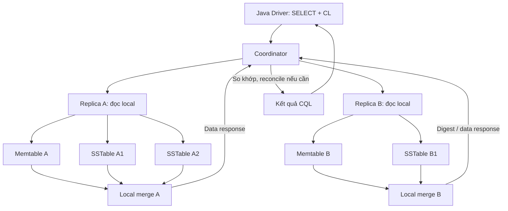
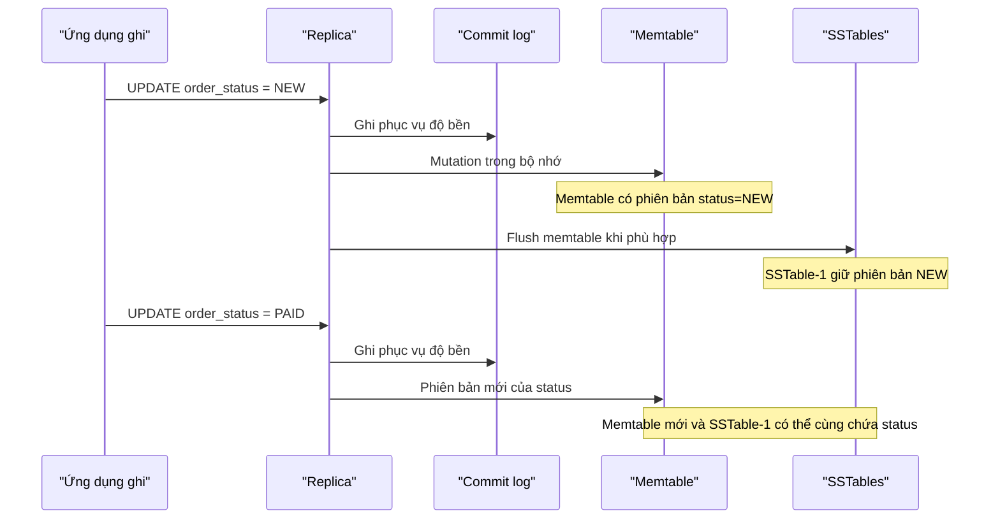
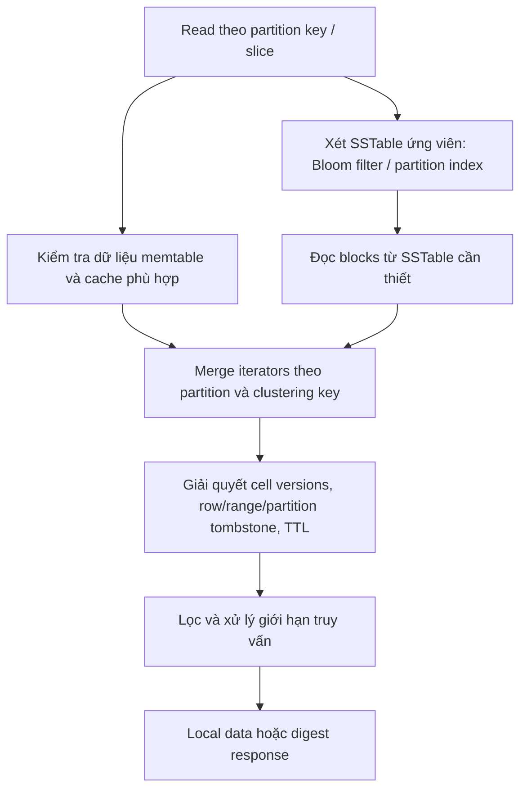
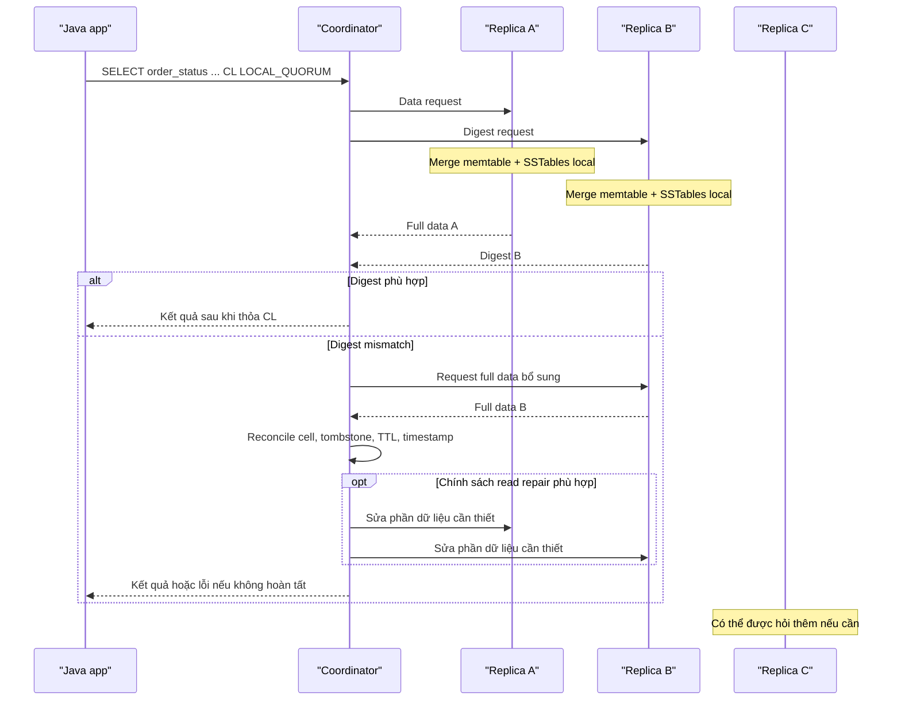

# Hợp nhất các phiên bản từ memtable/SSTable và các bản sao

## 1. Một hàng có thể tồn tại ở nhiều nơi, vì sao kết quả SELECT vẫn chỉ là một?

Apache Cassandra dùng mô hình lưu trữ kiểu **LSM-tree (Log-Structured Merge-Tree)**. Trên một node, một partition có thể có dữ liệu mới ở **memtable**, trong khi các phiên bản cũ của cùng cell còn nằm ở nhiều **SSTable** bất biến trên đĩa. Trên toàn cluster, partition đó lại được sao chép tới nhiều **replica** theo replication strategy của keyspace.

Vì vậy, kết quả của một lệnh `SELECT` không đơn giản là “lấy nguyên hàng từ một file”. Cassandra phải giải quyết **hai tầng hợp nhất**:

1. **Hợp nhất cục bộ (local merge):** mỗi replica đọc những phần liên quan của memtable và SSTables, kết hợp phiên bản cell, tombstone và TTL để tạo kết quả đọc tại node đó.
2. **Đối soát giữa replica (distributed reconciliation):** khi consistency level (CL) yêu cầu nhiều replica và phát hiện kết quả khác nhau, coordinator có thể lấy dữ liệu từ các replica liên quan, chọn phiên bản hợp lệ rồi thực hiện read repair theo cơ chế/phần cấu hình phù hợp.

Trong chương **Đường đọc và bộ đệm** của module `DATABASE_ENGINE_WIDE_COLUMN_CASSANDRA`, bài này kết nối cách thiết kế bảng theo truy vấn, partition key, replication/consistency, cache, compaction, repair, xử lý lỗi và tích hợp Java Driver.

Sau khi học, bạn cần giải thích được:

- Vì sao ghi mới vào memtable không bắt buộc phải ghi đè SSTable cũ.
- Điều gì quyết định giá trị thắng khi có nhiều phiên bản của một cell.
- Tombstone, TTL, row/range deletion ảnh hưởng đến việc đọc như thế nào.
- Khác biệt giữa hợp nhất local với reconciliation giữa các replica.
- Vì sao compaction và anti-entropy repair không cùng chức năng với một request đọc.
- Cách kiểm chứng bằng CQL `WRITETIME`, `TTL`, tracing và Java Driver.

> **Cốt lõi:** Cassandra có thể giữ nhiều biểu diễn vật lý của cùng dữ liệu nhưng trả về một **logical view** sau khi áp dụng các quy tắc về timestamp, xóa và hết hạn. Cùng schema không bảo đảm mọi replica đã có cùng phiên bản dữ liệu.

## 2. Tổng quan hai tầng hợp nhất



Sơ đồ là mô hình logic. Thứ tự truy cập cache, memtable và SSTable; số data/digest requests; cũng như số replica thật sự được hỏi phụ thuộc phiên bản Cassandra, loại truy vấn và CL. Nó **không** có nghĩa Cassandra luôn đọc tất cả SSTables hoặc luôn hỏi đúng hai replica.

| Câu hỏi | Hợp nhất cục bộ tại một replica | Đối soát giữa replica |
| --- | --- | --- |
| Nguồn phiên bản | Memtable, SSTables, tombstones của **một node** | Kết quả/phiên bản từ **các node khác nhau** |
| Bên thực hiện | Read path của replica | Coordinator/resolver và các replica liên quan |
| Đầu vào | Partition key, clustering range, dữ liệu local | Full-data/digest responses, CL, kết quả đọc local |
| Khi nào cần? | Khi đọc dữ liệu local có thể có nhiều phiên bản | Khi request liên quan nhiều replica; đặc biệt khi có mismatch |
| Kết quả | Logical view tại replica | Logical view hợp lệ từ các replica được đối soát |
| Liên quan compaction/repair | Compaction làm giảm phiên bản vật lý theo quy tắc | Read repair/anti-entropy repair giải quyết khác biệt giữa replica |

**Không nhầm:** một node có thể hợp nhất local hoàn toàn chính xác nhưng vẫn **chưa biết** lần ghi mới chỉ có tại replica khác.

## 3. Ghi vào memtable, flush thành SSTable và vì sao phiên bản chồng lấn

Một lần ghi Cassandra thường đi qua commit log và memtable; dữ liệu trong memtable sau đó được **flush** thành SSTable bất biến. Những lần ghi sau cho cùng partition/cell không nhất thiết sửa SSTable cũ: chúng có thể tạo phiên bản mới trong memtable hoặc SSTable khác.



### Ba điểm cần phân biệt

1. **Commit log không phải nguồn mà read path quét cho mỗi `SELECT`.** Nó phục vụ khả năng khôi phục mutation sau sự cố; dữ liệu đọc bình thường đến từ memtable/SSTable/cache.
2. **SSTable là bất biến:** một ghi mới không cần mở SSTable cũ để sửa cell ngay tại chỗ. Cơ chế LSM hỗ trợ write throughput cao nhưng có thể làm tăng **read amplification** khi phải xem nhiều SSTable.
3. **Flush không phải compaction:** flush ghi memtable thành SSTable; compaction đọc và tổ chức lại các SSTable theo quy tắc để giảm số file/phiên bản cần xử lý. Cả hai khác anti-entropy repair giữa các replica.

### Ví dụ nhiều phiên bản vật lý trên cùng node

Giả sử cột `order_status` của cùng một primary key xuất hiện như sau:

| Nguồn local | Phiên bản lưu | Timestamp logic |
| --- | --- | ---: |
| SSTable-01 | `'NEW'` | 100 |
| SSTable-02 | `'PROCESSING'` | 130 |
| Memtable hiện tại | `'PAID'` | 160 |

Trong tình huống **không có tombstone hoặc phiên bản khác chi phối**, logical read trả `'PAID'`. Cassandra có thể vẫn lưu ba biểu diễn vật lý trước compaction; SELECT không trả ba hàng chỉ vì một cell có ba phiên bản.

Timestamp 100/130/160 trong ví dụ là số **tượng trưng**. Timestamp CQL thực thường ở đơn vị microsecond từ Unix epoch.

## 4. Hợp nhất local khi replica thực hiện read

Khi nhận data request hoặc digest request, replica tìm dữ liệu của partition qua các thành phần phù hợp của read path. Nó có thể xét:

- **Memtable:** dữ liệu chưa flush, có thể chứa mutation mới.
- **Row cache** nếu được bật và có hit thích hợp; hiệu lực/đối tượng cache tùy cấu hình.
- **Bloom filters** của SSTable: loại file chắc chắn không có partition key; filter có thể false positive nhưng không được loại bỏ key có thật.
- **Partition summary/index và các cấu trúc chỉ mục:** định vị partition/khối dữ liệu cần đọc.
- **SSTable data blocks:** đọc, giải nén và lấy cell/row/range liên quan.
- **Tombstones, TTL và giới hạn truy vấn:** xác định dữ liệu nào còn hiển thị.



Sơ đồ mô tả **thành phần và trách nhiệm**, không khẳng định một thứ tự code nội bộ cố định trong mọi phiên bản. Cassandra có thể tối ưu bằng cách không đọc một số SSTable nếu metadata/index/filter đủ để bỏ qua chúng.

### Merge theo khóa và clustering order

Một bảng có `PRIMARY KEY ((customer_id, order_month), created_at, order_id)`. Các nguồn vật lý chứa những mẩu của cùng partition; khi đọc, Cassandra phải hợp nhất chúng theo:

- **Partition key:** `(customer_id, order_month)` xác định logical partition.
- **Clustering columns:** `created_at` và `order_id` xác định thứ tự và logical row bên trong partition.
- **Tên cột và metadata cell:** xác định phiên bản thuộc cùng cell hay các cell khác nhau.
- **Tombstone/TTL/timestamp:** quyết định cell còn hiệu lực và phiên bản nào được trả.

Clustering order ảnh hưởng cách sắp xếp khi đọc, **không** phải quy tắc “row nào được ghi cuối sẽ đứng đầu” hoặc “SSTable mới hơn luôn thắng”.

## 5. Last-write-wins theo cell: timestamp nào quyết định?

Trong Cassandra, mutation thông thường có **write timestamp**; khi có phiên bản cạnh tranh của một cell, quy tắc reconcile thường ưu tiên phiên bản có timestamp lớn hơn, đồng thời xét dấu xóa và các trường hợp đặc biệt.

Ví dụ cùng một logical row:

| Cell | Phiên bản tại SSTable | Phiên bản tại memtable | Kết quả có thể thấy |
| --- | --- | --- | --- |
| `order_status` | `'NEW'`, ts 100 | `'PAID'`, ts 140 | `'PAID'` |
| `total_amount` | `150000`, ts 110 | `120000`, ts 105 | `150000` vẫn có timestamp lớn hơn |
| `delivery_note` | `'Gate A'`, ts 120 | Không có cell đó | `'Gate A'` |

**Điều rất quan trọng:** một mutation được gửi **sau** nhưng mang timestamp **nhỏ hơn** có thể không thắng giá trị đã lưu. Vì thế “last-write-wins” trong Cassandra là quy tắc về **write timestamp**, không phải chắc chắn về thứ tự các HTTP request đến ứng dụng.

### Cùng hàng không nhất thiết cùng “phiên bản hàng”

Một `UPDATE` chỉ thay `order_status` không làm `total_amount` tự động nhận timestamp mới. Một lần đọc có thể thấy các cell với timestamp khác nhau và có nguồn vật lý khác nhau. Đừng nghĩ Cassandra luôn chọn nguyên một hàng từ SSTable mới nhất rồi bỏ mọi cell khác.

### Timestamp bằng nhau thì sao?

Khi hai mutation có cùng timestamp, Cassandra áp dụng các quy tắc phân xử xác định theo kiểu cell/giá trị và dấu xóa. **Không nên** dựa vào timestamp trùng để biểu diễn thứ tự nghiệp vụ; kết quả không phải “request đến cuối cùng sẽ thắng”. Với nghiệp vụ có cập nhật tranh chấp, hãy thiết kế version, serialization hoặc lightweight transaction (LWT) khi thực sự cần điều kiện chặt chẽ, chấp nhận chi phí tương ứng.

### Những ngoại lệ cần nhớ

- **Counter** dùng cơ chế đặc thù, không diễn giải như một scalar cell bình thường.
- **Collection** và **UDT** (đặc biệt frozen/non-frozen) có cách biểu diễn cell khác nhau; không áp một công thức máy móc cho mọi kiểu.
- **Partition/row/range tombstone** có thể che nhiều cell dù timestamp của từng cell trông như “mới nhất” theo cách nhìn chưa đầy đủ.

## 6. Tombstone: vì sao một giá trị cũ không được “sống lại”?

Tombstone là metadata xóa. Với một cell `delivery_note`:

| Phiên bản vật lý | Timestamp |
| --- | ---: |
| SSTable cũ: `delivery_note='Gate A'` | 100 |
| Memtable: tombstone xóa `delivery_note` | 150 |

Logical read không trả `'Gate A'` vì tombstone mới hơn phủ lên phiên bản cũ. Nếu chỉ xét cell dữ liệu mà quên tombstone, có thể kết luận sai.

### Tombstone có nhiều phạm vi

| Loại | Phạm vi tác động |
| --- | --- |
| **Cell tombstone** | Xóa một giá trị/cell cụ thể |
| **Row deletion** | Xóa logical row phù hợp |
| **Range tombstone** | Xóa một khoảng clustering rows trong partition |
| **Partition deletion** | Xóa phạm vi partition |
| **TTL expiration** | Dữ liệu hết TTL trở thành không còn hiển thị và có semantics xóa/hết hạn |

Với một range tombstone trên `created_at`, ngay cả khi SSTable khác còn chứa nhiều hàng trong khoảng đó, read path phải loại các phiên bản bị tombstone che theo quy tắc timestamp.

### Tombstone không được dọn quá sớm

Cassandra giữ thông tin xóa để replica đã mất kết nối không đưa dữ liệu cũ quay lại. `gc_grace_seconds` liên quan tới điều kiện loại bỏ tombstone khi compaction, nhưng an toàn còn phụ thuộc repair, topology và cách dữ liệu được phân phối. Hạ giá trị này tùy tiện để “giảm tombstone” có thể làm tăng nguy cơ **zombie data** khi replica cũ trở lại.

**Compaction không phải lệnh xóa tức thì:** dữ liệu cũ/tombstone có thể tồn tại vật lý cho đến khi đáp ứng các điều kiện dọn phù hợp; logical read phải tôn trọng chúng trước đó.

## 7. TTL: cùng cell nhưng có hạn sử dụng

TTL (*time-to-live*) cho phép một giá trị có thời hạn. Khi hết hạn, dữ liệu không còn được hiển thị như giá trị sống dù SSTable vẫn có thể chứa biểu diễn vật lý.

Ví dụ:

```sql
UPDATE merge_lab.orders_by_customer_month
USING TTL 120
SET delivery_note = 'Leave at reception'
WHERE customer_id = 11111111-1111-4111-8111-111111111111
  AND order_month = '2026-11-01'
  AND created_at = '2026-11-21T08:00:00Z'
  AND order_id = aaaaaaaa-aaaa-4aaa-8aaa-aaaaaaaaaaaa;
```

Đối với cột được hỗ trợ, `TTL(delivery_note)` giúp quan sát thời gian sống còn lại; nó thường giảm dần khi thời gian trôi qua. `WRITETIME(delivery_note)` trả về write timestamp tương ứng khi giá trị còn được biểu diễn phù hợp để truy vấn.

**Những điều không nên suy luận:**

- TTL hết không có nghĩa file SSTable được xóa vật lý ngay.
- Việc sửa `default_time_to_live` sau này không tự đặt lại TTL của mọi cell đã ghi trước đó.
- Không thể dựa vào một truy vấn `TTL()` đơn lẻ để kiểm tra toàn bộ retention của mọi hàng.
- TTL kết hợp timestamp do client tự đặt và đồng hồ lệch có thể gây tình huống khó hiểu; phải thử trên đúng phiên bản và chính sách thời gian của cluster.

### TTL và nhiều phiên bản

Một cell có TTL tại SSTable cũ và một phiên bản mới không TTL trong memtable cần được xử lý theo timestamp và metadata từng phiên bản. Không thể đơn giản nói “cột này từng có TTL nên mọi lần ghi về sau đều tự hết hạn cùng thời điểm”.

## 8. Hợp nhất giữa các replica sau local merge

Mỗi replica chỉ biết dữ liệu **local** của mình. Khi coordinator nhận read request, nó xác định natural replicas của partition bằng token và replication strategy, chọn những replica cần thiết theo CL.

Một cách tối ưu thường gặp là lấy **full data** từ một replica và **digest** từ replica khác. Digest là dấu kiểm tra nội dung liên quan tới query; nó không chứa đầy đủ các cell để tự tái dựng kết quả.



Đây là **minh họa**, không phải cam kết tất cả Cassandra versions luôn gửi một data request và một digest request, hoặc luôn thực hiện read repair như sơ đồ. CL, speculative retry, loại truy vấn và chính sách `read_repair` có thể làm các bước khác.

### Ví dụ hai replica đang khác dữ liệu

| Cell | Replica A sau local merge | Replica B sau local merge |
| --- | --- | --- |
| `order_status` | `'PAID'`, ts 200 | `'PROCESSING'`, ts 150 |
| `delivery_note` | `'Gate A'`, ts 210 | `'Gate B'`, ts 220 |
| `cancel_reason` | Tombstone ts 250 | `'Changed mind'`, ts 180 |

Nếu coordinator thu thập đầy đủ các phiên bản cần thiết và không có phiên bản khác chi phối, logical result sau reconcile có thể là `order_status='PAID'`, `delivery_note='Gate B'` và `cancel_reason` không còn hiển thị. **Kết quả không nhất thiết giống nguyên hàng của A hay B.**

### Một read không kiểm tra toàn bộ cluster

Ở RF = 3, read `LOCAL_QUORUM` tại một DC thường cần hai phản hồi local. Replica thứ ba có thể không được hỏi hoặc vẫn thiếu dữ liệu. Digest khớp giữa hai replica tham gia cũng **không chứng minh** chúng đồng nhất với mọi replica còn lại hoặc với mọi partition khác.

## 9. Consistency level quyết định khả năng phát hiện khác biệt thế nào?

Giả sử keyspace có RF = 3 ở một DC và cả ba replica hoạt động:

| Read CL | Phản hồi tối thiểu trong trường hợp cơ bản | Khả năng quan sát khác biệt |
| --- | ---: | --- |
| `ONE` / `LOCAL_ONE` | 1 | Có thể hoàn tất mà không đối chiếu với replica khác |
| `TWO` | 2 | Có cơ hội so khớp dữ liệu giữa hai replica |
| `QUORUM` / `LOCAL_QUORUM` | 2 | Hỏi đa số replica trong phạm vi tương ứng |
| `ALL` | 3 | Yêu cầu mọi replica phù hợp phản hồi; giảm khả năng phục vụ nếu một node chậm/down |

Với replication factor \(RF\), quorum được tính:

\[
Q = \left\lfloor \frac{RF}{2} \right\rfloor + 1.
\]

Khi write và read đều dùng quorum trên cùng tập replica RF = 3, hai tập phản hồi thành công có giao nhau trong những giả thiết chuẩn. Điều này tăng khả năng thấy dữ liệu mới sau một ghi được xác nhận, nhưng **không tự cam kết linearizability** cho các cập nhật đồng thời, timestamp tự đặt, timeout không rõ thành công hay dữ liệu trên nhiều partition.

### Hai DC không dùng chung một định nghĩa LOCAL_QUORUM

Với `NetworkTopologyStrategy` và `dc1:3, dc2:2`:

- `LOCAL_QUORUM` tại `dc1` cần 2/3 replica của `dc1`.
- `LOCAL_QUORUM` tại `dc2` cần 2/2 replica của `dc2`.
- `QUORUM` xét tổng RF = 5, cần 3 phản hồi trong phạm vi phù hợp.

**Điểm cần nhớ:** đọc local quorum ở DC này không chứng minh dữ liệu tại DC khác đã cập nhật ngay, đặc biệt khi hệ thống vừa có sự cố mạng liên DC.

### Read repair theo phiên bản

Từ Cassandra 4.x, table option `read_repair` thường được mô tả qua `BLOCKING` hoặc `NONE`, với đánh đổi giữa tính chất **monotonic quorum reads** và **partition-level write atomicity**. Việc đọc có cần chờ repair hay không phụ thuộc option, phạm vi query và phiên bản. Các đời Cassandra khác có những tùy chọn/hành vi khác; không áp dụng một công thức cho mọi cluster.

**Read repair không thay anti-entropy repair:** các partition hiếm khi được đọc có thể không được phát hiện lệch qua read path. `nodetool repair` (theo quy trình vận hành) và streaming khi thay topology/RF là các hoạt động khác.

## 10. Compaction: hợp nhất vật lý khác với hợp nhất khi SELECT

Giả sử trong nhiều SSTable cùng có dữ liệu của một partition. Một lần `SELECT` cần tạo logical view chính xác **ngay cả khi chưa compaction**. Compaction chủ động gộp/viết lại các SSTable theo chiến lược, giảm các phiên bản vật lý không còn cần thiết khi điều kiện an toàn cho phép.

| Hoạt động | Thực thi | Mục đích chính | Không được nhầm với |
| --- | --- | --- | --- |
| **Read-time local merge** | Khi replica xử lý đọc | Tạo logical result từ memtable/SSTables hiện có | Ghi lại file SSTable mới |
| **Flush** | Khi memtable được flush | Tạo SSTable từ dữ liệu trong bộ nhớ | Đồng bộ replica hoặc repair |
| **Compaction** | Công việc lưu trữ nền | Hợp nhất/tổ chức lại SSTables; xử lý phiên bản, tombstone theo điều kiện | Bảo đảm mọi replica giống nhau |
| **Read repair** | Khi read phát hiện lệch và policy cho phép | Sửa phần dữ liệu trong phạm vi đọc/replica liên quan | Repair toàn dải token |
| **Anti-entropy repair** | Công cụ/quy trình vận hành | Đồng bộ khác biệt giữa replica theo phạm vi kế hoạch | Cache hoặc flush |
| **Streaming** | Khi join/move/đổi topology/RF theo quy trình | Chuyển dữ liệu cần thiết giữa node | Thay đổi schema version |

### Compaction không được tùy ý xóa tombstone

Một tombstone có thể cần tồn tại đủ lâu để replica khác biết về delete. Thời điểm an toàn để loại bỏ phụ thuộc cơ chế Cassandra, phạm vi SSTable liên quan, `gc_grace_seconds` và chiến lược repair. Không xem một lần `nodetool compact` thủ công là phép “giải phóng hết tombstone an toàn”.

### Vì sao SSTable nhiều gây read amplification?

Khi cùng một partition/cell nằm trong nhiều SSTable, replica có thể cần:

1. Kiểm tra metadata/bloom filter của nhiều file.
2. Truy cập partition index và các đoạn dữ liệu phù hợp.
3. Giải nén block khi cần và dựng iterators.
4. Reconcile cell/tombstone/TTL qua các nguồn local.

Compaction tốt thường giảm khối lượng phải xử lý, nhưng chạy compaction cũng dùng CPU, disk I/O và không gian tạm. Chọn STCS, LCS, TWCS hoặc chiến lược được hỗ trợ cần căn cứ **workload và vòng đời dữ liệu**, không mặc định một chiến lược là tốt nhất cho mọi bảng.

## 11. Cache giúp tìm dữ liệu nhanh hơn, không thay quy tắc reconcile

Cassandra có những thành phần cache và bộ lọc hỗ trợ đọc. Hiệu lực và giới hạn tùy phiên bản/config:

| Cơ chế | Tác dụng | Không bảo đảm |
| --- | --- | --- |
| **Key cache** | Lưu thông tin định vị/index partition trong SSTable | Không phải bản sao dữ liệu cell mới nhất |
| **Row cache** | Có thể phục vụ một số nội dung đọc từ cache nếu bật và hit đúng | Không bỏ qua invalidation/quy tắc nhất quán |
| **Bloom filter** | Loại những SSTable chắc chắn không chứa partition key | Không phải cache của dữ liệu; có false positive |
| **OS page cache** | Giảm truy cập đĩa khi block còn trong bộ nhớ hệ điều hành | Không thay đổi timestamp hay chọn replica |
| **Memtable** | Giữ mutation trước flush và tham gia read | Không phải dữ liệu từ toàn bộ replica |

**Cache hit không tạo ra consistency level mới.** Coordinator vẫn phải đạt CL; một replica trả dữ liệu nhanh từ cache không được “vượt qua” tombstone/TTL hoặc trở thành nguồn đúng tuyệt đối khi replica khác có phiên bản mới.

### Khi nào cần nghi vấn cache?

Nếu read latency giảm mạnh sau một đợt warm-up, page cache/key cache/row cache có thể góp phần. Tuy nhiên, nếu mismatch, tombstone hoặc partition hot vẫn tồn tại, chỉ tăng cache không chắc sửa được nguyên nhân gốc. Khi benchmark, ghi rõ cold/warm cache, concurrency, CL, RF và trạng thái compaction.

## 12. Lab CQL: quan sát timestamp thắng trên một logical row

Lab này **không cần làm lệch replica** và không yêu cầu thao tác trực tiếp SSTable. Chỉ dùng keyspace thử nghiệm `merge_lab` và bản ghi giả, trên cluster một node DC tên `datacenter1`. Nếu tên DC khác, thay chính xác theo `nodetool status`. RF = 1 chỉ phục vụ lab một node.

### Bước 1 — Xác minh DC

```bash
nodetool status
```

### Bước 2 — Tạo keyspace và bảng theo truy vấn

```sql
CREATE KEYSPACE IF NOT EXISTS merge_lab
WITH replication = {
    'class': 'NetworkTopologyStrategy',
    'datacenter1': '1'
}
AND durable_writes = true;

CREATE TABLE IF NOT EXISTS merge_lab.orders_by_customer_month (
    customer_id uuid,
    order_month date,
    created_at timestamp,
    order_id uuid,
    order_status text,
    total_amount decimal,
    delivery_note text,
    PRIMARY KEY ((customer_id, order_month), created_at, order_id)
) WITH CLUSTERING ORDER BY (created_at DESC, order_id ASC)
  AND default_time_to_live = 0
  AND comment = 'Lab: reading multiple cell versions';
```

Nếu keyspace/bảng đã tồn tại, `IF NOT EXISTS` **không** kiểm tra lại định nghĩa. Hãy đối chiếu schema lab trước khi dùng; không ghi lên dữ liệu người khác.

### Bước 3 — Kiểm tra khóa trước khi đọc/ghi

```sql
SELECT keyspace_name, replication
FROM system_schema.keyspaces
WHERE keyspace_name = 'merge_lab';

SELECT column_name, kind, position, type, clustering_order
FROM system_schema.columns
WHERE keyspace_name = 'merge_lab'
  AND table_name = 'orders_by_customer_month';
```

Phải thấy `customer_id` và `order_month` là thành phần partition key, `created_at` và `order_id` là clustering columns. Truy vấn theo `customer_id` **mà thiếu `order_month`** không tự tương đương truy vấn một partition.

### Bước 4 — Tạo một hàng dữ liệu giả

```sql
INSERT INTO merge_lab.orders_by_customer_month (
    customer_id, order_month, created_at, order_id, total_amount
) VALUES (
    11111111-1111-4111-8111-111111111111,
    '2026-11-01',
    '2026-11-21T08:00:00Z',
    aaaaaaaa-aaaa-4aaa-8aaa-aaaaaaaaaaaa,
    150000.00
);
```

Lúc này `order_status` chưa có giá trị. Các lệnh sau dùng `USING TIMESTAMP` để quan sát quy tắc ưu tiên **ở đúng một cell**, không nhằm mô phỏng mọi chi tiết tạo/flush SSTable.

### Bước 5 — Ghi ba phiên bản với timestamp có chủ đích

```sql
-- Giá trị đầu tiên, timestamp thấp.
UPDATE merge_lab.orders_by_customer_month
USING TIMESTAMP 1760000000000000
SET order_status = 'NEW'
WHERE customer_id = 11111111-1111-4111-8111-111111111111
  AND order_month = '2026-11-01'
  AND created_at = '2026-11-21T08:00:00Z'
  AND order_id = aaaaaaaa-aaaa-4aaa-8aaa-aaaaaaaaaaaa;

-- Phiên bản có timestamp lớn hơn.
UPDATE merge_lab.orders_by_customer_month
USING TIMESTAMP 1760000001000000
SET order_status = 'PAID'
WHERE customer_id = 11111111-1111-4111-8111-111111111111
  AND order_month = '2026-11-01'
  AND created_at = '2026-11-21T08:00:00Z'
  AND order_id = aaaaaaaa-aaaa-4aaa-8aaa-aaaaaaaaaaaa;

-- Gửi sau nhưng timestamp nằm giữa hai giá trị trên.
UPDATE merge_lab.orders_by_customer_month
USING TIMESTAMP 1760000000500000
SET order_status = 'PROCESSING'
WHERE customer_id = 11111111-1111-4111-8111-111111111111
  AND order_month = '2026-11-01'
  AND created_at = '2026-11-21T08:00:00Z'
  AND order_id = aaaaaaaa-aaaa-4aaa-8aaa-aaaaaaaaaaaa;
```

**Kỳ vọng:** `order_status='PAID'` thắng vì timestamp `1760000001000000` lớn nhất, dù mutation `'PROCESSING'` được gửi sau.

Timestamp đặt tay ở đây chỉ để thực hành trên dữ liệu giả, không phải khuyến nghị đặt timestamp ứng dụng production. Trong hệ thống thật, timestamp tự đặt cần chính sách nhất quán để tránh clock skew, ghi đè ngược và dữ liệu khó khôi phục.

### Bước 6 — Kiểm tra giá trị và write timestamp

```sql
SELECT created_at, order_id,
       order_status, WRITETIME(order_status) AS status_ts,
       total_amount
FROM merge_lab.orders_by_customer_month
WHERE customer_id = 11111111-1111-4111-8111-111111111111
  AND order_month = '2026-11-01';
```

`WRITETIME(order_status)` cho thấy write timestamp của cell được trả về, trong trường hợp kiểu cột/lệnh được hỗ trợ. Chỉ nhìn giá trị `'PAID'` chưa đủ hiểu vì sao nó thắng; timestamp giúp kiểm chứng giả thiết.

**Giới hạn của lab:** không thực hiện `nodetool flush` hoặc `compact`, nên không có bằng chứng rằng ba mutation thực sự nằm ở **ba SSTable khác nhau**. Bài thử chứng minh **quy tắc chọn phiên bản logic**, không phải số file SSTable trên đĩa.

### Bước 7 — Quan sát TTL trên một cột khác

```sql
UPDATE merge_lab.orders_by_customer_month
USING TTL 120
SET delivery_note = 'Reception'
WHERE customer_id = 11111111-1111-4111-8111-111111111111
  AND order_month = '2026-11-01'
  AND created_at = '2026-11-21T08:00:00Z'
  AND order_id = aaaaaaaa-aaaa-4aaa-8aaa-aaaaaaaaaaaa;

SELECT delivery_note, TTL(delivery_note) AS remaining_seconds,
       WRITETIME(delivery_note) AS note_ts
FROM merge_lab.orders_by_customer_month
WHERE customer_id = 11111111-1111-4111-8111-111111111111
  AND order_month = '2026-11-01';
```

Khi TTL hết, `delivery_note` không còn được hiển thị như giá trị sống. Kết quả `TTL()` phụ thuộc thời điểm query; đừng cố khẳng định nó chính xác bằng 120 sau một khoảng chờ. `order_status` vẫn có quy tắc riêng vì không được đặt TTL trong lệnh trên.

### Bước 8 — Kiểm tra đường đọc với tracing (tùy chọn)

```sql
TRACING ON;

SELECT created_at, order_id, order_status
FROM merge_lab.orders_by_customer_month
WHERE customer_id = 11111111-1111-4111-8111-111111111111
  AND order_month = '2026-11-01'
LIMIT 10;

TRACING OFF;
```

`TRACING` là lệnh tiện ích của `cqlsh`. Trace có thể cho thấy coordinator và các bước đọc theo phiên bản Cassandra, nhưng **không bắt buộc** hiển thị mọi lần local merge hoặc số SSTable đã xem. Với RF = 1, không thể dùng lab này để suy ra hành vi digest mismatch giữa ba replica.

### Bước 9 — Dọn lab có kiểm soát

```sql
-- CẢNH BÁO: chỉ dùng khi merge_lab là keyspace lab có thể xóa hoàn toàn.
DROP KEYSPACE IF EXISTS merge_lab;
```

`DROP KEYSPACE` xóa toàn bộ schema và dữ liệu trong keyspace. Không dùng trên keyspace production hay dữ liệu của người khác.

## 13. Khi cần quan sát nhiều replica thực sự

Để kiểm chứng distributed reconciliation, cần một **cluster lab nhiều node** với replication strategy/RF phù hợp. Ví dụ RF = 3 tại DC `dc1` đòi hỏi đủ replica/node hoạt động:

```sql
-- MẪU riêng cho lab ba node trở lên ở dc1.
-- Không chạy nếu cluster không có topology phù hợp.
CREATE KEYSPACE IF NOT EXISTS merge_lab_multi
WITH replication = {
    'class': 'NetworkTopologyStrategy',
    'dc1': '3'
};
```

Sau khi tạo bảng, ghi dữ liệu giả và chờ schema agreement:

```bash
nodetool status
nodetool describecluster
```

Trong `cqlsh`, có thể so sánh các request:

```sql
CONSISTENCY LOCAL_ONE;
-- SELECT ... theo đầy đủ partition key của bảng lab nhiều node.

CONSISTENCY LOCAL_QUORUM;
-- SELECT ... cùng partition key.
```

Hai CL có thể trả **cùng** kết quả khi cluster khỏe; không xem đây là sự thất bại của bài thử. **Không cố tình tắt node, sửa SSTable hoặc gây mất đồng bộ replica** trên cluster đang dùng chung chỉ để tạo digest mismatch. Khi cần nghiên cứu lỗi sâu, sử dụng môi trường cô lập, giả lập có kiểm soát và công cụ quan sát của phiên bản đang dùng.

### Vì sao không dùng `nodetool repair` như một cách “tạo lỗi”?

Repair là công cụ đồng bộ dữ liệu, không phải phép tạo phiên bản mâu thuẫn. Nó còn có chi phí I/O/network và ràng buộc topology/phiên bản. Chỉ chạy theo runbook phù hợp khi có mục tiêu vận hành rõ, không dùng như thao tác demo vô căn cứ.

## 14. Java Driver 4.x: đọc và quan sát timestamp/CL

Ví dụ Cassandra Java Driver 4.x, Java 15+ (text block). Giả sử `CqlSession session` đã được tạo, đúng cluster/keyspace, và bảng `merge_lab.orders_by_customer_month` đã có dữ liệu.

```java
import com.datastax.oss.driver.api.core.CqlSession;
import com.datastax.oss.driver.api.core.DefaultConsistencyLevel;
import com.datastax.oss.driver.api.core.cql.BoundStatement;
import com.datastax.oss.driver.api.core.cql.PreparedStatement;
import com.datastax.oss.driver.api.core.cql.Row;

import java.time.LocalDate;
import java.util.UUID;

// session được khởi tạo, cấu hình local DC và quản lý ở bên ngoài.
PreparedStatement select = session.prepare("""
    SELECT created_at, order_id, order_status,
           WRITETIME(order_status) AS status_ts
    FROM merge_lab.orders_by_customer_month
    WHERE customer_id = ? AND order_month = ?
    """);

UUID customerId =
    UUID.fromString("11111111-1111-4111-8111-111111111111");
LocalDate month = LocalDate.of(2026, 11, 1);

BoundStatement bound = select.bind(customerId, month)
    .setConsistencyLevel(DefaultConsistencyLevel.LOCAL_ONE);

for (Row row : session.execute(bound)) {
    String status = row.getString("order_status");
    Long writeTs = row.isNull("status_ts")
        ? null : row.getLong("status_ts");
    System.out.println(status + " (ts=" + writeTs + ")");
}
```

Với lab RF = 1, `LOCAL_ONE` phù hợp mục đích kiểm tra logic cell; **không thể dùng nó để chứng minh so khớp dữ liệu giữa ba replica**. Trong cluster nhiều node production, CL phải được chọn theo RF/DC, yêu cầu độ tươi dữ liệu và mục tiêu chịu lỗi thực tế.

### Điều Driver thấy và không thấy

- Driver nhận **kết quả CQL sau xử lý**, không nhận các bản sao SSTable hoặc từng digest thô để tự merge.
- `WRITETIME()` có thể giúp chẩn đoán scalar cell được hỗ trợ, nhưng không cho thấy mọi phiên bản cũ bị che bởi tombstone.
- Một `SELECT` qua coordinator không chứng minh mọi replica đã nhất quán.
- Dùng prepared statement và bind đầy đủ partition key để driver có thể routing hiệu quả khi có điều kiện phù hợp.
- Giới hạn page size, retry, timeout và trace; không retry vô hạn khi hệ thống có vấn đề compaction hoặc replica down.
- Không cho ứng dụng tự chạy `flush`, `compact` hoặc `repair` mỗi khi đọc một giá trị cũ: các thao tác đó cần quy trình vận hành riêng.

## 15. Hiệu năng: vì sao read bị chậm dù kết quả chỉ một hàng?

Đọc một logical row có thể cần xem nhiều phiên bản vật lý. Các yếu tố làm tăng độ trễ:

| Hiện tượng | Hệ quả trong read path | Cách điều tra |
| --- | --- | --- |
| Nhiều SSTable cùng chứa partition | Nhiều kiểm tra, I/O và merge iterators | `nodetool tablestats`, compaction metrics |
| Tombstone/range deletion dày | Phải xử lý nhiều cell/hàng bị xóa | Tombstone warnings, tracing, query shape, retention |
| Partition quá lớn/hot | Read slice lớn, CPU và I/O tập trung | Partition key/cardinality, latency p95/p99 |
| TTL hàng loạt hết hạn | Nhiều dữ liệu không còn hiển thị nhưng vẫn cần xử lý | TTL policy, TWCS/compaction khi phù hợp |
| Digest mismatch giữa replica | Thêm full-data read, reconcile và có thể repair | Read repair metrics, RF/CL, node history |
| Speculative retry | Tăng request đọc để giảm tail latency | Speculative metrics, CPU/network tải tăng |
| Cache miss / disk chậm | Tốn I/O local và giải nén | Cache hit rate, disk metrics, GC/heap |
| Node thiếu dữ liệu sau thay RF/DC | Read có thể khác theo replica/CL | Streaming/anti-entropy repair, topology |

### Một query có `LIMIT 10` vẫn có thể tốn nhiều việc

Nếu các hàng đầu bị tombstone hoặc TTL loại bỏ, Cassandra có thể phải đọc thêm hàng ứng viên để cung cấp đủ kết quả hợp lệ. Khi các replica không giống nhau, **short-read protection** còn có thể phát thêm request để bù các hàng bị loại sau reconcile. `LIMIT` giới hạn số hàng trả về, **không** bảo đảm chỉ phải đọc đúng 10 cell từ đĩa.

### Giảm read amplification đúng cách

1. Thiết kế **partition key và bucket** theo query để partition không tăng vô hạn.
2. Giới hạn clustering slice và lượng dữ liệu lấy, không quét toàn bảng nếu tránh được.
3. Chọn TTL/retention và compaction strategy theo vòng đời dữ liệu, kiểm tra tombstone.
4. Theo dõi số SSTable, disk I/O, compaction backlog và tình trạng GC.
5. Kiểm tra RF, CL và read repair/anti-entropy repair khi có chênh lệch replica.
6. Chỉ điều chỉnh cache, speculative retry, timeout sau khi có đo đạc đủ.

Không hạ CL từ `LOCAL_QUORUM` xuống `ONE` chỉ để che một replica chậm nếu nghiệp vụ yêu cầu phản hồi quorum.

## 16. Bài tập, tình huống lỗi và checklist

### Bài tập A — Local merge với timestamp ngược thứ tự gửi

Một SSTable giữ `price = 200`, timestamp 300. Memtable nhận `price = 150`, timestamp 250. Không có tombstone/phiên bản khác. `SELECT price` nên thấy gì?

**Đáp án:** `200`, vì phiên bản timestamp 300 thắng dù mutation ts 250 được nhận sau.

### Bài tập B — Hợp nhất theo cell, không theo nguyên hàng

Replica A có `status='PAID'` ts 160 và `note='Gate A'` ts 120. B có `status='NEW'` ts 90 và `note='Gate B'` ts 180. Sau reconciliation phù hợp, kết quả có thể là gì?

**Đáp án:** `status='PAID'` từ A và `note='Gate B'` từ B. Không có quy tắc lấy nguyên hàng từ một replica.

### Bài tập C — Tombstone thắng dữ liệu cũ

SSTable chứa `delivery_note='Reception'` ts 100, memtable có cell tombstone ts 200. Sau local merge, giá trị cũ có xuất hiện không?

**Đáp án:** Không, vì tombstone mới hơn che phiên bản cũ trong phạm vi tương ứng. Điều này vẫn đúng trước khi compaction loại bỏ dữ liệu cũ về mặt vật lý.

### Bài tập D — Cache và CL

Replica A có row-cache hit, B có cache miss; request dùng `LOCAL_QUORUM` RF = 3. A trả nhanh có đủ điều kiện cho client thành công ngay không?

**Đáp án:** Không. Coordinator vẫn cần đủ phản hồi theo CL; tốc độ cache của A không thay số replica cần xác nhận.

### Bài tập E — Compaction so với repair

Một node đã compaction xong tất cả SSTables nhưng replica B vẫn thiếu một lần ghi trước đó. Có thể kết luận dữ liệu hai node đồng bộ không?

**Đáp án:** Không. Compaction tổ chức dữ liệu **trong một node**; để xử lý khác biệt **giữa các replica** cần cơ chế đọc/reconcile/read repair hoặc anti-entropy repair phù hợp.

### Bài tập F — Giới hạn của thí nghiệm `USING TIMESTAMP`

Sau ba lệnh `UPDATE` trong lab, `WRITETIME(order_status)` trả timestamp lớn nhất. Có thể kết luận Cassandra đã tạo ba SSTables và compaction gộp chúng chưa?

**Đáp án:** Không. Lab chỉ chứng minh lựa chọn phiên bản logic theo timestamp; vị trí vật lý memtable/SSTable phụ thuộc flush/compaction và cần công cụ quan sát khác nếu muốn nghiên cứu.

### Checklist chẩn đoán

| Câu hỏi | Bằng chứng phù hợp |
| --- | --- |
| Query có đầy đủ partition key và clustering range? | CQL, `PRIMARY KEY`, dữ liệu mẫu |
| Có nhiều phiên bản local cùng cell? | `WRITETIME`, lịch ghi, SSTable/compaction metrics; không suy ra chỉ từ giá trị |
| Tombstone/TTL có che giá trị không? | `TTL`, chính sách xóa, tombstone metrics |
| Có nhiều SSTables cần merge? | `tablestats`, compaction backlog, disk I/O |
| Replica khác nhau ở phạm vi đọc không? | Digest mismatch/read repair metrics, tracing có chọn lọc |
| CL đọc và ghi có phù hợp RF/DC? | `system_schema.keyspaces`, driver config, topology |
| Có replica down/chưa repair sau đổi RF/DC? | `nodetool status`, streaming/repair runbook |
| Cache hoặc speculative retry làm che triệu chứng? | Cache hit rate, speculative requests, p95/p99 |
| Java đang tự đặt write timestamp/TTL không? | Code, mapper, prepared statement, log nghiệp vụ |
| Đã xác minh sau sửa? | Kết quả truy vấn theo partition, latency, errors, repair metrics |

**Ghi nhớ:** khi đọc Cassandra, mỗi replica có thể cần **hợp nhất cục bộ** nhiều phiên bản từ memtable và SSTables, tuân theo timestamp, tombstone và TTL. Coordinator có thể cần **đối soát giữa các replica** để đạt mức nhất quán của request; digest, read repair và anti-entropy repair có phạm vi/chức năng khác nhau. Compaction làm thay đổi bố trí vật lý, không thay thế repair; cache tăng tốc truy cập, không thay quy tắc lựa chọn phiên bản. Hiểu đúng hai tầng hợp nhất giúp thiết kế partition key, chọn CL và xử lý read latency hoặc dữ liệu cũ trong ứng dụng Java một cách có căn cứ.
