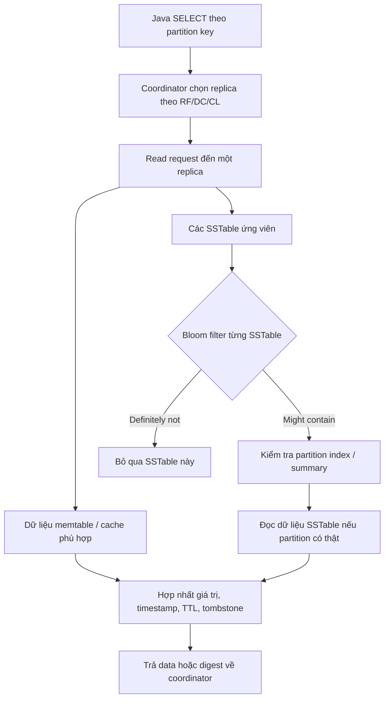
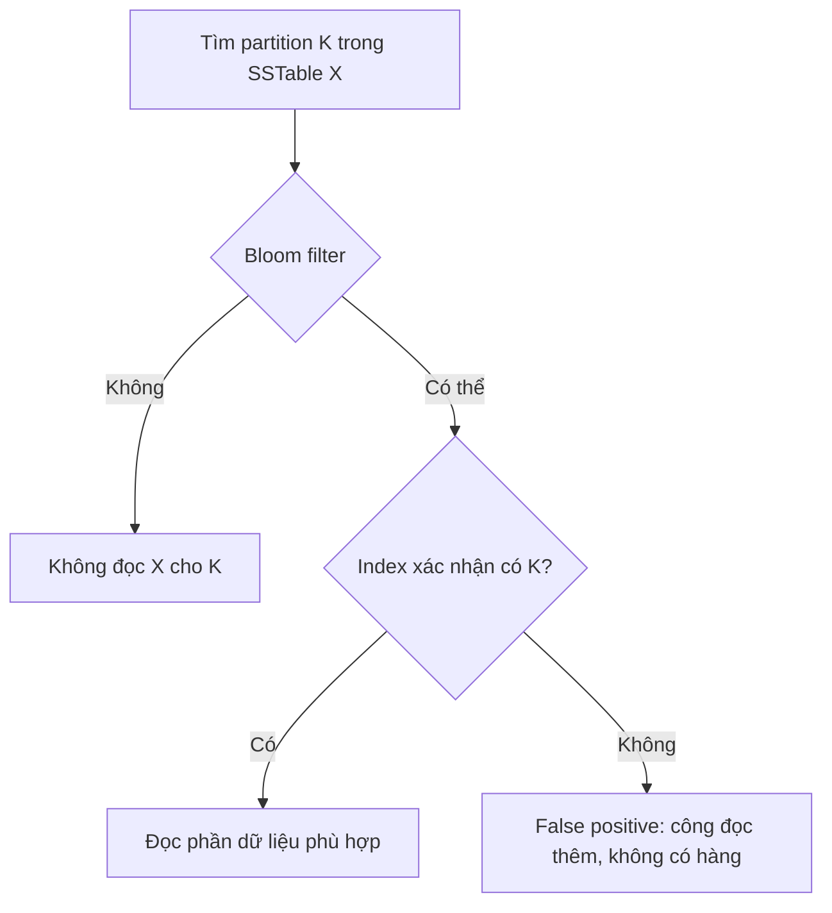
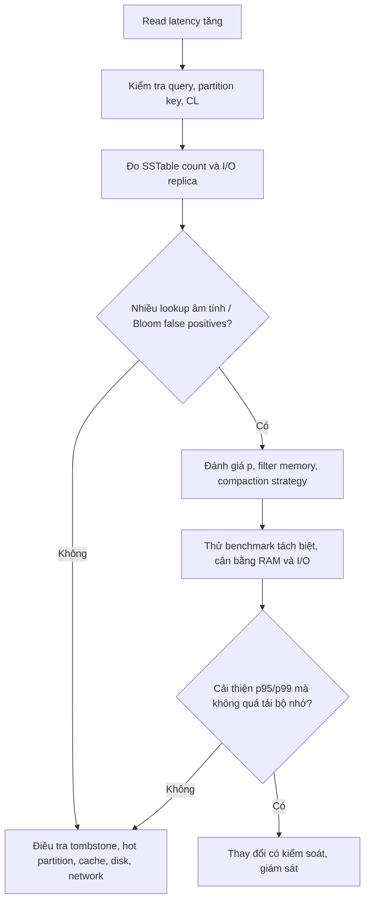

# Bloom filter và ý nghĩa có thể dương tính giả

## 1. Vấn đề: một partition có thể nằm trong nhiều SSTable

Apache Cassandra sử dụng cơ chế lưu trữ gần với **LSM-tree**: mutation được ghi vào memtable và các SSTable bất biến được tạo ra khi flush. Theo thời gian, một node có thể lưu nhiều SSTable, trong đó chỉ một vài file có dữ liệu của partition mà ứng dụng đang hỏi.

Ví dụ dịch vụ Java cần đọc một sự kiện từ bảng `sensor_events_by_day`:

```sql
SELECT event_time, event_id, reading
FROM telemetry.sensor_events_by_day
WHERE sensor_id = 'sensor-01'
  AND event_day = '2026-11-21'
LIMIT 20;
```

Partition key của bảng được giả định là `(sensor_id, event_day)`. Khi request đến một replica, node cần xác định SSTable nào **có khả năng** chứa partition đó. Đọc chỉ mục của mọi file, chưa kể dữ liệu thật, có thể gây rất nhiều I/O.

**Bloom filter** giải quyết một phần bài toán này: là cấu trúc kiểm tra thành viên xác suất, nó giúp Cassandra **loại nhanh** những SSTable chắc chắn không chứa partition key đang tìm. Đổi lại, đôi khi bộ lọc thông báo “có thể có” đối với một partition thực sự không tồn tại trong file. Hiện tượng đó gọi là **dương tính giả (*false positive*)**.

Trong chương **Đường đọc và bộ đệm** của module `DATABASE_ENGINE_WIDE_COLUMN_CASSANDRA`, chủ đề này nối đường đọc tại replica với thiết kế partition key, replication, CL, compaction, repair, theo dõi hiệu năng và Java Driver.

**Sau khi học, bạn cần biết:**

1. Bloom filter kiểm tra khóa nào, được sử dụng ở đâu trong đường đọc.
2. Cách bit array và hàm băm tạo ra kết quả “chắc chắn không” hoặc “có thể có”.
3. Vì sao dương tính giả **không** đồng nghĩa Cassandra trả thêm hàng không tồn tại.
4. Tác động của tỷ lệ dương tính giả đến read amplification, CPU, bộ nhớ và I/O.
5. Cách đọc option `bloom_filter_fp_chance` và chỉ số `nodetool tablestats`.
6. Cách xây dựng một phép thử và đánh giá thay đổi cấu hình mà không gây hại cluster.

> **Kết luận nền tảng:** Bloom filter là công cụ tối ưu truy cập SSTable, **không** phải nguồn dữ liệu, không phải index nghiệp vụ và không thay thế consistency level.

## 2. Bloom filter nằm ở đâu trong đường đọc Cassandra?

Một truy vấn Cassandra đi qua hai tầng:

1. **Tầng cluster:** driver chọn coordinator; coordinator xác định natural replicas theo token của partition key và replication strategy; số phản hồi cần thiết chịu ảnh hưởng của CL.
2. **Tầng replica:** mỗi replica được hỏi phải tìm dữ liệu local trong memtable, cache, SSTable rồi hợp nhất phiên bản, tombstone và TTL. Bloom filter hỗ trợ **lựa chọn SSTable cần kiểm tra** ở tầng này.



Sơ đồ chỉ mô tả các thành phần và vai trò; trong các phiên bản Cassandra, cache, SSTable metadata và các cơ chế tối ưu khác có thể làm thứ tự xử lý thực tế khác nhau. Không suy ra rằng mọi lần đọc luôn chạm đĩa hoặc kiểm tra mọi SSTable.

### Bloom filter được gắn với đối tượng nào?

Trong read path SSTable truyền thống của Cassandra, Bloom filter được xây dựng cho **các partition key có trong một SSTable**, không phải:

- Một Bloom filter duy nhất cho toàn bộ cluster.
- Một Bloom filter để chọn node nào là replica.
- Một index chứa mọi cột hoặc giá trị `reading`.
- Một bộ lọc riêng cho mọi hàng clustering trong partition.
- Một cơ chế xác minh dữ liệu đã được repair giữa các replica.

Khi truy vấn cung cấp partition key tổng hợp, ví dụ `(sensor_id, event_day)`, Cassandra xét **khóa phân vùng đã được mã hóa**; nó không kiểm tra riêng từng chuỗi `sensor_id` hoặc giá trị `event_day` như hai điều kiện độc lập.

### Một SSTable có thể tồn tại nhiều phiên bản cùng partition?

Một SSTable chứa dữ liệu theo cấu trúc bất biến và được tổ chức theo partition/clustering key. Các mutation vào cùng partition ở thời điểm khác nhau có thể nằm ở **các SSTable khác nhau** hoặc memtable hiện tại. Bloom filter từng SSTable giúp tìm ứng viên; việc hợp nhất phiên bản do phần read path kế tiếp đảm nhận.

## 3. Bloom filter hoạt động bằng bit array và các hàm băm

Về khái niệm, Bloom filter gồm:

- Một **mảng bit** ban đầu bằng 0, có `m` bit.
- `k` phép băm/địa chỉ bit cho mỗi khóa.
- Khi thêm một khóa, đặt `k` vị trí bit tương ứng thành 1.
- Khi tra một khóa, kiểm tra mọi vị trí bit mà các hàm băm của khóa đó xác định.

Không cần lưu nguyên danh sách partition key trong Bloom filter để trả lời phép thử. Các bit của nhiều khóa được chia sẻ nên bộ lọc tiết kiệm bộ nhớ, nhưng chính điều này gây ra dương tính giả.

### Minh họa rất nhỏ

Giả sử có mảng 16 bit và hai vị trí băm cho mỗi partition key:

| Partition key (minh họa) | Vị trí bit cần đánh dấu |
| --- | --- |
| `sensor-01 / 2026-11-21` | 2 và 9 |
| `sensor-02 / 2026-11-21` | 5 và 12 |

Sau khi thêm hai khóa, các bit 2, 5, 9 và 12 bằng 1:

```text
Chỉ số:     0  1  2  3  4  5  6  7  8  9 10 11 12 13 14 15
Bit:        0  0  1  0  0  1  0  0  0  1  0  0  1  0  0  0
```

Giả sử tiếp theo:

- Khóa `sensor-03 / 2026-11-21`, **chưa từng thêm**, băm ra vị trí **2 và 12**. Cả hai đều bằng 1: bộ lọc trả **“có thể có”**, dù khóa không tồn tại. Đây là **false positive**.
- Khóa `sensor-04 / 2026-11-21` băm ra vị trí **3 và 9**. Bit 3 bằng 0: bộ lọc trả **“chắc chắn không có”** trong tập khóa nó đại diện.
- Khóa `sensor-01 / 2026-11-21` băm ra đúng vị trí **2 và 9**, đều bằng 1: đó là một trường hợp **true positive**.

Các vị trí băm ở bảng chỉ là số minh họa, không phải output hàm băm chính thức của Cassandra. Bloom filter thật có kích thước và phương án tính băm thích hợp cho tập partition key của SSTable.

### Giải thích tính bất đối xứng

Nếu một bit cần thiết bằng 0, **khóa chưa được thêm**: một khóa đã thêm phải đặt mọi bit tương ứng bằng 1. Nhưng nếu mọi bit bằng 1, chúng có thể được bật bởi **những khóa khác nhau**. Vì vậy kết quả dương chỉ là “có thể”.

## 4. False positive, true positive và false negative

Đối với **một SSTable** và **một partition key**:

| Sự thật trong SSTable | Kết quả Bloom filter | Tên gọi | Hệ quả |
| --- | --- | --- | --- |
| Có partition key | “Có thể có” | **True positive** | Tiếp tục xác minh vị trí và đọc dữ liệu khi cần |
| Không có partition key | “Chắc chắn không” | **True negative** | Bỏ qua SSTable an toàn |
| Không có partition key | “Có thể có” | **False positive** | Kiểm tra thêm chỉ mục/SSTable rồi biết không có |
| Có partition key | “Chắc chắn không” | **False negative** | **Không xảy ra** với Bloom filter được xây dựng và dùng đúng trong giả thiết bình thường |

### Vì sao false positive không làm sai kết quả SELECT?

Bloom filter chỉ xác định **có nên kiểm tra SSTable tiếp không**. Khi filter trả “có thể có”, Cassandra vẫn dùng partition index, dữ liệu SSTable và các bước xác minh thực sự để biết partition tồn tại hay không. Nếu không có, nó không tự tạo ra một row.



**Không nhầm với “đọc dữ liệu cũ”:** Một kết quả cũ ở CL `ONE` có thể do replica chưa nhận ghi mới. Đó là vấn đề replication/consistency, không phải Bloom filter tự thêm dữ liệu cũ vào câu trả lời.

### Điều kiện của phát biểu “không có false negative”

Đây là tính chất **của cấu trúc Bloom filter đúng và đầy đủ**: các khóa đã được đưa vào filter phải giữ được các bit được đánh dấu. Nó không có nghĩa mọi hệ thống file/hardware đều miễn nhiễm hỏng dữ liệu, cũng không có nghĩa một SSTable chứa đầy đủ các mutation đã ghi ở replica khác.

Nếu một lần đọc bị thiếu dữ liệu do corruption, replication bị trễ hay lỗi vận hành, không được vội kết luận Bloom filter đã tạo false negative. Cần điều tra từng tầng.

### “Có partition key” chưa chắc “có row hiển thị”

Một SSTable có thể chứa partition key nhưng dữ liệu liên quan đã bị tombstone che, hết TTL, không nằm trong clustering slice hoặc không đáp ứng điều kiện query. Khi đó Bloom filter có thể **true positive** trong khi `SELECT` không trả hàng nào. Đó **không** phải false positive theo định nghĩa kiểm tra sự tồn tại của partition key.

## 5. Ví dụ: một read đi qua nhiều SSTable

Giả sử tại replica R có bốn SSTable chứa các partition khác nhau, còn memtable giữ một số mutation gần đây:

| Nguồn local | Có partition `K` cần đọc? | Bloom filter đối với `K` | Việc tiếp theo |
| --- | --- | --- | --- |
| Memtable | Có | Không dùng Bloom filter của SSTable để loại bỏ | Hợp nhất dữ liệu memtable |
| SSTable-01 | Có | “Có thể có” đúng | Đọc dữ liệu ở vị trí phù hợp |
| SSTable-02 | Không | “Chắc chắn không” | Bỏ qua |
| SSTable-03 | Không | “Có thể có” sai | Kiểm tra index thêm; không thấy `K` |
| SSTable-04 | Có | “Có thể có” đúng | Đọc dữ liệu, xử lý phiên bản |

Trong tình huống này, false positive ở SSTable-03 **tăng công việc tìm kiếm** nhưng kết quả logic vẫn được tạo từ memtable, SSTable-01 và SSTable-04, rồi áp timestamp/tombstone/TTL.

### Chi phí phát sinh chính xác là gì?

Khi false positive xảy ra, node có thể cần:

1. Làm thêm thao tác tra cứu partition index hoặc cấu trúc chỉ mục hỗ trợ.
2. Truy cập metadata/file blocks khi index/cache chưa đáp ứng.
3. Dùng thêm CPU, bộ nhớ và I/O để xác minh partition thực sự không tồn tại trong SSTable đó.

**Không phải mọi false positive đều tạo đúng một lần đọc đĩa.** Partition index, key cache, OS page cache và cách tổ chức SSTable khiến chi phí thực tế phụ thuộc workload và phiên bản Cassandra. Vì thế “10 false positives = 10 disk seeks” chỉ là một ví dụ quá đơn giản, không phải công thức vận hành.

### Một request có nhiều replica thì sao?

Mỗi replica có thể có tập SSTable riêng và tỷ lệ false positive quan sát khác nhau. Với `LOCAL_QUORUM`, coordinator cần nhiều phản hồi replica; một replica bị I/O chậm do nhiều lookup có thể làm tăng latency chung. **Bloom filter không thay đổi số phản hồi cần thiết theo CL**, chỉ có thể ảnh hưởng thời gian một replica tạo data/digest response.

## 6. Dương tính giả là xác suất, không phải lỗi đúng/sai từng truy vấn

Một Bloom filter được chọn mục tiêu **false-positive probability** ký hiệu `p`. Ví dụ `p = 0.01` nghĩa là mức mục tiêu xấp xỉ **1%** đối với phép kiểm tra khóa **không có trong tập đã thêm**, dưới những giả thiết xây dựng/tải phù hợp.

Điều này **không** có nghĩa:

- Cứ đúng 100 truy vấn `SELECT` thì có một truy vấn trả sai.
- Cứ đọc 100 hàng thì Cassandra trả một hàng giả.
- 1% mọi phép thử luôn dương tính giả, bất kể phân bố khóa.
- Mọi SSTable trong một bảng có cùng tỷ lệ thực tế tại mọi thời điểm.

False positive được định nghĩa trên **các kiểm tra âm tính đối với một filter**, không trực tiếp trên số câu CQL.

### Ví dụ đọc qua nhiều file âm tính

Giả sử một read phải xem xét 40 SSTable, và có 30 SSTable chắc chắn **không chứa** partition key. Nếu các bộ lọc liên quan có tỷ lệ dương tính giả khoảng `p = 0.01`, số lần kiểm tra âm tính bị dương tính giả **kỳ vọng xấp xỉ**:

\[
E[\text{false-positive probes}] \approx N_{\text{negative SSTables}} \times p
=30\times 0.01=0.3.
\]

`0.3` là **giá trị trung bình trên nhiều tình huống tương tự**, không phải một phần ba lần truy cập index hay một giá trị được bảo đảm cho từng query. Các phép thử có thể tương quan; phân bố khóa, chính sách compaction và mức độ cache ảnh hưởng kết quả thật.

Nếu `p = 0.10`, số false-positive probes kỳ vọng trong mô hình đơn giản thành khoảng `3`. Mức tăng đó **có thể** làm I/O và tail latency xấu hơn, nhất là khi có nhiều SSTable và cache miss.

### Không suy ra false-positive ratio từ mỗi lần SELECT

Giá trị quan sát từ `nodetool tablestats` phản ánh bộ đếm/thống kê của Cassandra trong phạm vi và khoảng thời gian nhất định. Nó không nhất thiết bằng p cấu hình trong một benchmark ngắn; số lần kiểm tra, khối lượng ghi, compaction và phân phối partition có thể làm tỷ lệ thực tế khác mục tiêu.

## 7. Cân bằng bộ nhớ và xác suất false positive

Bloom filter không miễn phí. Dùng nhiều bit hơn cho mỗi partition key thường giảm xác suất dương tính giả, nhưng tăng bộ nhớ dành cho filter. Dùng ít bit hơn tiết kiệm bộ nhớ nhưng tạo thêm phép kiểm tra index/SSTable khi query không có khóa.

Đối với mô hình Bloom filter tiêu chuẩn với:

- `n`: số khóa được thêm;
- `m`: số bit;
- `k`: số phép băm;

xác suất dương tính giả thường được xấp xỉ bởi:

\[
p \approx \left(1-e^{-kn/m}\right)^k.
\]

Ở cấu hình gần tối ưu về số hàm băm:

\[
k_{\mathrm{opt}}\approx \frac{m}{n}\ln 2
\qquad\text{và}\qquad
\frac{m}{n}\approx-\frac{\ln p}{(\ln 2)^2}.
\]

Những công thức này dùng để **hiểu trade-off của cấu trúc Bloom filter**, không mô tả chính xác mọi chi tiết triển khai và overhead lưu trữ Cassandra.

| Xác suất mục tiêu `p` | Xấp xỉ bit/partition key trong mô hình lý tưởng | Đánh đổi |
| --- | ---: | --- |
| 10% (`0.10`) | 4.8 | Ít bộ nhớ, nhiều khả năng kiểm tra SSTable không cần thiết |
| 1% (`0.01`) | 9.6 | Điểm cân bằng thường dùng để minh họa |
| 0.1% (`0.001`) | 14.4 | Tốn bộ nhớ hơn, ít false positives hơn |

Ví dụ, giảm p mục tiêu từ 1% xuống 0.1% cần số bit/khóa lý tưởng tăng từ khoảng 9.6 lên 14.4, tức khoảng **50%** cho cấu trúc filter riêng lẻ. Không có nghĩa tổng RAM của node hoặc tổng latency tăng/giảm 50%: còn nhiều cache, memtable, overhead và loại workload khác.

### Chọn p “càng thấp càng tốt” có đúng không?

**Không.** Với bảng chủ yếu đọc các partition luôn tồn tại, Bloom filter thường trả true positive; việc hạ p có thể tiết kiệm ít chi phí xác minh âm tính nhưng chiếm thêm bộ nhớ. Trái lại, với hàng trăm SSTable và nhiều truy vấn partition key không tồn tại, p thấp hơn có thể mang lại hiệu quả rõ.

Quyết định phải dựa trên **độ trễ, số SSTable, tỷ lệ tra cứu âm tính và ngân sách bộ nhớ**, chứ không chỉ giá trị “1%” trông nhỏ.

## 8. `bloom_filter_fp_chance` trong Cassandra

Cassandra cung cấp thuộc tính bảng `bloom_filter_fp_chance` để điều chỉnh xác suất dương tính giả mục tiêu đối với Bloom filters của SSTables, khi phiên bản hỗ trợ.

Ví dụ:

```sql
CREATE TABLE bloom_lab.events_by_device_day (
    device_id text,
    event_day date,
    event_time timestamp,
    event_id uuid,
    reading double,
    PRIMARY KEY ((device_id, event_day), event_time, event_id)
) WITH CLUSTERING ORDER BY (event_time DESC, event_id ASC)
  AND bloom_filter_fp_chance = 0.01;
```

Nếu đã có bảng, thay đổi bằng DDL:

```sql
ALTER TABLE bloom_lab.events_by_device_day
WITH bloom_filter_fp_chance = 0.05;
```

Hai câu này **chỉ là ví dụ lab**, không phải khuyến nghị p = 0.05 cho production. Khi thay đổi thuộc tính bảng:

- Cassandra thay **schema option**, cần chờ schema agreement phù hợp trước khi coi rollout đã hoàn tất.
- Bloom filter của những SSTable đã tồn tại có thể **không được xây dựng lại tức thì** chỉ vì `ALTER TABLE` thành công.
- Những SSTable được tạo mới khi flush/compaction theo cơ chế phiên bản sẽ dùng cấu hình phù hợp tại thời điểm xây dựng.
- Để thay đổi toàn bộ SSTable cũ, cần kế hoạch rewrite/compaction được đánh giá tài nguyên; **không** ép full compaction trên production chỉ nhằm nhìn số liệu đổi ngay.
- Mục tiêu p liên quan cấu trúc filter; thực tế còn phụ thuộc số partition/SSTable và đường query.

### Default không bất biến

Mức `bloom_filter_fp_chance` mặc định có thể phụ thuộc compaction strategy và phiên bản Cassandra. Các tài liệu/cấu hình của những phiên bản khác nhau có thể đưa ra mặc định khác nhau cho STCS, LCS hoặc TWCS. **Đọc giá trị đang hiệu lực từ metadata của cluster**, thay vì khẳng định mọi bảng Cassandra mặc định dùng cùng `0.01`.

Kiểm tra bằng:

```sql
SELECT table_name, bloom_filter_fp_chance, compaction
FROM system_schema.tables
WHERE keyspace_name = 'bloom_lab'
  AND table_name = 'events_by_device_day';
```

`DESCRIBE TABLE` trong `cqlsh` cũng hữu ích để xem table options. Nhưng `DESCRIBE` là tiện ích của `cqlsh`, không phải một câu truy vấn CQL tiêu chuẩn để gửi nguyên qua Java Driver.

## 9. Compaction và số SSTable ảnh hưởng false positive ra sao?

Bloom filter gắn với SSTable. Khi memtable được flush tạo SSTable mới, một filter tương ứng được tạo cho tập partition key của file. Khi compaction gộp các SSTable, nó có thể tạo SSTable mới và xây dựng filter mới theo nội dung thực của file mới đó.

### Vì sao compaction có thể giảm “nhiều lần thử”?

Giả sử partition cần tìm chỉ có ở một SSTable, còn 60 SSTable khác không chứa nó. Nếu một query phải kiểm tra các filter của 61 file, mỗi file âm tính có xác suất p bị false positive.

Sau compaction, số SSTable phải xem xét có thể giảm đáng kể; số **cơ hội xảy ra dương tính giả** cũng có thể giảm, ngay cả khi p trên một filter không thay đổi. Nhưng tổng hiệu ứng còn phụ thuộc:

- Partition key nằm trong bao nhiêu SSTable mới.
- Kích thước filter mới và tỷ lệ âm tính của query.
- Compaction strategy, các level/time window, overlap giữa files.
- Cache hit, disk I/O, tombstone và workload thay đổi.

### Đừng trộn “false-positive chance” với “SSTable count”

| Chỉ số | Đang nói về | Muốn cải thiện thường xét |
| --- | --- | --- |
| `bloom_filter_fp_chance` | Xác suất mục tiêu trên một Bloom filter của SSTable | Ngân sách bộ nhớ so với các lookup âm tính |
| Số SSTable được kiểm tra | Độ phân tán dữ liệu vật lý, compaction/index skipping | Compaction policy, dạng workload và phân bố partition |
| Tỷ lệ false positive quan sát | Kết quả thực tế trên workload/interval | Query mix, file count, p, cache và thời điểm |
| Read latency | Tổng thời gian request bao gồm CL và local reads | I/O, CPU, network, tombstone, replica chậm, driver |

**Compaction không phải repair giữa replica.** Nó tổ chức dữ liệu **trong một node**; anti-entropy repair xử lý khác biệt **giữa những replica**. Cả hai khác với Bloom filter, vốn chỉ giúp giảm số SSTable cần tra cứu khi đọc.

## 10. Bloom filter khác cache, index và digest read thế nào?

Các khái niệm này dễ bị gộp lại vì đều xuất hiện trong đường đọc:

| Thành phần | Câu hỏi nó giúp trả lời | Phạm vi |
| --- | --- | --- |
| **Bloom filter** | SSTable X **có thể** chứa partition key K không? | Mỗi SSTable trên một replica |
| **Partition index/summary** | Nếu partition có trong SSTable, vị trí/đoạn dữ liệu ở đâu? | SSTable local |
| **Key cache** | Có lưu sẵn một phần thông tin tra cứu/index để giảm I/O không? | Cache của node |
| **Row cache** | Có thể phục vụ nội dung được cache mà không đọc lại phần lưu trữ tương ứng không? | Node/cache, tùy chính sách |
| **OS page cache** | Block dữ liệu hoặc index đã có trong RAM của hệ điều hành chưa? | Node/hệ điều hành |
| **Digest read** | Nội dung được đọc tại hai replica có dấu kiểm tra giống nhau không? | Đối soát giữa replica, do coordinator điều phối |
| **Secondary index** | Có thể tìm partition/hàng theo cột không phải primary key dưới điều kiện được hỗ trợ không? | Cấu trúc index của bảng, cách thực hiện tùy loại/phiên bản |

### Cặp nhầm lẫn thường gặp: Bloom filter và digest

**Bloom filter** được xây dựng từ partition key để trả lời “file này có thể chứa key không?”. **Digest** được tính từ nội dung phù hợp với một request đọc để hỗ trợ so sánh giữa replica. Một giá trị digest khác nhau có thể dẫn tới fetch dữ liệu bổ sung, reconciliation hoặc read repair; Bloom false positive chỉ dẫn tới lookup không cần thiết trên một SSTable.

Bloom filter **không có thông tin về mức nhất quán**. Dù `LOCAL_ONE` hay `LOCAL_QUORUM`, mỗi replica đều có thể dùng filter của riêng nó khi thực hiện read.

### Bloom filter không hỗ trợ mọi điều kiện WHERE

Ví dụ bảng `events_by_device_day` có:

```sql
PRIMARY KEY ((device_id, event_day), event_time, event_id)
```

Filter kiểm tra **partition key `(device_id, event_day)`** trong SSTable; nó không tự lọc các bản ghi theo `reading > 30` hoặc xác nhận một `event_time` có tồn tại. Điều kiện trên clustering columns được xử lý bởi các cấu trúc index/slice/đường đọc liên quan; các điều kiện lọc không phù hợp primary key có thể yêu cầu index hay bảng khác.

## 11. Lab CQL an toàn: quan sát filter mà không cố “tạo” false positive

Lab chỉ dùng keyspace `bloom_lab` với dữ liệu giả. Giả sử node lab thuộc DC tên `datacenter1`. Trước tiên xác minh:

```bash
nodetool status
```

Nếu tên DC khác, thay tên chính xác trong replication map. Cấu hình RF = 1 dưới đây chỉ nhằm chạy lab một node; không đáp ứng yêu cầu chịu lỗi production.

### Bước 1 — Tạo keyspace và bảng

```sql
CREATE KEYSPACE IF NOT EXISTS bloom_lab
WITH replication = {
    'class': 'NetworkTopologyStrategy',
    'datacenter1': '1'
}
AND durable_writes = true;

CREATE TABLE IF NOT EXISTS bloom_lab.events_by_device_day (
    device_id text,
    event_day date,
    event_time timestamp,
    event_id uuid,
    reading double,
    PRIMARY KEY ((device_id, event_day), event_time, event_id)
) WITH CLUSTERING ORDER BY (event_time DESC, event_id ASC)
  AND bloom_filter_fp_chance = 0.01
  AND comment = 'Bloom filter teaching lab, disposable data';
```

`IF NOT EXISTS` **không đối chiếu** định nghĩa đã tồn tại; nếu lab đã có keyspace/bảng cùng tên, phải xem RF, primary key và table options trước khi ghi tiếp.

### Bước 2 — Xem metadata thực tế

```sql
SELECT keyspace_name, replication
FROM system_schema.keyspaces
WHERE keyspace_name = 'bloom_lab';

SELECT table_name, bloom_filter_fp_chance, compaction
FROM system_schema.tables
WHERE keyspace_name = 'bloom_lab'
  AND table_name = 'events_by_device_day';

SELECT column_name, kind, position, type
FROM system_schema.columns
WHERE keyspace_name = 'bloom_lab'
  AND table_name = 'events_by_device_day';
```

Hai thành phần `device_id` và `event_day` phải là partition key; `event_time`/`event_id` là clustering columns. Chỉ khi tên/kiểu khớp mới tiếp tục thực hành.

### Bước 3 — Ghi một vài partition nhỏ

```sql
INSERT INTO bloom_lab.events_by_device_day (
    device_id, event_day, event_time, event_id, reading
) VALUES (
    'sensor-01', '2026-11-21',
    '2026-11-21T08:00:00Z',
    aaaaaaaa-aaaa-4aaa-8aaa-aaaaaaaaaaaa,
    27.5
);

INSERT INTO bloom_lab.events_by_device_day (
    device_id, event_day, event_time, event_id, reading
) VALUES (
    'sensor-02', '2026-11-21',
    '2026-11-21T08:00:00Z',
    bbbbbbbb-bbbb-4bbb-8bbb-bbbbbbbbbbbb,
    30.2
);
```

### Bước 4 — Đọc khóa có và không có trong lab

```sql
-- Partition tồn tại.
SELECT event_time, reading
FROM bloom_lab.events_by_device_day
WHERE device_id = 'sensor-01'
  AND event_day = '2026-11-21';

-- Partition không được ghi trong ví dụ.
SELECT event_time, reading
FROM bloom_lab.events_by_device_day
WHERE device_id = 'sensor-99'
  AND event_day = '2026-11-21';
```

Truy vấn thứ hai dự kiến trả **không có hàng**. Nó không chứng minh một lần false positive đã xảy ra: đa số negative lookup có thể được Bloom filter loại bỏ chính xác, và dữ liệu vẫn có thể đang ở memtable thay vì SSTable nếu chưa flush.

### Bước 5 — Xem thống kê bảng

Ở node lab, chạy:

```bash
nodetool tablestats bloom_lab
```

Tùy phiên bản, công cụ có thể liệt kê những chỉ số như:

- **Bloom filter false positives:** bộ đếm phép kiểm tra dương tính giả.
- **Bloom filter false ratio:** tỷ lệ false positive quan sát được theo cách công cụ định nghĩa.
- **Bloom filter space used:** dung lượng bộ nhớ của Bloom filters.
- **SSTable count / số SSTable live**, phần cache/độ trễ liên quan.

Nhãn output và cách thu thập metric thay đổi theo phiên bản. Với **rất ít dữ liệu**, kết quả có thể không có đủ mẫu, chưa tạo SSTable, và false positive có thể bằng 0. Đó là kết quả hợp lý, **không phải lỗi lab**.

### Bước 6 — Không ép cluster thay đổi chỉ để tăng bộ đếm

Không cần tắt node, gây lỗi dữ liệu, chạy full compaction nặng hay tạo hàng triệu hàng để chứng minh cấu trúc xác suất hoạt động. Nếu cần đo chênh lệch thật, hãy xây dựng **benchmark tách biệt**, đủ dữ liệu và SSTable để có tỷ lệ ổn định, theo dõi các chỉ số ở mục 13.

### Bước 7 — Dọn keyspace lab khi không còn cần

```sql
-- Chỉ chạy khi bloom_lab là keyspace thử nghiệm được phép xóa hoàn toàn.
DROP KEYSPACE IF EXISTS bloom_lab;
```

`DROP KEYSPACE` xóa mọi bảng và dữ liệu trong keyspace. Tuyệt đối không thay tên bằng keyspace production hoặc dữ liệu thuộc nhóm khác.

## 12. Lab thay đổi p: quan sát metadata, không kỳ vọng tác động tức thì

Nếu vẫn giữ bảng `bloom_lab.events_by_device_day` trong lab, thử:

```sql
ALTER TABLE bloom_lab.events_by_device_day
WITH bloom_filter_fp_chance = 0.05;
```

Sau khi schema agreement:

```sql
SELECT table_name, bloom_filter_fp_chance
FROM system_schema.tables
WHERE keyspace_name = 'bloom_lab'
  AND table_name = 'events_by_device_day';
```

**Kỳ vọng chắc chắn ở lớp metadata:** nếu DDL đã được áp dụng thành công, schema thực tế thể hiện `0.05`. **Không kỳ vọng chắc chắn ở lớp hiệu năng ngay sau đó:** những SSTable tạo trước có thể giữ Bloom filters với cấu hình cũ cho đến khi được viết lại.

### So sánh `0.01` và `0.05` về ý nghĩa

| Cấu hình | Nghĩa thống kê | Tác động lý thuyết |
| --- | --- | --- |
| `0.01` | Khoảng 1% kiểm tra âm tính có thể false positive theo mô hình mục tiêu | Bộ lọc lớn hơn, ít lookup dư |
| `0.05` | Khoảng 5% kiểm tra âm tính có thể false positive theo mô hình mục tiêu | Bộ lọc nhỏ hơn, nhiều lookup dư hơn |

Đây chỉ là **hướng đánh đổi**, không phải số liệu benchmark đo được trên cluster. Không suy ra việc tăng p năm lần sẽ làm read latency tăng năm lần; các read cần tìm partition thực, cache hit và chi phí mạng/CL có thể chi phối.

### Một phương án so sánh có kiểm soát

1. Giữ nguyên schema/partition key, dữ liệu mẫu, loại request và CL.
2. Tạo các bộ dữ liệu/SSTable tương đương trong môi trường đo độc lập hoặc các lần thử được chuẩn hóa.
3. Giữ trạng thái compaction, heap, disk, warm/cold cache và traffic càng tương đồng càng tốt.
4. Quan sát Bloom false positives/ratio, filter space used, read latency p50/p95/p99, disk I/O và số SSTable.
5. Tách read với partition **tồn tại** và read với partition **không tồn tại**.
6. Lặp lại đủ lâu để có mẫu đáng tin cậy và ghi rõ phiên bản Cassandra.

Đây là hướng dẫn thiết kế benchmark, **không yêu cầu chạy load test trong bài STEP_4**.

## 13. Theo dõi production: chỉ số nào cho thấy Bloom filter cần tối ưu?

Một sự cố phổ biến: độ trễ đọc tăng và số SSTable trên một node cao. Nếu Bloom false-positive ratio cũng tăng, có thể đang trả giá cho nhiều lookup âm tính không cần thiết. Tuy nhiên, cần kiểm tra tổng thể:

| Chỉ số | Gợi ý vấn đề gì? | Điều cần kiểm chứng thêm |
| --- | --- | --- |
| Bloom filter false positives | Số lần filter “có thể có” nhưng key không nằm trong SSTable | Số lookup âm tính, SSTable count, khoảng thời gian đo |
| Bloom filter false ratio | Chất lượng lọc theo workload quan sát | Định nghĩa metric phiên bản; sample size, filter cũ/mới |
| Bloom filter space used | Chi phí bộ nhớ cho filter | Heap/off-heap, cache khác, áp lực memory |
| SSTable count / files read | Mức độ phân mảnh/overlap của dữ liệu local | Compaction strategy, backlog, workload |
| Read latency p95/p99 | Trải nghiệm tail latency ở client/coordinator | I/O, CPU, CL, tombstones, network, GC |
| Cache hit/miss | Khả năng index/data được phục vụ nhanh | Cold/warm cache, memory pressure |
| Disk read IOPS / latency | Có I/O ngẫu nhiên hoặc thiết bị chậm không? | Storage saturation, OS cache, compaction |
| Tombstone scanned | Có phải nhiều dữ liệu bị xóa/hết TTL không? | TTL, `DELETE`, partition design, repair |

### Quy trình chẩn đoán



Không nên kết luận “false positive đang gây lỗi dữ liệu” từ metric này. Dương tính giả **chỉ liên quan hiệu năng truy cập SSTable**; nếu khách hàng thấy dữ liệu cũ hoặc thiếu dữ liệu, cần điều tra replication, CL, repair, timestamp/tombstone và ứng dụng riêng.

### Read repair có liên quan Bloom filter không?

Nếu coordinator đọc nhiều replica và nhận digest mismatch, nó có thể lấy thêm full data để reconcile/read repair. Những request bổ sung ấy cũng cần sử dụng read path local, nên Bloom filter có thể ảnh hưởng **chi phí thực hiện**. Nhưng Bloom false positive **không kích hoạt digest mismatch**: hai cơ chế kiểm tra những thứ khác nhau.

## 14. Java Driver 4.x: truy vấn có và không có partition

Java Driver không cung cấp cho ứng dụng một cờ “Bloom filter trả false positive cho query này” trong kết quả `Row`. Việc tính Bloom filter diễn ra nội bộ tại replica; client chỉ nhìn thấy dữ liệu logic, latency và những metadata/request diagnostics mà driver hỗ trợ.

Ví dụ Cassandra Java Driver 4.x, Java 15+ hỗ trợ text block. Giả sử `CqlSession session` đã được khởi tạo đúng cluster, đúng local DC, và `bloom_lab` vẫn tồn tại.

```java
import com.datastax.oss.driver.api.core.CqlSession;
import com.datastax.oss.driver.api.core.DefaultConsistencyLevel;
import com.datastax.oss.driver.api.core.cql.BoundStatement;
import com.datastax.oss.driver.api.core.cql.PreparedStatement;
import com.datastax.oss.driver.api.core.cql.Row;

import java.time.LocalDate;

// session được tạo và quản lý vòng đời bên ngoài ví dụ.
PreparedStatement select = session.prepare("""
    SELECT event_time, event_id, reading
    FROM bloom_lab.events_by_device_day
    WHERE device_id = ? AND event_day = ?
    """);

LocalDate day = LocalDate.of(2026, 11, 21);

// Khóa có trong dữ liệu lab.
BoundStatement existing = select.bind("sensor-01", day)
    .setConsistencyLevel(DefaultConsistencyLevel.LOCAL_ONE);

for (Row row : session.execute(existing)) {
    System.out.println(row.getDouble("reading"));
}

// Khóa không được ghi: kết quả có thể rỗng dù filter có false positive.
BoundStatement missing = select.bind("sensor-99", day)
    .setConsistencyLevel(DefaultConsistencyLevel.LOCAL_ONE);

Row missingRow = session.execute(missing).one();
if (missingRow == null) {
    System.out.println("Không có partition/row phù hợp trong kết quả đọc");
}
```

**Ý nghĩa quan sát:** Nếu một SSTable có Bloom false positive cho khóa `sensor-99`, Cassandra vẫn tra index và không tạo ra hàng giả. Ở Java, `missingRow` vẫn là `null` nếu thật sự không có dữ liệu thỏa query; false positive có thể chỉ làm request lâu hơn.

### Cấu hình query đúng thường quan trọng hơn tối ưu p ngay

- Bind đủ **partition key tổng hợp** để query nhắm đúng partition.
- Dùng prepared statement và tránh tạo query động chứa identifier tùy ý.
- Chọn CL (`LOCAL_ONE`/`LOCAL_QUORUM`, v.v.) theo RF/DC và yêu cầu độ tươi dữ liệu, không theo Bloom filter.
- Giới hạn lượng dữ liệu, paging và clustering range phù hợp.
- Theo dõi latency/error từ driver, đối chiếu với `nodetool tablestats` và server metrics để tìm nguyên nhân local.

Nếu cần đo Bloom filter, dùng công cụ **phía server**. Không viết vòng lặp retry vô hạn trên Java chỉ vì một lần đọc khóa không tồn tại chậm.

## 15. Tình huống thực tế: cảm giác Bloom filter “không hoạt động”

Một bảng log có hàng chục SSTable, nhiều truy vấn tìm thiết bị không tồn tại, read latency cao. Kỹ sư thấy `bloom_filter_fp_chance = 0.01` nhưng `nodetool tablestats` hiển thị false positives không nhỏ theo giá trị tuyệt đối.

### Vì sao điều này không mâu thuẫn?

1. **Số lần kiểm tra rất lớn:** 1% của hàng triệu phép kiểm tra âm tính vẫn là một con số lớn.
2. **Nhiều SSTable:** một read có thể tạo nhiều phép kiểm tra Bloom, không chỉ một.
3. **Workload thay đổi:** tỷ lệ khóa không tồn tại và phân bố partition có thể khác giai đoạn thiết kế.
4. **Filter ở các thế hệ SSTable khác nhau:** thay `bloom_filter_fp_chance` không nhất thiết viết lại toàn bộ SSTable cũ.
5. **Metric có phạm vi riêng:** tổng bộ đếm và ratio có thể dùng mẫu/khoảng thời gian khác mong đợi; cần đọc theo phiên bản.

### Các hướng tối ưu nên thử theo thứ tự

- Kiểm tra partition key/query shape để tránh quét ngoài ý muốn.
- Đo SSTable count, compaction backlog, data size và tombstone.
- Đối chiếu Bloom false positives **cùng** số phép tra cứu, ratio và disk I/O.
- Xem cache hit rate và áp lực bộ nhớ trước khi hạ p.
- Đánh giá trade-off p qua benchmark tương đương; không hạ giá trị toàn bảng chỉ vì thấy số FP tuyệt đối cao.
- Xác minh tác động sau compaction tự nhiên hoặc quá trình rewrite được lên kế hoạch, thay vì kỳ vọng đổi schema làm mọi filter cũ lập tức khác.

**Một kết quả khả dĩ:** p thấp hơn giúp giảm index lookups nhưng tăng RAM, đẩy OS cache ra ngoài và làm latency tệ hơn. Đó là lý do chỉ nên chọn cấu hình bằng đo đạc **toàn hệ thống**, không chỉ dựa vào lý thuyết Bloom filter.

## 16. Bài tập tự kiểm tra và checklist

### Bài tập A — Hiểu kết quả “có thể”

Một filter của SSTable X nói “có thể chứa K”; partition index cho biết X **không** có K. Đây là trường hợp gì? Client `SELECT` có nhận hàng K từ X không?

**Đáp án:** false positive. Cassandra có thể phải kiểm tra thêm nhưng không tự trả hàng không tồn tại.

### Bài tập B — Tìm false negative

Trong điều kiện filter được xây dựng đúng từ mọi partition key của SSTable, có tình huống filter trả “chắc chắn không” cho partition key thực sự nằm trong SSTable không?

**Đáp án:** Không. Đây là thuộc tính không có false negative của Bloom filter trong điều kiện bình thường. Các lỗi hỏng dữ liệu khác cần điều tra riêng.

### Bài tập C — Phân biệt true positive với hàng trả về

SSTable X có partition K nhưng mọi cell còn lại đều bị tombstone mới hơn che. Filter trả “có thể” và `SELECT` không có hàng. Đây có phải false positive không?

**Đáp án:** Không. Filter đã nhận diện đúng **sự tồn tại của partition key trong SSTable**, còn kết quả CQL phụ thuộc tombstone/TTL và các nguồn dữ liệu khác.

### Bài tập D — Tính trade-off gần đúng

Một read kiểm tra 50 SSTable **không chứa** partition cần tìm. Với p mục tiêu 1%, giá trị kỳ vọng của số lần dương tính giả theo mô hình đơn giản là bao nhiêu?

**Đáp án:** Khoảng `50 × 0.01 = 0.5` probes. Đây là kỳ vọng trên nhiều phép thử, không phải mỗi read phải có đúng 0.5 I/O.

### Bài tập E — Đổi p rồi đo ngay

Bạn đổi `bloom_filter_fp_chance` từ `0.05` xuống `0.01`, và năm phút sau không thấy số liệu I/O đổi. Có thể kết luận DDL không thành công không?

**Đáp án:** Chưa thể. Kiểm tra `system_schema.tables` và schema agreement để xác nhận option; Bloom filters của SSTable cũ có thể chưa được xây dựng lại. Ngoài ra, workload có thể không nhạy với false positives.

### Bài tập F — Bloom filter và consistency

`LOCAL_QUORUM` chậm hơn `LOCAL_ONE` trên RF = 3. Có chắc nguyên nhân là Bloom false positive không?

**Đáp án:** Không. CL cao hơn cần thêm phản hồi replica; có thể do network, I/O/tombstone, compaction, GC hoặc replica chậm. Bloom filter chỉ là một phần đường đọc local; phải đo trước khi kết luận.

### Checklist khi đánh giá Bloom filter

| Câu hỏi | Bằng chứng |
| --- | --- |
| Truy vấn có đủ partition key không? | CQL `WHERE`, `PRIMARY KEY` và cách bind trong Java |
| Đang xét filter của SSTable nào? | Hiểu vị trí local read và số SSTable cần kiểm tra |
| Có phân biệt false positive với hàng `SELECT` không? | Bloom filter chỉ trả “might contain”; index xác minh |
| p cấu hình hiện tại là bao nhiêu? | `system_schema.tables.bloom_filter_fp_chance` |
| Các SSTable có cùng thế hệ cấu hình không? | Lịch DDL, flush/compaction và trạng thái file |
| False-positive ratio quan sát được có đủ mẫu không? | `nodetool tablestats`/metrics theo thời gian |
| Có nhiều SSTable gây read amplification không? | SSTable count, compaction/backlog, I/O |
| Bộ nhớ cho filter có ảnh hưởng cache khác không? | Filter space, memory pressure, cache hit |
| CL/RF/DC đang chi phối latency không? | Driver CL, replication policy, node/replica health |
| Đã benchmark trên workload tương đương? | Query mix, missing-key ratio, warm/cold cache, p95/p99 |
| Có kế hoạch rollback nếu đổi p làm tệ đi? | Migration DDL, quan sát sau rewrite SSTable, ngưỡng cảnh báo |

**Ghi nhớ:** Bloom filter là cấu trúc xác suất dùng để **bỏ qua SSTable chắc chắn không chứa partition key**. Kết quả “có thể chứa” đôi khi là **dương tính giả**, khiến Cassandra tốn thêm công xác minh nhưng **không tạo hàng dữ liệu giả**. Giảm `bloom_filter_fp_chance` có thể giảm I/O ở các negative lookups đổi lấy bộ nhớ lớn hơn; hiệu quả thật còn phụ thuộc số SSTable, compaction, cache, query và CL. Trong Cassandra phân tán, hãy luôn tách **lựa chọn replica/consistency** khỏi **tối ưu đọc local bằng Bloom filter**, và ra quyết định bằng metadata cùng metrics thay vì đoán theo một con số p.
