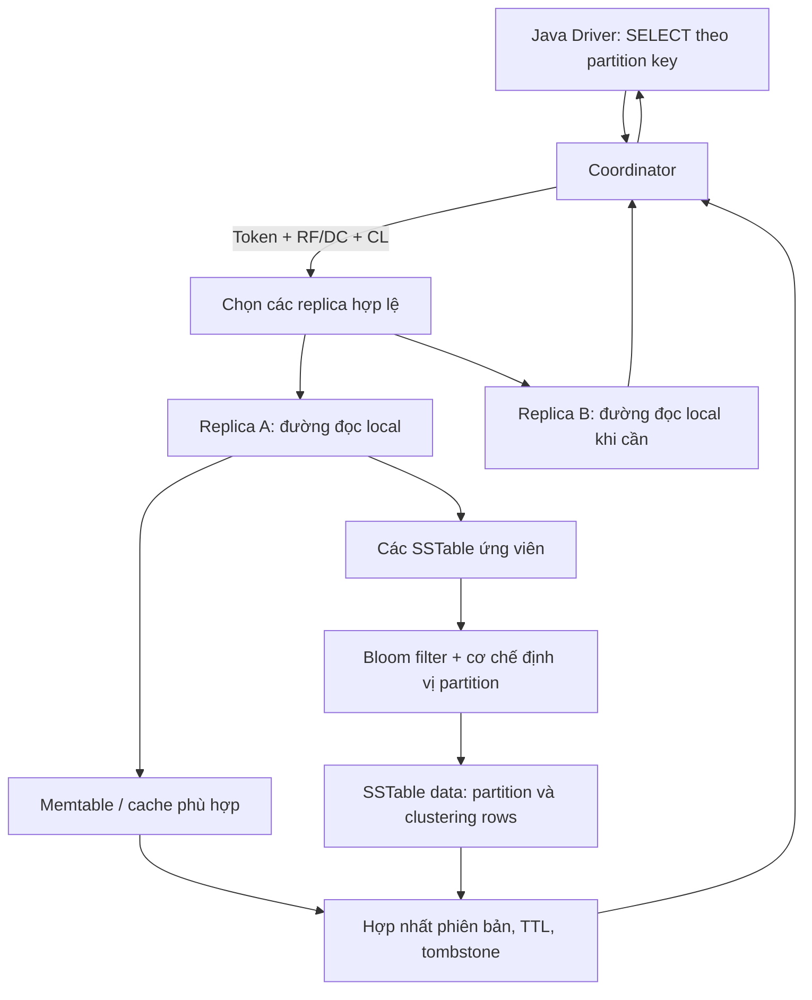
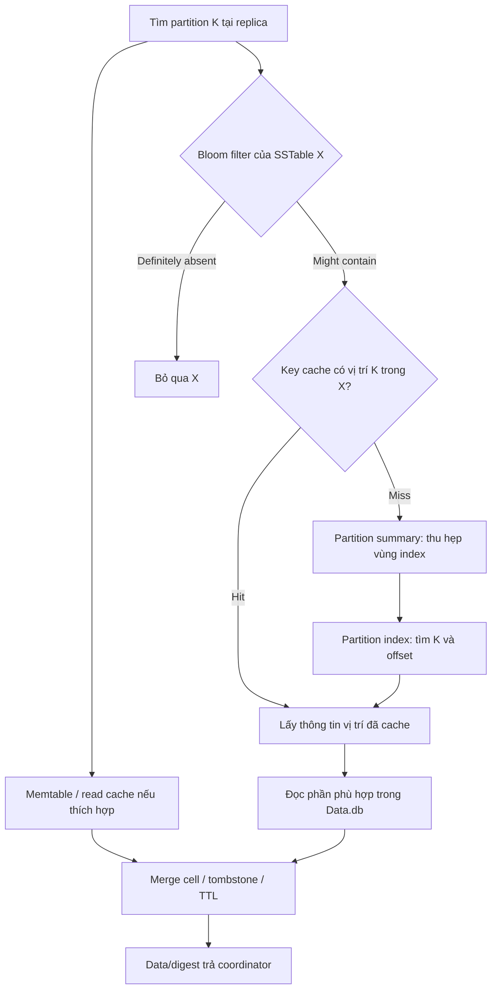

# Partition index, key cache hoặc cơ chế tương ứng theo định dạng SSTable

## 1. Bài toán: làm sao tìm một partition trong SSTable mà không quét cả file?

Apache Cassandra lưu dữ liệu theo mô hình wide-column phân tán. Khi ứng dụng Java gửi một lệnh `SELECT` với partition key, coordinator xác định những replica có trách nhiệm phục vụ partition. Sau đó, **mỗi replica** cần tìm dữ liệu trong bộ nhớ và trong một hoặc nhiều **SSTable** bất biến trên ổ đĩa.

Một SSTable có thể chứa rất nhiều partition. Nếu mỗi lần đọc một khóa đều phải quét toàn bộ nội dung của mọi SSTable thì read latency sẽ tăng mạnh theo số file và kích thước dữ liệu. Cassandra vì thế sử dụng những cấu trúc **định vị partition** và **loại trừ file không liên quan**:

- **Bloom filter:** giúp loại một SSTable chắc chắn không chứa partition key; kết quả “có thể có” phải được kiểm tra tiếp.
- **Partition index:** giúp xác định vị trí partition trong dữ liệu SSTable.
- **Partition summary:** ở các định dạng phù hợp, lưu một tập mẫu của thông tin chỉ mục để thu hẹp phạm vi tìm kiếm.
- **Key cache:** ở những đường đọc/định dạng hỗ trợ, giữ thông tin định vị đã tra để tránh làm lại các bước index lookup.
- **Cơ chế trie index:** những định dạng SSTable mới hơn có thể dùng cấu trúc tìm kiếm khác thay cho đường đi partition summary/index truyền thống.

Trong chương **Đường đọc và bộ đệm** của module `DATABASE_ENGINE_WIDE_COLUMN_CASSANDRA`, đây là cầu nối giữa **partition key thiết kế theo truy vấn**, LSM-tree, SSTable, cache, compaction, replication/consistency level, repair và thực hành Java Driver.

**Mục tiêu học tập:**

1. Phân biệt việc chọn *replica* với việc tìm *partition bên trong một SSTable*.
2. Giải thích đường tra cứu của định dạng SSTable kiểu **Big** bằng Bloom filter, key cache, partition summary và partition index.
3. Nhận diện vì sao mô tả đó **không áp dụng nguyên xi** cho mọi định dạng, đặc biệt các dạng trie-indexed như **Bti**.
4. Hiểu key-cache hit/miss, tác động của flush/compaction và sự khác biệt so với row cache/OS page cache.
5. Dùng CQL metadata, `nodetool` và Java Driver quan sát hiệu năng mà không nhầm cache hit với dữ liệu nhất quán.

> **Điểm mấu chốt:** partition index giúp trả lời **“partition K nằm ở vị trí nào trong SSTable này?”**. Key cache, nếu được dùng, giúp tránh lặp lại công việc tìm vị trí. Chúng **không** tự xác nhận cell mới nhất, không chọn replica và không thay thế consistency level.

## 2. Hai giai đoạn định vị rất khác nhau

Khi đọc dữ liệu, có ít nhất hai phép định vị:

| Giai đoạn | Câu hỏi | Thông tin quyết định |
| --- | --- | --- |
| **Định tuyến phân tán** | Partition K thuộc những replica nào? | Partition key → token; replication strategy, RF/DC và topology |
| **Tra cứu cục bộ** | Trên replica R, SSTable nào có thể chứa K, và K nằm ở đâu trong file? | Memtable/cache, Bloom filter, partition index hoặc trie index, dữ liệu SSTable |



Sơ đồ trên là mô hình khái niệm. Cassandra có thể thực hiện các bước theo tối ưu nội bộ khác nhau; không bắt buộc mỗi request phải hỏi hai replica hoặc đọc dữ liệu từ đĩa.

### Ví dụ partition key tổng hợp

Giả sử bảng được định nghĩa:

```sql
CREATE TABLE example_ks.events_by_device_day (
    device_id text,
    event_day date,
    event_time timestamp,
    event_id uuid,
    temperature double,
    PRIMARY KEY ((device_id, event_day), event_time, event_id)
);
```

Partition key là **cả cặp** `(device_id, event_day)`. Khi truy vấn:

```sql
SELECT event_time, event_id, temperature
FROM example_ks.events_by_device_day
WHERE device_id = 'sensor-01'
  AND event_day = '2026-11-21';
```

Cassandra dùng khóa phân vùng đã được mã hóa để tính token và chọn natural replicas. Bên trong mỗi SSTable liên quan, cấu trúc định vị cũng tra theo **partition key hoàn chỉnh**. Chỉ cung cấp `device_id` mà thiếu `event_day` không phải cùng một phép tra cứu một partition.

## 3. SSTable là tập hợp nhiều thành phần, không phải một file đơn giản

SSTable chứa dữ liệu bất biến được tạo khi **memtable flush** hoặc khi **compaction** tạo lại file. Trong các định dạng truyền thống kiểu **Big**, một SSTable thường có các thành phần logic/file riêng phục vụ dữ liệu, chỉ mục, Bloom filter, metadata và nén.

| Thành phần Big-format thường gặp | Vai trò khái niệm | Điều cần nhớ |
| --- | --- | --- |
| `Data.db` | Chứa dữ liệu partition và các row/cell đã được mã hóa | Đọc dữ liệu cuối cùng từ đây khi cần |
| `Index.db` | Partition index: liên kết partition key với vị trí dữ liệu tương ứng | Không đồng nghĩa secondary index của một cột |
| `Summary.db` | Partition summary dùng để định vị nhanh vùng trong index | Thường là tập mẫu/sparse representation, không chứa mọi row |
| `Filter.db` | Bloom filter các partition key của SSTable | Có thể dương tính giả, không âm tính giả trong điều kiện đúng |
| `Statistics.db` và metadata liên quan | Thống kê, cấu hình, thông tin SSTable | Hỗ trợ đọc, bảo trì và quản lý file |
| `CompressionInfo.db` khi áp dụng | Metadata hỗ trợ định vị/giải nén các khối nén | Không phải bộ nhớ cache |

Danh sách chỉ **minh họa định dạng Big**. Tên thành phần, phần nào luôn có, cách đặt trên đĩa và cấu trúc index **phụ thuộc phiên bản Cassandra, định dạng SSTable và cấu hình**. Không xây công cụ vận hành giả định mọi cluster đều có chính xác các file trên.

### Partition index và secondary index khác nhau

- **Partition index của SSTable:** là thành phần lưu trữ cục bộ giúp tìm khóa phân vùng đã có trong file.
- **Secondary index/SAI:** là tính năng truy vấn theo những thuộc tính không nhất thiết là partition key. Nó có logic và dữ liệu index riêng, không thể gọi thay `Index.db`.

Một bảng **không tạo secondary index nào** vẫn cần cách tìm partition khi đọc từ SSTable. Ngược lại, việc tạo secondary index không loại bỏ nhu cầu tìm và đọc dữ liệu thật.

## 4. Đường tìm kiếm ở định dạng Big: từ Bloom filter tới Data.db

Xét một replica có các SSTable bất biến. Với **định dạng Big** và một truy vấn theo partition key K, các bước thường được mô tả như sau:

1. Đường đọc xét dữ liệu ở memtable và các nguồn/cache có liên quan.
2. Với những SSTable có thể cần kiểm tra, Bloom filter giúp loại các file chắc chắn không chứa K.
3. Nếu K có thể nằm trong SSTable, hệ thống có thể thử **key cache** cho thông tin định vị tương ứng.
4. Nếu cache không có, **partition summary** giúp định hướng tới khoảng nhỏ hơn của **partition index**.
5. Partition index cho biết vị trí partition trong dữ liệu SSTable.
6. Hệ thống đọc phần dữ liệu/row/clustering slice cần thiết từ `Data.db`, có thể qua lớp giải nén và OS page cache.
7. Replica hợp nhất dữ liệu từ các nguồn local và áp dụng timestamp, tombstone, TTL trước khi trả data/digest response.



Đây là **đường đi mô tả cơ chế truyền thống**, không phải một chuỗi API cố định hay một cam kết về thứ tự thực thi trên mọi release. Một số SSTable có thể bị bỏ qua do điều kiện clustering, metadata khác hoặc cache hit; các định dạng mới có cơ chế index khác.

### Vì sao Bloom filter không đủ?

Bloom filter chỉ có hai loại câu trả lời:

- **“Chắc chắn không chứa K”**: bỏ SSTable.
- **“Có thể chứa K”**: phải tra index/đọc tiếp để xác minh.

Một Bloom false positive có thể khiến Cassandra tra partition index rồi biết rằng K không có ở SSTable này. Khi đó không có hàng giả được tạo ra. Bloom filter giúp tránh **tra cứu index không cần thiết**, nhưng không cung cấp offset thật.

### Vì sao partition index không đủ để trả kết quả?

Partition index xác định **vị trí** của partition; nội dung cột vẫn nằm trong dữ liệu SSTable, và có thể còn các phiên bản ở memtable hoặc SSTable khác. Khi đọc, hệ thống phải xử lý cell timestamp, TTL và tombstone. Một partition có trong index cũng chưa chắc có row **còn hiển thị** theo điều kiện query.

## 5. Partition index: ánh xạ khóa phân vùng tới vị trí dữ liệu

Theo mô hình Big truyền thống, partition index chứa các mục phục vụ tìm partition key trong SSTable đã được sắp xếp. Mỗi mục giúp dẫn đến vị trí bắt đầu dữ liệu partition hoặc thông tin liên quan cần thiết để tra cứu.

Ví dụ tượng trưng:

| Partition key đã mã hóa (minh họa) | Offset dữ liệu (minh họa) |
| --- | ---: |
| `(sensor-01, 2026-11-20)` | 0 |
| `(sensor-01, 2026-11-21)` | 4096 |
| `(sensor-02, 2026-11-21)` | 14336 |
| `(sensor-05, 2026-11-21)` | 24576 |

Các số offset chỉ dùng để giải thích; không phải dữ liệu thật của Cassandra và **không thể** lấy offset đó rồi `SELECT` bằng CQL. SSTable thực có mã hóa khóa, token/order và cấu trúc phụ trợ của định dạng cụ thể.

### Tìm một partition khác tìm một clustering row

Với `PRIMARY KEY ((device_id, event_day), event_time, event_id)`:

- **Partition index** giúp đi đến **partition** `(device_id, event_day)` trong SSTable.
- Sau khi đến partition, muốn lấy `event_time` trong một khoảng hoặc lấy những row mới nhất, replica cần xử lý **clustering rows** và các cấu trúc hỗ trợ định vị bên trong partition.

Các định dạng kiểu Big có thể dùng thông tin **promoted index/row index** cho partition rộng; định dạng trie-indexed có cách tổ chức khác. Không coi partition index là index chung cho từng `event_time` và từng column `temperature`.

### Tác động của partition lớn

Nếu một partition chứa hàng triệu clustering rows, tìm được offset của partition chỉ mới hoàn thành bước đầu. Cassandra vẫn cần định vị slice và hợp nhất dữ liệu phù hợp. Dù key-cache hit 100%, một read rộng trên partition khổng lồ vẫn có thể chậm.

Đây là lý do thiết kế **partition key và bucket theo truy vấn** quan trọng hơn việc tăng cache vô điều kiện.

## 6. Partition summary: giảm phạm vi cần tìm trong index

Nếu partition index dài, mỗi lần tra cứu toàn bộ index cũng có thể tốn I/O. Ở các định dạng Big truyền thống, **partition summary** lưu những mục mẫu/sparse references từ index để nhanh chóng tìm ra **khoảng index** chứa partition key đích.

Minh họa một index gồm nhiều khóa, nhưng summary chỉ lưu:

```text
Partition index (đầy đủ, dạng minh họa):
  K001 K002 K003 K004 K005 K006 K007 K008 K009 K010 K011 K012 ...

Partition summary (lấy mẫu):
  K001 --------- K005 --------- K009 --------- ...

Tìm K007:
  summary gợi vùng giữa K005 và K009
  -> tra phạm vi nhỏ hơn trong partition index
  -> xác minh K007 và vị trí dữ liệu
```

Thực tế không phải tất cả partition key đều phải có trong summary; cơ chế lấy mẫu và mức giữ trong bộ nhớ phụ thuộc định dạng, cấu hình cùng hoạt động quản lý index summary của Cassandra.

### Summary khác Bloom filter

| Đặc điểm | Bloom filter | Partition summary |
| --- | --- | --- |
| Câu hỏi | SSTable **có thể** chứa K không? | K nên được tìm trong **vùng nào của partition index**? |
| Kết quả âm | Có thể loại SSTable hoàn toàn | Không thay thế phép xác minh tồn tại |
| Có thể false positive? | Có | Không phải cấu trúc xác suất cùng kiểu Bloom filter |
| Vai trò | Loại trừ lookup | Tăng tốc lookup cần làm |
| Đối tượng | Partition keys của SSTable | Các vị trí/mẫu của partition index ở định dạng hỗ trợ |

**Không phải mọi định dạng SSTable đều có partition summary theo đúng kiểu trên**. Ví dụ đường tìm kiếm trie index có thể thay thế nhu cầu dùng cấu trúc `Summary.db` truyền thống.

## 7. Key cache: tiết kiệm bước định vị, không cache toàn bộ hàng

Trong đường đọc truyền thống, **key cache** lưu lại thông tin giúp tra nhanh vị trí/index của một partition key trong **một SSTable cụ thể**. Với các lần đọc lặp lại vào cùng tập partition, cache hit có thể bỏ qua một phần thao tác tra partition summary/index.

Điểm quan trọng:

- **Cache key gắn với ngữ cảnh SSTable**, không phải một ánh xạ toàn cục vĩnh viễn từ `order_id` sang offset cho mọi phiên bản dữ liệu.
- **Cache value là thông tin phục vụ định vị**, không phải toàn bộ cột `order_status` hay `total_amount`.
- Một partition có thể xuất hiện trong nhiều SSTable; mỗi SSTable có thể phải được xét để hợp nhất các phiên bản.
- Flush/compaction có thể tạo SSTable mới với cấu trúc index/offset khác; cache entry của SSTable cũ không thể cứ dùng cho file mới.
- Cache miss không phải lỗi: Cassandra có thể tra cấu trúc index của định dạng tương ứng.
- Tác dụng thực tế phụ thuộc phiên bản, định dạng SSTable và chính sách `caching` của bảng.

### Minh họa hit và miss

| Tình huống | Điều thường xảy ra ở định dạng hỗ trợ key cache |
| --- | --- |
| Lần đầu đọc K trên SSTable X | Có thể miss; tra partition summary/index, sau đó có thể lưu thông tin định vị |
| Lần sau đọc K khi entry còn hiệu lực | Có thể hit; giảm công tra cứu index |
| SSTable X được compaction thành SSTable Y | Offset/descriptor có thể thay đổi; cần tra cứu hoặc entry phù hợp với Y |
| K có trong memtable nhưng không có SSTable X | Bloom filter có thể loại X; không cần key cache của X |
| K có trong SSTable nhưng mọi cell đã hết hạn/bị xóa | Key-cache hit vẫn không biến dữ liệu không còn hiển thị thành dữ liệu sống |

### Key-cache hit không đồng nghĩa dữ liệu mới nhất

Nếu một bản ghi mới của K đang trong memtable hoặc replica khác, vị trí đã cache ở SSTable cũ **không chứa thông tin về bản ghi mới đó**. Read path vẫn phải hợp nhất các nguồn dữ liệu cần thiết và coordinator vẫn phải đáp ứng CL.

Một hệ thống có **key-cache hit rate cao** vẫn có thể trả kết quả cũ ở `ONE` nếu replica chưa nhận ghi mới. Đó là vấn đề replication/consistency, không phải key cache “định tuyến sai”.

## 8. Định dạng SSTable khác nhau: Big và trie-indexed Bti

**Không nên dạy partition summary + `Index.db` + key cache như một thuật toán bất biến của mọi Cassandra release.**

Các phiên bản Cassandra hiện đại có thể hỗ trợ nhiều **định dạng SSTable**. Một ví dụ đáng chú ý là **Bti (trie-indexed SSTable)** được đưa vào dòng Cassandra 5.x, sử dụng cấu trúc trie để hỗ trợ tra cứu partition và vị trí bên trong partition. Điều này thay đổi đường truy xuất index so với mô hình Big truyền thống.

| Khía cạnh | Đường đi Big truyền thống | Đường đi trie-indexed/Bti |
| --- | --- | --- |
| Định vị partition | Partition index, thường kết hợp partition summary | Cấu trúc index dựa trên trie |
| Định vị clustering rows | Các thông tin/chỉ mục nội bộ theo định dạng Big | Cấu trúc row index phù hợp trie-indexed |
| Tên file minh họa | `Index.db`, `Summary.db` bên cạnh `Data.db` | Thường có các thành phần index dạng `Partitions.db`/`Rows.db`; tên chi tiết tùy phiên bản |
| Vai trò key cache | Có thể giúp tránh lặp index lookup | Không được tự giả định cache tương tác giống Big; cơ chế truy cập trie có chi phí/đường đi khác |
| Điều không thay đổi | Partition key, token/RF, CL, logical data semantics | Các yêu cầu về replica/CL và tính đúng đắn dữ liệu vẫn được giữ |

**Cần kiểm tra chính xác phiên bản và SSTable format đang sử dụng.** Có thể tồn tại những file được tạo từ nhiều đời/định dạng khác nhau trong quá trình nâng cấp. Sự hiện diện hay vắng mặt của một tên file truyền thống không đủ kết luận rằng Cassandra “không có index”.

### Vì sao trie index có thể có ích?

Trie dùng cấu trúc theo tiền tố/đường đi khóa để hỗ trợ tìm kiếm. Với thiết kế phù hợp, nó có thể giảm một số bước/chi phí lookup so với đường đi summary + partition index kiểu cũ, và hỗ trợ điều hướng trong partition theo cấu trúc tương ứng.

Điều này **không có nghĩa**:

- Bti làm mọi truy vấn nhanh hơn bất kể workload.
- Không cần Bloom filter hoặc mọi cấu trúc hỗ trợ khác.
- Không cần đọc `Data.db`.
- Không cần hợp nhất memtable/SSTable, tombstone, TTL.
- Chọn định dạng SSTable tự tăng RF hoặc chuyển consistency level.

Các thay đổi format có tác động tới compaction, lưu trữ và tương thích phiên bản, cần theo quy trình nâng cấp/benchmark của Cassandra mục tiêu; không tự ý đổi định dạng production chỉ vì một ví dụ bài học.

### Quy tắc khi đọc tài liệu hoặc đo metrics

Nếu hướng dẫn một phiên bản cũ mô tả *partition summary hit/miss* hoặc *key cache hit* theo Big, còn cluster mới dùng trie-indexed, đừng ép giải thích mọi kết quả bằng cùng một sơ đồ. Hãy kiểm tra:

1. Cassandra release và định dạng SSTable được cấu hình/hỗ trợ.
2. Những SSTable đã thực sự được ghi lại theo định dạng nào.
3. Metrics index/cache thực sự có trên phiên bản đó.
4. Hiệu quả thực nghiệm, không chỉ giả thuyết về một cấu trúc dữ liệu.

## 9. Định vị partition và định vị clustering slice là hai việc riêng

Trong wide-column Cassandra, **partition key** quyết định nhóm dữ liệu; **clustering key** quyết định thứ tự trong partition.

Ví dụ:

```sql
PRIMARY KEY ((device_id, event_day), event_time, event_id)
```

Truy vấn thứ nhất đọc một partition và một khoảng thời gian:

```sql
SELECT event_time, event_id, temperature
FROM example_ks.events_by_device_day
WHERE device_id = 'sensor-01'
  AND event_day = '2026-11-21'
  AND event_time >= '2026-11-21T08:00:00Z'
  AND event_time < '2026-11-21T09:00:00Z';
```

Hai tầng tìm kiếm:

1. Tìm partition `(sensor-01, 2026-11-21)` trong các nguồn local.
2. Trong partition, tìm clustering rows nằm trong khoảng `event_time`, sau đó đọc những cột cần trả và reconcile dữ liệu.

**Key cache ở tầng partition không tự làm tầng clustering miễn phí.** Với partition rất rộng, các cấu trúc row-index/clustering-index tương ứng với format, cách tổ chức dữ liệu và phạm vi query ảnh hưởng nhiều tới độ trễ.

### LIMIT cũng không bảo đảm luôn chỉ đọc đúng N hàng

Nếu nhiều hàng đầu bị tombstone hoặc TTL loại bỏ, Cassandra có thể phải xem thêm dữ liệu để trả đủ số hàng hợp lệ trong giới hạn. Với nhiều replica, khác biệt dữ liệu có thể kéo theo fetch bổ sung hoặc short-read protection. Index tốt chỉ giải quyết **định vị**, không loại bỏ chi phí reconcile.

## 10. Key cache, row cache, Bloom filter và OS page cache khác nhau

| Cơ chế | Cache/kiểm tra cái gì? | Đơn vị/đích sử dụng |
| --- | --- | --- |
| **Bloom filter** | Test xác suất xem partition key có trong SSTable không | Loại bỏ file không liên quan; có false positive |
| **Partition index/trie index** | Cấu trúc dẫn tới vị trí dữ liệu partition | Tra cứu chỉ mục SSTable |
| **Partition summary** | Các vị trí mẫu giúp tìm vùng index nhanh hơn | Tối ưu index lookup ở định dạng hỗ trợ |
| **Key cache** | Thông tin định vị/index cho key trong SSTable khi được hỗ trợ | Giảm công lookup lặp lại |
| **Row cache** | Dữ liệu/biểu diễn row hay partition phù hợp với policy | Có thể tiết kiệm một phần việc đọc dữ liệu |
| **OS page cache** | File blocks của index/data đang có trong RAM hệ điều hành | Giảm I/O thiết bị |
| **Memtable** | Mutation chưa flush, là dữ liệu đang sống trong read path | Không phải cache của một SSTable |

### Một ví dụ không được đánh đồng

Read K lần đầu: Bloom filter nói “có thể”; key cache miss; index lookup; Data.db có dữ liệu. Read lần sau: key cache hit, OS page cache cũng ấm. Độ trễ giảm có thể do **nhiều lớp cùng tác động**.

Không nên quy toàn bộ sự cải thiện cho key cache chỉ vì hit-rate tăng. Nếu cần phân tích hiệu năng, theo dõi cả cache metrics, số SSTable đọc, disk I/O và latency tại replica/coordinator.

## 11. Cấu hình và kiểm tra `caching` trong CQL

Cassandra hỗ trợ **table option `caching`** với chính sách liên quan key cache/row cache ở những phiên bản phù hợp. Ví dụ cú pháp thường gặp:

```sql
CREATE TABLE index_lab.events_by_device_day (
    device_id text,
    event_day date,
    event_time timestamp,
    event_id uuid,
    temperature double,
    PRIMARY KEY ((device_id, event_day), event_time, event_id)
) WITH CLUSTERING ORDER BY (event_time DESC, event_id ASC)
  AND caching = {'keys': 'ALL', 'rows_per_partition': 'NONE'};
```

Đây là mẫu tạo bảng; `index_lab` phải được tạo trước khi thực thi. Trong ví dụ:

- `keys = 'ALL'` cho phép dùng chính sách key caching tương ứng theo cấu hình/định dạng hỗ trợ.
- `rows_per_partition = 'NONE'` không khuyến khích dùng row cache cho các row của bảng.
- **Không có nghĩa** Cassandra giữ mọi partition key trong RAM ngay lập tức, không giới hạn.
- Dung lượng cache thực tế chịu tác động của cấu hình node, eviction, tải và phiên bản/format.

Khi cần đổi option trên **bảng lab**:

```sql
ALTER TABLE index_lab.events_by_device_day
WITH caching = {'keys': 'NONE', 'rows_per_partition': 'NONE'};
```

Không đổi cấu hình này trên bảng production chỉ để thử một giả thuyết. Sau DDL cần kiểm tra **schema agreement**, metadata và tác động đối với workload. Với trie-indexed format, không được mặc định cùng một giá trị `caching.keys` tạo cùng tác động index lookup như ở Big.

### Phân biệt table policy và bộ nhớ cache của node

- **Table option** `caching` khai báo chính sách cache cho bảng.
- **Server configuration** (chẳng hạn giới hạn dung lượng key cache, tên cấu hình tùy release) kiểm soát ngân sách tài nguyên trên node.
- **Metrics thực tế** cho biết số entry, hit/miss và hiệu quả theo thời gian.

Đặt `keys='ALL'` không phải cách yêu cầu Cassandra lập tức nạp tất cả index entries vào RAM. Nếu bộ nhớ nhỏ, dữ liệu/caches khác và I/O nặng, hit-rate vẫn có thể thấp.

### Kiểm tra định nghĩa thực tế

```sql
SELECT table_name, caching, compaction, compression
FROM system_schema.tables
WHERE keyspace_name = 'index_lab'
  AND table_name = 'events_by_device_day';
```

`system_schema.tables` cho thấy option Cassandra đã ghi nhận, **không** đo key-cache hit của request. Phải tách schema correctness và hiệu năng runtime.

## 12. Lab CQL: một partition, nhiều clustering rows

**Điều kiện:** dùng cluster lab riêng. Ví dụ giả định DC thật là `datacenter1` với một node; nếu `nodetool status` báo tên khác, đổi đúng tên trong replication map. RF = 1 chỉ phù hợp lab một node, không đáp ứng chịu lỗi production.

### Bước 1 — Xác minh node và DC

```bash
nodetool status
```

### Bước 2 — Tạo keyspace và bảng thử

```sql
CREATE KEYSPACE IF NOT EXISTS index_lab
WITH replication = {
    'class': 'NetworkTopologyStrategy',
    'datacenter1': '1'
}
AND durable_writes = true;

CREATE TABLE IF NOT EXISTS index_lab.events_by_device_day (
    device_id text,
    event_day date,
    event_time timestamp,
    event_id uuid,
    temperature double,
    PRIMARY KEY ((device_id, event_day), event_time, event_id)
) WITH CLUSTERING ORDER BY (event_time DESC, event_id ASC)
  AND caching = {'keys': 'ALL', 'rows_per_partition': 'NONE'}
  AND comment = 'Disposable partition-index and cache lab';
```

Nếu cùng tên đã tồn tại, `IF NOT EXISTS` **không kiểm chứng** cấu trúc bảng cũ; cần đối chiếu keyspace/table/primary key trước khi tiếp tục. Chỉ dùng dữ liệu giả mà bạn có quyền xóa.

### Bước 3 — Kiểm tra metadata

```sql
SELECT keyspace_name, replication
FROM system_schema.keyspaces
WHERE keyspace_name = 'index_lab';

SELECT table_name, caching, compaction
FROM system_schema.tables
WHERE keyspace_name = 'index_lab'
  AND table_name = 'events_by_device_day';

SELECT column_name, kind, position, type, clustering_order
FROM system_schema.columns
WHERE keyspace_name = 'index_lab'
  AND table_name = 'events_by_device_day';
```

Đối soát: `device_id` và `event_day` phải là partition key; `event_time`/`event_id` là clustering columns. Chính sách caching phải là cấu hình bạn định thử.

### Bước 4 — Ghi dữ liệu vào cùng và khác partition

```sql
INSERT INTO index_lab.events_by_device_day
    (device_id, event_day, event_time, event_id, temperature)
VALUES
    ('sensor-01', '2026-11-21', '2026-11-21T08:00:00Z',
     aaaaaaaa-aaaa-4aaa-8aaa-aaaaaaaaaaaa, 27.5);

INSERT INTO index_lab.events_by_device_day
    (device_id, event_day, event_time, event_id, temperature)
VALUES
    ('sensor-01', '2026-11-21', '2026-11-21T08:10:00Z',
     bbbbbbbb-bbbb-4bbb-8bbb-bbbbbbbbbbbb, 28.0);

INSERT INTO index_lab.events_by_device_day
    (device_id, event_day, event_time, event_id, temperature)
VALUES
    ('sensor-02', '2026-11-21', '2026-11-21T08:00:00Z',
     cccccccc-cccc-4ccc-8ccc-cccccccccccc, 31.0);
```

Hai hàng đầu có cùng partition key `(sensor-01, 2026-11-21)` nhưng khác clustering key. Hàng thứ ba thuộc partition khác.

### Bước 5 — Đọc partition và clustering slice

```sql
SELECT event_time, event_id, temperature
FROM index_lab.events_by_device_day
WHERE device_id = 'sensor-01'
  AND event_day = '2026-11-21';

SELECT event_time, event_id, temperature
FROM index_lab.events_by_device_day
WHERE device_id = 'sensor-01'
  AND event_day = '2026-11-21'
  AND event_time >= '2026-11-21T08:05:00Z';

SELECT event_time, event_id, temperature
FROM index_lab.events_by_device_day
WHERE device_id = 'sensor-99'
  AND event_day = '2026-11-21';
```

Kỳ vọng:

- Truy vấn đầu có hai hàng từ một partition, theo clustering order đã khai báo.
- Truy vấn thứ hai chỉ còn hàng có `event_time = 08:10`.
- Truy vấn thứ ba rỗng nếu chưa có ai ghi `sensor-99` trong lab.

Truy vấn rỗng có thể được Bloom filter loại SSTable nhanh, hoặc có thể phát sinh index lookup nếu filter dương tính giả. **Kết quả CQL không cho biết trực tiếp trường hợp nào đã diễn ra**.

### Bước 6 — Đọc runtime metrics

Trên node lab, có thể tham khảo:

```bash
nodetool info
nodetool tablestats index_lab
```

Các phiên bản Cassandra có thể in thông tin **key cache** (dung lượng, entry, hits/requests, hit rate), **SSTable count**, Bloom filter statistics và latency với tên nhãn khác nhau. Không giả định một phiên bản/format sẽ có đủ mọi metric truyền thống.

**Vì sao số liệu có thể không thay đổi?** Dữ liệu mới có thể vẫn trong memtable; query được phục vụ từ cache khác; bảng quá nhỏ; không có SSTable chứa partition; định dạng SSTable không dùng cùng đường key-cache như sơ đồ Big. Do đó bài lab chỉ giúp hiểu cơ chế và tập làm quen với công cụ, không phải benchmark hiệu năng.

### Bước 7 — Tracing một query nếu cần

Trong `cqlsh`:

```sql
TRACING ON;

SELECT event_time, event_id, temperature
FROM index_lab.events_by_device_day
WHERE device_id = 'sensor-01'
  AND event_day = '2026-11-21'
LIMIT 10;

TRACING OFF;
```

Tracing giúp quan sát coordinator/đường thực hiện ở mức phiên bản cung cấp, **không nhất thiết công khai từng key-cache hit hoặc từng lần đọc partition summary**. Không bật tracing thường trực trên tất cả traffic production.

### Bước 8 — Dọn môi trường khi thật sự có thể xóa

```sql
-- CẢNH BÁO: chỉ thực hiện trên keyspace index_lab sở hữu riêng và được phép xóa.
DROP KEYSPACE IF EXISTS index_lab;
```

`DROP KEYSPACE` xóa toàn bộ bảng và dữ liệu lab. Không dùng trên keyspace production hay bài thực hành của người khác.

## 13. Hit-rate và read latency: đọc số liệu đúng cách

Một câu hỏi thực tế: **Key cache hit-rate tăng từ 60% lên 95% có chắc latency giảm nhiều không?** Không thể khẳng định chỉ từ một số.

| Chỉ số | Nó đo/cho biết gì? | Giới hạn |
| --- | --- | --- |
| Key cache hits / requests / hit rate | Tỷ lệ tra cứu nhận dữ liệu định vị từ cache theo định nghĩa metric của phiên bản | Không phải tỷ lệ `SELECT` trả về từ RAM |
| Key cache size/capacity | Bộ nhớ/entry đang dành cho cơ chế key cache | Không phản ánh OS page cache hoặc row cache |
| SSTables per read / SSTable count | Số file/nguồn dữ liệu có thể cần xét | Không nói chính xác index lookup cost trên mọi format |
| Bloom filter false positives | Những lần filter cho “có thể” sai | Không phải số hàng giả |
| Local read latency | Chi phí xử lý đọc tại node | Chịu ảnh hưởng merge/tombstone/I/O/cache |
| Client read latency p95/p99 | Thời gian ứng dụng chờ nhận response | Thêm coordinator, CL, mạng, retry, replica chậm |
| Compaction backlog / disk I/O | Tình trạng lưu trữ local | Có thể chi phối read nhiều hơn cache hit |

### Ví dụ định lượng rất đơn giản

Giả sử một đường tìm partition kiểu Big có:

- Key-cache lookup và xử lý chung: 0.05 ms;
- Nếu cache miss, thêm chi phí index lookup trung bình 0.8 ms;
- Đọc dữ liệu/merge/tombstone: 3 ms.

Trong mô hình **minh họa**:

| Key-cache hit rate | Chi phí định vị kỳ vọng (ms) | Tổng local read gần đúng (ms) |
| --- | ---: | ---: |
| 0% | `0.05 + 0.8 = 0.85` | `3.85` |
| 50% | `0.05 + 0.5 × 0.8 = 0.45` | `3.45` |
| 100% | `0.05` | `3.05` |

Đây **không phải benchmark Cassandra**. Nó chỉ minh họa vì sao cải thiện một thành phần chưa chắc làm latency tổng giảm tương ứng. Khi network/CL hoặc dữ liệu lớn chiếm phần lớn chi phí, key-cache hit rate có thể có tác động nhỏ hơn.

### Phân biệt cache hit rate với cache usefulness

Một bảng được đọc đi đọc lại cùng vài partition có thể đạt hit rate cao. Nhưng nếu partition đó quá lớn, xử lý tombstone/row merge vẫn có thể nặng. Ngược lại, một bảng chỉ có key lookup nhỏ, OS page cache ấm và dùng format trie hiệu quả có thể có latency tốt dù metric key cache không cao.

Luôn đo **latency p95/p99, disk I/O, bytes read và SLO** cùng các metrics cache.

## 14. Compaction, flush và eviction thay đổi hiệu quả index/cache

### Flush tạo SSTable mới

Dữ liệu chưa flush còn ở memtable. Khi flush tạo SSTable mới, cấu trúc index/Bloom/filter tương ứng với **file mới** được tạo. Trong các lần đọc tiếp theo, replica có thể cần xét thêm file đó.

### Compaction viết lại dữ liệu

Compaction đọc các SSTable theo chính sách của bảng, tổ chức/hợp nhất chúng và tạo SSTable mới. Điều này có thể:

- Giảm số SSTable cần tra trong một số workload.
- Tạo bộ partition index hoặc trie index mới.
- Làm thay đổi những thông tin vị trí vốn gắn với SSTable cũ.
- Tạm tăng I/O, CPU và ảnh hưởng latency trong lúc chạy.

Đừng giả định key-cache entries của một SSTable bị compaction vẫn dùng được cho offset của file mới; cơ chế cache quản lý hiệu lực theo định danh/lifecycle SSTable.

### Eviction khi bộ nhớ có hạn

Key cache tiêu thụ ngân sách bộ nhớ. Khi có nhiều mục mới và vượt khả năng giữ, những mục khác có thể bị loại theo chính sách cache phù hợp. Một bảng lớn với truy cập chủ yếu là **random cold keys** có thể có hit-rate thấp dù chính sách caching cho phép toàn bộ khóa.

### Index summary có ngân sách riêng trong các định dạng phù hợp

Index summary truyền thống cũng tiêu thụ bộ nhớ và có cơ chế lấy mẫu/thích ứng theo cấu hình Cassandra. Cần phân biệt chi phí của **summary** với **key cache**; không cộng chúng thành “row cache”. Với định dạng trie, cơ chế và metrics có thể khác.

### Repair không phải thao tác làm nóng key cache

Repair xử lý khác biệt replica theo phạm vi dữ liệu; nó không phải một lệnh tối ưu index lookup. Khi đọc chậm sau thay RF/topology, hãy tách vấn đề dữ liệu replica/streaming/repair khỏi vấn đề cache/index của một node.

## 15. Java Driver 4.x: truy vấn đúng partition và quan sát phía client

Ứng dụng Java không được lựa chọn trực tiếp `Index.db`, partition summary hay key cache của node cho mỗi statement. Driver chọn coordinator theo policy; Cassandra tự xử lý định vị dữ liệu trong replica.

Ví dụ dùng **Apache Cassandra Java Driver 4.x** và Java 15+ cho text block, giả sử `CqlSession session` đã được khởi tạo và quản lý vòng đời bên ngoài:

```java
import com.datastax.oss.driver.api.core.CqlSession;
import com.datastax.oss.driver.api.core.DefaultConsistencyLevel;
import com.datastax.oss.driver.api.core.cql.BoundStatement;
import com.datastax.oss.driver.api.core.cql.PreparedStatement;
import com.datastax.oss.driver.api.core.cql.ResultSet;
import com.datastax.oss.driver.api.core.cql.Row;

import java.time.LocalDate;

PreparedStatement ps = session.prepare("""
    SELECT event_time, event_id, temperature
    FROM index_lab.events_by_device_day
    WHERE device_id = ?
      AND event_day = ?
      AND event_time >= ?
    LIMIT 20
    """);

BoundStatement read = ps.bind(
        "sensor-01",
        LocalDate.of(2026, 11, 21),
        java.time.Instant.parse("2026-11-21T08:05:00Z"))
    .setConsistencyLevel(DefaultConsistencyLevel.LOCAL_ONE);

ResultSet result = session.execute(read);
for (Row row : result) {
    System.out.println(row.getInstant("event_time")
            + " => " + row.getDouble("temperature"));
}

System.out.println("Coordinator: "
        + result.getExecutionInfo().getCoordinator());
```

Giải thích:

- Bind đầy đủ `device_id` và `event_day` để query nhắm đúng **partition key tổng hợp**.
- Điều kiện `event_time >= ?` giới hạn clustering slice bên trong partition, khác nhiệm vụ của partition index.
- `LOCAL_ONE` phù hợp ví dụ RF = 1 trong lab; production phải chọn CL theo RF, DC và độ tươi dữ liệu yêu cầu.
- `getCoordinator()` cho biết node coordinator theo metadata execution, **không cho biết SSTable nào đã tra hoặc key cache hit/miss**.
- Muốn đo cache/index phải kết hợp server-side metrics và tracing, không cố suy ra từ một `Row`.

### Cần chú ý khi đọc nhiều lần để “làm ấm cache”

Ứng dụng có thể đo latency cho cùng partition nhiều lần, nhưng cải thiện quan sát được có thể đến từ nhiều lớp: OS page cache, key cache, row cache, JIT/warm connections, replica được chọn khác hoặc trạng thái compaction. Một benchmark đáng tin phải kiểm soát các yếu tố đó.

### Không sửa cache từ Java request handler

Tránh thiết kế “mỗi khi một query chậm thì gọi `nodetool compact` hoặc sửa `ALTER TABLE caching`”. Đây là các hoạt động vận hành/thay schema có phạm vi lớn và cần review riêng, không phải thao tác theo từng request.

## 16. Runbook chẩn đoán: phân biệt index miss với nguyên nhân khác

Nếu đọc từ `events_by_device_day` chậm, thực hiện theo trình tự:

1. **Kiểm tra query và partition key:** câu `WHERE` có đầy đủ partition key không, clustering slice có phù hợp không?
2. **Xác minh RF/DC và CL:** coordinator đang chờ mấy replica, có chạm WAN không, node nào chậm?
3. **Xem format và phiên bản:** đường index truyền thống hay trie-indexed; metric key cache có thực sự phản ánh read path hiện tại không?
4. **Quan sát SSTable và compaction:** số file, disk I/O, compaction backlog, tombstones, partition lớn.
5. **Đọc cache/index metrics:** hit/requests, memory, index summary nếu có, Bloom false positives, cache eviction.
6. **So sánh workload:** đọc lặp cùng key hay random keys, missing-key lookups, cold vs warm, kích thước slice.
7. **Benchmark có kiểm soát:** trước/sau khi thay table `caching` hoặc server cache budget ở môi trường phù hợp.
8. **Triển khai có thể rollback:** ghi lại cấu hình cũ, chờ schema agreement nếu có DDL, giám sát p95/p99 và memory/GC.

| Triệu chứng | Nguyên nhân có thể | Cách xác minh |
| --- | --- | --- |
| Key-cache hit rate thấp | Truy cập random keys, working set lớn, eviction, data còn memtable hoặc format khác | Query mix, cache metrics, phiên bản/format |
| Hit rate cao nhưng read chậm | Partition lớn, tombstones, nhiều SSTable, I/O/CL chậm | Tracing, tablestats, p95/p99, node health |
| Nhiều Bloom false positives | Filter cho “có thể” đối với key không ở SSTable | `bloom_filter_fp_chance`, metric, số SSTable và workload |
| Đổi `caching` mà latency chưa đổi | Cache chưa ấm, workload không nhạy, định dạng/index khác, chi phí khác chi phối | So sánh metadata, metrics theo thời gian |
| Sau compaction cache hit tạm giảm | File/index mới, entry cũ không còn tương ứng | Lịch compaction, metrics trước/sau |
| `LOCAL_QUORUM` chậm hơn `LOCAL_ONE` | Chờ nhiều replica hoặc network/replica chậm | RF/DC/CL, tracing và driver metadata |
| Một partition đọc rất chậm | Có nhiều clustering rows/tombstone hoặc query slice rộng | Data model, clustering predicates, tombstone metrics |
| Missing-key query chậm | Nhiều SSTable hoặc false-positive lookups, cache/index lookup | Bloom/filter metrics, SSTable count, I/O |
| Không thấy `Index.db` như tài liệu cũ | Định dạng SSTable không phải Big hoặc file layout thay đổi | Phiên bản Cassandra và định dạng SSTable thực tế |

**Điều kiện kết luận:** chỉ nói “key cache đang là nút thắt” khi có dữ liệu cho thấy index lookup thực sự là chi phí đáng kể và phương án chỉnh cache cải thiện latency/tài nguyên. Nếu không, ưu tiên sửa partition design, compaction backlog hoặc replica chậm theo bằng chứng.

## 17. Bài tập vận dụng và tổng kết

### Bài tập A — Tìm đúng tầng

Ứng dụng kết nối node A; partition K có natural replicas B, C, D. `Index.db` của B giúp làm gì?

**Đáp án:** Giúp **B tìm partition K trong SSTable local kiểu Big**. Nó không quyết định A gửi request tới B hay C; việc chọn replica do token/RF/CL và coordinator đảm nhiệm.

### Bài tập B — Bloom filter có thể dương tính giả

Bloom filter của SSTable X báo “might contain K” nhưng index tra không thấy K. Key cache có thể làm K “xuất hiện” không?

**Đáp án:** Không. Đây là Bloom false positive; cache/index giúp định vị hoặc xác minh, không tạo dữ liệu không tồn tại.

### Bài tập C — Key cache có đảm bảo dữ liệu mới nhất?

SSTable-01 có `status='NEW'`, memtable chứa `status='PAID'` cùng primary key và timestamp mới hơn. Key cache hit ở SSTable-01. Kết quả `SELECT status` phải là gì trong giả thiết không có tombstone/phiên bản khác?

**Đáp án:** `'PAID'`. Cache hit chỉ giúp định vị SSTable-01, không được bỏ qua mutation mới hơn trong memtable.

### Bài tập D — Partition summary có gì khác key cache?

Summary cho biết vùng index gần khóa K, nhưng key cache đã có thông tin vị trí hợp lệ của K trong SSTable X. Đường Big có thể tiết kiệm bước nào?

**Đáp án:** Có thể tránh tra lại partition summary/index cho K trên X, rồi đọc dữ liệu từ vị trí đã tìm trước đó khi cần.

### Bài tập E — Thay đổi định dạng SSTable

Một hướng dẫn cũ nói rằng đọc luôn qua `Summary.db` và `Index.db`. Cluster mới dùng trie-indexed format. Có nên kết luận Cassandra đã bỏ khả năng tìm partition không?

**Đáp án:** Không. Định dạng mới có **cơ chế index tương ứng**; phải hiểu trie index và thành phần file của phiên bản thực, không ép mọi trường hợp vào sơ đồ Big.

### Bài tập F — Hiệu năng và quyết định cache

Key-cache hit-rate cao nhưng `LOCAL_QUORUM` vẫn có p99 lớn, một replica bị compaction backlog và tombstones dày. Nên tăng RAM key cache ngay không?

**Đáp án:** Chưa. Cần kiểm tra replica chậm, số SSTable, tombstones, I/O và query shape; cache chỉ cải thiện một phần chi phí định vị.

### Checklist trước khi đề xuất tối ưu

| Câu hỏi | Bằng chứng cần có |
| --- | --- |
| Query nhắm đúng partition và clustering range? | `PRIMARY KEY`, `WHERE`, prepared statement |
| Client chọn coordinator và CL nào? | Java execution metadata, RF/DC, policy |
| Node đang dùng SSTable format nào? | Phiên bản/format, phương thức index tương ứng |
| SSTable nào cần được xét? | Bloom filter/SSTable count, metrics |
| Key cache có dùng trong đường này không? | Tài liệu/config/metrics của đúng phiên bản và format |
| Key-cache hit-rate có đủ mẫu? | Hits/requests theo thời gian và query mix |
| Có index summary/trie lookup cost đáng kể không? | Chỉ số server/tracing/benchmark thích hợp |
| Dữ liệu có còn trong memtable? | Trạng thái flush và workload |
| Read amplification đến từ đâu? | SSTable count, tombstone, partition size, I/O |
| Compaction/repair và cache có bị nhầm chức năng? | Runbook, topology và cơ chế tương ứng |
| Đổi cấu hình có cải thiện SLO thật không? | Before/after p95/p99, CPU/RAM, disk, error rate |

**Ghi nhớ:** ở định dạng SSTable **Big**, partition index và partition summary giúp tìm **vị trí partition**, key cache có thể bỏ bớt công tra index, còn Bloom filter loại các file chắc chắn không chứa khóa. Ở **định dạng trie-indexed như Bti**, đường tìm kiếm dùng cấu trúc tương ứng và không nên mặc định có cùng luồng `Summary.db`/`Index.db`. Dù định dạng nào, định vị partition **không thay** merge dữ liệu từ memtable/SSTables, không chọn replica và không xác định CL. Muốn tối ưu hiệu năng đọc Cassandra từ Java, hãy bắt đầu bằng **khóa phân vùng/truy vấn đúng**, sau đó đo cache/index, số SSTable, compaction, latency và sức khỏe replica trên đúng phiên bản đang vận hành.
