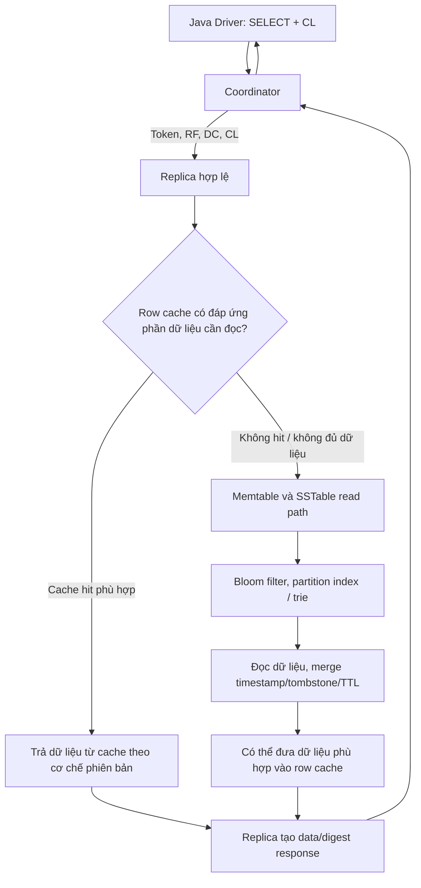
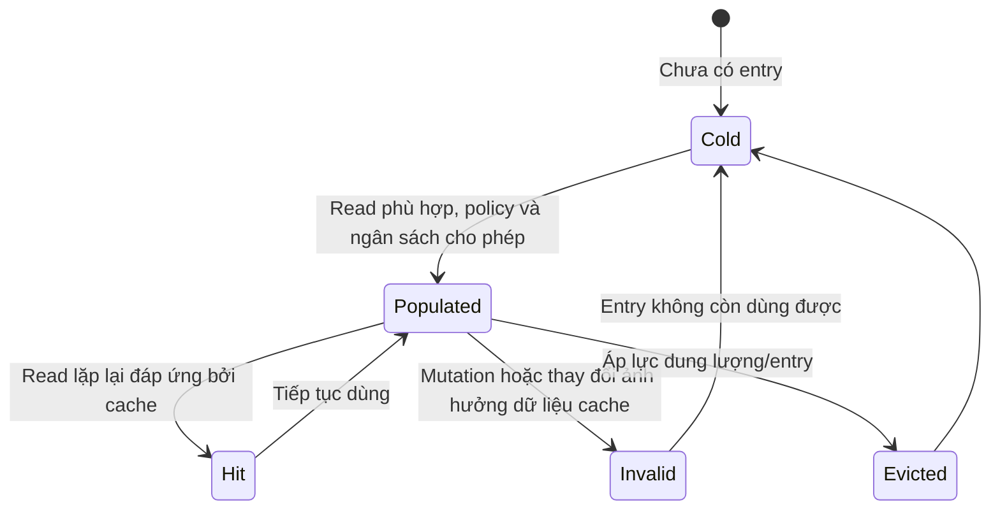
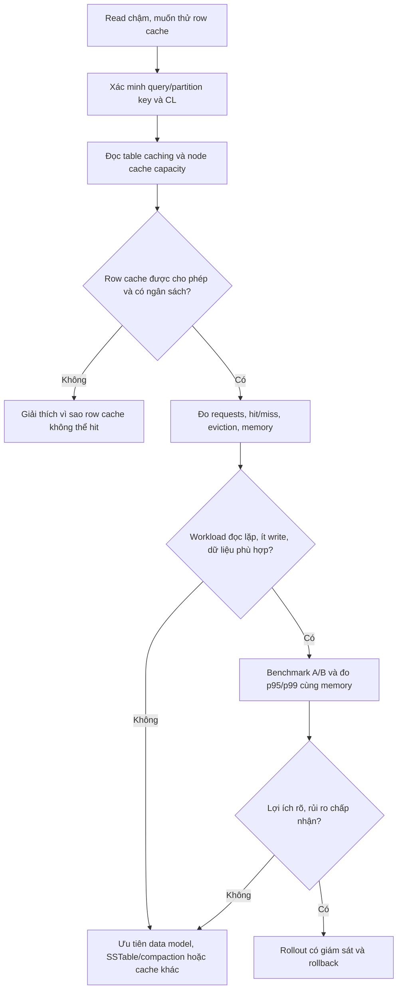

# Row cache và điều kiện phù hợp theo cấu hình/phiên bản

## 1. Row cache giải quyết vấn đề nào trong đường đọc Cassandra?

Apache Cassandra là hệ cơ sở dữ liệu wide-column phân tán. Ứng dụng Java gửi truy vấn CQL cho **coordinator**; coordinator xác định replica theo partition key, replication strategy và consistency level (CL). Trên từng replica, dữ liệu được tìm qua memtable, những SSTable liên quan và các cơ chế hỗ trợ đọc.

Với workload thường xuyên đọc lặp lại cùng một nhóm partition, việc định vị SSTable, đọc dữ liệu, giải nén và hợp nhất phiên bản có thể trở thành chi phí đáng kể. **Row cache** là một cơ chế *tùy chọn* lưu dữ liệu đọc được của partition trong bộ nhớ node để một số lần đọc sau có thể tránh một phần công việc đi xuống SSTable.

Nhưng **row cache không mặc nhiên phù hợp mọi bảng**. Nó chiếm bộ nhớ, có thể bị vô hiệu khi dữ liệu thay đổi, và mức độ hỗ trợ/hành vi chịu ảnh hưởng bởi phiên bản Cassandra, chính sách cache của bảng, định dạng SSTable và cấu hình node.

Bài thuộc chương **Đường đọc và bộ đệm** của module `DATABASE_ENGINE_WIDE_COLUMN_CASSANDRA`; nội dung kết nối cách chọn partition key theo truy vấn với RF/DC, CL, memtable/SSTable, compaction, repair, xử lý lỗi và Java Driver.

Sau bài học, bạn có thể:

1. Phân biệt **row cache**, **key cache**, Bloom filter, memtable và OS page cache.
2. Hiểu `caching = {'keys': ..., 'rows_per_partition': ...}` và điều kiện row cache được cấp bộ nhớ thực.
3. Chọn workload phù hợp: đọc lặp lại, partition vừa/nhỏ, dữ liệu ít thay đổi.
4. Giải thích cache invalidation, cache miss, evictions và ảnh hưởng của TTL/tombstone.
5. Quan sát bằng `system_schema`, `nodetool`, metrics và truy vấn Java Driver.
6. Lập benchmark có đối chứng trước khi bật row cache trong production.

> **Nguyên tắc:** Row cache là tối ưu hiệu năng **cục bộ tại node**. Nó không tăng replication factor, không thay consistency level, không bảo đảm dữ liệu mới nhất trên mọi replica và không thay thế anti-entropy repair.

## 2. Row cache nằm ở đâu trong đường đọc?



Đây là sơ đồ **khái niệm**, không phải trình tự mã nguồn bắt buộc. Một row-cache hit có thể chỉ đáp ứng một phần nhu cầu của truy vấn, và các thành phần cache/local read path có thứ tự/điều kiện khác nhau theo phiên bản Cassandra.

### Hai câu hỏi không được nhầm

| Câu hỏi | Thành phần chịu trách nhiệm |
| --- | --- |
| Node nào giữ partition K? | Token + replication strategy + topology |
| Read phải đợi bao nhiêu replica? | Consistency level |
| Trên một replica, partition K ở SSTable nào? | Bloom filter, partition index hoặc trie index |
| Có thể lấy dữ liệu partition K từ RAM thay vì đọc lại SSTable không? | Row cache, các cache khác và memtable tùy tình huống |
| Dữ liệu từ nhiều phiên bản có nhất quán không? | Local merge, reconciliation, timestamp, TTL/tombstone |

**Kể cả khi replica A có row-cache hit**, request `LOCAL_QUORUM` ở DC có RF = 3 vẫn cần đủ phản hồi theo quorum (thường là 2). Cache không cho phép coordinator bỏ qua yêu cầu CL.

## 3. Row cache thật sự lưu gì?

Trong Cassandra, row cache hoạt động theo **phạm vi partition** và chính sách lưu **số row trong mỗi partition** được phép cache. Tên “row cache” không có nghĩa mọi lần truy vấn đều có một cache entry độc lập cho mỗi logical row được lọc tùy ý.

Với bảng:

```sql
CREATE TABLE cache_lab.events_by_device_day (
    device_id text,
    event_day date,
    event_time timestamp,
    event_id uuid,
    temperature double,
    PRIMARY KEY ((device_id, event_day), event_time, event_id)
) WITH CLUSTERING ORDER BY (event_time DESC, event_id ASC);
```

Partition được định danh bằng **cặp `(device_id, event_day)`**. Bên trong có thể có nhiều clustering rows theo `event_time, event_id`. Khi table policy cho phép, row cache có thể giữ một **partition hoặc phần đầu của partition theo số row được cấu hình**, không phải một “secondary index” cho mọi giá trị `temperature`.

### Minh họa một partition được truy cập nhiều lần

| Clustering row trong partition | Thời điểm | Nhiệt độ |
| --- | --- | ---: |
| E3 | 08:20 | 29.1 |
| E2 | 08:10 | 28.5 |
| E1 | 08:00 | 27.6 |

Nếu bảng có thứ tự clustering `event_time DESC`, các row đầu tiên theo thứ tự lưu trữ/phục vụ truy vấn thường tương ứng những sự kiện mới nhất. Một policy cache giới hạn `rows_per_partition` có thể hữu ích cho truy vấn thường xuyên hỏi **những row đầu**.

Ngược lại, truy vấn một khoảng thời gian cũ nằm xa ngoài phần đã cache không được bảo đảm cache hit. Cassandra có thể tiếp tục đường đọc SSTable cho phần thiếu.

### Row cache không phải bản sao vĩnh viễn của bảng

- Nội dung cache có thể bị **evict** khi thiếu dung lượng.
- Dữ liệu cache có thể bị **invalidate** khi partition được ghi/xóa để tránh trả trạng thái cũ.
- Cache là **theo node**, không được tự động chia sẻ nguyên trạng với replica khác.
- Cache không phải nguồn backup; khởi động lại hoặc sự kiện vận hành có thể khiến cache lạnh dù dữ liệu vẫn an toàn trong storage.
- Không suy luận rằng mọi row trong partition có mặt chỉ vì một phép tra cache trả hit.

## 4. Hai lớp cấu hình phải đồng thời cho phép row cache

Để row cache thực sự hữu ích, cần kiểm tra **chính sách của bảng** và **ngân sách bộ nhớ ở node**. Đây là hai lớp khác nhau.

### 4.1. Table option `caching`

Ví dụ:

```sql
CREATE TABLE cache_lab.events_by_device_day (
    device_id text,
    event_day date,
    event_time timestamp,
    event_id uuid,
    temperature double,
    PRIMARY KEY ((device_id, event_day), event_time, event_id)
) WITH CLUSTERING ORDER BY (event_time DESC, event_id ASC)
  AND caching = {'keys': 'ALL', 'rows_per_partition': '5'};
```

Trong những phiên bản CQL hỗ trợ cú pháp này:

- `'keys': 'ALL'` cho phép chính sách **key caching**; đây không phải bật row cache.
- `'rows_per_partition': '5'` biểu thị mục tiêu cache **tối đa/phần đầu năm row mỗi partition** theo cơ chế của phiên bản.
- `'rows_per_partition': 'NONE'` là cách tắt row cache **ở cấp bảng**.
- `'rows_per_partition': 'ALL'` cho phép cache toàn bộ partition khi điều kiện/giới hạn khác cho phép.

**Quan trọng:** giá trị `'ALL'` không bảo đảm *mọi* partition đều được cache, không đặt dung lượng node thành vô hạn và không biến mọi query thành cache hit. Cần xem các giới hạn/cơ chế thực thi của phiên bản.

### 4.2. Server configuration và dung lượng row cache

Các đời Cassandra thường có cấu hình ở cấp node như `row_cache_size_in_mb` trong cấu hình máy chủ. Khi **dung lượng row cache bằng 0 hoặc row cache không được bật ở node**, chính sách bảng cho phép cache row **chưa đủ** để cache hoạt động.

Cấu hình máy chủ có thể còn có các tham số liên quan lưu/khôi phục cache, loại provider hoặc quản lý bộ nhớ. Tên, giá trị mặc định, khả năng áp dụng động hay yêu cầu khởi động lại **phụ thuộc phiên bản**; phải kiểm tra tài liệu và cấu hình đang chạy, không sao chép nguyên tham số của một ví dụ cũ vào production.

### Ma trận hai điều kiện

| Table `rows_per_partition` | Node có dung lượng row cache phù hợp? | Kết quả dự kiến |
| --- | --- | --- |
| `NONE` | Có | Bảng không dùng row cache theo policy |
| `5` hoặc `ALL` | Không / dung lượng 0 | Không có row cache hiệu lực dù table policy cho phép |
| `5` hoặc `ALL` | Có | **Có khả năng** row cache hit sau khi dữ liệu phù hợp được cache |
| `5` hoặc `ALL` | Có nhưng working set rất lớn | Có thể evict thường xuyên, hit-rate thấp |

**Không kết luận cache đang bật chỉ vì `system_schema.tables.caching` có `rows_per_partition='ALL'`.** Metadata chỉ cho thấy table policy; phải kiểm tra ngân sách node, metrics và workload.

## 5. Cú pháp CQL để bật, giới hạn và tắt row cache ở bảng

Trên **một bảng lab đã có**:

```sql
-- Cho phép lưu tối đa/phần đầu 10 row trong mỗi partition theo policy hỗ trợ.
ALTER TABLE cache_lab.events_by_device_day
WITH caching = {'keys': 'ALL', 'rows_per_partition': '10'};

-- Cho phép cache cả partition khi phù hợp.
ALTER TABLE cache_lab.events_by_device_day
WITH caching = {'keys': 'ALL', 'rows_per_partition': 'ALL'};

-- Tắt row cache cho bảng nhưng vẫn cho phép key caching.
ALTER TABLE cache_lab.events_by_device_day
WITH caching = {'keys': 'ALL', 'rows_per_partition': 'NONE'};
```

Các ví dụ tách biệt để minh họa **những trạng thái cấu hình khác nhau**, không phải một chuỗi nên chạy liên tục trên production. Trên một cluster thật, việc thay `caching` là DDL; hãy điều phối migration, kiểm tra schema agreement, đo read latency và có phương án rollback.

### Tại sao nên dùng mức giới hạn thay vì `ALL`?

Với một partition có rất nhiều clustering rows, cache toàn bộ có thể tiêu tốn bộ nhớ lớn và làm đẩy các entry khác ra khỏi cache. Nếu ứng dụng thường chỉ đọc năm sự kiện mới nhất, thử `'5'` hợp lý hơn `'ALL'` để đánh giá.

Tuy nhiên **không** được suy ra `rows_per_partition='5'` nghĩa là Cassandra chỉ lưu tối đa năm hàng trong bảng. Đây là **cache policy**, không phải TTL, giới hạn ghi hoặc CQL `LIMIT 5`. Truy vấn không dùng `LIMIT` vẫn có thể đọc nhiều hơn từ storage.

### Cách kiểm tra table option thực tế

```sql
SELECT table_name, caching, comment
FROM system_schema.tables
WHERE keyspace_name = 'cache_lab'
  AND table_name = 'events_by_device_day';
```

Trong `cqlsh` cũng có thể dùng:

```sql
DESCRIBE TABLE cache_lab.events_by_device_day;
```

`DESCRIBE TABLE` là **tiện ích của cqlsh**, không phải câu `SELECT` tiêu chuẩn để đưa nguyên vào Java Driver. Kết quả metadata phải được so với cấu hình dự kiến; `CREATE TABLE IF NOT EXISTS` không tự cập nhật policy của bảng đã tồn tại.

## 6. Các điều kiện khiến row cache được sử dụng hoặc bị bỏ qua

| Điều kiện | Tác động dự kiến |
| --- | --- |
| Node không cấp dung lượng row cache | Không có hiệu lực cache row |
| Bảng đặt `rows_per_partition='NONE'` | Đường đọc không dùng row cache theo policy |
| Bảng cho phép cache và dữ liệu đọc được phù hợp | Có cơ hội tạo/hit cache |
| Read đầu tiên, cache lạnh | Thường cần đường SSTable/memtable, có thể tạo entry |
| Read lặp lại cùng partition và vùng dữ liệu được cache | Có cơ hội hit và giảm I/O |
| Query cần clustering slice ngoài phần đã cache | Có thể bỏ qua hoặc phải đọc thêm từ storage |
| Partition được ghi/xóa | Entry liên quan có thể bị invalidated, cần tái nạp |
| Cache đầy hoặc working set vượt ngân sách | Eviction, tăng cache miss |
| Workload phần lớn là random keys/scan | Ít tái sử dụng entry, hiệu quả thường thấp |
| Dữ liệu mới chủ yếu ở memtable | Row cache có thể không đem lại lợi ích đáng kể so với đường đọc bộ nhớ |

**Không có một công thức “đã bật row cache thì mọi SELECT của bảng được cache”.** Truy vấn theo clustering range, chiều sắp xếp, điều kiện lọc, kiểu bảng và phiên bản có thể khiến cache không đáp ứng được.

### Ví dụ truy vấn phù hợp và không phù hợp

Với bảng `events_by_device_day` sắp `event_time DESC`:

```sql
-- Nhắm đúng một partition, lấy một số sự kiện mới nhất.
SELECT event_time, temperature
FROM cache_lab.events_by_device_day
WHERE device_id = 'sensor-01'
  AND event_day = '2026-11-21'
LIMIT 5;

-- Vẫn cùng partition nhưng tìm một khoảng cũ hơn.
SELECT event_time, temperature
FROM cache_lab.events_by_device_day
WHERE device_id = 'sensor-01'
  AND event_day = '2026-11-21'
  AND event_time < '2026-11-21T08:00:00Z';
```

Query đầu **có thể** hưởng lợi nếu năm row đầu được cache. Query sau có thể cần dữ liệu nằm ngoài phần được giữ. Tên bảng hay `LIMIT` không đủ để kết luận cache hit: phải đo cache metrics thực tế.

## 7. Vòng đời cache: làm nóng, invalidate và eviction

Một vòng đời đơn giản hóa:



### Cache warming

Row cache thường có lợi sau khi được **làm ấm** bởi các lượt đọc thích hợp. Đầu giai đoạn rollout hoặc sau sự kiện khởi động, các cache entry có thể chưa tồn tại. So sánh latency giữa một truy vấn cold và một truy vấn warm mà không ghi rõ điều kiện dễ dẫn đến kết luận sai.

### Invalidation khi có ghi

Trong những cơ chế row cache phổ biến của Cassandra, mutation vào partition được cache có thể khiến entry liên quan **bị vô hiệu hóa** để tránh dùng dữ liệu cũ. Không nên giả định mỗi `UPDATE` sẽ tự chỉnh từng ô trong cache ngay tại chỗ rồi giữ lại nguyên entry.

Việc cache bị invalidated là dấu hiệu **bảo vệ tính đúng đắn**, không phải lỗi cần khắc phục bằng cách ép cache hit. Với partition bị ghi liên tục, chi phí liên tục invalidate rồi nạp lại có thể khiến row cache kém hiệu quả.

### Eviction khi bộ nhớ hữu hạn

Nếu số partition đọc lặp lại lớn hơn dung lượng cache, các entry có thể bị loại theo chính sách phiên bản. Một bảng nhiều partition cực rộng, hoặc nhiều bảng cùng cạnh tranh ngân sách cache node, có thể làm entry “nóng” bị đẩy ra trước lần sử dụng sau.

### TTL, tombstone và compaction

- **TTL:** dữ liệu hết hạn không được hiển thị chỉ vì đã từng có trong cache. Cơ chế cache phải tôn trọng tính hợp lệ/metadata thời gian theo phiên bản.
- **Tombstone:** deletion phải được phản ánh khi đọc; entry không được phép làm dữ liệu đã xóa “sống lại”.
- **Compaction:** sắp xếp lại SSTable; không được coi là thao tác tự biến row cache thành nguồn sự thật hoặc giải quyết mọi sai khác replica.
- **Repair/streaming:** thao tác dữ liệu giữa replica có thể ảnh hưởng tính hợp lệ cache theo cơ chế nội bộ, nhưng không phải công cụ chuyên dùng để “làm ấm row cache”.

Không cố kiểm tra row cache bằng cách dùng thao tác xóa dữ liệu production, hạ `gc_grace_seconds` hoặc ép full compaction. Thử nghiệm cần nằm trong lab.

## 8. Workload nào đáng thử row cache?

| Workload | Mức phù hợp thường gặp | Lý do |
| --- | --- | --- |
| Đọc lặp lại một tập partition **vừa/nhỏ**, ít cập nhật | **Đáng thử** | Tái sử dụng entry, tránh một phần SSTable I/O |
| Truy vấn lặp lại vài clustering rows **đầu** mỗi partition | **Đáng thử có giới hạn** | `rows_per_partition = N` có thể phù hợp |
| Bảng tham chiếu/read-heavy, dữ liệu đổi hiếm | **Đáng thử** | Ít invalidation, working set có thể ổn định |
| Mỗi request đọc một partition mới, cardinality rất lớn | **Thường ít lợi** | Ít hit và nhiều eviction |
| Partition liên tục có mutation | **Thường ít lợi** | Invalidate cache thường xuyên |
| Partition cực lớn với `rows_per_partition='ALL'` | **Rủi ro cao** | Tiêu thụ bộ nhớ, có thể gây eviction/memory pressure |
| Scan rộng, query không khớp partition/slice được cache | **Thường không phù hợp** | Đọc từ storage vẫn chi phối |
| Dữ liệu rất mới đang ở memtable | **Cần đo trước** | Lợi ích tiết kiệm SSTable có thể nhỏ |
| Dữ liệu có TTL cực ngắn hoặc xóa liên tục | **Cần thận trọng** | Vòng đời cache ngắn, nhiều thay đổi/tombstone |

### Ví dụ bảng phù hợp

Một dịch vụ IoT có bảng `device_settings_by_id`, partition theo `device_id`, mỗi partition chỉ chứa một nhóm cấu hình nhỏ và chỉ thay đổi vài lần mỗi ngày. Hàng nghìn request đọc lại nhóm thiết bị phổ biến: row cache **có thể** đem lại lợi ích khi working set vừa với ngân sách.

### Ví dụ bảng ít phù hợp

Bảng `events_by_device_day` nhận ghi mới mỗi giây cho cùng partition. Dù dashboard luôn truy vấn sự kiện mới nhất, writer liên tục có thể invalidate cache. Khi đó tối ưu partition bucket, truy vấn clustering slice, SSTable/compaction và key cache/OS cache có thể đem lại giá trị hơn việc bật row cache.

**Không đánh giá chỉ dựa trên tên table.** Chính tỷ lệ read/write, phân bố key, kích thước partition, retention và cách query mới quyết định hiệu quả.

## 9. Row cache khác key cache, Bloom filter và page cache

| Thành phần | Lưu hoặc kiểm tra gì? | Vai trò |
| --- | --- | --- |
| **Row cache** | Dữ liệu/biểu diễn row hoặc phần partition được cache theo policy | Tránh một phần đọc dữ liệu local lặp lại |
| **Key cache** | Thông tin định vị partition trong SSTable ở đường/định dạng hỗ trợ | Tránh lặp thao tác index lookup |
| **Bloom filter** | Test xác suất xem SSTable có thể chứa partition key không | Loại những SSTable chắc chắn không chứa khóa; có false positive |
| **Partition index / trie index** | Dẫn tới vị trí partition/row trong file SSTable | Tìm dữ liệu trên đĩa |
| **OS page cache** | Các block file đang có trong bộ nhớ hệ điều hành | Giảm I/O thiết bị cho index/data |
| **Memtable** | Mutation chưa flush thành SSTable | Nguồn dữ liệu sống trong read path, không chỉ là cache |

### Ví dụ phân biệt

Một read được phục vụ nhanh có thể do:

1. Dữ liệu còn trong memtable.
2. Row cache đáp ứng phần đọc.
3. Key cache giúp tìm vị trí partition nhanh.
4. Index/data blocks đã ở OS page cache.
5. Replica được chọn ở cùng DC, mạng có latency thấp.

Vì thế “read lần hai nhanh hơn lần đầu” **không đủ bằng chứng** rằng row cache đã hoạt động. Cần đối chiếu metric row cache và các thành phần khác.

### Row cache không giống kết quả truy vấn cache ở ứng dụng

Một cache Redis hoặc Caffeine nằm phía Java có semantics và cơ chế invalidation do **ứng dụng** quản lý. Row cache Cassandra nằm ở **replica**, theo table policy và server configuration. Không được thay thế một thiết kế application cache bằng giả định Cassandra tự chia sẻ row cache nhất quán giữa mọi node.

## 10. Định dạng SSTable và phiên bản Cassandra có ảnh hưởng gì?

Ở các phiên bản Cassandra khác nhau, đường đọc SSTable có thể sử dụng các cấu trúc index khác nhau:

- **Big SSTable format truyền thống:** thường được giải thích bằng Bloom filter, partition summary, partition index và key cache khi phù hợp.
- **Trie-indexed SSTable (ví dụ Bti trong Cassandra 5.x):** dùng cấu trúc trie để định vị partition/clustering rows, không nhất thiết đi qua `Summary.db` và `Index.db` như sơ đồ Big.

**Row cache là một lớp ý tưởng khác với partition index.** Tuy nhiên, hành vi thực tế và hiệu quả của cache còn tùy đường đọc và những tối ưu mà phiên bản/định dạng đang dùng cung cấp.

| Điều cần kiểm tra | Vì sao quan trọng |
| --- | --- |
| **Phiên bản Cassandra** | Tên option, default, cache behavior và metrics có thể khác |
| **SSTable format thực tế** | Cơ chế tìm partition và chi phí cache miss có thể khác |
| **Table `caching` thực tế** | Bảng có cho phép row cache không, mức rows_per_partition |
| **Node row-cache capacity** | Có đủ dung lượng để tạo/hit entry hay không |
| **Trạng thái file sau upgrade/compaction** | Có thể còn dữ liệu từ những thế hệ/định dạng SSTable khác nhau |

Không khẳng định rằng “bật row cache làm Bti nhanh hơn Big” hoặc ngược lại nếu chưa đo trên cùng workload/phiên bản. Và cũng không coi lời khuyên về cache trên Cassandra 2.x/3.x là mặc định đúng cho cluster 4.x/5.x.

### Default và hỗ trợ không phải hợp đồng bất biến

Nhiều cụm Cassandra triển khai mặc định **không chủ động dùng row cache**, do chi phí bộ nhớ và hiệu quả tùy workload. Nhưng **đừng chép một giá trị default cố định** mà không đọc cấu hình thực tế của node và table metadata.

Khi có rolling upgrade hoặc phối hợp nhiều phiên bản máy chủ, hãy kiểm tra các giới hạn của phiên bản trong phạm vi nâng cấp; không chạy lệnh `ALTER TABLE caching` theo tutorial cũ rồi giả định mọi node đều diễn giải/tối ưu giống nhau.

## 11. Consistency level và row cache: dữ liệu đúng đến đâu?

Giả sử keyspace `NetworkTopologyStrategy` có RF = 3 tại `dc1`. Natural replicas của partition K là A, B, C; A có row-cache hit, B không có entry, C vừa nhận một mutation mới.

**Cache hit trên A không thể thay thế phản hồi từ B hoặc C khi CL yêu cầu nhiều replica.**

| Read CL | Phản hồi tối thiểu tại một DC RF=3 | Row cache ảnh hưởng gì? |
| --- | ---: | --- |
| `LOCAL_ONE` | 1 | Có thể giảm latency của replica được hỏi; có thể thấy dữ liệu cũ nếu replica thiếu ghi mới |
| `LOCAL_QUORUM` | 2 | Mỗi replica có thể hit/miss độc lập; coordinator vẫn chờ đủ hai phản hồi hợp lệ |
| `ALL` | 3 | Một cache hit không bù được replica down/chậm; dễ ảnh hưởng availability |

**Có dữ liệu mới trên C** không đồng nghĩa A “lỗi cache”. Nếu A chưa nhận mutation vì replication trễ/sự cố, đó là vấn đề **phạm vi phản hồi và trạng thái replica**. Cache tại A phải tôn trọng dữ liệu/metadata mà A biết, nhưng không tự biết mọi mutation tại C.

### Data read, digest read và cache

Coordinator có thể yêu cầu **full data** từ một replica và **digest** từ replica khác; cả hai kiểu request có thể được hỗ trợ bởi những thành phần đường đọc local thích hợp. Nếu digest mismatch, coordinator cần dữ liệu bổ sung để reconcile và có thể thực hiện read repair theo chính sách/phiên bản.

Row cache không phải một “digest toàn cluster”, không tự phát hiện replica lệch và không thay anti-entropy repair. Schema agreement cũng chỉ kiểm tra định nghĩa schema, không chứng minh nội dung row cache hoặc dữ liệu các replica giống nhau.

### Quorum không bảo đảm mọi hành vi tuyến tính

Kết hợp write/read quorum với RF có thể giúp các tập phản hồi giao nhau trong những giả thiết phù hợp, nhưng timestamp cạnh tranh, LWT, timeout không rõ kết quả, truy vấn nhiều partition và ghi đồng thời vẫn cần phân tích riêng. Bật cache không tăng hay giảm những bảo đảm logic đó.

## 12. Hiệu năng: lợi ích row cache phải lớn hơn chi phí bộ nhớ

Lợi ích của một cache phụ thuộc **tỷ lệ hit** và **chi phí được tránh**. Ví dụ mô hình đơn giản:

- Một read phải truy cập SSTable và merge dữ liệu: 4 ms ở một replica.
- Nếu row cache đáp ứng được: 0.3 ms.
- Tỷ lệ hit là `h`.

Chi phí local kỳ vọng theo mô hình giản lược:

\[
E[T_{\mathrm{local}}] \approx h\cdot 0.3 + (1-h)\cdot 4.
\]

| Hit rate giả định | Chi phí local trung bình gần đúng |
| --- | ---: |
| 0% | 4.00 ms |
| 25% | 3.08 ms |
| 50% | 2.15 ms |
| 90% | 0.67 ms |

Các số chỉ là **mô hình dạy học**, không phải benchmark Cassandra. Thực tế còn có cache population, eviction, invalidation, CPU, mạng, coordinator, CL, batching, đồng thời và các phân phối độ trễ dài.

### Vì sao hit rate cao vẫn có p99 xấu?

- Các cache miss còn lại có thể tập trung vào **partition rất lớn** hoặc một replica chậm.
- `LOCAL_QUORUM` phải chờ replica thứ hai; hit của replica đầu chưa đủ.
- Partition được ghi nhiều có thể gây invalidation ngay khi tải cao.
- Dung lượng row cache có thể lấy tài nguyên từ OS page cache, memtable hoặc cache khác.
- Chi phí tạo entry và quản lý cache có thể vượt phần I/O được tiết kiệm.

Vì thế hãy đo p50/p95/p99, CPU, memory, GC, disk I/O, throughput và **tỷ lệ hit theo giai đoạn**, không chỉ nhìn một tỷ lệ trung bình.

## 13. Quan sát row cache: metadata, nodetool và metrics

### CQL metadata của bảng

```sql
SELECT keyspace_name, table_name, caching
FROM system_schema.tables
WHERE keyspace_name = 'cache_lab'
  AND table_name = 'events_by_device_day';
```

Truy vấn này xác nhận table option được Cassandra ghi nhận. Nó **không** cho biết row cache ở node có dung lượng bao nhiêu hoặc đã hit bao nhiêu lần.

### Công cụ trên node

```bash
nodetool info
nodetool tablestats cache_lab
```

Tùy phiên bản, output có thể có thông tin:

| Metric/nhãn ví dụ | Ý nghĩa cần hiểu |
| --- | --- |
| Row Cache size/capacity | Bộ nhớ đang dùng/ngân sách cache ở node |
| Row Cache entries | Số entry được giữ theo cơ chế cache |
| Row Cache requests/hits | Số yêu cầu tới cache và số hit |
| Row Cache hit rate | Tỷ lệ hit theo định nghĩa và khoảng thời gian metric |
| Row Cache misses | Yêu cầu không được đáp ứng từ cache |
| SSTable count, read latency | Bối cảnh I/O và read amplification |
| Tombstone/cache-related metrics | Các yếu tố làm request chậm ngoài cache |

Nhãn và phạm vi xuất ra bởi `nodetool info`/`tablestats` **không hoàn toàn giống giữa mọi release**. Cassandra còn cung cấp metrics qua JMX/Prometheus exporters tùy triển khai; hãy đối chiếu metric **RowCache** của phiên bản đang chạy và reset/window của bộ đếm.

### Cẩn trọng với metric hit rate

- Nếu table policy cho phép row cache nhưng **node capacity = 0**, số hit thấp hoặc không đổi là bình thường.
- Nếu mới tạo bảng và các write còn nằm ở memtable, metric không tăng chưa chứng minh cache code bị hỏng.
- Nếu node vừa restart hoặc working set thay đổi, cache có thể đang ở trạng thái cold.
- Một node có hit rate cao không nói lên hit rate của các replica khác.
- Tổng bộ đếm tăng theo thời gian không phản ánh riêng khoảng thời gian một release; cần so sánh cùng window.

**Không** dùng một lần `SELECT` nhanh hơn để khẳng định row cache có hiệu quả. Cần ghép metrics server với latency phía Java.

## 14. Lab CQL an toàn: thử table policy và quan sát cache

Lab này dùng keyspace riêng `cache_lab` với dữ liệu giả. Giả sử cluster lab chỉ có một node thuộc DC tên chính xác `datacenter1`. Nếu DC khác, thay tên cho đúng kết quả `nodetool status`. RF = 1 chỉ phục vụ lab, **không** phải cấu hình chịu lỗi production.

### Bước 1 — Kiểm tra node và DC

```bash
nodetool status
```

### Bước 2 — Tạo keyspace lab

```sql
CREATE KEYSPACE IF NOT EXISTS cache_lab
WITH replication = {
    'class': 'NetworkTopologyStrategy',
    'datacenter1': '1'
}
AND durable_writes = true;
```

`IF NOT EXISTS` chỉ bỏ lỗi trùng tên; nó không xác minh replication của keyspace đã tồn tại. Nếu `cache_lab` không phải môi trường bạn được phép xóa, dừng bài thực hành.

### Bước 3 — Tạo bảng có cache policy giới hạn

```sql
CREATE TABLE IF NOT EXISTS cache_lab.events_by_device_day (
    device_id text,
    event_day date,
    event_time timestamp,
    event_id uuid,
    temperature double,
    PRIMARY KEY ((device_id, event_day), event_time, event_id)
) WITH CLUSTERING ORDER BY (event_time DESC, event_id ASC)
  AND caching = {'keys': 'ALL', 'rows_per_partition': '5'}
  AND comment = 'Disposable row-cache training data';
```

Nếu bảng đã tồn tại, `IF NOT EXISTS` **không đối soát primary key hoặc caching**. Kiểm tra metadata sau khi tạo; không ghi vào bảng có cấu trúc sai hoặc dữ liệu người khác.

### Bước 4 — Đọc metadata xác minh schema

```sql
SELECT table_name, caching
FROM system_schema.tables
WHERE keyspace_name = 'cache_lab'
  AND table_name = 'events_by_device_day';

SELECT column_name, kind, position, type, clustering_order
FROM system_schema.columns
WHERE keyspace_name = 'cache_lab'
  AND table_name = 'events_by_device_day';
```

Hai cột `device_id` và `event_day` phải thuộc partition key; `event_time` và `event_id` thuộc clustering key.

### Bước 5 — Ghi vài hàng nhỏ

```sql
INSERT INTO cache_lab.events_by_device_day (
    device_id, event_day, event_time, event_id, temperature
) VALUES (
    'sensor-01', '2026-11-21', '2026-11-21T08:00:00Z',
    aaaaaaaa-aaaa-4aaa-8aaa-aaaaaaaaaaaa, 27.5
);

INSERT INTO cache_lab.events_by_device_day (
    device_id, event_day, event_time, event_id, temperature
) VALUES (
    'sensor-01', '2026-11-21', '2026-11-21T08:10:00Z',
    bbbbbbbb-bbbb-4bbb-8bbb-bbbbbbbbbbbb, 28.1
);

INSERT INTO cache_lab.events_by_device_day (
    device_id, event_day, event_time, event_id, temperature
) VALUES (
    'sensor-01', '2026-11-21', '2026-11-21T08:20:00Z',
    cccccccc-cccc-4ccc-8ccc-cccccccccccc, 29.0
);
```

### Bước 6 — Đọc lặp lại cùng partition

```sql
SELECT event_time, event_id, temperature
FROM cache_lab.events_by_device_day
WHERE device_id = 'sensor-01'
  AND event_day = '2026-11-21'
LIMIT 5;

-- Có thể chạy lại SELECT trên để quan sát cache metrics trong lab.
```

**Kết quả nghiệp vụ dự kiến:** ba hàng theo thứ tự clustering. **Điều chưa được bảo đảm:** lần thứ hai chắc chắn là row-cache hit; server có thể chưa bật ngân sách cache, dữ liệu đang ở memtable, hoặc phiên bản/đường đọc không cache request như giả định.

### Bước 7 — Đọc metrics trước/sau

```bash
nodetool info
nodetool tablestats cache_lab
```

Ghi lại node, ngày giờ, cache size/capacity, requests/hits/misses nếu có, SSTable count và read latency. **Không** thay `row_cache_size_in_mb` hay khởi động lại node production để chạy bài tập; thay cấu hình server chỉ ở lab được phép và theo đúng tài liệu phiên bản.

### Bước 8 — So sánh một lần thay table option

Chỉ trong lab:

```sql
ALTER TABLE cache_lab.events_by_device_day
WITH caching = {'keys': 'ALL', 'rows_per_partition': 'NONE'};

SELECT table_name, caching
FROM system_schema.tables
WHERE keyspace_name = 'cache_lab'
  AND table_name = 'events_by_device_day';
```

Sau DDL cần xác minh schema agreement. Dùng metrics cùng một khoảng đo nếu muốn so sánh, nhưng **không kết luận được hiệu năng** chỉ bằng ba hàng và vài lần `SELECT`.

### Bước 9 — Dọn lab

```sql
-- CẢNH BÁO: chỉ chạy khi cache_lab là keyspace thử nghiệm có thể xóa.
DROP KEYSPACE IF EXISTS cache_lab;
```

Lệnh `DROP KEYSPACE` xóa toàn bộ bảng và dữ liệu trong keyspace; không dùng trên production hoặc môi trường có dữ liệu cần giữ.

## 15. Benchmark có đối chứng trước khi bật row cache production

Một thí nghiệm hữu ích cần tách tác động của row cache khỏi compaction, OS page cache, node load và CL.

### Thiết kế hai kịch bản

| Yếu tố | A — Không dùng row cache | B — Thử row cache |
| --- | --- | --- |
| Bảng/schema | Cùng primary key và kiểu dữ liệu | Giống A |
| Workload | Cùng tần suất read/write, partition distribution | Giống A |
| Row cache | `rows_per_partition='NONE'` | `rows_per_partition='N'` hoặc `ALL` phù hợp |
| Node memory budget | Ghi nhận rõ | Cấp dung lượng có kiểm soát |
| CL/RF/DC | Cố định | Cố định |
| Data size/SSTable count | Có đối soát | Giữ tương đương hoặc ghi nhận sai khác |
| Cache state | Cold/warm được ghi rõ | Cold/warm được ghi rõ |
| Metrics | p50/p95/p99, disk I/O, CPU, memory, GC, timeout | Các metric tương tự + row-cache hits/evictions |

### Các bước thực hiện

1. **Chọn workload đại diện**: tỷ lệ đọc/ghi, phân bố partition nóng, clustering slices và dữ liệu tồn tại/không tồn tại.
2. **Đo baseline** với row cache tắt và ghi lại trạng thái SSTable, compaction, node/driver config.
3. **Bật có giới hạn** trên lab/staging tương đồng, xác nhận cả table policy lẫn server budget.
4. **Warm-up** và đo ở các cửa sổ ổn định; tách kết quả cold/warm.
5. **Theo dõi invalidation/eviction** và bộ nhớ; không chỉ xem cache hit rate.
6. **So sánh p95/p99 theo workload**, timeout, I/O, CPU và tổng lượng tài nguyên tiêu thụ.
7. **Định nghĩa ngưỡng rollback**: tăng memory pressure, GC, giảm OS page cache, p99 xấu hơn hoặc lợi ích không đạt yêu cầu.

### Bẫy benchmark thường gặp

- Chỉ đọc đi đọc lại một partition nhỏ khiến cache rất đẹp nhưng không đại diện workload thực.
- Dữ liệu chưa flush nên không thấy nhiều SSTable reads để cache tránh.
- Cùng lúc thay CL từ `LOCAL_QUORUM` sang `LOCAL_ONE`, làm kết quả đo không còn công bằng.
- Đổi compaction, thêm node hoặc tải từ client khác trong lúc benchmark.
- Một replica có cache nóng, replica khác lạnh; coordinator phân tải khiến p99 dao động.
- Bật `ALL` cho partition rất lớn rồi hết bộ nhớ, ảnh hưởng chính workload muốn tối ưu.

Kết luận triển khai nên dựa trên **hiệu quả tổng thể và rủi ro vận hành**, không phải một tỷ lệ hit ấn tượng.

## 16. Java Driver 4.x: dùng prepared statement, không “ép row cache hit”

Driver Java không cung cấp một tùy chọn cho từng `SELECT` kiểu “đọc từ row cache”. Ứng dụng gửi CQL, bind khóa phân vùng, chọn CL; Cassandra tự quyết định cách phục vụ read request trên từng replica.

Ví dụ với **Cassandra Java Driver 4.x** và Java 15+ (text block), giả sử `CqlSession session` đã kết nối đúng cluster/local DC và được quản lý vòng đời ở bên ngoài:

```java
import com.datastax.oss.driver.api.core.CqlSession;
import com.datastax.oss.driver.api.core.DefaultConsistencyLevel;
import com.datastax.oss.driver.api.core.cql.BoundStatement;
import com.datastax.oss.driver.api.core.cql.PreparedStatement;
import com.datastax.oss.driver.api.core.cql.ResultSet;
import com.datastax.oss.driver.api.core.cql.Row;

import java.time.LocalDate;

PreparedStatement query = session.prepare("""
    SELECT event_time, event_id, temperature
    FROM cache_lab.events_by_device_day
    WHERE device_id = ? AND event_day = ?
    LIMIT 5
    """);

BoundStatement read = query.bind(
        "sensor-01", LocalDate.of(2026, 11, 21))
    .setConsistencyLevel(DefaultConsistencyLevel.LOCAL_ONE);

ResultSet result = session.execute(read);
for (Row row : result) {
    System.out.println(
        row.getInstant("event_time") + " -> "
        + row.getDouble("temperature"));
}

System.out.println("Coordinator: "
    + result.getExecutionInfo().getCoordinator());
```

Ở lab RF = 1, `LOCAL_ONE` là lựa chọn phù hợp để thực hành. Trong production, chọn CL theo RF/DC và yêu cầu độ tươi dữ liệu, không thay đổi CL chỉ nhằm “cho cache dễ hit”.

### Java quan sát được gì?

- **Kết quả CQL** sau khi Cassandra đã xử lý dữ liệu và CL.
- Coordinator và thông tin thực thi do driver hỗ trợ.
- Latency, error rate, timeout/retry từ metrics hoặc instrumentation phía client.

Java **không** nhìn thấy trực tiếp từng row-cache hit/miss trong `Row` hoặc `ResultSet`. Muốn biết cache có hoạt động, phải tương quan metrics server với những request đã gửi.

### Lưu ý khi sử dụng cache và ghi đồng thời

Nếu service viết trạng thái mới và lập tức đọc lại, cần xét CL, concurrency, write result/timestamp và trạng thái replica. Row cache không phải cơ chế giao dịch, không giữ thứ tự nghiệp vụ và không thay LWT. Khi nghi stale read, phải điều tra replication/CL/việc ghi trước khi quy lỗi cho cache.

## 17. Runbook xử lý tình huống row cache không đem lại lợi ích

| Triệu chứng | Nguyên nhân khả dĩ | Bước kiểm tra |
| --- | --- | --- |
| `caching.rows_per_partition='ALL'` nhưng hits = 0 | Node row cache không có dung lượng, cache lạnh, request không phù hợp | Node config, table metadata, cache requests/size |
| Hit rate thấp | Random key, working set quá lớn, eviction, write invalidation | Phân bố partition, read/write mix, eviction/requests |
| Hit rate cao nhưng p99 chậm | CL chờ replica khác, hot partition, tombstones, mạng | Tracing, coordinator/replica metrics, SSTables |
| Đọc lần hai vẫn chậm | Cache chưa populate/không phù hợp slice, I/O/GC chi phối | Cache metrics, key/clustering query, OS page cache |
| Cache tốt sau warm-up nhưng tệ sau deploy | Restart, eviction, thay workload hoặc flush/compaction | So sánh cold/warm window, node lifecycle |
| Bật cache làm node thiếu RAM | Partition quá lớn, `ALL`, ngân sách cache quá cao | Row-cache size, RSS/heap, OS cache, GC |
| Dữ liệu khác nhau giữa replica | Lỗi/chậm replication, ghi chưa đạt CL, node offline | RF/DC, read/write CL, repair/streaming |
| Query theo slice cũ không hit | Cache giữ phần đầu partition, query ngoài phạm vi | Clustering order, `rows_per_partition`, trace |
| Chỉ số khác tài liệu cũ | Version/SSTable format/counter semantics khác | Đối chiếu tài liệu và metrics phiên bản thực |

### Quy trình chẩn đoán ngắn



**Không dùng biện pháp nguy hiểm** như giảm CL tùy tiện, tắt replica, chạy full compaction không kế hoạch hoặc chỉnh server memory production mà chưa có phê duyệt để cố “làm cache có tác dụng”.

## 18. Bài tập thực hành và checklist tổng kết

### Bài tập A — Đọc table policy

Cho `caching = {'keys':'ALL','rows_per_partition':'NONE'}`. Row cache có được dùng theo table policy không? `keys='ALL'` có nghĩa cache toàn bộ hàng không?

**Đáp án:** Row cache bị tắt theo table policy. `keys='ALL'` liên quan key caching, **không** phải cache row.

### Bài tập B — Có policy nhưng không có RAM

Bảng dùng `rows_per_partition='ALL'`, node đặt row-cache capacity bằng 0. Có được kết luận cache đang hoạt động không?

**Đáp án:** Không. Bảng cho phép nhưng **node không cấp ngân sách row cache**; cần kiểm tra cấu hình/metrics node trước khi nói đến hit.

### Bài tập C — Partition rộng

Một partition chứa 200.000 sự kiện; ứng dụng thường chỉ lấy ba sự kiện mới nhất. Nên bật `ALL` ngay?

**Đáp án:** Không. Nên đánh giá cache chỉ phần đầu với `rows_per_partition` giới hạn thích hợp, đồng thời xem lại bucket/partition size và thử benchmark. Cache toàn partition rất rộng có thể lãng phí bộ nhớ.

### Bài tập D — Dữ liệu liên tục thay đổi

Một thiết bị có writer cập nhật partition mỗi giây, reader cũng đọc rất thường xuyên. Vì sao row cache có thể không hữu ích dù read rate cao?

**Đáp án:** Write có thể invalidate entry làm cache liên tục miss/repopulate. Cần đo workload thật, không chỉ tỷ lệ read.

### Bài tập E — Cache hit và CL

Replica A row-cache hit, B miss; request `LOCAL_QUORUM` với RF=3. A có được trả kết quả ngay không?

**Đáp án:** Không chỉ dựa trên A. Coordinator vẫn phải đáp ứng số phản hồi theo CL; row cache chỉ giảm một phần chi phí local của A.

### Bài tập F — Một SELECT nhanh hơn sau warm-up

Lần đọc thứ hai nhanh hơn lần đầu. Có đủ chứng cứ row cache hiệu quả không?

**Đáp án:** Chưa. Cần xem metrics row cache; OS page cache, key cache, memtable, JIT, warm connection và replica được chọn cũng có thể giải thích chênh lệch.

### Checklist trước khi áp dụng production

| Câu hỏi | Bằng chứng cần có |
| --- | --- |
| Workload có lặp lại partition đủ nhiều? | Phân phối partition key, đọc/ghi và kết quả profiling |
| Partition vừa bộ nhớ, có cần cache toàn bộ không? | Size/row count và `rows_per_partition` được chọn |
| Table policy có cho phép row cache? | `system_schema.tables.caching` |
| Node có cấp row-cache memory thực sự? | Config/metrics của phiên bản thực |
| Phiên bản/format có hành vi cache nào đáng chú ý? | Tài liệu release, SSTable format thực tế |
| Có nhiều mutation gây invalidation không? | Metrics read/write, profile partition hot |
| CL/RF/DC có phù hợp business requirement? | Keyspace replication, Java statement CL |
| Đã tách cache effect khỏi OS page cache/compaction? | Benchmark cold/warm và metrics I/O |
| Bộ nhớ cache có gây pressure hoặc eviction? | Cache size, RAM/GC, OS cache và số eviction |
| Lợi ích có thể quan sát từ phía Java? | p50/p95/p99, throughput, timeout/error |
| Có đường rollback rõ ràng nếu không hiệu quả? | DDL/table option cũ, thay đổi node config theo runbook |

**Ghi nhớ:** Row cache có thể giảm chi phí đọc lại dữ liệu của những partition được truy cập thường xuyên, nhưng chỉ hữu ích khi **table policy cho phép, node có dung lượng thực, workload tái sử dụng entry và cache không liên tục bị invalidated/evicted**. Nó khác key cache (lưu thông tin định vị SSTable), không thay Bloom filter hay memtable và không bỏ qua RF/CL. Cách làm đúng là bắt đầu từ **partition key và truy vấn theo workload**, kiểm tra version/config, rồi đánh giá bằng metrics và benchmark A/B thay vì bật `rows_per_partition='ALL'` cho mọi bảng.
