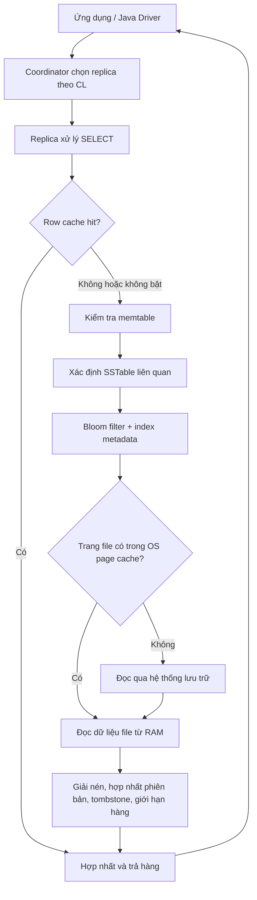

# Bộ nhớ đệm hệ điều hành và tập dữ liệu thường được truy cập

**Chương:** Đường đọc và bộ đệm  
**Module:** `DATABASE_ENGINE_WIDE_COLUMN_CASSANDRA` — Apache Cassandra

Bài học nằm trong phạm vi kiến trúc phân tán và mô hình wide-column của Apache Cassandra: lựa chọn partition key, thiết kế bảng theo truy vấn, mức nhất quán đọc/ghi, CQL, replication, compaction, repair, xử lý lỗi và kết nối Java.

Khi một truy vấn Cassandra được thực hiện lần đầu, dữ liệu có thể phải được đọc từ thiết bị lưu trữ. Với truy vấn cùng khóa được thực hiện lại, một phần dữ liệu và metadata có thể đã nằm trong **bộ nhớ đệm trang của hệ điều hành (OS page cache)**, khiến lần đọc sau nhanh hơn. Tuy nhiên, một lần đọc nhanh không nhất thiết là “cache hit”, và số lượng RAM còn trống không cho biết trực tiếp Cassandra cần bao nhiêu I/O.

Bài này trả lời ba câu hỏi vận hành: Cassandra sử dụng page cache ở đâu trên đường đọc; **working set** (tập dữ liệu thường được truy cập) quyết định khả năng giữ dữ liệu nóng ra sao; và phải đo đạc thế nào để tránh những kết luận sai từ thí nghiệm “đọc lần 1 so với lần 2”.

## 1. Mục tiêu học tập

Sau khi hoàn thành, bạn có thể:

1. Phân biệt **Linux page cache**, **Cassandra key cache**, **row cache**, **memtable**, Bloom filter và index summary.
2. Giải thích vì sao cùng một câu CQL có thể tạo ra lượng I/O vật lý khác nhau ở những thời điểm khác nhau.
3. Xác định working set theo **partition, clustering range, tần suất và replica**, thay vì chỉ nhìn tổng dung lượng bảng.
4. Thực hiện thí nghiệm đọc nóng/lạnh có nhóm đối chứng, kiểm tra bằng CQL và công cụ Linux/Cassandra.
5. Nhận biết tác động của compaction, read repair, streaming, flush, phân trang và giới hạn bộ nhớ tới tỷ lệ cache hit.
6. Diễn giải các chỉ số `MemAvailable`, `Cached`, disk read throughput, page faults, latency p95/p99 một cách thận trọng.
7. Đề xuất cách cải thiện truy vấn và cache dựa trên dữ liệu đo được; không mặc định “tăng cache” là giải pháp cho mọi truy vấn chậm.

## 2. Các lớp bộ nhớ cần phân biệt

Cassandra không có một “cache” duy nhất. Một yêu cầu đọc có thể đi qua nhiều lớp dữ liệu và metadata có vòng đời khác nhau:

| Thành phần | Chứa gì? | Thuộc về ai? | Vai trò chính |
| --- | --- | --- | --- |
| **Memtable** | Mutation/hàng chưa flush thành SSTable | Cassandra, bộ nhớ heap/off-heap tùy cấu hình/phiên bản | Đọc dữ liệu ghi gần đây và hợp nhất với dữ liệu SSTable; **không phải page cache**. |
| **Row cache** | Dữ liệu của những partition được cache theo chính sách Cassandra | Cassandra quản lý | Có thể tránh một phần đường đọc SSTable khi hit; thường bị vô hiệu hóa theo mặc định hoặc không phù hợp với mọi workload. |
| **Key cache** | Vị trí/metadata giúp tìm partition trong SSTable | Cassandra quản lý | Giảm công việc tra cứu index khi đọc từ SSTable; **không chứa toàn bộ nội dung hàng**. |
| **Bloom filter** | Cấu trúc xác suất để kiểm tra SSTable nào có thể chứa partition key | Cassandra, chủ yếu bộ nhớ native/off-heap | Loại bớt SSTable chắc chắn không chứa khóa; có thể false positive nhưng không được có false negative trong điều kiện hoạt động đúng. |
| **Index summary / index metadata** | Mốc tra cứu, chỉ mục partition và clustering trên SSTable | Cassandra và hệ thống tệp (phụ thuộc phần dữ liệu) | Tìm vùng byte cần đọc trong SSTable. |
| **OS page cache** | Các trang dữ liệu/metadata của tệp được hệ điều hành giữ lại trong RAM | Kernel của node | Tránh đọc lại block từ ổ đĩa khi truy cập trang file đang có trong RAM. |
| **Storage cache** | Cache trong controller/SSD hoặc hạ tầng lưu trữ | Thiết bị/hệ thống lưu trữ | Có thể giảm độ trễ I/O ngay cả khi OS page cache miss. |

**Điểm cốt lõi:** `key cache hit` không đồng nghĩa `data page cache hit`. Key cache giúp tìm vị trí dữ liệu, nhưng những trang dữ liệu cần đọc vẫn có thể chưa nằm trong OS page cache. Ngược lại, dù key cache miss, các trang index và dữ liệu trên đĩa vẫn có thể đã được Linux cache.

Row cache là lựa chọn ứng dụng theo **kiểu truy vấn**, không phải bản sao của OS page cache. Trong nhiều workload, tận dụng page cache và cấu trúc SSTable hiệu quả hơn việc bật row cache cho tất cả bảng. Không đánh đồng cache trên node Cassandra với cache kết quả nằm ở ứng dụng, proxy hay CDN.

## 3. OS page cache hoạt động như thế nào?

Trên Linux, khi Cassandra đọc các file SSTable bằng cơ chế I/O sử dụng page cache, kernel có thể giữ các trang file đã đọc trong RAM. Nếu một lần đọc sau cần đúng trang còn trong cache, dữ liệu có thể được phục vụ từ bộ nhớ. Nếu trang đã bị đẩy ra do áp lực bộ nhớ hoặc chưa từng được đọc, kernel cần lấy nó từ thiết bị lưu trữ.

Cassandra sử dụng nhiều cơ chế truy cập file tùy phiên bản, cấu hình và thành phần SSTable; một số thao tác có thể dùng memory mapping. Với dữ liệu đọc qua đường được page cache hỗ trợ, **mmap cũng không có nghĩa là bỏ qua page cache**. Không được suy từ một biểu đồ duy nhất rằng *mọi* I/O của Cassandra đều phải đi qua page cache hoặc rằng mọi cache miss đều trở thành một lần đọc vật lý cùng kích thước.

### 3.1. Cache tồn tại ở mức node, không ở mức cluster

OS page cache là tài nguyên của kernel trên **từng host**. Với replication factor (RF) bằng 3:

- Hàng có cùng partition key được lưu trên ba replica.
- Mỗi replica có các SSTable, index metadata, page cache và áp lực bộ nhớ riêng.
- Coordinator xử lý yêu cầu CQL có thể chọn replica khác nhau theo consistency level, chính sách đọc, locality và trạng thái node.
- Lần đọc thứ hai ở ứng dụng **không bảo đảm** đi qua replica có cache ấm từ lần đọc thứ nhất.

Vì vậy, trong thí nghiệm muốn so sánh OS page cache, hãy cố định topology và quan sát **node thực sự đọc dữ liệu**. Không dùng cách “mở `cqlsh` trên node X” làm bằng chứng đọc chỉ sử dụng page cache của X: node được kết nối có thể là coordinator và gửi truy vấn tới replica khác.

### 3.2. Bộ nhớ “đang dùng” không phải luôn “bị lãng phí”

Linux dùng phần RAM chưa cần cho ứng dụng để cache file. Ví dụ:

```bash
free -h
grep -E '^(MemTotal|MemFree|MemAvailable|Cached|Buffers|Dirty|Writeback):' /proc/meminfo
```

Hai con số thường bị hiểu nhầm:

- `MemFree` thấp không tự chứng minh thiếu RAM; kernel có thể đang dùng RAM để cache và có thể thu hồi bớt khi ứng dụng cần.
- `MemAvailable` ước lượng lượng bộ nhớ có thể cấp cho ứng dụng mà không phải swap quá mức; nó hữu ích hơn `MemFree` để xét áp lực bộ nhớ ở mức host, nhưng vẫn là **ước lượng**, không phải lượng RAM dành riêng cho Cassandra.

`Cached` ở `/proc/meminfo` không phải “dữ liệu Cassandra đang có trong cache”. Đây là số liệu của kernel cho nhiều file và quá trình trên host; trong container, chỉ số từ host và giới hạn cgroup có thể khác đáng kể. Có cả phần bộ nhớ kernel, slab, anonymous pages và các dạng cache khác cần phân tích riêng.

**Không đặt mục tiêu hạ `Cached` về 0.** Page cache là chức năng bình thường, hữu ích của Linux. Việc kernel thu hồi cache dưới áp lực bộ nhớ là hành vi dự kiến; chính tỷ lệ truy cập lại dữ liệu và hiệu năng I/O quyết định nó có đủ không.

## 4. Page cache nằm ở đâu trên read path của Cassandra?

Giả sử một truy vấn dùng đầy đủ partition key:

```sql
SELECT event_time, event_id, event_type, amount_cents
FROM lab_read_cache.events_by_account
WHERE tenant_id = 't1'
  AND account_id = 101
  AND event_time >= '2026-11-01T00:00:00Z'
  AND event_time <  '2026-12-01T00:00:00Z'
LIMIT 50;
```

Sơ đồ đơn giản hóa:



Sơ đồ chỉ mô tả các thành phần chính, **không phải thứ tự bắt buộc của từng lệnh nội bộ**. Trên thực tế, Cassandra có thể đọc memtable và nhiều SSTable, áp dụng Bloom filter/index, kiểm tra tombstone và chọn phiên bản mới nhất. Có dữ liệu trong memtable không đảm bảo không cần nhìn SSTable khác.

Page cache ảnh hưởng nhiều loại trang của file: trang chứa dữ liệu nén SSTable, một số trang index/metadata và các file đang truy cập. **Dữ liệu thường được nén trên đĩa**, nên dữ liệu đọc từ page cache có thể vẫn cần giải nén và giải mã thành hàng. Cache hit của kernel giảm I/O vật lý, **không loại bỏ CPU, hợp nhất tombstone, kiểm tra consistency level hay trao đổi mạng**.

### 4.1. Thời gian đọc gồm nhiều thành phần

Một cách phân tích gần đúng:

```text
Read latency
≈ điều phối mạng + chờ hàng đợi + định vị SSTable/index
  + truy cập memtable/SSTable + (I/O vật lý nếu cần)
  + giải nén/hợp nhất/lọc tombstone + serialize/trả kết quả
```

Với cùng truy vấn, cache ấm có thể giảm phần I/O vật lý. Nhưng nếu latency chủ yếu nằm ở mạng, GC, tombstone scan, CPU giải nén hoặc coordinator quá tải, page cache ấm chưa chắc tạo khác biệt lớn. Một truy vấn có thể vừa đọc từ RAM vừa từ SSD: tránh phân loại nhị phân toàn bộ truy vấn là “cache hit” hoặc “cache miss” khi nó chạm nhiều trang.

## 5. Working set: tập dữ liệu nào thực sự cần giữ nóng?

**Working set** là tập trang/dữ liệu có xác suất được truy cập lại trong một cửa sổ thời gian. Trong Cassandra, nó bị chi phối bởi **mẫu truy vấn**, không chỉ kích thước bảng. Hãy xét ba workload:

| Workload | Tính chất truy cập | Kỳ vọng về OS page cache |
| --- | --- | --- |
| **Hot keys**: 90% request tập trung vào một nhóm nhỏ account | Lặp lại nhiều partition và clustering range | Những trang SSTable/index thường dùng có cơ hội ở lại cache; warm reads thường ít I/O hơn. |
| **Uniform random** trên hàng triệu partition | Khả năng lặp lại cùng trang thấp | Cache hit thấp hơn khi working set lớn hơn RAM có thể cấp. |
| **Time-range scan** trên dữ liệu mới nhất | Chủ yếu chạm vài SSTable/đoạn clustering gần đây | Một tập trang gần đây có thể giữ nóng, nhưng scan rộng và compaction có thể thay thế các trang đó. |

Không nên ước tính working set bằng cách cộng toàn bộ dung lượng keyspace trừ khi truy vấn thực tế chạm gần như toàn bộ. Ngược lại, một bảng “nhỏ” vẫn có thể gây I/O nếu nhiều ứng dụng cùng tranh chấp RAM và page cache bị thu hồi liên tục.

### 5.1. Ước tính sơ bộ theo trang, không theo hàng logic

Giả sử node liên tục truy cập khoảng 800.000 phần dữ liệu/metadata phân biệt, mỗi phần tương đương **8 KiB trang file thường xuyên cần thiết**. Ước tính thô:

```text
800.000 × 8 KiB ≈ 6,10 GiB dữ liệu nóng trên node
```

Đây chỉ là ví dụ minh họa, **không phải công thức suy RAM từ số hàng Cassandra**. Một partition có thể chạm nhiều trang; cùng một trang có thể chứa nhiều hàng; số trang còn phụ thuộc nén, kích thước partition, bloom/index, số SSTable và pattern đọc. RF=3 không có nghĩa mọi node đều chứa ba bản sao của mọi hàng; cần tính phần dữ liệu và access pattern của **từng replica**.

Để có ước tính đáng tin:

1. Thu thập tần suất truy vấn theo loại và khóa truy cập trong cửa sổ thời gian cụ thể (ví dụ 15 phút, 1 giờ, 24 giờ).
2. Nhận diện partition nào nóng và mỗi lần truy vấn cần bao nhiêu clustering rows/range.
3. Quan sát số lượng SSTable, dữ liệu nén và page cache/physical read theo node.
4. Đối chiếu với RAM host còn khả dụng sau khi tính JVM heap, native/off-heap, kernel và các service khác.
5. So sánh nhiều khoảng thời gian: peak hour, compaction, backup/repair và giai đoạn dữ liệu được flush.

Working set có thể **dịch chuyển liên tục** (ví dụ dữ liệu 24 giờ gần nhất). Cache cần đủ chỗ cho những trang có khả năng được đọc lại trước khi chúng bị đẩy ra; giữ được mọi trang từng truy cập là không khả thi và cũng không cần thiết.

### 5.2. Quy tắc thiết kế khóa ảnh hưởng working set

Ví dụ cùng nghiệp vụ “lấy 20 sự kiện gần nhất của account”:

- Bảng có partition key = `(tenant_id, account_id)`, clustering = thời gian giảm dần: query định vị một partition và đọc dải hẹp, thường tận dụng locality tốt.
- Bảng có partition key = UUID ngẫu nhiên của từng event: phải tìm nhiều partition hoặc dùng một read model khác; làm tăng fan-out và số trang phân tán có khả năng bị chạm.
- Partition cực lớn chứa nhiều năm lịch sử: một truy vấn mới nhất có thể chỉ đọc một dải nhỏ, nhưng các truy vấn quá rộng và tombstone có thể buộc hệ thống chạm nhiều trang.

Tăng cache **không sửa được mô hình khóa** khiến mỗi request phải quét nhiều partition. Trước tiên hãy tối ưu số partition và số hàng phải đọc.

## 6. Phòng lab: tạo bảng có hot key và cold key

Để kiểm chứng, dùng **cluster Cassandra riêng** đang ổn định. Ví dụ thao tác trên Cassandra 4.1/5.x, có thể dùng một node duy nhất trong lab, hoặc cluster có đầy đủ node trong một datacenter; tên dưới đây là `datacenter1`, cần đổi theo kết quả kiểm tra thật.

```bash
nodetool status
cqlsh
```

Trong `cqlsh`:

```sql
SELECT data_center, release_version FROM system.local;

CREATE KEYSPACE IF NOT EXISTS lab_read_cache
WITH replication = {
    'class': 'NetworkTopologyStrategy',
    'datacenter1': 1
}
AND durable_writes = true;

CREATE TABLE IF NOT EXISTS lab_read_cache.events_by_account (
    tenant_id text,
    account_id int,
    event_time timestamp,
    event_id uuid,
    event_type text,
    amount_cents bigint,
    PRIMARY KEY ((tenant_id, account_id), event_time, event_id)
) WITH CLUSTERING ORDER BY (event_time DESC, event_id ASC);
```

**Giải thích khóa:**

- Partition key là cặp `(tenant_id, account_id)`, nên account 101 và 102 là hai partition khác nhau.
- `event_time` là clustering column đầu tiên, giúp truy vấn theo khoảng thời gian.
- `event_id` ngăn trùng khóa khi nhiều sự kiện có cùng timestamp.
- `event_type` và `amount_cents` là cột thường, được trả về theo access pattern này, không tham gia định vị partition.

Nạp dữ liệu nhỏ để kiểm tra **tính đúng của CQL**:

```sql
INSERT INTO lab_read_cache.events_by_account
(tenant_id, account_id, event_time, event_id, event_type, amount_cents)
VALUES ('t1', 101, '2026-11-20T10:00:00Z',
        10000000-0000-4000-8000-000000000101, 'PAYMENT', 150000);

INSERT INTO lab_read_cache.events_by_account
(tenant_id, account_id, event_time, event_id, event_type, amount_cents)
VALUES ('t1', 101, '2026-11-20T10:05:00Z',
        10000000-0000-4000-8000-000000000102, 'REFUND', -20000);

INSERT INTO lab_read_cache.events_by_account
(tenant_id, account_id, event_time, event_id, event_type, amount_cents)
VALUES ('t1', 102, '2026-11-20T10:07:00Z',
        10000000-0000-4000-8000-000000000103, 'PAYMENT', 42000);

INSERT INTO lab_read_cache.events_by_account
(tenant_id, account_id, event_time, event_id, event_type, amount_cents)
VALUES ('t1', 103, '2026-11-20T10:09:00Z',
        10000000-0000-4000-8000-000000000104, 'PAYMENT', 25000);

CONSISTENCY ONE

SELECT event_time, event_type, amount_cents
FROM lab_read_cache.events_by_account
WHERE tenant_id = 't1' AND account_id = 101
LIMIT 20;
```

Kết quả dự kiến: hai sự kiện của account 101, thứ tự `10:05` trước `10:00`. Bộ dữ liệu bốn hàng **quá nhỏ để chứng minh lợi ích page cache**: các trang có thể đã nằm trong memtable, metadata cache hoặc page cache từ lúc ghi. Nó chỉ xác minh schema và câu truy vấn hoạt động.

## 7. Thiết kế thí nghiệm hot/warm/cold có thể diễn giải

Một benchmark dùng vài dòng và chạy `SELECT` hai lần thường cho kết luận sai. Muốn thấy khác biệt giữa **truy cập lặp lại** và **truy cập nhiều khóa phân tán**, hãy tạo một bộ dữ liệu lớn hơn RAM page cache khả dụng trong **lab**, hoặc đủ lớn để tạo ra thay đổi đáng kể trên chỉ số I/O. Giữ kích thước dữ liệu, compaction, concurrency và CL gần như cố định trong hai nhóm đo.

### 7.1. Hai nhóm workload

| Nhóm | Khóa truy cập | Chương trình đo | Điều muốn thấy |
| --- | --- | --- | --- |
| H — hot | Chọn lặp từ 20–100 account cố định | Chạy đủ lượt khởi động rồi đo p50/p95/p99 | Trang dữ liệu/index phổ biến có thể được cache; lượng disk read trên mỗi request giảm. |
| R — random/cold | Chọn từ hàng chục nghìn account với ít lần lặp | Chạy cùng số truy vấn, CL, page size | Working set phân tán; lượng I/O vật lý và tail latency có thể cao hơn. |

**Cần tạo dữ liệu nền:** Ví dụ sinh 50.000–200.000 account, mỗi account nhiều sự kiện, để phần dữ liệu nằm trên SSTable và tổng working set đủ lớn. Quy mô phải phù hợp tài nguyên máy lab; không dùng con số trên như mặc định cho mọi máy. Nếu dữ liệu còn nằm trong memtable, chưa flush, kiểm thử có thể chủ yếu đo đọc RAM của Cassandra.

Với driver Java có thể chuẩn bị dữ liệu bằng prepared statement/batching **theo đúng access pattern**, tránh một logged batch khổng lồ qua nhiều partition. Sau khi hoàn tất ghi, hãy chờ compaction/flush nền ổn định trước khi so sánh. Không đưa `nodetool flush` hoặc `nodetool compact` vào luồng benchmark production chỉ để tạo trạng thái “đẹp”.

### 7.2. Tập CQL đối chứng

Đọc một partition nóng:

```sql
CONSISTENCY ONE

SELECT event_time, event_id, event_type, amount_cents
FROM lab_read_cache.events_by_account
WHERE tenant_id = 't1' AND account_id = 101
LIMIT 20;
```

Đọc partition khác (để thấy vì sao không thể đánh đồng khóa nóng và khóa lạnh):

```sql
SELECT event_time, event_id, event_type, amount_cents
FROM lab_read_cache.events_by_account
WHERE tenant_id = 't1' AND account_id = 102
LIMIT 20;
```

Đọc có clustering range:

```sql
SELECT event_time, event_id, event_type, amount_cents
FROM lab_read_cache.events_by_account
WHERE tenant_id = 't1' AND account_id = 101
  AND event_time >= '2026-11-20T00:00:00Z'
  AND event_time < '2026-11-21T00:00:00Z'
LIMIT 20;
```

Nếu dữ liệu đã nạp nhiều sự kiện, thay `LIMIT 20` bằng các số khác để so sánh chi phí đọc/deserialize và lượng trang phải chạm. `LIMIT` giới hạn số hàng trả về, **không đảm bảo** đọc chính xác từng ấy hàng từ disk, nhất là khi có tombstone hoặc nhiều SSTable.

### 7.3. Không gọi “cold start” khi chỉ restart Cassandra

OS page cache nằm trong kernel. **Restart process Cassandra không mặc nhiên xóa page cache của Linux**. Ngược lại, restart có thể làm thay đổi memtable, key cache/row cache, JIT, connection pool và nhiều trạng thái khác nên tạo sai số lớn.

Một thí nghiệm lạnh có kiểm soát có thể sử dụng host/VM mới, bộ dữ liệu chưa từng được chạm, hoặc một quy trình quản trị cache **chỉ dành cho máy lab**. Không xóa cache của cả host dùng chung hoặc máy production chỉ để đo, vì thao tác đó ảnh hưởng tới mọi service. Nếu không kiểm soát được trạng thái lạnh, hãy gọi nhóm R là **“truy cập ít lặp / random”** thay vì tuyên bố mọi request là cache miss.

### 7.4. Tránh tác động của memtable trong phép đo

Dữ liệu vừa được ghi có thể còn ở memtable; Cassandra có thể trả lời một phần truy vấn mà chưa phải đọc dữ liệu từ SSTable. Để đo tương tác với OS page cache:

1. Nạp xong dữ liệu trước khi bắt đầu benchmark.
2. Chờ các hoạt động ghi/flush/compaction nền giảm về mức ổn định.
3. Dùng tracing/metrics để xác định truy vấn đang đọc SSTable thay vì chỉ memtable.
4. Quan sát I/O vật lý trong cùng thời gian đo, không kết luận từ latency đơn lẻ.
5. Nếu áp dụng flush trong máy lab, ghi rõ thao tác đó vì nó làm thay đổi cấu trúc SSTable và tình trạng cache.

## 8. Đọc nóng bằng Java Driver 4.x

Ví dụ dưới minh họa **cách tạo lượt đo** chứ không thay thế một load testing tool chuyên dụng. Giả định keyspace/table đã có dữ liệu ở các account 1–20.000 và session đã kết nối đúng local datacenter. Truy vấn dùng đầy đủ composite partition key để các nhóm khác nhau chỉ thay đổi **phân bố khóa**, không thay đổi nội dung CQL.

```java
import com.datastax.oss.driver.api.core.CqlSession;
import com.datastax.oss.driver.api.core.DefaultConsistencyLevel;
import com.datastax.oss.driver.api.core.cql.PreparedStatement;
import com.datastax.oss.driver.api.core.cql.Row;

import java.util.Arrays;
import java.util.Random;

public final class ReadCacheExperiment {
    private static final int REQUESTS = 10_000;

    static long[] measure(CqlSession session,
                          PreparedStatement select,
                          int keySpace,
                          long seed) {
        Random random = new Random(seed);
        long[] elapsedMicros = new long[REQUESTS];

        for (int i = 0; i < REQUESTS; i++) {
            int accountId = 1 + random.nextInt(keySpace);
            long started = System.nanoTime();

            Row first = session.execute(
                select.bind("t1", accountId)
                      .setConsistencyLevel(DefaultConsistencyLevel.ONE)
                      .setPageSize(20)
            ).one();

            // Một row duy nhất không đồng nghĩa đã duyệt toàn bộ partition.
            // Với LIMIT 20, đây là bài đo thời gian lấy row đầu.
            elapsedMicros[i] = (System.nanoTime() - started) / 1_000L;

            if (first == null) {
                // Phải biết accountId có dữ liệu hay không trước khi
                // sử dụng kết quả này làm số đo working set có giá trị.
            }
        }
        return elapsedMicros;
    }

    static long percentile(long[] samples, double p) {
        long[] copy = Arrays.copyOf(samples, samples.length);
        Arrays.sort(copy);
        int position = (int) Math.ceil(p * copy.length) - 1;
        return copy[Math.max(0, Math.min(position, copy.length - 1))];
    }

    public static void run(CqlSession session) {
        PreparedStatement select = session.prepare(
            "SELECT event_time, event_type, amount_cents " +
            "FROM lab_read_cache.events_by_account " +
            "WHERE tenant_id = ? AND account_id = ? LIMIT 20"
        );

        // Warm-up độc lập: không lấy số liệu warm-up báo cáo.
        measure(session, select, 20, 11L);

        long[] hot = measure(session, select, 20, 12L);
        long[] random = measure(session, select, 20_000, 13L);

        System.out.printf("hot p50=%d us, p95=%d us, p99=%d us%n",
            percentile(hot, 0.50), percentile(hot, 0.95),
            percentile(hot, 0.99));
        System.out.printf("random p50=%d us, p95=%d us, p99=%d us%n",
            percentile(random, 0.50), percentile(random, 0.95),
            percentile(random, 0.99));
    }
}
```

**Giới hạn của mẫu code:** Đo thời gian `session.execute(...).one()` bao gồm client, mạng, coordinator, các tầng cache và chi phí nhận hàng đầu tiên; **không thể trích ra “thời gian page cache” trực tiếp**. Mỗi account cần có hàng thật, nếu không nhóm random có nhiều truy vấn trả rỗng sẽ không còn so sánh tương đương. Driver có thể thực hiện paging tự động; thời gian trả **hàng đầu** không phải thời gian tiêu thụ toàn bộ trang.

Với đo hiệu năng có giá trị:

- Chuẩn bị đủ dữ liệu cho hai nhóm, cùng số hàng/partition và cùng dải clustering.
- Chạy thử hai nhóm nhiều lần, đổi thứ tự nhóm và ghi lại các giai đoạn warm-up.
- Dùng profile/metrics của Cassandra và hệ điều hành cùng timestamp với client latency.
- Với benchmark throughput/concurrency, nên dùng công cụ tải chuyên dụng (ví dụ `cassandra-stress` với profile phù hợp) hoặc harness có kiểm soát tốc độ và số client; không suy throughput production từ vòng lặp đồng bộ này.
- Nếu cluster có RF>1, bảo đảm hai nhóm được phân phối tương đương tới replica và cùng consistency level; nếu không, kết quả có thể chủ yếu phản ánh cache trên **replica khác nhau**.

## 9. Quan sát bộ nhớ, đọc đĩa và latency cùng thời điểm

Dưới đây là các lệnh Linux phổ biến. Chạy trên **node Cassandra thực**, không chỉ máy client, và xác nhận quyền truy cập/tool được cài sẵn. `iostat` thường thuộc gói `sysstat`.

```bash
# Ảnh chụp trạng thái bộ nhớ kernel của node:
free -h
grep -E '^(MemAvailable|Cached|Dirty|Writeback):' /proc/meminfo

# Mức CPU, swap và block I/O cấp host theo thời gian:
vmstat 1 10

# Số I/O theo thiết bị; xem r/s, rkB/s, await, %util:
iostat -dx 1 10
```

Đối chiếu với thông tin Cassandra từ node:

```bash
nodetool info
nodetool tablestats lab_read_cache.events_by_account
nodetool tablehistograms lab_read_cache events_by_account
nodetool tpstats
```

Tên lệnh, cột và metrics chi tiết có thể khác giữa phiên bản Cassandra. `nodetool info` thường hiển thị tình trạng bộ nhớ/row cache/key cache ở mức node; `tablestats` cung cấp thống kê bảng, Bloom filter và SSTable; `tablehistograms` cho thông tin histogram độ trễ/chất lượng đọc theo bảng. Dữ liệu từ các công cụ này **không phải** bộ đếm trực tiếp tổng số cache hit của Linux page cache.

### 9.1. Đọc số liệu theo cặp, không suy một chỉ số

| Quan sát đồng thời | Diễn giải có thể | Cần kiểm tra thêm |
| --- | --- | --- |
| p95 giảm và `rkB/s` từ block device giảm trong nhóm hot | Cache/working set có thể giúp giảm I/O vật lý. | Các yếu tố khác có thay đổi? Query trả cùng lượng dữ liệu? Memtable, replica, row cache, traffic ngoài benchmark? |
| `Cached` của Linux tăng sau nhiều SELECT | Kernel có thể đang giữ các trang file mới được đọc. | Trang thuộc SSTable, process khác hay file khác? Có thêm hoạt động background không? |
| `MemFree` thấp nhưng `MemAvailable` còn cao, swap = 0 | Có thể là hành vi page cache bình thường, chưa chắc áp lực bộ nhớ. | Direct reclaim, major faults, latency, cgroup limits, RAM native và GC? |
| Read latency tăng nhưng disk read thấp | Vấn đề có thể ở CPU, network, tombstone, lock/wait queue hoặc replica. | Trace request, GC, thread pools, coordinator/replica metrics. |
| Disk read tăng đột biến đúng lúc compaction/streaming | Background I/O có thể tranh bandwidth và làm thay đổi cache residency. | Compaction progress, SSTable creation, network throughput. |
| Key cache hit rate tốt nhưng query vẫn chậm | Chỉ có metadata tra cứu được cache, dữ liệu có thể còn cần I/O hoặc tốn CPU hợp nhất. | I/O vật lý và thời gian đọc các SSTable/hàng. |
| Cùng query nhanh trên node A, chậm trên node B | Working set và RAM cache là riêng từng node. | Placement, RF, CL, heap/offheap, trạng thái compaction và nền tảng ổ đĩa. |

**Cẩn trọng với `iostat`:** Những số liệu này thường là **cấp thiết bị**, gồm I/O của Cassandra và process khác. `%util` cao, `await` tăng hay `rkB/s` giảm không phải bằng chứng độc lập về tỷ lệ hit trong page cache. Hãy kiểm tra máy có workload khác hay không.

### 9.2. Phân biệt cache hit với lỗi trang

Khi dữ liệu được truy cập qua `mmap`, có thể phát sinh **minor page fault** để map trang đã có trong RAM và **major page fault** nếu cần I/O để lấy trang. Nhưng không phải mọi đọc Cassandra đều đi qua mmap hoặc biểu hiện bằng số page faults của tiến trình. Số lượng major faults bằng 0 cũng không chứng minh dữ liệu đều ở OS page cache: kernel buffered I/O thông thường có thể thực hiện đọc block mà không phát sinh major page fault cho process theo cách đó.

Vì vậy dùng **block I/O counters + latency + tracing + kiến thức đường I/O** thay vì coi page fault count là bộ đếm cache miss của Cassandra.

## 10. Những yếu tố làm working set thay đổi

### 10.1. Flush và compaction

SSTable là các file bất biến. Khi memtable flush, những mutation mới xuất hiện trong các SSTable mới; trang file mới có thể chưa được đọc bằng đường đọc của ứng dụng. Khi compaction hợp nhất/thay thế SSTable, các file/vị trí trang thay đổi. Những trang đã nóng của **file cũ** không tự biến thành trang nóng của **file mới**.

Các hậu quả có thể quan sát:

- Sau compaction, một số truy vấn nóng tăng disk read tạm thời vì các SSTable mới cần được đọc vào cache.
- Chính compaction cũng tạo I/O đọc/ghi lớn, có thể cạnh tranh RAM/page cache và bandwidth với query.
- Compaction có thể giảm số SSTable cần kiểm tra và hợp nhất tombstone trong các trường hợp thích hợp, bù lại chi phí rebuild working set.

Không kết luận “compaction luôn làm truy vấn chậm” hay “compaction luôn làm cache tốt hơn”. Hiệu ứng phụ thuộc chiến lược compaction, độ mới của dữ liệu, phân bố truy vấn và trạng thái ổ đĩa.

### 10.2. Repair, bootstrap, streaming và backup

Repair, bootstrap và streaming có thể đọc hoặc tải một khối lượng SSTable lớn trên node. Khối lượng I/O này có thể:

1. Cạnh tranh băng thông với truy vấn.
2. Gây áp lực page cache, làm các trang hot bị thu hồi sớm.
3. Sinh file/metadata mới khiến đường đọc và số SSTable thay đổi.

Backup/snapshot dùng cơ chế filesystem riêng nhưng việc copy/upload hoặc scan file cũng có thể ảnh hưởng I/O. Khi đo cache, hãy ghi trạng thái các hoạt động nền. Nếu bạn gặp p99 tăng lúc repair, **không tự động** quy nó hoàn toàn cho cache miss: còn có thể là tranh I/O, CPU, mạng hoặc compaction.

### 10.3. JVM heap và bộ nhớ native/off-heap

Trên một host có RAM hữu hạn, Cassandra sử dụng JVM heap, native/off-heap, bộ đệm mạng, OS page cache và bộ nhớ hệ điều hành. Một cấu hình heap quá lớn có thể để lại ít RAM hơn cho page cache; heap quá nhỏ cũng có thể gây áp lực GC hoặc bộ nhớ Cassandra. Không tăng/giảm heap dựa trên một phép tính tỷ lệ đơn giản.

Quan sát thêm:

- Tổng RSS và native memory của JVM.
- Heap used, GC pause và allocation rate.
- Memory cgroup/container limit nếu có.
- `MemAvailable`, swap/reclaim, disk read latency và read p95/p99.

Một node có `Cached` lớn và JVM heap ổn định vẫn có thể gặp vấn đề nếu workload có random reads vượt quá khả năng SSD.

### 10.4. Replication và consistency level

Giữ constant write/read consistency level giữa các lần đo. Với RF=3:

- Ở `ONE`, đọc có thể được phục vụ bởi một replica, nên cache của replica được chọn có ảnh hưởng lớn.
- Ở `LOCAL_QUORUM`, cần đủ replica theo ngưỡng, và yêu cầu có thể bao gồm nhiều tương tác mạng/so sánh dữ liệu; chi phí vượt ra ngoài page cache của một node.
- Đọc cùng partition tại những thời điểm khác nhau có thể gặp dữ liệu khác nếu có ghi cạnh tranh, hinted handoff, repair hoặc replica chưa hội tụ.

Chất lượng cache không thay thế consistency level. Một replica có cache ấm nhưng dữ liệu cũ **không** mặc nhiên là nơi được phép lấy đáp án “đúng” với yêu cầu nhất quán của nghiệp vụ.

## 11. Chẩn đoán ba tình huống điển hình

### Tình huống A: Latency cao ngay sau khi restart Cassandra

**Giả thuyết:** key cache/row cache và JIT chưa ấm, một số page file mới chưa được đọc; hoặc background khởi động gây I/O/CPU cao. **Đừng kết luận OS page cache bị xóa vì process restart.**

Các bước:

1. Xác minh node khỏe và đã tham gia ring bình thường.
2. So sánh client latency cùng loại query trước/sau restart, cùng CL và số hàng.
3. Kiểm tra `nodetool info`, trạng thái cache Cassandra, GC và I/O vật lý.
4. Theo dõi warm-up qua nhiều phút trên workload thực tế; kiểm tra OS page cache có thay đổi gì sau restart host/VM hay không.
5. Nếu là node thay mới hoặc bootstrap, xét thêm streaming và build SSTable mới.

### Tình huống B: Có nhiều RAM nhưng random reads vẫn chậm

**Giả thuyết:** working set lớn hơn RAM page cache khả dụng hoặc truy vấn trải trên quá nhiều partition/SSTable.

Đối chiếu:

- Có dùng đủ partition key và clustering range không?
- Số partition, số SSTable, kích thước hàng và tỷ lệ tombstone ra sao?
- Khóa được truy cập có lặp đủ thường xuyên để hưởng cache không?
- Đã kiểm tra độ trễ và băng thông thiết bị theo node chưa?

Cách cải thiện có thể là sửa bảng theo truy vấn, giới hạn phạm vi thời gian/bucket, chọn compaction strategy phù hợp, tăng năng lực I/O hoặc RAM theo số liệu. Tăng heap Java **không trực tiếp** làm OS page cache lớn hơn.

### Tình huống C: Truy vấn một account nhanh, tổng tải vẫn chậm

**Giả thuyết:** benchmark lặp một khóa đang đo cache ấm, trong khi hệ thống thật đọc hàng triệu account khác nhau. Một khóa nóng và toàn bộ phân bố truy vấn khác nhau về locality.

Hãy chạy nhóm H và R có cùng truy vấn, cùng số hàng/partition, cùng concurrency rồi so sánh p50/p95/p99 và disk reads. Nếu khác biệt lớn, sizing working set cần dựa trên **phân phối khóa** thực tế; không lấy microbenchmark một account làm tiêu chuẩn capacity toàn cluster.

## 12. Tối ưu theo nguyên nhân thay vì “bật mọi cache”

| Dấu hiệu được đo | Hành động có cơ sở | Cần tránh |
| --- | --- | --- |
| Query đọc nhiều partition để lấy ít hàng | Tái thiết kế partition key/clustering columns và bảng theo truy vấn. | Tăng page cache rồi giữ nguyên quét rộng. |
| Working set hot vừa vượt RAM, I/O physical read cao | Đánh giá RAM còn khả dụng và memory budget toàn node, capacity SSD, locality. | Tăng heap JVM tùy tiện làm page cache nhỏ lại. |
| Scan nhiều tombstone/SSTable dù disk cache ấm | Phân tích TTL/delete, compaction, partition layout. | Chỉ nhìn `Cached` rồi kết luận cache hiệu quả. |
| Tải nóng tập trung, row cache có khả năng giúp | Benchmark row cache có kiểm soát trên workload phù hợp, đo write overhead/memory pressure. | Bật row cache toàn cluster mà không kiểm chứng. |
| Key cache có hit rate thấp, nhiều lookups tới SSTable | Xem cấu hình key cache, sức chứa, pattern khóa và số SSTable. | Giả định key cache là dữ liệu hàng. |
| Tail latency tăng trong giờ repair/compaction | Điều phối lịch, giới hạn tải nền theo phương án vận hành, quan sát I/O. | Xóa cache Linux để “khắc phục” độ trễ. |

### Những hiểu lầm cần ghi nhớ

- **“Dữ liệu trên SSD nên page cache không cần thiết.”** SSD nhanh nhưng vẫn chậm hơn RAM đối với nhiều kiểu đọc; page cache còn giảm I/O.
- **“RAM gần đầy nghĩa là Cassandra sắp hết bộ nhớ.”** Linux tận dụng RAM để cache; cần xem available/reclaim/swap và ngân sách RAM thực tế.
- **“Key cache hit 95% nghĩa là 95% truy vấn không đụng disk.”** Key cache giữ metadata tra cứu, không phải tất cả data pages.
- **“Restart Cassandra xóa cache đọc.”** Page cache thuộc kernel; chỉ restart process không bảo đảm lạnh.
- **“Truy vấn lần đầu chậm, lần hai nhanh chứng minh page cache.”** Còn có memtable, key cache, row cache, JIT, connection, replica routing và nhiều lớp cache khác.
- **“LIMIT 10 nghĩa là tối đa 10 hàng được đọc từ disk.”** Tombstone, SSTable overlap, clustering range và index lookups có thể đòi nhiều I/O hơn.

## 13. Bảng nhật ký thí nghiệm

Ghi lại bảng sau cho **mỗi nhóm workload và mỗi thời điểm đo**, ngay cả khi kết quả không giống kỳ vọng:

| Thuộc tính | Mẫu ghi |
| --- | --- |
| Phiên bản Cassandra, RF, read CL | Cassandra 5.x; RF=1; ONE |
| Node/thiết bị và RAM | node-1; NVMe; host memory/cgroup limit |
| Dữ liệu | Tổng account, hàng/partition, số SSTable, dung lượng đã nén |
| Nhóm workload | H: 20 hot keys; R: 20.000 random keys |
| Số request, concurrency, page size | 10.000; 1 client đồng bộ; page size 20 |
| Warm-up và thứ tự | H warm-up; đo H; đo R; đổi thứ tự lần sau |
| Read p50/p95/p99 | Các số đo thật của từng nhóm |
| I/O | r/s, rkB/s, await và thời điểm đo |
| Bộ nhớ | `MemAvailable`/`Cached`, heap/native, cgroup |
| Hoạt động nền | flush, compaction, repair, streaming |
| Nhận định | Giả thuyết được/không được hỗ trợ và bước kiểm chứng kế tiếp |

Không điền các giá trị giả định vào cột “kết quả” như số liệu đo thực tế. Nếu nhóm R trả nhiều truy vấn rỗng hoặc có số hàng trả về khác H, đánh dấu **không so sánh được** và sửa dữ liệu đầu vào.

## 14. Câu hỏi tự kiểm tra

1. Linux page cache và Cassandra key cache lưu gì khác nhau? Vì sao key cache hit không đảm bảo không có disk I/O?
2. Một truy vấn có thể dùng cả memtable và SSTable không? Vai trò Bloom filter và index summary là gì?
3. Tại sao `MemFree` thấp chưa đủ để kết luận node thiếu RAM? `MemAvailable` giúp gì, có giới hạn nào?
4. Hai lần `SELECT` giống nhau tại `CONSISTENCY ONE` trên RF=3 có chắc đi qua cùng replica và cùng OS page cache không?
5. Working set được xác định theo tổng số hàng trong keyspace hay theo các trang được truy cập lại trong một khoảng thời gian? Nêu ví dụ.
6. Restart process Cassandra có xóa OS page cache không? Vì sao cần phân biệt restart process với thay host/khởi động lại OS?
7. Một bảng có 100 GiB dữ liệu nhưng 90% truy vấn vào 2 GiB dữ liệu mới nhất có nhất thiết cần 100 GiB page cache trên mỗi node không? Cần bổ sung những giả định nào?
8. Vì sao compaction có thể vừa giúp giảm số SSTable cần đọc vừa khiến một số trang nóng mất hiệu lực?
9. Nếu read p99 tăng trong lúc repair nhưng `Cached` vẫn cao, bạn cần xem thêm tối thiểu ba chỉ số/trạng thái nào?
10. Tại sao vòng lặp Java đọc hàng đầu của 20 account không đủ để tính cache hit rate của Linux?
11. Cần kiểm tra gì nếu sau một thay đổi partition key, I/O trên mỗi truy vấn giảm dù tổng dữ liệu vật lý không đổi?
12. Khi hệ thống đọc từ page cache, còn những thành phần latency nào không biến mất?

### Checklist vận hành

- [ ] Xác định rõ đường đọc, partition key và clustering range của truy vấn.
- [ ] Biết workload gồm hot keys, random keys hay scan theo thời gian.
- [ ] Phân biệt OS page cache với row cache, key cache và memtable.
- [ ] Kiểm tra latency p95/p99 cùng các chỉ số I/O, bộ nhớ và replica thực tế.
- [ ] Ghi trạng thái flush/compaction/repair/streaming trong thời gian benchmark.
- [ ] Không gọi một phép đo là “cold cache” khi chưa kiểm soát được trạng thái lạnh.
- [ ] Không dùng `MemFree` hoặc `Cached` đơn lẻ làm kết luận về sức khỏe node.
- [ ] Không can thiệp page cache của máy production để thực hiện benchmark.
- [ ] Ưu tiên sửa access pattern khi truy vấn đọc quá nhiều partition hoặc SSTable.
- [ ] Kiểm tra hiệu quả bằng nhiều lần đo, có đối chứng và cùng consistency level.

**Ghi nhớ:** Page cache của hệ điều hành giúp Cassandra tránh những lần đọc file vật lý lặp lại, nhưng tác dụng phụ thuộc vào **working set thực sự**, thời gian truy cập lại, sức chứa RAM mỗi node và mức cạnh tranh tài nguyên. Hiệu năng đọc tốt bắt đầu từ **thiết kế khóa đúng truy vấn**, rồi mới đến sizing bộ nhớ, lựa chọn cache và giám sát bằng số liệu đồng thời từ Cassandra, Linux và ứng dụng.

