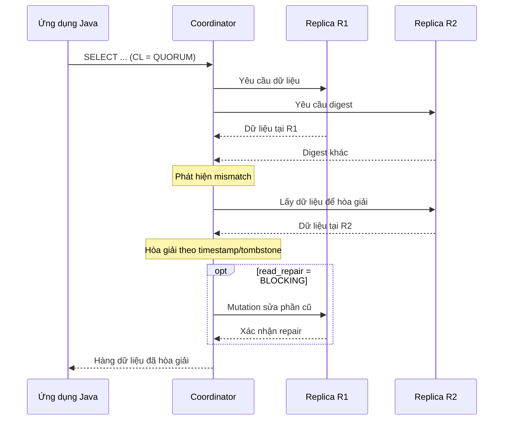

# Read repair trong đường đọc Cassandra và phạm vi bảo đảm

## 1. Read repair giải quyết vấn đề gì?

Apache Cassandra là hệ quản trị cơ sở dữ liệu **wide-column phân tán**. Dữ liệu được phân vùng theo **partition key**, nhân bản đến nhiều replica theo **replication factor (RF)** và cho phép client chọn **consistency level (CL)** của từng thao tác. Đây là nền tảng để thiết kế bảng theo truy vấn, đọc ghi với CQL và truy cập dữ liệu qua ứng dụng Java.

Trong hệ phân tán, các replica giữ cùng một partition không phải lúc nào cũng có trạng thái giống hệt nhau. Chẳng hạn:

- Một replica tạm thời mất kết nối khi có mutation mới.
- Một thao tác ghi chỉ nhận đủ phản hồi từ quorum, trong khi replica còn lại cập nhật chậm.
- Hệ thống đang xử lý lại hinted handoff, hoặc replica mới phục hồi chưa có đủ dữ liệu.
- Có dữ liệu chưa đồng bộ sau một thời gian gián đoạn dài, cần **anti-entropy repair**.

**Read repair** là cơ chế Cassandra sử dụng **trong một số lần đọc** để phát hiện dữ liệu khác nhau giữa các replica tham gia và sửa một phần chênh lệch đó. Cơ chế này hỗ trợ tính nhất quán theo yêu cầu đọc nhưng **không phải một lần đồng bộ toàn bộ cluster**.

Ví dụ với RF = 3, partition có khóa `sku = 'book-01'`:

| Replica | Giá trị đang lưu | Timestamp logic minh họa |
| --- | --- | --- |
| R1 | `stock = 10` | 100 |
| R2 | `stock = 12` | 200 |
| R3 | `stock = 12` | 200 |

Nếu một lần đọc `QUORUM` so sánh R1 với R2, Cassandra có thể nhận ra dữ liệu không khớp. Coordinator thực hiện đối chiếu theo quy tắc dữ liệu của Cassandra và xác định `stock = 12` là giá trị thắng trong ví dụ này; sau đó tùy chính sách read repair, nó có thể ghi phần thiếu về replica cũ.

**Đừng hiểu read repair là “chọn giá trị được đa số replica lưu”.** Cassandra hòa giải các cell theo timestamp, tombstone và quy tắc tương ứng. Số lượng replica phản hồi quyết định phạm vi quan sát; nó không thay thế quy tắc phân giải phiên bản dữ liệu.

## 2. Read repair nằm ở bước nào của đường đọc?

Trên một replica, dữ liệu có thể ở **memtable** và các **SSTable bất biến**. Đường đọc có thể sử dụng Bloom filter, partition index, key cache hoặc row cache khi phù hợp với cấu hình và đường truy vấn. Các bộ đệm/metadata này giúp tìm dữ liệu nhanh hơn; chúng **không thay thế so sánh phiên bản giữa các replica**.

Ở mức khái niệm, một truy vấn cần phản hồi từ nhiều replica đi qua các bước:

1. **Coordinator xác định partition và các replica liên quan** từ partition key và cấu hình topology.
2. **Gửi yêu cầu đọc** tới số replica phù hợp. Một đường đọc phổ biến lấy dữ liệu đầy đủ từ một replica và lấy **digest** (dấu tóm tắt) từ replica khác; cách lựa chọn và tối ưu hóa cụ thể thay đổi theo phiên bản.
3. **So sánh kết quả/digest.** Nếu chúng tương thích, coordinator có thể hoàn tất đọc theo CL. Nếu có **digest mismatch**, coordinator phải lấy đủ dữ liệu cần thiết để đối chiếu.
4. **Hòa giải giá trị:** xử lý timestamp, tombstone, TTL và các phiên bản khác nhau để tạo kết quả đúng theo tập dữ liệu mà lần đọc đã quan sát.
5. **Read repair khi được cấu hình:** gửi mutation sửa chữa tới replica cần cập nhật trong **phạm vi dữ liệu vừa đọc**; một số chế độ đợi xác nhận trước khi trả kết quả.



Sơ đồ là mô hình học tập, không cố định số request, replica được chọn hoặc thứ tự tối ưu hóa trong mọi bản Cassandra. Nếu replica phản hồi cùng digest, **không nhất thiết có write-back repair**. Read repair cũng không xuất hiện chỉ vì câu lệnh có từ khóa `SELECT`.

### Digest mismatch có nghĩa gì?

Digest là dấu đại diện cho dữ liệu trong phạm vi truy vấn. Khi so sánh mismatch, coordinator phải lấy lại nội dung cần thiết và hòa giải; nó không thể quyết định “digest nào mới hơn” từ chính giá trị hash.

Với một số CL thấp như `ONE`, coordinator có thể hoàn thành đọc từ **một replica** mà không so sánh hai replica. Nếu replica đó cũ, kết quả có thể cũ; không nên xem `ONE` là cơ chế tự phát hiện và sửa tất cả sự khác biệt. Ngay cả với `QUORUM`, replica không tham gia lần đọc cũng có thể còn lỗi thời.

## 3. Phân biệt đọc đủ quorum và sửa đủ replica

Giả sử một datacenter có RF = 3, các replica là R1, R2, R3:

```text
Trạng thái trước đọc:
R1: stock=10 (cũ)
R2: stock=12 (mới)
R3: stock=12 (mới)

Đọc ở LOCAL_QUORUM cần phản hồi từ 2 replica của DC.
Coordinator chọn R1 và R2 -> phát hiện mismatch -> hòa giải stock=12.

Nếu repair cho R1 hoàn tất:
R1: stock=12
R2: stock=12
R3: stock=12 (đã mới sẵn)
```

Trong tình huống khác, giả sử **R3 cũng cũ** nhưng chỉ R1 và R2 được chọn để phục vụ yêu cầu. Sau read repair giữa R1 và R2, **R3 vẫn có thể cũ** vì không tham gia phạm vi sửa.

| Khái niệm | Điều nó bảo đảm/điều khiển | Điều không bảo đảm |
| --- | --- | --- |
| `QUORUM` hoặc `LOCAL_QUORUM` | Cần đa số replica phản hồi trong phạm vi tương ứng | Mọi replica đều được kiểm tra và sửa |
| Hòa giải read result | Tạo giá trị dựa trên các phiên bản đã thu thập theo quy tắc Cassandra | Đã nhìn thấy tất cả mutation trên mọi replica |
| Blocking read repair | Chờ xác nhận sửa chữa theo chính sách khi phát hiện mismatch | Đã scan toàn bảng, mọi partition và mọi replica |
| `nodetool repair` | Công cụ anti-entropy để đồng bộ các token range/replica thuộc phạm vi được chọn | Thay thế CL của truy vấn đọc, hoặc bảo đảm mãi mãi không có replica lệch |

Do đó, một ứng dụng đọc lại đúng dữ liệu sau read repair chỉ chứng minh kết quả được tạo **trong phạm vi truy vấn, topology và CL đã sử dụng**. Đừng suy ra “cả cluster đã được repair”.

## 4. Hai chế độ read repair trong Cassandra 4.x trở lên

Với Apache Cassandra 4.x/5.x, bảng có tùy chọn `read_repair`, đáng chú ý là:

| Chế độ | Hành vi chủ yếu | Sự đánh đổi |
| --- | --- | --- |
| `BLOCKING` | Khi cần repair trong đường đọc, coordinator chờ xác nhận sửa chữa theo chính sách trước khi trả kết quả; đây là chế độ mặc định trong Cassandra 4.x | Hỗ trợ **monotonic quorum reads**, nhưng có thể tăng độ trễ đọc và làm lộ vấn đề khi replica chậm |
| `NONE` | Không thực hiện read-repair write-back trong đường đọc | Tránh việc một truy vấn đọc từng phần sửa riêng lẻ và phá tính nguyên tử ở phạm vi partition của các mutation nhiều hàng; không nhận được bảo đảm monotonic quorum reads do blocking read repair cung cấp |

Cần kiểm tra **phiên bản Cassandra thực tế** trước khi dựa vào tên tùy chọn. Cassandra 3.x có các cấu hình/cơ chế read repair khác, gồm các tỷ lệ background read repair trong một số bản; không chuyển nguyên cấu hình cũ sang 4.x/5.x khi chưa đối chiếu tài liệu phiên bản.

Ví dụ bảng dùng `BLOCKING`:

```sql
CREATE KEYSPACE IF NOT EXISTS read_repair_lab
WITH replication = {
    'class': 'NetworkTopologyStrategy',
    'dc1': 3
};

CREATE TABLE IF NOT EXISTS read_repair_lab.inventory_by_sku (
    sku text PRIMARY KEY,
    stock int,
    updated_at timestamp
) WITH read_repair = 'BLOCKING';
```

Ở môi trường Cassandra 4.x/5.x hỗ trợ tùy chọn này, có thể đổi chính sách:

```sql
ALTER TABLE read_repair_lab.inventory_by_sku
WITH read_repair = 'NONE';

-- Đổi lại khi đã đánh giá yêu cầu nhất quán và độ trễ:
ALTER TABLE read_repair_lab.inventory_by_sku
WITH read_repair = 'BLOCKING';
```

**Lưu ý:** thay đổi này áp dụng ở mức **bảng**, không có nghĩa mỗi câu `SELECT` được phép tùy ý ghi đè chính sách bảng. Đừng thay đổi `read_repair` trên production chỉ để kiểm tra một ví dụ nếu chưa đánh giá ảnh hưởng ứng dụng.

### `BLOCKING` không phải “đợi đến khi mọi replica có dữ liệu mới”

Khi phát hiện mismatch và áp dụng blocking read repair, Cassandra chờ các xác nhận cần thiết theo cơ chế và CL của lần đọc. **Không có quy tắc chờ tất cả replica trên toàn cluster.** Những replica chưa tham gia hoặc những dải dữ liệu không được truy vấn vẫn có thể chưa được sửa.

Ngoài ra, khi dữ liệu vốn đã khớp hoặc không phát hiện mismatch, `BLOCKING` không bắt buộc tạo thêm ghi sửa chữa.

### `NONE` không có nghĩa đọc “bỏ qua dữ liệu mới”

Khi đọc từ nhiều replica và phát hiện phiên bản khác nhau, Cassandra vẫn cần **hòa giải kết quả đọc** để trả dữ liệu theo semantics của truy vấn. Chính sách `NONE` bỏ bước sửa ghi ngược lại trong đường đọc, không phải yêu cầu coordinator chọn đại dữ liệu của replica đầu tiên nếu đã nhìn thấy dữ liệu khác nhau.

## 5. Bảo đảm monotonic quorum reads

**Monotonic reads** diễn đạt ý tưởng: sau khi một client quan sát trạng thái mới, những lần đọc tiếp theo trong cùng phạm vi bảo đảm không đột nhiên quay về trạng thái cũ hơn. Với Cassandra, cần hiểu cụ thể là **monotonic quorum reads** được hỗ trợ bởi blocking read repair.

Giả sử RF = 3 trong một DC:

1. R1 và R2 có phiên bản mới `v2`; R3 còn `v1`.
2. Lần đọc `LOCAL_QUORUM` thứ nhất có thể lấy R1 và R3, phát hiện mismatch.
3. Với `BLOCKING`, coordinator hoàn tất repair theo điều kiện cần thiết rồi mới trả `v2`.
4. Lần đọc `LOCAL_QUORUM` sau, dù chọn cặp replica khác, khả năng quay lại kết quả cũ do một quorum chưa được sửa được loại bỏ trong mô hình quorum phù hợp.

Nguyên tắc giao nhau của quorum trong một tập RF:

```text
RF = 3
Quorum size = floor(3 / 2) + 1 = 2

Hai tập quorum bất kỳ có ít nhất một replica chung.
```

**Điều kiện phải giữ khi suy luận:** cùng partition/phạm vi truy vấn, quorum trong cùng tập replica (chẳng hạn cùng DC khi dùng `LOCAL_QUORUM`), không có concurrent write, TTL hết hạn hoặc thao tác xóa mới thay đổi giá trị; timestamp, topology và đường đọc được hiểu đúng. Đây không phải cam kết toàn cục giữa hai datacenter dùng các local quorum **không giao nhau**.

Monotonic quorum reads cũng **khác** với:

- **Linearizability:** mọi thao tác như xảy ra nguyên tử tại một thời điểm duy nhất trên toàn hệ thống.
- **Read-your-writes:** client chắc chắn thấy ghi vừa thực hiện trong mọi điều kiện và mọi mức CL.
- **Tính nguyên tử đa partition:** toàn bộ batch/transaction trải trên nhiều partition cùng hiện ra trong một ảnh chụp nhất quán.

Một cấu hình `BLOCKING` không tự cung cấp cả ba bảo đảm trên.

## 6. Đánh đổi: đọc đơn điệu và partition-level write atomicity

Với một mutation ảnh hưởng **nhiều hàng cùng một partition**, Cassandra có cơ chế áp dụng theo partition. Tuy nhiên, khi một số replica có bản cập nhật đầy đủ còn số khác chưa theo kịp, một truy vấn chỉ đọc **một phần** partition có thể khiến blocking read repair chỉ sửa những hàng được truy vấn.

Xét bảng:

```sql
CREATE TABLE IF NOT EXISTS read_repair_lab.document_fields_by_id (
    document_id text,
    field_name text,
    value text,
    PRIMARY KEY ((document_id), field_name)
) WITH read_repair = 'BLOCKING';
```

Ứng dụng ghi đồng thời hai hàng cùng partition qua một batch:

```sql
BEGIN BATCH
  UPDATE read_repair_lab.document_fields_by_id
  SET value = 'approved'
  WHERE document_id = 'doc-1' AND field_name = 'status';

  UPDATE read_repair_lab.document_fields_by_id
  SET value = 'reviewer-7'
  WHERE document_id = 'doc-1' AND field_name = 'reviewer';
APPLY BATCH;
```

Giả sử một replica có cả hai thay đổi còn một replica cũ hơn. Sau đó ứng dụng chỉ truy vấn:

```sql
SELECT value
FROM read_repair_lab.document_fields_by_id
WHERE document_id = 'doc-1' AND field_name = 'status';
```

Nếu read repair được kích hoạt cho **hàng `status`**, replica cũ có thể được sửa hàng đó nhưng chưa được sửa hàng `reviewer`. Từ góc độ trạng thái vật lý trên replica này, hai thay đổi vốn đi cùng nhau có thể đang hiện diện **không đồng bộ** do sửa chữa một phần. Đây là lý do tài liệu Cassandra nêu sự đánh đổi giữa:

- `BLOCKING`: ưu tiên **monotonic quorum reads**.
- `NONE`: ưu tiên bảo toàn đặc tính **partition-level write atomicity** trước ảnh hưởng của read repair từng phần.

Đừng hiểu `NONE` là một giải pháp transaction ACID đa partition hoặc bảo đảm mọi loại truy vấn đọc đều quan sát ảnh chụp tổng thể. Nó tránh một nguồn làm rạn tính nguyên tử ở phạm vi partition; ứng dụng vẫn cần xem xét CL, mutation có điều kiện, concurrent writes và thiết kế dữ liệu.

### Cách chọn theo nghiệp vụ

| Yêu cầu chính | Hướng xem xét |
| --- | --- |
| Đọc quorum không muốn “đi lùi” sang giá trị cũ | `BLOCKING` với CL/quorum phù hợp và hiểu giới hạn |
| Mutation nhiều hàng cùng partition cần tránh read repair từng phần | Đánh giá `NONE` và kiểm thử semantics của workload |
| Cần giao dịch điều kiện chống lost update | Dùng **LWT/`IF`** cho khóa phù hợp; read repair không thay thế CAS |
| Cần đồng bộ replica sau sự cố kéo dài | Thực hiện **anti-entropy repair** theo kế hoạch |
| Cần tính nhất quán mạnh của nhiều partition | Thiết kế lại ranh giới dữ liệu hoặc cơ chế giao dịch/điều phối phù hợp |

## 7. Phạm vi bảo đảm của read repair: những giới hạn cần nhớ

### 7.1. Chỉ dữ liệu đã được truy vấn

Một lần đọc `WHERE sku = 'book-01'` không tự kiểm tra `sku = 'book-02'`. Với bảng có nhiều clustering row trong một partition, truy vấn chỉ một lát cắt clustering cũng không bảo đảm sửa mọi hàng còn lại trong partition.

```sql
-- Chỉ nhìn vào một hàng trong partition doc-1:
SELECT value
FROM read_repair_lab.document_fields_by_id
WHERE document_id = 'doc-1'
  AND field_name = 'status';

-- Đọc cả partition có phạm vi lớn hơn:
SELECT field_name, value
FROM read_repair_lab.document_fields_by_id
WHERE document_id = 'doc-1';
```

Ngay cả truy vấn thứ hai cũng chỉ chạm đến những replica được coordinator dùng trong lần đọc. Không nên ép ứng dụng quét cả partition khổng lồ chỉ để hy vọng sửa toàn cluster; hãy xử lý mô hình phân vùng và dùng repair vận hành phù hợp.

### 7.2. Chỉ replica tham gia giao thức đọc/sửa liên quan

Cassandra quyết định lựa chọn replica dựa trên topology, CL, trạng thái node và tối ưu hóa đọc. Những replica **không được liên hệ** có thể giữ phiên bản cũ. Nếu có nhiều datacenter, `LOCAL_QUORUM` trong một DC không mặc nhiên cập nhật dữ liệu tại DC khác.

### 7.3. Không thay thế repair định kỳ

Đây là hai hoạt động khác nhau:

| Tiêu chí | Read repair | Anti-entropy repair (`nodetool repair`) |
| --- | --- | --- |
| Kích hoạt | Trong đường đọc khi phát hiện lệch và chính sách cho phép | Theo lệnh/quy trình vận hành |
| Phạm vi | Dữ liệu nằm trong những truy vấn và replica tham gia | Token range, bảng/keyspace, replica theo lựa chọn repair |
| Mục đích | Hòa giải kết quả đọc và có thể sửa một phần replica | So sánh/đồng bộ bản sao trên phạm vi dữ liệu đã chọn |
| Tác động | Có thể làm tăng độ trễ truy vấn | Tạo tải nền về mạng, I/O, CPU trong thời gian repair |
| Khả năng thay thế | Không đủ cho dữ liệu không được truy vấn | Không thay thế lựa chọn CL và xử lý read mismatch ở thời điểm truy vấn |

Hinted handoff cũng không phải giải pháp thay thế vô hạn: hint có giới hạn về thời gian lưu giữ/cấu hình, và replica có thể bỏ lỡ mutation trong những hoàn cảnh không còn hint. Bảo đảm khôi phục dữ liệu sau sự cố phải có chiến lược repair phù hợp.

### 7.4. TTL, tombstone và clock/timestamp

Sự khác biệt giữa replica không chỉ là “giá trị số nhỏ hơn”. Cassandra cần xử lý timestamp của cell, TTL và tombstone khi hòa giải dữ liệu.

- Một bản ghi xóa được biểu diễn bằng **tombstone**, có thể phải được giữ để replica chậm không làm dữ liệu bị xóa xuất hiện trở lại.
- Dữ liệu hết TTL không đồng nghĩa tất cả SSTable xóa vật lý ngay.
- Dữ liệu ghi với timestamp sai lệch bất thường có thể ảnh hưởng quy tắc thắng thua, dù read repair hoạt động.
- Read repair không thay thế việc chọn `gc_grace_seconds`, chiến lược compaction và lịch repair đúng.

Không chủ động xóa tombstone hoặc giảm `gc_grace_seconds` chỉ để “cho read repair nhanh hơn”; hậu quả có thể là hồi sinh dữ liệu đã xóa trong một số tình huống.

## 8. Ví dụ thực hành CQL

Thực hành dưới đây minh họa cách cấu hình và quan sát hành vi đọc. Nó **không cố tình làm hỏng replica** trên môi trường production.

### Bước 1 — Chuẩn bị keyspace và bảng

```sql
CREATE KEYSPACE IF NOT EXISTS read_repair_lab
WITH replication = {
  'class': 'NetworkTopologyStrategy',
  'dc1': 3
};

CREATE TABLE IF NOT EXISTS read_repair_lab.inventory_by_sku (
    sku text PRIMARY KEY,
    stock int,
    updated_at timestamp
) WITH read_repair = 'BLOCKING';
```

Thay `dc1` và RF theo cluster thật; ví dụ này giả định đủ ba replica trong cùng DC. Nếu lab chỉ có một node, RF = 3 với `LOCAL_QUORUM` có thể không đủ replica để chạy.

### Bước 2 — Ghi và đọc theo partition key

```sql
INSERT INTO read_repair_lab.inventory_by_sku
    (sku, stock, updated_at)
VALUES ('book-01', 12, '2026-11-20 10:00:00+0000');

SELECT sku, stock, updated_at
FROM read_repair_lab.inventory_by_sku
WHERE sku = 'book-01';
```

Trong `cqlsh` có thể đặt CL của phiên làm việc:

```text
CONSISTENCY LOCAL_QUORUM;
TRACING ON;
```

Chạy lại `SELECT`, quan sát trace nếu có rồi tắt:

```text
TRACING OFF;
```

Trace giúp xem coordinator, các bước đọc và một số thông tin về thời gian xử lý; **không thấy dòng repair trong trace không có nghĩa read repair bị hỏng**, vì khi dữ liệu khớp thì chẳng có mismatch để sửa. Tracing sinh thêm tải, chỉ bật có chủ đích cho chẩn đoán.

### Bước 3 — Quan sát tùy chọn bảng

Trong phiên `cqlsh`, lệnh sau có thể giúp xem schema bảng:

```text
DESCRIBE TABLE read_repair_lab.inventory_by_sku;
```

Kiểm tra giá trị `read_repair` được hiển thị cùng schema. Cách hiển thị đầy đủ tùy phiên bản/tool; nếu công cụ không hỗ trợ tùy chọn, cần xác minh lại phiên bản trước khi thử `ALTER TABLE`.

### Bước 4 — Tình huống giả lập chênh lệch replica

Không thể bảo đảm phát sinh read repair chỉ từ các câu `INSERT`/`SELECT` khi cluster khỏe mạnh. Nếu muốn kiểm thử digest mismatch, dùng **cụm test cô lập** và công cụ fault injection có kiểm soát để tạo một replica chậm/cũ, sau đó phục hồi topology trước khi so sánh các CL. Không xóa file SSTable/commit log bằng tay để tạo lệch replica.

Khi làm lab, ghi lại:

1. RF, số node và tên DC.
2. CL đọc/ghi và chính sách `read_repair` của bảng.
3. Kết quả truy vấn trước/sau, số replica tham gia trace.
4. Sự hiện diện hay vắng mặt của digest mismatch và write-back repair.
5. Độ trễ đọc trong chế độ `BLOCKING` so với `NONE` trong **cùng điều kiện thử nghiệm**.

Không thể lấy một phép đo trên cụm không có mismatch rồi kết luận `BLOCKING` và `NONE` luôn có hiệu năng giống nhau.

## 9. Dùng Java Driver 4.x để chọn CL đọc rõ ràng

Read repair là cơ chế của Cassandra; ứng dụng Java **không gọi API “repair” cho từng `SELECT`**. Ứng dụng cần chọn query và CL phù hợp, còn chính sách `BLOCKING`/`NONE` nằm ở schema bảng.

```java
import java.util.OptionalInt;

import com.datastax.oss.driver.api.core.CqlSession;
import com.datastax.oss.driver.api.core.DefaultConsistencyLevel;
import com.datastax.oss.driver.api.core.cql.BoundStatement;
import com.datastax.oss.driver.api.core.cql.PreparedStatement;
import com.datastax.oss.driver.api.core.cql.ResultSet;
import com.datastax.oss.driver.api.core.cql.Row;

public final class InventoryRepository {
    private final CqlSession session;
    private final PreparedStatement selectBySku;

    public InventoryRepository(CqlSession session) {
        this.session = session;
        this.selectBySku = session.prepare(
            "SELECT stock FROM read_repair_lab.inventory_by_sku WHERE sku = ?"
        );
    }

    public OptionalInt findStock(String sku) {
        BoundStatement statement = selectBySku.bind(sku)
            .setConsistencyLevel(DefaultConsistencyLevel.LOCAL_QUORUM);

        ResultSet result = session.execute(statement);
        Row row = result.one();
        if (row == null || row.isNull("stock")) {
            return OptionalInt.empty();
        }
        return OptionalInt.of(row.getInt("stock"));
    }
}
```

Ở đây, `LOCAL_QUORUM` yêu cầu phản hồi từ đa số replica của DC địa phương. Nếu bảng bật `BLOCKING` và có mismatch cần sửa, độ trễ có thể tăng vì đọc phải chờ repair liên quan. Đọc nhận timeout không có nghĩa dữ liệu đã mất; cần phân biệt timeout mạng, replica chậm, thiếu quorum, contention và tải đĩa.

Không thay `LOCAL_QUORUM` bằng `LOCAL_ONE` chỉ để vượt qua timeout khi nghiệp vụ dựa vào quorum reads. Thay CL làm thay đổi ranh giới nhất quán, kể cả khả năng coordinator phát hiện replica lệch.

## 10. Chẩn đoán khi read repair ảnh hưởng độ trễ

Khi nhiều truy vấn đột nhiên chậm, cần phân biệt read repair với những nguyên nhân khác trên đường đọc: cache miss, partition lớn, quá nhiều SSTable, tombstone, GC pause, đĩa chậm, mạng giữa replica và coordinator.

| Hiện tượng | Khả năng cần xét | Hành động chẩn đoán |
| --- | --- | --- |
| Đọc quorum chậm sau sự cố node | Replica vừa hồi phục còn dữ liệu cũ; digest mismatch/repair tăng | Xem trace chọn lọc, logs, metrics về read repair và sức khỏe node |
| `ONE` nhanh nhưng `LOCAL_QUORUM` chậm | Quorum phải chờ thêm replica; có thể có mismatch | Kiểm tra latency của từng replica, CL, mạng và read repair |
| Một partition đặc biệt chậm | Partition lớn, nhiều tombstone/SSTable hoặc dữ liệu lệch | Kiểm tra mô hình partition, truy vấn, metrics và compaction |
| Nhiều replica không cùng dữ liệu sau thời gian lỗi dài | Read repair không chạm hết phạm vi, thiếu repair vận hành | Lập kế hoạch anti-entropy repair thích hợp |
| Chuyển sang `NONE` làm giảm một số lần đọc chậm | Có thể giảm write-back repair trên đường đọc | Đánh giá lại yêu cầu monotonic quorum reads và tính nguyên tử partition |
| Trace ít hoặc không có bước repair | Dữ liệu đã giống nhau hoặc chưa có so sánh mismatch | Không kết luận read repair vô hiệu chỉ từ một truy vấn |

Các bản Cassandra khác nhau có tên và phạm vi metrics/JMX khác nhau; tra metric thực tế của phiên bản đang chạy. Có thể dùng `nodetool tablestats` để quan sát thống kê đọc của bảng, nhưng **nó không tự chứng minh một lần read repair vừa xảy ra**. `nodetool repair` là thao tác bảo trì riêng, không nên chạy chỉ để thử xem một truy vấn đang đọc chậm có hết hay không mà chưa kiểm tra tải và phạm vi repair.

### Hiệu năng, tính sẵn sàng và bảo đảm

Blocking read repair có thể làm tăng số request và ghi trên replica khi dữ liệu lệch, đồng thời kéo dài thời gian hoàn tất truy vấn. Nếu replica cần repair không phản hồi đúng hạn, client có thể thấy timeout. Tắt write-back repair bằng `NONE` có thể giảm một phần chi phí này nhưng làm thay đổi semantics nhất quán. Cần đánh giá bằng **workload, SLA, CL, topology và kiểu mutation** thay vì tối ưu riêng một biểu đồ latency.

## 11. Những hiểu nhầm thường gặp

| Hiểu nhầm | Cách hiểu đúng |
| --- | --- |
| “Mỗi lần `SELECT` đều sửa toàn bộ replica” | Chỉ có thể phát hiện mismatch ở dữ liệu/replica tham gia; không phải mọi truy vấn đều kích hoạt sửa |
| “`QUORUM` nghĩa là tất cả replica giống nhau” | Quorum chỉ cần đa số phản hồi trong phạm vi; replica khác có thể còn cũ |
| “Read repair trả kết quả theo giá trị đa số” | Cassandra hòa giải theo timestamp, tombstone và quy tắc dữ liệu; quorum không bỏ phiếu chọn giá trị số đông |
| “`BLOCKING` là giao dịch tuyến tính hóa mọi truy vấn” | Đây là chính sách đọc/sửa khi mismatch, hỗ trợ monotonic quorum reads trong điều kiện phù hợp |
| “`NONE` nghĩa là không hòa giải dữ liệu” | `NONE` bỏ write-back read repair; coordinator vẫn phải hòa giải các dữ liệu đã quan sát khi kết quả khác nhau |
| “Read repair đủ thay `nodetool repair`” | Read repair không chạm dữ liệu không được đọc; repair vận hành có phạm vi rộng hơn |
| “Cache làm read repair không cần thiết” | Cache hỗ trợ tối ưu truy cập cục bộ, không là cơ chế đồng bộ phiên bản giữa replica |
| “Read repair luôn an toàn cho batch nhiều hàng” | Repair chỉ phần đã truy vấn có thể làm thay đổi khả năng quan sát tính nguyên tử theo partition |

## 12. Câu hỏi thực hành tự đánh giá

**Bài 1 — Quorum với một replica cũ.** RF = 3, R1 lưu `v1` còn R2/R3 lưu `v2`. Một lần `LOCAL_QUORUM` chọn R1 và R2. Hãy nêu cách phát hiện chênh lệch, kết quả hòa giải và replica nào có thể được sửa trong chế độ `BLOCKING`. Nếu chỉ chọn R2 và R3 thì có chắc chắn xảy ra read repair không?

**Bài 2 — Đọc một phần partition.** Một batch cập nhật hai clustering row trong cùng partition. Một replica bị thiếu toàn bộ batch; client chỉ `SELECT` một hàng và read repair sửa hàng đó. Vì sao điều này có thể ảnh hưởng partition-level write atomicity? Khi nào nên xem xét `NONE`?

**Bài 3 — Replica không bao giờ được đọc.** Một partition cũ tồn tại trên nhiều replica nhưng các ứng dụng chưa đọc tới nó trong nhiều tháng. Read repair có chắc chắn sửa khác biệt của partition đó không? Cần cơ chế vận hành gì?

**Bài 4 — Ứng dụng Java đa DC.** App ở DC1 dùng `LOCAL_QUORUM` và bảng `BLOCKING`. App ở DC2 dùng `LOCAL_QUORUM` riêng. Có được suy ra mọi lần đọc của hai app đều monotonic trên cùng phạm vi toàn cầu không? Vì sao?

**Đáp án định hướng:**

- Bài 1: mismatch có thể được nhận biết khi so digest; coordinator tải dữ liệu cần thiết, hòa giải theo timestamp/tombstone và có thể sửa R1 nếu cần. Chọn R2 + R3 khi dữ liệu trùng khớp thì có thể **không phát hiện mismatch** và không sửa R1.
- Bài 2: một read repair chỉ sửa row đã đọc, trong khi row còn lại vẫn cũ trên replica đó. `NONE` tránh write-back từng phần của đường đọc nhưng không giải quyết transaction xuyên partition.
- Bài 3: không. Cần anti-entropy repair có phạm vi và lịch trình phù hợp, không phụ thuộc chỉ vào việc có truy vấn đọc.
- Bài 4: không. Hai local quorum thuộc hai DC có thể không giao nhau; cần phân tích replication, đường ghi và yêu cầu toàn cục.

## 13. Checklist trước khi áp dụng

- [ ] Xác định RF, tên DC và CL đọc/ghi mà ứng dụng thực sự sử dụng.
- [ ] Biết bảng đang cấu hình `read_repair = 'BLOCKING'` hay `'NONE'` ở phiên bản Cassandra tương ứng.
- [ ] Phân biệt **trả kết quả được hòa giải** với **ghi sửa dữ liệu ngược về replica**.
- [ ] Hiểu read repair chỉ chạm **phạm vi dữ liệu và replica liên quan đến lần đọc**.
- [ ] Đánh giá đánh đổi giữa **monotonic quorum reads** và **partition-level write atomicity**.
- [ ] Giữ lịch **anti-entropy repair** riêng cho dữ liệu không được truy vấn và replica phục hồi.
- [ ] Theo dõi digest mismatch, read latency, tình trạng node, tombstone và SSTable khi điều tra.
- [ ] Không coi read repair là LWT, transaction đa partition, backup hoặc công cụ thay thế thiết kế partition key theo truy vấn.

**Ghi nhớ:** Read repair giúp Cassandra nhận biết và có thể sửa dữ liệu lệch **ngay trên đường đọc**, thông qua việc so sánh kết quả giữa các replica được truy vấn. `BLOCKING` hỗ trợ tính đơn điệu của các lần đọc quorum nhưng có chi phí và có thể sửa một phần partition; `NONE` loại bỏ write-back repair trong đường đọc để giữ đặc tính nguyên tử ở cấp partition trước loại tác động đó. Phạm vi của read repair luôn hẹp hơn hoạt động repair vận hành trên token range; thiết kế ứng dụng Java đáng tin cậy cần kết hợp CL, replication, schema, chống tranh chấp và quy trình anti-entropy repair.
