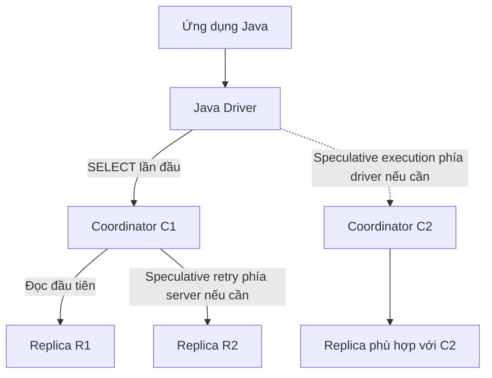

# Speculative retry phía server và phân biệt với driver

> **Chương:** Đường đọc và bộ đệm  
> **Phạm vi:** Apache Cassandra — cơ sở dữ liệu phân tán theo mô hình *wide-column* — và ứng dụng Java dùng Cassandra Java Driver 4.x.  
> **Mục tiêu:** Hiểu thời điểm Cassandra coordinator gửi thêm yêu cầu đọc tới replica khác; phân biệt cơ chế này với speculative execution và retry policy của driver; đánh giá tác động đến độ trễ, mức nhất quán, chi phí đọc và vận hành.

## 1. Tình huống: một replica chậm làm đuôi độ trễ kéo dài

Một API Java đọc bản ghi theo khóa phân vùng. Bảng được nhân bản trên ba replica (`RF = 3`). Đa số yêu cầu hoàn tất nhanh, nhưng đôi lúc replica được chọn đang chờ I/O, compaction hoặc bị áp lực CPU. Nếu coordinator cứ chờ replica đó, phần đuôi của phân phối độ trễ (p95, p99) sẽ tăng dù vẫn có replica khác đang sẵn sàng.

**Speculative retry phía server** là cơ chế Cassandra có thể chủ động gửi **thêm một yêu cầu đọc tới replica khác** khi bản đọc ban đầu chưa đủ phản hồi trong ngưỡng thời gian đã định. Đây là một dạng *hedged read*: gửi thêm công việc để tăng cơ hội có phản hồi sớm hơn.

Từ “retry” trong tên cơ chế rất dễ gây hiểu sai. Nó **không nhất thiết là gửi lại sau khi request đã thất bại**. Phần đọc ban đầu có thể vẫn đang chạy, và request bổ sung có thể chạy **song song** với nó.

Giả sử có ba replica R1, R2, R3. Với một truy vấn cần một phản hồi replica, thời gian minh họa:

```text
Client                    Coordinator                   Replica
   |                           |                            |
   | ---- SELECT key -------> | ---- read R1 ------------> R1 (chậm)
   |                           |                            |
   |                           | -- vượt ngưỡng chờ -->     |
   |                           | ---- read R2 ------------> R2 (nhanh)
   |                           | <--- kết quả từ R2 --------|
   | <---- kết quả ---------- |                            |
   |                           |       R1 có thể vẫn xử lý   |
```

Ngưỡng chờ có thể dựa trên độ trễ quan sát được hoặc thời gian cố định, tùy chính sách cấu hình và phiên bản Cassandra. Khi một phản hồi bổ sung giúp thỏa consistency level, coordinator có thể hoàn thành đường đọc sớm hơn. **Không được diễn giải rằng Cassandra luôn gửi hai request cho mọi câu `SELECT`**.

## 2. Speculative retry thuộc lớp nào trong đường đọc?

Cần định vị chính xác **coordinator** và **driver** trước khi cấu hình:



Hai mũi tên bổ sung có **điểm xuất phát khác nhau**:

- **Server-side speculative retry:** do **Cassandra coordinator C1** quyết định. C1 vẫn là coordinator của request ban đầu; nó chọn thêm replica để đọc dữ liệu cho chính request này.
- **Driver-side speculative execution:** do **Java Driver** quyết định. Driver gửi **một lần thực thi bổ sung của cùng câu lệnh** tới coordinator khác trong khi lần trước chưa hoàn tất.

Đường đi qua C2 có thể khởi phát **một loạt đọc replica mới**. Nếu C1 và C2 đều sử dụng speculative retry phía server, chi phí có thể tăng ở cả hai tầng. Chính vì vậy, cần hiểu ranh giới trước khi bật cả hai cơ chế.

Các thuật ngữ liên quan nhưng khác mục đích:

| Thuật ngữ | Ai quyết định? | Khi nào? | Hành động chính |
| --- | --- | --- | --- |
| **Server speculative retry** | Cassandra coordinator | Một replica đọc quá chậm so với chính sách của bảng | Gửi thêm yêu cầu đọc tới replica khác |
| **Driver speculative execution** | Java Driver | Một lần thực thi chưa hoàn tất sau thời gian chờ cấu hình | Gửi thêm cùng câu lệnh tới coordinator khác |
| **Driver retry policy** | Driver | Một lần thực thi **đã báo lỗi/timeout** và chính sách cho phép xử lý tiếp | Quyết định thử lại, đổi node hoặc trả lỗi tùy tình huống |
| **Read repair** | Cassandra | Cần xử lý khác biệt phiên bản dữ liệu trong quá trình đọc theo cơ chế hỗ trợ | Sửa dữ liệu không đồng nhất giữa replica |
| **Hinted handoff** | Cassandra | Replica đích không nhận được một mutation ghi trong điều kiện cho phép hint | Lưu và chuyển tiếp hint cho đường **ghi**, không phải hedged read |

Chỉ ba hàng đầu là những khái niệm cần so sánh trực tiếp khi tối ưu đuôi độ trễ đọc; read repair và hinted handoff không phải cách đặt tên khác cho speculative retry.

## 3. Phía server quyết định gửi đọc bổ sung như thế nào?

Ở mức khái niệm, một request đọc đi qua các bước:

1. Driver gửi `SELECT` tới coordinator.
2. Coordinator xác định partition key, replica đang sở hữu token, trạng thái replica và consistency level (`CL`) yêu cầu.
3. Coordinator gửi các yêu cầu đọc ban đầu tới replica được chọn. Tùy `CL` và phiên bản, request có thể bao gồm dữ liệu và thông tin digest để kiểm tra nhất quán.
4. Nếu chưa có đủ phản hồi hợp lệ và ngưỡng speculative retry của bảng bị vượt qua, coordinator **có thể** gửi thêm yêu cầu đọc tới replica phù hợp chưa được sử dụng.
5. Khi tập phản hồi đủ để thỏa `CL` và các bước kiểm tra đọc cần thiết đã hoàn tất, coordinator trả kết quả hoặc lỗi theo giao thức.

Mô hình trên là mô tả hành vi, không đại diện chính xác cho mọi nhánh triển khai giữa Cassandra 3.x, 4.x, 5.x hoặc các bản tương thích CQL.

### Điều kiện quan trọng

- **Phải có replica thay thế hợp lệ.** Nếu `RF = 1` hoặc mọi replica phù hợp đã được sử dụng, không thể kỳ vọng speculative retry tạo ra replica mới.
- **Consistency level vẫn giữ nguyên.** Một đọc `LOCAL_QUORUM` vẫn phải đạt số phản hồi hợp lệ theo `LOCAL_QUORUM`; gửi thêm replica không hạ yêu cầu xuống `ONE`.
- **Không cứu được mọi lỗi.** Replica chậm vì phần lớn node cùng nghẽn I/O, hotspot trên partition hoặc mạng chung bị bão hòa thì request bổ sung có thể cũng chậm.
- **Có thể tăng tải.** Mỗi replica được đọc thêm đều tiêu thụ CPU, network, bộ nhớ, đường đọc SSTable và có thể làm cache kém hiệu quả.
- **Không phải cơ chế đổi mô hình dữ liệu.** Truy vấn sai partition key, lọc quá rộng hoặc tombstone scan lớn không bỗng trở thành rẻ chỉ vì gửi thêm bản đọc.

### Ví dụ `RF = 3`

| `CL` đọc | Số phản hồi hợp lệ tối thiểu trong một datacenter có RF=3 | Cơ hội đọc bổ sung |
| --- | --- | --- |
| `ONE` | 1 | Có thể dùng replica khác nếu đọc đầu tiên quá chậm |
| `LOCAL_QUORUM` | 2 | Có thể gửi sang replica thứ ba nếu vẫn thiếu phản hồi |
| `ALL` | 3 | Không có replica thứ tư trong nhóm RF=3 để thay thế; speculative retry không giải quyết việc chờ cả ba |

Ví dụ này giả định ba replica nằm trong cùng datacenter, đều phù hợp và không có ràng buộc triển khai đặc biệt. Với nhiều datacenter hoặc chiến lược replication khác, tính toán `LOCAL_QUORUM` phải dựa vào **RF của datacenter cục bộ**.

## 4. Cấu hình speculative retry phía server

### Tùy chọn `speculative_retry` trên bảng

Apache Cassandra cung cấp thuộc tính bảng `speculative_retry`. Các chính sách quen thuộc trong nhiều phiên bản gồm:

| Dạng chính sách | Ý nghĩa thực hành | Đánh đổi |
| --- | --- | --- |
| `NONE` | Không chủ động gửi đọc dự phòng theo chính sách speculative của bảng | Không phát sinh tải bổ sung vì cơ chế này; có thể tăng tail latency |
| `ALWAYS` | Có xu hướng gửi thêm yêu cầu đọc dự phòng khi có replica phù hợp | Độ trễ có thể giảm trong một số trường hợp, nhưng tăng tải rõ rệt |
| `99PERCENTILE` hoặc dạng phần trăm phiên bản hỗ trợ | Dùng phân vị độ trễ đọc quan sát được làm ngưỡng | Thích ứng theo phân phối latency, nhưng ngưỡng không phải SLO cố định |
| Giá trị thời gian như `20ms` | Kích hoạt sau một ngưỡng thời gian cố định theo phiên bản hỗ trợ | Dễ liên hệ với SLO; có thể gây fan-out nhiều khi hệ thống đang chậm |

**Cú pháp và tập giá trị hợp lệ phụ thuộc phiên bản Cassandra.** Một số tài liệu hoặc bản phân phối sử dụng cách ghi `99p`, `99PERCENTILE` hay các tổ hợp chính sách khác. Hãy kiểm tra phần mô tả của phiên bản cluster đang chạy và định nghĩa schema thực tế trước khi sửa production. Không nên suy diễn mặc định của cluster từ bài học này.

Ví dụ cho môi trường lab hỗ trợ dạng cấu hình nêu trên:

```cql
CREATE TABLE IF NOT EXISTS lab.events_by_device (
    device_id text,
    event_time timestamp,
    event_id uuid,
    payload text,
    PRIMARY KEY ((device_id), event_time, event_id)
) WITH CLUSTERING ORDER BY (event_time DESC, event_id ASC);

ALTER TABLE lab.events_by_device
WITH speculative_retry = '99PERCENTILE';
```

Muốn tắt để thực hiện phép so sánh có kiểm soát:

```cql
ALTER TABLE lab.events_by_device
WITH speculative_retry = 'NONE';
```

Ví dụ dùng ngưỡng cố định **minh họa** khi phiên bản hỗ trợ:

```cql
ALTER TABLE lab.events_by_device
WITH speculative_retry = '20ms';
```

Các lệnh yêu cầu keyspace `lab` có sẵn; đừng chạy trên bảng production khi chưa xác nhận chính sách, tác động đến tải và phương án quay lại cấu hình trước đó.

### Phân vị không phải lời hứa về độ trễ

Giả sử phân vị thứ 99 của các phép đo đọc liên quan tại coordinator khoảng 80 ms. Khi áp chính sách tương ứng, speculative retry có thể được cân nhắc nếu đường đọc chưa đủ phản hồi sau ngưỡng này. Điều đó **không có nghĩa 99% request kết thúc trước 80 ms**, càng không phải bảo đảm p99 API bằng 80 ms. Tổng thời gian còn gồm:

- Chờ trong Java Driver và queue của kết nối.
- Network giữa client và coordinator.
- Đọc replica, digest/đối chiếu khi cần.
- Truyền kết quả, phân trang, mã hóa và xử lý trong ứng dụng.

Đặc biệt, với tải đang thay đổi mạnh, một ngưỡng dựa trên phân vị quá khứ có thể phản ứng chậm hoặc khiến nhiều request đồng loạt gửi thêm bản đọc.

## 5. Speculative execution của Java Driver: bản sao ở lớp client

Java Driver 4.x có chính sách speculative execution, cho phép gửi cùng statement lên **coordinator khác** sau một khoảng chờ nếu request ban đầu chưa hoàn tất.

Ví dụ cấu hình HOCON theo cách tổ chức quen thuộc của Java Driver 4.x:

```hocon
datastax-java-driver {
  advanced.speculative-execution-policy {
    class = ConstantSpeculativeExecutionPolicy
    delay = 100 milliseconds
    max-executions = 2
  }
}
```

Với chính sách hằng số, driver có thể đặt lịch thực thi bổ sung theo khoảng `delay` khi chưa có phản hồi, tối đa theo giới hạn `max-executions` mà phiên bản driver áp dụng. Đây là **cấu hình thử nghiệm**, không phải giá trị tối ưu hay khuyến nghị mặc định. Hãy kiểm tra đúng cú pháp và phần định nghĩa tham số của phiên bản driver đang sử dụng.

### Điều kiện idempotence

Driver cần biết một statement có thể được thực thi lại mà không gây hậu quả ngoài ý muốn. Với `SELECT` thông thường, có thể đánh dấu statement **idempotent**; driver từ đó mới có cơ sở dùng speculative execution theo chính sách đã cấu hình.

Ví dụ Java Driver 4.x:

```java
import com.datastax.oss.driver.api.core.CqlSession;
import com.datastax.oss.driver.api.core.DefaultConsistencyLevel;
import com.datastax.oss.driver.api.core.cql.BoundStatement;
import com.datastax.oss.driver.api.core.cql.PreparedStatement;
import com.datastax.oss.driver.api.core.cql.ResultSet;
import com.datastax.oss.driver.api.core.cql.Row;
import java.time.Instant;
import java.util.UUID;

public final class DeviceReads {
    private final CqlSession session;
    private final PreparedStatement read;

    public DeviceReads(CqlSession session) {
        this.session = session;
        this.read = session.prepare(
            "SELECT event_id, event_time, payload " +
            "FROM lab.events_by_device " +
            "WHERE device_id = ? AND event_time >= ? " +
            "LIMIT ?"
        );
    }

    public void readRecent(String deviceId, Instant from, int limit) {
        if (limit < 1 || limit > 100) {
            throw new IllegalArgumentException("limit phải từ 1 đến 100");
        }

        BoundStatement statement = read.bind(deviceId, from, limit)
            .setConsistencyLevel(DefaultConsistencyLevel.LOCAL_QUORUM)
            .setIdempotent(true)
            .setPageSize(limit);

        ResultSet result = session.execute(statement);
        for (Row row : result) {
            UUID eventId = row.getUuid("event_id");
            Instant eventTime = row.getInstant("event_time");
            String payload = row.getString("payload");
            System.out.printf("%s %s %s%n", eventId, eventTime, payload);
        }
    }
}
```

Ví dụ này giả định `CqlSession` đã được kết nối và có keyspace/table như trên. `setIdempotent(true)` là **khai báo tính an toàn thực thi lại**, không phải lệnh bật speculative execution riêng cho statement. Driver còn phải được cấu hình chính sách thích hợp và có coordinator dự phòng để thực hiện.

**Không đánh dấu mọi câu lệnh là idempotent một cách máy móc.** Counter update, thao tác có side effect bên ngoài, các hành vi phụ thuộc thời điểm/timestamp hoặc những mutation không bảo đảm kết quả khi thực thi lại cần được đánh giá riêng. Với speculative execution, hai lần thực thi có thể **đồng thời**; rủi ro không thể giải quyết đơn giản bằng giả định lần đầu chắc chắn đã thất bại.

### Driver gửi thêm tới đâu?

Thông thường driver sử dụng chính sách chọn host và tình trạng kết nối để thử coordinator khác. Hai lần thực thi có thể tới C1 và C2, nhưng **hai coordinator vẫn có thể đọc các replica giao nhau**.

Bởi vậy:

- Hai coordinator khác nhau **không** bảo đảm hai tập replica hoàn toàn khác nhau.
- Số request trên mạng client–coordinator có thể tăng, đồng thời tổng read request tới replica cũng tăng.
- Request chậm ban đầu không được “hoàn tác” mọi công việc đã thực hiện chỉ vì lần bổ sung trả về trước.

## 6. Đừng nhầm speculative execution với retry policy của driver

Có thể nhận biết qua **sự kiện kích hoạt**:

```text
                 Một lần SELECT đang chờ
                           |
                  +--------+--------+
                  |                 |
          Chưa trả lời đủ lâu     Đã trả lỗi/timeout
                  |                 |
         Speculative execution   Retry policy đánh giá
         gửi thêm song song      lỗi và quyết định xử lý
                  |                 |
          Có thể có hai yêu cầu  Có thể trả lỗi, thử lại
          đồng thời              hoặc chuyển coordinator
```

Retry policy của driver là logic xử lý **phản hồi lỗi** theo khả năng retry và mức nhất quán. Speculative execution nhằm cải thiện **thời gian chờ trước khi nhận kết quả**, kể cả khi request gốc chưa báo lỗi.

Một câu truy vấn có thể trải qua cả hai cơ chế trong những tình huống phức tạp, vì vậy khi debug cần ghi nhận: coordinator nào đã nhận request, request nào được thực thi bổ sung, lỗi gì xuất hiện và lần thực thi nào trả kết quả cho client.

Đặc biệt, đừng suy diễn timeout luôn đồng nghĩa server chưa làm gì. Với tác vụ ghi không idempotent, việc retry từ phía driver có thể tạo kết quả không mong đợi. Bài này ưu tiên **đường đọc** chính vì speculative read dễ an toàn hơn so với speculative write.

## 7. Cơ chế nào làm tăng tải bao nhiêu?

Một số tình huống ước lượng để nhìn rõ *request amplification*:

| Kịch bản | Client → coordinator | Coordinator → replica | Rủi ro nổi bật |
| --- | --- | --- | --- |
| Không có speculative nào | 1 request | Bộ đọc ban đầu cần để đạt CL | Tail latency nếu một replica chậm |
| Chỉ speculative retry server | 1 request | Có thể thêm đọc tới replica khác | Tăng read I/O trên replica |
| Chỉ speculative execution driver | Có thể 2 lần thực thi song song | Mỗi coordinator có đường đọc riêng | Trùng công việc ở nhiều coordinator/replica |
| Cả server và driver | Có thể 2 hoặc nhiều lần thực thi | Mỗi coordinator còn có thể mở rộng sang replica khác | Fan-out ở nhiều tầng, cạnh tranh tài nguyên |

Đây là **mô hình định tính**, không phải lời khẳng định số lượng request cố định. Số lần thực thi thực tế chịu ảnh hưởng của `CL`, RF, topology, policy, trạng thái replica và việc request hoàn tất trước khi ngưỡng được kích hoạt.

Hãy nghĩ tới một hệ thống p99 đang tăng vì đĩa của tất cả replica bão hòa. Bật speculative retry quá mạnh sẽ **đổ thêm đọc** vào cùng các đĩa đó, có thể khiến p99 còn xấu hơn. Ngược lại, nếu chỉ một replica lệch chậm trong khi replica khác còn dư năng lực, một lượng speculative read vừa phải có thể giảm đuôi độ trễ.

Vì thế, **hedging không phải cách tăng năng lực phục vụ**. Nó trao đổi thêm một phần tài nguyên để tăng xác suất hoàn tất nhanh.

## 8. Ảnh hưởng của cache, SSTable và kiểu truy vấn

Speculative retry nằm trong **đường đọc và bộ đệm** nhưng không phải một cache độc lập. Một replica có thể nhanh hoặc chậm tùy:

- **Key cache / row cache (nếu được bật):** hit/miss có thể thay đổi lượng I/O; mỗi replica có trạng thái cache riêng.
- **Bloom filter, partition index, index summary:** ảnh hưởng việc tìm SSTable/partition và số lần đọc đĩa.
- **SSTable và compaction:** dữ liệu dàn trải qua nhiều SSTable hoặc compaction đang chạy có thể làm tăng tail latency.
- **Tombstone:** truy vấn phải duyệt nhiều dấu xóa có thể chậm trên **mọi** replica; speculative retry không loại bỏ tombstone.
- **Partition size và truy vấn:** partition cực lớn, đọc dải quá rộng hoặc yêu cầu `ALLOW FILTERING` tốn kém không được sửa bằng hedging.
- **Repair và tình trạng replica:** độ lệch dữ liệu, lỗi hoặc replica bị quá tải có thể tạo chi phí bổ sung khi đọc.

Một kết quả từ replica thứ hai có thể đến nhanh vì cache nóng, SSTable bố trí thuận lợi hoặc node ít tải. Nhưng không có bảo đảm replica thứ hai luôn tốt hơn; phải đo bằng số liệu vận hành thực.

### Speculative retry không thay đổi ý nghĩa dữ liệu đọc

Giả sử client đặt `LOCAL_QUORUM`, việc gửi thêm một bản đọc vẫn phải tuân thủ quy tắc kết hợp phản hồi và đối chiếu của mức nhất quán này. Speculative retry không được dùng như cách hạ CL, bỏ qua dữ liệu phân tán hoặc thay thế thiết kế replication/repair.

Nếu hệ thống yêu cầu tính nhất quán nghiêm ngặt cho điều kiện cập nhật, hãy xem xét cơ chế LWT và mô hình khóa phù hợp. Server speculative retry cho đường đọc không biến một cặp `SELECT` + `UPDATE` thông thường thành giao dịch nguyên tử.

## 9. Quan sát và xác minh phía nào đang gửi thêm request

Cần có **hai nhóm telemetry độc lập**: server và driver.

### Phía server

Có thể thu thập, tùy phiên bản Cassandra và cấu hình monitoring:

- Thống kê read latency theo bảng, gồm phân phối p95/p99 và tốc độ truy vấn.
- Metrics/tracing về speculative retries và các lần đọc tới replica bổ sung.
- Tình trạng replica: CPU, disk, pending read tasks, dropped messages, compaction, GC, network.
- Tỷ lệ read timeout và lượng yêu cầu hoàn tất được so với tổng request.

Ở môi trường thử nghiệm, `cqlsh` có tracing:

```cql
TRACING ON;

SELECT event_id, event_time, payload
FROM lab.events_by_device
WHERE device_id = 'sensor-01'
LIMIT 20;

TRACING OFF;
```

Tracing cho biết đường đi của một truy vấn và có thể hỗ trợ nhận diện hoạt động đọc bổ sung. **Tên event thay đổi giữa các phiên bản**, nên đừng viết bộ kiểm tra chỉ khớp một chuỗi log cố định. Tracing có overhead; không bật dày đặc trên production.

Lưu ý một phiên đọc nhanh sẽ **không kích hoạt** speculative retry. Để quan sát được cơ chế, cần đặt workload đại diện và đủ mẫu; không nên cố làm hỏng node production để tạo một trace.

### Phía driver

Thu thập:

- Số lần **speculative execution** được driver khởi phát và số lần đem lại kết quả trước.
- Latency nhìn từ client, retry/timeout và coordinator được chọn.
- Số kết nối/luồng request đang chờ, saturation, per-host request in-flight.
- Độ trễ end-to-end của API Java, đặc biệt p95/p99 theo loại truy vấn.

Không suy ra “driver đã speculative” chỉ vì Cassandra server có metric speculative retry tăng. Ngược lại, driver có thể gửi hai lần thực thi dù server table đang cấu hình `speculative_retry='NONE'`.

### Tình huống dễ nhầm khi soi log

```text
15:00:00.000  Driver gửi SELECT tới Coordinator C1
15:00:00.040  C1 gửi thêm đọc sang R3 (server speculative)
15:00:00.100  Driver chưa nhận kết quả, gửi SELECT tới C2
15:00:00.125  C2 trả kết quả về driver
15:00:00.150  C1 hoàn tất quá muộn
```

Đây là **dòng thời gian minh họa**, không phải log Cassandra thật. Cùng một lời gọi Java đã tạo hai coordinator execution và có một speculative retry bên trong C1. Nếu chỉ nhìn latency cuối 125 ms mà không nhìn số lần đọc, ta có thể đánh giá sai chi phí tài nguyên.

## 10. Thí nghiệm so sánh có kiểm soát

Có thể thực hành trên cluster lab có ít nhất một partition được nhân bản sang nhiều replica, dữ liệu gần với workload mong muốn và quyền xem metrics. Không cần tạo lỗi chủ động trên production.

### Bước A — Chuẩn bị truy vấn có khóa phân vùng

```cql
INSERT INTO lab.events_by_device
  (device_id, event_time, event_id, payload)
VALUES ('sensor-01', '2026-11-21T03:00:00Z',
        11111111-1111-4111-8111-111111111111, 'ok');

SELECT event_id, event_time, payload
FROM lab.events_by_device
WHERE device_id = 'sensor-01'
LIMIT 20;
```

Bài đo này chỉ minh họa một truy vấn hợp lệ theo partition key; muốn đo p99 thực sự cần nhiều partitions, dữ liệu có kích thước phù hợp, lượng đọc song song và phân phối tải gần thực tế.

### Bước B — Đo baseline

Tắt speculative policy phía server cho bảng lab và để driver không có speculative execution, sau đó đo **p50/p95/p99**, throughput, CPU, disk I/O, timeout và số replica read thực tế.

### Bước C — Bật một tầng mỗi lần

1. Bật server speculative retry trên bảng, giữ driver như cũ. Đo độ trễ **và** số đọc bổ sung.
2. Trả server về baseline, bật driver speculative execution **chỉ cho SELECT idempotent**. Đo độ trễ và số coordinator execution.
3. Nếu cần, thử cả hai với giới hạn rõ ràng; kiểm tra xem lợi ích cộng thêm có bù được tải tăng không.

Nên thử ở cả tải thấp và cao, lúc cache nóng/lạnh và khi một replica có hiệu năng lệch so với các replica khác. Mỗi lần thay đổi phải ghi rõ phiên bản Cassandra, driver, RF, CL và cấu hình policy để kết quả có thể tái hiện.

### Bước D — Dùng tiêu chí định lượng

| Chỉ số | Câu hỏi cần trả lời |
| --- | --- |
| p95/p99 API và Cassandra read | Tail latency có giảm đủ để đạt SLO? |
| Tổng replica reads / một client read | Mỗi request phải trả thêm bao nhiêu chi phí? |
| Số speculative trigger và tỷ lệ thực sự giúp hoàn tất | Hedging có đang kích hoạt quá thường xuyên? |
| CPU, disk I/O, network, compaction, pending tasks | Cluster còn năng lực khi fan-out tăng không? |
| Timeout, retry, error rate | Có làm tăng lỗi dưới tải đỉnh không? |
| Khác biệt giữa node nhanh và node chậm | Đang chữa một outlier hay đang che vấn đề diện rộng? |

Ví dụ **giả định**: p99 API giảm từ 220 ms xuống 160 ms nhưng read I/O tăng 80% khi cluster đã gần bão hòa. Đây chưa chắc là cải thiện phù hợp. Ngược lại, p99 giảm đáng kể với chỉ 2–3% đọc bổ sung trong cluster còn dư tài nguyên có thể là một đánh đổi đáng cân nhắc. Cần dựa vào SLO và ngân sách tài nguyên riêng của hệ thống.

## 11. Các tình huống lựa chọn

| Bối cảnh | Ưu tiên xem xét | Giải thích |
| --- | --- | --- |
| Một replica thỉnh thoảng chậm, các replica khác còn dư năng lực | Server speculative retry mức vừa phải | Có thể lấy kết quả từ replica dự phòng mà không nhân thêm cả coordinator execution |
| Đuôi độ trễ nằm ở coordinator, đường nối client–coordinator hoặc host quá tải | Driver speculative execution cho SELECT idempotent | Gửi request sang coordinator khác có thể né điểm nghẽn phía coordinator |
| Driver đã gửi nhiều lần thực thi, server cũng fan-out mạnh | Giới hạn một hoặc cả hai policy, đo lại | Tránh khuếch đại tải quá mức |
| RF=1 hoặc CL cần phản hồi từ mọi replica | Tối ưu đường đọc, phân phối tải và lỗi gốc | Không có replica dự phòng thật sự để hedging |
| Tombstone scan hoặc partition nóng trên mọi replica | Sửa mô hình bảng, TTL, truy vấn và compaction | Đọc bổ sung vẫn gặp cùng chi phí |
| Query chỉ thỉnh thoảng chậm khi một node có GC/I/O spike | Điều tra node chậm song song với đánh giá hedging | Speculation có thể giảm triệu chứng nhưng không sửa nguyên nhân |
| Tác vụ ghi không idempotent, counter hoặc side effect | Không tự bật speculative execution | Gửi đồng thời hai lần có thể thay đổi kết quả nghiệp vụ |

### Cách cân nhắc thứ tự

Đầu tiên hãy phân tích **đường đọc thật**: partition key, số hàng trả về, cache, SSTable và số replica phải chờ. Sau đó đo xem đuôi độ trễ nằm **ở replica** hay **ở coordinator/đường client**. Khi xác định được vị trí, mới thử policy tương ứng, luôn kèm giới hạn fan-out và chỉ số nguồn lực.

Đừng chọn `ALWAYS` hay delay cực thấp chỉ vì chúng làm vài request thử nghiệm nhanh hơn. Khi nhiều truy vấn đồng thời kích hoạt speculative read, tổng số công việc có thể tăng đúng lúc cluster thiếu tài nguyên nhất.

## 12. Những câu khẳng định sai thường gặp

**“Cassandra server speculative retry và Java Driver retry là cùng một cơ chế.”** Sai. Một cơ chế chạy trên coordinator khi replica chậm; một cơ chế của driver xử lý lỗi, và speculative execution của driver còn là cơ chế riêng.

**“Bật server speculative retry sẽ tạo coordinator thứ hai.”** Sai. Coordinator đầu tiên gửi thêm đọc tới replica; coordinator khác xuất hiện khi driver chủ động gửi thêm execution hoặc cơ chế chuyển hướng khác ở cấp client.

**“Speculative retry giúp đạt `LOCAL_QUORUM` bằng một phản hồi.”** Sai. CL không bị hạ; replica dự phòng chỉ giúp đạt đủ phản hồi hợp lệ sớm hơn.

**“Đặt `99PERCENTILE` làm API p99 đúng bằng ngưỡng đó.”** Sai. Nó là policy kích hoạt một phần đường đọc của coordinator, không phải cam kết độ trễ end-to-end.

**“Cứ bật cả hai tầng thì nhanh hơn.”** Sai. Một driver execution mới có thể sinh nhiều đọc replica; nếu replica cùng bão hòa, fan-out khiến kết quả tệ hơn.

**“Dùng speculative execution cho mọi `UPDATE` vì Cassandra ghi idempotent.”** Sai. Idempotence phải đánh giá trên statement cụ thể, bao gồm counter, timestamp, LWT và side effect; không suy ra từ tên phương thức hay loại CQL chung.

**“Thấy request timeout tức là replica chưa xử lý gì.”** Sai. Timeout chỉ nói không nhận được kết quả trong giới hạn thời gian; những phần việc phía server có thể vẫn đã diễn ra.

## 13. Bài tập tự kiểm tra

1. RF=3, CL=ONE: R1 bị chậm nhưng R2 còn sẵn. Coordinator có thể làm gì khi `speculative_retry` cho phép, và ai vẫn là coordinator?
2. RF=3, CL=ALL: Vì sao gửi “một đọc nữa” tới cùng ba replica không giải quyết yêu cầu phải chờ cả ba?
3. Driver cấu hình delay 100 ms và bảng cấu hình speculative sau 40 ms. Một truy vấn thực tế chưa hoàn tất sau 120 ms có thể đi qua những nhánh bổ sung nào?
4. So sánh sự kiện kích hoạt driver **retry policy** với driver **speculative execution**.
5. Vì sao `setIdempotent(true)` cần đúng về mặt nghiệp vụ? Nó tự bật speculative policy hay chỉ giúp driver được phép áp dụng?
6. Sau khi bật hedging, p99 giảm nhưng CPU và disk I/O tăng đột ngột. Bạn sẽ thu thập thêm những chỉ số nào trước khi quyết định giữ policy?
7. Nếu mọi replica phải quét rất nhiều tombstone, cơ chế nào nên được sửa trước: chính sách speculative hay thiết kế dữ liệu và truy vấn?
8. Trình bày lý do việc thay đổi `speculative_retry` không làm đổi consistency level hoặc replication factor của bảng.

## 14. Ghi nhớ

- **Server speculative retry**: một coordinator gửi thêm request đọc sang replica khác khi đường đọc ban đầu quá chậm.
- **Driver speculative execution**: driver gửi thêm lần thực thi cùng statement sang coordinator khác trước khi lần đầu hoàn tất; chỉ nên dùng cho statement được xác định idempotent.
- **Driver retry policy**: xử lý lỗi hoặc timeout của một execution, khác với hedging khi chưa có lỗi.
- **Tính nhất quán không đổi**: mọi đường đọc vẫn phải đáp ứng CL của truy vấn; fan-out không thay cho replication hay repair.
- **Chi phí cần tính**: một lời gọi Java có thể tạo nhiều coordinator execution và nhiều replica reads; luôn quan sát cả hai tầng.
- **Cách đánh giá**: đo p95/p99 **cùng** số đọc bổ sung, throughput và tải CPU/I/O trên dữ liệu gần sản xuất.

**Thông điệp trọng tâm:** Speculative retry là cách dùng thêm tài nguyên để giảm rủi ro chờ một replica chậm; speculative execution của driver dùng thêm coordinator để tránh chờ một lần thực thi chậm. Hãy chọn đúng tầng gây tail latency, đặt giới hạn phù hợp và đo hiệu quả trên toàn hệ thống.
