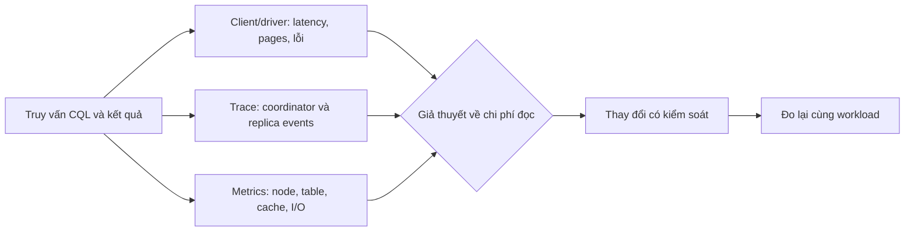

# Đối chiếu trace, metric và kết quả để xác định chi phí đọc

## 1. Vấn đề: truy vấn trả về ít hàng vẫn có thể rất đắt

Trong Apache Cassandra, đọc một partition không đơn thuần là tìm một hàng trên đĩa. Coordinator phải chọn các replica theo **partition key, replication và consistency level**; mỗi replica có thể đọc từ **memtable**, kiểm tra **Bloom filter**, định vị dữ liệu trong các **SSTable**, hợp nhất nhiều phiên bản và tombstone, rồi gửi dữ liệu hoặc digest về coordinator. Coordinator có thể phải đối chiếu phản hồi từ nhiều replica trước khi trả kết quả. Độ trễ mà ứng dụng Java cảm nhận còn bao gồm mạng, lập lịch, paging và xử lý kết quả ở client.

Điều này tạo ra một nghịch lý hay gặp: truy vấn `LIMIT 20` chỉ trả 12 hàng nhưng vẫn mất hàng trăm mili giây. Con số **12 hàng trả về** không cho biết replica đã đọc bao nhiêu SSTable, quét bao nhiêu tombstone, chờ mạng bao lâu hoặc có bao nhiêu page được tải.

Bài thuộc chương **Đường đọc và bộ đệm** của mô-đun `DATABASE_ENGINE_WIDE_COLUMN_CASSANDRA`. Phạm vi gắn với kiến trúc phân tán, mô hình wide-column và thiết kế bảng theo truy vấn, partition key, mức nhất quán đọc ghi, compaction, repair, xử lý lỗi và kết nối Java. Mục tiêu là điều tra **chi phí đọc bằng cách đối chiếu ba nguồn thông tin**:

1. **Kết quả truy vấn và phía client:** trả đúng dữ liệu không, bao nhiêu hàng/page/byte, mất bao lâu, có timeout/retry hay không?
2. **Query trace:** lần truy vấn đó đã đi qua những node, công đoạn và khoảng chờ nào?
3. **Metrics:** trong một khoảng đo đủ đại diện, node/bảng có độ trễ, số SSTable, tombstone, cache miss, queue, I/O hoặc lỗi tăng không?

Sau bài này, người học có thể chạy một lần tracing có kiểm soát, đọc các metric liên quan, lập giả thuyết về điểm nghẽn và kiểm tra lại bằng truy vấn cùng điều kiện. Không lấy một trace riêng lẻ để suy ra hiệu năng của toàn cluster.

## 2. Ba góc nhìn bổ sung cho nhau

| Góc nhìn | Phạm vi quan sát | Câu hỏi trả lời tốt | Điểm mù |
| --- | --- | --- | --- |
| **Kết quả và latency client** | Một request/page hoặc toàn bộ quá trình đọc tại ứng dụng | Người dùng nhận gì? Mất bao lâu? Có retry, paging, deserialize? | Không chỉ ra chính xác chi phí nằm tại replica, coordinator hay client. |
| **Trace CQL** | Một lần thực thi được bật tracing và các event được ghi nhận | Request đến node nào? Giai đoạn nào xuất hiện chờ hoặc đọc nhiều dữ liệu? | Có overhead, không bảo đảm mọi event đều xuất hiện; không phản ánh phân phối p95/p99 toàn hệ thống. |
| **Metric node/table/cache** | Nhiều request trên một node trong khoảng thời gian | Xu hướng, tail latency, tombstone, số SSTable mỗi lần đọc, cache hit/miss, queue? | Không tự quy một biến động cho đúng query nếu có nhiều workload cùng chạy. |

Một cách xem gần đúng thời gian end-to-end:

```text
Thời gian ứng dụng quan sát
  ≈ thời gian chờ ở client/driver + mạng
    + coordinator/replica phục vụ request
    + giải mã/xử lý kết quả
    + tải các page tiếp theo (nếu ứng dụng đọc hết)
```

Đây là **phân rã khái niệm**, không phải công thức cộng các số `source_elapsed` trong trace. Các công đoạn có thể chạy song song và các thước đo có phạm vi đo khác nhau. Một ứng dụng đo đến lúc nhận page đầu tiên thường có kết quả ngắn hơn nhiều so với đo đến lúc **duyệt hết mọi page**.



## 3. Ví dụ xuyên suốt: đọc dữ liệu cảm biến theo ngày

Giả sử có một keyspace thực hành `read_lab_ks` với replication phù hợp topology của môi trường. Trên cluster một DC có ba node, có thể tạo ví dụ sau (thay `dc1` bằng tên DC thực tế):

```sql
CREATE KEYSPACE read_lab_ks
WITH replication = {'class': 'NetworkTopologyStrategy', 'dc1': '3'};

CREATE TABLE read_lab_ks.events_by_device (
    device_id text,
    bucket_day date,
    event_ts timestamp,
    event_id uuid,
    temperature decimal,
    payload text,
    PRIMARY KEY ((device_id, bucket_day), event_ts, event_id)
) WITH CLUSTERING ORDER BY (event_ts DESC, event_id ASC);
```

Nếu lab có số node khác, điều chỉnh **RF trên keyspace thử nghiệm** theo topology và mục tiêu học; RF lớn hơn số node sẵn sàng trong DC có thể làm `LOCAL_QUORUM`/`ALL` không thực hiện được. Không đổi replication của keyspace production chỉ để làm bài.

```sql
INSERT INTO read_lab_ks.events_by_device
    (device_id, bucket_day, event_ts, event_id, temperature, payload)
VALUES
    ('sensor-7', '2026-11-21', '2026-11-21T08:00:00+0000',
     11111111-2222-3333-4444-555555555555, 27.1, 'sample-a');

INSERT INTO read_lab_ks.events_by_device
    (device_id, bucket_day, event_ts, event_id, temperature, payload)
VALUES
    ('sensor-7', '2026-11-21', '2026-11-21T08:01:00+0000',
     aaaaaaaa-bbbb-cccc-dddd-eeeeeeeeeeee, 27.4, 'sample-b');
```

Đọc một đoạn trong partition:

```sql
SELECT event_ts, event_id, temperature, payload
FROM read_lab_ks.events_by_device
WHERE device_id = 'sensor-7'
  AND bucket_day = '2026-11-21'
  AND event_ts >= '2026-11-21T08:00:00+0000'
  AND event_ts <  '2026-11-21T09:00:00+0000'
LIMIT 100;
```

Ở schema này, **partition key tổng hợp** là `(device_id, bucket_day)`; `event_ts` và `event_id` là clustering columns. Query được định tuyến đến một partition và giới hạn khoảng clustering, thuận lợi để phân tích chi phí đọc. Hai hàng mẫu chỉ nhằm xác nhận câu lệnh; để thử hiệu năng cần số lượng dữ liệu/phiên bản/tombstone và tải thực tế đủ đại diện.

### Luôn ghi lại ngữ cảnh truy vấn

Trước khi đo, chốt **đúng CQL và bind values**, keyspace, schema, version Cassandra, consistency level, thời gian đo, DC và coordinator, page size, số trang đọc, số hàng/byte kết quả và cách client đo latency. Giữ các yếu tố này nhất quán giữa các lần so sánh; thay cả CL lẫn page size cùng lúc sẽ khiến kết quả khó diễn giải.

## 4. Bật tracing đúng cách trong `cqlsh`

Các lệnh dưới đây dành cho môi trường thử nghiệm hoặc một **mẫu request được lựa chọn**:

```sql
CONSISTENCY LOCAL_QUORUM
PAGING 100
ELAPSED ON
TRACING ON

SELECT event_ts, event_id, temperature, payload
FROM read_lab_ks.events_by_device
WHERE device_id = 'sensor-7'
  AND bucket_day = '2026-11-21'
  AND event_ts >= '2026-11-21T08:00:00+0000'
  AND event_ts <  '2026-11-21T09:00:00+0000'
LIMIT 100;

TRACING OFF
```

`TRACING ON` khiến `cqlsh` in các event sau khi truy vấn hoàn tất; `ELAPSED ON` in thời gian phía `cqlsh` quan sát; `PAGING 100` đặt kích thước page theo **số hàng**. Nếu kết quả có nhiều page, việc người dùng tiếp tục lấy page cũng có thể phát sinh thêm hoạt động đọc; cần ghi nhận bạn đã đọc **một page** hay **toàn bộ kết quả**.

Đầu ra trace thường có các cột tương tự:

```text
Tracing session: <session-uuid>

activity                        | timestamp            | source       | source_elapsed | client
--------------------------------+----------------------+--------------+----------------+---------
Execute CQL3 query              | ...                  | 192.0.2.10   |              0 | ...
... gửi yêu cầu đọc đến replica  | ...                  | 192.0.2.10   |           ...  | ...
... xử lý partition/SSTable     | ...                  | 192.0.2.11   |           ...  | ...
... nhận phản hồi               | ...                  | 192.0.2.10   |           ...  | ...
...                              | ...                  | ...          |            ... | ...
```

Đây chỉ là **sơ đồ minh họa**, không phải log đã chạy thực tế. Chuỗi `activity` và việc event nào xuất hiện thay đổi theo Cassandra version, CL, trạng thái cache và đường đi đọc. Quan sát các thông tin có ý nghĩa:

- **Session ID:** dùng để mở lại trace của lần thực thi.
- **`source`:** node phát sinh event; phân biệt coordinator và replica.
- **`activity`:** thao tác được ghi lại, ví dụ gửi/nhận thông điệp, đọc SSTable, merge hoặc reconcile dữ liệu; không gán cứng ý nghĩa dựa trên một chuỗi event ở mọi version.
- **`timestamp` và `source_elapsed`:** hỗ trợ dựng diễn tiến trong phạm vi trace; **không cộng tất cả `source_elapsed`** để thành tổng latency, vì đây là các mốc thời gian và nhiều công đoạn song song.
- **Thời gian tổng và kết quả:** so với `ELAPSED`/latency driver và số hàng trả về; chú ý overhead của trace.

Nếu đã có session ID, `cqlsh` có thể hiển thị lại bằng:

```text
SHOW SESSION <session-uuid>
```

`SHOW SESSION` là **lệnh `cqlsh`**, không phải SQL; thay placeholder bằng UUID được in từ lần trace. Một cách khác là xem các bảng hệ thống, sau khi tắt tracing để giảm nhiễu:

```sql
SELECT session_id, coordinator, duration, request, started_at
FROM system_traces.sessions
WHERE session_id = 12345678-1234-1234-1234-123456789abc;

SELECT event_id, activity, source, source_elapsed, thread
FROM system_traces.events
WHERE session_id = 12345678-1234-1234-1234-123456789abc;
```

Các UUID ở ví dụ là **placeholder**, không chỉ đến trace có thật. Trace được ghi bất đồng bộ và có TTL theo cấu hình; event có thể đến muộn hoặc bị thiếu, vì thế một kết quả rỗng không đủ để kết luận truy vấn không chạy. Không lưu hoặc bật tracing liên tục trên workload production: thu thập trace tạo thêm công việc, lưu thêm dữ liệu và có thể chứa CQL/bind values nhạy cảm.

## 5. Cách đọc trace theo đường đọc phân tán

Với một partition read, dòng sự kiện thường được phân tích theo các nhóm sau:

| Nhóm sự kiện / giai đoạn | Điều cần kiểm tra | Điều có thể suy ra nếu có bằng chứng khác |
| --- | --- | --- |
| Coordinator nhận và phân tích query | Coordinator có đang bận, chuẩn bị/parse thường xuyên, có truy vấn khác loại? | Prepared statement và driver routing có thể giảm một phần overhead, nhưng không giải quyết lỗi schema. |
| Xác định replica, gửi request | Số replica được liên hệ, DC/rack, CL, thời gian chờ phản hồi | Cross-DC hoặc node chậm có thể làm tăng tail latency. |
| Replica đọc memtable/cache/SSTable | Có nhiều SSTable, Bloom filter hoặc bước merge/reconciliation không? | Read amplification cao, dữ liệu phân mảnh hoặc tombstone có thể tăng CPU/I/O. |
| Digest/data response | Đọc dữ liệu/digest theo CL và version như thế nào? | Coordinator có thể tốn thêm chi phí đối chiếu replica; không kết luận read repair chỉ từ việc có digest. |
| Read repair / speculative retry (nếu xuất hiện) | Có nhánh đọc bổ sung hoặc bất đồng replica? | Có thể là chi phí mạng/CPU thêm; cần metric và tình trạng replica để xác nhận. |
| Serialize/paging và trả kết quả | Page size, kích cỡ hàng, số page, thời gian chờ ở client | Payload lớn hoặc nhiều page có thể chi phối thời gian end-to-end. |

**Một khoảng thời gian lớn giữa hai event chưa chắc là chi phí của thao tác nằm giữa hai dòng**: event có thể được ghi trễ; dữ liệu đến từ nhiều node có đồng hồ khác nhau; và trace không bao phủ toàn bộ thời gian ứng dụng chờ. Hãy tìm **mẫu lặp lại** ở nhiều trace cùng loại, rồi đối chiếu metric đúng node và đúng khoảng thời gian.

### Caching được thể hiện gián tiếp

Cassandra có nhiều lớp hỗ trợ đọc:

1. **Memtable:** chứa các mutation chưa flush và có thể đáp ứng một phần dữ liệu đọc.
2. **Key cache:** tăng tốc định vị vị trí partition trong SSTable; **không đồng nghĩa cache nguyên kết quả của `SELECT`**.
3. **Row cache:** cache dữ liệu theo cách và giới hạn của từng version/table; có thể bị tắt, không phải lớp cache luôn hiệu quả với mọi truy vấn.
4. **Chunk cache / hệ điều hành / buffer:** giảm chi phí đọc khối dữ liệu lặp lại tùy version và cấu hình.
5. **Bloom filter, partition index, index summary:** giúp tránh/giảm một số truy cập SSTable; Bloom filter là cấu trúc xác suất, **không phải cache các hàng trả về**.

Trace ít truy cập SSTable sau khi đọc lại có thể là dấu hiệu dữ liệu còn trong memtable hoặc được cache, nhưng **chỉ nhìn trace không đủ chứng minh cache hit**. Kiểm tra metric hit/miss và workload lặp lại.

## 6. Thu metrics từ đúng node, đúng bảng và đúng khoảng thời gian

Các lệnh quản trị thường dùng:

```bash
# Tổng quan node và các bảng của lab
nodetool status
nodetool tablestats read_lab_ks.events_by_device
nodetool tablehistograms read_lab_ks.events_by_device

# Tổng quan coordinator và hàng đợi
nodetool proxyhistograms
nodetool tpstats

# Nếu nghi ngờ compaction cạnh tranh I/O
nodetool compactionstats
```

`nodetool` thường lấy dữ liệu quản trị từ **một node**. Với sự cố phân tán, cần chạy/thu metrics trên **coordinator và những replica thực sự tham gia**, không chỉ trên máy mà ứng dụng đang kết nối. `tablestats` và `tablehistograms` giúp nhìn vào bảng; `proxyhistograms` là góc nhìn coordinator tổng hợp, **không chứng minh một bảng duy nhất là nguyên nhân**. `tpstats` hiển thị tình trạng nhiều thread pool/queue, còn `compactionstats` giúp nhìn áp lực compaction.

Để theo dõi p95/p99, throughput và biến động theo phút, hệ giám sát nên lấy các metric Cassandra từ **JMX hoặc hệ thống thu thập metrics**. Một số môi trường/version cũng xuất metrics qua virtual tables; kiểm tra khả năng hỗ trợ thực tế. Các số đếm thường là **counter từ lúc node khởi động**: dùng **delta/rate trong khoảng đo**, không so số tích lũy giữa hai node hoặc hai lần restart như thể là tốc độ hiện tại.

### Nhóm metrics quan trọng cho read path

| Metric / nhóm | Tầng quan sát | Cách dùng khi đối chiếu trace |
| --- | --- | --- |
| `ClientRequest.Read.Latency`, `Timeouts`, `Failures`, `Unavailables` | Coordinator | Nếu p99 và lỗi tăng trên coordinator, khoanh vùng request handling/network/replica, rồi tìm trace tương ứng. |
| `Table.CoordinatorReadLatency` | Coordinator, theo bảng | Phân biệt bảng/workload đóng góp latency coordinator; không phải chỉ số local disk. |
| `Table.ReadLatency` | Replica, theo bảng | Chi phí local read; so với coordinator/client để xét phần mạng, chờ replica khác hoặc xử lý ngoài replica. |
| `Table.SSTablesPerReadHistogram` | Replica, theo bảng | Số file dữ liệu SSTable được truy cập trong mỗi partition read; cao thường gợi ý read amplification. |
| `Table.TombstoneScannedHistogram`, `TombstoneWarnings`/`Failures` | Replica, theo bảng | Lượng tombstone quét, cảnh báo và lỗi; đối chiếu query ít hàng nhưng phải đọc nhiều phần đã xóa/hết TTL. |
| `Table.LiveScannedHistogram` | Replica, theo bảng | Số live cell phải duyệt; cao có thể cho thấy partition/range rộng. |
| `Table.LiveSSTableCount`, `Compaction.PendingTasks` | Replica, theo bảng hoặc compaction | Bối cảnh có nhiều SSTable và compaction chậm; không gán quan hệ nhân quả từ một chỉ số riêng. |
| `Table.KeyCacheHitRate`; `Table.RowCacheHit/Miss` | Cache local, theo bảng | Kiểm tra cache có thực sự hoạt động; tỷ lệ cache cần được hiểu cùng số request và cấu hình. |
| `Cache.KeyCache/RowCache/ChunkCache` | Cache trên node | Sử dụng `HitRate`, `Hits/Misses`, `Size`/`Capacity` để xem cache nào nóng và khả năng bỏ lỡ. |
| `Table.BloomFilterFalseRatio` | SSTable lookup | False positive có thể tạo lookup thừa; không đồng nghĩa tỷ lệ row-cache miss hay toàn bộ disk I/O. |
| `Table.SpeculativeRetries` | Coordinator, theo bảng | Khi tăng, có thể coordinator gửi thêm request để tránh tail latency; cần đối chiếu replica chậm và CL. |
| Thread pool pending/dropped messages, CPU/GC, disk latency, network | Node/host | Nếu trace có khoảng chờ dài nhưng metrics đọc bảng bình thường, kiểm tra hàng đợi, CPU, I/O và mạng. |

**Lưu ý:** `SSTablesPerReadHistogram` đếm SSTable **thực sự được truy cập khi đọc partition**; SSTable được loại bỏ bởi Bloom filter, min/max key hoặc partition index không nhất thiết được tính. `BloomFilterFalseRatio` cao có thể làm tăng thao tác tra cứu nhưng không tự động là nguyên nhân p99 cao. Mức cache hit cao cũng chưa chắc loại bỏ độ trễ do mạng hoặc page lớn.

Không lấy trung bình latency của toàn cluster làm bằng chứng đại diện cho p99 của bảng nóng. Cần **phân phối theo node, DC, bảng và khoảng thời gian**. Hai node có traffic khác nhau hoặc cùng một node sau restart không so sánh trực tiếp bằng counter tích lũy.

## 7. Đối chiếu ba nguồn: quy trình điều tra sáu bước

### Bước 1 — Xác nhận chi phí có thực và định nghĩa phép đo

Ghi **p50/p95/p99 latency end-to-end** theo từng loại truy vấn, số timeout, throughput và số hàng/byte trên mỗi page. Phân biệt thời gian nhận **page đầu** với thời gian **duyệt đủ** kết quả. Kiểm tra retry/speculative execution của driver: một lần gọi API có thể tạo nhiều lần thực thi CQL.

### Bước 2 — Kiểm tra tính hợp lệ của truy vấn và kết quả

Xác minh schema và `WHERE` có chỉ rõ **đầy đủ partition key** hay không, có scan nhiều partition hoặc `ALLOW FILTERING` không, có range quá rộng không, `LIMIT` áp dụng lên **hàng sống** nhưng dữ liệu phải quét có thể nhiều hơn không. Ghi số hàng thực trả về, kiểu và độ lớn cột `payload`; không đánh đồng `LIMIT` với ngân sách I/O.

Kết quả sai/thiếu hàng cần điều tra riêng: consistency level, TTL, timestamp/tombstone, replica chưa đồng bộ hoặc lỗi ứng dụng. **Read nhanh nhưng dữ liệu không phù hợp** không phải một tối ưu hợp lệ.

### Bước 3 — Lấy một số trace có kiểm soát

Chọn các request **cùng dạng query và bind values đại diện** vào thời điểm bình thường và chậm. Ghi trace ID, coordinator, danh sách replica và thời gian tổng. Tránh lấy trace của request bất thường duy nhất làm chuẩn; tracing tự nó cũng làm tăng overhead.

### Bước 4 — Khoanh vùng node/bảng từ trace

Nếu phần lớn thời gian nằm ở một replica hoặc chờ phản hồi, lấy metrics local read, queue, disk/GC/network của node đó. Nếu nhiều replica cùng đọc nhiều SSTable, kiểm tra bảng/compaction/tombstone. Nếu trace ngắn nhưng ứng dụng chậm, tập trung vào mạng client, driver pool, deserialization và fetching các page sau.

### Bước 5 — Đối chiếu metrics cùng khung thời gian

Lấy delta/rate và percentile metrics trong **cùng cửa sổ quan sát**, xem chúng có tăng đồng thời với request chậm không. Phân biệt **quan hệ thời gian** với **nguyên nhân**; nhiều workload chung node có thể làm tăng `ReadLatency` dù truy vấn được trace không tự gây ra tải đó.

### Bước 6 — Thử một thay đổi và đo lại

Ưu tiên thay đổi trực tiếp giải quyết nguyên nhân: thu hẹp partition/range, giảm cột và kích thước kết quả, điều chỉnh page size, sửa query/schema, cải thiện compaction/TTL/repair theo quy trình, hoặc khắc phục node I/O và áp lực queue. **Chỉ thử một biến chính mỗi lần** để so sánh latency và kết quả trước/sau dưới tải tương đương.

## 8. Ví dụ bảng đối chiếu thực tế (số liệu giả định)

Giả sử ứng dụng đọc 20 sự kiện gần nhất cho cùng một thiết bị/ngày; ba lần chạy sau được ghi nhận ở những thời điểm tương đương và cùng CL:

| Lần chạy | Kết quả/client | Dấu hiệu trace | Metric trong khoảng đo | Giả thuyết cần kiểm chứng |
| --- | --- | --- | --- | --- |
| A | 20 hàng, 12 ms end-to-end | Ít bước SSTable, phản hồi replica nhanh | p95 local read thấp; ít tombstone | Baseline tốt; chưa có bằng chứng nghẽn. |
| B | 20 hàng, 210 ms | Một replica đọc/merge lâu, các replica khác nhanh | p99 `ReadLatency` node đó cao, disk await/queue cao | Node/đĩa/compaction là điểm chậm cục bộ. |
| C | 8 hàng, 430 ms | Nhiều bước đọc và lọc dữ liệu đã xóa | `TombstoneScannedHistogram` tăng, SSTables/read tăng | TTL/delete gây read amplification; `LIMIT 20` không giới hạn số tombstone phải quét. |
| D | 20 hàng, 320 ms để tải toàn bộ | Trace/page đầu nhanh; nhiều page kế tiếp | Local read gần baseline, băng thông hoặc client decode cao | Thời gian nằm ở paging/đường truyền/client. |

**Các số trên chỉ dùng để minh họa**, không phải ngưỡng hiệu năng chung của Cassandra. Với B, có thể có nguyên nhân khác như GC hay mạng; với C, nếu đọc nhiều SSTable nhưng tombstone không tăng, cần kiểm tra phân mảnh/compaction và kích thước partition. Chỉ thay cấu hình cache dựa trên dòng “20 hàng, 210 ms” là chưa đủ bằng chứng.

### Ba mô hình cần phân biệt

**1. Nhiều SSTable, ít tombstone:** một partition có nhiều phiên bản trên nhiều SSTable; local read phải kiểm tra/merge nhiều file. Kiểm tra compaction strategy, pending compactions, số SSTable per read, phân bố partition và chi phí I/O. Thay đổi compaction cần đánh giá ảnh hưởng write amplification và dung lượng.

**2. Nhiều tombstone, ít hàng sống:** `DELETE`, TTL hết hạn hoặc cập nhật giá trị `NULL` tạo dữ liệu xóa cần xét khi đọc. Kết quả có thể rỗng nhưng máy phải quét nhiều tombstone. Xem pattern TTL, cách bucket dữ liệu, giới hạn thời gian truy vấn và tình trạng compaction/repair; không tự ý giảm `gc_grace_seconds` để “xóa tombstone nhanh” vì có nguy cơ làm dữ liệu đã xóa xuất hiện trở lại trong điều kiện replica chưa đồng bộ.

**3. Local read nhanh, coordinator/client chậm:** cân nhắc CL (ví dụ `LOCAL_QUORUM` cần đủ replica), thời gian mạng liên node/giữa DC, speculative retry, driver pool, page size và độ lớn payload. Thêm cache trên replica chưa chắc làm client nhanh hơn.

## 9. Cache: chọn dựa trên số liệu, không dựa vào mong muốn “ít đọc đĩa”

### Key cache

Key cache giúp tra cứu **vị trí partition trong SSTable** nhanh hơn. Tỷ lệ `KeyCacheHitRate` cao có thể giảm chi phí index lookup, nhưng một truy vấn còn phải đọc/merge nhiều SSTable hoặc tombstone vẫn có thể chậm. Kiểm tra hits/misses, dung lượng cache, phân bố khóa nóng và p95/p99 trước khi tăng cấu hình.

### Row cache

Row cache có thể giảm công việc đọc cho pattern truy vấn phù hợp, nhưng dễ tốn bộ nhớ và không hữu ích khi dữ liệu thay đổi liên tục hoặc mỗi request đọc khóa khác nhau. Trong nhiều cấu hình nó bị tắt mặc định; khi `RowCacheHit`/`RowCacheMiss` không tăng, có thể đơn giản là không được bật. Không xem `0% hit rate` là lỗi cần khắc phục ngay.

### Bloom filter và các lớp khác

Bloom filter loại bỏ nhiều SSTable **chắc chắn không có** partition đang tra; false positive khiến Cassandra phải kiểm tra file không chứa partition. Chỉnh `bloom_filter_fp_chance` để giảm false positive thường **tốn thêm bộ nhớ** và không có tác dụng ngay trên toàn bộ SSTable cũ: nhiều thay đổi chỉ có hiệu lực khi SSTable mới được tạo hoặc được viết lại. Vì vậy trước khi đổi, kiểm tra tỷ lệ false positive, số SSTable/read, mức dùng bộ nhớ và I/O thực tế.

Chunk cache, OS page cache và memtable có thể làm lần đọc sau rẻ hơn lần đầu. **Warm-cache benchmark** phải được ghi rõ; test “đọc đúng một khóa 1.000 lần” có thể đẹp hơn nhiều so với traffic thật gồm hàng triệu khóa khác nhau.

## 10. Phép đo từ Java Driver: page đầu khác toàn bộ kết quả

Với Cassandra Java Driver 4.x, một cách đo hai mốc thời gian bằng prepared statement (minh họa; đã có `session` và import cần thiết):

```java
PreparedStatement ps = session.prepare(
    "SELECT event_ts, event_id, temperature, payload " +
    "FROM read_lab_ks.events_by_device " +
    "WHERE device_id = ? AND bucket_day = ? " +
    "AND event_ts >= ? AND event_ts < ?"
);

BoundStatement request = ps.bind(
    "sensor-7",
    LocalDate.of(2026, 11, 21),
    Instant.parse("2026-11-21T08:00:00Z"),
    Instant.parse("2026-11-21T09:00:00Z")
).setConsistencyLevel(DefaultConsistencyLevel.LOCAL_QUORUM)
 .setPageSize(100)
 .setTracing(true); // Chỉ bật có kiểm soát khi chẩn đoán.

long start = System.nanoTime();
ResultSet result = session.execute(request);
long firstPageReady = System.nanoTime();

int count = 0;
for (Row row : result) {
    // Driver có thể tải thêm page trong quá trình duyệt.
    row.getString("payload");
    count++;
}
long allPagesRead = System.nanoTime();

System.out.printf(
    "First page: %.2f ms; all pages: %.2f ms; rows: %d%n",
    (firstPageReady - start) / 1_000_000.0,
    (allPagesRead - start) / 1_000_000.0,
    count
);
UUID traceId = result.getExecutionInfo().getTracingId();
System.out.println("Trace: " + traceId);
```

`firstPageReady` phản ánh lần gọi đồng bộ trả về kết quả ban đầu; `allPagesRead` bao gồm việc duyệt và tải thêm page (nếu có). Mốc đo vẫn có Java scheduling, GC, connection handling và network. Nếu tracing được bật, `getTracingId()` có thể dùng để đối chiếu phiên trace; với nhiều page, mỗi request fetch có thể có execution info riêng nên đừng mặc định một ID đại diện đủ cho toàn bộ quá trình. **Không bật tracing đại trà** từ mọi request ứng dụng.

Nên thu cả metric driver về **in-flight requests, connection pool, request latency, timeout, retries và speculative executions** nếu version/extension hỗ trợ. Gắn định danh truy vấn ở mức ứng dụng (query name/use case) giúp nối biểu đồ p99 với đúng pattern CQL, không ghi nguyên thông tin cá nhân hoặc toàn bộ payload vào metric label.

## 11. Mẫu phiếu điều tra có thể tái sử dụng

| Trường | Giá trị cần điền |
| --- | --- |
| Thời điểm / môi trường | Ngày giờ, cluster, DC, Cassandra version, workload đang chạy |
| Query và bind values | CQL, keyspace/bảng, khóa phân vùng, clustering range, `LIMIT` |
| CL / driver | CL đọc, page size, timeout, retries/speculative execution, coordinator |
| Kết quả | Số hàng và page, kích thước payload, đúng/sai kỳ vọng, timeout hay success |
| Client latency | p50/p95/p99, first-page và all-pages (nếu có) |
| Trace | Session ID, các node tham gia, giai đoạn tốn thời gian, event có thể thiếu |
| Replica metrics | `ReadLatency`, `SSTablesPerReadHistogram`, tombstone, live scanned, cache |
| Node metrics | CPU, GC, disk/IOPS/latency, network, queue/thread pools, compaction |
| Giả thuyết và phép thử | Một nguyên nhân có bằng chứng, thay đổi duy nhất, kế hoạch đo lại |
| So sánh trước/sau | Cùng tải, cùng dữ liệu, latency, số hàng đúng, chi phí tài nguyên |

Đặt một giới hạn rõ cho thực nghiệm: tracing và các câu lệnh đọc có thể tăng tải, nhất là trên partition lớn. Trên production chỉ thu **mẫu vừa đủ**, theo dõi ảnh hưởng và tắt tracing sau khi lấy bằng chứng. Lưu trace theo chính sách bảo mật vì statement/bind values có thể chứa dữ liệu nhạy cảm.

## 12. Bài tập thực hành và câu hỏi tự kiểm tra

1. Dùng bảng `events_by_device` với hai hàng ở mục 3. Chạy `SELECT` ở `LOCAL_QUORUM`, bật `TRACING ON` rồi lưu kết quả, tổng thời gian và session ID. Phân biệt trường `source` và `source_elapsed` trong trace.
2. Đổi `PAGING 1` để buộc cqlsh cần nhiều page khi đọc hai hàng. Ghi nhận số lần cần tải tiếp và vì sao tổng thời gian người dùng thao tác có thể khác thời gian của một page. Trả lại `PAGING 100` sau thử nghiệm.
3. Thu `tablestats`, `tablehistograms`, `proxyhistograms` trước/sau một khoảng đo. Xác định metric nào có phạm vi **bảng**, metric nào là **coordinator/node**, metric nào là counter cần tính delta.
4. Tạo thêm dữ liệu có TTL ngắn trong **lab**, chờ TTL hết rồi đọc phạm vi tương ứng. Quan sát số hàng sống và tombstone metric. Không mong đợi một lab với vài hàng sẽ phản ánh tức thì toàn bộ phân phối histogram; giải thích vì sao.
5. Giả sử client ghi nhận p99 = 350 ms nhưng local `ReadLatency` trên replica chỉ vài ms. Liệt kê các thành phần còn cần kiểm tra và cách dùng trace để định hướng.
6. Khi cache hit rate tăng nhưng p99 không giảm, nêu ít nhất ba lời giải thích hợp lý (ví dụ tombstone, mạng liên DC, paging, CPU/GC, scan range rộng).

**Câu hỏi tổng kết:** Một lần `SELECT ... LIMIT 20` trả 8 hàng sau 400 ms. Bạn cần thu **ít nhất một bằng chứng ở mỗi nhóm** — kết quả/client, trace, metric — trước khi quyết định thay đổi cache, compaction hay schema. Mỗi bằng chứng chứng minh điều gì và chưa chứng minh được điều gì?

## 13. Tài liệu tham khảo

- [Apache Cassandra — cqlsh](https://cassandra.apache.org/doc/stable/cassandra/managing/tools/cqlsh.html): `TRACING ON/OFF`, `SHOW SESSION`, `PAGING` và `ELAPSED`.
- [Apache Cassandra — Monitoring metrics](https://cassandra.apache.org/doc/stable/cassandra/managing/operating/metrics.html): latency, SSTables/read, tombstones, cache, speculative retries, thread pool và dropped messages.
- [Apache Cassandra — Storage Engine](https://cassandra.apache.org/doc/stable/cassandra/architecture/storage-engine.html): memtable, SSTable, compaction và read path.
- [Apache Cassandra — Bloom Filters](https://cassandra.apache.org/doc/stable/cassandra/managing/operating/bloom_filters.html): ý nghĩa false positive và chi phí bộ nhớ/đĩa.
- [Apache Cassandra — nodetool tablestats](https://cassandra.apache.org/doc/stable/cassandra/managing/tools/nodetool/tablestats.html) và [tablehistograms](https://cassandra.apache.org/doc/stable/cassandra/managing/tools/nodetool/tablehistograms.html): thống kê theo bảng và histogram phục vụ điều tra.

**Kết luận:** Chi phí đọc trong Cassandra không đo bằng mỗi số hàng trả về. **Kết quả** cho biết tác động lên ứng dụng, **trace** cho biết tuyến xử lý của một lần đọc, còn **metric** cho biết xu hướng và mức tiêu thụ tài nguyên. Chỉ khi ba góc nhìn phù hợp nhau mới nên quyết định điều chỉnh schema, partition/range, cache, compaction, repair hoặc cấu hình driver.
